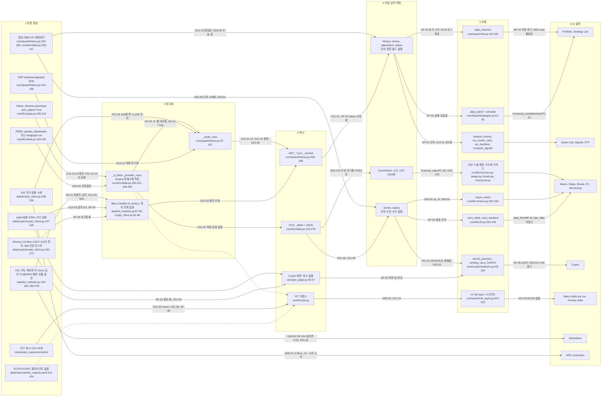

# QUANTGEN 구현 상태 감사 보고서 (2026-10-27)

## 0. 머리말

- **감사일:** 2026-10-27.
- **기준 커밋:** `eae0a29`. 차원 보고서는 작성 시점에 따라 `fdc1728`, `527cdf2`, `859a983`, `4665e6e`를 기준으로 적었습니다. 이 커밋들과 `eae0a29` 사이에 코드 차이는 없습니다. 근거: `git diff --stat fdc1728 eae0a29 -- core data ui tests tools config.py main.py requirements.txt pyproject.toml`의 출력이 비어 있습니다. 그래서 각 보고서의 file:line은 `eae0a29`에서도 같은 줄을 가리킵니다. 보고 시점 HEAD는 `078981a`입니다. `eae0a29` 뒤에 바뀐 파일은 `docs/audit/2026-10-27/bonds_screen_request.md`(추가)와 `docs/nautilus_bridge/OWNER_RULINGS_LOG.md`(수정) 둘뿐입니다. `git diff --stat eae0a29 HEAD -- core data ui tests tools config.py main.py requirements.txt pyproject.toml`와 `git diff --stat eae0a29 HEAD -- . ':!docs'`의 출력이 모두 비어 있습니다. 그래서 file:line은 `078981a`에서도 그대로입니다. Bonds 화면 검증 요청은 별도 요청이라 이 보고서 범위 밖입니다.
- **요청서:** `docs/audit/2026-10-27/00_request.md`(소유자가 올린 원문). 소유자 메모 두 줄 "(-> 공급사필요)"와 "(-> FICC/BTC 모두 KIS에서 접근 가능한지 …)"도 범위에 넣었습니다.

### 0.1 범위

요청서 3장(현재까지 확인된 사실), 4장(D-01, D-02, P-01, D-03, D-04, D-05, C-01, V-01), 5장(속도 감사 계획), 6장(데이터 정확성 계획과 소유자 메모), 7장 1~8항, 8장(감사 자료)을 다룹니다. 차원별 보고서는 다음과 같습니다.

| 차원 키 | 다룬 요청서 항목 | 보고서 |
|---|---|---|
| `d01_d02_history_cleaning` | 4장 D-01·D-02, 6장 NaN/inf·중복·간격 | `docs/audit/2026-10-27/d01_d02_history_cleaning.md` |
| `d03_synthetic_fallback` | 4장 D-03, 7장 3항 합성 대체 | `docs/audit/2026-10-27/d03_synthetic_fallback.md` |
| `d04_d05_timestamps` | 4장 D-04·D-05, 6장 관측일·발표일·수신 시각 | `docs/audit/2026-10-27/d04_d05_timestamps.md` |
| `c01_v01_cache_and_vendors` | 4장 C-01·V-01, 7장 3항 캐시 만료·무효화 | `docs/audit/2026-10-27/c01_v01_cache_and_vendors.md` |
| `p01_performance` | 4장 P-01, 5장 전체, 7장 5항 | `docs/audit/2026-10-27/p01_performance.md` |
| `functional_completeness` | 7장 2항 기능 완전성 | `docs/audit/2026-10-27/functional_completeness.md` |
| `data_flow` | 7장 3항 공급자→정규화→캐시→모델→UI | `docs/audit/2026-10-27/data_flow.md` |
| `financial_calcs` | 7장 4항 금융 계산, 6장 FICC·구조화 상품 | `docs/audit/2026-10-27/financial_calcs.md` |
| `tests_and_artifacts` | 3장 사실, 7장 6항 테스트, 8장 감사 자료 | `docs/audit/2026-10-27/tests_and_artifacts.md` |
| `suppliers_ficc_btc` | 6장 소유자 메모 두 줄(공급사) | `docs/audit/2026-10-27/suppliers_ficc_btc.md` |
| `calendars` | 6장 거래일 캘린더, 캘린더 서명 준비(소유자 판정 ①-2: 감사 선행) | `docs/audit/2026-10-27/calendars.md` |

범위에서 뺀 것:
- `paper_live/`, `grokteam/`: 실행하지 않았습니다. 일부 차원은 grep으로 읽기만 했습니다.
- 보호 캐시 파일 4개(`docs/asset_expansion/cache/{yf_SPY.csv, yf_BTC-USD.csv, binance_BTCUSDT.csv, upbit_KRW-BTC.csv}`): 열지 않았습니다. 이 파일을 읽는 테스트와 dry run도 돌리지 않았습니다.
- `.env`: 열지 않았습니다. 키·토큰은 출력하지 않았습니다.
- `tests/run_all.py`: 이번 감사에서 다시 실행하지 않았습니다. 870행은 기존 실행 기록과 대조만 했습니다.
- 시장 데이터 공급자 실호출: 하지 않았습니다. 그래서 실서버 응답, 실제 지연, 공급자 간 실제 차이는 모두 미검증입니다.
- Bonds 화면 검증 요청(`docs/audit/2026-10-27/bonds_screen_request.md`, `078981a`에서 추가): 별도 요청이라 이 보고서에서 다루지 않았습니다.

### 0.2 방법

1. **조사(11개 차원).** 차원마다 조사자 1명이 요청서 주장을 코드 file:line과 대조했습니다. 의심 경로는 저장소 밖 스크래치 폴더에서 재현했습니다. 네트워크는 막았고, 공급자 응답은 스텁으로 바꿨습니다. 데이터는 합성 데이터와 허용된 캐시 파일만 썼습니다. 제안 패치는 `git archive` 사본에만 적용했습니다. 회귀 테스트가 수정 전 FAIL, 수정 후 PASS인지 확인했습니다.
2. **차원별 적대적 검증 1회.** 차원마다 검증자 1명이 인용 코드를 다시 읽었습니다. 재현 스크립트는 조사자 것을 쓰지 않고 새로 썼습니다. 발견마다 유지·정정·반박을 정했고, 판정과 심각도를 고쳤고, 놓친 발견을 더했습니다. 각 차원 보고서 끝의 "## 독립 검증 결과"가 그 기록입니다. 이 보고서의 판정과 심각도는 검증자가 고친 값입니다.
3. **중복 병합.** 근본 원인이 같은 발견은 한 행으로 합쳤습니다. 합친 ID는 3절 표의 행에 "병합:"으로 적었습니다.
4. **uid.** ID가 한 차원에만 있으면 그대로 씁니다. 차원 사이에서 겹치면 `<차원 키>/<ID>`로 씁니다. 겹치는 ID는 FC-01~FC-08(`functional_completeness`와 `financial_calcs`), MF-01·MF-02(`functional_completeness`와 `data_flow`)입니다. `financial_calcs`의 M-01~M-04와 `calendars`의 M-1~M-4는 문자열이 달라 그대로 씁니다.
5. **비평 3관점.** 병합한 결과와 보고서 초안을 서로 다른 세 관점의 비평으로 다시 읽고 고쳤습니다.

재현 스크립트, 출력, 패치 사본은 `/tmp/claude-0/-home-user-quantgen/244a07c1-ef5e-50fd-a9f1-360db0f46038/scratchpad/audit_work/` 아래 차원별 폴더(조사 `<key>/`, 검증 `verify_<key>/`)에 있습니다.

### 0.3 코드 수정 없음

- 추적 소스 코드는 바꾸지 않았습니다. 근거는 0절 첫 항목의 `git diff --stat` 결과입니다.
- 수정안은 모두 diff로만 냈습니다. 적용은 소유자 승인 뒤입니다(요청서 7장 8항). 소유자 메모의 "implement"도 같은 규칙에 따라 설계까지만 했습니다.
- 감사 산출물은 `docs/audit/2026-10-27/` 아래 문서와 자료뿐입니다.
- **예외 기록.** `tests_and_artifacts` 조사자가 8장 자료 CSV 3개(`not_run_implementation_status.csv`, `test_classification.csv`, `unwired_selfchecks.csv`)를 고쳤고, 같은 폴더에 새 파일 4개를 만들었습니다(MISS-01). 이 변경은 `eae0a29`에 커밋되었습니다. 고치기 전 판은 `7b3a38f`에 있습니다.
- **규칙 이탈 기록(유출 없음).**
  - `p01_performance` 검증자의 첫 스크립트 1개는 dotenv 차단을 넣기 전에 실행되었습니다. 그래서 `config`의 `load_dotenv()`가 돌았을 수 있습니다. 출력과 네트워크 사용은 없었습니다.
  - `functional_completeness` 검증 중 Settings 버튼으로 Yahoo `EURUSD=X` 요청 1건이 시도되었습니다. 프록시가 403으로 거절했고 데이터는 받지 않았습니다.
  - `data_flow` 검증자가 저장소 루트에 미추적 로그 1개(115바이트, 오류 문구만)를 실수로 만들었고, 바로 스크래치로 옮겼습니다.

### 0.4 판정 정의

| 판정 | 뜻 |
|---|---|
| 사실 | 코드로 확인했고, 재현 스크립트나 실행 결과로 다시 확인했다. |
| 추정 | 코드 근거는 있다. 그러나 결과가 외부 사실(실서버 응답, 거래소 공지 원문, AI 모델 출력, 실제 발생 빈도)에 달려 있어 확인하지 못했다. |
| 오류 | 주장(요청서, README, 코드 주석, 조사자)이 실제 코드나 실행 결과와 다르다. |
| 미검증 | 확인하지 못했다. 정상으로 치지 않는다. |

테스트 상태 NOT_RUN은 PASS가 아닙니다. 함수가 있다는 것만으로 정상 작동을 판정하지 않았습니다.

### 0.5 심각도 정의

| 심각도 | 기준 |
|---|---|
| P0 | 잘못된 돈·판단 숫자를 실제처럼 표시하거나 안전 규칙을 위반한다. |
| P1 | 사용자에게 보이는 틀린 숫자, 주요 화면 충돌, 오래되거나 합성된 데이터를 실데이터로 표시한다. |
| P2 | 경계 사례의 오류나 빠진 방어다. |
| P3 | 위생 문제다. |

요청서의 우선순위(높음, 중간~높음 등)와 이 보고서의 심각도는 기준이 다릅니다. 2절 표에서 차이를 적었습니다.

## 1. 요약

- **요청서 항목은 모두 코드로 다시 확인했습니다.** D-01, D-02, D-03, D-04, D-05, P-01은 사실입니다. D-04와 D-05의 "미확정"은 사실로 확정되었습니다. C-01은 손상 캐시 재사용이 사실이고, 오래된 캐시 재사용은 일부 경로(dry run mtime, KIS 토큰)에서만 사실입니다. V-01의 "아직 비교하지 않았다"는 사실이고, 이번 감사도 실공급자 비교는 하지 못했습니다(미검증). 요청서가 "높음"으로 둔 D-01·D-02는 실데이터에서 inf·중복이 나온 근거가 없어 P2로 봅니다(D12-01, D12-02). 더 큰 문제는 요청서 밖에서 나왔습니다.
- **가장 위험한 것은 틀린 숫자를 실데이터처럼 보여 주는 경로입니다(P1).** Crypto 화면은 FRED USD/KRW만 합성으로 바뀌어도 김치 프리미엄을 +1257.30%(검증 재현 +1277.95%)로 계산하고 녹색 `source: LIVE` 칩을 붙입니다(D03-01). FRED가 정상이어도 주 1회 공표되는 DEXKOUS를 나이 제한 없이 앞채워, 늘 3~10일 묵은 환율을 씁니다(V01-01). FRED가 곡선 일부 만기만 주면 장기물을 평평하게 늘린 값이 `source: FRED`로 나옵니다. 30y 스왑 par가 49bp 낮게 나왔습니다(D03-V01). KIS 시세의 `as_of`는 응답 수신 시각이라 엔진 신선도 가드가 작동하지 않고, 거래정지 종목이 장중 모의주문으로 체결되었습니다(D05-01).
- **공식은 대체로 맞지만, 관례와 적용 범위에서 숫자가 틀립니다(P1).** Garman–Kohlhagen, Black-76, SABR, 채권, 곡선 부트스트랩, GARCH-t 우도는 QuantLib·`arch`·교과서 예제와 맞았습니다(`financial_calcs.md` 0장·3장, 입력 범위 안에서만). 틀린 곳은 이렇습니다. 짧은 첫 스텁에 1/freq 전체 발생 가중을 줘서 18개월 스왑 par가 약 −1%p 틀립니다(financial_calcs/FC-02). CMS 스티프너의 floor/cap을 변동성 0으로 평가하고, 경고 문구는 볼록성 방향을 거꾸로 말합니다(financial_calcs/FC-01, M-01). 가상자산을 252일로 연율화해 Quant Lab 변동성이 약 17% 낮습니다(D12-11). Strategy Lab의 Run 버튼은 모든 계열에서 `ValueError`로 멈춥니다(functional_completeness/FC-01).
- **캘린더는 지금 그대로 서명하면 안 됩니다.** 서명 마감은 2026-11-01 00:00 KST(= 2026-10-31T15:00:00Z)입니다. 감사일(2026-10-27) 뒤로 10-28~10-31 나흘이 남았습니다. KRX 파일에 2026-06-03·2026-07-17 휴장일이 없습니다(CAL-01, 사실). 2027 노동절·제헌절 대체공휴일도 빠진 것으로 봅니다(CAL-02, 추정: KRX 2027 공지가 아직 없음). 2027-08-24부터는 엔진 세션 창이 커버리지 끝에 걸려 hard stop HALT가 기록되지 않습니다(M-1). 2028 파일을 2027-08-23까지 서명하거나 `sessions_around`를 고쳐야 합니다.
- **근본 원인은 출처·시각·단위가 데이터 객체와 결과 객체에 실리지 않는다는 점입니다.** `Series`와 `History`에 단위·수신 시각 필드가 없고(D03-06, D04-02, DF-01, C01-05), 계산 결과 데이터클래스에 출처 필드가 없습니다(D03-03). 그래서 화면마다 배너 조건을 따로 짜고, 조건이 어긋난 곳에서 사고가 납니다(D03-01, D03-V01). 정제 진입점도 하나가 아닙니다. `_clean_rows`를 우회하는 경로(D12-03)와 내용을 검사하지 않는 캐시 적중(C01-01, C01-02, C01-10)이 있습니다. 테스트는 이 결함을 잡지 못합니다. `_clean_rows`와 Strategy Lab Run 경로를 누르는 테스트가 없고(TA-06, functional_completeness/FC-06), NOT_RUN 대부분은 데이터 대기가 아니라 검증 코드가 아직 없는 상태입니다(TA-01).
- **확신 정도.** P1은 CAL-02(추정)를 빼면 모두 사실입니다. D03-V01과 M-1을 뺀 9건(CAL-02 포함)은 조사자와 검증자가 서로 다른 스크립트로 각각 재현했습니다. D03-V01과 M-1은 검증자가 추가한 발견이라 검증자 재현만 있었습니다. 비평 단계에서 P1 11건을 모두 다시 재현했습니다(`/tmp/claude-0/-home-user-quantgen/244a07c1-ef5e-50fd-a9f1-360db0f46038/scratchpad/audit_work/critic_evidence/`: `ce_d03v01.out` 부분 곡선 5s30s 30.0bp 대 전체 80.0bp, source FRED; `ce_m1.out` sessions_around 2027-08-23 ok, 2027-08-24 ValueError). 검증자는 반박한 발견 없이 심각도를 양쪽 방향으로 고쳤습니다. 다만 모든 재현은 스텁·합성 데이터·허용 캐시로 했습니다. 실서버 응답, 실제 발생 빈도, 오차의 실제 크기는 미검증입니다. 예를 들어 financial_calcs/FC-01의 크기는 곡선에 따라 100당 +2.80~+4.40(자체 검사 곡선)과 +0.77~+1.65(화면 합성 곡선)로 다릅니다. P0 기준에 닿은 항목은 없습니다. 실주문 경로가 없고, 실행(acting) 입력은 PIT 저장소가 합성·auto 값을 거부하며(`core/ficc/pit.py:408-409`), 매크로 장부는 모두 DISARMED이기 때문입니다. D05-01과 M-1은 안전 가드를 약하게 하므로 장부를 ARM하기 전에 고쳐야 합니다.
- **먼저 고칠 순서(제안).**
  1. 마감(2026-11-01 00:00 KST) 전: 캘린더 데이터 보정(CAL-01, CAL-02, CAL-03, CAL-04, CAL-05, CAL-10)과 서명 테스트 정리(CAL-08, M-2, M-4). 전체 묶음은 11장 PT-07입니다. CAL-02 두 행은 2027 월력요항을 근거로 넣고, KRX 2027 공지(12월 예상) 뒤 다시 대조합니다. 서명은 소유자가 합니다. 빈 7개 세트(CAL-06)는 서명 뒤에 처리합니다(PT-17).
  2. 실데이터 라벨이 붙은 틀린 숫자 차단: 김치 프리미엄은 실제 일간 환율이 없으면 계산하지 않습니다(D03-01, V01-01). 부분 곡선은 경고하고 늘린 구간은 n/a로 둡니다(D03-V01).
  3. 계산과 화면 고장: financial_calcs/FC-02, financial_calcs/FC-01과 M-01, D12-11, functional_completeness/FC-01(같은 구조의 다른 화면은 functional_completeness/MF-01).
  4. 엔진 기록을 믿기 전에: D05-01을 미래 시각 가드(D0405-V01)와 함께 고칩니다. 조사자 패치는 한 종목 문제로 엔진 전체를 HALT시키므로 검증자 대안을 기준으로 합니다(D0405-V02). M-1도 같은 시기에 고칩니다.
  5. 그다음 구조 수정: 출처·단위·수신 시각 필드와 단일 정제 진입점(D03-03, D03-06, D04-02, D12-01, D12-02, D12-03, C01-01, C01-02, C01-10).
- **속도와 공급사.** P-01의 순차 호출은 오프라인 지연 주입 측정으로 확인했습니다. KIS는 0.12초 전역 간격이 바닥이라 동시성으로 줄지 않습니다(P01-03). Strategy Lab은 네트워크보다 검증 게이트 `score_strategy`의 CPU 시간 7.7~9.9초가 더 큽니다. cProfile 기준으로 그 약 88%가 `pbo_cscv`입니다(P01-02). 실공급자 지연과 Flet 그리기 시간은 미검증입니다. 소유자 메모에 대한 답은 이렇습니다. KIS로 되는 것은 원화 지표금리·CD·콜, KTB·KOFR·달러 선물, 장내채권, 원/달러 KMB 고시, CME BTC 선물 시세입니다(코드와 공식 샘플 근거, 실서버 응답은 미검증). 안 되는 것은 원화 IRS·CRS, 선도 스왑포인트·NDF, 금리 내재변동성, 가상자산 현물입니다(공식 KIS API 카탈로그에 가상자산 항목 없음). 권장 구성은 다음과 같습니다. 원화 금리 이력·공식값과 15:30 환율은 ECOS(무료 키), 당일값은 KIS, 미국 금리는 FRED(발표일·수정 이력은 키 있는 FRED API와 ALFRED), BTC는 Upbit와 Coinbase BTC-USD, Binance는 USDT·펀딩용으로 유지합니다. IRS·스왑포인트·금리 vol은 R1 법률 검토 뒤 유료 공급사가 필요합니다(SF-07, V01-03). 구현은 설계까지만 했습니다(`suppliers_ficc_btc.md` 8장). 착수에는 소유자 결정(ECOS 키 발급, KIS 허용목록 25→26 승인 등)이 필요합니다.

| 심각도 | 사실 | 추정 | 오류 | 미검증 | 합계 |
|---|---|---|---|---|---|
| P0 | 0 | 0 | 0 | 0 | 0 |
| P1 | 10 | 1 | 0 | 0 | 11 |
| P2 | 58 | 1 | 0 | 0 | 59 |
| P3 | 65 | 6 | 0 | 0 | 71 |
| 합계 | 133 | 8 | 0 | 0 | 141 |

- 표의 행 수는 141개입니다. 원래 발견 11건은 같은 원인의 다른 행에 병합되었습니다.
- 검증자가 추가한 발견은 28건입니다. 26건은 독립 행이고, 2건은 같은 원인의 행에 병합되었습니다(financial_calcs/M-03 → D12-11, tests_and_artifacts/MISS-03 → CAL-08). 반박되어 빠진 발견은 0건입니다(부록 A).

## 2. 요청서 발견사항 재검증

판정은 검증자의 정정을 반영한 값입니다. "관련 uid"는 3절 표의 행을 가리킵니다.

| 항목 | 요청서 주장 | 판정 | 근거 (file:line) | 관련 uid |
|---|---|---|---|---|
| D-01 (요청서: 높음) | `_clean_rows()`가 None·`>0`만 검사하고 정렬한다. inf가 남는다. 비유한 값이 수익률·변동성·시뮬레이션에 전파된다 | 사실. 심각도는 P2 | `core/quant/history.py:97-102`(98행 `c is not None and c > 0`). +inf, `1e400`, `np.float64` inf가 남습니다(조사·검증 각각 재현). 하류: vol=nan, Sharpe=0, MC VaR 0%(`core/quant/montecarlo.py:327` `max(0.0, var)`), inf가 마지막 행이면 signals 'strong bullish'. NaN은 `nan > 0`이 거짓이라 우연히 빠지지만 기록이 없습니다. `Candles.to_history`(`data/crypto/crypto_client.py:81-84`), `Bars.to_history`(`data/kis_markets.py:87-90`), 캐시 적중(`core/quant/history.py:436`, 길이만 비교)은 `_clean_rows`를 우회합니다. 관측 간격 검사도 없습니다(`core/calendars/clocks.py:389` `completeness_check`는 테스트에서만 호출). 허용 캐시 42개에 inf가 0건이라 P2로 낮췄습니다 | D12-01, D12-03, D12-05, D12-06, D12-07, D12-09, D12-10, D12-12, D12-13, D12-14, M01, C01-01, TA-06 |
| D-02 (요청서: 높음) | 같은 함수에서 중복 날짜 제거가 확인되지 않는다 | 사실(`_clean_rows` 한정). "시스템 전체에 없다"로 읽으면 오류(부분). 심각도는 P2. 정책 선택은 소유자 결정 12.7(권고: 같은 값 병합, 마지막 세션만 나중 행, 그 밖의 충돌은 `HistoryError`) | `core/quant/history.py:97-102`에 중복 처리가 없습니다. FMP는 두 행을 모두 유지합니다. KIS 페이지 안·`_bars`(`data/kis_markets.py:146-151`)·Upbit·Binance는 dict로 암묵 제거하지만, 남는 행이 경로마다 다르고 기록이 없습니다. 같은 날짜 2배 값 1행이면 vol 0.329→0.939(조사), 0.29→0.93(검증)입니다. yfinance 1.7.0은 위에서 중복을 지우고(`keep='first'`), 허용 캐시 42개에 중복은 0건입니다 | D12-02 |
| P-01 (요청서: 중간~높음) | 포트폴리오·Strategy Lab이 자산 이력을 순차 호출한다. KIS 이력은 페이지를 반복 요청한다. 대기시간이 누적될 수 있다 | 사실(오프라인 지연 주입 측정). 실공급자 지연은 미검증. 심각도: P2(P01-02~P01-05, V-P01-M1), P3(P01-06, P01-07, P01-09, P01-10, P01-12). Strategy Lab Run 실패는 P1(functional_completeness/FC-01, P01-01 병합) | `ui/portfolio_page.py:111`, `ui/strategy_lab_page.py:104`(리스트 컴프리헨션 순차 호출). `core/quant/history.py:203`(최대 `days // 100 + 3`쪽). `data/krx/kis_client.py:83-95`(`_pace`, 0.12초 전역 잠금). 측정: KIS 20종목·504일 120건 14.3초, 5000일 891건 107.0초(지연 0), 작업자 4개도 107.5초. FMP·Yahoo 20종목·150ms는 3.1초이고 동시 4개 시안은 0.8초(결과 해시 동일). 요청서에 없던 병목: `score_strategy` CPU 7.66~9.93초(캐시가 따뜻해도 같음. cProfile 기준 `pbo_cscv`가 88%). Flet 클라이언트 그리기는 미검증 | P01-03, P01-02, P01-04, P01-05, P01-06, P01-07, P01-09, P01-10, P01-12, V-P01-M1, functional_completeness/FC-01 |
| D-03 (요청서: 높음) | `source='auto'`에서 공급자 실패 뒤 합성으로 대체한다. source/note 표시 코드가 있다. 소비 화면이 경고를 놓치면 합성값을 실데이터로 오인할 수 있다 | 사실(세 부분 모두). 심각도: P1(D03-01, D03-V01), 나머지 P2·P3 | 대체: `core/ficc/data.py:539-541`(`load_many`), `:562-568`(`load_treasury_curve`), `:613`(`load_fx_spot`), `:668-671`(`load_short_rate`). 표시: `ui/rates_page.py:84-91` 등 12개 화면. 오인 재현: `ui/crypto_page.py:52`(`DEXKOUS`를 `source="auto"`로), `:57`(`"source": "LIVE"` 고정) → 김치 프리미엄 +1257.30%에 LIVE 칩. `core/ficc/macro.py:223`은 합성 행이 기준일을 오늘로 당깁니다. `analysis_panel` 호출 19곳 중 14곳의 해설에 합성 표시가 없습니다. 양호한 통제: acting 경로는 `core/ficc/pit.py:408-409`가 합성·auto 값을 거부합니다 | D03-01, D03-V01, D03-02, D03-03, D03-04, D03-05, D03-06, D03-08, D03-09, D03-10, C01-06 |
| D-04 (요청서: 높음·미확정) | 매크로 전체 기준일이 가장 늦은 관측일 하나로 정해져 지표별 지연을 가린다. 관측일·발표일·수신 시각을 구분해야 한다 | 사실(시트 경로). PIT 경로까지 넓히면 오류. 심각도는 P2(맥락 전용 화면) | `core/ficc/macro.py:223` `as_of=max(r.last_date for r in rows)`. 실데이터형 스텁 재현: `as_of 2026-10-23`인데 H.10 환율 4개는 2026-10-16에서 끝남(7일 지연이 가려짐). 표 열에 날짜 없음(`ui/macro_page.py:43`), 해설 "Daily read for {as_of}"(`core/ficc/insights.py:388`). 시트의 `Series`(`core/ficc/data.py:77-84`)에는 발표·수신 시각이 없습니다. v2 PIT 경로는 `PITValue`(`core/ficc/pit.py:56-76`)가 세 시각을 따로 둡니다 | D04-01, D04-02, D04-03, D03-02, DF-04, data_flow/MF-01 |
| D-05 (요청서: 높음·미확정) | KIS 시세 `as_of`가 공급자 측정 시각이 아니라 응답 수신 시각이다. 시세가 실제보다 최신처럼 보인다 | 사실. 심각도는 P1 | `data/krx/kis_client.py:133-134`(`_now()`), `:269`(`quote`), `:324`(`index`). KIS 공식 `inquire-price` 샘플 82개 필드에 시각 필드가 없습니다. 엔진 가드 `core/engine/evaluator.py:261-312`는 `quote.as_of`만 봅니다. 거래정지 종목이 11:00 KST에 FIRED되어 모의주문 1건이 생겼습니다(조사·검증 각각 재현). 실주문 경로는 없습니다. 수정 시 주의: 조사자 패치는 엔진 전체 HALT를 부릅니다(D0405-V02) | D05-01, D05-02, D05-03, D05-04, D05-05, D05-06, D0405-V01, D0405-V02, D0405-T1 |
| C-01 (요청서: 미검증) | 캐시 읽기 경로의 품질 재검증이 불충분해 오래되거나 손상된 캐시가 재사용될 수 있다 | 손상: 사실. 오래된 캐시: 일부 경로만 사실(시계열 TTL은 지킴). 심각도: P2(C01-01~C01-04, C01-10, TA-06), P3(C01-05~C01-09) | 손상: `core/quant/history.py:436`(길이만 비교), `core/ficc/data.py:251-265`(JSON 파싱만). NaN·inf·역순·중복·0~1행·다른 기호 파일이 모두 그대로 나갑니다. PIT 저장소도 읽을 때 해시를 다시 검사하지 않습니다(`core/ficc/pit.py:252-268`). 오래된 캐시: TTL 6시간·장중 10분과 미래 시각 거부는 지킵니다(`core/ficc/data.py:262`, `core/quant/history.py:434-436`). 예외는 dry run이 파일 mtime을 수신 시각으로 쓰는 것(`core/skills/macro_daily.py:1412`)과 KIS 토큰이 키·도메인과 묶이지 않는 것(`data/krx/kis_client.py:146-155`)입니다. 스키마 버전과 원자적 쓰기도 없습니다. stale-while-revalidate·stale-if-error 정책도 없습니다. 만료 뒤 공급자가 실패하면 이력은 `HistoryError`를 내고(`core/quant/history.py:445-447`), FICC `auto`는 SYNTHETIC을 돌려줍니다(`core/ficc/data.py:539-541`, C01-06). 손상·비유한 캐시를 보는 테스트는 없습니다(TA-06). TTL 만료 테스트는 있습니다(`tests/quant_acceptance.py:100`, `tests/macro_m1_pit.py:303`) | C01-01, C01-02, C01-03, C01-04, C01-05, C01-06, C01-07, C01-08, C01-09, C01-10, TA-06 |
| V-01 (요청서: 미검증) | 같은 자산·같은 시점의 공급자 간 일치도를 아직 비교하지 않았다 | 사실(비교 수단 없음). 공급자 간 실제 차이는 미검증. 심각도: P1(V01-01), P2(V01-03), P3(V01-02, DF-06) | 교차 공급자 비교 코드가 없습니다. `core/ficc/pit.py:611` `reconcile`은 한 시리즈의 공식 대 공급사 종가만 대조하고, 테스트에서만 호출됩니다. 이번 감사도 실공급자에 접속하지 못했습니다. 비교 하네스는 스크래치에서 설계·합성 검증만 했습니다. 이미 화면에 나가는 교차 공급자 계산에서 결함을 재현했습니다: `core/crypto/analytics.py:106-107`의 note는 "a few hours of FX drift"라고 쓰지만 실제로는 주간 DEXKOUS를 나이 제한 없이 씁니다. 김치 프리미엄은 USDT를 USD로 1:1로 다룹니다 | V01-02, V01-01, V01-03, DF-06 |
| 3장: 저장소 구성 | `core/quant/`, `core/ficc/`, `data/`, `ui/`, `tests/`가 있고, 데이터 흐름 추적 방식이 적합하다 | 사실 | 다섯 폴더가 모두 있습니다(`ls`). 흐름 추적은 `data_flow` 차원에서 했습니다(`docs/audit/2026-10-27/data_flow.md` 3장·4장) | — |
| 3장: 문법 검사 | 322개 Python 파일 컴파일, 문법 오류 0건. 실행 정상성이나 계산 정확성을 증명하지 않는다 | 사실 | `git ls-files '*.py'`는 322개이고, 메모리 안 `compile()`에서 오류가 0건입니다(조사자·검증자, 이 절 작성 때도 다시 확인). 단서도 사실입니다. 컴파일되는 코드에서 Strategy Lab Run이 실행 중 `ValueError`로 멈춥니다 | functional_completeness/FC-01 |
| 3장: FICC·매크로 자체 검사 | 두 모듈의 오프라인 자체 검사 결과가 ok다. 외부 데이터 정확성이나 모든 경로의 정상 작동을 뜻하지 않는다 | 사실. 단 870행 스위트 밖 | `core/ficc/data.py:702`, `core/ficc/macro.py:276`의 `__main__` 블록입니다. hermetic 가드 아래에서 exit 0입니다(조사·검증). `tests/run_all.py`에 연결되어 있지 않습니다. 입력은 합성·가짜입니다(예: `core/ficc/macro.py:277` `source="synthetic"`). 외부 데이터 정확성은 이 검사로 알 수 없습니다 | TA-02, functional_completeness/FC-06 |
| 3장: 과거 테스트 요약 | 기존 기록에 870건 중 PASS 749, NOT_RUN 121이 적혀 있다. 이번에 새로 실행한 결과가 아니다 | 사실(기록). NOT_RUN은 PASS가 아님 | `qa/acceptance_results.json`(마지막 변경 커밋 `ac86705`)을 다시 세면 870행, PASS 749, NOT_RUN 121입니다. 이번 감사도 `tests/run_all.py`를 다시 돌리지 않았습니다. 클라우드 기존 실행은 1차 738 PASS / 8 FAIL / 124 NOT_RUN, 2차 745 / 1 / 124입니다(`docs/audit/2026-10-27/artifacts/run_all_cloud_summary.txt`). `tests/run_all.py:117-118`은 NOT_RUN을 따로 기록하고, `:142`의 종료 코드는 FAIL만 봅니다. 그래서 종료 코드 0이 전부 통과를 뜻하지 않습니다. `README.md:878`의 "743/864"는 낡은 수치입니다 | TA-01, TA-07, TA-08, TA-09, CAL-08, functional_completeness/FC-07 |
| 3장: 환경 한계(설치) | flet, yfinance, pandas-datareader가 없어 전체 테스트가 초기에 중단됐다 | flet은 사실. yfinance·pandas-datareader는 오류 | `tests/run_all.py:43`이 `tests/flet_api_guard.py`를 모듈 수준에서 import하고, 그 파일 24행이 `import flet as ft`입니다. yfinance와 pandas_datareader는 선택적 import라 중단 원인이 아닙니다(`core/ficc/data.py:48-55`). 클라우드에서는 이후 설치해 실행했습니다(`docs/audit/2026-10-27/artifacts/environment_fixes_cloud.txt`). 다만 클라우드 기준선은 `requirements.txt` 설치 환경이 아닙니다. gs-quant가 없고 statsmodels를 손으로 설치했습니다 | TA-11, MISS-02, functional_completeness/FC-02 |
| 3장: 환경 한계(검증 범위) | 외부 공급자와의 실시간 교차 검증과 UI 성능 계측이 완료되지 않았다 | 사실. 이번 감사 뒤에도 일부 미완료 | 이번 감사도 시장 데이터 공급자를 호출하지 않았습니다(0.1절). 작업자 스레드의 수집·계산·PNG 렌더 시간은 지연 주입으로 쟀습니다(`docs/audit/2026-10-27/p01_performance.md` 4장). 실공급자 지연, Flet 클라이언트 그리기, 공급자 간 실제 차이는 미검증입니다. 소유자 PC용 계측·수집 명령은 `p01_performance.md`, `tests_and_artifacts.md` 6-4절, `c01_v01_cache_and_vendors.md` 6장에 있습니다 | V01-02, P01-02 |


## 3. 전체 발견사항 (독립 검증 반영, 심각도순)

판정과 심각도는 독립 검증자가 정정한 값입니다. 같은 원인의 발견은 한 행으로 합치고 원래 ID를 "병합"에 적었습니다. 긴 diff는 각 차원 보고서에 있습니다.

### P1 (11건)

| ID | 판정 | (a) 심각도 | (b) 파일·함수·라인 | (c) 재현 단계 | (d) 기대 결과 / 실제 결과 | (e) 영향 | (f) 수정안 | (g) 회귀 테스트 |
|---|---|---|---|---|---|---|---|---|
| CAL-01 (병합: D12-08) | 사실 | P1 | core/calendars/data/holidays_KRX.yaml:93-112 rows(2026-05-25와 2026-08-17 사이); data/calendars/KRX.json holidays; 소비 함수 clocks.is_session; data/calendars/KRX.json holidays(exchange_calendars 4.13.2 생성); core/calendars/data/holidays_KRX.yaml(UNSIGNED DRAFT, 28-308행); calendars.is_trading_day('KRX', …) | cd /home/user/quantgen && python3 -B /tmp/claude-0/-home-user-quantgen/244a07c1-ef5e-50fd-a9f1-360db0f46038/scratchpad/audit_work/calendars/sign_dryrun.py → 서명 사본에서 is_session('KR', 2026-06-03)과 2026-07-17이 True. 검증자 재현: audit_work/verify_calendars/v_core.py, v_gap.py. | 기대: 두 날짜 모두 휴장(KRX 2026-05-20 공지, 지방선거·제헌절) / 실제: 초안 YAML, KRX.json, XKRX 4.13.2 모두 개장으로 보고 결정 시각 06:30Z를 냄. | 그대로 서명하면 KR 시계가 휴장일 2일을 세션으로 본다. gap_sessions('KR', 2026-06-04)가 2가 아닌 1이라 macro_state flags(kr_open_gap_event, var_display_scale)가 틀린다(검증자 정정: completeness_check는 운영 호출이 없음). | holidays_KRX.yaml에 2026-06-03, 2026-07-17 closed 행을 추가하고 서명 때 source_url을 KRX 공지로 쓴다(calendars.md 7.1절). diff: docs/audit/2026-10-27/calendars.md | test_cal02_known_2026_2027_rows_present: MUST_CLOSE['holidays_KRX'] ⊆ closed 행. test_close02_on_the_real_signed_files: 두 날짜에서 decision_time_utc가 NotASession. |
| CAL-02 | 추정 | P1 | core/calendars/data/holidays_KRX.yaml:203-242 rows(2027 구간); data/calendars/KRX.json 2027 목록; 소비 함수 clocks.is_session | cd /home/user/quantgen && python3 -B /tmp/claude-0/-home-user-quantgen/244a07c1-ef5e-50fd-a9f1-360db0f46038/scratchpad/audit_work/calendars/cal_xcheck.py → KRX.missing_vs_official에 2027-05-03, 2027-07-19. sign_dryrun.py에서 두 날짜 is_session True. | 기대: 노동절(5/1 토)·제헌절(7/17 토) 대체공휴일로 휴장(2027 월력요항 근거, KRX 2027 공지 전이라 추정) / 실제: YAML, KRX.json, XKRX 모두 행이 없어 세션으로 봄. | 2027년 KR 결정 2회가 휴장일에 잡힌다. 2027-05-04와 2027-07-20의 gap_sessions가 2가 아닌 1이다. | 2027-05-03, 2027-07-19 closed 행을 추가하고, KRX 2027 공지(12월 예상) 뒤 다시 대조해 다르면 v1.0.1로 재서명한다(calendars.md 7.1절). diff: docs/audit/2026-10-27/calendars.md | test_cal02_known_2026_2027_rows_present: MUST_CLOSE['holidays_KRX']에 2027-05-03, 2027-07-19 포함. test_close02_on_the_real_signed_files: 두 날짜 NotASession. |
| D03-01 | 사실 | P1 | ui/crypto_page.py:52 _live (load_series("DEXKOUS", source="auto")), :57 _live (source "LIVE" 고정), :63 analyze, :118 narrative, :123-131 payload, :156-159 화면 배너·칩 | python3 -B /tmp/claude-0/-home-user-quantgen/244a07c1-ef5e-50fd-a9f1-360db0f46038/scratchpad/audit_work/d03_synthetic_fallback/r1_crypto_dexkous.py (FRED 실패 스텁, Upbit/Binance 스텁 실제 프리미엄 +1.00%, 가짜 page로 Refresh). 검증자 재현: /tmp/claude-0/-home-user-quantgen/244a07c1-ef5e-50fd-a9f1-360db0f46038/scratchpad/audit_work/verify_d03_synthetic_fallback/v1_crypto.py | 기대: 실환율이 없으면 김치 프리미엄을 계산하지 않거나 오류 배너·해설·페이로드에 합성을 명시하고, 출처 칩은 LIVE가 아님. / 실제: 합성 DEXKOUS last 106.12(실제 약 1,380)로 kimchi last_pct +1257.30%(검증자 스텁 +1277.95%), a['source']='LIVE' 녹색 칩, USD/KRW: SYNTHETIC은 muted 칩, 합성 배너 없음, 페이로드에 usdkrw_source 키 없음, 해설에 SYNTHETIC 없음. | 화면 핵심 수치가 1,000배 이상 틀린데 녹색 LIVE 칩이 출처를 보증하는 것처럼 보이고 Deep analysis도 LIVE로 받는다. 주문 경로가 없어 P0는 아니며, FRED만 막히는 상황의 실제 빈도는 미검증이다. | USD/KRW를 12.3에서 정한 순서(권고: KIS `FX@KRW` → ECOS 731Y001 → 계산 거부)로 받는다. FRED DEXKOUS는 V01-01의 나이 상한(3일) 안일 때만 쓴다. d03 7.1 diff의 'KIS FX@KRW → FRED DEXKOUS 명시 호출 → 거부' 순서는 12.3 결정 전 시안이고, ECOS 클라이언트는 아직 없다(V01-03). analyze가 kimchi=None·kimchi_error를 돌려주며 페이로드에 usdkrw_source를 넣고 배너 조건을 넓힌다. 검증자 보완: narrative()와 화면 worker가 kp is None일 때 AttributeError가 나므로 이 처리도 diff로 넣어야 한다. diff: docs/audit/2026-10-27/d03_synthetic_fallback.md | test_d03_crypto_live_never_prices_kimchi_on_synthetic_fx: FRED 실패+크립토 스텁에서 assert a['kimchi'] is None or a['usdkrw_source'] != 'SYNTHETIC', assert 'usdkrw_source' in payload(a), 화면에 'Kimchi premium not computed' 배너. 검증자 보완: narrative(a)와 화면 렌더가 예외 없이 끝나는지도 확인. |
| D03-V01 | 사실 | P1 | core/ficc/data.py:571-596 _treasury_from_fred (:594-595 부분 만기여도 source="FRED", note "Missing tenors"); core/ficc/curves.py:293-297 _par_at (끝단 고정), :342 5s30s; ui/rates_page.py:84-87 _synthetic_notice, :90-91 _src_chip; ui/bonds_page.py:120-126; ui/structuring_page.py:137-141 | python3 -B /tmp/claude-0/-home-user-quantgen/244a07c1-ef5e-50fd-a9f1-360db0f46038/scratchpad/audit_work/verify_d03_synthetic_fallback/v7_partial_curve.py (FRED 스텁에서 DGS20, DGS30만 실패, _run_curve와 _run_swap(30y)를 가짜 page로 실행) | 기대: 'Missing tenors: DGS20, DGS30' 경고 배너, 마지막 제공 만기를 넘는 지표(5s30s, 30y 스왑)는 n/a 또는 거부. / 실제: 5s30s +30.0bp(전체 곡선 +80.0bp, 사실상 5s10s), 30y 스왑 par 4.215%(전체 곡선 4.706%), 칩은 source: FRED, curve: FRED 녹색이고 화면·swap 페이로드 어디에도 'Missing tenors'가 없다. | 그럴듯한 틀린 장기물 수치가 실데이터 라벨로 Rates·Bonds·Structuring에 나온다(D03-01과 같은 부류). 트리거는 FRED id별 부분 실패이며 실제 빈도는 미검증이다. | _synthetic_notice가 note에 'Missing tenors'가 있으면 warning 배너를 띄우고(bonds·structuring 동일), curves.py:339에서 max(snap.tenors)를 넘는 만기는 NaN으로 두어 'n/a'로 보이며, 마지막 제공 만기를 넘는 스왑·스왑션·채권은 FICCError를 낸다. diff: docs/audit/2026-10-27/d03_synthetic_fallback.md | test_d03_partial_fred_curve_is_labelled: DGS20·DGS30만 실패하는 FRED 스텁(TTL 0)에서 assert any('Missing tenors: DGS20, DGS30' in t for t in texts) and 5s30s 타일 == 'n/a', _run_swap(tenor_text='30y')는 FICCError이거나 경고 배너 포함. |
| D05-01 | 사실 | P1 | data/krx/kis_client.py:269 KISClient.quote (as_of=_now()), :324 KISClient.index, :133-134 _now; 소비 core/engine/evaluator.py:261-312 Evaluator._freshness | /tmp/claude-0/-home-user-quantgen/244a07c1-ef5e-50fd-a9f1-360db0f46038/scratchpad/audit_work/d04_d05_timestamps/r4_d05_engine_e2e.py: 거래정지 응답(temp_stop_yn=Y, 거래량 0, 61,000)을 KIS 스텁 → KRXGateway → QuoteFeed → Evaluator.evaluate로 흘린다. 시각 2026-10-27 11:00 KST, 규칙 '62,000 이하 매수'. | 기대: as_of는 거래소 시각이고, 시각이 없으면 비어 있어 피드가 거절한다(feed.py:25-30 계약). / 실제: as_of는 응답 수신 시각(t0 <= as_of <= t1)이라 거래정지 종목이 FIRED되고 모의주문 1건이 생긴다. 실제 마지막 체결 시각(전일 15:30 KST)을 넣으면 SKIPPED다. | KRX 규칙에서 엔진 신선도 가드가 한 번도 작동하지 않아 거래정지·피드 정지·장전 잔존 가격이 '방금 받은 시세'로 통과하고 모의주문·포워드 기록이 오염된다. 실주문 경로가 없어 P0는 아니다. | Quote.as_of는 거래소 시각(허용목록에 있는 inquire-asking-price-exp-ccn의 aspr_acpt_hour를 _kst_stamp로 날짜 부여), 새 Quote.fetched_at은 수신 시각으로 나눈다. 거래정지 처리는 D0405-V02 대안을 함께 적용한다. diff: docs/audit/2026-10-27/d04_d05_timestamps.md | test_d05_kis_quote_as_of_is_the_exchange_book_time_not_the_receipt: q.as_of == "2026-10-27T01:59:58+00:00" and q.fetched_at == "2026-10-27T02:00:00+00:00". test_d05_pre_open_book_time_is_dated_to_the_previous_weekday: 월 08:00 KST에 _kst_stamp("153000", ...) == 2026-10-23 06:30Z. |
| D12-11 (병합: M-03) | 사실 | P1 | core/quant/history.py:47 TRADING_DAYS=252; core/quant/risk.py:84,87,90,93 analyze_history; core/quant/montecarlo.py:115-116 _calibrate(μ·σ 연율화), :243-244 run_monte_carlo(rate_daily·drift_daily = value/252), :239 horizon 상한(TRADING_DAYS * 5); core/quant/backtest.py:128-132 run_backtest(n/252, √252); core/quant/validate.py:137-143 sharpe; 미사용 core/calendars/clocks.py:30 ANNUALISATION_DAYS {"CRYPTO": 365} | cd /home/user/quantgen && python3 -B /tmp/claude-0/-home-user-quantgen/244a07c1-ef5e-50fd-a9f1-360db0f46038/scratchpad/audit_work/d01_d02_history_cleaning/r07_gaps.py '[crypto]'(연 σ 0.80, 365봉 합성). 검증 재현: audit_work/verify_d01_d02_history_cleaning/v03_downstream.py. | 기대: 가상자산은 365로 연율화한다. / 실제: analyze_history ann_vol=0.661로 365 기준 0.795의 0.831배(√(252/365))다(조사자 측정 0.643). | 모든 가상자산 심볼의 Quant Lab 'Vol (ann.)'·'Drift (ann.)'(ui/quant_lab_page.py:316-317)가 17% 낮게 나오고 MC는 봉당 drift를 value/252로 써 365봉 경로에 연 drift가 1.45배 들어간다. 화면 숫자가 계통적으로 틀려 P2→P1로 상향했다. | 날짜의 주말 비율(>10%)로 periods_per_year를 정해 risk.analyze_history에 쓰고 montecarlo는 rate_daily·drift_daily를 value/ppy로 바꾼다(MC 부분은 diff 없음·미실행). 조사자안의 _looks_crypto 기준은 Yahoo BTC-USD를 놓쳐 쓰지 않는다. diff: docs/audit/2026-10-27/d01_d02_history_cleaning.md | tests/quant_acceptance.py::test_crypto_series_annualised_with_365(2024-10-01부터 730일 σ=0.80/√365 합성에서 ann_vol == std(r)·√365 상대오차 1e-9, 평일만 남긴 시리즈는 √252). HEAD는 0.661 대 0.795로 FAIL. |
| M-1 | 사실 | P1 | core/skills/macro_daily.py:147-156 sessions_around(ahead=130일, 모든 예외를 ValueError로 감쌈), :171 BookRegistry(sessions=...); core/engine/books.py:251-260 session_offset, :393-395 runtime_halt, :612-613 risk_step | cd /home/user/quantgen && python3 -B /tmp/claude-0/-home-user-quantgen/244a07c1-ef5e-50fd-a9f1-360db0f46038/scratchpad/audit_work/verify_calendars/v_horizon.py → 2027-08-23 ok, 2027-08-24 ValueError. v_hardstop.py → anchor 2027-09-01에서 risk_step ValueError, 장부 ARMED 유지. | 기대: 10세션 이상 커버되면 −15%에서 RISK hard_stop HALT, rearm_not_before t+10 / 실제: 2027-08-24부터(잔여 86세션) session_offset 예외로 HALT가 기록되지 않음. | hard stop 안전 규칙이 날짜 조건에 따라 약해지고 60세션 경보·ARM 조건이 막지 못한다. 2028 파일은 2027-08-23까지 서명해야 하며, 예외가 자동 재ARM되는 OPS STEP_ERROR HALT로 바뀌는 부분은 추정이다. | sessions_around에서 CalendarCoverageError를 잡아 anchor 이후면 break, 이전이면 continue하고 나머지 예외만 ValueError로 감싼다. diff: docs/audit/2026-10-27/calendars.md | test_hard_stop_halts_near_calendar_horizon: anchor 2027-09-01, risk_step(85.0) 후 halt class 'RISK', reason_code 'hard_stop', rearm_not_before '2027-09-21'. 현재 코드는 ValueError로 FAIL. |
| V01-01 | 사실 | P1 | core/crypto/analytics.py:69-107 kimchi_premium (:76 나이 제한 없는 앞채움, :106-107 note); ui/crypto_page.py:52 _live (FRED DEXKOUS), :63 analyze, :163 stat("Kimchi premium") | python3 -B /tmp/claude-0/-home-user-quantgen/244a07c1-ef5e-50fd-a9f1-360db0f46038/scratchpad/audit_work/c01_v01_cache_and_vendors/r07_kimchi_fx_age.py (합성 BTC는 2026-10-26까지, FX는 2026-10-16까지, 참 프리미엄 +2.00%). 검증자 재현: verify_c01_v01_cache_and_vendors/v05_kimchi.py (그사이 원화 1.5% 약세) | 기대: 오래된 FX를 쓴 날짜는 빼거나 경고하고, note에 실제 FX 나이를 적는다. / 실제: 마지막 값이 10일 묵은 FX를 써서 +0.52%(검증자 시나리오 +3.53%)로 나온다. FX 나이 필드가 없고 note는 'a few hours of FX drift'라고 쓴다. | H.10은 매주 월요일 공표라 FX 나이 3~10일이 상시 생기고, 틀린 값이 Crypto 주 화면 stat(:163)에 나가 절댓값 3% 초과면 빨간색으로 보인다. 검증자가 '사용자에게 보이는 틀린 숫자'로 보고 P2에서 P1로 올렸다(D03-01 FX 합성과는 별개). | kimchi_premium에 max_fx_age_days, fx_age_days_last/max, fx_stale_dropped, 정직한 note를 넣는다(조사자 패치는 부분 수정: 패치 후에도 4일 묵은 FX로 +2.61%). 검증자 추가 diff로 _live가 일간 load_fx_spot("USDKRW", source="yfinance")을 먼저 쓰고 DEXKOUS는 대체로 두며, 상한 3일과 stat 라벨의 날짜·note tooltip을 더한다. diff: docs/audit/2026-10-27/c01_v01_cache_and_vendors.md. 단, 환율 공급 순서는 이 diff의 Yahoo 우선이 아니라 12.3 결정을 따른다(권고: KIS `FX@KRW` → ECOS 731Y001 전일값 → 계산 거부. Yahoo `KRW=X`는 9.2 게이트 탈락(L 0, S 1)이라 사용자가 고를 때만 개인용 보조로 쓴다). 검증자 diff의 yfinance 우선 순서는 그 결정 전 시안이다. ECOS 클라이언트가 생기기 전(V01-03)에는 KIS 다음에 FRED DEXKOUS를 나이 상한 안에서만 쓴다(D03-01과 같은 순서). 나이 상한 3일, 날짜 표시, 정직한 note는 그대로 쓴다. | tests/cache_vendor_acceptance.py::test_v01_kimchi_premium_reports_and_caps_fx_age: fx_age_days_last==10, note에 '10 day(s) old', max_fx_age_days=4면 dates[-1]=="2026-10-20"·fx_stale_dropped==6. (제안) test_v01_crypto_page_prices_the_premium_at_a_daily_fx: usdkrw_source가 12.3에서 정한 1순위 출처(권고안이면 "KIS", KIS가 없으면 "ECOS")이고 "FRED"·"FRED DEXKOUS"·"SYNTHETIC"이 아님, dates[-1]=="2026-10-26", fx_age_days_last<=3. 가짜 일간 환율은 Yahoo 대신 그 공급자(`KISMarkets.usdkrw_daily` 등)에 둔다. |
| financial_calcs/FC-01 | 사실 | P1 | core/ficc/structured.py:311-325 _cms_coupons, :328-380 steepener_note; UI 기본값 ui/structuring_page.py:53-55 | python3 -B /tmp/claude-0/-home-user-quantgen/244a07c1-ef5e-50fd-a9f1-360db0f46038/scratchpad/audit_work/financial_calcs/r07_structured.py 4번. 자체 검사 곡선, 5y, 레버리지 4, floor 0, cap 없음에서 각 쿠폰을 Bachelier E[max(4S,0)]로 다시 평가한다. | 기대: floor는 보유자가 산 옵션이므로 t0>0 쿠폰에 시간가치가 들어가야 한다. / 실제: 공정가치 86.1175가 스프레드 정규변동성 50/70bp에서 88.9214(+2.8039)/90.5155(+4.3980)여야 한다. 이 크기는 자체 검사 곡선 기준이고 화면 합성 곡선에서는 +0.77/+1.65다(크기는 곡선·변동성 가정에 달림, 추정). | "Margin (per 100)"이 빠진 시간가치만큼 과대하다. 판매사 마진 판단, 상품 비교, AI 해설 페이로드가 이 숫자를 쓴다. | spread_nvol 입력을 받아 t0>0 쿠폰의 floorlet·caplet을 Bachelier로 평가하고 UI에 "Spread normal vol (bp)" 칸을 추가한다. 비우면 내재가치로 두고 "floor/cap 시간가치 제외"를 표시한다. diff: docs/audit/2026-10-27/financial_calcs.md | ficc/test_steepener_floor_has_time_value: 자체 검사 곡선·5y·L=4·floor 0에서 fv(nvol=0.005) − fv(nvol=None)가 2.8039±0.01이고 >0이다. nvol=1e-12면 내재가치 결과와 1e-9 안에서 같다. |
| financial_calcs/FC-02 | 사실 | P1 | core/ficc/curves.py:41-48 coupon_times, :110-116 YieldCurve.annuity·par_rate; 사용처 core/ficc/swaps.py:78-85,392, core/ficc/structured.py:213,345, core/ficc/ratesim.py:340,370 | python3 -B /tmp/claude-0/-home-user-quantgen/244a07c1-ef5e-50fd-a9f1-360db0f46038/scratchpad/audit_work/financial_calcs/r09_stub_periods.py. 같은 곡선에서 코드 par와 "스텁은 자기 길이만 발생" par를 비교한다. | 기대: 새 스왑의 짧은 첫 스텁은 자기 길이만 발생하고 par 금리가 만기에 따라 매끄럽다. / 실제: 연 1회 par가 18m −97.2bp, 6m −207.5bp, 2.5y −63.9bp 틀리고 정수 만기는 0bp다(검증자 다른 곡선 18m −101.0bp). | 비정수 테너 스왑·포워드 스왑·스왑션·캡 ATM 행사가와 ratesim 시나리오 재평가가 틀린다. ui/rates_page.py:160-162가 "18m"을 받는다. RC는 가격이 아니라 연 쿠폰 표기 문제다. | annuity를 Σ τ_i·DF(t_i)(스텁 τ=t1−start)로 바꾸고 RC(:213)·스티프너(:345) hunk를 함께 적용한다(RC hunk 없으면 18m RC 공정가치 101.24). swaps.analyze_swap carry_1y(:161-163)와 스티프너 payoff grid(:354)도 맞춘다. diff: docs/audit/2026-10-27/financial_calcs.md | ficc/test_swap_par_rate_accrues_the_stub_only: par_swap_rate(c, 1.5)가 (1−DF(1.5))/(0.5·DF(0.5)+DF(1.5))와 1e-12 안에서 같고, 그 금리의 18m 스왑 PV가 1e-6 안에서 0이며, 10y par 4.01935877%는 그대로다. |
| functional_completeness/FC-01 (병합: P01-01) | 사실 | P1 | `ui/strategy_lab_page.py:227-279` `run()`의 `worker()`(try는 `:231-240`만, 렌더 `:241-277`은 try 밖, 차트 `:273`); `ui/xcharts.py:72-78` `equity_chart`(`:78` `x[-eq.size:]`); `core/quant/strategies.py:93-94` `equity_curve`; `ui/strategy_lab_page.py:118` `run_family`의 `register_trials` | `python3 -B -W ignore /tmp/claude-0/-home-user-quantgen/244a07c1-ef5e-50fd-a9f1-360db0f46038/scratchpad/audit_work/functional_completeness/repro_lab_chart.py` (검증자 재현: `/tmp/claude-0/-home-user-quantgen/244a07c1-ef5e-50fd-a9f1-360db0f46038/scratchpad/audit_work/verify_functional_completeness/v_fc01.py`, `v_fc01_ledger.py`) | 기대: Run을 누르면 판정 칩, 지표, OOS 자본곡선, 해설이 나오고 진행 링이 꺼진다. / 실제: 7개 계열 × 2개 길이 14건 모두 `ValueError: x and y must have same first dimension` ((722,) vs (723,))가 worker 밖으로 나가고, `ring.visible=True`, 이미지 0개로 패널이 빈다. | README의 Strategy Lab 계열 실행이 합성·실데이터 모두 UI에서 동작하지 않는다. 실데이터 실행은 실패 전에 E1 장부에 구성 12개를 먼저 등록해(같은 종목 재실행 0행, 다른 종목 +12행) 이후 시행 수를 부풀린다. 실제 Flet 창에서 예외가 로그로 남는지는 미검증이다. | `equity_chart`가 곡선과 벤치마크를 뒤 `len(dates)`점으로 자르고, worker를 `work()`로 바꿔 바깥 `worker()`가 모든 예외를 오류 안내로 바꾸고 링을 끈다. diff: docs/audit/2026-10-27/functional_completeness.md | `tests/expansion_acceptance.py::test_strategy_lab_run_renders_every_family`: 7개 계열 각각 Run 뒤 오류 안내 없음, `ring.visible is False`, `ft.Image` 존재. 보조로 `test_equity_chart_accepts_a_curve_one_point_longer_than_its_dates`, `test_strategy_lab_render_failure_becomes_a_notice`("RuntimeError: chart exploded" 안내, 링 꺼짐). 셋 다 HEAD 실패, 사본 통과. |

### P2 (59건)

| ID | 판정 | (a) 심각도 | (b) 파일·함수·라인 | (c) 재현 단계 | (d) 기대 결과 / 실제 결과 | (e) 영향 | (f) 수정안 | (g) 회귀 테스트 |
|---|---|---|---|---|---|---|---|---|
| C01-01 (병합: D12-04) | 사실 | P2 | core/quant/history.py:402-458 _cached (읽기 :430 검사 없는 json.loads, :436 len(dates)==len(closes) 검사뿐, :439-442 파일의 symbol/source 사용; 쓰기 :449-455, :452 allow_nan 기본값·비원자적 write_text); core/quant/history.py:429-442 _cached(436행 길이만 비교), :452 json.dumps(allow_nan 기본 True) | python3 -B /tmp/claude-0/-home-user-quantgen/244a07c1-ef5e-50fd-a9f1-360db0f46038/scratchpad/audit_work/c01_v01_cache_and_vendors/r01_history_cache_corrupt.py (임시 캐시에 손상 HIST_FMP_*.json 11종을 쓰고 _cached 호출, fetch는 불리면 REFETCH 예외). 검증자 재현: /tmp/claude-0/-home-user-quantgen/244a07c1-ef5e-50fd-a9f1-360db0f46038/scratchpad/audit_work/verify_c01_v01_cache_and_vendors/v01_history_cache.py | 기대: 손상 파일은 miss로 보고 다시 받는다. 쓰기 경로의 30행 하한과 유효성이 읽기에서도 지켜진다. / 실제: NaN·inf·0·음수·역순·중복·1행·0행·기호 불일치(MSFT/KIS) 파일이 모두 SERVED였고 재요청은 0회였다. 0행 파일은 .last에서 IndexError가 난다. | 손상·수기 편집·구버전 파일이 TTL(최대 6시간) 동안 수익률·변동성·최적화 입력이 된다. 쓰기 경로가 inf를 Infinity 토큰으로 저장하므로(:452) D-01의 inf가 실제로 캐시에 들어오는 경로다. | 읽기·쓰기 공통 게이트 _valid_cached(v<=2, key 일치, ISO 엄격 오름차순, 유한·양수, 30행 이상)와 parse_constant로 NaN/Infinity를 거부하고, 쓰기는 allow_nan=False와 임시 파일 후 os.replace로 한다. D-01/D-02의 _well_formed와 합치며, key 없는 v1 파일의 기호 불일치는 TTL 동안 잔여로 남는다. diff: docs/audit/2026-10-27/c01_v01_cache_and_vendors.md | tests/cache_vendor_acceptance.py::test_c01_history_cache_refuses_corrupt_payloads: 손상 10종마다 재요청 1회(len(calls)==n+1), 결과 종가는 유한·양수, 날짜는 정렬·유일. test_c01_history_cache_never_persists_non_finite_and_writes_atomically: inf면 파일 없음, p["v"]==2, p["key"]=="HIST_FMP_OK_30", *.tmp 없음. |
| C01-02 | 사실 | P2 | core/ficc/data.py:233-265 _cache_get (:254-255 검사 없는 파싱), :466 _provider_rows (if hit:만 확인), :486-487 (새 수신에만 sorted·_MIN_OBS), :268-279 _cache_put, :571-596 _treasury_from_fred | python3 -B /tmp/claude-0/-home-user-quantgen/244a07c1-ef5e-50fd-a9f1-360db0f46038/scratchpad/audit_work/c01_v01_cache_and_vendors/r02_ficc_cache_corrupt.py (공급자 함수는 예외를 던지게 패치, source='fred' 명시, 손상 캐시 파일 직접 작성). 검증자 재현: /tmp/claude-0/-home-user-quantgen/244a07c1-ef5e-50fd-a9f1-360db0f46038/scratchpad/audit_work/verify_c01_v01_cache_and_vendors/v02_ficc_cache.py | 기대: 손상 파일은 miss이고 명시 공급자면 FICCError가 난다. 곡선 패널에는 유한값만 들어간다. / 실제: NaN·inf·2행(_MIN_OBS=5 미만)·역순·중복이 모두 source=FRED로 나갔고, DGS2의 inf가 CurvePanel까지 전파됐다(all finite False). 같은 2행을 새로 받으면 거부된다. | 금리·FX·매크로 화면과 곡선 피팅·DV01이 비유한 값을 내고, CurvePanel의 'NaN-free' 계약(:132)이 깨진다. 단, 저장소 안 쓰기 경로는 이런 파일을 만들지 않아(data.py:189, :486-487) 유입은 수기 편집·외부 손상뿐이고, acting 경로는 PIT ingest가 비유한 값을 거부해 막힌다(pit.py:569). | 읽기·쓰기 게이트 _rows_ok(ISO 엄격 오름차순, 유한값)를 두고 _provider_rows에서 적중에도 _MIN_OBS를 적용한다. v/key 스키마와 원자적 쓰기(실패 시 임시 파일 삭제)를 더한다. diff: docs/audit/2026-10-27/c01_v01_cache_and_vendors.md | tests/cache_vendor_acceptance.py::test_c01_ficc_cache_refuses_corrupt_payloads_and_states_retrieved_at: 손상 5종마다 load_series(..., source="fred")가 FICCError, 유효 파일은 s.retrieved_at == 파일 ts의 UTC ISO. 기존 test_prov_01_cache_regression_replays_the_incident는 PASS 유지. |
| C01-03 (병합: TA-04) | 사실 | P2 | core/skills/macro_daily.py:1412 dry_run (:1395-1433, fetched = st_mtime); 호출 ui/macro_state_panel.py:730, tests/macro_m8_pipeline.py:849; core/skills/macro_daily.py:1412 `dry_run` 경로(retrieved_at_utc = st_mtime); tests/macro_m8_pipeline.py:846-875 `test_dry_run_end_to_end_on_the_local_cache`(:849 시계 2026-10-07T09:00Z, :871 vt 단언) | python3 -B /tmp/claude-0/-home-user-quantgen/244a07c1-ef5e-50fd-a9f1-360db0f46038/scratchpad/audit_work/c01_v01_cache_and_vendors/r05_mtime_provenance.py (합성 CSV 6개, DRY_RUN_CACHE 재지정, 시계 2026-10-07 09:00Z, mtime만 바꿔 두 번 실행)와 같은 폴더의 r05b_mtime_hides_running_bar.py. 검증자 재현: verify_c01_v01_cache_and_vendors/v03_mtime.py, v03b_real_vix.py | 기대: 같은 바이트는 같은 결과를 낸다. 수신 시각은 수집할 때 기록한 값이다. / 실제: mtime만 바꾸면 US vt_status가 ok(0.904)와 fail_closed(0.0, 입력 0개) 사이에서 바뀐다. 장중 수신 행은 복사 뒤 provisional_intraday에서 vendor_close가 된다. | clone·ZIP 해제·복사만으로 dry run과 I-01(tests/macro_m8_pipeline.py:871) 결과가 바뀌고 장중 봉이 종가가 된다(결과는 DISARMED라 실행 경로 영향 없음). 검증자 정정: tests/macro_m1_pit.py:395-399가 수신 시각 2026-09-25 ~16:30Z(장중)를 적고 있어 baseline2의 I-01 PASS도 장중 값이 확정치로 바뀐 결과다. | 다운로드 때 cache/RETRIEVAL.json(retrieved_at_utc, sha256)을 기록하고, dry run은 sha256이 맞을 때만 그 시각을 쓰며 없으면 mtime을 쓰되 최신 행을 빼고 retrieved_at_source='mtime'으로 표시한다. 매니페스트 없이 mtime이 시계보다 늦으면 여전히 fail_closed이므로 소유자가 RETRIEVAL.json을 채워야 한다(후보 2026-09-25T16:30Z). diff: docs/audit/2026-10-27/c01_v01_cache_and_vendors.md | tests/cache_vendor_acceptance.py::test_c01_dry_run_reads_retrieval_from_the_manifest_not_the_mtime: 매니페스트가 있으면 mtime 두 값에서 ingested가 같고 retrieved_at_source=="manifest", 없으면 "mtime"이고 appended가 1 적다. |
| C01-04 | 사실 | P2 | data/krx/kis_client.py:53 _TOKEN_PATH, :146-155 _cached_token, :157-166 _store_token, :198-245 _get (토큰 거절 코드 처리 없음) | python3 -B /tmp/claude-0/-home-user-quantgen/244a07c1-ef5e-50fd-a9f1-360db0f46038/scratchpad/audit_work/c01_v01_cache_and_vendors/r04_kis_token_cache.py (가짜 키·가짜 세션. (a) KEY_A 토큰 파일로 KEY_B·모의 도메인 token() 호출, (b) 서버가 EGW00123 응답). 검증자 재현: verify_c01_v01_cache_and_vendors/v04_kis_token.py | 기대: 키나 도메인이 다르면 새 토큰을 받고, 서버가 거절하면 캐시를 지우고 다시 받는다. / 실제: KEY_B·모의 도메인에서도 KEY_A 토큰을 다시 썼고 발급은 0회였다. EGW00123이 반복돼도 파일이 남고, 파일에는 access_token·expires_at뿐이며 권한은 0644다. | 키 교체·실전/모의 전환·서버측 폐기 뒤 최대 약 24시간 KIS 경로 전체가 안내 없이 실패하고, 공유 PC에서는 토큰이 노출될 수 있다. 코드 동작은 사실이고, 서버가 교차 키 토큰을 EGW00123으로 거절하는 방식은 추정(미검증)이다. | scope=sha256(app_key\|base_url)[:16]와 issued_at을 저장해 불일치면 새로 발급하고, EGW00121/00123이면 토큰을 지운다(발급 60초 미만은 유지, retry=True면 1회 재시도). 권한 0600, 원자적 교체로 쓴다. diff: docs/audit/2026-10-27/c01_v01_cache_and_vendors.md | tests/cache_vendor_acceptance.py::test_c01_kis_token_is_scoped_and_dropped_when_refused: 거절 즉시 파일 삭제·posts==[], 다음 호출 성공, _get 재시도 경로 gets==["Bearer OLD","Bearer T2"], KEY_B·모의 도메인은 새 토큰, 키 원문 없음, mode&0o077==0. |
| C01-10 | 사실 | P2 | core/ficc/pit.py:252-268 PITStore.rows (:263 _decode(json.loads(line))만), :284-300 append (:292 저장된 해시 문자열로 중복 판단, 해시 검사는 쓰기 때만 :288-289) | python3 -B /tmp/claude-0/-home-user-quantgen/244a07c1-ef5e-50fd-a9f1-360db0f46038/scratchpad/audit_work/verify_c01_v01_cache_and_vendors/v09_pit_read_unverified.py: VIXCLS 40행 ingest 뒤 마지막 행 value만 18.9→99.0으로 바꾸고 content_hash는 유지, 새 PITStore로 읽고 pit_value 호출, 원래 행을 다시 ingest. | 기대: 해시가 맞지 않는 행은 읽을 때 PITError로 거부하고, 참값 재수신은 저장된다. / 실제: rows()와 pit_value가 99.0을 돌려준다. 참값 재수신은 appended 0('unchanged')이라 99.0이 계속 남는다. | PIT 저장소는 acting 입력의 원천이라(ui/macro_state_panel.py:733 → run_decision) 편집·손상 값이 경고 없이 결정에 들어가고 정정 수신으로도 복구되지 않는다. JSON NaN도 같은 길로 들어오며, 실제 손상 빈도는 미측정이다. | rows()에서 디코드 직후 content_hash가 맞지 않으면 PITError, value가 비유한이면 PITError('non-finite value in the store')를 낸 뒤 append한다. monkeypatch 검증(v09b_with_fix.py)에서 거부를 확인했고 PIT 관련 11개 모듈 결과 차이는 0이다. diff: docs/audit/2026-10-27/c01_v01_cache_and_vendors.md | tests/macro_m1_pit.py::test_c01_pit_store_refuses_a_row_altered_after_writing: value를 99.0으로 바꾸고 content_hash를 유지한 줄은 PITStore(...).rows("VIXCLS")가 PITError("content_hash"), value를 NaN으로 바꾼 줄은 "non-finite"로 거부. |
| CAL-03 | 사실 | P2 | core/calendars/data/kr_sessions.yaml:173-180 csat_day 행(마지막 2026-11-19); core/calendars/clocks.py:126-128 CSAT 분기, :159-160 _is_csat | cd /home/user/quantgen && python3 -B /tmp/claude-0/-home-user-quantgen/244a07c1-ef5e-50fd-a9f1-360db0f46038/scratchpad/audit_work/calendars/sign_dryrun.py → KR decision_time_utc 2027-11-18 = 06:30:00Z. | 기대: 2027-11-18 수능일 세션 10:00–16:30, 종가 07:30Z, bound 07:30:30Z / 실제: 06:30Z, bound 06:30:30Z, 개장 09:00으로 계산. | 결정 시각이 1시간 이르고 15:30 장중 프린트를 종가로 받을 수 있다. 대개는 CloseAfterBound로 fail-closed가 되어 P2다. | kr_sessions.yaml에 csat_day 2027-11-18 행을 추가한다(calendars.md 7.1절). diff: docs/audit/2026-10-27/calendars.md | test_cal02_known_2026_2027_rows_present: MUST_CSAT ⊆ csat_day. test_close02_on_the_real_signed_files: decision_time_utc('KR', 2027-11-18) == 07:30Z. |
| CAL-06 | 사실 | P2 | core/calendars/data/holidays_{CBOE,CME,ECOS,HKEX,JPX,SSE,TWSE}.yaml:5-7 covers null, :19 rows: []; core/calendars/store.py:169-171 parse_file covers 검사; store.py:51-55 COVERAGE_FILES | cd /home/user/quantgen && python3 -B /tmp/claude-0/-home-user-quantgen/244a07c1-ef5e-50fd-a9f1-360db0f46038/scratchpad/audit_work/calendars/cal_xcheck.py → 7개 rows 0, covers None. 서명 사본에서도 7개 REFUSED, arm_precondition JP/CN/HK/TW False. | 기대: 2027-12-31까지 커버하는 서명 가능 파일 / 실제: 행 0개, covers null이라 서명해도 parse_file이 거부. | CBOE(VIXCLS 등), ECOS 시리즈, 교차시장 종가(NIKKEI225_CLOSE, HSI_CLOSE, TAIEX_CLOSE, SHANGHAI_CLOSE)의 달력이 서명될 수 없고 COVERAGE_FILES는 ECOS·CBOE를 감시하지 않는다. 검증자 정정: 교차시장 바인딩은 context·risk_model·forward_sim이라 라벨 붙은 값으로 읽히고 KR·US ARM에는 영향이 없어 '계속 fail-closed'는 과장이다. | calendars.md 4.5절 참조 목록으로 행을 만들되 공식 공지와 대조해 서명하고, SSE 2027은 국무원 공지 뒤 만들며 CME는 세트에서 뺀다. COVERAGE_FILES에 ECOS(KR), CBOE(US)를 추가한다. | 서명 후 arm_precondition(2026-11-02, 'JP'/'HK')가 True. test_cal02_known_2026_2027_rows_present에 HKEX 2027 목록 추가. |
| CAL-07 | 사실 | P2 | core/calendars/store.py:409-437 check_coverage, :453-479 record_calendar_changes; core/engine/books.py:368 coverage_halt; 운영 호출은 core/skills/macro_daily.py:1095 arm_precondition뿐 | cd /home/user/quantgen && grep -rnE 'check_coverage\|record_calendar_changes\|coverage_halt' --include=*.py core ui → store.py 내부(status)와 정의 외 운영 호출 없음. store.status도 운영 호출 없음. | 기대: spec L2077·L2090·L4096대로 잔여 60세션 warn, 20 page, 범위 밖 OPS HALT, 서명 버전마다 calendar_change 이벤트 / 실제: 운영 경로에 연결되지 않음. | 2027-10 초 잔여 60세션 이하가 되어도 알림이 없고 서명 사실이 governance_events.jsonl에 남지 않는다. 연결해도 M-1 때문에 엔진이 약 86세션 남았을 때 먼저 깨진다. | macro_daily.app_start(:1166-)에서 CS.record_calendar_changes(...)를 부르고 CS.status(m, today)['alerts']를 AlertStore로 올린다(alert code 등록 필요). 보고서에는 스케치만 있고 diff는 없다. | test_app_start_records_calendar_change_and_coverage_alert(가칭): sessions_left=60이면 warn 경보 1건, 첫 실행 calendar_change 1건, 두 번째 실행 0건. |
| CAL-08 (병합: MISS-03) | 사실 | P2 | tests/macro_m1_calendars.py:521-550 test_cal01_shipped_drafts_are_refused_and_acting_inputs_fail_closed, :357-364 test_close02_on_the_real_signed_files_is_owner_input, :621-626 test_cal02_2027_files_signed_before_2026_11_01(:621-623 무조건 NotRun); core/calendars/data/holidays_KRX.yaml:3, 9, 18 | cd /home/user/quantgen && python3 -B /tmp/claude-0/-home-user-quantgen/244a07c1-ef5e-50fd-a9f1-360db0f46038/scratchpad/audit_work/calendars/sign_dryrun.py → shipped_drafts 'AssertionError: holidays_FED', close02 AssertionError, 마감 테스트 NotRun. 검증자 재현: audit_work/verify_calendars/v_cal08.py. | 기대: 서명 후 T-CAL-01 PASS, T-CAL-02 마감 조항 PASS / 실제: 서명하면 2개가 FAIL, 마감 테스트는 조건 없이 NotRun. | 서명 커밋이 QA를 깨거나 마감 조항이 끝내 검증되지 않는다. 검증자: 수정안이 불완전해 다른 모듈 테스트 2개도 FAIL(M-2)이고 제안 마감 테스트는 signed_utc를 문자열로 비교한다(M-4). | calendars.md 7.2 테스트 diff로 서명 여부에 따라 분기하는 테스트 4개로 바꾸고, M-2·M-4 수정을 함께 적용한다. diff: docs/audit/2026-10-27/calendars.md | test_cal02_2027_files_signed_before_2026_11_01: signed_utc < 2026-10-31T15:00:00Z, covers_to ≥ 2027-12-31, sessions_left ≥ 60, arm_precondition KR/US True. 패치 초안 19 PASS / 5 NOT_RUN, 패치 서명 사본 21 PASS / 3 NOT_RUN. |
| CAL-10 | 사실 | P2 | data/calendars/KRX.json holidays·special_sessions; core/calendars/__init__.py:145-160 is_trading_day·special_session; 사용처 core/markets.py:169, core/skills/macro_daily.py:1300 | cd /home/user/quantgen && python3 -B -c "from core import calendars as L; from datetime import date; print(L.is_trading_day('KRX', date(2026,6,3)), L.special_session('KRX', date(2026,11,19)))" → True None. | 기대: 휴장 4일은 False, 수능일 2일은 10:00–16:30 / 실제: 개장으로 보고 정규 시간으로 봄. | 2026-11-19 UI 시각 표시가 틀리고, 레거시 데이터는 evaluator·runtime·core/quant/history.py:381에도 쓰인다. DryRunClocks(macro_daily.py:1316-1323)는 06:30:30Z와 16:00 ET를 하드코딩해 JSON 수정이 수능일에 반영되지 않는다. | calendars.md 7.4 diff로 KRX.json에 휴장 4일과 수능 특수세션 2일을 넣고 index.json 개수를 고친다(CRLF 유지). diff: docs/audit/2026-10-27/calendars.md | is_trading_day('KRX', 2026-06-03) is False, special_session('KRX', 2026-11-19)가 10:00–16:30. diff 적용 사본에서 engine_acceptance 68–75 PASS. |
| CAL-11 | 사실 | P2 | core/calendars/data/holidays_KRX.yaml:5-7 covers.from 2026-01-01 vs :20 owner_must_sign 1995..2027; holidays_NYSE.yaml:5-7 covers.from 2025-01-01 vs :19 1990..2027 | cd /home/user/quantgen && python3 -B /tmp/claude-0/-home-user-quantgen/244a07c1-ef5e-50fd-a9f1-360db0f46038/scratchpad/audit_work/calendars/sign_dryrun.py → KR 2025-11-13, US 2024-12-31에서 CalendarCoverageError. | 기대: T-CLOSE-02(2016-07-29, 2025-11-13), T-TZ-01(2006)을 실파일로 검증할 과거 구간 / 실제: KR 2026 이전, US 2025 이전은 OPS HALT 사유. | 서명 후에도 실파일 리플레이·백테스트 검증이 막힌다. 초안 자신의 owner_must_sign 범위에도 못 미치나 마감 자체에는 영향이 없다. | 마감 서명 문장에 커버 범위를 명시하고 과거 구간은 v1.1.0으로 추가한다. 보고서에 diff는 없다. | test_close02_on_the_real_signed_files 확장: decision_time_utc('KR', 2016-07-29) == 06:00Z. |
| D03-02 | 사실 | P2 | core/ficc/macro.py:223 macro_sheet (as_of=max(r.last_date for r in rows)), :170-199 _regime_from, :128-139 _row; core/ficc/data.py:288-295 _business_dates; ui/macro_page.py:161-169 | python3 -B /tmp/claude-0/-home-user-quantgen/244a07c1-ef5e-50fd-a9f1-360db0f46038/scratchpad/audit_work/d03_synthetic_fallback/r2_macro_asof.py (스텁 데이터 2026-10-23까지, DGS10·BAMLH0A0HYM2만 실패). 검증자: verify_d03_synthetic_fallback/v2_macro.py는 VIXCLS 하나만 실패시켜도 재현 | 기대: as_of는 실데이터 행의 최신일(2026-10-23)이고, 합성 입력을 쓴 판독·헤드라인 타일에 표시, 실패 사유가 보임. / 실제: as_of가 2026-10-27(오늘)로 바뀌고, 판독이 neutral→risk-on, unchanged→bull flattener로 바뀌는데 regime.summary에 SYNTHETIC 없음, 해설 'Daily read for 2026-10-27', 'FRED failed' 사유는 화면에 없음(배너는 있음). | 기준일이 실데이터보다 최신처럼 보이고(D-04와 겹침), 리포트 프롬프트가 as_of로 날짜를 달아 AI 리포트 날짜도 틀린다. 판독 칩은 합성 입력이 결정했는데 표시가 없다. | as_of를 비합성 행에서만 계산하고, _regime_from 요약에 합성 입력 id를 붙이며, MacroRow.note와 헤드라인 타일의 SYNTHETIC 오류색 표시를 추가한다. 검증자가 스크래치 사본(v10_fix_macro.py)에서 수정 후 통과를 확인했다. diff: docs/audit/2026-10-27/d03_synthetic_fallback.md | test_d03_macro_as_of_ignores_synthetic_rows: assert sheet.as_of == max(r.last_date for r in sheet.rows if r.source != 'SYNTHETIC'). test_d03_macro_read_names_synthetic_inputs: 판독 입력이 합성이면 assert 'SYNTHETIC' in sheet.regime.summary, 전부 실데이터면 not in. |
| D03-03 | 사실 | P2 | core/ficc/insights.py:105 narrate_bond, :142 narrate_swap, :162 narrate_swaption, :187 narrate_cap_floor, :208 narrate_fx_forward, :227 narrate_fx_option, :256 narrate_carry, :300 narrate_ratesim, :512 narrate_structured; core/quant/insights.py:138-257 narrate_*; ui/ai_panel.py analysis_panel | python3 -B /tmp/claude-0/-home-user-quantgen/244a07c1-ef5e-50fd-a9f1-360db0f46038/scratchpad/audit_work/d03_synthetic_fallback/r3_narratives.py (FRED·Yahoo 실패, 키 없음, 화면 워커 실행 후 Analysis 카드 문장 확인) | 기대: 입력에 합성이 있으면 Analysis 카드 문장 자체가 그것을 말함. / 실제: 측정 11곳 중 rates curve만 SYNTHETIC을 말하고 10곳은 말하지 않으며, analysis_panel 호출 19곳 중 14곳은 항상 표시 없음, Crypto 1곳은 조건부다(배너는 모두 있음). 결과 클래스 중 출처를 갖는 것은 YieldCurve와 CurveReport(snapshot.source)뿐이다(검증자 정정). | 해설은 선택 가능한 텍스트라 복사하거나 아래만 보면 합성 수치가 시장 판독처럼 읽힌다. 출처가 결과 객체에 없어 화면마다 배너를 따로 짜야 하고, 이 구조가 D03-01을 낳았다. | 1단계로 analysis_panel(..., synthetic=[...])이 해설 앞에 합성 문장과 배지를 붙이고, 2단계로 결과 데이터클래스에 sources: tuple[str, ...] = ()를 추가해 계산 함수가 입력 source를 전파한다. diff: docs/audit/2026-10-27/d03_synthetic_fallback.md | test_d03_every_analysis_panel_labels_synthetic: 오프라인 auto에서 각 화면 워커의 Analysis 문장에 assert 'SYNTHETIC' in narrative_text, 실데이터 스텁에서는 not in. |
| D03-04 | 사실 | P2 | core/quant/insights.py:263-282 _SYSTEM, :299-341 deep_analysis; ui/ai_panel.py:45-54 결과 카드 칩 | python3 -B /tmp/claude-0/-home-user-quantgen/244a07c1-ef5e-50fd-a9f1-360db0f46038/scratchpad/audit_work/d03_synthetic_fallback/r4_deep_request.py (더미 키, _requests.post를 기록기로 바꿔 전송 없이 요청 캡처). 검증자: verify_d03_synthetic_fallback/v11_fx_option_payload.py | 기대: 시스템 프롬프트가 합성 입력을 첫 문장에서 밝히라고 지시하고, 페이로드에 표준 synthetic_inputs 키, 결과 카드에 배지. / 실제: _SYSTEM에 synthetic·simulated·source 규칙 없음, 결과 카드는 engine 칩만 있다. 검증자 추가: Yahoo 정상·FRED 실패 시 fx_option 페이로드에는 SYNTHETIC 표시가 전혀 없고 spot_source만 있다. | 모델이 출처를 놓치면 합성 수치를 시장 판독처럼 쓴 글이 'engine: claude-…' 칩과 함께 나온다. 프롬프트·페이로드 부분은 사실이고, 실제 AI 출력 부분은 모델을 호출하지 않아 추정이다. | _SYSTEM에 합성·ASSUMED·UNAVAILABLE 입력을 첫 문장에서 밝히라는 규칙을 넣고, analysis_panel이 페이로드에 synthetic_inputs를 주입하며 결과 카드에 SYNTHETIC 배지를 단다. 검증자 판단으로 synthetic_inputs 키는 필수다. diff: docs/audit/2026-10-27/d03_synthetic_fallback.md | test_d03_deep_request_declares_synthetic_inputs: 가로챈 요청에서 assert payload['synthetic_inputs'](비어 있지 않음) and 'SYNTHETIC' in req['system']. |
| D03-05 | 사실 | P2 | ui/derivatives_page.py:71 snapshot (cd 없으면 0.03), :79 snapshot (rate_source "input"), :178-181 payload (rate_source 없음), :233 칩, :148-149 narrative | python3 -B /tmp/claude-0/-home-user-quantgen/244a07c1-ef5e-50fd-a9f1-360db0f46038/scratchpad/audit_work/d03_synthetic_fallback/r6_derivatives_rate.py (kis_ready True, KISMarkets 스텁, krw_yields_snapshot에 Y0112 없음, 금리 칸 공란) | 기대: 라벨 'ASSUMED 3.00% (KIS returned no CD 91d)'와 경고색, 페이로드에 rate_source. / 실제: rate 0.0300, rate_source 'input', 해설 'fair value at 3.00% (input) … cheap by 8 bp', 페이로드에 rate_source 없음. 검증자 추가: KIS가 Y0112를 빈 값으로 줘도(_f('')=None) 같은 결과이고, 실제 CD일 때도 페이로드에 rate_source가 없다. | 사용자가 넣지 않은 가정값을 사용자 입력으로 표시한다. 선물 공정가·미스프라이싱(bp)·박스 금리 비교가 가정값에 달렸는데 출처가 틀리게 적힌다. | rate_source를 'input' / 'CD 91d (KIS)' / 'ASSUMED 3.00% (KIS returned no CD 91d)'로 나누고 payload에 넣으며, ASSUMED면 칩을 warning 토큰으로 바꾼다. diff: docs/audit/2026-10-27/d03_synthetic_fallback.md | test_d03_derivatives_assumed_rate_is_labeled: 같은 스텁에서 assert s['rate_source'].startswith('ASSUMED') and payload(s)['rate_source'] == s['rate_source']. |
| D03-V02 (병합: financial_calcs/FC-04) | 사실 | P2 | ui/structuring_page.py:269-270 worker (항상 load_treasury_curve, UST), :49-51 dcd 기본값 USD/KRW, :157 칩; core/ficc/structured.py:251-297 dual_currency_deposit (:296-297 note); core/ficc/curve_models.py:242-256 krw_curve_panel (UI 호출 0건); ui/structuring_page.py:269-271 build_structuring_page(항상 load_treasury_curve), 기본값 :49-51; core/ficc/structured.py:266-268,288-299 dual_currency_deposit("plain deposit" 문구) | python3 -B /tmp/claude-0/-home-user-quantgen/244a07c1-ef5e-50fd-a9f1-360db0f46038/scratchpad/audit_work/verify_d03_synthetic_fallback/v6_dcd_proxy.py (평평한 UST 4.10% 곡선, 기본 term sheet spot 1350, strike 1300, vol 9%, USD 4.5%, 3m). 병합 financial_calcs/FC-04: python3 -B /tmp/claude-0/-home-user-quantgen/244a07c1-ef5e-50fd-a9f1-360db0f46038/scratchpad/audit_work/financial_calcs/r07_structured.py 3번(UI 기본 DCD, UST형 곡선 대 KRW 평탄 2.6% 가정 곡선) | 기대: KRW 예금은 KRW 곡선(KIS 설정 시 krw_curve_panel)으로 할인하고, 없으면 'UST curve used as a proxy for KRW' 경고를 띄우며 'plain KRW deposit'라고 쓰지 않음. / 실제: 'enhanced yield 5.26% against a plain KRW deposit at 4.10%'(KRW 2.60%였다면 4.09% 대 2.60%), 칩 curve: FRED, UST·proxy 경고 없음. FC-04 재현: 증강 수익률 4.8683% 대 4.0980%(77bp), 화면 plain KRW deposit 3.6000%(달러 금리) 대 2.6085%. | 기본 상품에서 항상 일어난다. 원화 예금 금리라고 적힌 숫자가 실제로는 미국 국채 금리이고 제시 수익률이 약 77~117bp(곡선 가정에 따라 다름. KRW 금리 수준은 가정) 높게 나온다. KIS KRW 곡선 로더가 있는데 쓰이지 않아 소유자 메모('FICC를 KIS에서')와 직결된다. | dcd이고 quote_ccy가 KRW이며 config.kis_ready()면 krw_curve_panel()을 쓰고, 아니면 UST 곡선 note 앞에 'UST curve used as a proxy for KRW: not a KRW quote.'를 붙여 warning 배너로 보인다. KIS 실패는 오류로 보이고 조용히 UST로 바꾸지 않는다. diff: docs/audit/2026-10-27/d03_synthetic_fallback.md | test_d03_dcd_krw_is_not_priced_as_ust_silently: (a) KIS 미설정·UST 4.10% 스텁에서 화면 텍스트에 'UST curve used as a proxy for KRW' 있음, 'plain KRW deposit at 4.10%' 없음. (b) krw_yield_daily 스텁(2.60%)·kis_ready=True에서 칩 'curve: KIS', abs(report.coupon - 0.0409) < 5e-4. |
| D04-01 | 사실 | P2 | core/ficc/macro.py:223 macro_sheet (as_of=max(r.last_date)); ui/macro_page.py:43 _COLUMNS, :161 칩; core/ficc/insights.py:388 narrate_daily_brief, 프롬프트 :559, :573 | /tmp/claude-0/-home-user-quantgen/244a07c1-ef5e-50fd-a9f1-360db0f46038/scratchpad/audit_work/d04_d05_timestamps/r1_d04_asof_hides_lag.py: _fetch 스텁으로 실데이터 18행(H.10 4개 2026-10-16, H.15 등 2026-10-22, Yahoo 선물 2026-10-23 종료)을 만들고 macro_sheet(source="auto")를 호출한다. | 기대: 기준일 옆에 가장 오래된 관측일과 지연 행이 보이고 서술문·AI 리포트가 행별 날짜를 쓴다. / 실제: as_of == "2026-10-23"이고 H.10 4개의 7일 지연(2026-10-16)이 표·칩·서술문 어디에도 없다. 'Biggest moves on the day'가 서로 다른 날의 변동을 섞는다. | 사용자와 일간·주간 AI 리포트가 모든 지표를 10-23 기준으로 읽고 달러 판독은 10-16 데이터로 계산된다. 맥락 전용 화면(T-CTX-01)이라 엔진·리스크에는 들어가지 않아 P2다. | as_of는 합성이 아닌 행의 최신일로 하고, 행마다 lag_bdays, 시트에 oldest_date·lagging을 두며 표에 'Obs date' 열, 칩에 'obs oldest → as_of'를 표시한다. D03-02 diff와 같은 줄이라 둘 중 하나만 적용한다. diff: docs/audit/2026-10-27/d04_d05_timestamps.md | test_d04_macro_rows_keep_their_own_dates_and_the_sheet_names_the_lag: sheet.oldest_date == "2026-10-16" and sheet.row("DEXKOUS").lag_bdays == 5. test_d04_daily_brief_and_narrative_carry_the_span: "between 2026-10-16 and 2026-10-23" in narrate_daily_brief(sheet). |
| D04-02 | 사실 | P2 | core/ficc/data.py:77-84 Series(발표·수신 시각 필드 없음), :233-265 _cache_get(ts를 _MEM에만 둠), :535-538 load_many, :163-192 _fred_fetch(키 없는 fredgraph.csv) | /tmp/claude-0/-home-user-quantgen/244a07c1-ef5e-50fd-a9f1-360db0f46038/scratchpad/audit_work/d04_d05_timestamps/r1_d04_asof_hides_lag.py 출력에서 MacroRow·Series 필드를 확인한다. fetched_at·available_at·release_date 필드가 없다. | 기대: 시리즈마다 observation_date, release/available_at, fetched_at이 따로 있다. / 실제: last_date만 있다. 캐시 적중 시 최대 6시간 전 값의 수신 시각을 알 수 없고, 키 없는 FRED CSV는 발표일·vintage를 주지 않는다. | 매크로 화면에서 언제 받았는지, 언제 발표됐는지, 수정 발표인지 구분할 수 없다. 요청서 6장 요구가 충족되지 않는다. | 즉시 Series·MacroRow에 fetched_at_utc(캐시 파일 ts 또는 호출 시각)를 넣어 툴팁에 보인다. 공급사 답은 같은 FRED의 키 기반 API + ALFRED(realtime_start, vintage_dates, last_updated)이고(공식 문서 미검증, 2차 문서 근거), publication_schedules.yaml 서명 후 available_at을 붙인다. diff: docs/audit/2026-10-27/d04_d05_timestamps.md | test_d04_macro_rows_keep_their_own_dates_and_the_sheet_names_the_lag: all(r.fetched_at_utc.endswith("Z") for r in sheet.rows). FRED API 전환 시 test_fred_api_rows_carry_realtime_start: 스텁 응답의 realtime_start가 행 available_date로 들어간다. |
| D0405-V01 | 사실 | P2 | core/engine/evaluator.py:261-315 Evaluator._freshness(age :283, 상한 비교만 :295, :310, 하한 없음); core/engine/feed.py:55-75 _to_datetime(naive를 UTC로 읽음 :60, :73) | /tmp/claude-0/-home-user-quantgen/244a07c1-ef5e-50fd-a9f1-360db0f46038/scratchpad/audit_work/verify_d04_d05_timestamps/v5_future_stamp.py: now=2026-10-27T01:00Z(KRX 장중)에서 as_of=now+6h 시세와 _to_datetime("2026-10-27 09:05:00")(KST 뜻) 시세를 evaluate한다. | 기대: 허용 오차(60초)보다 앞선 시각의 시세는 신선하지 않아 엔진이 거절한다. / 실제: age -21600초로 FIRED된다. KST naive 값은 09:05Z로 읽혀 age -29100초가 되고 55분 묵은 가격이 FIRED된다. | 지금 공급자는 모두 UTC를 줘서 잠재 상태다. D-05 수정으로 거래소 시각을 들이면 시간대 실수 한 번으로 최대 9시간 앞선 시세가 묵은 정도와 무관하게 늘 통과한다. | evaluator.py에 _FUTURE_SKEW_S = 60.0을 두고 _freshness에서 age < -_FUTURE_SKEW_S면 HALTED와 'stamped ... in the future' 사유를 돌려준다. D-05 수정과 함께 넣는다. diff: docs/audit/2026-10-27/d04_d05_timestamps.md | test_future_stamped_quote_is_never_fresh: as_of = now + 8h05m이면 outcome != FIRED, 사유에 "future", 주문 0건. as_of = now + 30s이면 FIRED. |
| D0405-V02 | 사실 | P2 | 제안 패치 data/krx/kis_client.py KISClient.quote(temp_stop_yn=Y → as_of=""); 영향 core/engine/evaluator.py:182-191 evaluate(시세 없음 → 유예 뒤 전역 halt), :310-313 _freshness(장중 120초 초과 → 전역 halt) | /tmp/claude-0/-home-user-quantgen/244a07c1-ef5e-50fd-a9f1-360db0f46038/scratchpad/audit_work/verify_d04_d05_timestamps/v3_patch_side_effects.py <orig\|tree\|tree2>: 실제 EngineRuntime에 KRX 규칙 2개(거래정지 1, 정상 1)를 11:00:05 KST로 5틱 돌린다. 두 번째 시나리오는 정상 종목 호가 시각을 3분 전으로 둔다. | 기대: 한 종목 문제는 그 종목만 SKIP하고 엔진은 ARMED를 유지한다. / 실제: 조사자 패치본(tree)은 거래정지 1종목으로 3틱 뒤, 비유동 종목으로 첫 틱에 엔진 전체가 HALTED된다. 현재 코드가 아니라 제안 패치의 결함이다. | 패치를 그대로 적용하면 KRX 종목 하나 때문에 미국 규칙까지 모든 규칙이 멈춘다. 비유동 종목의 발생 빈도와 stck_cntg_hour 대안의 위험은 추정이고 실측 미검증이다. | 거래정지 종목은 as_of=_kst_stamp("153000", receipt)(직전 세션 종가)로 찍어 종목별 SKIP되게 한다. 비유동 종목은 소유자가 NEXTGEN_MAX_AGE_KRX 상향 또는 장중 상한 초과의 종목별 SKIP 전환 중에서 정한다. diff: docs/audit/2026-10-27/d04_d05_timestamps.md | test_d05_one_suspended_krx_symbol_does_not_halt_the_engine: EngineRuntime 5틱 뒤 rt.state.mode.value == "ARMED", 정지 종목 decision이 skipped이고 사유에 "before today's open", 정지 종목 주문 0건. |
| D12-01 | 사실 | P2 | core/quant/history.py:97-102 _clean_rows(98행 `c is not None and c > 0`), 호출부 fmp_history:178·kis_history:221·yf_history:275, History.log_returns:88-90·simple_returns:92-94 | cd /home/user/quantgen && python3 -B /tmp/claude-0/-home-user-quantgen/244a07c1-ef5e-50fd-a9f1-360db0f46038/scratchpad/audit_work/d01_d02_history_cleaning/r01_clean_rows.py (값 블록), 같은 폴더 r02_provider_paths.py A·B·C, r03_downstream.py inf_mid·inf_last. 검증 재현: audit_work/verify_d01_d02_history_cleaning/v01·v02·v03. | 기대: NaN·±inf는 History에 들어가지 않고 버린 개수가 note에 남는다. / 실제: +inf·float("1e400")·np.float64 inf가 FMP·KIS·Yahoo 경로에서 남는다. NaN·-inf는 c>0이 거짓이라 빠지지만 기록이 없다. | 중간 inf 1개로 vol=nan, Sharpe=0, MC VaR 0%(montecarlo.py:327 max(0.0,nan))가 되고 마지막 행이 inf면 signals 'strong bullish'가 나온다. 허용 캐시 42개에 inf 0건이라 에지 입력 가드 누락으로 P2이며, 포트폴리오는 '경고 없이 [0.5,0.5]'가 아니라 'solver did not converge' 오류 칩과 vol nan%를 보인다(검증자 정정, ui/portfolio_page.py:153-154). | _clean_rows를 clean_rows()로 바꿔 math.isfinite 검사와 CleanReport(non_finite)를 note에 넣고, log_returns·simple_returns는 비유한·≤0 가격에서 ValueError를 낸다. 제안 패치 proposed_d01_d02.diff(스크래치, 미적용; 패치 트리에서 기존 테스트 상태 변화 0건). | tests/history_cleaning_acceptance.py::test_non_finite_and_non_numeric_closes_never_survive_and_are_counted(모든 종가 유한·>0, rep.non_finite==4, note에 '4 NaN/inf close(s) dropped'), ::test_returns_refuse_a_series_that_is_not_finite_and_positive(inf·nan·0·-1마다 ValueError). HEAD에서는 ImportError로만 실패하므로 HEAD 공개 API 동작 테스트(v09_behaviour_tests.py)를 함께 둔다. |
| D12-02 | 사실 | P2 | core/quant/history.py:97-102 _clean_rows(중복 처리 없음), fmp_history:167-178·yf_history:275(유지), kis_history:208-214(페이지 안 나중 행), data/kis_markets.py:146-151 _bars(나중)·186-197 _page_back(먼저); 소비부 core/quant/risk.py:149, core/quant/strategies.py:63, ui/crypto_page.py:53-55(dict 생성, 나중 행) | cd /home/user/quantgen && python3 -B /tmp/claude-0/-home-user-quantgen/244a07c1-ef5e-50fd-a9f1-360db0f46038/scratchpad/audit_work/d01_d02_history_cleaning/r02_provider_paths.py A·B·E, 같은 폴더 r03_downstream.py dup_mid. 검증 재현: audit_work/verify_d01_d02_history_cleaning/v02_provider_paths.py·v03_downstream.py. | 기대: 명시된 단일 중복 정책을 모든 경로가 따르고 처리 결과를 note에 남긴다. / 실제: 정책이 없고 경로마다 유지·먼저·나중이 다르며 기록이 없다. KIS 페이지 안 중복은 한 행이 무기록으로 사라진다. | 같은 날 2배 값 1행이 끼면 단일자산 ann_vol 0.329→0.939(검증 재현 0.29→0.93), MC VaR 13.5%→36.0%이고 바스켓(dict)은 나중 행만 써 화면 간 값이 다르다. yfinance 1.7.0 자체 중복 제거와 KIS·Upbit·Binance dict 제거로 실데이터 중복은 대부분 막히고 허용 캐시 42개에 0건이라 P2다. | 같은 값은 병합·카운트, 마지막 세션만 값이 다르면 나중 행 유지+note, 그 외 충돌은 HistoryError(날짜·두 값 명시)로 하고 kis_history는 seen 집합으로 페이징해 모든 행을 clean_rows에 넘긴다(proposed_d01_d02.diff, 미적용). FICC auto 경로의 HistoryError는 SYNTHETIC 대체로 이어지므로 D-03과 조율한다. | tests/history_cleaning_acceptance.py::test_identical_rows_of_one_session_merge_and_are_counted(len(ds)==len(set(ds))==40, merged_duplicates==2), ::test_two_different_closes_for_an_earlier_session_raise_and_name_both(HistoryError에 날짜·120·555), ::test_two_different_closes_for_the_last_session_keep_the_later_row_and_say_so(cs[-1]==140.5, note). |
| D12-03 | 사실 | P2 | data/crypto/crypto_client.py:81-84 Candles.to_history, :161 UpbitPublic.daily(float(x or 0.0)), :223 BinancePublic.daily; data/kis_markets.py:87-90 Bars.to_history, :150 _bars(c>0만); core/quant/history.py:284-293 crypto_history | cd /home/user/quantgen && python3 -B /tmp/claude-0/-home-user-quantgen/244a07c1-ef5e-50fd-a9f1-360db0f46038/scratchpad/audit_work/d01_d02_history_cleaning/r02_provider_paths.py D(Upbit None·0·"NaN", Binance "inf"·"0"·"NaN")·E(_bars "inf"). 검증 재현: audit_work/verify_d01_d02_history_cleaning/v02 D, v08_zero_fill.py(김치 프리미엄). | 기대: 모든 History 생성 경로가 같은 정제 규칙을 거친다. / 실제: _clean_rows를 완전히 우회한다. Upbit None은 0.0 종가, "NaN"은 nan으로 남고 _bars는 inf를 통과시키며 note가 없다. | log(0)=-inf로 vol=nan이 되고 KRW-BTC·BTCUSDT는 auto 라우팅(history.py:497-498)으로 Quant Lab·Portfolio·Signals에 직행한다. Upbit 마지막 종가가 0.0이면 김치 프리미엄 last_pct=-100.0이다(검증자 추가); 실제 결측 종가는 드물어 P2다. | History.from_rows(symbol, source, dates, closes, note, adjustment, positive)를 추가해 Candles.to_history·Bars.to_history가 쓰게 하고 _bars에 math.isfinite를 넣는다(proposed_d01_d02.diff, 미적용). Upbit `or 0.0` 자체는 M01과 함께 NaN으로 바꾼다. | tests/history_cleaning_acceptance.py::test_every_provider_path_applies_the_rule(Candles 종가 0.0 → History closes에 0.0 없음, note에 'at or below zero dropped'). |
| D12-05 | 사실 | P2 | core/quant/history.py:98 _clean_rows(≤0 무기록 삭제); data/kis_markets.py:150 _bars | cd /home/user/quantgen && python3 -B /tmp/claude-0/-home-user-quantgen/244a07c1-ef5e-50fd-a9f1-360db0f46038/scratchpad/audit_work/d01_d02_history_cleaning/r06_clf_negative.py(허용 캐시 yf_CL_F.csv 2020-01~06을 가짜 _yf_fetch로 yf_history('CL=F')에 투입). 검증 재현: audit_work/verify_d01_d02_history_cleaning/v04_real_cache.py. | 기대: 로그수익률 때문에 제거하더라도 날짜·개수를 note에 남긴다(요청서 §6). / 실제: 2020-04-20 종가 -37.63 행이 사라지고 note는 'Yahoo adjusted close'뿐이며 04-17→04-21 로그수익률 -0.6017이 1세션으로 계산된다. | 사용자가 시계열이 완전하다고 오인하고 극단 사건이 다른 날 수익률로 옮겨진다. Strategy Lab 기본값 days=5000(ui/strategy_lab_page.py:223)으로 실제 앱에서 닿는다. | CleanReport.non_positive에 날짜를 담고 note에 'N close(s) at or below zero dropped (날짜…)'를 남긴다(proposed_d01_d02.diff, 미적용). | tests/history_cleaning_acceptance.py::test_a_close_at_or_below_zero_is_dropped_and_named_unless_the_series_is_a_rate(rep.non_positive==('2026-01-11','2026-01-12'), note 문구, positive=False면 -37.63·0.0 유지). |
| D12-06 | 사실 | P2 | core/quant/history.py 전체(급등락 검사 없음); core/quant/montecarlo.py:132-140 _simulate_jump(3σ 분리만, 경고 없음) | cd /home/user/quantgen && python3 -B /tmp/claude-0/-home-user-quantgen/244a07c1-ef5e-50fd-a9f1-360db0f46038/scratchpad/audit_work/d01_d02_history_cleaning/r08_before_after.py 'spike 3x'(하루만 3배). | 기대: 급등락은 지우지 않고 경고·검토 대상으로 표시한다(요청서 §6). / 실제: HEAD에서 vol 3.227이 나오고 note 추가가 없다. | 단위·분할 누락 같은 데이터 오류성 급등과 실제 사건을 구분할 단서가 화면에 없다. | _spikes()로 \|ln r\| > max(25%, 8×1.4826×MAD)인 날짜를 note에 기록하고 값은 유지한다(proposed_d01_d02.diff, 미적용). note가 툴팁에만 보이는 문제는 M02로 함께 고친다. | tests/history_cleaning_acceptance.py::test_a_large_move_is_flagged_and_kept(400.0 유지, 두 날짜가 rep.spikes에 있음, note에 'kept, check it'). |
| D12-07 | 사실 | P2 | core/quant/history.py 전체(간격 검사 없음); core/calendars/clocks.py:389 completeness_check(tests/macro_m1_calendars.py:700-705에서만 호출); core/quant/risk.py:75 gs_quant 분기(bdate_range) | cd /home/user/quantgen && python3 -B /tmp/claude-0/-home-user-quantgen/244a07c1-ef5e-50fd-a9f1-360db0f46038/scratchpad/audit_work/d01_d02_history_cleaning/r05_ks_detail.py, 같은 폴더 r07_gaps.py. 검증 재현: audit_work/verify_d01_d02_history_cleaning/v07_ks_xkrx.py(XKRX 2000년~ 대조), v06_fix_gap_note.py(패치 gap note). | 기대: 캘린더 대비 결측 세션·비거래일 행을 보고하고 채우거나 지우지 않는다. / 실제: 보고가 없다. KS 개별주 2025-09-19 결측이 1세션 수익률로 계산되고, yf_005930.KS 비세션 행은 11개가 아니라 99개(97개가 전일 종가 반복)다(검증자 정정). | 합성 504세션 중 50 결측에서 ann_vol 0.1916→0.2047(+6.8%)로 과대 추정된다. 바스켓 교집합(risk.py:140-143)에서 행이 조용히 줄고 백테스트 보유기간이 왜곡된다. | gap_report(dates, market)·_gap_note()로 결측·비세션 행을 보고만 한다. 검증 결과 현재 패치는 실제 KRX 구간에서 오탐(2026-06-03·07-17)만 내고 2025-09-19를 놓치며 '493 day(s) outside coverage'가 붙으므로, D12-08 보정과 캘린더 과거 커버리지 확장 전에는 _cached에서 _with_gap을 빼야 한다. | tests/history_cleaning_acceptance.py::test_missing_sessions_are_reported_against_the_calendar_and_never_filled(US 2026-03-11 결측·2026-03-28 토요일 행 보고, History 길이 불변). 추가: 2026-01-02~2026-09-30 KRX 세션에서 06-03·07-17이 없는 시리즈는 'missing' note 0건. |
| D12-10 | 사실 | P2 | core/ficc/data.py:195-211 _yf_fetch(208행 dropna는 NaN만), :486 _provider_rows(sorted만) | cd /home/user/quantgen && python3 -B /tmp/claude-0/-home-user-quantgen/244a07c1-ef5e-50fd-a9f1-360db0f46038/scratchpad/audit_work/d01_d02_history_cleaning/r02_provider_paths.py C2(가짜 yfinance.download: inf·0·중복 인덱스)·F(load_series('EURUSD=X', source='yfinance')). 검증 재현: audit_work/verify_d01_d02_history_cleaning/v02 F. | 기대: 유한 값, 날짜당 한 행, 가격·FX는 양수(금리는 0·음수 허용)다. / 실제: inf 1개와 0.0 1개가 load_series까지 통과한다. 중복 통과는 가짜 download가 yfinance 자체 중복 제거를 우회해 생긴 결과라 일부 과장이다(검증자). | FX 현물 등 Yahoo 기반 FICC 시리즈가 오염되고 일부 소비부만 np.isfinite로 방어한다(core/ficc/fx.py:405). | _tidy(rows, label)로 _provider_rows를 정제하되 가격·FX는 positive=True, 금리만 positive=False로 한다(조사자안 positive=False는 FX 0.0을 남김). auto 경로의 충돌 중복은 SYNTHETIC 대체로 이어지므로 D-03과 조율한다. | tests/history_cleaning_acceptance.py::test_ficc_rows_with_a_conflicting_date_are_refused_with_the_reason(충돌 시 rows==[]·이유에 날짜, inf 제거, 금리 -0.5 유지)에 FX 시리즈 0.0 제거 단언을 추가한다. |
| DF-01 | 사실 | P2 | core/quant/history.py:312-313 kis_market_history(Y0xxx), :279-281 yf_history, :54-95 History(단위 필드 없음); 소비 core/quant/risk.py:63-118 analyze_history, :134-160 align_histories, core/quant/strategies.py:51-66 align_panel, core/quant/montecarlo.py:229 run_monte_carlo, core/quant/backtest.py:107 run_backtest | python3 -B /tmp/claude-0/-home-user-quantgen/244a07c1-ef5e-50fd-a9f1-360db0f46038/scratchpad/audit_work/data_flow/r01_yield_as_price.py. 가짜 KIS 전송으로 load_history('Y0101')에 수익률 3.50%→2.50% 경로를 주고 analyze_history, run_monte_carlo, align_histories+optimize_portfolio(min_vol)에 넣는다(검증자 재현 verify_data_flow/v01_yield_as_price.py, source='auto'). | 기대: 퍼센트 금리 계열은 단위를 지니고 수익률·변동성·MC·백테스트·비중 계산에서 거부되거나 따로 처리된다. / 실제: History(source='KIS', note='', adjustment='')로 들어와 채권 랠리가 ann_return −0.283, max_drawdown −0.285로 나오고 min_vol이 이 계열에 0.97을 준다(검증자 재현 −0.171, 0.859). ^TNX도 note 'Yahoo adjusted close', convention_warning은 ''. | Portfolio·Quant Lab·Signals·Strategy Lab에 Y0xxx·^TNX·^IRX를 넣으면 수치가 무의미하고 부호가 반대다. 사용자가 금리 코드를 직접 넣어야 생겨 P2이며, functional_completeness/FC-03(KIS 원화 금리 FICC 연결) 때 같은 함정이 생긴다. | History에 꼬리 필드 kind('price' 또는 'rate_pct')를 넣고 KIS Y0xxx와 Yahoo ^TNX·^IRX·^FVX·^TYX에 'rate_pct'를 붙이며, analyze_history·align_histories·align_panel·run_monte_carlo·run_backtest 입구에서 require_price로 ValueError를 낸다. _cached가 kind를 JSON에 저장한다(^VIX 같은 지수 수준은 여전히 미보호). diff: 스크래치 `audit_work/data_flow/proposed_data_flow.diff`(읽기용 LF 판 `proposed_data_flow.lf.diff`)의 `core/quant/history.py`·`risk.py`·`strategies.py`·`montecarlo.py`·`backtest.py` hunk. data_flow.md에는 경로와 hunk 목록만 있다(7장 :225, 이 발견의 수정안 :267). 본문 diff 블록 2개(:381, :426)는 data_flow/MF-01·data_flow/MF-02 것이다. 11장 머리말대로 커밋 전에 보고서 부록으로 옮긴다. | test_df01_kis_yield_is_not_a_price: 가짜 KIS로 load_history('Y0101').kind == 'rate_pct', analyze_history·align_histories가 'not a price' ValueError. test_df01_kind_survives_the_cache: 캐시 적중 뒤에도 kind == 'rate_pct'. |
| DF-02 | 사실 | P2 | core/quant/risk.py:134-160 align_histories(날짜 교집합 :140-143, 같은 날짜 일간 공분산 :153-154); core/quant/strategies.py:51-66 align_panel, :69-90 simulate; ui/portfolio_page.py:111-113; ui/strategy_lab_page.py:104-105 | python3 -B /tmp/claude-0/-home-user-quantgen/244a07c1-ef5e-50fd-a9f1-360db0f46038/scratchpad/audit_work/data_flow/r03_nonsync_close.py: 허용 캐시 yf_069500.KS.csv와 yf_QQQ.csv 505 공통 세션으로 align_histories와 optimize_portfolio(min_vol)를 돌린다. 앱 전략 계열 비교는 verify_data_flow/v02b_app_families.py. | 기대: 종가 시각이 다른 시장(KRX 06:30 UTC, 미국 20~21시 UTC, 암호화폐 00:00 UTC)을 섞으면 비동시성을 보정하거나 경고한다. / 실제: 같은 날짜 일간 상관 0.164 대 끝 기준 5세션 0.428(보고서의 0.538은 표본 위상 의존, 검증자 정정)이고 min_vol 비중은 [0.158, 0.842] 대 5세션 공분산 [0.028, 0.972]인데 경고가 없다. | Portfolio가 KRX·미국 혼합 바스켓의 분산 효과를 과대평가하고 비중을 잘못 준다. Strategy Lab 미래 정보 주장(토이 규칙 Sharpe 2.94→0.47)은 오류로 정정됐다. 앱 실제 계열(xs_momentum, trend_switch, risk_parity, vol_target, pairs)은 정보 일치 정렬에서도 이득이 없었다. | align_histories가 혼합 종가 시각(50세션 이상)이면 5세션 합 수익률로 공분산을 추정하고 BasketStats.note를 Portfolio 배너로 보인다. Strategy Lab은 Panel.note만 보이고 PASS/REJECT 보류는 하지 않는다(검증자 정정). diff: 스크래치 `audit_work/data_flow/proposed_data_flow.diff`(읽기용 LF 판 `proposed_data_flow.lf.diff`)의 `align_histories`·`align_panel`·note hunk(`core/quant/history.py @@-117`, `core/quant/risk.py @@-129`·`@@-151`, `core/quant/strategies.py @@-43`·`@@-63`, `ui/portfolio_page.py @@-139`). `ui/strategy_lab_page.py @@-103`의 판정 보류 hunk는 빼야 한다. 검증자 정정(Strategy Lab 보류 제외)은 data_flow.md 독립 검증 절에 있다. 보고서 본문에는 경로와 hunk 목록만 있다(11장 머리말). | test_df02_mixed_closes_are_flagged_and_weekly: KIS '069500'+FMP 'QQQ' 합성 경로에서 align_histories(...).note가 비어 있지 않고 st.corr[0,1] > 같은 날짜 일간 상관 + 0.2, 같은 시장 쌍은 note == ''. 공분산·note 단언만 남긴다. |
| DF-03 | 사실 | P2 | core/quant/history.py:445-448 _cached(status 설정), :65-68 History.status(읽는 곳 0); ui/crypto_page.py:45-60 _live; data/crypto/crypto_client.py:97-102 FundingSeries.daily, :192-226 BinancePublic.daily(k[6] 미사용), :137-165 UpbitPublic.daily; core/crypto/analytics.py:136-165 funding_carry | python3 -B /tmp/claude-0/-home-user-quantgen/244a07c1-ef5e-50fd-a9f1-360db0f46038/scratchpad/audit_work/verify_data_flow/v03_running_bar.py: 시각을 2026-10-27 09:53 UTC로 고정하고 가짜 kline·펀딩으로 실제 ui.crypto_page.analyze를 돌린다(조사자 data_flow/r02_running_bar_dropped.py). | 기대: 진행 중 봉은 표시되거나 분석에서 빠지고, 펀딩 연율은 완성된 UTC 일만 쓴다(history.py:448 주석 M1). / 실제: status='provisional_intraday'를 읽는 소비자가 0곳이고, Crypto 화면은 열린 오늘 봉과 일부 회차 펀딩을 써서 연율 10.950% 대신 10.429%를 보인다. 공급자가 열린 봉을 준다는 점은 추정(코드에 필터가 없다는 점은 사실). | 00:00~16:00 UTC마다 화면 'Funding (ann.)'과 백분위·flag가 아래로 치우친다(실데이터 약 −0.05~−0.11%p). 장중 MC 시작가·신호·백테스트 마지막 날도 미완성 값인데 화면이 말하지 않는다(검증자 P3→P2 상향). | crypto_client의 Upbit·Binance daily에 closed_only, FundingSeries.daily에 complete_only를 넣어 오늘 UTC 봉·키를 빼고 Crypto _live가 True로 부른다. Quant Lab·Portfolio 날짜 칩에 intraday 표시를 단다. diff: 스크래치 `audit_work/data_flow/proposed_data_flow.diff`(읽기용 LF 판 `proposed_data_flow.lf.diff`)의 `data/crypto/crypto_client.py`·`ui/crypto_page.py @@-45`·칩(`ui/quant_lab_page.py @@-324`, `ui/portfolio_page.py @@-139`) hunk. 보고서 본문에는 경로와 hunk 목록만 있다(11장 머리말). | test_df03_crypto_page_uses_complete_days_only: 가짜 전송에서 Binance·Upbit daily(closed_only=True).dates[-1] < 오늘 UTC, funding(...).daily(complete_only=True)에 오늘 키 없음. test_df03_quant_lab_says_intraday는 소스 문자열 검색이라 약하니 고정 시각 analyze의 펀딩 연율 == 완성일 값(10.950%) 단언으로 보강한다. |
| M-01 | 사실 | P2 | core/ficc/structured.py:332-336 steepener_note docstring, :372-374 경고 문구; core/ficc/insights.py:541-542 narrate_structured → ui/structuring_page.py:204,208-210 | python3 -B /tmp/claude-0/-home-user-quantgen/244a07c1-ef5e-50fd-a9f1-360db0f46038/scratchpad/audit_work/verify_financial_calcs/v01_steepener.py 마지막 블록. Hull CMS 볼록성 근사(Black vol 20%)를 자체 검사 곡선의 10y·2y 포워드 스왑금리에 적용한다. | 기대: 볼록성 조정은 양수이고 10y가 2y보다 커서, 빼면 롱 스프레드 쿠폰이 과소평가된다고 경고해야 한다. / 실제: 스프레드 조정 +3.24~+13.56bp(t0=1~4년), 4배 쿠폰 PV +1.13/100인데 경고는 "coupon leg is overstated"라고 반대로 말한다. | 화면 해설과 AI 페이로드의 마진 판단 방향이 틀린다. financial_calcs/FC-01과 같은 방향(공정가치 과소)이라 실제 마진은 더 과대하다. | docstring과 경고 문구를 "두 누락 모두 쿠폰을 UNDERSTATE, 공정가치는 하한, 마진은 상한"으로 고친다. 선택으로 Hull 근사나 선형 TSR 볼록성 조정을 spread_nvol과 함께 넣는다. diff: docs/audit/2026-10-27/financial_calcs.md | ficc/test_steepener_warning_names_the_right_direction: steepener_note(c, maturity=5.0).note에 "overstated"가 없고 "UNDERSTATE"가 있다. 기존 test_steepener_note_warns_about_convexity는 계속 통과한다. |
| M-02 | 사실 | P2 | core/quant/risk.py:150-154 align_histories(로그수익률 평균×252), :163-170 portfolio_point; core/quant/optimize.py:75,83-86,94,107 optimize_portfolio; ui/portfolio_page.py:148,170,184 | python3 -B /tmp/claude-0/-home-user-quantgen/244a07c1-ef5e-50fd-a9f1-360db0f46038/scratchpad/audit_work/verify_financial_calcs/m02_portfolio_logmean.py. 두 자산 GBM 산술 μ=(8%, 40%), σ=(15%, 60%), ρ=0.2로 40년 표본과 모집단 입력을 돌린다. | 기대: Markowitz 입력과 화면 수익률은 산술 기대수익률이다. / 실제: 50/50 표본에서 코드 수익률 12.69%(산술 22.34%, 로그 성장 17.04%), Sharpe 0.298(산술 0.595)이고, 최대 Sharpe 비중이 (0.746, 0.254) 대 (0.604, 0.396)이다. | Portfolio 화면의 수익률·Sharpe가 낮게 보이고 최적 비중과 효율적 프런티어가 고변동 자산(BTC 등)에서 멀어진다. | align_histories에서 평균·공분산을 단순수익률(np.expm1(R))로 계산하고 BasketStats.returns는 로그로 둔다. 라벨을 산술 기대수익률로 바꾸고 strategies.py:364도 맞춘다. diff: docs/audit/2026-10-27/financial_calcs.md | quant/test_basket_mean_is_arithmetic: abs(stats.mean_returns − np.expm1(R).mean(0)*252).max() < 1e-12이고 portfolio_point(w, stats)[0] == w @ stats.mean_returns다. |
| M-2 | 사실 | P2 | tests/macro_m1_integration.py:155-176 test_unsigned_shipped_calendars_fail_acting_inputs_closed; tests/macro_m9_lab.py:515, :538-540 test_t_crypto_01_clock_annualisation_and_no_crypto_sleeve | /tmp/claude-0/-home-user-quantgen/244a07c1-ef5e-50fd-a9f1-360db0f46038/scratchpad/audit_work/verify_calendars/run_mods.sh를 t_unsigned·t_signed 사본에서 실행 → PASS→FAIL 4건(조사자 2건 + 이 2건). diff 4개 적용 사본(res_patched_unsigned.txt vs res_patched_signed.txt)에서도 2건 남음. | 기대: 소유자 서명 커밋이 QA를 깨지 않음 / 실제: 제안 diff를 모두 적용해도 서명 즉시 FAIL 2건. | 서명 커밋이 QA를 깬다. 미서명 가정을 지키려 서명을 미루거나 테스트를 끌 위험이 있다. | 두 테스트가 배포 파일 대신 signed_off_by=None 픽스처(fixture_set)를 쓰게 한다. diff: docs/audit/2026-10-27/calendars.md | 서명 리허설 사본에서 캘린더 의존 모듈 전체 PASS→FAIL 0건(run_mods.sh 비교). 두 테스트는 서명 전후 모두 PASS. |
| M-3 | 사실 | P2 | data/calendars/{NSE,SGX,SSE,SZSE}.json covers.to 2026-12-31; core/calendars/__init__.py:4 stale_markets 모듈; tests/engine_acceptance.py:936-941 test_73; ui/trading_page.py:373-386 안내 문구 | cd /home/user/quantgen && python3 -B -c "from core import calendars as L; from datetime import date; print([r['market'] for r in L.stale_markets(date(2027,1,1)) if r['expired']])" → ['NSE','SGX','SSE','SZSE']. ls pkg_tools → 없음. | 기대: 만료 전 실행 가능한 갱신 경로와 실제 도구를 가리키는 UI 안내 / 실제: pkg_tools/generate_calendars.py가 없고 2027-01-01부터 test_73 FAIL. | 66일 뒤 QA가 깨지고 2027년 해당 거래소 휴장일이 주간 패턴 기본값 'open'으로 표시된다(core/markets.py:174-181). XSHG 4.13.2도 2026까지라 재생성으로 SSE/SZSE 2027을 만들 수 없다. | 생성기를 복구하거나 UI 문구를 실제 절차(공식 공지로 수기 보정·서명)로 바꾸고, SSE/SZSE 2027은 국무원 공지 뒤 추가한다. 보고서에 diff는 없다. | 데이터 갱신 후 stale_markets(date(2027,1,2))에 expired 없음. UI 문구가 가리키는 경로가 존재하거나 문구가 바뀜. |
| M01 | 사실 | P2 | data/kis_markets.py:153 _bars col(float(_f(..)) or 0.0), :233-234 etf_nav_daily nav·prem(or 0.0); data/crypto/crypto_client.py:161 UpbitPublic.daily g; 소비부 ui/etf_page.py:73-78 premium_stats | cd /home/user/quantgen && python3 -B /tmp/claude-0/-home-user-quantgen/244a07c1-ef5e-50fd-a9f1-360db0f46038/scratchpad/audit_work/verify_d01_d02_history_cleaning/v08_zero_fill.py(가짜 KIS 클라이언트가 60행 중 2행에서 nav·dprt를 뺌). | 기대: 빈 필드는 NaN으로 남고 통계는 유한 값만 쓰며 빠진 일수를 표시한다. / 실제: premium==0.0 2행, nav==0.0 2행이 생기고 괴리율 평균이 0.35 대신 0.338로 나온다. | ETF 화면 괴리율 통계(평균·z·ADF·반감기)가 조용히 0% 쪽으로 기운다. 0%는 정상 범위 값이라 사용자가 알아챌 수 없다. | _num()(결측·비유한→math.nan)을 _bars col과 etf_nav_daily에 쓰고 Upbit g의 종가 외 필드에도 적용하며, etf_page는 유한 값만 쓰고 premium_missing을 기록한다(스크래치 tree_m1에서 expansion·ui·ficc 81건 PASS). diff: docs/audit/2026-10-27/d01_d02_history_cleaning.md | tests/expansion_acceptance.py::test_etf_nav_blank_premium_is_missing_not_zero(2행에서 dprt를 빼고 sum(math.isnan(x) for x in b.extra['premium_pct'])==2, 0.0 not in b.extra['premium_pct']). HEAD는 0.0 2개로 FAIL. |
| MISS-01 | 사실 | P2 | docs/audit/2026-10-27/artifacts/not_run_implementation_status.csv, test_classification.csv, unwired_selfchecks.csv(추적 파일 수정); 같은 폴더 environment_fixes_cloud.txt, run_all_cloud_run1.log, run_all_cloud_run2.log, run_all_cloud_summary.txt(신규) | 검증 시점 `git -C /home/user/quantgen status --short`에 M 3개와 ?? 4개가 나오고 `git diff --stat`은 3 files, +153/-154였다. 지금은 `git -C /home/user/quantgen show --stat eae0a29 -- docs/audit/2026-10-27/artifacts`로 7개 파일이 커밋된 것을 본다. | 기대: 감사만 하고 추적 파일은 바꾸지 않으며 산출물은 스크래치패드에 둔다. / 실제: 조사자가 커밋 7b3a38f의 8절 증거물 3개를 '수정'·'교체'하고 신규 파일 4개를 작업 트리에 만들었고, 이후 오케스트레이터 커밋 eae0a29가 7개를 모두 반영했다. | 독자와 소유자는 조사자가 고친 판을 원본으로 읽는다. 승인 기록이 없으면 감사 규칙(추적 파일 무수정) 위반이 이력에 남는다. | 채택은 `eae0a29`에 기록됐다(0.3, 13.1). 남은 것은 소유자 결정 12.15(감사 자료 v2 판): v2 유지(원본은 `7b3a38f`에 보존) 또는 CSV 3개를 `7b3a38f` 판으로 되돌리고 v2를 `*_v2.csv`로 따로 두기. | 오케스트레이터 단계별 점검: 각 감사 단계 뒤 `git status --porcelain` 출력이 오케스트레이터가 쓴 경로 외에는 비어 있음을 단언한다. |
| P01-02 | 사실 | P2 | core/quant/validate.py:240-265 pbo_cscv, :268-270 _col_sharpe, :508 score_strategy(T>=2000이면 S=16) | cd /tmp/claude-0/-home-user-quantgen/244a07c1-ef5e-50fd-a9f1-360db0f46038/scratchpad/audit_work/p01 && python3 -B profile_score.py trend_switch 5 (cProfile); python3 -B final_pbo_check.py (제안 대 현재) | 기대: 검증 게이트 계산이 수집 시간 이하다. / 실제: score_strategy 7.66~9.93초(warm도 같음), cProfile 11.83초 중 pbo_cscv 10.37초(88%). 검증자 재측정은 7.1~9.7초다. | Strategy Lab Run마다 약 8~10초 CPU 대기가 생긴다. P01-01을 고치면 이 대기가 화면에 그대로 드러난다. | p01_performance.md 부록 A-1: 블록 모멘트를 한 번 구하고 모든 분할의 평균·분산을 행렬곱으로 계산한다(0.14~0.40초). 완전 일치는 시드 고정 입력 기준이고, K×S×G 배열은 큰 G에서 나눠 계산한다. diff: docs/audit/2026-10-27/p01_performance.md | tests/macro_m7_stats.py::test_pbo_cscv_fast_path_matches_the_split_loop: 루프 기준 대비 pbo·prob_loss·n_splits 완전 일치, abs(Δslope)<=1e-12, T-PBO-01 pbo==6897/12870, T=5000·G=12·S=16에서 1.5초 미만. |
| P01-03 | 사실 | P2 | core/quant/history.py:192-226 kis_history(100행/쪽, 최대 days//100+3쪽); data/krx/kis_client.py:83-95 _pace(_MIN_GAP_S=0.12, 전역 잠금), :217-236 | cd /tmp/claude-0/-home-user-quantgen/244a07c1-ef5e-50fd-a9f1-360db0f46038/scratchpad/audit_work/p01 && python3 -B bench_fetch.py (KIS 행); python3 -B bench_kis.py | 기대: KRX 다종목 분석이 수 초 안에 끝난다. / 실제: 20종목 504일 120건 14.3초(지연 0), 5000일 891건 107초(0ms)·136초(150ms). 작업자 4개도 107초로 간격 바닥(건수×0.12초)에 막힌다. | KRX 코드 포트폴리오(15종목 90건, 10.8초 바닥)와 Strategy Lab(종목당 50건)이 오래 기다린다. 속도 제한을 지키는 설계상 비용이고 엔진 시세도 같은 간격 줄을 쓴다. | 간격 0.12초는 유지한다. 긴 창 파일 재사용(P01-07)과, 만료 시 최신 1쪽만 받아 겹침 종가가 모두 같을 때만 잇는 꼬리 갱신을 넣는다(50건 → 1건). | tests/quant_acceptance.py::test_kis_tail_refresh_splices_only_on_identical_overlap: 겹침 동일이면 요청 1건이고 전체 재수집과 dates·closes 일치, 겹침 값 1개 변경 시 전체 재수집(50건), _pace 호출 수 == 요청 수. |
| P01-04 | 사실 | P2 | ui/derivatives_page.py:59-73 snapshot; data/kis_markets.py:392-430 KISMarkets.option_chain, :437-450 KISMarkets.index_daily | cd /tmp/claude-0/-home-user-quantgen/244a07c1-ef5e-50fd-a9f1-360db0f46038/scratchpad/audit_work/p01 && python3 -B bench_kis.py (옵션 마스터를 2.5pt 전 격자로 대체) | 기대: 옵션 화면 갱신이 수 초 안에 끝난다. / 실제: option_chain 320건 38.4초, index_daily(600) 매번 12건 1.45초, Run 1회 약 335건·약 40초 바닥. 요청 수는 사실이고 실제 시리즈 수는 마스터에 달려 추정이다. | 파생 Run마다 약 40초, 재클릭 시 약 80초를 기다린다. 그동안 엔진 KIS 시세도 같은 줄에 서고, 보드 안 시세 시각이 최대 38초 벌어진다(추정). | p01_performance.md 부록 A-5로 index_daily를 10분 메모한다. 호가는 15:45~18:00처럼 원리상 None인 시간대에만 요청 전 로컬 시계로 판단해 생략하고, 소유자가 시간대별 유효 비율을 먼저 잰다. diff: docs/audit/2026-10-27/p01_performance.md | tests/ficc_acceptance.py::test_index_daily_is_memoised_for_ten_minutes: 두 번째 호출 요청 0, Bars 동일. 호가 생략 테스트는 응답 aspr_acpt_hour 대신 시계 주입(now=)으로 결과 동일·요청 절반을 단언한다(검증자 정정). |
| P01-05 | 사실 | P2 | ui/portfolio_page.py:95-200 build_portfolio_page.run(재진입 검사·버튼 비활성화 없음); 같은 패턴 ui/*.py 15개 파일; 예외 ui/macro_state_panel.py:677-685 | cd /tmp/claude-0/-home-user-quantgen/244a07c1-ef5e-50fd-a9f1-360db0f46038/scratchpad/audit_work/p01 && python3 -B bench_cache.py 2번 항목 (실제 스레드로 Optimize를 0.05초 간격 두 번 클릭) | 기대: 두 번째 클릭은 무시되고 요청 5건이다. / 실제: 작업자 2개, 요청 10건, button.disabled False. | 요청·대기가 2배다(KIS 파생 40 → 80초). 두 작업자가 같은 result_host·캐시 파일을 쓰고, Lab은 시행 이중 등록과 GATE bootstrap_B 오염(V-P01-M3)이 생긴다(pyplot 동시 사용 오류는 재현 안 됨). | p01_performance.md 부록 A-4: 페이지마다 threading.Lock을 두고 acquire(blocking=False) 실패 시 반환, 작업자 finally에서 해제, 실행 중 버튼 disabled. 15개 화면에 같은 패턴을 넣는다. diff: docs/audit/2026-10-27/p01_performance.md | tests/macro_ui_views.py::test_a_second_click_while_running_does_nothing: 첫 작업자를 멈춘 채 재클릭 시 작업자 수 1, 공급자 호출 수 == 종목 수, 종료 후 재클릭은 실행. |
| P01-11 | 사실 | P2 | core/quant/validate.py:268-270 _col_sharpe(s>0 판정), :372 walk_forward(nanargmax); core/quant/strategies.py:85-87 simulate(비중 0이면 P&L = 상수 cash_daily) | cd /tmp/claude-0/-home-user-quantgen/244a07c1-ef5e-50fd-a9f1-360db0f46038/scratchpad/audit_work/p01 && python3 -B repro_flat_sharpe.py; 실데이터는 ../verify_p01_performance/v11b_real_cash_columns.py (VIXY trend_switch) | 기대: 변동 없는 열의 Sharpe는 0이다. / 실제: 756행 상수 현금 열 Sharpe 3.48e16이고 walk_forward가 그 설정을 고른다. 검증자 정정: 실데이터에서도 난다(VIXY trend_switch 26개 원점 중 12개). | OOS Sharpe·DSR 화면 숫자가 부동소수 잡음에 좌우된다(VIXY −0.418 대 −0.292, DSR 0.034 대 0.074). 상수 열이 있으면 PBO가 0.0이 되며, 두 사례 모두 결정은 같았다. | p01_performance.md 부록 A-1의 _sharpe_from_moments로 s > 1e-12·max(\|m\|,1e-12)일 때만 Sharpe를 계산하고 _col_sharpe와 빠른 PBO가 함께 쓴다. 금융 계산 확인과 소유자 승인이 필요하다. diff: docs/audit/2026-10-27/p01_performance.md | tests/macro_m7_stats.py::test_flat_cash_configuration_has_zero_sharpe: _col_sharpe(np.full((756,1),0.03/252))[0]==0.0, 3열 예 walk_forward(...).chosen[0]==1, 상수 열 포함 빠른 PBO == 루프 PBO. |
| SF-06 | 사실 | P2 | docs/asset_expansion/cache/ (git 추적 CSV 46개, MANIFEST·licence 파일 없음). 대조 tests/fixtures/macro/MANIFEST.csv:1 | git ls-files docs/asset_expansion/cache \| wc -l → 46(yf 40, binance 3, fred 2, upbit 1, 파일 이름만 집계). 폴더에서 MANIFEST·licence 파일을 찾으면 없다. | 기대: R1 무료 배포 전에 제3자 데이터 파일마다 출처·라이선스·재배포 가능 여부가 기록되고 권리 없는 파일은 배포에서 빠진다. / 실제: 기록이 없다. Yahoo 유래 40개는 개인용 전제이고 Upbit·Binance 약관 원문은 미확인이다. | 저장소 공유나 flet path="." 빌드로 배포하면 공급사 데이터를 재배포한다(배포 경로는 추정, pyproject 패키지는 core*·data*·ui*만 담음). 앱 기능 영향은 없고 R1 배포의 차단 조건이다. | MANIFEST.csv(file, provider, series, retrieved_at_utc, licence, redistribution, owner, md5)를 추가하고 redistribution != yes 파일을 배포 패키징에서 뺀다. 금지 파일 4개는 md5를 요구하지 말고 폴더 밖으로 옮기거나 md5를 비우고 redistribution=no로 둔다. | test_r1_vendor_cache_has_licence_rows: 폴더의 모든 데이터 파일이 MANIFEST에 있고 licence가 비지 않으며 redistribution ∈ {yes, no, unknown}. unknown도 통과하므로 배포 차단은 패키징 제외 목록 검사를 따로 둔다. |
| SFV-01 | 사실 | P2 | ui/crypto_page.py:45-57 _live(funding :51, premium_index :56, open_interest_hist :57), :60-61 analyze, :168 표시; data/crypto/crypto_client.py:53 BINANCE_FAPI 단일 호스트 | 가짜 전송으로 Upbit·Binance 현물은 응답하고 fapi.binance.com만 CryptoError를 내게 한 뒤 analyze(source="live")를 부른다. 스크립트 /tmp/claude-0/-home-user-quantgen/244a07c1-ef5e-50fd-a9f1-360db0f46038/scratchpad/audit_work/verify_suppliers_ficc_btc/scripts/v_m02_fapi_spof.py (VROOT=…/verify_suppliers_ficc_btc/head). | 기대: fapi가 막혀도 현물·김치 프리미엄·추세·GARCH는 LIVE로 계산되고 펀딩·프리미엄·OI만 unavailable이다. / 실제: CryptoError: Binance funding BTCUSDT: ConnectionError로 analyze 전체가 실패하고 화면은 오류 안내 하나만 보인다. | 국내망에서 fapi가 막히면 Crypto 화면 전체를 못 쓰고 현물·FX가 정상이어도 김치 프리미엄이 사라진다. 실제 차단 여부는 미검증이다(모듈 문서 :9-12가 국내 차단 공지를 적음). | _live에서 펀딩·premium_index·OI 호출을 try/except CryptoError로 감싸 deriv_error를 반환하고, :168 표시는 0으로 채우지 않고 "unavailable"로 둔다. 선택으로 data.binance.vision 월별 fundingRate zip을 대체 원천으로 쓴다. diff: docs/audit/2026-10-27/suppliers_ficc_btc.md | test_crypto_live_survives_fapi_block: fapi URL에서 CryptoError일 때 a["source"] == "LIVE", a["kimchi"].n > 0, a["funding"] is None, "unavailable" in a["deriv_error"]. HEAD FAIL, 수정 사본 PASS. |
| TA-01 | 사실 | P2 | tests/macro_m5_books.py:682-698 `_lad`, tests/macro_m2_risk.py:723-725 `_golden_refdata`, tests/macro_m7_integration.py:395-405 `_refdata`, tests/notrun.py, tests/run_all.py:138-142 `main`; tests/fixtures/macro/goldens.csv(1,203행), MANIFEST.csv(9행), tests/macro_registry.csv `implemented_in` | python3 -B -I /tmp/claude-0/-home-user-quantgen/244a07c1-ef5e-50fd-a9f1-360db0f46038/scratchpad/audit_work/tests_and_artifacts/v2/notrun_after_data.py /home/user/quantgen /tmp/claude-0/-home-user-quantgen/244a07c1-ef5e-50fd-a9f1-360db0f46038/scratchpad/baseline2_results.json /tmp/claude-0/-home-user-quantgen/244a07c1-ef5e-50fd-a9f1-360db0f46038/scratchpad/audit_work/tests_and_artifacts/v2/notrun_after_data.csv 로 행별 '데이터 도착 후' 결과를 낸다. 검증자는 픽스처 게이트를 모두 열고 다시 돌렸다(/tmp/claude-0/-home-user-quantgen/244a07c1-ef5e-50fd-a9f1-360db0f46038/scratchpad/audit_work/verify_tests_and_artifacts/simulate_data_arrival.py, 출력 sim_after_data.csv). | 기대: REFDATA NOT_RUN 행은 자료가 오면 실데이터로 단언해 PASS나 FAIL이 된다. / 실제: 124건 중 83건은 자료가 와도 NOT_RUN, 35건은 의도된 FAIL 경보, 1건 불명, PASS 가능은 5건(REFDATA 104건 중 0건)이다. 실시장 데이터 골든 재현은 1,203행 중 0행이고 공개 예제(G-DSR-01) 비교만 2행이다. | '121 not run'이 데이터 대기로 읽히지만 대부분은 리플레이 코드 대기이고, 사양 ID 91개는 자리표시자만 가리킨다. 사용자에게 보이는 틀린 수치는 없어 P1에서 P2로 낮췄다(README.md:348 'nothing formally run'). | tests/notrun.py에 `not_written()`을 두고 stub 42건과 자료 확인 후 NotRun 23건의 사유를 `STUB:`로 바꾸되 소유자 대기는 `STUB(OWNER):`로 남기며, run_all 요약 줄에 원인별 수를 낸다. tripwire 35건은 그대로 두고 G-KR-01..04, G-US-01 리플레이부터 쓴다. diff: docs/audit/2026-10-27/tests_and_artifacts.md | tests/macro_m0_harness.py::test_every_not_run_placeholder_says_stub: tests/macro_*.py를 AST로 훑어 무조건 `raise NotRun("REFDATA\|OWNER ...")`로 끝나는 테스트가 없음(`assert offenders == []`)과 run_all 요약 줄에 `STUB n`이 있음을 단언한다. |
| TA-02 | 사실 | P2 | tests/expansion_acceptance.py:28-33 `_selfcheck`, :323-345 `tests`; 미연결 `__main__` 20개(예: core/ficc/bonds.py:335, core/ficc/swaps.py:426, core/quant/garch.py:719, ui/rates_page.py:486) | python3 -B -I /tmp/claude-0/-home-user-quantgen/244a07c1-ef5e-50fd-a9f1-360db0f46038/scratchpad/audit_work/tests_and_artifacts/v2/selfcheck_ast_scan.py /home/user/quantgen 후 python3 -B /tmp/claude-0/-home-user-quantgen/244a07c1-ef5e-50fd-a9f1-360db0f46038/scratchpad/audit_work/tests_and_artifacts/v2/run_unwired_selfchecks_v2.py /home/user/quantgen /tmp/claude-0/-home-user-quantgen/244a07c1-ef5e-50fd-a9f1-360db0f46038/scratchpad/audit_work/tests_and_artifacts/v2/selfcheck_ast_scan.txt /tmp/claude-0/-home-user-quantgen/244a07c1-ef5e-50fd-a9f1-360db0f46038/scratchpad/audit_work/tests_and_artifacts/v2/unwired_selfchecks_v2.csv | 기대: assert가 든 `__main__` 자체 검사는 모두 run_all에서 돈다. / 실제: 31개 중 11개만 연결되어 20개(assert 345개)가 870행 밖에 있다. hermetic 아래에서 20개 모두 exit 0이다. | FICC 핵심(채권, 곡선, 스왑, FX, 구조화)과 화면 8개가 회귀해도 run_all이 잡지 못한다. 요청서의 'FICC·매크로 자체 검사 ok'는 이 870행 밖 검사다. | 20개 모듈을 `_selfcheck`로 연결하고 모든 자체 검사를 `hermetic()` 아래에서 돌린다(실행 시간 약 55-70 s 증가, 기존 11개도 hermetic 아래 exit 0 확인됨). diff: docs/audit/2026-10-27/tests_and_artifacts.md | tests/expansion_acceptance.py::test_every_asserting_selfcheck_is_wired: core/, data/, ui/에서 assert가 든 모듈 수준 `__main__` 블록 파일 집합 == `_selfcheck` 경로 집합을 단언한다. |
| TA-05 | 사실 | P2 | tests/acceptance.py:143-149 `test_21_krx_gateway_degrades_with_a_reason`; data/krx/gateway.py:88-94 `KRXGateway.daily`; README.md:903-906 | 가짜 키 환경변수로 test_21을 그대로 돌리고 `requests.adapters.HTTPAdapter.send`를 감시해 보내기 전에 거부한다: python3 -B /tmp/claude-0/-home-user-quantgen/244a07c1-ef5e-50fd-a9f1-360db0f46038/scratchpad/audit_work/verify_tests_and_artifacts/repro_test21_leak2.py /home/user/quantgen | 기대: 테스트는 네트워크와 자격증명 없이 단언을 항상 실행한다. / 실제: 키가 있으면 KIS `POST /oauth2/tokenP`와 OpenDART `GET /api/corpCode.xml` 요청을 시도하고, 응답이 ok이면 `if not answer.ok:` 때문에 단언이 0개다. | 소유자 PC에서 쿼터와 레이트리밋을 쓰고 결과가 네트워크에 좌우된다. README의 '전 스위트 밀폐' 주장이 safety 스위트에서 틀리며, 비macro 232건 중 외부 호출 시도는 test_21뿐이다. | config.kis_ready·opendart_ready·krx_ready를 False로 패치하고 `hermetic()` 안에서 `assert not answer.ok and answer.reason.strip()`을 무조건 단언한다. README.md:903 문장을 사실대로 고친다. diff: docs/audit/2026-10-27/tests_and_artifacts.md | 개정 tests/acceptance.py::test_21_krx_gateway_degrades_with_a_reason: 가짜 키 환경변수로 실행하고 `HTTPAdapter.send` 감시나 hermetic `HermeticViolation`으로 HTTP 시도 0회와 단언 2회 실행을 단언한다. `socket.socket.connect` 감시는 DNS 실패 시 0회로 보여 부족하다. |
| TA-06 | 사실 | P2 | core/quant/history.py:97-101 `_clean_rows`; core/quant/history.py:427-443 캐시 적중 경로; ui/portfolio_page.py, ui/rules_page.py, ui/krx_page.py, ui/xcharts.py, ui/ai_panel.py, core/numfmt.py | python3 -B /tmp/claude-0/-home-user-quantgen/244a07c1-ef5e-50fd-a9f1-360db0f46038/scratchpad/audit_work/tests_and_artifacts/v2/repro_clean_rows_untested.py /home/user/quantgen; python3 -B -I /tmp/claude-0/-home-user-quantgen/244a07c1-ef5e-50fd-a9f1-360db0f46038/scratchpad/audit_work/tests_and_artifacts/v2/import_coverage_v2.py /home/user/quantgen; `grep -rn _clean_rows tests` 결과 0건. | 기대: 정제, 캐시 읽기, 다자산 로딩 경로에 단위 테스트가 있다. / 실제: `_clean_rows`는 inf와 중복 날짜를 남기고 NaN만 빼는데(closes 100.0, 100.5, inf, 101.0) 이를 보는 테스트가 없다. core/data/ui 125개 중 12개 모듈은 어떤 테스트도 참조하지 않고, 손상·비유한 캐시 테스트와 성능 테스트(벽시계 상한 2건 제외)가 없다. | D-01, D-02, C-01, P-01 지적 사항이 회귀해도 스위트는 PASS한다. | 정제 테스트, Infinity가 든 캐시 테스트, 가짜 `load_history`로 종목 1, 5, 20개의 호출 수와 순서를 고정하는 Portfolio 테스트를 추가한다. 정제 로직 수정 자체는 D-01/D-02 소관이다. diff: docs/audit/2026-10-27/tests_and_artifacts.md | test_history_cleaning_drops_non_finite_and_resolves_duplicate_dates: 모든 close가 유한하고 >0, 날짜가 유일하고 정렬됨을 단언한다(지금 FAIL, D-01/D-02 수정 후 PASS). test_history_cache_hit_with_non_finite_closes_is_refetched: 공급자 재호출 1회, 결과 전부 유한. |
| TA-07 (병합: FC-15) | 사실 | P2 | tests/ficc_acceptance.py 57건(예: :393-400 GK 패리티, :403-407 내재변동성 왕복, :429-437 SABR 자기 재현); 외부 기준 예외는 tests/macro_m1_fixtures.py:265-282, tests/quant_acceptance.py:369-378; tests/ficc_acceptance.py, tests/quant_acceptance.py(테스트 본문 전체) | `grep -nE "[0-9]\.[0-9]{3,}" tests/ficc_acceptance.py`는 입력값만 나오고 기대값 리터럴이 없다. 공개 예제 대조: python3 -B /tmp/claude-0/-home-user-quantgen/244a07c1-ef5e-50fd-a9f1-360db0f46038/scratchpad/audit_work/verify_tests_and_artifacts/check_gk_published.py /home/user/quantgen | 기대: 핵심 가격 공식마다 독립 구현이나 공개 수치 예제와 비교하는 테스트가 최소 1건 있다. / 실제: FICC 57건은 패리티, 왕복, 단조성, 수치 미분 대조뿐이라 양쪽에 같은 관례 오류(일수, 복리)가 들어가면 모두 PASS한다. | '57 PASS'가 금융 정확성을 인증하지 않는다. 결함이 아니라 보증 범위의 공백이며 요청서 7절 4항의 독립 비교 요구와 맞지 않는다. | GK, Black-76, Bachelier, 채권 가격·듀레이션, par swap rate, CIR/Vasicek마다 공개 수치 예제와 비교하는 테스트를 출처와 함께 추가한다. 보고서의 GK diff는 같은 대수식을 다시 적어 차이 0.0이 당연하므로 공개 예제 비교로 바꾼다. diff: docs/audit/2026-10-27/tests_and_artifacts.md | test_gk_matches_a_published_example(보고서의 test_gk_matches_an_independent_closed_form 대체): Haug GK 예제(S 1.56, K 1.60, T 0.5, r 0.06, rf 0.08, σ 0.12, c=0.0291)와 core 값(0.029099)의 차이 < 5e-5를 단언한다. 예제 값은 원문 대조 전이라 미검증이다. |
| V-P01-M1 | 추정 | P2 | p01_performance.md 부록 A-3 load_histories(제안 코드) → core/quant/history.py:272 yf_history → core/ficc/data.py:194-200 _yf_fetch; requirements.txt:13, pyproject.toml:16 (yfinance>=0.2) | yfinance 0.2.54~1.6.0 wheel을 pip download --no-deps로 받아 yfinance/multi.py 소스만 읽는다(/tmp/claude-0/-home-user-quantgen/244a07c1-ef5e-50fd-a9f1-360db0f46038/scratchpad/audit_work/verify_p01_performance/dl_yf). 실행은 하지 않았다. | 기대: 허용되는 모든 yfinance 버전에서 동시 수집 결과가 순차와 같다. / 실제(추정): 1.4 미만은 download()가 전역 shared._DFS를 호출마다 초기화해 다른 스레드의 종목을 지우고, yf_history가 '0 usable sessions' HistoryError를 낸다. | A-3 적용 뒤 Portfolio·Strategy Lab의 Yahoo 기호에서 간헐적 실패가 날 수 있다. 현재 순차 코드에는 문제가 없고 제안 패치가 만드는 위험이다. | requirements.txt:13과 pyproject.toml:16을 yfinance>=1.4로 올리거나, load_histories에서 YFINANCE 기호를 풀에서 빼고 _yf_fetch 한 번으로 묶는다. diff: docs/audit/2026-10-27/p01_performance.md | tests/quant_acceptance.py::test_parallel_yahoo_needs_per_call_download_state: requirements·pyproject 하한과 설치본 __version__ >= 1.4, __version__='1.3.0'이면 load_histories 최대 동시 진입 1. 현재 FAIL, 수정 후 PASS. |
| V01-03 | 사실 | P2 | data/macro/series_registry.yaml:310-329 ECOS_1530_CLOSE, :356-372 BOK_BASE_RATE, :373-389 KR_CPI(KOSIS), :390-407 BOK_CALL_RATE, :408-424 KR_CD91; 소비 core/quant/risk_layer.py:610-622, core/quant/refusal.py:12,33,92 | grep -rniI "ecos\|kosis" --include=*.py core data ui: 소비 코드·레지스트리·캘린더만 나오고 수집 클라이언트가 없다. | 기대: 레지스트리의 공급자마다 수집 경로가 있다. / 실제: ECOS·KOSIS 수집 경로가 없어 소유자 픽스처로만 채워진다. 검증자 보강: KIS 소스인 USDKRW_1530_SNAPSHOT(series_registry.yaml:330-343)을 수집하는 코드도 없다. | 한국 공식 거시(기준금리, 콜, CD91, 15:30 환율, CPI)가 운영에서 항상 fail-closed다(REFUSAL, 배수 1.0). 틀린 값은 아니지만 기능이 꺼지고, 15:30 환율은 KIS 키가 있어도 비며, 소유자 메모 '공급사필요'가 가리키는 공백이다. | 설명형(diff 없음): data/ecos/ecos_client.py에 단일 접점 _ecos_fetch, ECOS_API_KEY, hermetic 접점 등록, 레지스트리 id로 PIT ingest를 둔다(ECOS URL 형식·통계표 코드는 미검증). KOSIS(KR_CPI)도 같은 틀로 하고, KIS CME BTC는 load_history 라우팅을 추가한다. | (제안) test_v01_ecos_client_is_one_touchpoint_and_hermetic: tests/macro_acceptance._touchpoints()에 _ecos_fetch가 있고, 패치된 JSON으로 BOK_BASE_RATE가 first_release로 적재되며, 키가 없으면 ECOSUnavailable. |
| data_flow/MF-01 | 사실 | P2 | core/ficc/fx.py:342-343 _stale(_STALE_DAYS=45 :51), :346-371 carry_table; ui/fx_page.py:345-350 do_carry 표, :355-358 AI 페이로드 행; core/ficc/insights.py:288-293 narrate_carry | python3 -B -W ignore /tmp/claude-0/-home-user-quantgen/244a07c1-ef5e-50fd-a9f1-360db0f46038/scratchpad/audit_work/verify_data_flow/v06_stale_carry.py: USD SOFR 일간 2026-10-22, KRW 월간 2026-02-01, JPY 월간 2026-03-01까지인 합성 Series로 carry_table을 부르고 ui/fx_page.py 식 그대로 표 셀·페이로드를 만든다. | 기대: 표와 AI 페이로드에 금리 관측일과 묵음 표시가 있고, 묵음 판정은 빈도를 안다. / 실제: KRW 행은 rate_date 2026-02-01, rate_stale True인데 표 셀과 페이로드 행에 둘 다 없다. 최신 발표 가능 월간 값(2026-09-01자)도 52일 > 45일로 stale이 된다. | 9개 통화 중 5개(JPY, KRW, AUD, CAD, CHF)의 Rate·Carry·Score가 몇 달 묵은 값일 수 있는데 표만 보면 모른다. Claude 심층 분석은 페이로드만 받아 묵은 캐리를 현재 값처럼 설명할 수 있다. | _stale에 monthly 인자를 넣어 월간 값은 spot 월보다 두 달 넘게 오래될 때만 stale로 보고, ui/fx_page.py 표에 'Rate date' 열(rate_date + ' (stale)')과 페이로드에 rate_date·rate_stale를 넣는다. fx.py 자체 검사(:539-542) 기대값도 다시 맞춘다. diff: docs/audit/2026-10-27/data_flow.md | ficc/test_mf01_monthly_staleness_is_frequency_aware: KRW 월간 2026-09-01, spot 2026-10-23이면 KRW 행 rate_stale is False, 2026-02-01이면 True. ui/test_mf01_fx_payload_has_rate_date: _carry_cells·_carry_payload_rows로 빼서 셀에 '2026-02-01 (stale)', 페이로드에 rate_date·rate_stale 키. |
| financial_calcs/FC-03 | 사실 | P2 | core/ficc/bonds.py:80-99 _pv_terms·price_from_yield·yield_from_price(문서 :12-14 "clean-ish"); ui/bonds_page.py:69 라벨 "Price (per 100)", :112 analyze_bond 호출 | python3 -B /tmp/claude-0/-home-user-quantgen/244a07c1-ef5e-50fd-a9f1-360db0f46038/scratchpad/audit_work/financial_calcs/r02_bonds.py 2·3번. 4% 반기, 잔존 7년 4개월 채권을 QuantLib dirty/clean과 비교한다. | 기대: 시장 clean 호가를 넣으면 참 수익률이 나오거나 라벨이 dirty라고 말한다. / 실제: 코드 가격은 QuantLib dirty 100.662271과 같고, clean 99.995604를 넣으면 4.106187%(참 4.0000%, +10.6bp)다. 실제 UST 예는 +11.5bp다. | 수익률·듀레이션·DV01·z-spread·캐리·시나리오 손익이 틀린 수익률로 계산된다. 기본 10y 정수 만기에서는 경과이자가 0이라 드러나지 않는다. | accrued_interest, dirty_from_clean과 analyze_bond(clean_price=)를 추가하고 UI 라벨을 "Clean price (per 100)"로 바꿔 Accrued·Dirty를 보인다. diff: docs/audit/2026-10-27/financial_calcs.md | ficc/test_bond_clean_quote_off_cycle: accrued_interest(Bond(0.04, 7+4/12, 2))가 0.666667±1e-6이고 analyze_bond(b, clean_price=99.995604).ytm이 0.04±1e-6이다. |
| financial_calcs/FC-05 | 사실 | P2 | core/ficc/data.py:66-67 _TREASURY_IDS(DGS*만); ui/rates_page.py:94-96 _curve, :156-181 _run_swap; core/ficc/swaps.py:12-16 | 코드 읽기. python3 -B /tmp/claude-0/-home-user-quantgen/244a07c1-ef5e-50fd-a9f1-360db0f46038/scratchpad/audit_work/financial_calcs/r03_curves_swaps.py 2번: 미국채 반기 10y par 3.98%에서 연 1회 "스왑" par 4.019%가 나온다. | 기대: SOFR OIS 스왑은 SOFR OIS 곡선으로 평가하거나 화면이 미국채 대용임을 말한다. / 실제: "Par rate"·PV·포워드 스왑·스왑션 포워드가 미국채 CMT 곡선에서 나오고 칩은 "curve: FRED"와 "1/yr both legs"뿐이다. | par·포워드 스왑 금리와 스왑션 기준 포워드가 시장과 스왑 스프레드만큼 다르다. 스프레드 크기는 미검증이다. | _run_swap·_run_option에 "UST curve as swap curve: no swap spread" 경고 칩을 달고 README에 같은 말을 쓴다. 이후 SOFR OIS 곡선 공급사를 붙여 YieldCurve를 바꿔 끼운다(공급사필요). | ui/test_rates_swap_names_its_curve: 스왑 결과 칩에 "no swap spread" 문구가 있다. |
| financial_calcs/FC-06 | 사실 | P2 | ui/derivatives_page.py:121-122 snapshot(ED.basis_report를 div_pts 없이 호출), 통계 :240-241, 해설 :149-151; core/ficc/equity_deriv.py:48-59,81-87 basis_report | python3 -B /tmp/claude-0/-home-user-quantgen/244a07c1-ef5e-50fd-a9f1-360db0f46038/scratchpad/audit_work/financial_calcs/r08_equity_deriv.py 1번. S=400, CD 2.8%, 50일, 시장이 배당 5포인트를 반영한 선물 가격. | 기대: 배당 반영 공정가치 대비 0bp, 암시 조달금리 2.80%다. / 실제: 공정가치 401.534, "−125.0bp cheap"(빨강), 암시 조달금리 −6.325%다(배당 크기는 추정). | 배당이 큰 만기에서 선물이 체계적으로 cheap으로, 암시 조달금리가 음수로 보인다. 수정 후 공정가치는 KIS 이론가와 같아지므로 독립 추정이 아님을 화면에 적어야 한다. | KIS theo가 있으면 div_pts = max(S(1+rτ) − theo, 0)을 역산해 넘긴다. 없으면 "dividends excluded" 칩을 띄우고 rich/cheap 문구를 뺀다. diff: docs/audit/2026-10-27/financial_calcs.md | 검증자 정정안: theo = S(1+rτ)−5, price = theo인 보드 fixture에서 snapshot의 basis.mispricing_bp가 수정 전 약 −125bp, 수정 후 0±1e-9다. 조사자의 두 테스트는 수정 전후를 구분하지 못한다. |
| financial_calcs/FC-07 | 사실 | P2 | core/quant/validate.py:264 pbo_cscv, core/quant/gate_stats.py:723 pbo_on_claim(np.mean(logits < 0)) | python3 -B /tmp/claude-0/-home-user-quantgen/244a07c1-ef5e-50fd-a9f1-360db0f46038/scratchpad/audit_work/financial_calcs/r06b_pbo_ties.py. G마다 잡음 격자(1500×G) 40개로 코드 PBO와 λ≤0(pypbo) PBO를 비교한다. | 기대: pypbo처럼 λ=0(OOS 중앙 순위)을 과적합으로 세고 잡음에서 PBO≈0.5다. / 실제: G=9 0.405 대 0.516, G=11 0.415 대 0.513, G=15 0.484 대 0.561이고 짝수 G는 같다. | 홀수 격자에서 PBO가 약 1/G 낮아 pbo_max 0.05·pbo_reject 0.20 경계 판정이 바뀔 수 있다(잡음 격자 3~7%). 고정값 테스트는 G=10이라 영향이 없다. | 두 곳의 logits < 0을 logits <= 0으로 바꾼다. GATE는 사전 등록 값이므로 소유자 승인과 재등록 절차를 따른다. diff: docs/audit/2026-10-27/financial_calcs.md | quant/test_pbo_counts_the_median_rank_as_overfit: 시드 7의 1500×9 잡음 행렬에서 pbo_cscv가 독립 λ≤0 구현과 1e-12 안에서 같고, 짝수 G 값은 그대로다. |
| functional_completeness/FC-02 (병합: TA-03) | 사실 | P2 | `core/quant/strategies.py:266-271` `adf_pvalue`(모든 예외를 NaN으로); `core/crypto/analytics.py:170-175` `eth_btc_test`; `requirements.txt`, `pyproject.toml:10-17`(statsmodels 미선언); core/quant/strategies.py:266-271 `adf_pvalue`(except Exception → nan); core/crypto/analytics.py:170-175 `eth_btc_test`; ui/crypto_page.py:117 | `python3 -B /tmp/claude-0/-home-user-quantgen/244a07c1-ef5e-50fd-a9f1-360db0f46038/scratchpad/audit_work/functional_completeness/repro_statsmodels_missing.py` (statsmodels 숨김 대 있음 비교). 검증자: `/tmp/claude-0/-home-user-quantgen/244a07c1-ef5e-50fd-a9f1-360db0f46038/scratchpad/audit_work/verify_functional_completeness/v_fc02.py` (`HIDE_SM=1`) | 기대: statsmodels가 직접 의존성이고, ADF가 돌지 않으면 "ADF not run"이라고 쓴다. / 실제: 숨기면 김치·ETH/BTC ADF p가 `nan`인데 판정은 "no rejection of a unit root (the expected null)"이다. 정상성 AR(1) 계열도 같은 판정이다(있으면 p=2.3e-10, "mean-reverting"). | gs-quant가 빠지거나 설치에 실패하면 ETF 괴리·김치·ETH/BTC·pairs의 ADF가 경고 없이 NaN이 되고, ETH/BTC는 검정 없이 판정 문장을 낸다. gs-quant 2.2.1과 1.0.0 모두 statsmodels를 요구하므로 위험은 gs-quant 부재 시에 한정된다(원 기준 실행에서 selfcheck 3건 FAIL). | `requirements.txt`와 `pyproject.toml`에 `statsmodels>=0.14`를 넣고, `eth_btc_test`가 p가 유한하지 않으면 "ADF not run (statsmodels unavailable or the test failed)"을 반환한다. diff: docs/audit/2026-10-27/functional_completeness.md | `tests/expansion_acceptance.py::test_eth_btc_verdict_says_not_run_when_adf_is_unavailable`: `adf_pvalue`를 NaN으로 바꾸면 판정에 "not run" 포함. `test_statsmodels_is_declared`: 두 매니페스트에 "statsmodels" 존재. 둘 다 HEAD 실패, 사본 통과. |
| functional_completeness/FC-03 | 사실 | P2 | `data/kis_markets.py:55-64, 492-512, 561-626`(`krw_yield_daily`, `usdkrw_daily`, `bond_quote`, `investor_daily`, `short_sale_daily` 등); `core/ficc/curve_models.py:242-258` `krw_curve_panel`; `ui/rates_page.py:43-44, 95, 104` `_SOURCES`·`load_treasury_curve`; `ui/bonds_page.py:29-30, 110`; `ui/structuring_page.py:32-33, 269`; `core/ficc/data.py:628` KRW 단기금리 | `ui core data`에서 `krw_yield_daily`, `krw_curve_panel`, `usdkrw_daily`, `bond_quote`, `bond_info`, `investor_daily`, `short_sale_daily`를 grep하면 앱 호출처가 없다. `python3 -B -W ignore /tmp/claude-0/-home-user-quantgen/244a07c1-ef5e-50fd-a9f1-360db0f46038/scratchpad/audit_work/functional_completeness/regression_tests.py /home/user/quantgen` → `ImportError: cannot import name 'load_curve'`. | 기대: README `:715`대로 KIS 원화 금리를 쓰고, Rates·Bonds·Structuring에서 원화 곡선(CD91 + KTB)을 고를 수 있다. / 실제: FICC 화면 출처는 auto/fred/synthetic(미국 국채)뿐이다. 원화 금리는 Derivatives CD91 할인율과 `load_history` 단일 시계열로만 화면에 닿고, 수급·공매도·KTB 시세 함수는 앱 호출처가 없다(`bond_daily`만 `core/quant/history.py:311`에서 사용). | KTB 곡선, 원화 스왑, KTB 가격·위험, 원화 캐리를 화면에서 분석할 수 없고, FX 캐리의 KRW 금리는 6-8개월 늦은 월간 OECD 계열(`IR3TIB01KRM156N`)이다. 계산 오류가 아닌 기능 공백이지만 소유자 메모가 직접 요구해 P2 유지. KIS 실제 응답과 수익률 관행은 미검증. | `core/ficc/data.py`에 `load_curve(source)`를 추가해 `kis_krw`면 `krw_curve_panel`을 쓰고 키가 없으면 합성 대신 거절하며, Rates·Bonds·Structuring에 "KRW curve (KIS: CD 91d + KTB)"를 넣고 금리 시뮬레이션은 KRW를 거절한다. 검증자 지적대로 스왑 결과에 "KTB government curve, not a KRW IRS quote" 표시와 Bonds·Structuring 부제("UST curve") 수정을 더한다. diff: docs/audit/2026-10-27/functional_completeness.md | `tests/ficc_acceptance.py::test_krw_curve_source_prices_off_kis_without_synthetic`: 가짜 `KISMarkets.krw_yield_daily`로 `load_curve("kis_krw").source == "KIS"`, `tenors[0] == 0.25`; `_run_curve`·`_run_swap`에 "Synthetic" 없음·"KIS" 칩 있음; `kis_ready()`가 거짓이면 "KIS" 포함 예외. HEAD 실패, 사본 통과. |
| functional_completeness/MF-01 | 사실 | P2 | `ui/crypto_page.py:145-201` `build_crypto_page`의 `worker()`(try는 `analyze` `:146-150`만), `:177-179` SMA50/SMA200 연결; `ui/xcharts.py:14-22` `lines_chart`; 같은 구조 `ui/derivatives_page.py:212-276`, `ui/etf_page.py:188-248`, `ui/portfolio_page.py:100-198`, `ui/signals_page.py:133-198`, `ui/quant_lab_page.py:273-380` | `python3 -B -W ignore /tmp/claude-0/-home-user-quantgen/244a07c1-ef5e-50fd-a9f1-360db0f46038/scratchpad/audit_work/verify_functional_completeness/v_crypto_days.py` (`_live`를 LIVE로 표시한 잘린 합성 dict로 교체, 네트워크 없음) | 기대: Days=180이면 SMA200을 비우거나 안내를 띄우고 진행 링이 멈춘다. / 실제: Days 199·180·120에서 `ValueError` ((199,) vs (201,), (180,) vs (220,), (120,) vs (280,))가 worker 밖으로 나가 `ring.visible=True`, 이미지 0, 안내 없음이다. Days 730·365는 정상이다. | 실데이터에서 Days<200을 넣으면 Crypto 화면이 빈 패널과 도는 링으로 멈춘다. 다른 5개 화면도 렌더링 예외 하나면 같은 상태가 된다(구조만 코드로 확인, 실데이터 유발 조건은 미검증). 합성 소스는 Days를 무시한다(늘 900일). | Crypto에 길이를 맞추는 `_sma` 도우미와 `worker()`→`work()` 감싸기를 넣고, 나머지 5개 화면에도 같은 감싸기나 `ui/components`의 공용 `guarded(page, host, busy, work)`를 적용한다. diff: docs/audit/2026-10-27/functional_completeness.md | `tests/expansion_acceptance.py::test_crypto_page_short_window_renders`: 180일 가짜 `_live`로 Run → 예외 유출 없음, `ring.visible is False`, `ft.Image` 1개 이상. `test_v3_pages_render_failure_becomes_a_notice`: 6개 화면 각각 차트 함수가 `RuntimeError("chart exploded")`를 내면 그 안내가 보이고 링이 꺼진다. |
| functional_completeness/MF-02 | 사실 | P2 | `ui/strategy_lab_page.py:92-103` `run_family`(`V.cost_floor_bp` 표 값만); `core/quant/validate.py:115-121` `cost_floor_bp`; `core/quant/instruments.py:168-181` `cost_per_side`(호출처 `core/skills/macro_daily.py:577`, `core/quant/card_lines.py:195`뿐); `ui/etf_page.py:84` `cost = 3.0 if out["is_krx"] else 50.0` | `python3 -B -W ignore /tmp/claude-0/-home-user-quantgen/244a07c1-ef5e-50fd-a9f1-360db0f46038/scratchpad/audit_work/verify_functional_completeness/v_tickfloor.py`; 같은 폴더 `v_mf02b.py`(252670 합성 계열을 마지막 종가 ₩69로 축척하고 KIS로 표시, 네트워크 없음), `v_etf_cost.py` | 기대: P10(`README.md:445-453`)대로 252670 ₩69면 비용 ≥ 73.86 bp/측이고 3 bp 입력은 판정 보류이며, ETF 화면은 게이트 표 행을 쓴다. / 실제: Strategy Lab은 ₩69에서도 3.00 bp를 쓰고 3 bp 입력을 보류하지 않는다. ETF 화면은 6자리 코드 모두 3.0이다(122630·005930은 표로 35). | 저가 KRX ETF의 Strategy Lab 판정(DSR, 2× 비용, PASS/REJECT)과 장부 `cost_bps`가 규칙보다 최대 약 25배 낮은 비용으로 계산되며, functional_completeness/FC-01을 고치면 화면에 드러난다. ETF는 "3 bp per side"를 표시해 숨기지는 않는다. 252670 현재 가격은 미검증. | `run_family`가 이력을 먼저 읽고 등록 종목이면 마지막 종가의 틱 하한으로 floor를 올리며(합성 제외), 보류 문구를 "table rate or tick floor"로 바꾼다. ETF는 `V.cost_floor_bp([code])[0]`와 `core/quant/instruments.py`로 옮긴 공용 틱 하한 도우미를 쓰고, 행이 없으면 이유와 함께 슬리브를 비운다. diff: docs/audit/2026-10-27/functional_completeness.md | `tests/expansion_acceptance.py::test_strategy_lab_charges_the_tick_floor`: ₩69 KIS 표시 252670에서 `run_family("trend_switch", ["252670"])["cost_bps"] >= 73.8`, `cost_bps=3.0`이면 `r["withheld"]` 비어 있지 않음, 합성 069500은 3.0. `test_etf_sleeve_cost_follows_the_gate_table`: 합성 122630의 `sleeves["cost_bps"] == 35.0`. |

### P3 (71건)

| ID | 판정 | (a) 심각도 | (b) 파일·함수·라인 | (c) 재현 단계 | (d) 기대 결과 / 실제 결과 | (e) 영향 | (f) 수정안 | (g) 회귀 테스트 |
|---|---|---|---|---|---|---|---|---|
| C01-05 | 사실 | P3 | core/ficc/data.py:77-84 Series (수신 시각 필드 없음), :498-503 _series_from_rows; core/quant/history.py:437-438 (시간대 없는 로컬 시각 note) | python3 -B /tmp/claude-0/-home-user-quantgen/244a07c1-ef5e-50fd-a9f1-360db0f46038/scratchpad/audit_work/c01_v01_cache_and_vendors/r02_ficc_cache_corrupt.py 마지막 부분: 새 수신 Series와 캐시 적중 Series를 비교한다. | 기대: 관측일과 별도로 수신 시각(fetched_at)이 결과에 남는다. / 실제: 두 Series가 ==로 같고 note는 빈 문자열이다. 이력 캐시 표시는 'cached 2026-10-27 17:50'처럼 시간대가 없다. | FICC 화면이 최대 6시간 묵은 값을 새 값처럼 보여 주고 감사 추적이 어렵다. 일별 데이터라 영향은 작다. | Series.retrieved_at(UTC ISO, 기본값 "")을 추가해 _series_from_rows에서 채우고, 이력 캐시 표시는 UTC와 Z로 바꾼다. diff: docs/audit/2026-10-27/c01_v01_cache_and_vendors.md | tests/cache_vendor_acceptance.py::test_c01_ficc_cache_refuses_corrupt_payloads_and_states_retrieved_at의 s.retrieved_at == 파일 ts의 UTC ISO 단언. |
| C01-06 (병합: D03-07) | 사실 | P3 | core/quant/history.py:424-447 _cached (만료 뒤 수신 실패 시 예외 전파 :445-447); core/ficc/data.py:248-265, :539-543 (auto면 SYNTHETIC); core/ficc/data.py:233-265 _cache_get (TTL 지나면 None), :449-495 _provider_rows, :539-541 load_many | python3 -B /tmp/claude-0/-home-user-quantgen/244a07c1-ef5e-50fd-a9f1-360db0f46038/scratchpad/audit_work/c01_v01_cache_and_vendors/r03_stale_policy.py (a)(b): TTL+5초 실제 캐시 파일을 두고 공급자 실패(FMP 429)를 일으킨다. | 기대: 라벨을 붙인 표시용 stale-if-error 또는 stale-while-revalidate가 있다. / 실제: 이력은 source='fmp'와 'auto' 모두 HistoryError다. FICC auto는 SYNTHETIC(소수 단위 약 0.037)을 돌려준다. | 일시 장애 때 화면이 비거나 시뮬레이터 값으로 바뀐다. FICC 쪽은 D03-07과 같은 사실이다. | 설명형(diff 없음): stale_if_error_s(예: 24시간)를 두고 display·context 경로에서만 만료 파일을 status='stale'과 STALE note로 돌려준다. PIT not_before와 acting 경로에서는 금지하고 D03-07과 하나로 구현한다. | (제안) test_c01_stale_real_cache_is_labelled_not_replaced: h.status=="stale", "STALE" in h.note, 값은 파일 값, not_before를 주면 None. |
| C01-07 (병합: P01-08) | 사실 | P3 | core/quant/history.py:363-387 _may_be_trading (:386-387 거래소를 모르는 공급자는 평일이면 True); core/quant/history.py:371-387 _may_be_trading | python3 -B /tmp/claude-0/-home-user-quantgen/244a07c1-ef5e-50fd-a9f1-360db0f46038/scratchpad/audit_work/c01_v01_cache_and_vendors/r03_stale_policy.py (d): 2026-10-19 00:00Z부터 168시간을 실제 함수로 표본. 검증자 재현: verify_c01_v01_cache_and_vendors/v07_may_be_trading.py | 기대: 장 마감 뒤 받은 시계열은 6시간 캐시된다. / 실제: '장중'(10분 TTL) 판정 시간이 YFINANCE SPY·^VIX·KIS Y0101 각 123/168, FMP SPY 35/168, KIS 005930 40/168, CRYPTO 168/168이다. | Yahoo·KIS 비주식 자산은 평일에 10분마다 전체를 다시 받는다(P-01과 겹침). 실제 대기 시간 영향은 미계측이다. | 설명형(diff 없음): Yahoo 티커의 거래소를 추론한다(영문 티커·^GSPC·^VIX는 US, =X는 주말만 휴장, =F는 Globex, KIS Y0… 금리는 15:30 KST 이후 확정). 또는 FICC _running_bar 규칙을 함께 쓴다. | (제안) test_c01_yahoo_us_listing_is_final_after_the_close: _may_be_trading("YFINANCE","SPY",2026-08-19 22:00Z) is False, 15:00Z면 True. |
| C01-08 | 사실 | P3 | core/ficc/data.py:216 _MEM (상한 없음), :220-221 _cache_key (조정 기준 없음), :276 비원자적 {"ts","rows"}; core/quant/history.py:452-455; data/krx/kis_client.py:160-164; data/krx/opendart_client.py:104-113; data/kis_markets.py:651-670 _MASTER_CACHE (기한 없음) | python3 -B /tmp/claude-0/-home-user-quantgen/244a07c1-ef5e-50fd-a9f1-360db0f46038/scratchpad/audit_work/c01_v01_cache_and_vendors/r02_ficc_cache_corrupt.py 마지막 줄(payload 키 ['rows','ts']). 나머지는 코드 열람. | 기대: 형식 버전, 원자적 쓰기, 메모리 상한이 있다. / 실제: 버전이 없어 형식 변경을 TTL로만 구분하고 write_text는 비운 뒤 쓴다. _MEM과 _MASTER_CACHE에는 상한·기한이 없다. | 낮다. 형식 변경 시 최대 6시간 혼선과 동시 실행 시 중복 요청이 생긴다. 같은 Yahoo 티커 이중 저장에 따른 화면 간 마지막 봉 차이와 KIS 마스터 미갱신은 추정(일부 추정)이다. | 두 시계열 캐시와 KIS 토큰에 v/key 스키마와 임시 파일 후 os.replace를 적용한다. 설명형으로 _MASTER_CACHE는 KST 날짜별 키, _MEM은 512개 LRU로 제한한다. diff: docs/audit/2026-10-27/c01_v01_cache_and_vendors.md | tests/cache_vendor_acceptance.py::test_c01_history_cache_never_persists_non_finite_and_writes_atomically의 p["v"]==2·key 일치·*.tmp 없음 단언. R2 after에서 payload 키가 ['key','rows','ts','v']. |
| C01-09 | 사실 | P3 | docs/asset_expansion_study.py:68-79 _cached (:79 항상 참인 조건식), :94-105 fred, :123-136 binance_funding, :813-816 manifest, :10 머리말 | python3 -B /tmp/claude-0/-home-user-quantgen/244a07c1-ef5e-50fd-a9f1-360db0f46038/scratchpad/audit_work/c01_v01_cache_and_vendors/r06_study_cache.py (CACHE를 임시 폴더로, 합성 CSV 7행). 패치 후 같은 폴더 r06b_study_inputs_after.py. | 기대: 입력 파일 해시가 결과와 함께 남고 정리 규칙이 명시·기록된다. / 실제: name.startswith("_") is False가 모든 이름에서 True라 s[s>0]가 항상 적용돼 0·-1·NaN 행이 경고 없이 빠진다(inf·역순은 남음). manifest에 입력 해시와 머리말의 'data spans'가 없다. | 입력 변경을 탐지할 수 없다. yf_CL_F.csv:4933의 2020-04-20 -37.63(WTI 음수 가격) 행이 기록 없이 빠진다. | 동작은 유지하고 식을 s[s>0]로 명시하며, manifest에 inputs sha256을 넣고 다운로드 때 RETRIEVAL.json을 기록한다. 이 패치는 금지 파일 4개의 sha256도 manifest에 적으므로 제외 목록 여부를 소유자가 정해야 한다. diff: docs/audit/2026-10-27/c01_v01_cache_and_vendors.md | (제안) test_c01_study_manifest_pins_inputs: INPUTS[파일]==sha256(파일), 새로 받으면 RETRIEVAL.json에 항목 생성(r06b 출력 True). |
| CAL-04 | 사실 | P3 | core/calendars/data/holidays_SIFMA.yaml:155-163(2026-04-03 kind: closed), 조기폐장 행 :384-433; 소비 함수 publication.sifma_status | cd /home/user/quantgen && python3 -B /tmp/claude-0/-home-user-quantgen/244a07c1-ef5e-50fd-a9f1-360db0f46038/scratchpad/audit_work/calendars/sign_dryrun.py → sifma_status(2026-04-03)='closed', sifma_status(2026-07-02)='open'. cal_xcheck.py → SIFMA.mismatches 8건. | 기대: 2026-04-03 early_close 12:00, 2026-07-02 early_close 14:00(SIFMA 보도자료, 사실). 나머지 6건 14:00은 추정 / 실제: 2026-04-03은 closed, 나머지는 행 없음. | sifma_status는 테스트 밖 호출이 없고, 운영 소비자는 UST_PAR_10Y obs_calendar와 TREASURY_PAR grace뿐이다. 잘못된 closed는 stale 판정을 하루 느슨하게 할 뿐이라 검증자가 P2에서 P3로 낮췄다. | 2026-04-03을 early_close 12:00으로 바꾸고 조기폐장 7행을 추가한다. 추정 6건은 sifma.org로 확인한 뒤 서명한다(calendars.md 7.1절). diff: docs/audit/2026-10-27/calendars.md | test_cal02_known_2026_2027_rows_present: MUST_EARLY {2026-04-03: 12:00, 2026-07-02: 14:00}. test_close02_on_the_real_signed_files: sifma_status(2026-04-03) == 'early_close'. |
| CAL-05 | 사실 | P3 | core/calendars/data/holidays_FED.yaml:1245-1253(마지막 행 2027-12-24, date :1250); 같은 규칙의 2021-12-31 행 :665, 규칙 선언 :16; 소비 함수 business_day | cd /home/user/quantgen && python3 -B /tmp/claude-0/-home-user-quantgen/244a07c1-ef5e-50fd-a9f1-360db0f46038/scratchpad/audit_work/calendars/sign_dryrun.py → business_day('FED', 2027-12-31) True, 2021-12-31 False. | 기대: 파일 자체 토→금 규칙상 2028-01-01(토)의 휴무가 2027-12-31(금) / 실제: 행이 없다(파일 내부 불일치). Board 휴무 자체는 미검증. | 2027-12-30 관측의 H.15·H.10 게시 시각이 하루 이르게 계산될 수 있다. 커버리지 마지막 날이라 영향이 작다. | 2027-12-31 closed 행을 추가하고 federalreserve.gov로 확인한다(calendars.md 7.1절). diff: docs/audit/2026-10-27/calendars.md | test_cal02_known_2026_2027_rows_present: MUST_CLOSE['holidays_FED'] = ('2027-12-31',). |
| CAL-09 | 사실 | P3 | core/calendars/data/source_skipped.yaml:125-198(Good Friday 행 series: DGS10뿐); core/calendars/publication.py:198-223 source_skipped, next_expected_obs | cd /home/user/quantgen && python3 -B /tmp/claude-0/-home-user-quantgen/244a07c1-ef5e-50fd-a9f1-360db0f46038/scratchpad/audit_work/calendars/repro_source_skipped.py → 2025-04-17 다음 기대 관측 DGS10 04-21, DGS2·DTB3 04-18. 검증자: audit_work/verify_calendars/v_cal09.py. | 기대: H.15 모든 시리즈가 Good Friday 공백을 건너뜀 / 실제: DGS10만 건너뛰고 2026·2027 행이 없음(코드 사실). | 검증자 정정: 영향 주장은 오류다. H.15 시리즈는 grace_publication_bdays=1이라 KR 결정 2025-04-22, 04-23이 모두 Fresh이고 'stale 1회'는 재현되지 않아 P2에서 P3로 낮췄다. | Good Friday 행을 series: H.15(채널)로 바꾸고 SIFMA 2027 확인 뒤 2027-03-26 행을 추가한다. 보고서에는 형태만 있고 diff는 없다. | test_source_skipped_good_friday_covers_h15_channel(가칭): next_expected_obs(DGS2, 2025-04-17) == 2025-04-21. |
| CAL-12 | 사실 | P3 | core/calendars/publication.py:156-157 publication_instant same_day 분기; core/ficc/pit.py:536 stamp_release | 교정·서명 사본(ECOS·CBOE REFUSED)에서 publication_instant 호출 → ECOS_USDKRW 06:30Z, VIXCLS_CBOE 20:15Z. 스크립트: /tmp/claude-0/-home-user-quantgen/244a07c1-ef5e-50fd-a9f1-360db0f46038/scratchpad/audit_work/calendars/sign_dryrun.py, 검증 결과 audit_work/verify_calendars/stageB.txt. | 기대: 미서명 달력에 의존하는 계산은 CalendarUnsigned로 거부(T-CAL-01) / 실제: same_day 규칙은 달력을 읽지 않고 시각을 돌려줌. | stamp_release가 그 시각을 calendar_bound로 찍는다. 운영 판단은 next_expected_obs에서 막혀 스탬프만 영향을 받는다. | same_day 분기에서 business_day(s['calendar'], obs_date, cal=cal)를 먼저 호출한다(calendars.md 7.3절). diff: docs/audit/2026-10-27/calendars.md | test_cal01_same_day_schedule_needs_its_signed_calendar: CBOE 없는 픽스처에서 VIXCLS_CBOE가 CalendarUnsigned이고 메시지에 holidays_CBOE. 현재 FAIL, 패치 후 PASS. |
| CAL-13 | 사실 | P3 | core/calendars/store.py:119 read_yaml, :102-110 _reject_native_dates(date만 거부), :19-20 docstring; core/calendars/clocks.py:80-84 _hhmm | cd /home/user/quantgen && python3 -B /tmp/claude-0/-home-user-quantgen/244a07c1-ef5e-50fd-a9f1-360db0f46038/scratchpad/audit_work/calendars/repro_unquoted_time.py → close_local 12:00이 720으로 로드되고 사용 시 ValueError. | 기대: 따옴표 없는 HH:MM은 로드 시 거부(docstring대로) / 실제: 서명·md5·로드를 통과하고 처음 쓸 때 ValueError. | HKEX 반일장 행 등을 따옴표 없이 쓰면 서명된 파일이 운영 중 실패한다. 검증자: 제안 패치는 키 이름 기반 TIME_KEYS라 kr_regime_tags value(:100, :108)의 따옴표 없는 15:30은 패치 후에도 930으로 적재된다. | read_yaml이 시간 리졸버를 뺀 SafeLoader를 쓰게 하거나 키 이름과 무관하게 정수화된 시각을 거부한다. calendars.md 7.3 diff는 이 점에서 불완전하다. diff: docs/audit/2026-10-27/calendars.md | test_cal01_unquoted_time_refused_at_load: close_local: 12:00이면 'unquoted time' CalendarUnsigned. kr_regime_tags value 15:30 변형도 거부되어야 한다. |
| CAL-14 | 사실 | P3 | core/calendars/store.py:37 SIGNATURE_FIELDS, :113-116 content_md5, :131-180 parse_file(MANIFEST 검사에 signed_utc 없음) | cd /home/user/quantgen && python3 -B /tmp/claude-0/-home-user-quantgen/244a07c1-ef5e-50fd-a9f1-360db0f46038/scratchpad/audit_work/calendars/sign_dryrun.py → signed_utc_outside_md5: true(signed_utc를 바꿔도 md5 동일). | 기대: 마감 준수 증빙(signed_utc)과 서명 문장을 바꿀 수 없음 / 실제: signed_utc는 md5와 MANIFEST 검사 밖이고 서명 문장 필드가 없음. | 마감 준수 증빙이 약하다. signed_utc 형식도 검사하지 않는다(M-4). | MANIFEST 행 signed_utc가 파일과 같아야 하고 sign_off_statement(md5 대상)를 필수로 한다. 테스트 픽스처 2줄도 고친다(calendars.md 7.2·7.3절). diff: docs/audit/2026-10-27/calendars.md | test_cal01_unsigned_refused_signed_accepted 변형: MANIFEST signed_utc 불일치면 오류에 'signed_utc', sign_off_statement가 비면 'sign_off_statement'. |
| D03-06 | 사실 | P3 | core/ficc/data.py:77-84 Series (unit 없음), :311-317 _synthetic_kind, :330-352 synthetic_series, :539-541 load_many; core/quant/history.py:501-506 load_history | python3 -B /tmp/claude-0/-home-user-quantgen/244a07c1-ef5e-50fd-a9f1-360db0f46038/scratchpad/audit_work/d03_synthetic_fallback/r5_units_kind.py | 기대: 같은 id는 대체돼도 같은 단위와 비슷한 규모이거나 단위가 객체에 명시됨. / 실제: DGS10 FRED 4.2210 대 합성 0.0386(109배), DEXKOUS 103.41(실제 약 1,380), DEXJPUS 51.95, DEXUSEU 91.28. Y0101 377.30, KR103501GE31 401.27, FX@KRW 231.26으로 주가형 GBM이 된다. | 지금은 소비자가 source == 'FRED'로 단위를 분기해 막지만(core/ficc/macro.py:131-132,171-176, ui/quant_lab_page.py:89-95) 새 소비자는 100배 오류를 낸다. D03-01이 이 규모 불일치에서 생겼다. | Series.unit을 추가해 로더가 채우고 소비자는 unit으로 변환하며, FRED 경유 FX id에 현실적 시작값 표를 쓴다. KIS 도메인 기호는 KIS가 없으면 합성 대신 HistoryError를 낸다. diff: docs/audit/2026-10-27/d03_synthetic_fallback.md | 검증자 정정(원안 live.unit == syn.unit과 비율 0.2~5는 수정 후에도 실패): test_d03_fallback_keeps_unit에서 assert (live.unit, syn.unit) == ('pct', 'decimal'), as_decimal(live).last ≈ live.last/100, 0.005 < as_decimal(syn).last < 0.15, FX id는 0.5 < live.last/syn.last < 2. test_d03_kis_domain_without_kis_raises: load_history('Y0101', source='auto') → HistoryError. |
| D03-08 | 사실 | P3 | ui/components.py:30 chip (기본 토큰 muted); ui/rates_page.py:91 _src_chip, ui/fx_page.py:100-102 _chips, ui/crypto_page.py:158-159 외 7개 화면 칩; ui/macro_page.py:121,162(error); core/ficc/data.py:288-295, core/quant/history.py:250-257 합성 날짜 | 코드 확인. R1(/tmp/claude-0/-home-user-quantgen/244a07c1-ef5e-50fd-a9f1-360db0f46038/scratchpad/audit_work/d03_synthetic_fallback/r1_crypto_dexkous.py)의 칩 출력과 R2·R5의 last_date=2026-10-27 | 기대: SYNTHETIC은 오류색과 'simulated' 단어, ASSUMED는 경고색, 실데이터는 성공색이라는 단일 규칙과 'simulated to' 날짜 표기. / 실제: 합성 칩은 대부분 muted(#9eabb2), 매크로만 error이고 실데이터 칩은 녹색(#6daa45)이다. 합성 날짜가 오늘로 끝나 실데이터(10-23)보다 최신처럼 보인다. | 배너를 놓친 사용자에게 칩이 반대 신호를 준다. 합성 칩이 실데이터 칩보다 덜 눈에 띈다. | ui/components.py에 SOURCE_TOKEN과 source_chip()을 추가하고 각 화면의 _src_chip, _chips, 인라인 출처 칩을 교체하며, 합성 날짜 칩은 'simulated to {last_date}'로 쓴다. diff: docs/audit/2026-10-27/d03_synthetic_fallback.md | test_d03_source_chip_rule: source_chip('curve', 'SYNTHETIC') 텍스트에 'SYNTHETIC'·'simulated', 테두리 active().error, 'ASSUMED 3%'→warning, 'FRED'→success. 정적 검사로 ui/에서 "muted" if … == "SYNTHETIC" 패턴 0건. |
| D03-09 | 사실 | P3 | ui/strategy_lab_page.py:98-104 run_family (보류 조건은 비용뿐), :249-251 결정 칩, :148-155 payload; ui/quant_lab_page.py:333 (_grade_blocks(_lab_grade(...)) 무조건 표시); ui/etf_page.py:233-236; ui/crypto_page.py:160 | python3 -B /tmp/claude-0/-home-user-quantgen/244a07c1-ef5e-50fd-a9f1-360db0f46038/scratchpad/audit_work/d03_synthetic_fallback/r7_verdicts_on_synthetic.py | 기대: 입력에 합성이 있으면 게이트 결정은 WITHHELD이고, 저장된 실데이터 등급은 합성 결과 옆에 두지 않음. / 실제: Strategy Lab은 sources가 전부 SYNTHETIC인데 withheld False, 결정 INSUFFICIENT_DATA가 칩과 페이로드에 그대로다(원장 미등록은 양호). Quant Lab은 069500이 SYNTHETIC인데 저장된 M9 등급 PASS 칩을 같은 영역에 표시한다. | 배너는 있지만 판정 색 칩이 판정처럼 읽힌다. 합성 팬 차트와 실데이터 PASS 등급이 한 화면에 섞인다. | run_family가 합성 입력이면 withheld 사유를 설정하고, Quant Lab은 hist.source != 'SYNTHETIC'일 때만 _grade_blocks를 그린다. 검증자 보완: 보류 칩(:249-250)이 비용 사유를 가정해 '35 bp < table 35 bp' 같은 틀린 문구가 나오므로 칩 문구를 사유별로 나눈다. diff: docs/audit/2026-10-27/d03_synthetic_fallback.md | test_d03_strategy_lab_withholds_verdict_on_synthetic: assert payload(run_family(..., source='synthetic'))['decision'] == 'WITHHELD'. test_d03_quant_lab_hides_stored_grade_on_synthetic: 합성 실행 화면 텍스트에 'M9 gate' 없음. |
| D03-10 | 사실 | P3 | ui/fx_page.py:66-72 _rate (:71 synthetic이 아니면 항상 "auto"), :310-311 do_carry, :40-41 선택지 | python3 -B /tmp/claude-0/-home-user-quantgen/244a07c1-ef5e-50fd-a9f1-360db0f46038/scratchpad/audit_work/d03_synthetic_fallback/r9_fx_explicit_yahoo.py | 기대: Yahoo(명시)를 고르면 spot처럼 금리도 대체 없이 FICCError. / 실제: _rate(blank, 'USD', 'yfinance')는 SYNTHETIC 0.0364를 반환하고, 같은 조건의 spot은 FICCError다. | README의 '명시 공급자는 예외, auto만 대체' 계약과 다르다. 배너는 떠서 영향은 작다. | _rate와 do_carry의 source를 {'synthetic': 'synthetic', 'auto': 'auto'}.get(src, 'fred')로 매핑한다. 이때 나는 FICCError는 ui/fx_page.py:383이 잡는다(검증자 확인). diff: docs/audit/2026-10-27/d03_synthetic_fallback.md | test_d03_fx_explicit_source_does_not_degrade_rates: FRED 실패에서 _rate(blank, 'USD', 'yfinance')가 FICCError를 낸다. |
| D04-03 | 사실 | P3 | ui/macro_state_panel.py:486-492 _context_tile(열 :491); core/ficc/pit.py:56-76 PITValue; core/ficc/context_log.py:551-558 _raw_item | /tmp/claude-0/-home-user-quantgen/244a07c1-ef5e-50fd-a9f1-360db0f46038/scratchpad/audit_work/d04_d05_timestamps/r3_pit_fields.py (a): DGS10(FRED_H15)을 2026-10-23T22:00Z에 ingest하고 _context_tile 열을 본다. | 기대: 세 시각이 따로 저장되고 화면에도 보인다. / 실제: 저장은 obs_date 2026-10-22, available_at 2026-10-23T20:15Z, retrieved_at 22:00Z로 분리된다(요청서 D-04 주장을 PIT 경로까지 넓히면 오류). 화면 타일은 Obs date와 Stale만 보인다. | 낮다. 아티팩트 JSON에는 있지만 화면에서 발표 후 얼마 만에 받았는지 확인할 수 없다. | _context_tile 표에 'Available (UTC)', 'Retrieved (UTC)' 두 열을 추가한다(설명만, diff 없음). | test_context_tile_shows_available_and_retrieved: 아이템 1개 ctx로 _context_tile을 만들고 표 헤더에 두 열 이름이 있는지 단언한다. |
| D0405-T1 | 사실 | P3 | tests/ficc_acceptance.py:528(합성 시트에서만 last_date == as_of); tests/engine_acceptance.py:445-468 test_35, :485(가짜 게이트웨이가 as_of=now 주입); tests/macro_m1_fixtures.py:483-492 test_kis_quote_check_owner_record | 기준 실행 baseline2_results.json에서 위 테스트는 PASS다. 원본 사본에서 /tmp/claude-0/-home-user-quantgen/244a07c1-ef5e-50fd-a9f1-360db0f46038/scratchpad/audit_work/d04_d05_timestamps/regression_d04_d05.py 10개를 돌리면 10개 모두 FAIL이다. | 기대: 결함이 있으면 테스트가 실패한다. / 실제: 기존 테스트는 PASS이고 결함은 남아 있다. test_81은 quote()의 retry 인자만 보고, test_kis_quote_check_owner_record는 NOT_RUN이다(PASS 아님). | '테스트 통과'가 타임스탬프 정확성을 보장하지 않는다. | d04_d05_timestamps.md 7.3의 회귀 테스트 10개를 추가한다(D04 3개 tests/ficc_acceptance.py, D05 6개 tests/engine_acceptance.py, PIT 1개 tests/macro_m1_pit.py). 소유자가 docs/kis_quote_check.py로 약 20세션 aspr_acpt_hour와 수신 시각 차이를 실측한다. | d04_d05_timestamps.md 7.3 전체(regression_d04_d05.py 10개): 원본에서 10개 FAIL, 패치본에서 10개 PASS, 관련 기존 묶음 PASS 253 / NOT_RUN 31 유지. |
| D05-02 | 사실 | P3 | data/krx/krx_market_client.py:181 _from_api, :204 _from_csv, :226 indices(as_of=_now()), :68-69 _session_date; data/krx/gateway.py:62-86 KRXGateway.quote(:73 all_quotes("ALL"), :82 as_of=row["as_of"]) | /tmp/claude-0/-home-user-quantgen/244a07c1-ef5e-50fd-a9f1-360db0f46038/scratchpad/audit_work/d04_d05_timestamps/r2_d05_kis_asof.py 5번: KIS 미설정 게이트웨이에서 _api 스텁이 BAS_DD="20261023" 종가 행을 주고 피드와 _freshness에 넘긴다. 검증자 지적대로 요청일과 다른 날짜를 주는 인위적 조건이다. | 기대: 전체 시장 일별 행은 그 세션 종가(15:30 KST)로 찍힌다. / 실제: as_of는 수신 시각이고 BAS_DD는 무시된다. 코드는 사실이고 실제 발생은 추정이다. | 게이트웨이는 늘 basDd=오늘을 요청하고 KRX 일별 자료는 다음 날 08:00 KST 갱신이라(서드파티 문서, 공식 미검증) 엔진 오체결 경로는 사실상 없다. 남는 것은 장 마감 뒤 종가를 'as of 수신 시각'으로 보이는 화면 표시 오류라 P3다. | as_of는 min(_close_utc(BAS_DD or basDd), 수신 시각), fetched_at은 수신 시각으로 두고 게이트웨이가 fetched_at을 Quote로 넘긴다. min은 같은 날 장중 행에 미래 시각이 찍히는 것을 막는다(검증자 권고). diff: docs/audit/2026-10-27/d04_d05_timestamps.md | test_d05_krx_fallback_row_is_stamped_at_its_session_close: row["as_of"] == "2026-10-23T06:30:00+00:00" and row["fetched_at"]. 검증자 권고 반영 시 같은 날 장중 행에서 as_of <= fetched_at도 단언한다. |
| D05-03 | 사실 | P3 | core/ficc/pit.py:580-582 ingest(quote_utc=retrieved_at_utc), :549-555 stamp_quote(available_at_source="published" 고정) | /tmp/claude-0/-home-user-quantgen/244a07c1-ef5e-50fd-a9f1-360db0f46038/scratchpad/audit_work/d04_d05_timestamps/r3_pit_fields.py (b): 15:30:00 KST USDKRW_1530_SNAPSHOT을 15:45 KST(06:45Z)에 받아 ingest하고 lag_audit을 돌린다. | 기대: obs_utc는 거래소 시각이고, 없으면 수신 시각에 'inferred_from_retrieval'을 붙인다. / 실제: obs_utc = available_at_utc = retrieved_at_utc = 06:45Z, available_at_source="published"이고 lag_audit 위반은 0건이다. | 15:45에 받은 값이 15:30 스냅숏으로, 'published' 출처로 잘못 기록된다. 지금은 이 경로를 부르는 생산 코드가 0곳이라 잠재 결함(P3)이다. | ingest(..., quote_times=None)를 추가하고 stamp_quote(quote_utc=None)이면 수신 시각과 'inferred_from_retrieval'을 쓴다. diff: docs/audit/2026-10-27/d04_d05_timestamps.md | test_d05_pit_ingest_of_a_quote_snapshot_without_exchange_time_is_inferred_from_retrieval: 시각 없으면 available_at_source == "inferred_from_retrieval". quote_times가 있으면 "published", obs_utc == 06:30Z, retrieved_at_utc == 06:45Z. |
| D05-04 | 사실 | P3 | core/engine/evaluator.py:210-216 Evaluator.evaluate의 SimulatedOrder(...) 생성(as_of 미전달, :215); core/engine/orders.py:67 as_of 필드 | /tmp/claude-0/-home-user-quantgen/244a07c1-ef5e-50fd-a9f1-360db0f46038/scratchpad/audit_work/d04_d05_timestamps/r4_d05_engine_e2e.py: FIRED 주문의 as_of를 확인한다. | 기대: 주문 기록에 트리거 시세의 거래소 시각이 있다(orders.py:67 R-27 rule 7). / 실제: as_of=None. | 모의 체결이 어느 시점 가격인지 사후 감사할 수 없다. 지금 넣으면 수신 시각이 들어가므로 D05-01과 함께 고쳐야 한다. | SimulatedOrder(..., as_of=quote.as_of)로 넘긴다. diff: docs/audit/2026-10-27/d04_d05_timestamps.md | test_d05_simulated_order_records_the_triggering_quote_time: d.outcome is Outcome.FIRED and book.all()[0].as_of == stamp. |
| D05-05 | 추정 | P3 | data/krx/kis_client.py:322 KISClient.index(out.get("prdy_ctrt")) | /tmp/claude-0/-home-user-quantgen/244a07c1-ef5e-50fd-a9f1-360db0f46038/scratchpad/audit_work/d04_d05_timestamps/r2_d05_kis_asof.py 3번: 공식 필드명(bstp_nmix_prdy_ctrt)만 있는 지수 응답 스텁으로 index()를 부른다. | 기대: change_pct == -0.46. / 실제: change_pct is None. 공식 chk_inquire_index_price.py 36개 필드에 prdy_ctrt가 없다(실응답 미검증이라 추정). | 지수 화면의 등락률이 늘 빈칸일 수 있다. 실응답에 prdy_ctrt도 오는지는 미검증이다. | out.get("bstp_nmix_prdy_ctrt", out.get("prdy_ctrt"))로 공식 키를 먼저 읽는다. diff: docs/audit/2026-10-27/d04_d05_timestamps.md | test_d05_kis_index_reads_the_official_change_pct_field_and_no_receipt_as_of: ix["change_pct"] == -0.46 and ix["as_of"] == "" and ix["fetched_at"]. |
| D05-06 | 사실 | P3 | data/kis_markets.py:220 etf_quote, :273 futures_quote, :457 overseas_quote, :568 bond_quote(date.today()); :390 option_board, :430 option_chain(시간대 없는 datetime.now()) | /tmp/claude-0/-home-user-quantgen/244a07c1-ef5e-50fd-a9f1-360db0f46038/scratchpad/audit_work/d04_d05_timestamps/r2_d05_kis_asof.py 6번: 스텁 클라이언트로 etf_quote(), bond_quote()를 부른다. | 기대: 거래소 시각 또는 세션 날짜가 있고 UTC 수신 시각이 따로 있다. / 실제: as_of == date.today()(로컬 날짜)이고 옵션 보드는 시간대 없는 로컬 시각이다. 토요일에 받으면 금요일 종가가 토요일 날짜로 찍힌다. | 낮다. 파생상품 화면의 'prices of {session}' 칩(ui/derivatives_page.py:233)이 일부 완화하지만 같은 줄의 'as of'는 로컬 수신 시각이다. | 각 dict에 UTC fetched_at을 넣고 as_of는 세션 날짜(last_session())로 바꾸거나 fetched_on으로 이름을 바꾼다. 옵션 보드는 이미 읽는 aspr_acpt_hour를 book_time으로 보관한다(설명만, diff 없음). | test_kis_markets_quotes_carry_utc_fetched_at: 스텁 클라이언트로 etf_quote()["fetched_at"].endswith("+00:00"). |
| D12-09 | 사실 | P3 | data/kis_markets.py:150 _bars(c>0 필터), :476-490 overseas_chart(CHART_YIELD); core/quant/history.py:312-313 kis_market_history | cd /home/user/quantgen && python3 -B /tmp/claude-0/-home-user-quantgen/244a07c1-ef5e-50fd-a9f1-360db0f46038/scratchpad/audit_work/d01_d02_history_cleaning/r02_provider_paths.py E2(0.25, 0.10, 0.00, -0.05, 0.05 입력). 검증 재현: audit_work/verify_d01_d02_history_cleaning/v02 E2. | 기대: 금리는 0·음수도 유효한 관측값으로 남는다. / 실제: 0.00과 -0.05가 기록 없이 삭제된다(5→3). | 이 경로 시리즈(KTB·CD·콜·UST 10y/30y·Fed funds, kis_markets.py:56-61)는 도달 가능한 기간에 0 이하가 된 적이 없어 실해가 낮다. 조사자 근거인 fred_DGS3MO 0.00 21건은 FRED 시리즈라 이 경로와 무관하다(검증자 정정, P2→P3). | overseas_chart의 CHART_YIELD에서 _bars(..., positive=False)를 쓰고 Bars.to_history는 'I:' 심볼이면 positive=False로 정제한다(proposed_d01_d02.diff, 미적용). | tests/history_cleaning_acceptance.py::test_every_provider_path_applies_the_rule(Y0204 행에서 0.0·-0.05 유지, 'inf' 제거, len(y)==39, 0.0 in y.to_history().closes). |
| D12-12 | 사실 | P3 | core/quant/history.py:99 _clean_rows(문자열 정렬), fmp_history:170([:10]만) | cd /home/user/quantgen && python3 -B /tmp/claude-0/-home-user-quantgen/244a07c1-ef5e-50fd-a9f1-360db0f46038/scratchpad/audit_work/d01_d02_history_cleaning/r01_clean_rows.py 날짜 블록. 검증 재현: audit_work/verify_d01_d02_history_cleaning/v01_clean_rows.py. | 기대: ISO로 정규화하고 해석 불가 행은 제거·기록하며 엄격 오름차순이다. / 실제: '20260105'가 '2026-01-06' 뒤로, '2026-1-9'가 맨 뒤로 가고 ''·'N/A'가 남는다. | 형식이 섞이면 수익률 순서가 뒤집힌다. 현재 공급자는 ISO로 보내 노출이 낮다. | _iso_day()로 날짜를 정규화·검증하고 해석 불가 행은 bad_date로 센다(proposed_d01_d02.diff, 미적용). | tests/history_cleaning_acceptance.py::test_dates_are_normalised_or_dropped_and_the_output_is_strictly_ascending(결과 ('2026-01-02','2026-01-05','2026-01-06'), bad_date==4). |
| D12-13 | 사실 | P3 | core/quant/history.py:98 _clean_rows | cd /home/user/quantgen && python3 -B /tmp/claude-0/-home-user-quantgen/244a07c1-ef5e-50fd-a9f1-360db0f46038/scratchpad/audit_work/d01_d02_history_cleaning/r01_clean_rows.py 종가 "101.5", "abc". 검증 재현: audit_work/verify_d01_d02_history_cleaning/v01_clean_rows.py. | 기대: 숫자 문자열은 변환하고 아니면 제거·기록한다. / 실제: TypeError: '>' not supported between instances of 'str' and 'int'가 난다. | UI가 원문 예외를 그대로 보인다(ui/quant_lab_page.py:296-299). 현재 호출부는 float/None만 넘겨 도달할 수 없다. | clean_rows에서 float() 변환과 non_numeric 카운트를 하고 bool은 거부한다(proposed_d01_d02.diff, 미적용). | tests/history_cleaning_acceptance.py::test_non_finite_and_non_numeric_closes_never_survive_and_are_counted('abc', None, True → non_numeric==3). |
| D12-14 | 사실 | P3 | core/quant/history.py:166 fmp_history(가격 필드 결측만 셈), :172-175(변환 실패 무기록 continue) | cd /home/user/quantgen && python3 -B /tmp/claude-0/-home-user-quantgen/244a07c1-ef5e-50fd-a9f1-360db0f46038/scratchpad/audit_work/d01_d02_history_cleaning/r08_before_after.py HEAD fmp nan / zero. | 기대: 버린 모든 행이 note에 기록된다. / 실제: n=59로 한 행이 빠졌지만 note 추가가 없고 NaN·≤0 삭제도 note에 남지 않는다. | 사용자가 결측을 모른다. | _with_note(note, rep)로 CleanReport를 note에 결합하고 기존 'N session(s) without adjClose dropped' 문구(tests/quant_acceptance.py:229)는 유지한다(proposed_d01_d02.diff, 미적용). | tests/history_cleaning_acceptance.py::test_every_provider_path_applies_the_rule(FMP Infinity → note에 '1 NaN/inf close(s) dropped'). |
| D12-15 | 사실 | P3 | core/quant/history.py:253-256 synthetic_history(평일만 생성) | cd /home/user/quantgen && python3 -B /tmp/claude-0/-home-user-quantgen/244a07c1-ef5e-50fd-a9f1-360db0f46038/scratchpad/audit_work/d01_d02_history_cleaning/r07_gaps.py '[synthetic]'. | 기대: 합성이라도 실제 거래일 형태다. / 실제: 2026-01-01, 01-19, 02-16, 04-03, 05-25 등 US 휴장일에 값이 있다. | 실데이터와 바스켓을 만들면 교집합에서 행이 빠질 뿐 계산 오류는 아니다. | 합성 날짜 생성에 캘린더를 쓰거나 note에 평일 기준임을 밝힌다(낮은 우선순위). | (선택) 2026년 구간 합성 날짜마다 calendars.is_trading_day('US', d) is not False. |
| D12-16 | 사실 | P3 | docs/asset_expansion_study.py:68-79 _cached(79행 조건식) | 코드 읽기만 했다(스크립트가 금지 캐시 파일을 읽어 실행하지 않음). | 기대: inf·중복 인덱스를 검사하고 조건이 명확하다. / 실제: dropna()만 하고, 79행은 연산자 우선순위 때문에 '이름이 _로 시작하지 않으면 항상 양수만'으로 동작한다. | 연구 산출물 위생 문제이며 앱 화면 영향은 없다. funding(129행)·FRED(98행)는 _cached를 거치지 않아 실해가 없다(검증자). | s = s[np.isfinite(s)]로 거르고 중복 인덱스를 검출·보고하며 79행을 명시적 조건으로 바꾼다. | inf·중복이 든 합성 CSV로 _cached 단위 테스트를 추가해 결과가 전부 유한하고 인덱스가 유일한지 확인한다. |
| DF-04 | 추정 | P3 | core/ficc/fx.py:373-381 _ffill_rates(lag=1 :378), :384-440 carry_backtest(note :434-438 'no lookahead'); core/ficc/data.py:616-632 _SHORT_RATE_IDS | python3 -B /tmp/claude-0/-home-user-quantgen/244a07c1-ef5e-50fd-a9f1-360db0f46038/scratchpad/audit_work/data_flow/r04_monthly_release_lag.py: 월간 계열에 _ffill_rates를 2026-03-02·03-13·03-16·03-31로 묻고, 합성 금리 교차에서 코드 규칙과 발표일 규칙의 carry_backtest 포지션을 비교한다. | 기대: 순위에는 발표된 값만 쓰고 note 'no lookahead'가 규칙과 맞는다. / 실제: 2026-03-02~03-31 모두 2026-02-01자 월평균을 쓰는데 FRED 갱신일은 2026-03-16이라 03-01~03-15에 미발표 값을 쓴다. 주간 리밸런싱 144회 중 3회 롱 레그가 다르고 note는 'no lookahead'다. | 월간 금리 통화(JPY, KRW, AUD, CAD, CHF)의 순위가 최대 약 반 달 앞서 바뀌고 화면·AI 해설 문구가 사실과 다르다. 발표 시점 근거가 웹 검색 요약 1건이라 추정이며, 코드 주석('6-8 months behind')상 실제 지연은 더 길 수 있다. | _release_dates로 월간 관측을 익월 21일 발표로 보고 carry_backtest는 발표일 기준(known=True)으로 순위, 관측일 기준으로 이자 발생을 계산하며 note에서 'no lookahead'를 뺀다. 21일 규칙도 가정이라 ALFRED realtime_start나 core/ficc/pit.py로 확인한다. diff: 스크래치 `audit_work/data_flow/proposed_data_flow.diff`(읽기용 LF 판 `proposed_data_flow.lf.diff`)의 `core/ficc/fx.py` hunk. 보고서 본문에는 경로와 hunk 목록만 있다(11장 머리말). | test_df04_monthly_rate_waits_for_release: 월간 계열(0.03+0.0025i)에서 fx._ffill_rates(m, ['2026-03-02','2026-03-15']) == 0.03, carry_backtest(...).note에 'no lookahead' 없음(수정 전 0.0325로 FAIL). |
| DF-05 | 사실 | P3 | core/quant/history.py:279-281 yf_history(note 'Yahoo adjusted close' 고정), :310-311 kis_market_history(채권); data/kis_markets.py:570-578 bond_daily | python3 -B -W ignore /tmp/claude-0/-home-user-quantgen/244a07c1-ef5e-50fd-a9f1-360db0f46038/scratchpad/audit_work/data_flow/r06_futures_roll_label.py: 허용 캐시 yf_CL_F.csv 2019-10~2021-09를 가짜 _yf_fetch로 실제 yf_history에 통과시키고 analyze_history를 돌린다. | 기대: 연속선물은 롤 미조정을, 채권 가격 계열은 쿠폰 제외를 note·adjustment로 밝힌다. / 실제: CL=F·ZN=F·GC=F note가 'Yahoo adjusted close', adjustment ''이고 롤 흔적은 2020-04-21→04-22다. worst_day −0.6017은 롤이 아니라 D-01의 −37.63 행 제거 때문이며, KIS 채권 note에 쿠폰 언급이 없다. | 롤 날짜의 계약 간 가격차가 수익률·변동성·MC·백테스트에 섞이고 'adjusted'를 롤 조정으로 오해할 수 있다. 채권 가격수익률은 convention_warning이 잡지 못한다. | yf_history note를 '=F'면 'Yahoo continuous front-month future, NOT roll-adjusted'로 바꾸고 KIS 채권 note에 '; coupons NOT included (price return)'를 붙인다. continuous_futures를 load_history에 연결하라는 중기안은 data_flow/MF-02 수정 전에는 따르지 않는다. diff: 스크래치 `audit_work/data_flow/proposed_data_flow.diff`(읽기용 LF 판 `proposed_data_flow.lf.diff`)의 `yf_history`·`kis_market_history` note hunk(`core/quant/history.py @@-277`·`@@-308`). 보고서 본문에는 경로와 hunk 목록만 있다(11장 머리말). | test_df01_df05_yahoo_labels: 가짜 _yf_fetch로 load_history('CL=F', source='yfinance').note에 'roll' 포함. 채권 note 'coupons NOT included' 단언은 미작성(추가 필요). |
| DF-06 | 사실 | P3 | core/crypto/analytics.py:69-107 kimchi_premium(:82 prem = kr/(us*fx) − 1, :102 btc_usd=us, :106-107 note); ui/crypto_page.py:171 차트 제목 | 코드 확인. kimchi_premium({d:1.4e8}, {d:1e5}, {d:1380.0})의 note에 'USDT'가 없고, ui/crypto_page.py에는 'note' 참조가 0개다(grep). | 기대: Upbit KRW와 Binance USDT를 비교할 때 USDT/USD 기저를 보정하거나 화면에 밝힌다. / 실제: BTCUSDT를 USD로 1:1 취급하고 필드 이름도 btc_usd다. note는 FX 시차만 말하고, 그 note도 화면·해설·페이로드에 나가지 않는다. | USDT가 1달러에서 벗어나는 구간(예: 2022-05)에는 기저가 김치 프리미엄의 z·ADF·예측 회귀에 섞인다. 평상시 크기는 미검증이다. | 차트 제목을 'Upbit KRW-BTC vs Binance BTCUSDT (USDT taken as USD) × USD/KRW'로 바꾸고 narrative와 payload['kimchi'](quote_ccy 'USDT')에 밝힌다. 조사자 diff는 note만 고쳐 화면에 닿지 않는다(검증자 지적). 검증자 수정(차트 제목·narrative·payload) 설명: data_flow.md 독립 검증 결과 DF-06 행(diff 없음). 조사자 note diff는 스크래치 `audit_work/data_flow/proposed_data_flow.diff`(읽기용 LF 판 `proposed_data_flow.lf.diff`)의 `core/crypto/analytics.py @@-103` hunk(보고서에는 경로만, 11장 머리말). | test_df06_kimchi_note_names_usdt(note에 'USDT')는 화면 변화 없이 통과하므로, narrative(a)와 payload(a)에 'USDT'가 있는지 단언하는 테스트로 바꾼다. |
| FC-09 | 사실 | P3 | core/quant/garch.py:478 fit_garch(k = 4 if dist == "t" else 3), :548 delta_aic_vs_gbm(GBM은 μ·σ 2개) | python3 -B /tmp/claude-0/-home-user-quantgen/244a07c1-ef5e-50fd-a9f1-360db0f46038/scratchpad/audit_work/financial_calcs/r04_garch.py 1번 마지막 줄. | 기대: 같은 표본에서 추정한 μ를 두 모형 모두 모수로 센다(GARCH-t k=5). / 실제: ΔAIC 500.68이고 μ를 세면 498.68이라 GARCH에 2만큼 유리하다. | 경계 사례에서만 "GARCH preferred" 판정이 바뀐다. BIC도 같이 치우친다. | k = (4 if dist == "t" else 3) + 1로 μ를 센다. | quant/test_garch_aic_counts_the_mean: t 적합에서 aic == 2*5 − 2*loglik이다. |
| FC-10 | 사실 | P3 | core/quant/montecarlo.py:145-149 _simulate_jump(rng.normal(jump_mu, jump_sig) * n_jumps), 보정 :159-162; 문서 :12-14 "Merton" | python3 -B /tmp/claude-0/-home-user-quantgen/244a07c1-ef5e-50fd-a9f1-360db0f46038/scratchpad/audit_work/financial_calcs/r05_montecarlo.py 3번. | 기대: 머튼 복합 포아송은 n개 독립 점프 합 ~ N(n·μ_J, n·σ_J²)이다. / 실제: 정규 1회 추출에 n을 곱한다. 분산 비율 코드/머튼은 보정 λ에서 1.0036, λ=0.2·μJ=−3%·σJ=4%에서 1.128이다. | 보정된 λ에서는 무시할 수준이다. 위험중립 보정은 코드 구성과 맞지만(z=+0.48) 문서와 구현이 다르다. | jump_shocks = n·μ_J + √n·σ_J·Z로 바꾸고 보정을 λ(e^{μ_J+σ_J²/2}−1) 닫힌식으로 쓴다. 시드 고정값 테스트를 다시 확인한다. | quant/test_mc_jump_matches_merton: λ=0.2에서 점프 충격 분산이 λ(σ_J²+μ_J²)와 MC 오차 안에서 같고, 위험중립 드리프트 검사는 유지된다. |
| FC-11 | 사실 | P3 | core/ficc/common.py:25-39 parse_tenor; core/ficc/fx.py:10-14,168-179; core/ficc/bonds.py:12-14; core/ficc/curves.py:12; ui/fx_page.py:66-72 → core/ficc/data.py:617-622 | python3 -B /tmp/claude-0/-home-user-quantgen/244a07c1-ef5e-50fd-a9f1-360db0f46038/scratchpad/audit_work/financial_calcs/r08_equity_deriv.py 5·6번, r02_bonds.py 3번. | 기대: 요청서 6장대로 상품별 일수 관례·캘린더·영업일·결제일을 적용한다. / 실제: 모두 없다. 3m=0.25(91/365=0.249315), UST 같은 수익률 가격 차 −0.046/100, USDJPY 25Δ 행사가가 프리미엄 조정 관례와 약 −48bp 어긋난다(시장 관례 크기는 추정). | 개별 오차는 작지만 financial_calcs/FC-03과 겹치면 커진다. 엔·원 스마일 행사가가 어긋나고 FX 선도에 모든 만기 익일물 금리를 쓴다. | 날짜 기반 일정(결제일·영업일 조정·상품별 일수 관례)이나 최소한 경과이자·결제일 입력을 넣는다. USDJPY·USDKRW에 premium-adjusted 델타와 만기별 금리를 쓰고 "ACT/365F, no calendar" 칩을 단다. | ficc/test_ust_dirty_price_act_act: UST 4.5% 2036-02-15, 거래 2026-10-27, y=4.5%에서 dirty 100.897012·clean 99.992121이다. ficc/test_fx_pa_delta_strike: PA 25Δ 콜 행사가 153.633±1e-3이다. |
| FC-12 | 사실 | P3 | core/ficc/swaps.py:200-205 _intrinsic(math.inf * sign); core/ficc/equity_deriv.py:491 hedge_pnl_simulation(죽은 조건식) | python3 -B /tmp/claude-0/-home-user-quantgen/244a07c1-ef5e-50fd-a9f1-360db0f46038/scratchpad/audit_work/financial_calcs/r01_options.py 마지막 줄: black76(0.03, 0.04, 0.0, 0.2).d1 | 기대: 만기 OTM 콜은 d1=−∞, OTM 풋(F>K)은 +∞다. / 실제: OTM 콜 +∞, OTM 풋 −∞로 부호가 반대다. equity_deriv.py:491은 항상 None이다. | 지금은 .d1·.d2 소비처가 없어 영향이 없다. 나중에 N(d2)로 확률을 표시하면 반대 값이 나온다. | d = (math.inf if F > K else -math.inf) if F != K else 0.0으로 d1=d2=d로 둔다. :491은 rate_daily=None으로 단순화한다. | ficc/test_intrinsic_d1_sign: OTM 콜 d1=−∞, ITM 콜 +∞, OTM 풋 +∞다. |
| FC-13 | 사실 | P3 | core/ficc/equity_deriv.py:55-59 implied_repo(항상 KRX 단리), :85 basis_report(convention 미전달) | python3 -B /tmp/claude-0/-home-user-quantgen/244a07c1-ef5e-50fd-a9f1-360db0f46038/scratchpad/audit_work/financial_calcs/r08_equity_deriv.py 1번 셋째 줄. | 기대: convention="cont"면 연속복리 암시 금리를 준다. / 실제: 공정가치는 연속복리(396.5180)인데 implied_rate는 KRX 단리 2.8000%다(연속 등가 2.8300%, 검증자 재현 단리 2.8054%). | 화면은 KRX 기본값만 써서 현재 영향은 없다. | implied_repo에 convention 인자를 추가해 연속복리면 log(F/(spot − div_pts))/T를 돌려주고 basis_report가 넘긴다. | ficc/test_implied_repo_follows_convention: 두 관례 모두 fair_value(S, implied_repo(F, …), T, …) == F(1e-12)다. |
| FC-14 | 사실 | P3 | core/ficc/fx.py:432-443 carry_backtest(:443 sharpe = ann_ret / ann_vol); 게이트 core/quant/validate.py:137-143 sharpe | python3 -B /tmp/claude-0/-home-user-quantgen/244a07c1-ef5e-50fd-a9f1-360db0f46038/scratchpad/audit_work/financial_calcs/r08_equity_deriv.py 4번(같은 일간 손익). | 기대: 앱 전체에서 Sharpe 정의가 같다. / 실제: 같은 일간 손익에서 캐리 화면식 0.428 대 게이트식 0.467이다(검증자 재현 0.210 대 0.286). | 화면 간 Sharpe 비교가 어긋난다. | sharpe=validate.sharpe(daily)로 바꾸거나 라벨을 "CAGR/vol"로 바꾼다. | ficc/test_carry_backtest_sharpe_matches_gate: bt.sharpe == validate.sharpe(np.diff(bt.equity)/bt.equity[:-1])다. |
| FC-16 | 사실 | P3 | core/ficc/structured.py 전체(PPN·RC·DCD·스티프너 4종, 배당은 :27-29 평탄 연속 수익률); README :108-118 | python3 -B /tmp/claude-0/-home-user-quantgen/244a07c1-ef5e-50fd-a9f1-360db0f46038/scratchpad/audit_work/financial_calcs/r07_structured.py 5번: autocall·barrier·knock-in·조기상환 용어 검색 0건. | 기대: 요청서 6장의 조기상환 조건 민감도를 검사한다. / 실제: 조기상환형 상품과 이산 배당이 없어 검사할 수 없다. README도 그런 상품을 주장하지 않는다. | ELS(스텝다운 오토콜)류를 평가할 수 없고 KOSPI200 배당 계절성을 반영하지 못한다. | 기능 추가 범위다. 다중 관측 오토콜·녹인을 이산 배당 일정의 위험중립 MC로 구현하고 닫힌식 디지털 사례로 검증한다. | 추가 시: 단일 관측·배리어 없는 오토콜이 디지털 콜+채권 닫힌식과 MC 오차(1e-3) 안에서 같고, vol·배당·상관 민감도 부호가 맞다. |
| M-04 | 사실 | P3 | core/ficc/swaps.py:392 price_cap_floor(ATM = [start, start+tenor] 전체 par), :398-399(t0=0 캡렛 제외); ui/rates_page.py:258 _run_option "Strike … (ATM)" | python3 -B /tmp/claude-0/-home-user-quantgen/244a07c1-ef5e-50fd-a9f1-360db0f46038/scratchpad/audit_work/verify_financial_calcs/m04_cap_atm.py. 상승·앞단 역전 곡선에서 1y·2y·5y 분기 캡의 보고 ATM과 캡렛 묶음 포워드를 비교하고 cap − floor를 계산한다. | 기대: ATM 행사가에서 cap − floor = 0이다(가격에 들어간 캡렛 묶음의 포워드 스왑금리). / 실제: 상승 곡선 1y −6.2bp, 5y −3.9bp이고 1y cap − floor +451(캡 1,847, 1백만당)이다. 역전 곡선 1y +14.6bp, cap − floor −1,054다. | 짧은 만기 "ATM" 캡의 프리미엄과 그릭스가 실제 ATM과 다르다. 기본 5y에서는 작다. | ATM을 남는 캡렛의 Σ τ·DF·fwd / Σ τ·DF로 바꾸고 고정 검사(swaps.py:508, tests/ficc_acceptance.py:361)를 새 정의로 고친다. diff: docs/audit/2026-10-27/financial_calcs.md | ficc/test_cap_atm_is_the_caplet_strip_forward: price_cap_floor(c, 1.0, None, vol=0.008)와 같은 행사가 floor의 프리미엄 차가 1e-6 미만이다(수정 전 +451). |
| M-4 | 사실 | P3 | core/calendars/store.py:139-140 parse_file(signed_utc 빈 값만 검사); 제안 테스트 test_cal02_2027_files_signed_before_2026_11_01의 f.signed_utc < DEADLINE_UTC | cd /home/user/quantgen && python3 -B /tmp/claude-0/-home-user-quantgen/244a07c1-ef5e-50fd-a9f1-360db0f46038/scratchpad/audit_work/verify_calendars/sign_patched.py로 패치 사본 서명 후 마감 테스트 실행 → '10/30/2026' PASS(오판), '2026-10-31T23:59:00+09:00' AssertionError. | 기대: 형식이 틀린 signed_utc는 적재 시 거부, 마감 비교는 datetime / 실제: 임의 문자열이 통과하고 비교는 사전순. | 마감 준수 증빙이 오판될 수 있다. | parse_file에서 'Z'로 끝나는 ISO-8601이 아니면 CalendarUnsigned를 내고, 테스트는 datetime.fromisoformat으로 비교한다. diff: docs/audit/2026-10-27/calendars.md | test_cal01_signed_utc_must_be_iso_utc: '10/30/2026'이면 CalendarUnsigned이고 메시지에 'signed_utc'. '2026-10-30T00:00:00Z'면 적재. |
| M02 | 사실 | P3 | ui/portfolio_page.py:143-144, ui/strategy_lab_page.py:257-259(History.note를 'success' 칩 tooltip에만 넣음); 비교 ui/quant_lab_page.py:326, ui/signals_page.py:169-170(note를 칩 본문에 표시) | 코드 읽기: 두 화면은 SYNTHETIC이 아니면 칩 색이 항상 success이고 h.note는 tooltip에만 들어간다. | 기대: 정제 결과('N session(s) … dropped', 'NOT dividend-adjusted' 등)가 경고 색의 보이는 요소로 나타난다(요청서 §6). / 실제: 마우스를 올려야만 보이고 경고가 있는 시리즈도 초록 칩이다(코드 확인만, 렌더링 미실행). | D-01·D-02 패치가 note에 경고를 넣어도 두 주요 화면에서는 사용자에게 보이지 않는다. | History에 warnings: tuple[str, ...](또는 CleanReport 비어 있지 않음 여부)를 노출하고, 두 화면은 그때 칩을 'error'로 칠하고 notice('; '.join(h.warnings), 'error')를 덧붙인다. | tests/flet_api_guard.py::test_portfolio_surfaces_cleaning_warnings(warnings가 있는 History 2개로 결과 블록을 만들고 'error' 칩 또는 notice에 경고 문구가 있는지 확인). HEAD는 tooltip뿐이라 FAIL. |
| MF-03 | 사실 | P3 | core/quant/history.py:105-117 convention_warning(처방 :116-117), :321-325 _looks_krx, :491-496 load_history auto KRX 분기; ui/strategy_lab_page.py:218 힌트 | python3 -B -W ignore /tmp/claude-0/-home-user-quantgen/244a07c1-ef5e-50fd-a9f1-360db0f46038/scratchpad/audit_work/verify_data_flow/v08_convention_advice.py: kis_history·yf_history를 가짜로 바꾸고 AAPL(total)+005930(split)로 경고를 낸 뒤 처방대로 005930.KS를 source='auto'로 넣는다. | 기대: 경고 처방을 따르면 경고가 사라지거나, 문구가 Data source 전환까지 말한다. / 실제: KIS 키가 있으면 005930.KS도 KIS split으로 가 경고가 남고, 키가 없으면 SYNTHETIC이 된다. Yahoo는 한 번도 호출되지 않는다. | 사용자가 앱의 처방을 따라도 총수익·가격수익 혼합이 남는다. 키 없는 환경에서는 무키 Yahoo 실데이터 대신 합성 계열을 받는다. | 문구를 'Yahoo for total return (set Data source to yfinance; a KRX code as 005930.KS)'로 바꾸거나, KIS 미설정 시 .KS/.KQ 직접 입력을 auto에서 Yahoo로 보낸다. | quant/test_mf03_convention_advice_names_the_source: 'yfinance' in convention_warning([total_h, split_h])(수정 전 FAIL). |
| MISS-02 | 사실 | P3 | requirements.txt:11 `gs-quant>=1.0`; pyproject.toml:15; docs/audit/2026-10-27/artifacts/audit-installed-packages.txt:4 머리말; core/quant/gsq.py:46 `status`; tests/quant_acceptance.py:534-545 | `python3 -m pip show gs-quant`는 not found다. `python3 -m pip install --dry-run -r /home/user/quantgen/requirements.txt`는 gs_quant-2.2.2로 해석되고, PyPI requires_dist상 2.2.2는 statsmodels>=0.14.5, 1.0.0과 2.0.0은 >=0.13.0을 요구한다(/tmp/claude-0/-home-user-quantgen/244a07c1-ef5e-50fd-a9f1-360db0f46038/scratchpad/audit_work/verify_tests_and_artifacts/gsq_pypi.json). | 기대: 클라우드 기준선은 `pip install -r requirements.txt` 환경을 재현하고 아티팩트는 statsmodels가 gs-quant로 들어온다고 적는다. / 실제: gs-quant가 없고 statsmodels는 13:56 UTC에 손으로 설치했으며, freeze 머리말은 statsmodels가 'declared nowhere'라고 적는다. | 1차 실행 FAIL 3건은 새 설치 결함이 아니라 불완전 설치 탓이고 TA-03 영향이 과장되었다. 클라우드 PASS의 `quant/test_gsq_*`는 미설치 분기만 실행해 `offline_analytics` 단언은 돌지 않았다. | 버리는 venv에서 `pip install -r requirements.txt`를 전체 로그와 함께 다시 실행하고 freeze 머리말을 고친다. 코드가 statsmodels를 직접 import하므로 requirements에도 직접 선언한다. | test_every_third_party_import_is_declared: 서드파티 import − requirements = 빈 집합. 설치 점검: `pip install -r requirements.txt` 종료 코드 0, 이어서 `python -c "import gs_quant, statsmodels"` 성공. |
| P01-06 | 사실 | P3 | ui/portfolio_page.py:111 build_portfolio_page.run.worker; ui/strategy_lab_page.py:104 run_family; ui/fx_page.py:309 do_carry | cd /tmp/claude-0/-home-user-quantgen/244a07c1-ef5e-50fd-a9f1-360db0f46038/scratchpad/audit_work/p01 && python3 -B bench_fetch.py (FMP·Yahoo 행, pool4 열) | 기대: 종목이 늘어도 대기가 지연 몇 번 수준이다. / 실제: 20종목·150ms에서 FMP 3.11초, Yahoo 3.04초. 작업자 4개 시안은 0.81·0.77초이고 18개 시나리오 결과 해시가 같다. | 포트폴리오·Lab 수집 시간이 종목 수에 비례해 는다. 요청 수·쿼터는 같다. | p01_performance.md 부록 A-3: load_histories(symbols, workers=4)로 중복 제거·순서 유지·첫 실패 재발생을 하고 crypto _throttle에 잠금을 넣는다. Yahoo에 쓰려면 yfinance>=1.4 하한이 필요하다(V-P01-M1). diff: docs/audit/2026-10-27/p01_performance.md | tests/quant_acceptance.py::test_load_histories_equals_the_sequential_loop: 가짜 공급자 20종목에서 순차 결과와 같은 History(note 제외)와 같은 HistoryError, 크립토 동시 호출 간격 >= 0.12초. |
| P01-07 | 사실 | P3 | core/quant/history.py:427 _cached(캐시 키 HIST_{provider}_{SYMBOL}_{days}); 기본값 :464 load_history(504), ui/strategy_lab_page.py:223(5000) | cd /tmp/claude-0/-home-user-quantgen/244a07c1-ef5e-50fd-a9f1-360db0f46038/scratchpad/audit_work/p01 && python3 -B bench_cache.py 1번 항목 | 기대: 5000일을 받은 뒤 더 짧은 창은 파일에서 답한다. / 실제: 504→5000→4000→504에서 요청 5→5→5→0, 4.6 MB·3.8 MB를 다시 받는다. | 화면을 오가면 같은 종목을 다시 받는다(KIS는 종목당 6~50건). | p01_performance.md 부록 A-2: FMP·KIS·CRYPTO만 유효한 더 긴 창 파일의 꼬리 days행을 재사용하고 Yahoo는 뺀다. 기존 테스트 tests/quant_acceptance.py:129-130의 단언과 가짜 공급자 고정값도 함께 바꿔야 한다(소유자 승인). diff: docs/audit/2026-10-27/p01_performance.md | tests/quant_acceptance.py::test_a_longer_cached_window_answers_a_shorter_one: 가짜 FMP로 days=5000 후 days=504 호출 수 0, 결과가 직접 504 결과와 같다. YFINANCE는 재요청, 만료 파일은 쓰지 않는다. |
| P01-09 | 사실 | P3 | data/kis_markets.py:437-450 KISMarkets.index_daily; ui/crypto_page.py:45-57 _live; core/ficc/data.py:177 _fred_fetch, :200 _yf_fetch(threads=False), :674-676 load_policy_rates | cd /tmp/claude-0/-home-user-quantgen/244a07c1-ef5e-50fd-a9f1-360db0f46038/scratchpad/audit_work/p01 && python3 -B bench_kis.py; python3 -B bench_ficc.py; python3 -B bench_macro.py | 기대: 재실행은 캐시에서 답하고 일괄 요청은 실제로 묶인다. / 실제: index_daily 매번 12건, 크립토 매번 11건(1.74초), FX 캐리 cold HTTP 19건·매크로 시트 18건이 순차다. | 화면별 1~3초가 더 걸린다(150ms 가정). 실제 FRED 지연이 크면 더 길다(미검증). | index_daily(p01_performance.md 부록 A-5)·크립토 Candles에 10분 메모, _yf_fetch에 threads=min(4, n), FX spot 묶음 도우미 load_fx_spots, FRED id 2~4개 병렬(한도 미검증)을 넣는다. diff: docs/audit/2026-10-27/p01_performance.md | tests/ficc_acceptance.py::test_fx_spots_batch_equals_one_by_one: 7개 통화쌍 묶음 Series가 개별 load_fx_spot 결과와 같고 _yf_fetch 1회. 크립토 _live 두 번째 호출 요청 수 0. |
| P01-10 | 사실 | P3 | core/ficc/data.py:435-440 _period_for; core/quant/history.py:272 yf_history | python3 -B -c "import sys; sys.path.insert(0,'/home/user/quantgen'); from core.ficc.data import _period_for; print(_period_for(5000))" → 10y | 기대: Sessions 5000이면 가능한 만큼(최대 5000) 받는다. / 실제: _period_for(5000)='10y'라 약 2,515세션에서 멈춘다(실제 Yahoo 행 수는 추정). 캐시 파일명은 _5000이다. | Yahoo로 Strategy Lab을 돌리면 walk-forward OOS 기간이 약 절반으로 준다. 범위 밖(데이터 완전성)이다. | p01_performance.md 부록 A-7: 2500세션 초과는 'max'를 요청하고 호출자가 days로 자른다. diff: docs/audit/2026-10-27/p01_performance.md | tests/ficc_acceptance.py::test_period_for_long_windows_asks_for_max: _period_for(5000)=='max', (2000)=='10y', (504)=='2y', 가짜 6000행에서 yf_history(days=5000)가 5000행. |
| P01-12 | 사실 | P3 | ui/portfolio_page.py:102-111 build_portfolio_page.run.worker | cd /tmp/claude-0/-home-user-quantgen/244a07c1-ef5e-50fd-a9f1-360db0f46038/scratchpad/audit_work/p01 && python3 -B bench_cache.py 3번 항목 (QQQ, QQQ, TLT) | 기대: QQQ, QQQ, TLT는 QQQ, TLT로 처리되거나 안내가 나온다. / 실제: 상관행렬 행렬식 2.2e-16(특이), min_vol 가중치 0.098/0.098/0.804, converged=True. | 같은 자산이 두 줄로 보이고 가중치가 나뉜다. 사용자는 특이 공분산을 알 수 없다(범위 밖: 입력 검증). | portfolio 입력과 load_histories(p01_performance.md 부록 A-3)에서 dict.fromkeys로 중복을 지우고 지운 기호를 notice로 알린다. A-3 diff는 strip만 하므로 'qqq '까지 합치려면 upper()를 더해야 한다. diff: docs/audit/2026-10-27/p01_performance.md | tests/quant_acceptance.py::test_duplicate_symbols_are_dropped_once: load_histories(['QQQ','qqq ','TLT'])의 기호가 ['QQQ','TLT'], 가짜 공급자 호출 2회. |
| P01-13 | 사실 | P3 | main.py:51-66(모든 페이지 모듈 시작 시 임포트); core/quant/insights.py:30-35(타입용 클래스와 garch 상수 최상단 임포트, 검증자 정정) | cd /tmp/claude-0/-home-user-quantgen/244a07c1-ef5e-50fd-a9f1-360db0f46038/scratchpad/audit_work/p01 && python3 -B bench_startup.py; 저장소 루트에서 python3 -B -X importtime -c "import main" | 기대: 첫 화면에 필요한 모듈만 시작 시 읽는다. / 실제: import main 2.90~3.65초(클라우드). 시작 화면 ui.macro_page 하나만 임포트해도 2.66~2.70초이고 이미 scipy.stats·core.quant.garch를 읽는다. | 창이 뜨기 전 약 3초를 기다린다(Windows 수치 미검증). 원래 수정안(페이지 지연 임포트)은 효과가 0.5초 안팎이라 검증자 판정상 오류다. | 검증자 정정안: core/quant/insights.py:30-35의 타입용 임포트(BacktestResult 등)를 if TYPE_CHECKING: 아래로 옮기고, LR_5PCT·NU_NORMAL은 _narrate_garch 안에서 임포트한다. | tests/flet_api_guard.py(검증자 정정 단언): 새 인터프리터에서 import ui.macro_page 후 'core.quant.garch' not in sys.modules. |
| SF-01 | 사실 | P3 | data/kis_markets.py:62-63 KRW_CURVE_TENORS(라벨 :59 "CD 91d"), core/ficc/curve_models.py:242-257 krw_curve_panel | KISMarkets.krw_yield_daily를 스텁으로 바꾸고 krw_curve_panel()의 tenors[0]과 앞단 zero·선도를 본다. 스크립트 /tmp/claude-0/-home-user-quantgen/244a07c1-ef5e-50fd-a9f1-360db0f46038/scratchpad/audit_work/suppliers_ficc_btc/r10_krw_curve_cd_basis.py (검증 verify_suppliers_ficc_btc/scripts/v_sf01.py). | 기대: 정부 곡선 노드는 무위험 금리만 쓰고 3개월 점은 통안 91일(ECOS 817Y002/010400000)이다. / 실제: 첫 노드가 ("Y0112", 0.25) CD 91일이라 tenors[0]=0.25다. 통안+30bp 가정에서 3개월 zero +29.8bp, 3개월→1년 선도 −10.0bp이고 크기는 추정이다. | krw_curve_panel 호출처가 저장소에 0건이라 지금 화면 숫자 영향은 없다(잠복, P3). functional_completeness/FC-03·D03-V02(financial_calcs/FC-04 병합) 제안대로 화면에 연결하면 할인계수·선도·캐리·구조화 쿠폰이 CD 신용 스프레드만큼 틀려 P2가 된다. | KRW_CURVE_TENORS에서 Y0112를 빼고 곡선을 1년부터 시작한다(1년 미만 평탄 외삽). ECOS 클라이언트 뒤에 통안 91일을 0.25 노드로 넣고 functional_completeness/FC-03 테스트의 tenors[0] == 0.25 조건을 바꾼다. diff: docs/audit/2026-10-27/suppliers_ficc_btc.md | test_krw_curve_has_no_cd_node: all(c != "Y0112" for c, _ in KRW_CURVE_TENORS), 스텁으로 krw_curve_panel().tenors[0] == 1.0, note에 "no CD 91d node". HEAD FAIL, 패치본 PASS. |
| SF-02 | 추정 | P3 | data/kis_markets.py:570-578 KISMarkets.bond_daily; 소비 core/quant/history.py:311 kis_market_history ISIN 경로 | 가짜 클라이언트로 30행×3쪽(tr_cont M, M, D)을 주고 bond_daily를 부른다. 스크립트 /tmp/claude-0/-home-user-quantgen/244a07c1-ef5e-50fd-a9f1-360db0f46038/scratchpad/audit_work/suppliers_ficc_btc/r06_bond_daily_continuation.py (검증 v_sf02.py). | 기대: tr_cont "M"이면 "N"으로 다음 쪽을 받는다. / 실제: 호출 1회, 90행 중 30행만 반환한다. tr_cont 무시는 코드 사실이나 실서버가 여러 쪽을 주는지는 증거가 없어 추정이다. | 실서버가 여러 쪽을 주면 장내채권 가격 이력이 첫 쪽(탐침 기록 69세션)으로 잘린다. 근거인 공식 샘플의 tr_cont 재귀는 334개 중 180개에 있는 상용구라 다중 쪽 증거가 아니다. | max_pages=10 루프로 tr_cont를 따른다. 새 날짜가 없거나 같은 쪽이 반복되면 멈추는 가드를 더한다(현 패치는 서버가 계속 M을 주면 같은 요청을 10번 보냄). diff: docs/audit/2026-10-27/suppliers_ficc_btc.md | test_bond_daily_follows_tr_cont: 가짜 3쪽 → len(bars) == 90, 호출 ['', 'N', 'N']. HEAD FAIL(30행), 패치본 PASS(90행). |
| SF-03 | 추정 | P3 | data/kis_markets.py:743-756 commodity_futures_contracts(부분 문자열 비교 :752), :759-760 _FRONT_KEYWORDS, :763-772 front_contract | 합성 fo_com_code 마스터에 KOFR "3개월무위험금리"와 금 줄을 같은 만기로 넣고 front_contract를 부른다. 스크립트 /tmp/claude-0/-home-user-quantgen/244a07c1-ef5e-50fd-a9f1-360db0f46038/scratchpad/audit_work/suppliers_ficc_btc/r02_kis_master_keywords_and_market_codes.py (검증 v_sf03.py). | 기대: GOLD → 금선물(A88612), KOFR → KOFR선물(A69612). / 실제: '금'이 '3개월무위험금리'에 걸려 GOLD = A69612, KOFR = None이다. 실제 마스터 종목명은 저장소에 없어 추정이다(kis_api_audit.md:160이 이 이름을 뒷받침). | 잠복이다. 현재 호출은 KTB3(:633)뿐이다. KOFR·금 선물을 쓰면 다른 계약이나 None이 조용히 나온다. | _FRONT_NAMES와 exact= 인자로 종목명 완전 일치로 바꾼다. 실패 방식은 '다른 계약'에서 None으로 바뀌고, KOFR 이름은 캡처한 마스터 한 줄로 확정한다. diff: docs/audit/2026-10-27/suppliers_ficc_btc.md | test_front_contract_exact_names: 합성 마스터에서 GOLD → A88612, KOFR → A69612, KTB3 → A65612. HEAD FAIL, 패치본 PASS(기대값은 합성 가정). |
| SF-04 | 추정 | P3 | data/kis_markets.py:248-253 KISMarkets.futures_market; 진입 core/quant/history.py:316 kis_market_history, :338-349 _looks_kis_market | futures_market에 A04612(VKOSPI), A08612(KRX300), A09612, A11610(주식선물)을 넣는다. 스크립트 /tmp/claude-0/-home-user-quantgen/244a07c1-ef5e-50fd-a9f1-360db0f46038/scratchpad/audit_work/suppliers_ficc_btc/r02_kis_master_keywords_and_market_codes.py (검증 v_sf04_sf05.py). | 기대: 지수 상품은 F, 주식선물은 JF, fo_com_code 상품만 CF. / 실제: 01/05/06/07만 F이고 나머지는 모두 CF다. :252의 두 갈래 조건식은 같고 서버 반응은 미검증이다. | 해당 기호의 KIS 이력 조회가 HistoryError가 된다. 빈 응답은 예외로 끝나 틀린 값이 조용히 나가지는 않는다. | 계약이 실린 마스터로 판정한다(fo_com_code → CF, fo_stk_code_mts → JF, 그 밖 F). 마스터가 없으면 추측하지 않고 KISError를 내며 tests/expansion_acceptance.py:146 단정(A05610→F, A67612→CF)을 지킨다. | test_futures_market_by_master: 마스터 스텁에서 A04612 → F, A11610 → JF, A65612 → CF, 미지 코드 → KISError(기대값은 합성 가정). |
| SF-05 | 사실 | P3 | data/crypto/crypto_client.py:165 UpbitPublic.daily note, :226 BinancePublic.daily note; 경로 core/quant/history.py:289, :333-335 _looks_crypto | 7개 심볼(KRW-BTC, USDT-BTC, BTC-ETH, BTCUSDT, ETHBTC, BTCFDUSD, BTCTRY)의 note를 본다. 스크립트 /tmp/claude-0/-home-user-quantgen/244a07c1-ef5e-50fd-a9f1-360db0f46038/scratchpad/audit_work/suppliers_ficc_btc/r09_quote_currency_labels.py (검증 v_sf04_sf05.py). | 기대: note가 실제 호가통화를 적는다. / 실제: USDT-BTC·BTC-ETH → "KRW quote", ETHBTC → "HBTC", BTCFDUSD → "DUSD", BTCTRY → "CTRY"로 7개 중 5개가 틀린다. | 출처 라벨(Quant Lab 칩, ui/quant_lab_page.py:326)이 통화를 틀리게 말한다. USDT-BTC는 load_history로 닿는다. 값은 영향 없다. | _quote_ccy(symbol)로 대시 앞 부분이나 알려진 접미어(긴 것부터)에서 호가통화를 뽑는다. 설계에서는 Candles.quote_ccy 필드를 둔다. diff: docs/audit/2026-10-27/suppliers_ficc_btc.md | test_crypto_quote_ccy_labels: USDT-BTC → ", USDT quote", ETHBTC → ", BTC quote", BTCFDUSD → ", FDUSD quote". HEAD FAIL, 패치본 PASS. |
| SF-07 | 사실 | P3 | core/ficc/data.py:64 SOURCES, :621-632 _SHORT_RATE_IDS; config.py:282-290 ficc_provider_status; ui/rates_page.py:394, 440 vol 입력값 | python3 -B -I /tmp/claude-0/-home-user-quantgen/244a07c1-ef5e-50fd-a9f1-360db0f46038/scratchpad/audit_work/suppliers_ficc_btc/r07_kis_family_matrix.py <kis_repo> /home/user/quantgen. 공식 KIS 카탈로그 334건에 IRS·CRS·스왑포인트·금리 vol 항목 0건, 코드에도 공급자가 없다. | 기대: 원화 IRS·CRS, 선도 포인트, 금리 vol이 이름 있는 공급자를 갖거나 '라이선스 공급사 필요' 비가용 상태로 명시된다. / 실제: 공급자도 비가용 표시도 없고 ficc_provider_status는 FRED·Yahoo 두 행뿐이다. 무료 공식 API 부재는 미검증이다. | 원화 IRS 평가, CRS 베이시스, 선도 포인트, 스왑션·캡 vol을 시장값으로 낼 수 없다. README:104가 CIP 모델 선도를 밝히고 vol은 사용자 입력이라 시장값 위장은 없으므로 결함이 아닌 공급 공백이다(P3). KIS 안내문 ui/settings_page.py:220-224는 KRW 금리·채권을 적으므로 FICC 목록에만 빠져 있다. | ficc_provider_status에 krw_irs, fx_forward_points, rates_implied_vol 비가용 행을 넣고 프록시 값에 PROXY 표기를 붙인다. 시장값은 R1 유료 전환과 법률 검토 뒤 유료 공급사(8장 5단계)로 받는다. | test_ficc_provider_status_names_unavailable_families: krw_irs, fx_forward_points, rates_implied_vol 행이 있고 ready is False, vars == (), note에 "licensed". |
| SFV-02 | 추정 | P3 | data/kis_markets.py:632-637 KISMarkets.probe(고정 코드 "A01612", "A65612", "VXV26"), :763-772 front_contract; ui/derivatives_page.py:65 | load_master 실패를 흉내 내고 거래소 규칙으로 최종거래일을 계산한다. 스크립트 /tmp/claude-0/-home-user-quantgen/244a07c1-ef5e-50fd-a9f1-360db0f46038/scratchpad/audit_work/verify_suppliers_ficc_btc/scripts/v_m01_hardcoded_contracts.py (VROOT=…/verify_suppliers_ficc_btc/head). | 기대: 점검과 대체 경로가 마스터나 날짜 규칙으로 근월물을 고르고, 모르면 '마스터 없음'을 알린다. / 실제: VXV26은 2026-10-21에 이미 만기이고 A01612는 2026-12-10, A65612는 2026-12-15에 만기다. 마스터 실패로 front_contract가 None이면 호출부가 이 고정 코드를 쓴다. | Settings의 KIS 상태가 만기 계약 조회로 판정돼 거짓 성공·거짓 실패가 날 수 있다. 12-10 이후 마스터 장애 시 Derivatives가 만기 계약을 조회하며, KIS 응답 형태가 미검증이라 추정이다. | _front_or_raise(product)를 두어 근월물을 모르면 KISError를 내고, probe는 이것과 _vx_front_code(date.today())를 쓴다. ui/derivatives_page.py:65는 None이면 FICCError("KIS master unavailable: the front KOSPI200 future is unknown")를 낸다. | test_kis_no_dated_contract_literals: probe와 ui/derivatives_page.py 원문에 r'"A\d{5}"', r'"VX[FGHJKMNQUVXZ]\d\d"'가 없고, load_master 실패 스텁에서 snapshot(source="kis")가 "master unavailable" FICCError를 내며, _vx_front_code(date(2026,10,27)) == "VXX26". |
| TA-08 | 사실 | P3 | tests/quant_acceptance.py:348-354 `test_mc_jump_degrades_to_gbm_without_outliers`, :534-539 `test_gsq_status_is_coherent`, :542-545 `test_gsq_pricing_without_session_explains_itself`; tests/macro_ui_components.py:129-146; tests/macro_ui_overlay.py:374-377; tests/macro_ui_views.py:337-340; tests/macro_m5_integration.py:334-343 | python3 -B -I /tmp/claude-0/-home-user-quantgen/244a07c1-ef5e-50fd-a9f1-360db0f46038/scratchpad/audit_work/tests_and_artifacts/v2/weak_assert_scan.py /home/user/quantgen /tmp/claude-0/-home-user-quantgen/244a07c1-ef5e-50fd-a9f1-360db0f46038/scratchpad/baseline2_results.json; 강화안 확인은 python3 -B /tmp/claude-0/-home-user-quantgen/244a07c1-ef5e-50fd-a9f1-360db0f46038/scratchpad/audit_work/tests_and_artifacts/v2/check_jump_degrade.py /home/user/quantgen | 기대: 테스트는 이름이 약속한 성질을 단언하고 한 검사는 한 번만 센다. / 실제: jump 테스트는 메모가 비어 있지 않은지만 보고, `assert st.installed in (True, False)`는 항상 참이며, Flet 가드 4개가 3번 더 돌고, README 수치 테스트는 README.md:877-878의 낡은 '43 PASS', '743/864'를 잡지 못한다. | PASS 수가 실제 보증보다 크고 결함이 생겨도 드러나지 않는다. gsq 가격 테스트의 '단언 0개' 경로는 `connect()`를 부르지 않아 테스트에서는 도달하지 않는다(이론적). | jump 테스트는 균등 잡음 계열로 바꿔 `"degrades" in mc.jump_note`를 단언하고, 항등 단언을 지우고, macro_ui 래퍼 3개는 `len(names) == 4`만 남긴다. README 테스트는 스위트별 수를 `tests()` 길이와 비교하고, 백업 zip 부재 시 `NotRun("OWNER: ...")`로 바꾼다. | 개정 test_mc_jump_degrades_to_gbm_without_outliers: `"degrades" in mc.jump_note`. test_readme_suite_counts_match_the_collected_tests: README 합계 행 분모 == len(run_all.tests()) == 870. |
| TA-09 | 사실 | P3 | tests/run_all.py:57-71 `papers_tests`(:63 `missing` 튜플); tools/paper/selfcheck.py:21 `import yaml` | python3 -B /tmp/claude-0/-home-user-quantgen/244a07c1-ef5e-50fd-a9f1-360db0f46038/scratchpad/audit_work/tests_and_artifacts/repro_papers_collapse.py /home/user/quantgen (yaml import를 막고 run_all 함수를 AST로 뽑아 실행) | 기대: 선언된 의존성(pyyaml)이 빠진 환경 결함은 FAIL이고 종료 코드 1이다. / 실제: `rows: 1 statuses: ['NOT_RUN']`, 종료 코드 0이고 사유는 'OWNER:'다. pypdf 부분은 오류로, pypdf는 함수 안(selfcheck.py:118-119)에서 늦게 import되어 스위트를 접지 않는다. | pyyaml이 빠지면 papers 49건이 사라져도 요약은 '0 failed'다. pypdf가 없으면 tectonic이 있는 PC에서 2-3건만 FAIL한다. | `papers_tests`의 import 실패를 모두 RuntimeError(FAIL)로 바꾼다. 함수 안에서 쓰는 pypdf>=4.0도 requirements.txt에 선언한다. diff: docs/audit/2026-10-27/tests_and_artifacts.md | tests/acceptance.py::test_a_missing_dependency_is_a_fail_not_a_not_run: yaml을 막고 `papers_tests()`를 실행해 상태 FAIL과 `main()` 반환값 1을 단언한다. |
| TA-10 | 사실 | P3 | tools/debate.py:64-78 `_run`(:75 taskkill); tools/paper/selfcheck.py:1253-1266 `test_debate_run_kills_process_tree` | docs/audit/2026-10-27/artifacts/run_all_cloud_run2.log의 `FileNotFoundError: 'taskkill'` traceback을 본다. 수정안 확인: python3 -B /tmp/claude-0/-home-user-quantgen/244a07c1-ef5e-50fd-a9f1-360db0f46038/scratchpad/audit_work/tests_and_artifacts/v2/check_posix_tree_kill.py (3.0초 안에 트리 종료) | 기대: 시간 초과 시 모든 OS에서 프로세스 트리를 끝내거나 비Windows에서는 NOT_RUN으로 표시한다. / 실제: Linux에서 TimeoutExpired 대신 FileNotFoundError가 나고 120초 sleep 손자 프로세스가 남으며, FAIL까지 120 s가 걸린다. | 소유자 Windows PC에는 영향이 없다. 비Windows에서는 referee 실행이 멈추거나 프로세스가 남고 실행마다 약 2분이 늘어난다. | Popen에 `start_new_session=(os.name != "nt")`를 주고 비Windows에서는 `os.killpg(proc.pid, signal.SIGKILL)`을 ProcessLookupError를 잡는 try 안에서 호출한다. diff: docs/audit/2026-10-27/tests_and_artifacts.md | 기존 papers/test_debate_run_kills_process_tree가 Linux에서도 PASS하고 경과 시간 < 60 s를 단언한다. |
| TA-11 | 사실 | P3 | tests/run_all.py:41-51 모듈 수준 스위트 import(:43 → tests/flet_api_guard.py:24 `import flet as ft`); core/ficc/data.py:48-55 선택적 import | python3 -B /tmp/claude-0/-home-user-quantgen/244a07c1-ef5e-50fd-a9f1-360db0f46038/scratchpad/audit_work/tests_and_artifacts/v2/repro_missing_providers.py /home/user/quantgen flet 를 실행하고 같은 명령을 yfinance, pandas_datareader로 반복한다. | 기대: 한 스위트의 import 실패는 FAIL 1행이고 나머지 스위트는 돈다. / 실제: flet을 막으면 `tests.flet_api_guard` import에서 ModuleNotFoundError가 나 run_all이 테스트 0건, 결과 파일 없이 죽고, yfinance나 pandas_datareader를 막으면 모든 스위트가 import된다. | 깨진 환경에서 부분 증거가 남지 않는다. 요청서 3절 '세 패키지 미설치로 조기 중단'은 flet만 사실이고 나머지 둘은 오류다. | 스위트를 `_suite()` 도우미로 늦게 import해 실패를 FAIL 1행으로 바꾼다. 보고서 diff에는 '... (10 lines) ...' 자리표시가 있어 그대로 적용할 수 없다. diff: docs/audit/2026-10-27/tests_and_artifacts.md | tests/acceptance.py::test_one_broken_suite_is_one_fail_row: flet을 막고 `run_all.tests()`를 호출해 `ui/import` 1행이 있고 다른 스위트 행 수가 그대로임을 단언한다. |
| TA-12 | 사실 | P3 | tests/macro_m9_lab.py:659 `test_smoke_grading_on_local_closes_runs_offline_and_is_labelled_vendor_data`; tests/macro_tf_gov.py:578-600 `test_cry1_study_runs_offline_end_to_end_on_the_local_caches` + docs/techfund_study.py:72-74 `SERIES`; tests/macro_m8_pipeline.py:846-875 + core/skills/macro_daily.py:86-90 `DRY_RUN_CACHE`; tests/macro_m3_estimators.py:540-551 | 코드를 읽는다. 보호 파일을 읽는 테스트는 실행하지 않았다(출력 내용 미검증). | 기대: 캐시 갱신과 무관하게 같은 판정이 나오고 고정 자료는 MANIFEST에 md5로 등록한 사본이다. / 실제: :659가 yf_069500.KS.csv 마지막 날짜 '2026-09-22'를 고정해 캐시를 갱신하면 FAIL하고, 스위트가 보호 파일 3개(binance_BTCUSDT.csv, upbit_KRW-BTC.csv, yf_SPY.csv)를 읽어 계산한다. | 캐시 갱신과 스위트 PASS가 충돌하고, 다른 프로젝트가 미열람으로 둔 기간 자료를 전체 스위트가 읽어 계산한다. 결과물은 임시 디렉터리에 쓰이고 PASS 줄에 데이터는 찍히지 않는다('출력에 쓰인다'는 과장). | 고정 자료는 tests/fixtures/에 사본을 두고 MANIFEST에 md5를 등록해 `require_fixture`로 읽고, 마지막 날짜는 파일에서 구해 '마지막 행 제거'만 단언한다. 보호 파일 테스트를 건너뛰는 실행 옵션은 소유자 결정 사항이다. | tests/macro_m9_lab.py::test_smoke_grading_is_independent_of_the_cache_end: 끝 날짜가 다른 합성 캐시 두 벌에서 `dates[-1]`이 원본 마지막 날짜의 한 행 앞임을 단언한다. |
| V-P01-M2 | 사실 | P3 | core/quant/history.py:374 _may_be_trading(FMP 비점 기호 → venue US); :493-512 load_history auto 라우팅; p01_performance.md 부록 A-6(제안 코드) | python3 -B /tmp/claude-0/-home-user-quantgen/244a07c1-ef5e-50fd-a9f1-360db0f46038/scratchpad/audit_work/verify_p01_performance/m04_fmp_crypto_venue.py (시계를 토 2026-10-24 12:00Z로 고정, 가짜 fmp_history로 load_history('BTCUSD') 후 5.5시간 뒤 재호출) | 기대: 크립토(24/7)·FX(평일 24시간)는 마지막 봉을 provisional_intraday로 표시하고 10분 TTL을 쓴다. / 실제: BTCUSD·EURUSD status ''이고 5.5시간 뒤에도 캐시에서 나온다(함수 수준). FMP가 이 기호를 실제로 주는지는 추정이다. | FMP 형식 크립토·FX 시계열이 최대 6시간 묵고 진행 중 봉이 종가처럼 남는다('cached' 칩은 보인다). A-6을 그대로 적용하면 Yahoo 비USD 크립토로 퍼진다. | FMP는 re.fullmatch(r'[A-Z]{1,5}(-[A-Z])?', s)일 때만 venue US로 보고 나머지 비점 기호는 True(짧은 TTL)를 돌려준다. p01_performance.md 부록 A-6도 같은 정규식으로 좁힌다. diff: docs/audit/2026-10-27/p01_performance.md | tests/quant_acceptance.py::test_the_cache_knows_when_a_market_may_be_trading 추가: FMP BTCUSD 토 12:00Z True, FMP EURUSD 수 02:00Z True, FMP QQQ 토 12:00Z False, YFINANCE ETH-EUR 화 03:00Z True. 첫 단언은 현재 FAIL. |
| V-P01-M3 | 사실 | P3 | ui/strategy_lab_page.py:124-129 run_family(V.GATE['bootstrap_B'] 저장·설정·복원); core/quant/validate.py:54 GATE, :501, :520 score_strategy | python3 -B /tmp/claude-0/-home-user-quantgen/244a07c1-ef5e-50fd-a9f1-360db0f46038/scratchpad/audit_work/verify_p01_performance/v05_double_click.py 2부 (합성 run_family 스레드 2개를 0.15초 간격 시작, score_strategy 0.3초 지연) | 기대: 실행이 끝난 뒤 V.GATE['bootstrap_B'] == 2000이다. / 실제: 겹친 Lab 실행 2개 뒤 100으로 남는다(UI 기본값이면 1000). | 사전 등록 게이트가 프로세스 안에서 바뀐 채 남는다. 지금 화면 숫자는 안 바뀌지만 validate.py:880-898 자체 점검 같은 다른 사용처는 잘못된 B를 쓴다. | score_strategy에 bootstrap_B 인자를 추가해 :501·:520에서 쓰고, strategy_lab_page.py:124-129의 전역 save/set/restore를 지우고 인자로 넘긴다. | tests/macro_ui_views.py::test_two_overlapping_lab_runs_leave_the_gate_unchanged: 겹친 run_family 2개 뒤 V.GATE['bootstrap_B'] == 2000, 각 sr_oos·ci90이 순차 실행과 같다. 현재 FAIL(100), 수정 후 PASS. |
| V01-02 | 사실 | P3 | 부재. 유일한 대조는 core/ficc/pit.py:362-375 _dispute, :611-630 reconcile (같은 시리즈 공식 대 공급사, reconcile은 테스트에서만 호출); 레지스트리 sources 목록은 선언뿐 | grep -rln -i "vendor_compare\|cross_provider\|provider_compare" --include=*.py . 결과 없음. 하네스: python3 -B /tmp/claude-0/-home-user-quantgen/244a07c1-ef5e-50fd-a9f1-360db0f46038/scratchpad/audit_work/c01_v01_cache_and_vendors/run_harness_selftest.py, 같은 폴더 run_harness_compare_demo.py (합성) | 기대: 같은 자산·기간을 두 공급자에서 받아 차이를 숫자로 남긴다. / 실제: 그런 수단이 없다. 조정 기준 차이는 convention_warning 문장(core/quant/history.py:105-118)으로만 알린다. | 공급자를 바꿀 때 결과 변화량, 날짜 하루 밀림, 단위·조정 기준 결함을 찾을 수 없다. 런타임 오수치가 아닌 QA 도구 공백이고 운영 경로에는 _dispute → INPUT_DISPUTED(macro_daily.py:509-511) 대조가 있어 검증자가 P2에서 P3로 내렸다. | tools/vendor_compare.py를 새로 둔다: 16개 쌍, 날짜 기준·통화·단위·조정 기준 정렬, -1/0/+1 지연 탐색, match_rate·median/p95/max bp·누락 날짜·worst 5. fetch는 소유자 PC에서, compare·selftest는 어디서나 돈다(fetch 단계는 미검증). diff: docs/audit/2026-10-27/c01_v01_cache_and_vendors.md | tests/cache_vendor_acceptance.py::test_v01_vendor_compare_selftest: 심어 둔 결함 11개를 모두 잡아 VC.selftest(...)==[]. |
| data_flow/MF-02 | 사실 | P3 | data/kis_markets.py:305 KISMarkets.continuous_futures(:291-317, note :317 '5 sessions before each expiry'), 호출처 0곳 | python3 -B -W ignore /tmp/claude-0/-home-user-quantgen/244a07c1-ef5e-50fd-a9f1-360db0f46038/scratchpad/audit_work/verify_data_flow/v07_continuous_futures.py: 가짜 futures_daily로 분기 계약 5개(상장 후 1년 만기)를 504세션 창에서 받아 날짜별 원계약을 수익률로 맞춘다. | 기대: 각 계약을 만기 5세션 전까지 쓰고 C1은 2025-12-04 무렵까지 쓰인다. / 실제: cutoff가 다음 계약의 6번째 세션이라 C1 만기보다 약 9개월 앞서 롤하고, 2026-06-01 값은 근월물 C3가 아니라 C5(만기 2026-12-10)에서 온다. | 지금은 죽은 코드라 화면 영향이 없다. DF-05 중기안대로 연결하면 유동성 낮은 원월물 가격이 '연속 근월물' 이름으로 수익률·변동성·MC에 들어가고 note가 실제 규칙과 다르다. | cutoff를 현재 계약의 마지막 세션 기준(만기가 창 안이면 s.dates[max(0, len(s)-5)])으로 바꾸고, 정석은 마스터 만기일(index_futures_contracts·commodity_futures_contracts)을 쓴다. diff: docs/audit/2026-10-27/data_flow.md | expansion/test_mf02_continuous_futures_rolls_before_expiry: 가짜 계약 5개에서 각 날짜의 원계약이 5세션 넘게 남은 가장 가까운 만기 계약이어야 하고 2026-06-01은 C3다(수정 전 C5로 FAIL). |
| financial_calcs/FC-08 | 사실 | P3 | core/quant/gjr.py:115 _loglik(정상성 벌점 alpha + beta + 0.5 * gamma), :176 fit_gjr(pers = p[1] + p[3] + 0.5 * p[2]) | python3 -B /tmp/claude-0/-home-user-quantgen/244a07c1-ef5e-50fd-a9f1-360db0f46038/scratchpad/audit_work/financial_calcs/r04_garch.py 3번. Hansen skew-t에서 E[z²·1{z<0}]를 수치 적분한다. | 기대: 지속성 = α+β+γ·E[z²1{z<0}]이고 대칭일 때만 0.5다. / 실제: ν=6, λ=−0.3에서 0.6048, λ=−0.1에서 0.5372인데 코드는 항상 0.5를 써서 γ=0.15면 지속성이 0.016 과소다. | 왼쪽 꼬리가 긴 적합이 정상성 검사를 통과하고 반감기가 낙관적이다. skew-t는 crypto scorecard(core/crypto/analytics.py:254)에서만 쓴다. | 적합 후 m=E[z²1{z<0}]를 적분해 persistence = α+β+γ·m으로 보고하고, 최적화 벌점과 정상성 플래그에도 같은 m을 쓴다. | quant/test_gjr_skewt_persistence_uses_negative_second_moment: m(6, −0.3)=0.6048±1e-3이고 fit.persistence == α+β+γ·m이다. |
| functional_completeness/FC-04 | 사실 | P3 | `README.md:281-285`("Offered as a signal"); `ui/crypto_page.py:94-96, 158-160`(판정 칩만); `core/quant/strategies.py:330-348` `crypto_trend`(호출처는 `ui/strategy_lab_page.py:42` 격자뿐); `ui/strategy_lab_page.py:261-274`; `ui/signals_page.py:27` | `grep -rn "crypto_trend(" --include=*.py ui core` → 격자 정의뿐. `python3 -B /tmp/claude-0/-home-user-quantgen/244a07c1-ef5e-50fd-a9f1-360db0f46038/scratchpad/audit_work/functional_completeness/dry_run_kr.py` → `recommended:KR composed = 1.000`. | 기대: PASS 규칙이 "신호로 제공"되면 오늘 상태(long/flat, 시작일)와 카드 판정·출처가 한 화면에 있거나, README가 현재 상태를 표시하지 않는다고 쓴다. / 실제: 예측(팬·VaR·분산 예측·헤지 시뮬레이션)은 보이지만 PASS 카드 2건은 판정 칩뿐이고, Signals 종합 점수는 "Context only", 매크로 권고 장부는 불변식 1.000뿐이다. | 검증된 판단 지표의 현재 값이 UI에 없다. 틀린 숫자도 빠진 방어도 없는 README 대 화면 불일치라 검증자가 P2에서 P3로 낮췄다. 앱 문구 "PASS is offered by default"(`ui/strategy_lab_page.py:203-204`)로 보아 README "offered"의 의미는 추정이다. | 소유자 결정 사항이다. 안 A: Crypto 화면에 카드 매개변수로 `S.crypto_trend`를 돌린 "C3 crypto trend 상태" 타일(카드 판정, "vendor data, not an order", 합성이면 숨김)을 단다. 안 B: README `:281`을 "PASS on the scorecard (no live state is displayed)"로 고친다. | 안 A: `tests/expansion_acceptance.py::test_crypto_page_shows_c3_state_with_its_card`(합성은 타일 없음, 가짜 Upbit 전송에서 "C3"·PASS 칩·"not an order" 존재; 코드 없음, 미검증). 안 B: `tests/macro_ui_components.py` README 검사에 "Offered as a signal" 부재 단언. |
| functional_completeness/FC-05 | 사실 | P3 | `core/ficc/equity_deriv.py:419-426` `pricing_kernel`(self-check `:617`만 호출); `ui/derivatives_page.py:187`(vertical 수는 payload만), `:201`, `:251-263`; `core/ficc/curve_models.py:170` `butterfly_signal`(화면 호출 없음) 대 `ui/rates_page.py:115`; `ui/crypto_page.py:94-96`; `ui/quant_lab_page.py:165-187` `_study_chips` | `python3 -B -W ignore /tmp/claude-0/-home-user-quantgen/244a07c1-ef5e-50fd-a9f1-360db0f46038/scratchpad/audit_work/functional_completeness/drive_pages.py` → derivatives gbm·garch_t 모두 "kernel shown: False, vertical shown: False". 나머지 3건은 grep. | 기대: README `:215, 217-218, 236-237, 286-289, 307-308`이 말하는 수치가 해당 화면에 있다. / 실제: 가격결정 커널 없음(f_Q, garch_t일 때만 f_P), vertical 차익 수 없음(butterfly만), PCA 버터플라이 모니터 없음, Crypto에 stationarity share 없음, Quant Lab 연구 칩은 기호와 무관하게 SPY·KODEX 200 고정이다. | README로 기능을 판단하면 과대평가한다. 계산 오류는 아니다. | `density_chart`에 `p_samples`가 있으면 커널 보조축을 그리고, butterfly 타일 툴팁에 vertical 수, Crypto 칩에 `stationarity_share`를 넣고, `_study_chips(symbol)`로 바꿔 crypto면 `D_C2_*`를 보인다. PCA fly는 README에서 빼거나 Rates에 `butterfly_signal` z 칩을 단다. | `test_derivatives_garch_engine_draws_the_kernel`(garch_t 실행 뒤 "kernel" 범례 존재), `test_quant_lab_study_chips_follow_the_symbol`(합성 `BTC-USD` 실행에 "D_C2" 또는 "bitcoin" 칩). 둘 다 이름과 단언만 있고 코드는 없다(미검증). |
| functional_completeness/FC-06 | 사실 | P3 | `tests/expansion_acceptance.py:323-345` `tests()`의 `_selfcheck` 목록(UI는 strategy_lab `run_family`, crypto `analyze`뿐); `tests/macro_ui_views.py:264-295`(페이지 빌드만); `ui/{rates,bonds,fx,structuring,macro,derivatives,etf,quant_lab}_page.py` `__main__` self-check | `grep -rn "_selfcheck(" tests/*.py`; `python3 -B -W ignore /tmp/claude-0/-home-user-quantgen/244a07c1-ef5e-50fd-a9f1-360db0f46038/scratchpad/audit_work/functional_completeness/run_ui_selfchecks.py` → 10개 모두 OK(약 12초, 네트워크 0). | 기대: 화면의 실행 버튼 경로가 회귀 테스트에 있다. / 실제: 8개 화면 self-check는 어떤 테스트도 돌리지 않고, Strategy Lab Run·Portfolio Optimize·Signals Analyze를 누르는 테스트가 없다(Run 클릭 테스트는 Quant Lab `tests/macro_ui_views.py:332`와 매크로 오버레이뿐). | UI 회귀를 놓치며 functional_completeness/FC-01이 이 틈으로 빠졌다. 오프라인으로 도는 경로라 데이터 의존이 아니라 테스트 누락이다. | `tests/expansion_acceptance.py` `tests()`에 self-check 8개와 functional_completeness/FC-01·functional_completeness/FC-02 테스트를 더하고(expansion 20→30, 사본 통과), Portfolio·Signals 버튼 클릭 테스트를 추가하며 README `:872` expansion 수치를 고친다. diff: docs/audit/2026-10-27/functional_completeness.md | `expansion/selfcheck_ui_<page>` 8개(HEAD에서도 통과하는 커버리지 추가), `expansion/strategy_lab_run_renders_every_family`(HEAD 실패, 사본 통과), 신규 `test_portfolio_optimize_renders_all_objectives`·`test_signals_analyze_renders_each_strategy`(오류 안내 없음, 이미지 2개 이상, Analysis 카드 존재). |
| functional_completeness/FC-07 | 사실 | P3 | `README.md:877-878`(743/864, papers 43); `main.py:8-9, 17-18` 모듈 docstring; `README.md:357, 585-586`, `core/skills/macro_daily.py:351, 1073-1074`, `core/quant/gate_package.py:46`("repository under git"); `core/ficc/macro_artifacts.py:33` `GIT_HASH = "UNVERSIONED"` | `qa/acceptance_results.json`를 `python3 -B -c`로 집계(870건: PASS 749, NOT_RUN 121, papers 49); `grep -rn "repository under git" README.md core tests`. | 기대: 문서와 화면 안내가 현재 상태와 실제 차단 요인을 말한다. / 실제: README 총계는 743/864·papers 43이고, `main.py` docstring은 기본 모형 GARCH-t를 빼고 "regime read"라고 쓴다. 화면·README는 git에 올리라고 하지만 `README.md:48`은 이미 git 관리 중이라고 한다. | 소유자가 끝난 일(git)을 할 일로 보고, 진짜 결정(`GIT_HASH` 상수를 git HEAD에 묶을지, 분할 명세 3.3절)을 놓친다. | README 총계를 저장 결과나 날짜 붙은 "as of" 문구로 고치고 `main.py` docstring을 README와 맞춘다. 안내를 "owner decision pending: tie MA.GIT_HASH / lab.GIT_HASH to the git HEAD (split spec §3.3)"로 바꾸고, 옛 문자열을 단언하는 테스트 6곳(`tests/macro_m7_cards.py:206, 774` 등)을 함께 고친다. | `tests/macro_ui_components.py::test_readme_carries_both_disclaimers_and_no_stale_counts`에 "743/864" 부재와 "under git since" 존재 단언을 추가한다. |
| functional_completeness/FC-08 | 사실 | P3 | `ui/signals_page.py:114-115`(비용 기본 "10"), `:136-139` `run_backtest` 호출, `:160-170`(비용 칩 없음); `core/quant/backtest.py:108` `run_backtest`(기본 10); `core/quant/validate.py:78` `COST_BP_PER_SIDE` | `python3 -B -W ignore /tmp/claude-0/-home-user-quantgen/244a07c1-ef5e-50fd-a9f1-360db0f46038/scratchpad/audit_work/functional_completeness/drive_pages.py`의 Signals 실행(AAPL, 기본값) → 페이로드 `cost_bps = 10`. 패치 확인: `check_signals_patch.py <root>`. | 기대: README `:445-453`(P10)대로 비용표(US 50, KRX 주식 35 bp)를 쓰고, 쓴 비용을 화면에 보인다. / 실제: AAPL이 10 bp로 계산되고 화면에 비용 표시가 없다. 조사자의 부수 주장 "ETF 화면은 비용표를 쓴다"는 오류다(`ui/etf_page.py:84` 하드코딩, functional_completeness/MF-02). | 같은 기호의 성과가 Signals와 Strategy Lab에서 다른 비용 가정으로 나온다. Signals는 "Context only"라 판정에는 쓰이지 않는다. | 빈칸이면 `cost_floor_bp([symbol])`의 표 값을 쓰고, 표에 없으면 입력을 요구하며, "cost X bp/side (table 또는 typed)" 칩을 추가한다. diff: docs/audit/2026-10-27/functional_completeness.md | `tests/macro_ui_views.py::test_signals_cost_defaults_to_the_table`: 합성 AAPL 실행 텍스트에 "cost 50 bp/side (table)" 존재. HEAD 실패, 사본 통과(005930 → 35, 입력 10 → typed도 확인). |

## 4. 기능 완전성

근거는 `docs/audit/2026-10-27/functional_completeness.md`의 3·4·5장과 그 "독립 검증 결과"다. 이 섹션의 줄 번호와 수치는 코드에서 다시 확인했다.

- 코드 기준: 조사는 `859a983`, 검증은 `4665e6e`에서 했다. 지금 HEAD `078981a`까지 `git diff --name-only 859a983 HEAD`는 `docs/audit/` 아래와 `docs/nautilus_bridge/OWNER_RULINGS_LOG.md`만 보여 준다. 코드 차이는 없다. `git diff --stat 859a983 HEAD -- core data ui tests tools config.py main.py requirements.txt pyproject.toml` 출력이 비어 있다. `eae0a29` 뒤 커밋 `078981a`는 `docs/audit/2026-10-27/bonds_screen_request.md`를 새로 더하고 `docs/nautilus_bridge/OWNER_RULINGS_LOG.md`에 13줄을 덧붙였다.
- 판정 척도:
  - **구현+UI연결+테스트**: 코드, 화면 호출 경로, 테스트가 모두 있다.
  - **구현만**: 코드는 있다. 화면 연결이 없거나 화면 경로가 고장 났다.
  - **문서만**: README에만 있고 화면에 없다.
  - **미검증**: 이번 감사에서 확인하지 못했다.
- 판정은 기능이 있는지와 연결됐는지만 말한다. 계산이 맞다는 보증이 아니다. 계산 결함은 "관련 uid" 열과 3장 표에 있다. 예: financial_calcs/FC-01, financial_calcs/FC-02, D03-01, D03-V01, V01-01.
- "오프라인 실행"은 합성 데이터로 실행 버튼을 누른 결과다. 조사자는 `drive_pages.py`, 검증자는 `inv_drive_pages.py`로 돌렸다. 네트워크는 Python 소켓 수준에서 막았다. 검증자에 따르면 yfinance 1.7(curl_cffi)은 이 차단을 우회한다. 검증 중 Yahoo 요청 1건이 나갔고 프록시가 403으로 거절했다. 받은 데이터는 없다. 실공급자 경로는 모두 미검증이다.
- "테스트" 열은 클라우드 run2 결과다(`artifacts/run_all_cloud_summary.txt`: 745 PASS / 1 FAIL / 124 NOT_RUN). NOT_RUN은 PASS로 세지 않았다. `tests/run_all.py`는 이번 감사에서 실행하지 않았다.
- 표에 나오지 않은 화면도 있다. NAV는 16개다(`main.py:70-87`). Execution, Rules, Settings는 이 표의 범위 밖이다. NAV 16개는 모두 오프라인에서 빌드된다. 실행 버튼이 있는 분석 화면 12개 중 11개는 합성으로 돈다. 예외는 Strategy Lab 하나다.

| 기능 | README 주장 (README.md:line) | 구현 위치 | UI 진입 | 오프라인 실행 | 테스트 | 판정 | 관련 uid |
|---|---|---|---|---|---|---|---|
| 매크로 시트 | `README.md:62-80` 지표 18개, 1d/1w/1m/3m 변화, z·백분위, 서술 판독, 보고서 버튼 2개 | `core/ficc/macro.py:61` `INDICATORS`(18개 재확인), `:202` `macro_sheet`, `:237` `daily_brief`, `:255` `weekly_brief` | `main.py:71` NAV `macro` → `ui/macro_page.py:88` → `:192` | 합성: 표·차트·해설·보고서 2종 정상 | `ficc/test_macro_*` 3건(`tests/ficc_acceptance.py:523-545`) PASS | 구현+UI연결+테스트 | D04-01, D04-02, D03-02, D03-04 |
| 매크로 v2: 오버레이·카드·리서치 | `README.md:316-628` | `core/skills/macro_daily.py`, `core/quant/risk_layer.py`, `core/quant/cards.py`, `core/quant/gate_package.py`, `ui/macro_state_panel.py:661`, `ui/macro_cards_view.py:313`, `ui/research_view.py:302` | `ui/macro_page.py:44-46` 뷰 선택, `:227` 지연 빌드 | KR dry run(허용 캐시 사본만) 정상: `VENDOR DATA · DRY RUN` 칩, `recommended:KR composed 1.000`. 카드는 모두 NOT RUN(설계대로). US dry run은 금지 파일 `yf_SPY.csv`가 필요해 미검증 | macro 421 PASS / 121 NOT_RUN. NOT_RUN 121건은 통과가 아니다 | 구현+UI연결+테스트 (정식 카드 실행은 설계상 차단) | C01-03, V01-03, M-1, CAL-07, TA-01, D04-03 |
| 금리 (Rates) | `README.md:82-89` 부트스트랩·NS/NSS·PCA, 스왑, 스왑션·캡플로어, Vasicek/CIR/HW | `core/ficc/curves.py:165,215,221,262,325,374`, `core/ficc/swaps.py:152,208,233,340,382`, `core/ficc/ratesim.py:50,106,218,344` | NAV `rates` → `ui/rates_page.py:364`, 작업 함수 `:103`, `:156`, `:200`, `:291` | 합성: 도구 4개 모두 정상 | ficc 다수(부트스트랩, NS, PCA, 스왑, 스왑션 패리티, 캡, ratesim 4건) PASS. 페이지 self-check는 `run_all` 밖 | 구현+UI연결+테스트 | financial_calcs/FC-02, financial_calcs/FC-05, D03-V01, M-04, FC-12, functional_completeness/FC-06 |
| 채권 (Bonds) | `README.md:91-98` 가격↔수익률, 듀레이션·볼록성·KRD, 시나리오 9개, 선물 헤지 | `core/ficc/bonds.py:231,299,323` | NAV `bonds` → `ui/bonds_page.py:59`, `:110-118` | 합성: 계산·시나리오·헤지 정상 | `ficc/test_bond_*` 9건과 `test_futures_hedge_arithmetic` PASS | 구현+UI연결+테스트 | financial_calcs/FC-03, FC-11 |
| FX | `README.md:100-106` CIP 선도, GK·스마일, 캐리 바스켓 | `core/ficc/fx.py:57,64,126,168,201,217,346,384` | NAV `fx` → `ui/fx_page.py:122`, `:185-313` | 합성: 선도·옵션·캐리 정상 | `ficc/test_fx_*`, `test_gk_*`, `test_sabr_*`, `test_carry_*` PASS | 구현+UI연결+테스트 | data_flow/MF-01, DF-04, D03-10, FC-14 |
| 구조화 (Structuring) | `README.md:108-118` 상품 4개, 헤지 시트 | `core/ficc/structured.py:144,196,251,328,386` | NAV `structuring` → `ui/structuring_page.py:217`, `:91-111`, `:269-274` | 합성: 상품 4개 정상(self-check) | `ficc/test_ppn_*`, `test_reverse_convertible_*`, `test_dcd_*`, `test_steepener_*`, `test_hedge_sheet_*` PASS. 외부 기준값과 비교하는 테스트는 없다 | 구현+UI연결+테스트 | financial_calcs/FC-01, M-01, D03-V02, FC-16, TA-07 |
| KIS 원화 FICC 데이터: 원화 금리, KTB, KTB·USD 선물, 원/달러 고시, 수급·공매도 | `README.md:715` | `data/kis_markets.py:55-64`, `:492-512` (`krw_yield_daily`, `usdkrw_daily`, `krw_yields_snapshot`), `:561-626` (`bond_quote`, `bond_daily`, `bond_info`, `investor_daily`, `short_sale_daily`), `core/ficc/curve_models.py:242` `krw_curve_panel` | FICC 화면 연결 없음. 화면 출처 선택지는 auto/fred/synthetic뿐이다(`ui/rates_page.py:43`, `ui/bonds_page.py:29`, `ui/structuring_page.py:32`). 화면에 닿는 곳은 Derivatives의 CD 91d(`ui/derivatives_page.py:69-71`)와 `load_history` 단일 계열(`core/quant/history.py:296-317`)뿐이다 | 키가 없어 실행하지 않았다. 가짜 KIS로만 확인 | `expansion/kis_markets_paging_and_shapes`(가짜 전송) | 구현만 | functional_completeness/FC-03, SF-01, SF-02, SF-07, DF-01 |
| Quant Lab | `README.md:135-181` 모형 4개, 드리프트 4종, 팬·VaR, 자체 채점 칩 | `core/quant/montecarlo.py:66,229`, `core/quant/garch.py:446,558,674`, `docs/quant_lab/*.json` | NAV `quant` → `ui/quant_lab_page.py:239`, `:287-288` | 합성: 모형 4개(garch_t, gbm, jump, bootstrap) 정상 | quant 53건 PASS. Run 클릭 테스트 `tests/macro_ui_views.py::test_quant_lab_run_shows_caption_and_the_stored_grade` | 구현+UI연결+테스트 | functional_completeness/FC-05, D12-11, FC-09, FC-10, D03-09, DF-03 |
| Portfolio | `README.md:183-188` 목적 4종, 프런티어, 무작위 포트폴리오 1,500개 | `core/quant/optimize.py:68,103` (`n_cloud=1500`, `:104`) | NAV `portfolio` → `ui/portfolio_page.py:75`, `:111-117` | 합성: 목적 4개 정상 | `quant/test_optimizer_*`, `test_frontier_*`, `test_risk_parity_*` PASS. 페이지 빌드·Optimize 실행 테스트는 없다 | 구현+UI연결+테스트 | M-02, DF-02, P01-05, P01-06, P01-12, M02, functional_completeness/FC-06 |
| Signals | `README.md:190-196` 구성요소 6개, 비용 반영 백테스트 | `core/quant/signals.py:90` (6개 재확인), `core/quant/backtest.py:29,107` | NAV `signals` → `ui/signals_page.py:95`, `:136-139` | 합성: 전략 3종 정상 | `quant/test_signal*`, `test_backtest_*`, `macro_ui_views/test_signals_page_header_notice` PASS. Analyze 실행 테스트는 없다 | 구현+UI연결+테스트 | functional_completeness/FC-08, D12-11, functional_completeness/MF-01 |
| KRX 시세 (NEXTGEN 상속) | `README.md:763-772` | `data/krx/gateway.py`, `data/krx/kis_client.py` | NAV `krx` → `ui/krx_page.py:32` | 빌드만 확인. 실시세는 미검증 | `safety/test_21`, `test_22`, engine 92건 PASS. `test_21`의 단언은 `answer.ok`가 거짓일 때만 돈다(`tests/acceptance.py:148` `if not answer.ok:`). 응답이 ok면 단언이 0개다(TA-05) | 구현+UI연결+테스트 (실시세 미검증) | D05-01, D05-02, D05-05, TA-05 |
| 파생: KOSPI200 표면 | `README.md:209-222` 베이시스, IV 역산, 패리티, SVI, MFIV, RND, 박스 금리, 헤지 P&L | `ui/derivatives_page.py:51-136` `snapshot`, `core/ficc/equity_deriv.py` (`basis_report` `:81`, `pricing_kernel` `:419`, `letf_drag` `:548` 등) | NAV `derivatives` → `ui/derivatives_page.py:195`, `:215` | 합성 보드: gbm·garch_t 정상. KIS 보드: 키가 없다는 오류 안내 | `expansion/selfcheck_equity_deriv`, KIS 가짜 전송 테스트 PASS. 페이지 self-check는 `run_all` 밖 | 구현+UI연결+테스트 | financial_calcs/FC-06, FC-13, D03-05, P01-04, SFV-02, D05-06, functional_completeness/MF-01 |
| README 세부 표시 5건: 경험적 가격결정 커널, vertical 차익 수, PCA 버터플라이 모니터, BTC stationarity share, 기호별 연구 칩 | `README.md:215`, `:217-218`, `:236-237`, `:286-289`, `:307-308` | `core/ficc/equity_deriv.py:419-426` `pricing_kernel`(호출은 self-check `:617`뿐), `:212-240` vertical 계산, `core/ficc/curve_models.py:170` `butterfly_signal`, 카드 `D_C2_garch_btc`의 `stationarity_share` | 화면에 없거나 다른 대상을 보인다: `ui/derivatives_page.py:251-263`(butterfly 수와 f_Q·f_P만), `ui/rates_page.py:115`(단순 2s5s10s fly), `ui/quant_lab_page.py:165-187`(SPY·KODEX 200 칩 고정) | 화면 구동 결과: gbm·garch_t 모두 "kernel shown: False", "vertical shown: False" | 없음. 제안 테스트 2개는 이름만 있다(미검증) | 구현만 | functional_completeness/FC-05 |
| ETF | `README.md:224-230` NAV·괴리, 바스켓, LETF drag, 슬리브 | `ui/etf_page.py:45-128` `analyze`, `core/ficc/equity_deriv.py:548` `letf_drag` | NAV `etf` → `ui/etf_page.py:176`, `:190` | 합성·auto(키 없음): 슬리브·LETF drag 정상. NAV·괴리·바스켓은 KIS 전용 경로(`ui/etf_page.py:48-55`)라 실행하지 않았다 | `expansion/etf_page_adjusted_sleeves`(가짜 KIS) PASS | 구현+UI연결+테스트 | functional_completeness/MF-02, M01, functional_completeness/FC-02, P01-09, functional_completeness/MF-01 |
| 가상자산 (BTC) | `README.md:232-241` 김치 프리미엄, 펀딩 캐리, GARCH-t, ETH/BTC, 요일표 | `core/crypto/analytics.py:69,136,170,178`, `data/crypto/crypto_client.py`, `ui/crypto_page.py:60-97` | NAV `crypto` → `ui/crypto_page.py:134`, `:147` | 합성: 정상(이미지 3). 기본 소스 `live`는 네트워크가 없으면 오류 안내만 뜬다. 합성으로 바뀌지 않는다. 실데이터는 미검증 | `expansion/selfcheck_crypto_analytics`, `selfcheck_crypto_page`, `crypto_client_refusals_and_router` PASS(run2). statsmodels가 없던 run1에서는 `selfcheck_crypto_analytics`가 FAIL | 구현+UI연결+테스트 | D03-01, V01-01, DF-03, DF-06, SFV-01, SF-05, functional_completeness/FC-02, functional_completeness/MF-01, D12-11, financial_calcs/FC-08 |
| Strategy Lab 점수표 | `README.md:243-251`, `:272-312` 카드 34개, PASS 5 / REVISE 11 / REJECT 18 | `core/quant/validate.py:847` `load_cards`, `docs/asset_expansion/cards/*.json` (34개, PASS 5·REVISE 11·REJECT 18 재집계) | NAV `lab` → `ui/strategy_lab_page.py:158-212` | 정상 | `macro_ui_views/test_strategy_lab_builds_with_foreign_cards_in_a_temp_cards_dir` PASS | 구현+UI연결+테스트 | 없음 |
| Strategy Lab 계열 실행 | `README.md:246-248` "runnable on any symbols and source through the same gate" | `core/quant/strategies.py:162-379`, `core/quant/validate.py:345` `walk_forward`, `ui/strategy_lab_page.py:85-136` `run_family` | `ui/strategy_lab_page.py:227-279` | **실패.** 7개 계열 모두 차트에서 `ValueError`가 난다(예: (722,) 대 (723,)). 예외가 worker의 try 밖으로 나가 빈 패널과 도는 진행 링만 남는다. 실데이터 표시 실행이면 시행 장부에 구성 12개가 먼저 기록된다 | `expansion/selfcheck_strategy_lab`은 `run_family`만 부른다. Run 클릭 테스트는 없다 | 구현만 (UI 경로 고장) | functional_completeness/FC-01, functional_completeness/MF-02, DF-02, financial_calcs/FC-07, P01-02, P01-11, V-P01-M3, D03-09, functional_completeness/FC-06 |
| 예측: 팬·VaR·손실확률, GARCH 분산 기간구조, 헤지 P&L, 변동성 추정기 | `README.md:147-149`, `:219-220`, `:227-229` | 위 Quant Lab·파생·ETF 행의 모듈, `core/quant/vol_estimators.py`, `core/quant/forecast_eval.py` | Quant Lab, Derivatives, ETF, 매크로 Overlay | 합성 정상 | quant 53 PASS, `macro_m3_estimators` 12 PASS / 8 NOT_RUN(REFDATA) | 구현+UI연결+테스트 | FC-09, FC-10, D12-11, D12-06 |
| 예측 품질 검사: 학습·검증 분리, 생존 편향, OOS 성능, 예측 구간 보정 | 요청서 6장. `README.md:303-308` (GARCH-t가 5% 좌측 꼬리를 6.6–6.8%로 덜 덮음, "beside every fit") | `docs/quant_lab/SPY.json`, `docs/quant_lab/KODEX200.json`, `core/quant/forecast_eval.py` | Quant Lab 연구 칩(`ui/quant_lab_page.py:165-187`, SPY·KODEX 200 고정) | 실행하지 않았다. 적중률·보정 수치를 다시 계산하지 않았다 | 외부 기준 대조 여부는 미검증 | 미검증 | functional_completeness/FC-05, DF-02, DF-04 |
| 예측: Diebold–Li | `README.md:301` (REJECT로 표시) | `core/ficc/curve_models.py:85` `dns_study` | 화면 호출 없음. 카드 `M_B1_dns`(REJECT)만 점수표에 보인다 | 해당 없음 | `expansion/selfcheck_curve_models` PASS | 구현만 (기각돼 노출하지 않는 것은 의도) | 없음 |
| 예측 기반 판단 지표 | `README.md:281-285` "Offered as a signal", `:357-362` 권고 장부 | Signals 종합 점수(`core/quant/signals.py:157-158`), 매크로 권고 장부, PASS 카드 `S_C3_*`, `core/quant/strategies.py:330` `crypto_trend` | Signals는 "Context only"(`ui/signals_page.py:28`). 권고 장부는 1.000뿐. PASS 카드는 판정 칩뿐(`ui/crypto_page.py:94-96`). `crypto_trend(` 호출처는 Strategy Lab 격자(`ui/strategy_lab_page.py:42`)뿐 | KR dry run: `recommended:KR composed 1.000` | 각 영역 테스트. 현재 상태를 보이는 테스트는 없다 | 문서만 (현재 값 표시) | functional_completeness/FC-04 |

판정 집계(21행): 구현+UI연결+테스트 15, 구현만 4, 문서만 1, 미검증 1.

표기 정정 하나. 조사 보고서 3장 12행은 가격결정 커널을 "문서만"으로 적었다. 그러나 `pricing_kernel` 함수는 있다(`core/ficc/equity_deriv.py:419`). 이 표의 척도로는 "구현만"(화면 미연결)이다.

### 4.1 README 주장 대조

| README 주장 | 판정 | 근거 | 관련 uid |
|---|---|---|---|
| `README.md:745-747` "With zero keys and no network, every page still works on synthetic data" | 오류(부분) | Strategy Lab Run은 합성으로도 실패한다. Crypto의 기본 소스 `live`는 네트워크가 없으면 오류 안내만 보이고 합성으로 바뀌지 않는다(`ui/crypto_page.py:48`, `:147-150`). 나머지 분석 화면 10개는 합성으로 돈다 | functional_completeness/FC-01 |
| `README.md:246-248` 모든 계열을 "같은 게이트로" 실행 가능 | 오류(UI) / 사실(코어) | `run_family`는 7개 계열 모두 판정을 낸다. 화면은 차트에서 멈춘다. `core/quant/strategies.py:93-94`의 `equity_curve`가 `[1.0] + cumprod`로 n+1점을 내고, `ui/xcharts.py:76-78`이 이를 날짜 n개에 그린다. worker의 try는 `ui/strategy_lab_page.py:231-240`만 감싼다 | functional_completeness/FC-01 |
| `README.md:281-285` crypto trend "Offered as a signal" | 현재 상태 표시 없음 | 판정 칩만 있다. 검증자는 숫자 오류가 아니라 README와 화면의 불일치로 보고 P2→P3으로 낮췄다. README "Offered"의 뜻은 추정이다 | functional_completeness/FC-04 |
| `README.md:715` KIS가 원화 금리·KTB·수급·공매도를 제공 | 사실(데이터 계층) / 화면 미연결 | `data/kis_markets.py:492-626`. `krw_yield_daily`·`krw_curve_panel`의 앱 호출처는 0곳이다(grep 재확인) | functional_completeness/FC-03 |
| `README.md:69` 지표 18개, `:192` 구성요소 6개, `:187` 무작위 1,500개, `:274-278` 카드 34개 5/11/18, NAV 16개 | 사실 | `core/ficc/macro.py:61`(18), `core/quant/signals.py:90`, `core/quant/optimize.py:104`, 카드 JSON 재집계, `main.py:70-87` | 없음 |
| `README.md:878` 테스트 총계 743/864, `:877` papers 43 | 오류(낡음) | 저장 기록 `qa/acceptance_results.json`은 870건 중 749 PASS, 121 NOT_RUN, papers 49다 | functional_completeness/FC-07 |
| `README.md:357`, `:585-586` "저장소를 git에 올려라" | 오류(낡음) | `README.md:48`은 분할 뒤 git 관리 중이라고 쓴다. 실제 차단 요인은 `core/ficc/macro_artifacts.py:33` `GIT_HASH = "UNVERSIONED"` 상수다 | functional_completeness/FC-07 |
| `README.md:445-453` (P10) 모든 백테스트에 QUANTGEN 비용 적용 | 오류 | Signals는 10 bp 고정(`ui/signals_page.py:114-115`, `:136-139`). ETF는 `3.0 if is_krx else 50.0` 하드코딩(`ui/etf_page.py:84`). Strategy Lab은 표 값만 쓰고 틱 하한이 없다. 조사자의 "ETF는 비용표를 쓴다"는 검증자가 오류로 정정했다 | functional_completeness/FC-08, functional_completeness/MF-02 |

### 4.2 검증자가 바꾼 것

- functional_completeness/FC-04: P2 → P3.
- 새 발견 2건: functional_completeness/MF-01(v3·주식 화면 6곳의 렌더링이 try 밖, Crypto는 Days < 200에서 멈춤), functional_completeness/MF-02(틱 하한 미적용, ETF 비용 하드코딩).
- functional_completeness/FC-02: gs-quant 2.2.1과 1.0.0 모두 statsmodels를 요구한다. 위험은 gs-quant 설치가 빠지거나 실패할 때로 한정된다. 원 클라우드 run1이 그 경우였고 3건이 FAIL했다.
- functional_completeness/FC-06: 추가 제안한 self-check 8개는 HEAD에서도 통과한다. 버그 회귀 테스트가 아니라 커버리지 추가다.

### 4.3 소유자 메모와의 관계 (기능 측면)

- FICC: KIS 원화 금리·KTB·원/달러 함수는 있지만 FICC 화면 4개는 미국채(FRED)와 합성만 고른다(functional_completeness/FC-03). FX 캐리의 KRW 금리는 월간 OECD 계열이다(`core/ficc/data.py:628`). 원화 IRS·CRS·선도 포인트·금리 vol은 KIS에도, 코드에도 없다(SF-07).
- BTC: 현물·펀딩은 Upbit·Binance(키 없음)로 Crypto 화면에 연결돼 있다. KIS에는 BTC 현물이 없다. 선물 다리(fapi) 하나가 막히면 화면 전체가 멈춘다(SFV-01).
- 매크로: 시트 18개 지표는 모두 미국·달러 계열이다. 한국 공식 거시(ECOS·KOSIS) 클라이언트는 없다(V01-03).

### 4.4 미검증

- 실공급자 경로 전부: KIS, FRED, Yahoo, Upbit, Binance, FMP, OpenDART, KRX.
- 실제 Flet 창에서 `page.run_thread` 예외가 로그로 남는지. 동기 가짜 page로만 재현했다(functional_completeness/FC-01, functional_completeness/MF-01).
- 매크로 US dry run. 금지 파일이 필요하다.
- gs-quant 설치 경로와 그 오프라인 계층. Deep analysis(Claude API) 경로.
- 예측 구간 보정 수치(`README.md:303-308`), 생존 편향, OOS 성능의 독립 재계산.
- functional_completeness/FC-04 안 A의 코드와 functional_completeness/FC-05 회귀 테스트 코드. 둘 다 작성되지 않았다.

## 5. 데이터 흐름

근거는 `docs/audit/2026-10-27/data_flow.md`의 3·4장과 "독립 검증 결과", 그리고 다른 차원의 uid다. 화살표 라벨은 그 홉의 위험 uid다. 점선은 PIT 훅과 공급자 공백이다. 노드의 file:line은 코드에서 다시 확인했다.



이 블록은 mermaid 11.4.1 파서(`mermaid.parse`)로 구문 검사를 통과했다. 검사 스크립트는 `/tmp/claude-0/-home-user-quantgen/244a07c1-ef5e-50fd-a9f1-360db0f46038/scratchpad/audit_work/s45_mermaid/parse.mjs`다.

### 5.1 홉별 위험

| 공급자 | 홉 | 위험 | file:line | 관련 uid |
|---|---|---|---|---|
| Yahoo | 원본 | `_yf_fetch`가 `dropna`만 한다. inf가 통과한다 | `core/ficc/data.py:208-209` | D12-10 |
| Yahoo | 원본 | 일봉 날짜에서 시간대를 지운다. 시장 간 종가 시각 차가 날짜에 남지 않는다 | yfinance 1.7 `multi.py` `ignore_tz` (설치된 라이브러리 소스) | DF-02 |
| Yahoo | 원본 | 1260일을 넘는 요청은 모두 `10y`로 받는다 | `core/ficc/data.py:435-440` | P01-10 |
| Yahoo·FMP·KIS 주식 | 정규화 | `_clean_rows`는 `c is not None and c > 0`만 검사한다. inf와 중복 날짜는 남는다. 0 이하와 NaN은 기록 없이 사라진다. 날짜는 문자열로 정렬한다 | `core/quant/history.py:97-102` | D12-01, D12-02, D12-05, D12-12, D12-13 |
| Yahoo | 정규화 | note를 "Yahoo adjusted close"로 고정한다. `^TNX` 수익률과 롤 미조정 `=F` 연속선물이 가격처럼 보인다 | `core/quant/history.py:279-281` | DF-01, DF-05 |
| FMP | 정규화 | 변환 실패와 정제 삭제를 note에 기록하지 않는다 | `core/quant/history.py:166-178` | D12-14 |
| Yahoo·FMP·KIS·Crypto | 캐시 | `_cached` 적중 경로는 행 수 일치만 본다. 쓰기는 비원자적이다. 키에 `days`가 들어간다 | `core/quant/history.py:427-455` | C01-01, C01-08, P01-07 |
| Yahoo·FMP·KIS·Crypto | 캐시 | `_may_be_trading`이 거래소를 모른다. 평일 내내 장중으로 보고 10분 TTL을 쓴다. FMP 비점 기호는 모두 미국 장 규칙을 받는다 | `core/quant/history.py:363-387` | C01-07, V-P01-M2 |
| Yahoo·FMP·KIS·Crypto | 캐시→객체 | `status="provisional_intraday"`를 읽는 소비자가 0곳이다. 캐시 표시 "cached HH:MM"에 시간대가 없다 | `core/quant/history.py:437-448` | DF-03, C01-05 |
| FRED | 원본 | 관측일만 받는다. 발표 시각과 수신 시각이 없다 | `core/ficc/data.py:163-192` | D04-02, C01-05 |
| FRED·Yahoo (FICC) | 캐시 | `_cache_get` 적중 경로는 파싱 외 검증을 하지 않는다. 정렬과 `_MIN_OBS`는 새 수신에만 적용한다 | `core/ficc/data.py:233-265`, `:486-487` | C01-02 |
| FRED·Yahoo (FICC) | 대체 | `auto`에서 id별로 합성으로 바꾼다. 금리 단위가 퍼센트에서 소수로 바뀐다(DGS10 4.1516 대 0.0380). 캐시가 만료된 뒤 공급자가 실패해도 오래된 값 대신 합성이 나온다 | `core/ficc/data.py:537-541`, `:311-352` | D03-06, C01-06 |
| FRED | 객체 | 만기 일부가 빠진 곡선을 `source="FRED"`로 돌려준다. 마지막 만기 너머는 평평하게 늘린다. 화면은 SYNTHETIC일 때만 note를 보인다 | `core/ficc/data.py:571-596`, `core/ficc/curves.py:293-297`, `ui/rates_page.py:84-87` | D03-V01 |
| FRED | 모델 | 곡선 공급원이 미국채 DGS뿐이다. Structuring은 상품 통화와 무관하게 UST 곡선을 쓴다 | `core/ficc/data.py:66-67`, `ui/structuring_page.py:269-270` | financial_calcs/FC-05, D03-V02 |
| FRED | 모델 | 시트 기준일이 행 `last_date`의 최댓값 하나다. 합성 행이 섞이면 오늘 날짜가 된다 | `core/ficc/macro.py:223` | D04-01, D03-02 |
| FRED | 모델 | 월간 금리를 관측 1개만 늦춘다. 발표일을 모른다 | `core/ficc/fx.py:373-381` | DF-04 |
| FRED | 모델→UI | `_stale`이 빈도를 모른다. FX 표와 AI 페이로드에 `rate_date`·`rate_stale`이 없다 | `core/ficc/fx.py:342-343`, `ui/fx_page.py:345-358` | data_flow/MF-01 |
| FRED→Crypto | 모델 | 주간 공표 DEXKOUS를 나이 상한 없이 앞채운다. `source="auto"`라 합성 환율이 들어가도 화면 출처는 LIVE다 | `core/crypto/analytics.py:73-80`, `ui/crypto_page.py:52`, `:57` | V01-01, D03-01 |
| KIS 주식 | 원본 | 시세 `as_of`에 응답 수신 시각 `_now()`를 넣는다. `index()`는 `prdy_ctrt`를 읽는다 | `data/krx/kis_client.py:269`, `:322`, `:324` | D05-01, D05-05 |
| KIS | 원본 | 이력은 100행/쪽 반복이다. 모든 호출이 전역 0.12초 간격 잠금을 공유한다. 토큰 캐시에 app key·도메인 범위가 없다 | `core/quant/history.py:192-226`, `data/krx/kis_client.py:83-95`, `:53`, `:146-166` | P01-03, C01-04 |
| KIS 기타 | 원본 | `as_of`에 로컬 `date.today()`나 naive `datetime.now()`를 쓴다 | `data/kis_markets.py:220`, `:273`, `:390`, `:430`, `:457`, `:568` | D05-06 |
| KIS 기타 | 정규화 | `_bars`가 `c > 0`만 검사한다. 0 이하 금리도 지우고 inf는 통과시킨다. 결측 필드는 0.0으로 채운다 | `data/kis_markets.py:146-153` | D12-09, D12-05, M01 |
| KIS 기타 | 정규화 | `Y0xxx` 퍼센트 금리를 `closes`로 넣는다. History에 단위·종류 필드가 없다 | `core/quant/history.py:312-313` | DF-01 |
| KIS 기타 | 정규화 | 채권 가격 계열이 쿠폰 제외임을 말하지 않는다. `bond_daily`는 연속조회 헤더를 읽지 않는다 | `core/quant/history.py:310-311`, `data/kis_markets.py:570-578` | DF-05, SF-02 |
| KIS 기타 | 정규화 | `continuous_futures`가 현재 계약 만기가 아니라 다음 계약의 6번째 세션에서 롤한다. 지금은 호출처가 없다 | `data/kis_markets.py:305` | data_flow/MF-02 |
| KIS 기타 | 객체 | 원화 곡선의 0.25년 노드가 은행 CD 91일이다. `krw_curve_panel`은 호출처가 없다 | `data/kis_markets.py:62-63` | SF-01 |
| KIS 기타 | UI 연결 | 원화 금리·KTB·원/달러 함수가 FICC 화면에 연결되지 않았다 | `data/kis_markets.py:492-512`, `ui/rates_page.py:43` | functional_completeness/FC-03 |
| KIS 파생 | 모델→UI | CD 91d가 없으면 0.03을 쓰면서 `rate_source='input'`을 붙인다. 옵션 체인은 시리즈마다 시세·호가를 순차로 받는다 | `ui/derivatives_page.py:69-71`, `:79`, `data/kis_markets.py:392-430` | D03-05, P01-04 |
| KIS·FMP·합성 | 대체 | `auto`에서 KRX 코드는 KIS 키가 없으면 합성이 된다. `convention_warning`의 처방(`005930.KS`로 Yahoo)이 이 경로에서 작동하지 않는다 | `core/quant/history.py:491-496`, `:105-117` | MF-03 |
| Upbit·Binance | 원본 | 결측을 `or 0.0`으로 채운다. `to_history`가 `_clean_rows`를 거치지 않는다 | `data/crypto/crypto_client.py:161`, `:81-84` | D12-03 |
| Upbit·Binance | 원본 | 마지막 열린 봉과 오늘 일부 회차 펀딩을 거르지 않는다 | `data/crypto/crypto_client.py:97-102`, `:192-226` | DF-03 |
| Binance | 원본 | 선물 호스트(fapi)가 하나다. 그 실패가 현물·김치 프리미엄까지 포함한 Crypto 화면 전체를 멈춘다 | `data/crypto/crypto_client.py:53`, `ui/crypto_page.py:45-57` | SFV-01 |
| Upbit·Binance | 정규화 | 호가통화 표기를 Upbit는 "KRW"로 고정하고 Binance는 `symbol[-4:]`로 자른다 | `data/crypto/crypto_client.py:165`, `:226` | SF-05 |
| Upbit·Binance | 캐시 | Crypto 화면은 캐시 없이 매번 받는다 | `ui/crypto_page.py:45-57` | P01-09 |
| Upbit·Binance | 모델 | BTCUSDT를 USD로 1:1 취급한다. note는 화면·해설·페이로드 어디에도 나가지 않는다 | `core/crypto/analytics.py:82`, `:102`, `:106-107` | DF-06 |
| 전 공급자 (History) | 모델 | 연율화가 252로 고정이다. Crypto 화면만 365로 바꾼다 | `core/quant/history.py:47`, `core/quant/risk.py:84-90`, `ui/crypto_page.py:76` | D12-11 |
| 다중 공급자 | 모델 | 종가 시각이 다른 시장을 날짜 라벨 교집합으로 맞추고 같은 날짜 일간 공분산을 쓴다. 기대수익은 로그수익률 평균이다 | `core/quant/risk.py:138-155`, `core/quant/strategies.py:51-66` | DF-02, M-02 |
| 전 공급자 (History) | 정규화 | 급등락 검사와 캘린더 대비 간격 검사가 없다. `completeness_check`는 테스트에서만 부른다 | `core/quant/history.py` 전체, `core/calendars/clocks.py:389` | D12-06, D12-07 |
| 합성 | 원본 | 로컬 오늘로 끝나는 평일을 만든다. 공휴일도 포함한다 | `core/quant/history.py:250-257`, `core/ficc/data.py:288-295` | D12-15, D03-08 |
| 전 공급자 | UI | 결과 객체에 출처 필드가 없다. 칩 기본 토큰이 muted다. Portfolio·Strategy Lab은 note를 성공 칩 툴팁에만 둔다 | `ui/components.py:30`, `ui/portfolio_page.py:143-144`, `ui/strategy_lab_page.py:257-259` | D03-03, D03-08, M02 |
| ECOS·KOSIS | 원본 | 클라이언트가 없다. v2 risk layer가 `ECOS_1530_CLOSE`를 PIT에서 읽는다 | `data/macro/series_registry.yaml:310-329`, `core/quant/risk_layer.py:614-617` | V01-03 |
| 연구 CSV | PIT | 파일 mtime을 `retrieved_at_utc`로 쓴다 | `core/skills/macro_daily.py:1412` | C01-03 |
| 연구 CSV | 캐시 | 입력 해시와 수신 기록이 없다. 양수 필터 조건식이 연산자 우선순위 때문에 항상 참이다 | `docs/asset_expansion_study.py:68-79` | C01-09, D12-16 |
| 연구 CSV | 저장소 | 벤더 CSV 46개를 출처·라이선스 기록 없이 git에 추적한다 | `docs/asset_expansion/cache/` | SF-06 |
| PIT | 캐시 | `quote_snapshot`의 `quote_utc`에 수신 시각을 넣고 출처를 'published'로 고정한다. `rows`는 읽을 때 해시·유한성을 다시 검사하지 않는다 | `core/ficc/pit.py:580-582`, `:549-555`, `:252-268` | D05-03, C01-10 |

### 5.2 검증자가 바꾼 것

- DF-02: 부분 유지. 포트폴리오 공분산 부분은 사실이다(069500–QQQ 같은 날짜 상관 0.164, 끝 기준 5세션 0.428). 조사자의 "5세션 0.538"은 표본 시작 위상에 따라 0.428~0.538 사이에서 바뀐다. "Strategy Lab 미래 정보" 주장은 앱의 실제 계열에서 **오류**다. 검증자 측정에서 xs_momentum, trend_switch, risk_parity, vol_target, pairs 모두 시차 정보로 얻는 이득이 없었다. Sharpe 2.94→0.47은 앱에 없는 토이 규칙의 숫자다. 그래서 "혼합 패널이면 PASS/REJECT 보류" 수정안은 과하다. 공분산 보정과 note만 남긴다.
- DF-03: P3 → P2. 고정 시각 09:53 UTC에서 펀딩 연율이 10.950%가 아니라 10.429%로 나온다. 00:00~16:00 UTC에는 매번 아래로 치우친다.
- DF-06: 사실은 유지한다. 그러나 제안한 note 수정은 화면에 닿지 않는다. `ui/crypto_page.py`에는 `note` 참조가 0개다. 차트 제목(`:171`), 해설, 페이로드를 고쳐야 한다.
- DF-05: note 수정은 맞다. 중기 제안("`continuous_futures`를 `load_history`에 연결")은 data_flow/MF-02를 먼저 고쳐야 한다.
- 새 발견 3건: data_flow/MF-01(P2), data_flow/MF-02(P3), MF-03(P3).

### 5.3 코드로 확인한 정상 처리

- FRED 퍼센트→소수 변환 4곳: `core/ficc/data.py:582`, `:666-667`, `core/ficc/macro.py:131-132`, `ui/quant_lab_page.py:94`. `data_flow.md` 0장은 매크로 쪽을 `:136-137`로 적었다. 실제 변환 줄은 `:131-132`다.
- 매크로 화면의 %·bp 표시: `ui/macro_page.py:56-70`.
- FMP 배당조정 판정: `core/quant/history.py:163-165`. KIS 주식 수정주가 요청: `data/krx/kis_client.py:287`(`FID_ORG_ADJ_PRC`).
- FMP 시세의 `as_of`는 공급자 `timestamp`다: `data/fmp/quote_client.py:86-88`, `:282`.
- `core/quant/history.py::_cached`는 공급자 실패 때 오래된 캐시로 몰래 대체하지 않고 예외를 낸다(D03 검증자 확인).

### 5.4 공급자 공백 (소유자 메모 "(-> 공급사필요)")

흐름에서 공급원이 비어 있는 홉은 네 곳이다.

1. 매크로 시트의 발표·수신 시각(D04-02). FRED 응답에는 관측일만 있다. ALFRED 빈티지나 기존 PIT 경로가 필요하다(미검증).
2. 원화 공식 시계열 ECOS·KOSIS(V01-03). v2 risk layer와 시나리오가 `ECOS_1530_CLOSE`를 읽는데 클라이언트가 없다.
3. 원화 IRS·CRS, 선도 포인트, 금리 vol(SF-07). KIS 공식 카탈로그에 없다.
4. USDT/USD 기저(DF-06). 측정 수단이 없다.

KIS로 되는 범위(원화 지표금리, KTB·KOFR·달러 선물, 장내채권, KMB 원/달러, CME BTC 선물)와 권장 공급사는 `docs/audit/2026-10-27/suppliers_ficc_btc.md` 4·7장에 있다. 흐름 관점에서 FICC는 새 공급사보다 연결이 먼저다. 연결하기 전에 DF-01의 단위 필드를 먼저 넣어야 퍼센트 금리가 가격으로 흘러가지 않는다.

### 5.5 미검증

- 모든 공급자의 실제 응답. 시장 데이터 API는 호출하지 않았다.
- Binance·Upbit 일봉 API가 마지막 행으로 열린 봉을 주는지. 공식 문서에 명시가 없고 Upbit 문서는 DNS 차단으로 읽지 못했다.
- OECD 월간 금리의 과거 실제 공표 시점(DF-04). 근거는 검색 요약 1건뿐이다.
- KIS 응답 필드의 의미: `FID_ORG_ADJ_PRC`, `bond_prpr`가 클린가인지, `Y0xxx`가 퍼센트인지. 저장소 주석과 문서 기준이다.
- yfinance 1.7 실응답의 여러 시간대 티커 혼합 처리, USDT/USD 기저의 평상시 크기, 연구 CSV 조정 종가와 공식 종가의 수준 차.
- 실제 Flet 화면에서 새 경고 배너·칩이 보이는지.


## 6. 금융 계산 검증

근거는 `docs/audit/2026-10-27/financial_calcs.md` 3·4·5·6장과 그 끝의 "독립 검증 결과"다. 이 절의 수치는 모두 두 문서에 있는 값이다. 핵심 코드 위치는 이 절을 쓰면서 다시 grep으로 확인했다(`structured.py:321,323`, `curves.py:110-112`, `validate.py:264`, `gate_stats.py:723`, `gjr.py:115,176`, `garch.py:478`, `montecarlo.py:148`, `swaps.py:392`, `risk.py:153`, `backtest.py:128-132`, `clocks.py:30`).

방법:
- 기준값은 네 종류다. (a) 교과서 닫힌식 예제(Hull). (b) QuantLib 1.44와 `arch` 8.0.0의 독립 구현. 둘 다 스크래치 폴더에만 설치했고 저장소와 전역 python은 바꾸지 않았다. (c) 감사자가 직접 쓴 독립 구현(부트스트랩 전역해, 현금흐름 루프, 수치 적분). (d) 공개 기준: pypbo `pbo.py`, Bailey–López de Prado(2014) 수치 예.
- 실행 환경은 Python 3.13.17, numpy 2.3.5, scipy 1.18.0이다. 합성 곡선과 합성 가격만 썼다. 시장 데이터 공급자에는 접속하지 않았다.
- 검증자는 P0~P2를 모두 새 재현 스크립트로 다시 확인했다. P3는 코드 읽기와 일부 재실행으로 확인했다. 수정안은 메모리 안에서만 적용했다. 그 상태에서 회귀 테스트가 수정 전에 실패하고 수정 후에 통과하는지 보았다.
- 단위: 금리·변동성은 소수(0.05 = 5%)다. T는 ACT/365F 실수 연이다. "측정 차이"는 따로 적지 않으면 코드값 − 기준값이다.
- "일치"는 그 행에 적은 입력 범위와 관례 안에서만 성립한다. 이 절은 금융 계산 전체의 정확성을 인증하지 않는다. 실시장 입력의 정확성은 미검증이다(6.5).

### 6.1 공식별 대조표

| 공식 | 위치 | 단위·가정 | 기준값 (출처) | 측정 차이 | 판정 | 관련 uid |
|---|---|---|---|---|---|---|
| Garman–Kohlhagen 가격 (= 배당 있는 BS, q = r_f) | `core/ficc/fx.py:126-147` | 연속복리, 평탄 금리·변동성 | QuantLib `AnalyticEuropeanEngine` 5사례. Hull BS 예(S 42, K 40, r 10%, σ 20%, T 0.5 → 콜 4.76, 풋 0.81) | 최대 1.7e-13 (가격 1350 규모) | 일치(사실) | — |
| GK 그릭스 (delta, gamma, vega, theta, rho_d, rho_f, vanna, volga) | `fx.py:137-147` | vega는 1 vol-pt당, theta는 달력일당, rho는 금리 1.00당 | QuantLib 그릭스. vanna·volga는 QuantLib vega의 유한차분 | ≤5e-13. vanna·volga 상대 ≤1e-6 | 일치(사실) | — |
| 내재변동성 역산 (GK, Black, normal) | `fx.py:150-165`, `core/ficc/swaps.py:256-282` | brentq 구간 [1e-4, 5], [1e-6, 0.5] | 왕복 | ≤5e-14 | 일치(사실, 왕복만) | — |
| Black-76: df·(F·N(d1) − K·N(d2)) | `swaps.py:208-230` | 연금·명목 1당 | QuantLib `blackFormula`. Hull 선물옵션 예(F = K = 20, r 9%, T 4/12, σ 25% → 풋 1.12) | 0~6e-14 | 일치(사실). 만기(T = 0)에서 d1 부호가 반대다. 현재 `.d1`을 읽는 곳은 없다 | FC-12 |
| Bachelier: df·[(F−K)·N(d) + σ√T·φ(d)] | `swaps.py:233-253` | nvol 소수(0.008 = 80bp/년), 음수 F 허용 | QuantLib `bachelierBlackFormula` | ≤9e-19 | 일치(사실) | — |
| SABR lognormal (Hagan 2002) | `fx.py:217-236` | β 고정 | QuantLib `sabrVolatility` 5사례(β = 1, 0.5) | ≤6e-17 | 일치(사실) | — |
| 델타 → 행사가 | `fx.py:168-179` | spot delta, 프리미엄 미조정 | delta 방정식을 brentq로 직접 풂 | 2e-16 | 일치(사실). 관례는 단순화: USDJPY 1y 10% 25Δ 행사가 미조정 154.394/135.879, 프리미엄 조정 153.633/135.228 | FC-11 |
| 채권 가격·Macaulay·수정 듀레이션·볼록성 (쿠폰일 결제) | `core/ficc/bonds.py:80-134` | 100당, street 관례 | QuantLib `FixedRateBond`(30/360, 반기), 10y 5%, y = 6% | 가격 5.7e-14, Mac·Mod 2.7e-15, 볼록성 4.3e-14 | 일치(사실) | — |
| DV01 = ModD·P/face·N·1bp | `bonds.py:137-141` | 1차 근사 | QuantLib `basisPointValue`(2차 항 포함) | 100당 +3.3e-5 (= ½·Cvx·P·1e-8) | 정의 차이(결함 아님) | — |
| 채권 가격, 쿠폰일이 아닌 결제 | `bonds.py:80-99`. 화면 라벨 `ui/bonds_page.py:69` "Price (per 100)", 호출 `:112` | 모든 현금흐름의 PV = dirty 가격. 경과이자·결제일 없음. 문서 `bonds.py:12-14`의 "clean-ish"는 틀림 | QuantLib dirty/clean. 4% 반기, 잔존 7년 4개월. UST 4.5% 2036-02-15, 거래 2026-10-27 T+1, ACT/ACT ICMA | 코드 가격 = QuantLib dirty(차이 0). clean 호가를 넣으면 수익률 +10.6bp(4%), +11.4bp(5%), +11.5bp(UST 예). 기본 10y 정수 만기에서는 경과이자 0이라 드러나지 않음 | 결함(사실) | financial_calcs/FC-03 |
| KRD 합 대 DV01 | `bonds.py:144-157` | 삼각 bump, zero 이동 | 평탄 곡선. 문서의 비율 1 + y/f | 1.025000 = 1 + 0.05/2 | 일치(문서대로) | — |
| 곡선 부트스트랩 | `core/ficc/curves.py:165-201` | 1y 미만 DF = 1/(1+yt), 1y 이상 반기 par 채권, ACT/365F, 로그선형 DF | 독립 전역해(fsolve 한 번) | zero 최대 1.55e-15, DF 3.4e-15 | 일치(사실) | — |
| 보간: z·t 선형(구간별 상수 포워드), 양끝 평탄 zero | `curves.py:77-89` | — | 독립 구현 | 위와 같음. 3m 포워드의 인접 점프 최대 73.9bp는 이 보간의 성질 | 일치(사실) | — |
| 스왑 PV·par, 정수 만기: N(DF_s − DF_e) − N·K·A | `swaps.py:83-100` | 단일 곡선, 기본 연 1회 | 현금흐름 루프 | PV 9.3e-10(명목 1천만), par 일치 | 일치(사실) | — |
| 연금 A와 par, 짧은 첫 스텁(비정수 만기) | `curves.py:41-48` `coupon_times`, `:110-116` `annuity`·`par_rate`. 사용처 `swaps.py:78-85, 346, 392`, `ratesim.py:340,370`, `structured.py:213, 345` | 스텁에도 1/freq 전체 가중(문서 `curves.py:19-20`에 명시) | 스텁은 자기 길이만 발생하는 독립 par | 조사(자체 검사 곡선): 3m −318.7bp, 6m −207.5bp, 18m −97.2bp, 2.5y −63.9bp, 5.25y −51.0bp, 7.5y −27.5bp. 검증(다른 곡선): 3m −270.0bp, 6m −185.0bp, 18m −101.0bp, 2.5y −71.0bp. 정수 만기 0bp | 결함(사실) | financial_calcs/FC-02 |
| 스왑션: N·A·opt(F, K, T) | `swaps.py:340-365` | A는 오늘로 할인 | ATM 닫힌식 N·A·σ√T/√(2π), QuantLib | 0 | 일치(사실, 정수 만기). 비정수 만기의 F·A는 위 행의 결함을 따른다 | financial_calcs/FC-02 |
| 캡 프리미엄: Σ N·τ·DF(t1)·opt(fwd, K, t0) | `swaps.py:382-410` | 첫 캡렛 제외 | 캡렛별 QuantLib `blackFormula` 합 | 0 | 일치(사실) | — |
| 캡 "ATM" 행사가 | `swaps.py:392`(ATM = [start, start+tenor] 전체 par), `:398-399`(t0 = 0 캡렛 제외) | 빠진 첫 기간을 ATM 정의에 넣음. 화면은 "(ATM)"으로 표시 | 캡렛 묶음 포워드(ATM에서 cap − floor = 0) | 상승 곡선: 1y −6.2bp, 5y −3.9bp. 1y cap − floor +451(캡 1,847, 1백만당). 역전 앞단: 1y +14.6bp, 5y +5.4bp | 결함(사실) | M-04 |
| 할인·포워드 곡선의 출처 | `core/ficc/data.py:66-67` `_TREASURY_IDS`, `ui/rates_page.py:94-96, 156-181` | 미국채 CMT(FRED DGS) 곡선을 SOFR 스왑 곡선으로 씀. 칩은 "curve: FRED", "1/yr both legs"뿐 | SOFR OIS 곡선 | 측정 못 함. 예: 미국채 반기 par 3.98%(10y)에서 연 1회 "스왑" par 4.019% | 결함(사실). 스왑 스프레드 크기는 미검증 | financial_calcs/FC-05 |
| Vasicek·CIR·Hull–White 할인채 | `core/ficc/ratesim.py:161-194` | 아핀 닫힌식. HW는 곡선 필요 | QuantLib `Vasicek`, `CoxIngersollRoss`, `HullWhite` `discountBond` 9사례 | ≤6.5e-12 | 일치(사실) | — |
| Diebold–Li 적재, λ = 0.0609/월 | `core/ficc/curve_models.py:35-45` | — | 곡률 적재 최대점 약 30개월 | 29.44개월 | 일치(사실) | — |
| GARCH(1,1)-t 로그우도·추정·예측 | `core/quant/garch.py:189-212, 222-264, 558-571` | 일간. μ = 표본평균 고정, σ²₁ = 표본분산. L-BFGS-B, 시작점 3개 | `arch` 8.0.0: 같은 모수·같은 σ²₁, `arch` MLE 모수를 코드 우도로 평가, `arch` 재귀 | 우도 차 0.0. 코드 최대 8326.781342 ≥ `arch` 8326.777756. 예측 상대 3.3e-16 | 일치(사실) | — |
| GARCH AIC 모수 수 | `garch.py:478`, `:547-548` | `k = 4 if dist == "t" else 3`(μ 제외). GBM 쪽은 μ·σ 2개 | μ를 센 k = 5 | ΔAIC 500.68 대 498.68. GARCH에 2만큼 유리 | 결함(사실). 경계 사례에서만 판정이 바뀜 | FC-09 |
| GJR-t 로그우도·추정, Hansen skew-t 밀도 | `core/quant/gjr.py:113-183`, `:44-55` | (α + γ·1{ε<0})·ε² | `arch` o = 1, `SkewStudent` | 우도 차 0.0, 코드 최대 ≥ `arch` 해, 밀도 ≤1.8e-15 | 일치(사실) | — |
| GJR skew-t 지속성 | `gjr.py:115`, `:176` | α + β + 0.5γ 고정 | α + β + γ·E[z²·1{z<0}], Hansen skew-t 수치 적분 | ν = 6: λ = −0.3에서 0.6048, λ = −0.1에서 0.5372, λ = 0에서 0.5000(코드는 항상 0.5). γ = 0.15면 지속성 0.016 과소 | 결함(사실). skew-t는 crypto scorecard(`core/crypto/analytics.py:254`)에서만 씀 | financial_calcs/FC-08 |
| MC 위험중립 드리프트: rate − c_t, c_t = ln E[exp(shock)] | `core/quant/montecarlo.py:229-298` | 모형별 정확 보정 | E[S_T]/S_0 = e^{rT} | z: GBM +0.25, jump +0.48, bootstrap −0.26, GARCH-t +1.75(10시드 합성 +0.01) | 일치(사실, MC 오차 안) | — |
| MC 점프 구성 | `montecarlo.py:144-150`(정규 1회 × 횟수, `:148`), 보정 `:159-162`. 문서 `:12-14`는 "Merton" | — | 머튼: n개 독립 점프의 합 ~ N(n·μ_J, n·σ_J²) | 분산 비율 코드/머튼: 1.0036(λ = 0.008), 1.074(λ = 0.2). 검증: 1.128(λ = 0.2, μ_J −3%, σ_J 4%). 위험중립 보정은 자기 구성과는 맞음 | 결함(사실). 보정된 λ에서는 영향이 작음 | FC-10 |
| MC VaR·CVaR (GBM) | `montecarlo.py:310-313` | 경험 분위, 꼬리 평균 | 로그정규 닫힌식 | VaR 26.33% 대 26.37%, CVaR 31.67% 대 31.72% | 일치(사실, MC 오차) | — |
| 연율화 계수 (백테스트·MC·게이트) | `core/quant/backtest.py:128-132`, `montecarlo.py:113-116, 239-241`, `core/quant/validate.py:137-143`. 쓰이지 않는 `core/calendars/clocks.py:30` `ANNUALISATION_DAYS = {"CRYPTO": 365}` | `TRADING_DAYS = 252` 고정. 24시간 가상자산 일봉에도 252 | 연 365봉, 달력 기준 CAGR | 3년 σ 80% 합성 KRW-BTC: ann_vol 0.4724 대 0.5686, Sharpe 0.427 대 0.514, ann_return 9.53% 대 달력 CAGR 14.09%. MC premium 드리프트 3.56% 대 2.45%. 126 "sessions"는 BTC에서 4.1개월 | 결함(사실) | D12-11 |
| Sharpe, Lo 표준오차 | `validate.py:137-153` | mean/sd·√252, √((1 + ½SR²)/T)·√252, iid | 직접 계산 | 0 | 일치(사실) | — |
| 0분산 열의 Sharpe | `validate.py:268-270` `_col_sharpe`, 선택 `:372` | `s > 0`만 검사. 전액 현금 열의 std는 약 5e-20 | 0분산 열은 Sharpe 0 | 상수 현금 열 3.47e16~4.65e16. 허용 캐시 VIXY trend_switch: 26개 원점 중 12개가 전액 현금 설정을 고름. OOS Sharpe −0.418 대 −0.292, DSR 0.034 대 0.074(결정은 같음). 상수 열이 있으면 PBO 0.0 | 결함(사실) | P01-11 |
| DSR | `validate.py:211-237` | 기간 단위 SR, γ₄는 비초과 첨도 | BLdP 2014 수치 예(N 100, SR 2.5, T 1250, V 0.5, γ₃ −3, γ₄ 10) | E[max SR] 0.1132, DSR 0.9004 재현 | 일치(사실) | — |
| PBO (CSCV) | `validate.py:257-264`, `core/quant/gate_stats.py:719-723` | logit < 0만 과적합으로 셈 | pypbo `pbo.py`(`phi = 1.0 if lam <= 0`) | 짝수 G는 차이 0. 잡음 격자: G = 9 0.405 대 0.516, G = 11 0.415 대 0.513, G = 15 0.484 대 0.561, G = 27 0.414 대 0.453 | 결함(사실) | financial_calcs/FC-07 |
| 캐리 백테스트 "Sharpe" | `core/ficc/fx.py:432-443` | CAGR/vol | 게이트 정의(`validate.py:137-143`, 산술평균/표준편차·√252) | 같은 일간 손익에서 0.428 대 0.467(조사), 0.210 대 0.286(검증, 다른 표본) | 정의 불일치(사실) | FC-14 |
| LETF 드래그: (β−β²)/2·Σσ²Δ + ((1−β)r − f)T | `core/ficc/equity_deriv.py:548-559` | — | 일일 리밸런싱 시뮬레이션 2만 경로 | β = +2: −0.06249 대 −0.06250. β = −2: −0.18757 대 −0.18750 | 일치(사실) | — |
| 모형무관 분산(MFIV, Cboe 스트립) | `equity_deriv.py:333-389` | — | 평탄 20% 보드 | 행사가 간격 2.5: +0.3bp, 5: +1.0bp, 25: +24.9bp | 일치(사실). 이산화 오차는 간격에 비례 | — |
| Cboe 30일 보간, 박스 금리, 패리티 잔차 | `equity_deriv.py:392-399, 432-443, 196-209` | 문헌 식 | 코드 읽기, 모듈 자체 검사 | 수치 기준 비교 없음 | 미검증(코드 읽기만) | — |
| 선물 베이시스 공정가치·암시 조달금리 | `ui/derivatives_page.py:121-122`(`div_pts` 미전달), 표시 `:240-241`, 해설 `:149-151`. 코어 `equity_deriv.py:48-59, 81-87` | 배당점수 0 | 배당 반영 공정가치(S 400, CD 2.8%, 50일, 배당 5포인트) | 화면 경로 "−125.0bp cheap", 암시 조달금리 −6.325%. 배당 반영 시 0.0bp, 2.800% | 결함(사실). 실제 배당점수 크기는 추정 | financial_calcs/FC-06 |
| `implied_repo` 관례 | `equity_deriv.py:55-59`, `:85` | 항상 KRX 단리. `basis_report`가 `convention`을 넘기지 않음 | `convention = "cont"`면 연속복리 암시 금리 | cont에서 공정가치는 연속복리(396.5180)인데 암시 금리는 단리 2.8000%(연속 등가 2.8300%) | 결함(사실). 화면은 KRX 기본값만 써서 지금 영향 없음 | FC-13 |
| PPN 참여율: (issue − margin − 100·DF)/(100·C/S) | `core/ficc/structured.py:144-193` | — | 독립 BS | 0 | 일치(사실) | — |
| 역전환사채 쿠폰: (issue − margin + put − 100·DF)/(100·A) | `structured.py:196-248` | 정수 만기 | 독립 BS. 옵션 없는 극한 = 1y 연간 par | 0. 3.83706853% = 3.83706853% | 일치(사실, 정수 만기). 비정수 만기는 가격이 아니라 연 쿠폰 표기 문제 | financial_calcs/FC-02 |
| 구조화 민감도 부호 | `structured.py` | — | 기대 부호 | PPN: vol 20→25% 참여율 0.672→0.562, 배당 2→3% 0.672→0.756, 곡선 −100/+100bp 0.545/0.773. RC: vol 25→35% 쿠폰 9.92→13.89%, 배당 2→4% 9.92→10.68%, 행사가 95→85% 9.92→6.56% | 일치(사실, 모두 기대 부호) | — |
| CMS 스티프너 쿠폰 clip(L·S, floor, cap) | `structured.py:311-325` `_cms_coupons`(`:321`, `:323`), `:328-380`. UI 기본값 `ui/structuring_page.py:53-55`(L 4, floor 0, cap 없음, 5y) | 포워드 스프레드의 내재가치(변동성 0) | 스프레드의 Bachelier 옵션, σ_n 50/70bp/년. 독립 수치 적분과 차이 0 | 공정가치 과소. 자체 검사 곡선: +2.8039/+4.3980 per 100(코드 86.1175). 화면 합성 곡선: +0.77/+1.65 | 결함(사실). 크기는 곡선·변동성 가정에 달림(추정) | financial_calcs/FC-01 |
| CMS 볼록성 경고 문구 | `structured.py:332-336`, `:372-374` → `core/ficc/insights.py:541-542` → `ui/structuring_page.py:204, 208-210` | "so the coupon leg is overstated" | Hull CMS 볼록성 근사, 두 금리 Black vol 20% | 스프레드 조정 +3.24/+6.57/+10.00/+13.56bp(t0 = 1~4년). 4배 레버리지 쿠폰 PV +1.13/100. 쿠폰은 과대가 아니라 과소 | 결함(사실, 문구 방향이 반대) | M-01 |
| 이중통화예금 원화 다리의 할인 | `ui/structuring_page.py:269-271`(항상 `load_treasury_curve`) | 미국채 곡선. 화면의 "plain KRW deposit 3.60%"는 달러 금리 | 원화 평탄 2.6% 곡선(비교용 가정) | 증강 수익률 4.8683% 대 4.0980%(77bp). plain 3.6000% 대 2.6085% | 결함(사실). 원화 금리 수준은 가정 | D03-V02 |
| 평균-분산 기대수익률 | `core/quant/risk.py:150-154`(`:153`), `:163-170`. `core/quant/optimize.py:75, 83-86, 94, 107` | 로그수익률 평균 × 252를 μ로 씀 | 산술 기대수익률. 2자산 GBM: μ (8%, 40%), σ (15%, 60%), ρ 0.2 | 50/50 표본: "return" 12.69% 대 산술 22.34%(로그 성장 17.04%). Sharpe 0.298 대 0.595. 모집단 최대 Sharpe 비중 (0.746, 0.254) 대 (0.604, 0.396) | 결함(사실) | M-02 |
| 일수·캘린더·영업일·결제 관례 | `core/ficc/common.py:25-39`, `curves.py:12`, `bonds.py:12-14`, `fx.py:10-14`. FX 선도 금리 `ui/fx_page.py:66-72` → `core/ficc/data.py:617-622` | ACT/365F 실수 연. 3m = 0.25, 2w = 2/52, 윤년 무시. 영업일 조정·결제 지연 없음. FX 선도에 정책·익일물 금리 | 13주 어음 91/365 = 0.249315. QuantLib ACT/ACT ICMA, T+1 | 3m 0.25 대 0.249315. 2w 0.038462 대 0.038356. UST 같은 수익률의 가격 −0.046/100 | 단순화(사실). 시장 관례 차이의 크기는 추정 | FC-11 |
| 조기상환형 상품, 이산 배당 | `structured.py` 전체(PPN, RC, DCD, 스티프너 4종). 배당 `:27-29` | 배당은 평탄 연속 수익률 | — | autocall·barrier·knock 용어 0건 | 기능 부재(사실). 요청서 6장의 조기상환 민감도는 검사할 대상이 없다. README도 주장하지 않는다 | FC-16 |

### 6.2 검증자가 조사 결과를 정정한 점

- financial_calcs/FC-01의 크기 "+2.80~+4.40"은 자체 검사 곡선 기준이다. 화면이 쓰는 합성 곡선(앞단 9.6%, 역전)에서는 +0.77(50bp), +1.65(70bp)다. 방향은 같다.
- 조사 보고서 6장의 "CMS 볼록성 조정은 FC-01의 반대 방향"은 오류다(M-01). 볼록성 조정 누락과 floor/cap 시간가치 누락은 둘 다 쿠폰을 낮춘다. 공정가치는 과소, 마진은 과대다. 그런데 화면은 반대 방향으로 경고한다.
- financial_calcs/FC-02 수정안은 세 hunk(`annuity`, RC `structured.py:213`, 스티프너 `:345`)를 함께 적용해야 한다. RC hunk를 빼면 18m RC 공정가치가 99.00이 아니라 101.24가 된다. 수정 전 RC 값은 내부적으로 일관된다. 그래서 RC 쪽은 가격 오류가 아니라 연 쿠폰 표기 문제다. `swaps.analyze_swap`의 `carry_1y`(`:161-163`)와 스티프너 payoff grid(`:354`)도 1/freq를 쓴다. 수정안은 이 둘을 다루지 않는다. 수정안을 메모리에서 적용했을 때 관련 인수 테스트 33개는 33/33 통과했다.
- D03-V02(financial_calcs/FC-04 병합)의 "KOSPI200 EQ 기초자산도 같다"는 과장이다. UI는 PPN·RC 통화를 항상 USD로 두고 KOSPI200 선택 칸이 없다. 부제(`ui/structuring_page.py:295-297`)에 "priced off the latest UST par curve"가 이미 있다.
- financial_calcs/FC-06의 제안 회귀 테스트 두 개는 수정 전후를 구분하지 못한다. 코어 `div_pts` 테스트는 수정 전에도 통과한다. 합성 보드의 theo에는 배당이 없어서 전후 모두 +7.10bp다. theo = S(1+rτ) − 5, price = theo인 보드 fixture에서 `snapshot`의 `basis.mispricing_bp`가 수정 전 약 −125bp, 수정 후 0±1e-9인지 보아야 한다. 수정 후 공정가치는 KIS 이론가와 같아진다. 독립 추정이 아니라는 점을 화면에 적어야 한다.
- financial_calcs/FC-07의 수정은 사전 등록된 `GATE` 관례를 바꾼다. 소유자 승인과 재등록 절차가 필요하다. 고정값 테스트(`tests/macro_m7_stats.py:255`, `tests/macro_m1_fixtures.py:290`)는 G = 10이라 영향이 없다.
- TA-07(FC-15 병합)의 "관련 83건: PASS 78, NOT_RUN 5"는 선택 규칙이 없어 재현할 수 없다. baseline2에는 ficc 57 PASS, quant 53 PASS가 있다. 이름이 나온 NOT_RUN 5건은 실제로 NOT_RUN이다.
- P01-11은 성능 조사에서 "실데이터 미관측(추정)"이었다. 검증자가 허용 캐시 VIXY에서 관측했다. 그래서 P2다.

### 6.3 요청서 6장의 FICC·구조화 항목별 상태

| 요청서 항목 | 코드 상태 | 관련 uid |
|---|---|---|
| 할인곡선·포워드곡선 | 한 곡선이 둘을 겸한다. FRED DGS(미국채 CMT)를 부트스트랩한다. SOFR OIS 곡선이 없다. 원화 곡선 함수는 있으나 FICC 화면에 연결되지 않았다 | financial_calcs/FC-05, functional_completeness/FC-03, D03-V02 |
| day count | ACT/365F 실수 연뿐이다 | FC-11 |
| calendar·business-day convention·결제일 | 없다 | FC-11 |
| volatility surface | 스왑션·캡·FX 변동성은 사용자 입력이다. 공급자와 출처 표시가 없다 | — (6.4) |
| 구조화: 독립 기준가격·단순 사례 대조 | PPN·RC는 독립 BS와 차이 0. 스티프너는 floor/cap 시간가치 누락 | financial_calcs/FC-01, M-01 |
| 구조화: 곡선·변동성·배당 민감도 | 부호가 모두 기대대로다(6.1 "구조화 민감도 부호" 행) | — |
| 구조화: 조기상환 조건 민감도 | 대상 상품이 없어 검사할 수 없다 | FC-16 |
| 배당 | 평탄 연속 수익률뿐이다. 선물 베이시스 화면은 배당을 0으로 둔다 | FC-16, financial_calcs/FC-06 |

### 6.4 공급자가 필요한 금융 입력 (소유자 메모 "공급사필요")

이 표는 금융 계산에 필요한 입력만 적는다. 공급자 선택은 이 보고서의 공급자 절과 `suppliers_ficc_btc.md`를 따른다.

| 입력 | 지금 | 필요한 것 | 관련 uid |
|---|---|---|---|
| SOFR OIS 스왑 곡선 | 없다. 미국채 CMT로 대신한다 | 스왑 곡선 공급자. KIS는 미국 10·30년 금리만 준다(c01_v01 7장) | financial_calcs/FC-05 |
| 원화 할인 곡선 | `core/ficc/curve_models.py:242-257` `krw_curve_panel`(KIS CD91 + 국고채)이 있으나 화면에 연결되지 않았다. CD 91일을 국고채 0.25년 노드로 넣는다. ECOS 클라이언트가 없다 | 구조화·FX 화면에 연결. 공식 지표 수집 | D03-V02, functional_completeness/FC-03, SF-01, V01-03 |
| 원화 IRS·CRS·선도 포인트·금리 vol | 공급자가 없다 | 공급자 | SF-07 |
| 스왑션·캡 변동성, FX 변동성 표면(ATM/RR/BF) | 사용자 입력 | 표면 공급자. 화면에 출처 표시 | — |
| 10y−2y 스프레드 변동성 | 없다 | 역사적 추정 또는 CMS 스프레드 옵션 호가 | financial_calcs/FC-01 |
| KOSPI200 배당점수 | 없다 | KIS 이론가에서 역산 가능(financial_calcs.md FC-06 diff) | financial_calcs/FC-06 |

### 6.5 미검증

- 실시장 입력의 정확성: FRED DGS 수익률, KIS 옵션 보드와 KIS IV의 관례, KIS 이론가의 배당·금리 규칙. 네트워크를 쓰지 않았다.
- financial_calcs/FC-05의 실제 스왑 스프레드 크기, financial_calcs/FC-06의 만기월별 실제 배당점수, financial_calcs/FC-01의 실제 10y−2y 정규변동성.
- CMS 볼록성 조정의 정밀한 크기. 검증자는 Hull 근사로 방향과 대략의 크기만 계산했다(M-01). 복제 기반 값은 계산하지 않았다.
- `vol_products.py`의 기대 월간 드리프트 −b/2와 롤다운 백테스트. 휴리스틱이고 데이터로 검증하지 않았다.
- `equity_deriv.hedge_pnl_simulation`, SVI 적합과 Gatheral–Jacquier g(k), 위험중립 밀도. 코드 읽기와 모듈 자체 검사만 했다.
- `ratesim.calibrate`의 OLS 보정 품질, Hull–White 시뮬레이션 평균의 곡선 재현. 닫힌식 할인채만 QuantLib와 비교했다.
- `validate.kupiec`는 x = 0 또는 x = n이면 우도비 대신 점수 검정을 쓴다(`validate.py:633-635`). 게이트 최소 표본(500/1000)에서 결론이 같다는 것은 손계산으로만 확인했다.
- `fx.carry_backtest`의 무예견성. 코드 읽기와 자체 검사만 했다.
- 화면의 퍼센트·bp 표시 변환(`ui/rates_page.py:205`, `ui/structuring_page.py:57, 87`). 코드 읽기만 했고 렌더링은 확인하지 않았다.
- 이 차원 밖: `risk_layer`, `gate_stats` 카드 통계, `forecast_eval`, `vol_estimators`, `forward_sim`, `sleeves`.

## 7. 테스트가 실제로 보장하는 것

근거는 `docs/audit/2026-10-27/tests_and_artifacts.md`와 그 "독립 검증 결과", 그리고 `docs/audit/2026-10-27/artifacts/`다. `tests/run_all.py`는 이번 감사에서 다시 실행하지 않았다. 아래 결과는 기존 클라우드 실행 2회(2026-10-26)와 커밋된 소유자 기록이다. 대상 코드는 기준 실행 커밋(716bf77, b7f991a)과 HEAD 사이에 바뀌지 않았다(`git diff --stat` 비어 있음). 이 절을 쓰면서 아티팩트 CSV의 행 수와 분류 수를 다시 세었다. 수치가 보고서와 같다.

### 7.1 NOT_RUN은 PASS가 아니다

- `tests/run_all.py:117-118`은 `NotRun`을 별도 상태 NOT_RUN으로 기록한다. NOT_RUN 앞에서 실행된 단언이 실패하면 FAIL이다(`:119-121`).
- 종료 코드는 FAIL만 본다(`:142`, `return 0 if results and failed == 0 else 1`). 그래서 종료 코드 0은 "NOT_RUN 121건이 통과했다"는 뜻이 아니다. `tests/notrun.py:4-5`에도 같은 규칙이 있다.
- NOT_RUN 행은 아무것도 보증하지 않는다. 예외로, NOT_RUN 행 27건은 NotRun을 내기 전에 합성·인라인 검사 104개를 실행한다. 이 검사가 실패하면 FAIL로 드러난다.

| 실행 | 시각(UTC) | PASS / FAIL / NOT_RUN | 종료 코드 | 실행 시간 |
|---|---|---|---|---|
| 클라우드 1차 | 2026-10-26 13:41-13:51 | 738 / 8 / 124 | 1 (코드로 도출) | 9m55s |
| 클라우드 2차 | 2026-10-26 20:25-20:34 | 745 / 1 / 124 | 1 (코드로 도출) | 8m56s |
| 소유자 기록 `qa/acceptance_results.json` (ac86705) | — | 749 / 0 / 121 | 0 (코드로 도출) | — |

- 1차 FAIL 8건: expansion 자체 검사 3건(statsmodels 없음), `macro_m8_pipeline/test_dry_run_end_to_end_on_the_local_cache`(파일 mtime), guard 3건(태그 없음), `papers/test_debate_run_kills_process_tree`(taskkill). 2차 FAIL은 taskkill 1건이다(TA-10). 이 FAIL은 120초 뒤에 난다.
- 클라우드와 소유자 기록의 차이는 papers tectonic 3건이다. 소유자 기록은 PASS, 클라우드는 NOT_RUN이다.
- 소유자 기록 749 / 0 / 121은 커밋된 기존 기록이다. 이번에 다시 실행한 결과가 아니다.
- 클라우드 기준선은 `pip install -r requirements.txt` 환경이 아니다(MISS-02). gs-quant가 설치되지 않았다. statsmodels 0.15.0을 1차와 2차 사이(13:56 UTC)에 손으로 설치했다. 캐시 mtime을 2026-10-01로 앞당겼다. 로컬 대체 annotated 태그 `studies-of-record-2026-10-23`을 eacd57d에 만들었다(푸시 안 함). 그래서 클라우드의 guard PASS 3건과 `quant/test_gsq_*` PASS는 소유자 환경의 증거가 아니다. `quant/test_gsq_*`는 '미설치' 분기만 실행했다.
- `pip install --dry-run -r requirements.txt`는 gs_quant-2.2.2로 해석된다. gs-quant가 statsmodels(≥0.14.5)를 끌어온다. 새 requirements 설치에는 statsmodels가 들어온다. 그래도 코드가 statsmodels를 직접 import하므로 직접 선언이 필요하다(functional_completeness/FC-02).
- 870행 수집 누락은 없다. 8개 명시 목록 스위트의 `test_*` 함수가 모두 `tests()`에 들어 있다(조사자와 검증자 모두 확인).
- 아티팩트 `not_run_implementation_status.csv`, `test_classification.csv`, `unwired_selfchecks.csv`는 조사자가 고친 v2판이다(MISS-01). 원본은 커밋 7b3a38f에 있다.

요청서 3절의 주장:

| 주장 | 판정 | 근거 |
|---|---|---|
| 322개 Python 파일 컴파일, 문법 오류 0 | 사실 | 메모리 안 `compile()`로 322/322. 실행 정상성과는 별개다 |
| FICC·매크로 오프라인 자체 검사 ok | 사실, 단 870행 밖 | `core/ficc/data.py:702`, `core/ficc/macro.py:276` 블록이 hermetic 아래에서 "ok". run_all에 연결되지 않았다(TA-02). 합성·가짜 입력이다 |
| 기존 기록 870건 중 PASS 749, NOT_RUN 121 | 사실(기록) | `qa/acceptance_results.json`(ac86705). 다시 실행하지 않았다 |
| flet, yfinance, pandas-datareader 미설치로 조기 중단 | flet은 사실, 나머지 둘은 오류 | `tests/run_all.py:41-51`이 모든 스위트를 모듈 수준에서 import한다. flet만 중단 원인이다(TA-11). yfinance·pandas-datareader는 선택적 import다(`core/ficc/data.py:48-55`) |

### 7.2 스위트 × 유형 (클라우드 2차, `artifacts/test_classification.csv`)

| 스위트 | 행 | PASS | FAIL | NOT_RUN | 합성 단위 | 인라인 단위 | 소수 기대값 | 정적 스캔 | 통합 | NOT_RUN 유형 |
|---|---|---|---|---|---|---|---|---|---|---|
| safety | 10 | 10 | 0 | 0 | 0 | 2 | 0 | 8 | 0 | 0 |
| engine | 92 | 92 | 0 | 0 | 8 | 82 | 0 | 1 | 1 | 0 |
| ui | 4 | 4 | 0 | 0 | 0 | 0 | 0 | 4 | 0 | 0 |
| quant | 53 | 53 | 0 | 0 | 23 | 29 | 0 | 0 | 1 | 0 |
| ficc | 57 | 57 | 0 | 0 | 8 | 45 | 3 | 0 | 1 | 0 |
| expansion | 20 | 20 | 0 | 0 | 12 | 4 | 2 | 1 | 1 | 0 |
| macro | 542 | 421 | 0 | 121 | 133 | 156 | 32 | 52 | 48 | 121 |
| paper | 21 | 21 | 0 | 0 | 14 | 6 | 0 | 0 | 1 | 0 |
| grokteam | 17 | 17 | 0 | 0 | 6 | 8 | 2 | 1 | 0 | 0 |
| guard | 5 | 5 | 0 | 0 | 1 | 3 | 0 | 0 | 1 | 0 |
| papers | 49 | 45 | 1 | 3 | 15 | 17 | 0 | 3 | 11 | 3 |
| 합계 | 870 | 745 | 1 | 124 | 220 | 352 | 39 | 70 | 65 | 124 |

유형 정의(휴리스틱, `classify_tests.py`):
- 합성 단위: 시드 난수, 합성 이력, 가짜 객체를 쓴다.
- 인라인 단위: 손으로 만든 입력, 난수 없음.
- 소수 기대값: 소수 3자리 이상 상수와 비교한다. 대부분 사양 전사값이나 내부 허용오차다. 외부 기준값이 아니다.
- 정적 스캔: 소스 텍스트나 AST를 검사한다.
- 통합: 임시 디렉터리, CLI, git, 로컬 캐시, 여러 모듈 경로를 쓴다.
- 한계: 정규식 분류다. 무작위 표본 16건 중 1건이 잘못 분류되어 있었다(미검증: 전수 정확도).

스위트별로 실제 보장하는 것:
- safety 10: 8건은 소스 문자열 스캔이다(주문 경로 문자열 부재, 계좌 변수 부재, UTF-8, 뷰 캐시). 계산 정확성과 무관하다.
- engine 92: 가짜 시세와 가짜 공급자로 규칙 엔진 상태기계를 본다.
- ui 4: `ui/*.py`의 Flet API 이름·키워드·팔레트 토큰이 있는지 정적으로만 본다. 화면 동작 검사가 아니다.
- quant 53: 합성 이력에서 MC, GARCH, 최적화, 백테스트의 불변식을 본다. 독립성이 있는 검사는 numpy 재계산 대조(`tests/quant_acceptance.py:369-378`), 시뮬레이션 모수 회복, 구간 포함률 정도다.
- ficc 57: 부트스트랩 왕복, 패리티, 수치 미분 대조, 오프라인 합성 강등을 본다. 외부 기준값은 없다(TA-07).
- expansion 20: 가짜 KIS·암호화폐 전송, 게이트 검정, 연결된 자체 검사 11개다.
- macro 542(PASS 421): 합성 패널과 임시 디렉터리로 v2 파이프라인 장치·스키마·거부 경로·격리 스캔을 본다. 실시장 데이터 골든 재현은 없다.
- paper 21, grokteam 17: 오프라인 합성 검사다. 감사 규칙상 실행하지 않았고 정적 분류만 했다(내용 미검증).
- guard 5: git 태그와 해시 고정을 본다. 클라우드 PASS는 대체 태그 기준이라 증거가 아니다.
- papers 49: 논문 파이프라인이다.

### 7.3 NOT_RUN 124행: 원인과 데이터 도착 후 결과

원인별(`artifacts/not_run_by_cause.csv`, 첫 일치 규칙 하나만 붙였다. 여러 자료가 필요한 행이 있다):

| 분류 | 하위 원인 | 행 | 데이터 후 NOT_RUN 유지 | 데이터 후 FAIL | PASS 가능 | 불명 |
|---|---|---|---|---|---|---|
| 소유자 데이터 부재 (REFDATA 104) | R1 KOSPI 공식종가·Yahoo ^KS11 | 58 | 40 | 18 | 0 | 0 |
| | R2 French Data Library | 21 | 10 | 11 | 0 | 0 |
| | R3 FRED/ALFRED·기타 스냅샷 | 9 | 8 | 1 | 0 | 0 |
| | R4 연구 산출표(QX_*)·원장 | 12 | 8 | 4 | 0 | 0 |
| | R5 KRX 전종목 marcap 패널 | 3 | 3 | 0 | 0 | 0 |
| | R6 BTC 일중 캔들 | 1 | 0 | 1 | 0 | 0 |
| 소유자 서명·결정·입력 (OWNER) | O1 | 13 | 11 | 0 | 1 | 1 |
| 키·라이브 세션 (OWNER) | O2 KIS | 3 | 2 | 0 | 1 | 0 |
| 외부 도구 (OWNER) | O3 tectonic | 3 | 0 | 0 | 3 | 0 |
| 게이트 동결 대기 (PENDING) | P1 | 1 | 1 | 0 | 0 | 0 |
| Windows 전용 | — | 0 | | | | |
| 합계 | | 124 | 83 | 35 | 5 | 1 |

사유 접두어로 세면 REFDATA 104, OWNER 19, PENDING 1이다. Windows 전용 동작(taskkill)은 NOT_RUN이 아니라 FAIL 1건으로 나타난다.

테스트 형태별(`artifacts/not_run_implementation_status.csv`):

| 형태 | 행 | 데이터 도착 후 | 예 (file:line) |
|---|---|---|---|
| 무조건 stub | 42 | NOT_RUN 유지 | `tests/macro_m5_books.py:682-686`(`_lad`가 곧바로 `raise NotRun`) |
| 자료 확인 후 NotRun | 23 | 23건 모두 유지. `test_cost01`은 실데이터로 G-KR-02를 단언한 뒤 NotRun(`tests/macro_m2_costed.py:120-129`). `test_g_kr_06_cap15`는 PENDING 골든이라 유지(`:381-387`) | `tests/macro_m2_risk.py:394-397` |
| 인라인 smoke 후 NotRun | 19 | 18건 유지. 1건 불명(`tests/macro_m7_cardp.py:351-355`, ECOS 코드가 생기면 FAIL할 것으로 추정) | `tests/macro_m8_forward.py:580-1039` |
| FAIL 경보(tripwire) | 35 | FAIL. 의도된 설계다(`tests/macro_m2_risk.py:722` 주석) | `tests/macro_m2_risk.py:723-725`, `tests/macro_m7_integration.py:395-405`, `tests/macro_m1_calendars.py:382-384` |
| 조건부 | 5 | PASS 가능: KIS 기록 1(`tests/macro_m1_fixtures.py:483-492`), tectonic 3, 매핑 확정 1(`tests/macro_m4_sleeves.py:380-382`, 확정 뒤 추가 단언 없음) | — |

- 결론: REFDATA 104건 중 데이터만 오면 PASS가 될 수 있는 행은 0건이다. "121 not run"은 데이터 대기처럼 읽히지만 대부분은 검증 코드가 아직 없다(TA-01, P2. 검증자가 P1에서 낮춤: 사용자에게 보이는 틀린 숫자가 없고 README.md:348이 "nothing formally run"이라고 밝힌다).
- 검증자의 동적 재현(모든 `require_fixture`·`load_manifest`를 통과시키고 macro NOT_RUN 121건 재실행): NOT_RUN 유지 84, AssertionError 33, 픽스처를 읽은 뒤 NotRun 3(cost01, g_kr_06, ledger seed), 보호 파일 차단 1(m3 SPY smoke, 조사자는 tripwire로 분류). 조사자와 다른 행은 `test_cry1_cut_time` 1건이다. 이 테스트는 캐시 glob로 판정하므로 시뮬레이션이 다루지 못했다. 코드상 조사자가 맞다(`tests/macro_tf_gov.py:626-632`).
- 골든: `tests/fixtures/macro/goldens.csv` 1,203행 중 1,184행은 MANIFEST에 없는 실데이터가 필요하다(golden 1,124, reference 50, pending 6, pre_patch_pending 4). 17행은 자료 열이 비어 있다. `tests/fixtures/macro/MANIFEST.csv`는 9행이고 실시장 데이터는 0건이다. 검증자 정정: 실시장 데이터로 재현되는 골든은 0행이다. 공개 예제(G-DSR-01, BLdP, MANIFEST에 `synthetic`으로 등록)와 비교하는 행이 2행이다(`tests/macro_m1_fixtures.py:265-282`, 4자리 일치).
- `tests/macro_registry.csv`의 사양 ID 275개 중 91개(golden 89, freeze 2)는 `implemented_in`이 자리표시자 테스트만 가리킨다. 61개는 자리표시자와 실행 테스트가 섞여 있다. 123개는 실행 테스트가 있다.
- 기한형 요구도 NOT_RUN에 갇혀 있다. `tests/macro_m1_calendars.py:621-623`은 시계를 보지 않고 `NotRun("OWNER: ...")`을 낸다. 2026-11-01 마감이 지나도 FAIL하지 않는다(CAL-08, MISS-03 병합).
- 검증자 보완: OWNER 대기 stub을 `STUB:`로만 바꾸면 소유자 입력 정보가 사라진다. `STUB(OWNER):`처럼 두 정보를 함께 남겨야 한다.

### 7.4 870행 밖의 자체 검사 (TA-02)

- core/, data/, ui/에서 assert가 든 `__main__` 블록은 31개다. 11개만 `tests/expansion_acceptance.py:323-345`에 연결되어 있다(`_selfcheck`, `:28-33`).
- 연결되지 않은 20개(assert 345개): `core/ficc/{bonds,curves,data,fx,insights,macro,ratesim,structured,swaps}.py`, `core/quant/{garch,gjr}.py`, `ui/{bonds,derivatives,etf,fx,macro,quant_lab,rates,structuring}_page.py`, `ui/fcharts.py`.
- 클라우드에서 hermetic 가드 아래 20개 모두 exit 0이었다(`artifacts/unwired_selfchecks.csv`. 검증자 재실행 약 55초). 연결된 11개도 hermetic 아래에서 exit 0이다.
- 이 검사들은 합성·가짜 입력으로 자기 불변식을 본다. 외부 기준값과 비교하지 않는다. FICC 핵심 모듈과 8개 화면이 회귀해도 870행 결과에는 드러나지 않는다.

### 7.5 데이터·환경에 의존하는 PASS

| 의존 | 테스트 (file:line) | 비고 |
|---|---|---|
| 로컬 벤더 캐시 | `tests/macro_m1_pit.py:612-625`(fred_DEXKOUS.csv) | 파일이 없으면 NOT_RUN |
| 로컬 캐시 + 파일 mtime | `tests/macro_m8_pipeline.py:846-875`(`:849` 시계 고정, `:871` 단언) | mtime이 현재 시각이면 `fail_closed`. 새 체크아웃에서 FAIL한다(C01-03, TA-04 병합) |
| 로컬 캐시 내용 고정 | `tests/macro_m9_lab.py:659`(`dates[-1] == "2026-09-22"`) | 캐시를 갱신하면 FAIL한다(TA-12) |
| BTC·ETH 캐시 | `tests/macro_tf_gov.py:578-600` → `docs/techfund_study.py:72-75` | 보호 파일 binance_BTCUSDT.csv, upbit_KRW-BTC.csv를 읽는다(TA-12) |
| 캐시 smoke(NOT_RUN 행 안) | `tests/macro_m3_estimators.py:540-551`(yf_SPY.csv), `tests/macro_m5_fills_events.py:389-465` | smoke 단언은 오늘 실행된다 |
| git 태그 | `tests/frozen_guard.py:66-91` | 클라우드는 대체 태그 기준 |
| 외부 실행 파일 | tectonic 3건(NOT_RUN), taskkill 1건(FAIL) | TA-10 |
| 자격증명 유무 | `tests/acceptance.py:143-149`, `tests/quant_acceptance.py:542-545` | TA-05, TA-08 |
| 벽시계 | `tests/frozen_guard.py:80-82`(guard/test_c) | 2027-02-01까지 유효 |

전체 스위트는 보호 파일 4개 중 최소 3개(yf_SPY.csv, binance_BTCUSDT.csv, upbit_KRW-BTC.csv)를 읽는다. 감사자와 검증자는 이 테스트들을 실행하지 않았다.

### 7.6 공허하거나 약한 테스트 (file:line)

| 테스트 | 위치 | 실제로 단언하는 것 | 관련 uid |
|---|---|---|---|
| `quant/test_mc_jump_degrades_to_gbm_without_outliers` | `tests/quant_acceptance.py:348-354` | 이름은 "GBM으로 강등"이다. 단언은 `mc.jump_note`가 비어 있지 않은지뿐이다(`:354`) | TA-08 |
| `quant/test_gsq_status_is_coherent` | `tests/quant_acceptance.py:534-539` | `assert st.installed in (True, False)`(`:536`)는 항상 참이다. 클라우드는 미설치 분기만 탔다 | TA-08, MISS-02 |
| `quant/test_gsq_pricing_without_session_explains_itself` | `tests/quant_acceptance.py:542-545` | `ok`이면 단언 0개다. 검증: 테스트에서는 `connect()`를 부르지 않아 항상 `ok=False`라 이론적 문제다 | TA-08 |
| `safety/test_21_krx_gateway_degrades_with_a_reason` | `tests/acceptance.py:143-149`(`:148` `if not answer.ok:`) | 키가 있으면 실제 요청을 시도하고, 응답이 ok면 단언 0개다. 가짜 키로 `POST https://openapi.koreainvestment.com:9443/oauth2/tokenP`, `GET https://opendart.fss.or.kr/api/corpCode.xml` 시도를 재현했다. safety·engine·quant·ficc·expansion 232건 중 외부 요청을 시도한 테스트는 이것뿐이다. README.md:903의 "whole suite is hermetic"과 다르다 | TA-05 |
| `macro_ui_components/test_readme_carries_both_disclaimers_and_no_stale_counts` | `tests/macro_ui_components.py:137-146` | 옛 문자열 4개만 금지한다. README.md:877 "43 PASS", :878 "743/864"는 이미 낡았는데 잡지 못한다(실제 papers 49, 전체 870) | TA-08 |
| Flet 가드 재실행 3개 | `tests/macro_ui_components.py:129-134`, `tests/macro_ui_overlay.py:374-377`, `tests/macro_ui_views.py:337-340` | 같은 ui 검사 4개를 다시 돌린다. PASS 3행이 커버리지 없이 늘어난다 | TA-08 |
| 조기 반환 | `tests/macro_m5_integration.py:334-335`, `:342-343` | 백업 zip이 없으면 diff 조항을 건너뛰고 PASS한다. 지금은 zip이 추적되어 발동하지 않는다 | TA-08 |
| FICC 57건 | `tests/ficc_acceptance.py`(예: `:393-400` GK 패리티, `:403-407` 역산 왕복, `:429-437` SABR 자기 재현) | 항등식·왕복·패리티·수치 미분이다. 외부 기준값 리터럴이 없다. 같은 관례 오류가 양쪽에 들어가면 통과한다. financial_calcs/FC-01·FC-02·FC-03을 잡지 못했다. 조사자가 제안한 독립 GK 테스트도 같은 대수식을 다시 적은 것이라 효과가 없다. 공개 수치 예제(예: Haug GK c = 0.0291, core 0.029099. 인용은 원문 대조 필요)와 비교해야 한다 | TA-07 |
| 매크로 시트 기준일 | `tests/ficc_acceptance.py:528` | `r.last_date == sheet.as_of`를 합성 시트에서만 단언한다 | D0405-T1 |
| 엔진 시세 시각 | `tests/engine_acceptance.py:445-468`, `:485` | 가짜 게이트웨이가 `as_of=now`를 주입한다. `KISClient.quote()`의 시각 기록을 검사하는 테스트가 없다. 소유자 KIS 시세 점검 기록 테스트(`tests/macro_m1_fixtures.py:483-492`)는 NOT_RUN이다 | D0405-T1, D05-01 |
| 골든 도구 자기 비교 | `tests/macro_m1_fixtures.py:167-174`, `:321-331` | G-DSR-02 값을 넣어 자기 자신과 비교하거나 전사값끼리 산술 일관성만 본다. 모델이 데이터에서 그 수치를 다시 만드는지는 보지 않는다 | TA-01 |
| 캘린더 "미서명" 가정 | `tests/macro_m1_calendars.py:521-550`, `:355-364`, `tests/macro_m1_integration.py:155-176`, `tests/macro_m9_lab.py:515, 538-540` | 배포 캘린더가 미서명이라고 단언한다. 소유자가 서명하면 4건이 PASS → FAIL로 바뀐다 | CAL-08, M-2 |
| Strategy Lab 자체 검사 | `tests/expansion_acceptance.py:338` `selfcheck_strategy_lab` | PASS지만 차트를 부르지 않는다. 화면의 Run은 늘 `ValueError`로 멈춘다 | functional_completeness/FC-01 |

검증자 독자 스캔에서 단언을 삼키는 `except Exception: pass` 패턴과 중복 test 정의는 0건이었다.

### 7.7 테스트가 없는 기능 (file:line)

| 기능 | 위치 | 상태 | 관련 uid |
|---|---|---|---|
| 가격 이력 정제(NaN, ±inf, 중복 날짜) | `core/quant/history.py:97-101` `_clean_rows` | tests·tools에서 참조 0건. 재현: inf와 중복 날짜가 남고 NaN만 빠진다 | TA-06, D12-01, D12-02 |
| 캐시 적중 시 값 검증, 손상 캐시 | `core/quant/history.py:427-443` | 손상 파일·비유한 값 캐시 테스트 없음 | TA-06, C01-01 |
| 화면 Run 경로 | Strategy Lab Run, Portfolio Optimize, Signals Analyze | 버튼을 누르는 테스트가 없다 | functional_completeness/FC-06 |
| 렌더 단계 예외 처리 | `ui/crypto_page.py:145-201` 외 5개 화면 | Days < 200 등 렌더 예외 테스트 없음 | functional_completeness/MF-01 |
| 테스트가 전혀 참조하지 않는 모듈 12개 | `ui/rules_page.py`(596줄), `ui/rates_page.py`, `ui/fx_page.py`, `ui/structuring_page.py`, `ui/bonds_page.py`, `ui/derivatives_page.py`, `ui/settings_page.py`, `ui/portfolio_page.py`(216줄), `ui/krx_page.py`, `ui/xcharts.py`, `ui/ai_panel.py`, `core/numfmt.py`(114줄) | ui 11개는 Flet 정적 스캔만 받는다. `core/numfmt.py`는 아무 검사도 없다. Settings는 소스 문자열 스캔만 있다(`tests/acceptance.py:78-89`) | TA-06 |
| 8개 화면과 fcharts | `ui/*_page.py`, `ui/fcharts.py` | 870행 밖 자체 검사만 있다 | TA-02 |
| FICC 가격 공식의 외부 기준값 | `tests/ficc_acceptance.py` | 없다. 이 감사의 기준값(6.1)을 고정 테스트로 넣을 수 있다 | TA-07 |
| KIS 시세 시각 기록 | `data/krx/kis_client.py` `quote()`/`index()` | 실제 as_of 생성 경로 테스트 없음 | D0405-T1, D05-01 |
| ADF 실패 시 판정 가드 | `core/quant/strategies.py:266-271`, `core/crypto/analytics.py:170-175` | NaN이 "기각 못 함"으로 바뀌는 경로를 막는 테스트 없음 | functional_completeness/FC-02 |
| 성능 | — | 벽시계 상한 2건뿐: `tests/macro_m8_pipeline.py:850`(<120 s), `tests/macro_tf_gov.py:590`(<180 s) | P01-02 등(8절) |
| 공급자 간 교차 검증 | — | 없다 | V01-02 |

### 7.8 미검증

- 소유자 Windows PC의 실제 실행 결과. 749/870은 커밋된 기록만 확인했다.
- 클라우드 설치 전체 로그와 정확한 설치 명령. 남아 있지 않다.
- 키가 있는 실제 환경에서 test_21 외 스위트의 네트워크 접근. 가짜 키 아래 232건 중 test_21만 시도했다.
- `test_excess_01_bok_call_rate_ecos_code_is_owner_input`이 ECOS 코드 입력 뒤 FAIL로 바뀌는지(추정).
- `test_classification.csv` 유형 라벨의 전수 정확도.
- paper, grokteam 스위트의 내용. 보호 파일을 읽는 테스트의 출력 내용.

## 8. 속도

근거는 `docs/audit/2026-10-27/p01_performance.md`와 그 "독립 검증 결과"다. 모든 시간은 클라우드 Linux(4 vCPU Xeon 2.10GHz, Python 3.13.17, numpy 2.3.5, scipy 1.18.0, flet 0.85.2, matplotlib 3.11.2, yfinance 1.7.0)의 오프라인 하네스에서 잰 값이다. 공급자에는 실호출하지 않았다. 따라서 실제 공급자 지연에 따른 속도는 확정하지 않는다. 다만 KIS 간격 바닥(요청 수 × 0.12초)과 `pbo_cscv` CPU 시간은 공급자 지연과 무관하다. Windows에서도 같은 크기 순서일 것으로 본다(추정).

### 8.1 측정한 것

방법:
- 공유 HTTP 세션 `data.net.session.get`(FMP·KIS·Upbit·Binance 공통)을 가짜로 바꿨다. 가짜는 요청마다 0/50/150/300ms를 쉬고 실제 응답 모양의 JSON을 준다. Yahoo `_yf_fetch`와 FRED `_fred_fetch`도 같은 방식으로 바꿨다. FRED는 `requests.get` 또는 pandas_datareader를 써서 공유 세션을 거치지 않는다(`core/ficc/data.py:163-191`).
- 데이터는 허용된 캐시 CSV와 시드 고정 합성 가격이다. 보호 파일 4개는 이름으로 거부했다.
- KIS 간격 함수 `_pace`는 원래 동작(0.12초, 프로세스 전역 잠금, `data/krx/kis_client.py:83-95`)을 유지한 채 대기 시간만 따로 쟀다. 자격증명은 더미다.
- 시간 분해: 요청 수와 응답 바이트(가짜 세션 집계), 네트워크 대기(주입 지연 합), KIS 간격 대기, 파싱/CPU(= fetch − 네트워크 − 간격 − 가짜 응답 생성), 계산(페이지가 부르는 함수를 감싸서 잼), 렌더(matplotlib PNG와 Flet 컨트롤 생성, 작업자 스레드). cold는 빈 캐시 첫 실행, warm은 같은 입력 두 번째 실행이다.
- 요청 수 공식은 코드에서 유도하고 측정으로 확인했다. `kis_history`: 약 ⌈days/100⌉쪽, 최대 `days//100+3`(`core/quant/history.py:203`). KIS 1건 최소 시간: `max(지연, 0.12초)`. `option_chain(include_book=True)`: 시리즈당 2건, 최대 160 시리즈(`data/kis_markets.py:392-430`). `index_daily("2001", 600)`: 50행/쪽, 12건(`:437-450`).
- 검증자는 별도 하네스(`verify_p01_performance/venv.py`)로 핵심 수치를 다시 쟀다.

요청서 P-01 주장 판정:

| 주장 | 판정 | 근거 |
|---|---|---|
| Portfolio가 여러 자산 이력을 순차 호출 | 사실 | `ui/portfolio_page.py:111` `hists = [load_history(s, ...) for s in syms]` |
| Strategy Lab도 순차 호출 | 사실 | `ui/strategy_lab_page.py:104` |
| KIS 이력은 반복 페이지 요청 | 사실 | `core/quant/history.py:203-220`, `data/kis_markets.py:180-205`(`_page_back`) |
| 종목 수·지연에 따라 대기 누적 | 사실(측정) | FMP·Yahoo는 시간 ≈ 종목 수 × 지연. KIS는 0.12초/건 바닥이 더 있다 |
| (함의) 병목은 네트워크 | 보완 | Strategy Lab은 캐시가 따뜻해도 7.4~9.7초다. 원인은 CPU `pbo_cscv`다(P01-02) |
| 조치안 "요청 병합" | 보완 | Yahoo·FRED의 "일괄"도 HTTP는 종목·ID마다 순차다(`core/ficc/data.py:200` `threads=False`, `:177`). 병합만으로는 대기가 줄지 않는다 |
| 다른 화면의 순차 경로 | 사실(요청서 미기재) | `ui/fx_page.py:309-311`, `ui/crypto_page.py:45-57`, `ui/etf_page.py:48-67, 97`, `ui/derivatives_page.py:59-73` |

(a) 이력 수집 `load_history`, cold, 단위 초(`bench_fetch.py`). warm은 모든 경우 0.05초 이하, 요청 0건이다.

| 공급자 | 종목 | days | 요청 | 응답 크기 | 지연 0 | 150ms (작업자 4 시안) | 300ms | 파싱 CPU | 관련 uid |
|---|---|---|---|---|---|---|---|---|---|
| FMP | 5 | 504 | 5 | 482 KB | 0.042 | 0.775 (0.312) | 1.532 | 0.011~0.017 | P01-06 |
| FMP | 20 | 504 | 20 | 1.92 MB | 0.298 | 3.109 (0.808) | 6.134 | 0.058~0.081 | P01-06 |
| Yahoo | 20 | 504 | 20 | — | 0.026 | 3.041 (0.770) | 6.038 | 0.017~0.035 | P01-06, P01-09 |
| KIS | 1 | 504 | 6 | 156 KB | 0.604 | 0.986 (0.917) | 1.819 | 0.006~0.009 | P01-03 |
| KIS | 5 | 504 | 30 | 781 KB | 3.488 | 4.635 (3.800) | 9.066 | 0.025~0.048 | P01-03 |
| KIS | 20 | 504 | 120 | 3.11 MB | 14.306 | 18.336 (14.464) | 36.276 | 0.117~0.180 | P01-03 |
| FMP | 20 | 5000 | 20 | 19.3 MB | 0.844 | 3.872 (1.333) | — | 0.43~0.46 | P01-06 |
| KIS | 20 | 5000 | 891 | 25.9 MB | 107.018 | 136.436 (107.475) | — | 0.86~1.45 | P01-03 |
| Yahoo | 20 | 5000 | 20 | — | 0.054 | 3.083 (0.796) | — | 0.05~0.07 | P01-10 (2514세션만 옴) |

- KIS 20종목·504일, 지연 0에서 간격 대기는 14.04초(98%)다. 동시성으로도 바닥(요청 수 × 0.12초)은 내려가지 않는다. 간격 잠금이 전역이기 때문이다.
- 작업자 4개 시안은 18개 시나리오 모두 결과 해시(기호·출처·조정기준·날짜·종가)가 순차 실행과 같았다.
- 파싱 CPU는 26 MB를 받아도 1.5초 이하다. 수집 시간은 네트워크와 KIS 간격이 정한다.
- 검증 재측정: KIS 504일 6건 0.60초, 5000일 50건 6.01초. 작업자 4개로 5종목·504일 30건 3.60초(= 30 × 0.12초). FMP 150ms 순차 1/5/20종목 0.16/0.76/3.06초, 작업자 4개 0.15/0.31/0.78초.

(b) 화면 파이프라인(`bench_screens.py`, FMP 지연 150ms, 단위 초)

Portfolio(페이지 상한 15종목, `ui/portfolio_page.py:106`):

| 종목 | fetch (요청) | align | 최적화 4종 | 효율적 경계 | 차트 2개(PNG) | PNG 크기 | 작업자 전체 cold | warm 전체 |
|---|---|---|---|---|---|---|---|---|
| 2 | 0.347 (2) | 0.001 | 0.008 | 0.047 | 0.485 | 99 KB | 0.68 | 0.44 |
| 5 | 0.813 (5) | 0.002 | 0.026 | 0.217 | 0.368 | 182 KB | 1.44 | 0.62 |
| 15 | 2.478 (15) | 0.004 | 0.093 | 1.352 | 1.223 | 340 KB | 4.34 | 2.17 |

KRX 코드(KIS)로 바꾸면 fetch만 2종목 1.85초(12건), 5종목 4.59초(30건), 15종목 13.72초(90건)다. 15종목 warm의 2.2초는 경계 1.35초와 상관 히트맵 0.92초다(관찰).

Strategy Lab(`run_family`, days 5000, bootstrap_B 1000, 그리드 12):

| 계열·종목 | cold 전체 | fetch (요청) | pnl_matrix | walk_forward | 장부 | score_strategy | 차트 | warm 전체 |
|---|---|---|---|---|---|---|---|---|
| trend_switch 1 | 10.44 | 0.40 (1) | 0.023 | 0.007 | 0.077 | 9.93 | 0.11 | 9.71 |
| trend_switch 5 | 8.80 | 1.04 (5) | 0.034 | 0.008 | 0.038 | 7.66 | 0.11 | 7.71 |
| trend_switch 20 | 12.74 | 4.02 (20) | 0.055 | 0.007 | 0.061 | 8.54 | 0.12 | 8.56 |
| xs_momentum 5 | 8.93 | 0.97 (5) | 0.035 | 0.006 | 0.021 | 7.88 | 0.11 | 8.34 |
| xs_momentum 20 | 12.05 | 3.96 (20) | 0.044 | 0.008 | 0.051 | 7.93 | 0.11 | 7.41 |

- cold와 warm의 결정·SR·DSR·PBO는 모두 같았다.
- cProfile(5종목): 11.83초 중 `pbo_cscv` 10.37초(88%), `_col_sharpe` 25,775회 8.05초. S = 16이면 C(16,8) = 12,870 분할이다(P01-02).
- 벡터화 시안(p01_performance.md 부록 A-1): 0.14~0.28초. 검증 재측정: (5000, 12), S = 16에서 현재 7.1~8.8초 대 0.14~0.28초. (5000, 24)는 9.69초 대 0.40초. `pbo`·`prob_loss`·`n_splits`가 완전히 같고 Δslope ≤ 7.6e-15다. 상수 현금 열이 있는 입력만 다르다(0.000 대 0.098). 이 차이는 P01-11 규칙 때문이고 의도된 것이다. 메모리는 K×S×G 배열로 G = 12에서 약 20 MB다.
- 차트 시간은 날짜를 한 칸 맞춘 호출로 쟀다. 실제 페이지 호출(`ui/strategy_lab_page.py:273`)은 매번 `ValueError`다. 실패마다 matplotlib figure 1개가 닫히지 않는다(25회 실패 시 25개). 시행은 그 전에 장부에 기록된다(functional_completeness/FC-01).

(c) KIS 경로(`bench_kis.py`, 단위 초)

| 호출 | 요청 | 지연 0 | 지연 30ms | 간격 대기(30ms) | 관련 uid |
|---|---|---|---|---|---|
| `option_chain` spot 1126, ±10%, 2.5pt, book=True | 320 | 38.36 | 38.50 | 28.75 | P01-04 |
| 같은 조건, book=False | 160 | 19.24 | 19.24 | 14.36 | P01-04 |
| spot 800, book=True | 260 | 31.26 | 31.26 | 23.34 | P01-04 |
| `index_daily("2001", 600)` | 12 | 1.45 | 1.45 | 1.07 | P01-04, P01-09 |
| `kis_history("005930", 504)` | 6 | 0.72 | 0.72 | 0.53 | P01-03 |
| `kis_history("005930", 5000)` | 50 | 6.01 | 6.02 | 4.37 | P01-03 |

- 파생 Run 1회는 합계 약 335건(1 + 1 + 320 + 1 + 12)이고 바닥은 약 40초다. 두 번 누르면 약 80초다(P01-05). 그동안 엔진의 KIS 시세 조회도 같은 간격 줄에 선다.
- 시리즈 수는 2.5pt 전 구간 격자 마스터 기준(상한 160)이다. 실제 마스터의 시리즈 수는 추정이다.
- 38초에 걸쳐 순차로 받으므로 같은 보드 안의 시세 시각이 최대 38초 벌어진다(추정). `as_of`는 루프가 끝난 뒤의 시각이다(`data/kis_markets.py:430`, `OptionBoard(..., as_of=datetime.now()...)`. `p01_performance.md` 검증 표의 `:429`는 한 줄 앞 `puts=` 행을 가리킨다).

(d) 캐시·중복 요청(`bench_cache.py`)

| 점검 | 결과 | 관련 uid |
|---|---|---|
| 같은 5종목, days 504 → 5000 → 4000 → 504 | 요청 5 → 5 → 5 → 0. 0.48 MB → 4.60 MB → 3.81 MB → 0. 캐시 키 `HIST_{provider}_{SYMBOL}_{days}`(`core/quant/history.py:427`) | P01-07 |
| Portfolio Optimize를 0.05초 간격으로 두 번 클릭 | 작업자 2개, 요청 10건, `button.disabled=False`. 같은 패턴 15개 파일. 예외는 `ui/macro_state_panel.py:677-685`뿐 | P01-05 |
| 겹친 Strategy Lab 실행 2개 뒤 `V.GATE["bootstrap_B"]` | 2000 → 100으로 남는다(`ui/strategy_lab_page.py:124-129`) | V-P01-M3 |
| 기호 중복 `QQQ, QQQ, TLT` | 네트워크 2건. 상관행렬 행렬식 2.2e-16(특이). min_vol 비중 0.098/0.098/0.804 | P01-12 |
| `_may_be_trading` 참 비율(1주, 15분 간격) | FMP 미국 티커·KIS KRX·Yahoo `.KS`·KIS 해외 22.3%. Yahoo TLT·GC=F·^VIX 73.2%. 크립토 100%. 참이면 10분 TTL(`core/quant/history.py:435`), 거짓이면 6시간. FMP BTCUSD·EURUSD는 미국 주식 장 시간으로 판정된다 | C01-07, V-P01-M2 |
| `_traded_since` 비용 | 호출당 0.01~1.2ms | 문제 없음 |

(e) FICC·크립토·매크로(`bench_ficc.py`, `bench_macro.py`, 지연 150ms)

| 경로 | cold | warm | 관련 uid |
|---|---|---|---|
| FX 캐리 `do_carry`(`ui/fx_page.py:309-311`) | 2.29초. 공급자 호출 15회 = 실제 HTTP Yahoo 7 + FRED 12 | 0초, 0건 | P01-09 |
| 크립토 `_live(730)`(`ui/crypto_page.py:45-57`) | 1.89초, 12건(Upbit 4, Binance 캔들 2, 펀딩 3, 프리미엄 1, OI 1, FRED 1) | 1.74초, 11건. 캔들 캐시가 없다 | P01-09 |
| 매크로 시트 `macro_sheet` | 공급자 호출 FRED 1 + Yahoo 1 = 실제 HTTP FRED 16 + Yahoo 2, 순차 | 0초, 0건 | P01-09 |

(f) 앱 시작·페이지 생성·화면 계산(`bench_startup.py`, 검증 `v13*`, `m01`, `m02`)

- `import main`: 3.00/2.90/3.11초(조사), 3.09~3.65초(검증).
- 시작 화면 `ui.macro_page` 하나만 임포트해도 2.66~2.70초다. 이때 이미 `scipy.stats`와 `core.quant.garch`를 읽는다. 원인은 `core.ficc.insights → core.quant.insights` 1.21초(그 안의 garch 0.75초)다. 조사자가 원인으로 본 "bonds 경로 1.81초"는 임포트 순서 때문에 누적 시간이 그쪽에 잡힌 것이다. 페이지 지연 임포트로는 약 0.5초밖에 줄지 않는다(추정). 정정 수정안은 `core/quant/insights.py:30-35`의 타입용 임포트를 `if TYPE_CHECKING:` 아래로 옮기는 것이다(P01-13).
- 16개 페이지 생성은 0.3~9.0ms, 네트워크 요청 0건이다. 네트워크를 쓰는 처리는 모두 `page.run_thread` 작업자 안에 있다(20곳). UI 스레드 차단은 찾지 못했다.
- 조사자가 재지 않은 화면의 CPU 시간(검증, 합성 입력, 기본값): Quant Lab MC 0.08~0.28초, 파생 합성 보드 0.04~0.11초, Rates 시뮬 0.29~0.35초, Structuring 0.12초, ETF 0.06초, Crypto 0.25초. 병목은 없다.
- pyplot 차트 도우미를 8개 스레드에서 25회씩 동시에 불렀다. 오류 0건, PNG 불일치 0건이었다. P01-05의 "pyplot 스레드 위험"은 재현되지 않았다(추정으로 유지).

문제없음으로 확인한 것: warm 20종목 × 5000세션 0.045초. JSON 파싱은 병목이 아니다(KIS 891쪽 26 MB에 0.86~1.45초). KIS 간격은 스레드 간 잠금으로 지켜진다. `data/net.py`의 재시도는 연결 실패와 502/503/504만, 최대 2회다(최악 약 3 × 12초 + 1초). 매크로 시트는 공급자 단위로 묶어 부른다(`core/ficc/macro.py:150-158`).

제안 패치에 대한 검증자 주의:
- 부록 A-3(동시 수집)을 Yahoo에 적용하면 yfinance 1.4 미만에서 결과를 잃을 수 있다. 0.2.54~1.3.0의 `download()`는 전역 `shared._DFS`를 호출마다 초기화한다. requirements는 `yfinance>=0.2`를 허용한다(V-P01-M1, 추정. 소스만 읽고 실행하지 않음).
- 부록 A-6은 Yahoo의 비USD 크립토 쌍(ETH-EUR, BTC-JPY)을 미국 장 시간으로 판정하게 만든다. 정규식을 `^[A-Z]{1,5}(-[A-Z])?$`로 좁혀야 한다(V-P01-M2).
- P01-04의 호가 생략 회귀 테스트는 응답의 `aspr_acpt_hour`를 쓴다. 생략 여부는 요청 전에 정해야 하므로 로컬 시계 주입(`now=`)으로 바꿔야 한다.
- 공급자 메모와의 관계: KIS는 간격이 병목이다. FICC·BTC 이력을 KIS로 옮기면 대기가 늘 것이다(추정: 0.12초/건, 해외선물 `ovf_daily` 40행/건, `data/kis_markets.py:514-540`).

### 8.2 측정하지 못한 것 (미검증)

| 항목 | 이유 | 확인 방법 |
|---|---|---|
| 실제 공급자 지연·응답 크기(FMP, KIS, Yahoo, FRED, Upbit, Binance) | 실호출 금지 | 8.3 |
| 실네트워크에서 1/5/20 자산 시나리오 총 시간 | 실호출 필요 | 8.3 (2)·(3) |
| Flet 클라이언트 그리기, `page.update()` 전송 시간 | Flet 클라이언트가 없다 | 화면 녹화(8.3 (5)) |
| 앱 창 표시와 첫 화면 표시 시간 | 창이 없다 | 화면 녹화 |
| KIS 공식 호출 한도(실전·모의·해외) | 공식 포털 DNS 실패. 제3자 요약(실전 초당 20건, 모의 2건, 해외 1건)은 미확인. 저장소 주석은 2026-10-02 탐침에서 1초 10건에 EGW00201(`data/krx/kis_client.py:79-81`) | 소유자 계정으로 KIS 포털 확인. 0.12초 간격은 그대로 둔다 |
| FMP 플랜 한도, Yahoo 비공식 한도, keyless FRED `fredgraph.csv` 한도 | 문서 미확인 | 동시성 패치 뒤 출력 JSON의 `non200` 수 |
| 실제 KOSPI200 옵션 마스터의 ±10% 시리즈 수 | 마스터 다운로드 불가 | `deriv.json`의 KIS 요청 수 |
| 15:45~18:00 밖 시간대의 호가 유효 비율(P01-04 수정안 (2)) | 실호출 필요 | 시간대별 `deriv.json` 비교 |
| Windows에서의 임포트·계산 시간 | 다른 하드웨어 | 8.3 (1)~(4) |
| Yahoo 실제 "10y" 행 수와 "max" 동작 | 실호출 필요. 하네스는 10년 = 2514행으로 모사 | Yahoo 5000일 Lab |
| P01-07의 "긴 창의 꼬리 = 짧은 요청 결과"(실데이터) | 가짜 공급자로만 확인 | 8.4를 5000일 → 504일 순서로 |
| 소유자 PC의 yfinance 버전 | 모른다 | 8.3 (0) |
| 연구 기록 카드 `S_V1_vix_rolldown`이 P01-11의 영향을 받는지 | 보호 파일 `yf_SPY.csv`가 필요 | 소유자 판단 |
| 엔진 시세 폴링(`core/engine/feed.py`) 지연 | 이 차원 범위 밖 | 별도 |

### 8.3 소유자 Windows PC 계측 명령

두 스크립트를 쓴다. 둘 다 읽기 전용이다.
- `qg_live_profile.py`: Portfolio와 Strategy Lab. 원문은 `docs/audit/2026-10-27/p01_performance.md` 부록 B다. 조사자가 가짜 공급자로 자체 시험을 마쳤다(`test_live_profile.py`).
- `qg_screen_profile.py`: Macro, FX carry, Crypto, Derivatives, ETF. 이 절을 쓰면서 추가했다(아래 접힌 블록). `qg_live_profile.py`의 계측 함수를 그대로 쓴다.
- 두 스크립트 모두 cold(새 빈 캐시)와 warm(같은 입력, 같은 캐시)을 차례로 돌려 JSON에 쓴다. 요청은 호스트와 경로만 기록한다. 쿼리 문자열과 헤더(키, 토큰)는 기록하지 않는다. Strategy Lab 시행은 임시 장부 폴더에 쓴다.
- (0)은 이 보고서 파일의 경로를 고정하지 않는다. `docs\audit` 아래 .md 파일에서 ASCII 표지 문자열 `QUANTGEN P-01 per-screen profiling`을 찾아 첫 파일(`$R`)에서 `qg_screen_profile.py`를 꺼낸다(0.3: 감사 산출물은 `docs/audit/2026-10-27/` 아래에 있다). 찾지 못하면 `throw`로 멈춘다. 이 보고서를 저장소 밖 사본으로 받았으면 `$R`에 그 경로를 직접 넣는다.
- 이 절에서 한 확인: p01의 가짜 공급자(`audit_work/p01/common.py`)로 5개 화면을 Linux에서 오프라인 실행했다. FX carry는 cold HTTP Yahoo 7 + FRED 12, warm 0이었다. 매크로는 cold FRED 16 + Yahoo 2, warm 0이었다. p01 4.5절과 같다. `compare`는 같은 입력에서 `REGRESSION PASS`, 값 하나를 1e-6 바꾸면 `REGRESSION FAIL`이었다. 추출 정규식, BOM이 붙은 스크립트 실행, 요약 한 줄 명령도 시험했다. (0)의 보고서 찾기 규칙과 두 추출 정규식은 Python으로 같은 순서를 흉내 내 다시 시험했다. 보고서를 `docs/audit/2026-10-27/` 아래에 둔 경우와 `docs/audit/` 바로 아래에 CRLF로 둔 경우 모두, 추출한 두 스크립트가 시험을 마친 원본과 같았다(10,414자, 5,581자). `docs/audit` 밖에 두면 찾지 못해 멈췄다(출력 `/tmp/claude-0/-home-user-quantgen/244a07c1-ef5e-50fd-a9f1-360db0f46038/scratchpad/audit_work/final_s678/revise/emulate_step0.out`). 미검증: PowerShell 명령 자체(이 환경에 PowerShell이 없다. `Select-String` 포함), KIS ETF 경로, 실공급자.

화면별로 무엇을 어디서 읽는가:

| 화면 | 명령 | 요청 수 | 요청별 지연 | 크기 | 파싱 | 계산 | 렌더 |
|---|---|---|---|---|---|---|---|
| 앱 시작 | (1) | — | — | — | — | 임포트 시간, `importtime.txt` | 창 표시까지 녹화 |
| Portfolio | (2) `$P portfolio` | `network.by_host.*.requests`, `yahoo_tickers`, `fred_ids` | `p50_s`, `p95_s`, `s` | `bytes` | `stages.parse_and_overhead_s` | `align_s`, `optimize4_s`, `frontier_s` | `charts_s`(PNG 2개). Flet 그리기는 녹화 |
| Strategy Lab | (3) `$P lab` | 위와 같음 + `kis_pace_s` | 위와 같음 | `bytes` | `parse_and_overhead_s` | `pnl_matrix_s`, `walk_forward_s`, `ledger_s`, `score_s` | `chart_s`, `chart_error`(현재 코드에서는 `ValueError`). Flet 그리기는 녹화 |
| Macro | (4) `$Q macro` | `yahoo_tickers`, `fred_ids`(= HTTP 수) | 없음. `yahoo_s`, `fred_s` 합계만 | 없음 | `cpu_s`(파싱+계산) | `cpu_s`에 포함 | 녹화 |
| FX carry | (4) `$Q fx_carry` | `yahoo_tickers`, `fred_ids` | 합계만 | 없음 | `cpu_s − compute_s` | `compute_s` | 녹화 |
| Crypto | (4) `$Q crypto` | `by_host`(Upbit, Binance, fapi) + `fred_ids` | `p50_s`, `p95_s` | `bytes` | `fetch_s` − 대기 | `compute_s` | 녹화 |
| Derivatives | (4) `$Q derivatives` | `by_host`(KIS, 약 335건 기대) | `p50_s`, `p95_s`, `kis_pace_s` | `bytes` | `cpu_s`(파싱+계산) | `cpu_s`에 포함 | 녹화 |
| ETF | (4) `$Q etf --code` | `by_host` | `p50_s`, `p95_s` | `bytes` | `cpu_s`(파싱+계산) | `cpu_s`에 포함 | 녹화 |
| Rates, Bonds, Structuring, Quant Lab, Signals 등 | 스크립트 없음 | — | — | — | — | 검증자의 합성 입력 CPU 시간(8.1 (f)) | 녹화 |

Yahoo와 FRED는 공유 세션을 거치지 않는다. 그래서 요청별 지연과 크기는 잴 수 없다. 호출 합계 시간과 종목·ID 수만 기록한다.

저장소 루트에서 PowerShell로 실행한다. `.env` 내용과 키는 공유하지 않는다.

```powershell
# (0) 준비. 스크립트는 저장소 밖 전용 폴더에 둔다.
#     스크립트 폴더가 sys.path 맨 앞에 들어가므로 %TEMP% 같은 공용 폴더는 피한다.
cd C:\path\to\quantgen
$D = "$env:USERPROFILE\qg_audit"; $T = "$D\out"
New-Item -ItemType Directory -Force $T | Out-Null
$P = "$D\qg_live_profile.py"; $Q = "$D\qg_screen_profile.py"
$md = Get-Content docs\audit\2026-10-27\p01_performance.md -Raw -Encoding UTF8
Set-Content -Path $P -Encoding UTF8 -Value ([regex]::Match($md, '(?s)```python\r?\n("""QUANTGEN P-01 live profiling.*?)```').Groups[1].Value)
#     이 보고서(.md)는 경로를 고정하지 않는다. docs\audit 아래 .md에서 ASCII 표지 문자열로 찾는다.
#     저장소 밖 사본을 쓰면 다음 줄 대신 $R = "C:\...\보고서.md"처럼 경로를 직접 넣는다.
$R = (Get-ChildItem docs\audit -Recurse -Filter *.md | Select-String -Encoding UTF8 -SimpleMatch -List -Pattern 'QUANTGEN P-01 per-screen profiling' | Select-Object -First 1).Path
if (-not $R) { throw 'audit report not found under docs\audit: set $R to its path' }
"report: $R"
$md = Get-Content -LiteralPath $R -Raw -Encoding UTF8
Set-Content -Path $Q -Encoding UTF8 -Value ([regex]::Match($md, '(?s)```python\r?\n("""QUANTGEN P-01 per-screen profiling.*?)```').Groups[1].Value)
python -B -c "import ast, sys; srcs = [open(p, encoding='utf-8-sig').read() for p in sys.argv[1:]]; assert all(len(s) > 1000 for s in srcs), 'extraction failed'; [ast.parse(s) for s in srcs]; print('scripts ok', [len(s) for s in srcs])" $P $Q
python --version
python -c "import yfinance, flet; print('yfinance', yfinance.__version__)"
python -m pip freeze > "$T\pip_freeze.txt"

# (1) 앱 시작 (P01-13)
python -B -c "import time; t=time.perf_counter(); import main; print('import main', round(time.perf_counter()-t, 3), 's')"
python -B -c "import time; t=time.perf_counter(); import ui.macro_page; print('import ui.macro_page', round(time.perf_counter()-t, 3), 's')"
python -B -c "import sys, ui.macro_page; print('garch loaded at start:', 'core.quant.garch' in sys.modules)"
python -B -X importtime -c "import main" 2> "$T\importtime.txt"

# (2) Portfolio: FMP 2 / 5 / 15 종목, KRX(KIS) 5 종목, Yahoo 5 종목
python -B $P portfolio --symbols "AAPL,MSFT" --source fmp --out "$T\pf2.json"
python -B $P portfolio --symbols "AAPL,MSFT,NVDA,TLT,GLD" --source fmp --out "$T\pf5.json"
python -B $P portfolio --symbols "AAPL,MSFT,NVDA,TLT,GLD,AMZN,GOOGL,META,JPM,XOM,JNJ,PG,KO,IEF,LQD" --source fmp --out "$T\pf15.json"
python -B $P portfolio --symbols "005930,000660,035420,005380,069500" --source auto --out "$T\pfk5.json"
python -B $P portfolio --symbols "SPY,QQQ,TLT,GLD,IEF" --source yfinance --out "$T\pfy5.json"

# (3) Strategy Lab: 1 / 5 / 20 종목, 5000세션, bootstrap 1000, KRX 2 종목
python -B $P lab --family trend_switch --symbols "QQQ" --source fmp --out "$T\lab1.json"
python -B $P lab --family trend_switch --symbols "QQQ,TLT,GLD,IEF,XLE" --source fmp --out "$T\lab5.json"
python -B $P lab --family xs_momentum --symbols "XLB,XLE,XLF,XLI,XLK,XLP,XLU,XLV,XLY,QQQ,TLT,GLD,IEF,LQD,HYG,EEM,EFA,VNQ,DBC,IAU" --source fmp --out "$T\lab20.json"
python -B $P lab --family trend_switch --symbols "069500,152380" --source auto --out "$T\labk2.json"

# (4) 나머지 화면
python -B $Q macro --out "$T\macro.json"
python -B $Q fx_carry --out "$T\fx.json"
python -B $Q crypto --out "$T\crypto.json"
python -B $Q etf --code QQQ --out "$T\etf_us.json"
python -B $Q etf --code 069500 --out "$T\etf_kis.json"
python -B $Q derivatives --out "$T\deriv.json"

# (5) 요약: 파일·단계별 wall, 호스트별 (요청, p50, p95, 바이트, 비200), KIS 간격, Yahoo·FRED, stages
python -B -c "import json, glob, os, sys; [print(os.path.basename(f), ph, 'wall', r['wall_s'], 'hosts', {h: (v['requests'], v['p50_s'], v['p95_s'], v['bytes'], v['non200']) for h, v in r['network']['by_host'].items()}, 'kis_pace', r['network']['kis_pace_s'], 'yahoo', (r['network']['yahoo_tickers'], r['network']['yahoo_s']), 'fred', (r['network']['fred_ids'], r['network']['fred_s']), r['stages']) for f in sorted(glob.glob(os.path.join(sys.argv[1], '*.json'))) for ph, r in json.load(open(f, encoding='utf-8'))['runs'].items()]" $T
```

- (2)의 FMP 줄은 FMP 키가, KRX 줄과 (4)의 `etf_kis`·`derivatives`는 KIS 키가 필요하다. 키가 없으면 그 줄은 오류나 합성 대체로 끝난다. 결과 JSON의 `sources`·`data_source`로 확인한다.
- `derivatives`는 cold와 warm 모두 KIS를 다시 부른다(옵션체인·지수 캐시 없음, P01-04·P01-09). 합계 약 670건, 약 80초가 걸리고 그만큼 KIS 호출 한도를 쓴다.
- `crypto`도 warm에 다시 받는다(캔들 캐시 없음).
- 렌더(모든 화면): 앱에서 같은 입력으로 Run을 누르고 결과가 다 그려질 때까지 화면 녹화(Win+Alt+R)로 잰다. cold와 warm을 각각 잰다. "렌더+그리기 ≈ 녹화 시간 − 같은 입력의 스크립트 wall"로 어림한다(추정). Strategy Lab은 지금 결과가 그려지지 않는다(functional_completeness/FC-01).
- 출력 JSON에는 기호와 결과 숫자가 들어 있다. 공유 전에 내용을 확인한다.

<details>
<summary><code>qg_screen_profile.py</code> 전문 (위 (0)의 추출 명령이 이 블록을 읽는다)</summary>

```python
"""QUANTGEN P-01 per-screen profiling for Macro, FX carry, Crypto, Derivatives and ETF. Read-only.
Save next to qg_live_profile.py (p01_performance.md appendix B), OUTSIDE the repository; run from the repo root:
  python -B qg_screen_profile.py macro --out macro.json
  python -B qg_screen_profile.py fx_carry --out fx.json
  python -B qg_screen_profile.py crypto --out crypto.json
  python -B qg_screen_profile.py derivatives --out deriv.json        (needs KIS keys)
  python -B qg_screen_profile.py etf --code 069500 --out etf.json    (a KRX code uses KIS)
Cold (new empty cache) then warm (same input, same cache). Per host (qg_live_profile): requests, seconds,
p50/p95, bytes, non-200; host and path only, never the query string or headers. Stages: fetch_s (the screen's
data calls) and compute_s where the two can be separated; cpu_s = wall - waits (network, KIS pacing, Yahoo,
FRED) = parsing + computing. Rendering is not timed here (screen recording).
"""
from __future__ import annotations

import argparse
import json
import os
import sys
import tempfile
import time

sys.path.insert(0, os.path.dirname(os.path.abspath(__file__)))
import qg_live_profile as P  # noqa: E402


def _macro(a):
    from core.ficc.macro import macro_sheet
    t = time.perf_counter()
    s = macro_sheet(source="auto", days=a.days or 504)
    st = {"sheet_s": time.perf_counter() - t}
    return st, {"as_of": s.as_of, "sources": s.sources, "synthetic_ids": list(s.synthetic_ids),
                "last": [float(r.last) for r in s.rows]}


def _fx_carry(a):
    from core.ficc import fx
    from core.ficc.data import G10_KRW, load_fx_spot, load_policy_rates
    from core.quant.validate import cost_bp
    from ui.fx_page import _USD_FIRST
    days, st = a.days or 504, {}
    t = time.perf_counter()
    pairs = [("USD" + c if c in _USD_FIRST else c + "USD") for c in G10_KRW if c != "USD"]
    spots = {p: load_fx_spot(p, source="auto", days=days) for p in pairs}
    rates = load_policy_rates(list(G10_KRW), days=days, source="auto")
    st["fetch_s"] = time.perf_counter() - t
    t = time.perf_counter()
    rows = fx.carry_table(spots, rates)
    bt = fx.carry_backtest(spots, rates, top_n=3, cost_bps=cost_bp("fx"), rebalance_days=21)
    st["compute_s"] = time.perf_counter() - t
    return st, {"sources": [s.source for s in list(spots.values()) + list(rates.values())],
                "pairs": [r.pair for r in rows], "carry": [float(r.carry) for r in rows],
                "equity_last": float(bt.equity[-1])}


def _crypto(a):
    import ui.crypto_page as CP
    orig, st = CP._live, {}

    def timed(days):
        t = time.perf_counter()
        try:
            return orig(days)
        finally:
            st["fetch_s"] = time.perf_counter() - t
    CP._live = timed
    try:
        t = time.perf_counter()
        r = CP.analyze(days=a.days or 730, source="live")
        st["compute_s"] = time.perf_counter() - t - st["fetch_s"]
    finally:
        CP._live = orig
    return st, {"source": r["source"], "usdkrw_source": r["usdkrw_source"], "btc_bars": len(r["btc_dates"]),
                "btc_last": float(r["btc"][-1])}


def _derivatives(a):
    import ui.derivatives_page as DP
    t = time.perf_counter()
    s = DP.snapshot(source="kis")
    st = {"snapshot_s": time.perf_counter() - t}
    return st, {"expiry": str(s.get("expiry")), "as_of": str(s.get("as_of")), "session": str(s.get("session")),
                "rate_source": str(s.get("rate_source"))}


def _etf(a):
    import ui.etf_page as EP
    t = time.perf_counter()
    r = EP.analyze(a.code, days=a.days or 504, source="auto")
    st = {"analyze_s": time.perf_counter() - t}
    return st, {"data_source": str(r["data_source"]), "sessions": len(r["dates"]), "last": float(r["price"][-1])}


SCREENS = {"macro": _macro, "fx_carry": _fx_carry, "crypto": _crypto, "derivatives": _derivatives, "etf": _etf}


def main(argv=None) -> int:
    ap = argparse.ArgumentParser()
    ap.add_argument("screen", choices=sorted(SCREENS))
    ap.add_argument("--code", default="069500")
    ap.add_argument("--days", type=int, default=0)
    ap.add_argument("--out", default="qg_screen.json")
    ap.add_argument("--cache", default="", help="reuse this cache dir (before/after runs); default: new empty dir")
    a = ap.parse_args(argv)
    tmp = tempfile.mkdtemp(prefix="qg_scr_")
    os.environ["NEXTGEN_FICC_CACHE"] = a.cache or os.path.join(tmp, "cache")
    os.environ["QUANTGEN_MACRO_DIR"] = os.path.join(tmp, "macro")
    sys.path.insert(0, os.getcwd())
    P._instrument()
    out = {"scenario": a.screen, "python": sys.version.split()[0], "runs": {}}
    for phase in ("cold", "warm"):
        P._reset()
        t = time.perf_counter()
        st, res = SCREENS[a.screen](a)
        wall = time.perf_counter() - t
        net = P._net_summary()
        waited = sum(h["s"] for h in net["by_host"].values()) + net["kis_pace_s"] + net["yahoo_s"] + net["fred_s"]
        st["cpu_s"] = wall - waited
        out["runs"][phase] = {"wall_s": round(wall, 3), "stages": {k: round(v, 4) for k, v in st.items()},
                              "network": net, "result": res}
        print(f"{phase:4s} wall {wall:7.2f}s  stages {out['runs'][phase]['stages']}  requests "
              f"{net['session_requests']} (+yahoo {net['yahoo_tickers']}, fred {net['fred_ids']})  "
              f"kis pacing {net['kis_pace_s']}s", flush=True)
    with open(a.out, "w", encoding="utf-8") as fh:
        json.dump(out, fh, indent=1)
    print("written", a.out)
    return 0


if __name__ == "__main__":
    sys.exit(main())
```

</details>

### 8.4 개선 전후 회귀 확인

같은 입력과 같은 데이터로 패치 전후 결과가 같은지(허용 1e-9) 본다. `qg_live_profile.py compare`가 기호·출처·이력 해시·가중치·Sharpe·Lab 결정·SR·DSR·PBO와 `qg_screen_profile.py`의 결과 필드를 비교한다.

```powershell
# 패치 전. 미국·한국 장이 모두 닫힌 시간(예: 주말)에 실행한다.
# 패치 후 실행까지 6시간을 넘기지 않는다(캐시 TTL, NEXTGEN_FICC_CACHE_TTL 기본값).
$C = "$D\regress_cache"
python -B $P portfolio --symbols "AAPL,MSFT,NVDA,TLT,GLD" --source fmp --cache $C --out "$T\pf_before.json"
python -B $P lab --family trend_switch --symbols "QQQ,TLT,GLD,IEF,XLE" --source fmp --cache $C --out "$T\lab_before.json"
python -B $Q macro --cache $C --out "$T\macro_before.json"
python -B $Q fx_carry --cache $C --out "$T\fx_before.json"

# 패치 적용 뒤: 위 네 줄을 그대로, 출력 이름만 *_after.json으로 바꿔 실행한다.

# 비교: 마지막 줄이 모두 REGRESSION PASS여야 한다. 다르면 DIFF 줄이 항목을 보인다
foreach ($s in "pf","lab","macro","fx") { python -B $P compare "$T\${s}_before.json" "$T\${s}_after.json" }

# 저장소 PBO 테스트 2개(P01-02 패치 뒤). 이 감사 환경에서 현재 코드로 PASS했다(exit 0, 20.1초. 근거는 아래 판정 규칙의 마지막 항목)
python -B -c "import sys; sys.path.insert(0, '.'); import tests.macro_m1_fixtures as A, tests.macro_m7_stats as B; A.test_t_pbo_01_noise_control_reproduces(); B.test_pbo01_noise_control_200_panels_and_objectives(); print('PBO tests PASS')"
```

판정 규칙:
- 결과를 바꾸지 않아야 하는 패치: 부록 A-2(긴 창 꼬리 재사용, FMP·KIS·CRYPTO만), A-3(제한 동시성), A-4(재진입 방지), A-5(`index_daily` 메모), A-6(캐시 수명만 바꿈), P01-13 임포트 정리. 이들 뒤에는 `REGRESSION PASS`여야 한다. A-3을 Yahoo에 쓰기 전에 (0)에서 yfinance가 1.4 이상인지 확인한다(V-P01-M1).
- 결과를 일부러 바꾸는 패치: A-1의 0분산 규칙(P01-11)은 상수 현금 열이 있는 패널에서 `pbo`·`sr_oos`·`dsr`·`chosen`을 바꾼다(예: VIXY trend_switch OOS Sharpe −0.418 → −0.292, DSR 0.034 → 0.074). A-7(P01-10)은 Yahoo 5000일 요청의 세션 수를 바꾼다. 중복 기호 제거(P01-12)는 Portfolio 비중을 바꾼다. 이들은 따로 적용하고 DIFF 항목을 기록해 의도한 변화인지 확인한다.
- A-1의 벡터화는 시드 고정 입력에서 `pbo`·`prob_loss`가 완전히 같았다. 거의 같은 Sharpe 값끼리는 1e-16 차이로 순위가 바뀔 수 있다. 상수 열이 없는 패널에서 `pbo` DIFF가 나면 `prob_loss`와 `slope`도 함께 본다.
- P01-07(A-2)은 실데이터로 따로 확인한다. 빈 `$C`에서 Lab 5000일을 먼저 돌리고 Portfolio 504일을 같은 `$C`로 돌린다. 그 결과를 새 빈 캐시의 직접 504일 결과와 `compare`한다.
- 크립토와 파생은 캐시가 없어 매번 새 데이터를 받는다. 이 비교에서 뺀다.
- 전체 스위트(`tests/run_all.py`)는 `qa/acceptance_results.json`을 다시 쓴다. 소유자가 직접 실행 여부를 정한다.
- PBO 테스트 근거: 위 PBO 명령을 HEAD `078981a`, Python 3.13.17에서 그대로 다시 실행했다. dotenv는 막았고 소켓 연결은 끊었다. 결과는 `PBO tests PASS`, exit 0, 20.1초였다(출력 `/tmp/claude-0/-home-user-quantgen/244a07c1-ef5e-50fd-a9f1-360db0f46038/scratchpad/audit_work/final_s678/pbo_cmd/pbo_tests_rerun_revise.txt`). 실행 뒤 `git status --porcelain` 출력은 비어 있었다. 비평 단계의 재실행 출력(`/tmp/claude-0/-home-user-quantgen/244a07c1-ef5e-50fd-a9f1-360db0f46038/scratchpad/audit_work/critic_evidence/pbo_tests_rerun.txt`)에도 `PBO tests PASS`가 있다. 그 파일에는 시간과 종료 코드 기록이 없다. 처음 이 자리에 적었던 "19.6초"는 출력이 남아 있지 않아 뺐다.

## 9. 공급사 (FICC, BTC)

소유자 메모(요청서 6장): "(-> 공급사필요)", "(-> FICC/BTC 모두 KIS에서 접근 가능한지, 안된다면 다른 공급사 중 최적화된 공급사 알아서 파악해서 딱 깔끔하고 센스있게 implement 할 것.)"

**답: KIS로는 일부만 된다.**
- 되는 것: 원화 금리 지표, 장내채권, KRX 국채·KOFR·통화·금 선물, 원/달러 KMB 고시, CME BTC 선물 시세.
- 안 되는 것: 원화 IRS·CRS, CP, 선도 스왑포인트·NDF, 금리 변동성, BTC 현물.
- 그래서 공급사를 더 써야 한다.
  - 원화 금리 공식 이력: ECOS(무료 키).
  - 매크로 발표일·수정 이력: FRED API + ALFRED(무료 키). 한국 거시(기준금리, CPI): ECOS·KOSIS.
  - BTC: Upbit(원화) + Coinbase(USD 다리) + Binance(USDT, 펀딩).
  - IRS·스왑포인트·금리 vol: 유료 1곳. R1 법률 검토 뒤에 정한다.

요청서 7장 8번에 따라 구현은 하지 않았다. 아래는 감사 결과와 승인용 설계다. 근거 전문은 [suppliers_ficc_btc.md](2026-10-27/suppliers_ficc_btc.md)(4·6·7·8장, 검증 절)와 [c01_v01_cache_and_vendors.md](2026-10-27/c01_v01_cache_and_vendors.md)(7장, 검증 절)에 있다.

근거 수준:
- KIS 경로는 두 가지로 확인했다. 하나는 코드다(`data/kis_markets.py`, `config.py:90` `KIS_QUOTATION_ALLOWLIST`). 다른 하나는 KIS 공식 샘플 저장소다(`koreainvestment/open-trading-api` 커밋 `cd63caee`, 공식 카탈로그 334행, 범주 8개).
- 이 절을 쓰면서 코드에서 다시 확인한 것:
  - 허용목록은 25개이고 `avg-unit`이 없다.
  - `KRW_CURVE_TENORS`의 첫 노드는 `("Y0112", 0.25)`다(`data/kis_markets.py:62`).
  - `ficc_provider_status()`에는 FRED와 Yahoo 두 행뿐이다(`config.py:282-290`).
- KIS 실서버 응답은 전부 **미검증**이다. 공급자 접속이 막혀 있다. 2026-09-25 탐침 기록(`data/kis_markets.py:22-25`)도 원자료가 저장소에 없어 미검증이다.
- 공급사 약관·문서는 대부분 호스트 차단으로 원문을 읽지 못했다. 웹 검색 요약이나 공개 저장소(2차 자료)로만 본 항목은 그렇게 표시했다.
- 감사 기준 코드는 `4665e6e`다. 현재 HEAD `078981a`(`eae0a29` 뒤 문서 파일 2개만 바꾼 커밋)와 코드 차이는 없다. `git diff --stat 4665e6e HEAD -- core data ui tests config.py tools` 출력이 비어 있다.

### 9.1 항목별 KIS 접근 가능 여부

| 항목 | KIS 가능? | KIS 경로 (엔드포인트, tr_id, 시장 코드) | 코드·허용목록·화면 | 판정 | 관련 uid |
|---|---|---|---|---|---|
| KTB 지표금리 | **부분**: 1·3·5·10·20·30년. 2·50년 없음 | `inquire-daily-chartprice` FHKST03030100, 시장 `I`, `Y0104`·`Y0101`·`Y0105`·`Y0106`·`Y0116`·`Y0117`. 당일 스냅숏은 `comp-interest` FHPST07020000 | 허용목록 있음. `krw_yield_daily`, `krw_yields_snapshot`. FICC 화면에 연결 안 됨 | 코드 사실, 응답 미검증. 마스터(`frgn_code.mst`)로 확인된 코드는 `RY0101`~`RY0104`뿐이다. `comp-interest`의 `FID_DIV_CLS_CODE`는 코드가 `""`, 공식 샘플은 필수값이다(영향 미검증) | functional_completeness/FC-03 |
| KTB 가격(장내채권) | **됨** | `inquire-price` FHKBJ773400C0, `inquire-daily-price` FHKBJ773404C0, `search-bond-info` CTPF1114R | 허용목록에 3개 있음. `bond_quote`, `bond_daily`, `bond_info`. 화면 없음 | 코드 사실. `bond_daily`가 `tr_cont` 연속조회를 읽지 않는다. 실제로 여러 쪽이 오는지는 미검증이다 | SF-02, D05-06 |
| KTB·KOFR·통화(USD·JPY·EUR·CNH)·금 선물(KRX, 시장 `CF`) | **됨** | 시장 `CF`. `inquire-price` FHMIF10000000, `inquire-daily-fuopchartprice` FHKIF03020100 | 허용목록 있음. `futures_quote`, `futures_daily`, `front_contract`. 대상 목록은 코드 주석(`data/kis_markets.py:52`)과 suppliers 4장 | `CF`는 공식 샘플에 없다(샘플에는 `F`·`O`·`JF`만 있다). 탐침 기록뿐이라 미검증 | SF-03, SF-04, SFV-02 |
| KTB 곡선 | **부분** | 위 6개 만기 | `krw_curve_panel`을 부르는 곳이 0건이다. 0.25년 노드가 은행 CD 91일이다 | 곡선으로 쓰려면 SF-01을 먼저 고친다. 3개월 무위험 점(통안 91일)은 KIS에 없다 | SF-01 |
| 회사채 | **부분** | 지표: 시장 `I` `Y0102`(AA- 3년). 마스터에는 `RY0103`(BBB- 3년)이 있으나 코드표에 없다. 종목별 평가: `avg-unit` CTPF2005R(KIS채권평가·KBP·NICE P&I·FnPricing 4사의 단가·수익률·등급) | `avg-unit`은 허용목록 밖이고 미구현 | 지표는 부분 사실. `avg-unit`은 공식 샘플로 사실, 응답은 미검증 | — |
| 원화 IRS·CRS | **안 됨** | 공식 카탈로그에 IRS·스왑 0건 | 공급자 없음. provider-status에 비가용 행도 없음 | 사실(카탈로그) | SF-07 |
| CD 91일 | **됨** | 시장 `I` `Y0112`, `comp-interest` | 허용목록 있음 | 코드 사실, 응답 미검증. 곡선 노드로 쓰는 것은 오류다 | SF-01, D03-05 |
| 콜·KOFR·KORIBOR·통안 91일 | **부분**: 콜 `Y0114` 됨. KOFR·KORIBOR·통안·CP 이력 코드 없음 | 시장 `I` `Y0114`, 당일 스냅숏 `comp-interest` FHPST07020000 | 허용목록 있음. 이 묶음에서 코드표(`KRW_YIELD_CODES`, `data/kis_markets.py:56-60`)에 있는 것은 콜뿐 | 코드 사실, 응답 미검증. KOFR·KORIBOR·CP 이력 코드 없음은 suppliers 4장 기준이다. 통안은 코드표와 마스터 확인 범위(`RY0101`~`RY0104`) 밖이다. 나머지는 ECOS 817Y002(9.3) | V01-03 |
| CP 91일 | **안 됨**(코드 없음) | KIS 코드표에 없다. 마스터 확인 범위(`RY0101`~`RY0104`) 밖이다 | 없음 | 미검증. ECOS로 받는다 | — |
| FX 현물 | **됨** | 시장 `X` `FX@KRW`(서울외국환중개 KMB 고시) 일봉. 분봉 `inquire-time-indexchartprice` FHKST03030200은 허용목록 밖 | `usdkrw_daily`. 화면 없음. 레지스트리 `USDKRW_1530_SNAPSHOT`(source KIS)을 쓰는 코드가 없다 | 코드 사실, 응답 미검증 | V01-01, V01-03 |
| FX 선도·스왑포인트·NDF | **직접은 안 됨** | KRX 미국달러선물(`A75…`, 시장 `CF`) 스트립을 거래소 선도 PROXY로만 쓸 수 있다 | 함수 없음 | 사실(카탈로그). PROXY만 가능 | SF-07 |
| 금리 변동성 | **안 됨** | 국내 금리옵션 엔드포인트가 없다. 해외 금리선물·옵션은 주식 계좌 키로 HTTP 500이 났다는 기록이 있다(`data/kis_markets.py:13-15`) | 화면은 사용자 입력 vol(`ui/rates_page.py:394, 440`) | 사실(카탈로그, 코드 기록) | SF-07 |
| BTC 현물(원화·달러) | **안 됨** | 공식 카탈로그 범주 8개에 가상자산 항목이 0건이다. 한투 앱의 코인원 시세(2026-09-09)는 앱 안 링크이고 Open API가 아니다 | Upbit·Binance가 담당 | 사실(카탈로그). 앱 건은 언론 요약(2차) | — |
| CME BTC·ETH 선물 | **됨**(시세만) | `daily-ccnl` HHDFC55020100 | 허용목록 있음. `ovf_daily`. 단 `load_history`가 `BTCU26@CME`를 FMP로 보낸다(C01 7장) | 코드 사실, 응답 미검증 | — |
| 미국 스왑 곡선(SOFR OIS) | **안 됨**: KIS 미국 금리는 `Y0202`·`Y0201`·`Y0204`뿐(`data/kis_markets.py:61`) | — | 공급자 없음. 화면은 미국채 CMT를 스왑 곡선으로 쓴다 | 사실(코드, 공식 카탈로그 "스왑" 0건). 대체 공급사는 이번 조사 범위 밖(미검증) | financial_calcs/FC-05 |
| FX 변동성 표면(ATM/RR/BF) | 미검증(카탈로그에서 찾지 않음) | — | 화면은 사용자 입력 vol(`ui/fx_page.py:151-155`, ATM·25d RR·25d BF 입력칸) | 공급사 미조사(미검증) | — |

덧붙임:
- 미국 금리는 KIS에서 `Y0202`(10년), `Y0201`(30년), `Y0204`(연방기금)만 된다. 미국채 전 구간과 SOFR(익일물)은 FRED가 맡는다.
- SOFR OIS 스왑 곡선과 FX 변동성 표면은 표의 마지막 두 행을 본다. 둘 다 대체 공급사를 이번에 조사하지 않았다(미검증).

**판정: 부분.** KIS만으로는 소유자 메모의 FICC·BTC 범위를 채울 수 없다. 이력 깊이, 공식성, 라이선스도 약하다. 제3자에게 보여 주려면 KRX 정보이용계약이 필요하다(검색 요약, 미검증).

### 9.2 공급사 채점 비교

채점 기준: 항목마다 0~3점, 합계 27점이다. 점수는 조사자의 판단이다. `?`는 원문을 확인하지 못한 항목이다(출처: suppliers_ficc_btc.md 6장).
- C 범위, H 이력, F 지연·빈도(0 주간 이상, 1 다음 영업일, 2 당일 장후, 3 장중)
- $ 비용(3 무료, 0 유료 계약)
- L R1 라이선스(3 재배포 가능, 2 출처표시 조건, 1 개인용·BYOK만, 0 비공식·불명)
- S 안정성(3 공식 문서 API, 0 API 없음), K 키, A 국내 접근, R 읽기 전용 적합성

하드 게이트:
1. F: 현재값 표시는 F≥2, 공식 이력은 F≥1.
2. L: 배포물에 담는 데이터는 L≥2, BYOK 실시간 조회는 L≥1.
3. S≥2.

이 절에서 표의 합계를 모두 다시 더했다. 어긋난 곳은 data.go.kr 한 곳뿐이다. 그 행은 L이 "1~2?"라 합이 17~18이 된다(보고서는 18로 적었다).

| 계열 | 공급사 | C | H | F | $ | L | S | K | A | R | 합 | 게이트 |
|---|---|---|---|---|---|---|---|---|---|---|---|---|
| 국고채 곡선 | ECOS 817Y002 | 3 | 3 | 1? | 3 | 2? | 3 | 2 | 3 | 3 | 23 | 이력용 통과 |
| 국고채 곡선 | KRX Open API `bon/kts_bydd_trd` | 2 | 2 | 1 | 3 | 1? | 3 | 2 | 3 | 3 | 20 | 이력 통과(BYOK) |
| 국고채 곡선 | 유료(연합인포맥스, Koscom CHECK, Bloomberg) | 3 | 3 | 3 | 0 | 3 | 3 | 0 | 3 | 3 | 21 | 통과(계약) |
| 국고채 곡선 | KIS 시장 I `Y01xx` | 2 | 1 | 2 | 2 | 1 | 2 | 1 | 3 | 2 | 16 | 당일값 통과(BYOK) |
| 국고채 곡선 | KOFIA 채권정보센터 | 3 | 3 | 2 | 3 | 1? | 0 | 3 | 3 | 3 | 21 | **탈락: S**(API 없음) |
| 크레딧 | ECOS 817Y002(AA-·BBB- 3년) | 1 | 3 | 1? | 3 | 2? | 3 | 2 | 3 | 3 | 21 | 이력 통과 |
| 크레딧 | 유료 민평 4사·인포맥스 | 3 | 3 | 2 | 0 | 3 | 3 | 0 | 3 | 3 | 20 | 통과(계약) |
| 크레딧 | KRX `bon/bnd_bydd_trd` | 1 | 2 | 1 | 3 | 1? | 3 | 2 | 3 | 3 | 19 | 이력 통과(BYOK) |
| 크레딧 | data.go.kr 채권시세정보 | 1 | 1? | 1 | 3 | 1~2? | 2 | 2 | 3 | 3 | 17~18 | 통과(BYOK), 이용허락 미확인 |
| 크레딧 | KIS `avg-unit` | 3 | 1? | 1 | 2 | 1 | 2 | 1 | 3 | 2 | 16 | 통과(BYOK, 재배포 불가) |
| 단기금리 | ECOS 817Y002 | 3 | 3 | 1? | 3 | 2? | 3 | 2 | 3 | 3 | 23 | 이력 통과 |
| 단기금리 | FRED OECD `IR3TIB01KRM156N` | 1 | 3 | 0 | 3 | 2 | 3 | 3 | 3 | 3 | 21 | **탈락: F**(월간) |
| 단기금리 | KIS `Y0112`·`Y0114` | 1 | 1 | 2 | 2 | 1 | 2 | 1 | 3 | 2 | 15 | 당일값 통과(BYOK) |
| 원화 IRS·CRS | 유료(인포맥스, CHECK, Bloomberg, LSEG, Cbonds API) | 3 | 3 | 3 | 0 | 3 | 3 | 0 | 3 | 3 | 21 | 통과(계약) |
| 원화 IRS·CRS | 웹 공시(KMB, 인포맥스 기사 표, cbonds 참고치) | 2 | ? | 1 | 3 | 0 | 0 | 3 | 3 | 1 | — | **탈락: L, S** |
| FX 현물 | ECOS 731Y001·731Y003 | 2 | 3 | 1? | 3 | 2? | 3 | 2 | 3 | 3 | 22 | 이력 통과, 현재값은 F 탈락 |
| FX 현물 | FRED DEXKOUS(H.10) | 2 | 3 | 0 | 3 | 3 | 3 | 3 | 3 | 3 | 23 | **탈락: F**(주간 공표, V01-01). 장기 연구 이력으로만 쓴다 |
| FX 현물 | Yahoo `KRW=X` | 3 | 3 | 3 | 3 | 0 | 1 | 3 | 3 | 3 | 22 | **탈락: L, S** |
| FX 현물 | KIS `FX@KRW` | 2 | 1 | 2 | 2 | 1 | 2 | 1 | 3 | 2 | 16 | 현재값 통과(BYOK) |
| FX 선도 | CIP 모델(ECOS CD 91일 + FRED SOFR) | 2 | 3 | 1 | 3 | 2 | 3 | 2 | 3 | 3 | 22 | 통과(모델값, PROXY 표기) |
| FX 선도 | 유료(서울외국환중개·인포맥스 스왑포인트, Bloomberg NDF) | 3 | 3 | 3 | 0 | 3 | 3 | 0 | 3 | 3 | 21 | 통과(계약) |
| FX 선도 | KIS KRX 미국달러선물 스트립 | 1 | 1 | 2 | 2 | 1 | 2 | 1 | 3 | 2 | 15 | 통과(BYOK, PROXY) |
| 금리 vol | 실현변동성 프록시(ECOS 금리, KIS KTB 선물) | 1 | 3 | 1 | 3 | 2 | 3 | 2 | 3 | 3 | 21 | 통과(PROXY) |
| 금리 vol | 유료(ICE MOVE 라이선스, 스왑션 vol 벤더) | 3 | 3 | 3 | 0 | 3 | 3 | 0 | 3 | 3 | 21 | 통과(계약) |
| 금리 vol | Yahoo `^MOVE`(현재 `core/ficc/context_log.py:430`에서 사용) | 1 | 3 | 2 | 3 | 0 | 1 | 3 | 3 | 3 | 19 | **탈락: L, S** |
| 미국 금리 | US Treasury XML | 2 | 3 | 2 | 3 | 3? | 3 | 3 | 3? | 3 | 25 | 통과 |
| 미국 금리 | FRED(현행) | 3 | 3 | 1 | 3 | 2? | 3 | 3 | 3 | 3 | 24 | 이력 통과 |
| 미국 금리 | KIS 시장 I | 1 | 1 | 2 | 2 | 1 | 2 | 1 | 3 | 2 | 15 | 통과(BYOK, 2개 만기만) |
| BTC 원화 | Upbit(현행) | 3 | 3 | 3 | 3 | 1? | 3 | 3 | 3 | 3 | 25 | 통과(BYOK, 재배포 불가) |
| BTC 원화 | Bithumb | 3 | 2? | 3 | 3 | 1? | 3 | 3 | 3 | 3 | 24 | 통과(BYOK) |
| BTC 원화 | Coinone | 2 | 1? | 3 | 3 | 1? | 2 | 3 | 3 | 3 | 21 | 통과(BYOK) |
| BTC 달러·파생 | Binance spot·fapi(현행) | 3 | 3 | 3 | 3 | 1? | 3 | 3 | 2 | 3 | 24 | 통과(BYOK). 국내 차단 위험(A=2) |
| BTC 달러·파생 | Coinbase `BTC-USD`, `USDT-USD` | 2 | 3 | 3 | 3 | 1? | 3 | 3 | 2? | 3 | 23 | 통과(BYOK). USD 다리 |
| BTC 달러·파생 | 유료(Kaiko, CoinDesk Data, Coin Metrics) | 3 | 3 | 3 | 0 | 3 | 3 | 0 | 3 | 3 | 21 | 통과(재배포 계약) |
| BTC 달러·파생 | Yahoo `BTC-USD` | 2 | 3 | 3 | 3 | 0 | 1 | 3 | 3 | 3 | 21 | **탈락: L, S** |
| BTC 달러·파생 | CoinGecko Demo | 3 | 1 | 2 | 3 | 1 | 2 | 2 | 3 | 3 | 20 | 통과(출처표시, 월 1만 호출: 2차 자료) |
| BTC 달러·파생 | KIS CME BTC 선물 | 1 | 1 | 2 | 2 | 1 | 2 | 1 | 3 | 2 | 15 | 통과(BYOK, 규제 선물 기준가) |

KIS와 ECOS는 원화 IRS·CRS를, KIS는 금리 vol과 BTC 현물을 아예 제공하지 않는다(채점 대상 아님).

### 9.3 계열별 권장 공급사

| 계열 | 1순위 | 2순위·교차 검증 | 이유 |
|---|---|---|---|
| KTB 곡선 | ECOS 817Y002(국고채 1·2·3·5·10·20·30·50년) | KIS 시장 I(당일), KRX `kts_bydd_trd`(종목) | 공공기관 공표값이다. 이력이 1995/2000년부터 있다. 무료 키이고 BYOK로 R1에 안전하다. KIS는 당일값이 장점이나 이력과 라이선스가 약하다 |
| 곡선 3개월 점 | ECOS 통안 91일 `010400000` | 없으면 곡선을 1년부터 시작 | CD는 무위험 금리가 아니다(SF-01) |
| KTB 가격·선물 | KIS 장내채권·시장 `CF`(현행) | KRX `kts_bydd_trd` | 종목별 체결가를 받는 무료 경로다. SF-02·03·04 수정이 먼저다 |
| 크레딧 지표 | ECOS 회사채 AA- 3년 `010300000`, BBB- 3년 `010320000` | — | 공식 지표다 |
| 종목별 크레딧 평가 | KIS `avg-unit`(개인 BYOK) | 유료 민평(배포 단계) | 무료로 4사 평가에 닿는 유일한 경로다. 재배포는 안 된다 |
| 단기금리(CD·CP·콜·KOFR·KORIBOR·통안) | ECOS 817Y002 | KIS `Y0112`·`Y0114`(당일) | 지금 쓰는 FRED OECD 월간 계열(functional_completeness/FC-03)을 대체한다. 용도에 따라 고른다. CIP와 IRS 변동 다리는 CD 91일, 무위험 금리는 KOFR이다 |
| 원화 IRS·CRS | 유료 1곳(인포맥스, Bloomberg, LSEG 중) | — | 무료 공식 API를 찾지 못했다(검색 기준, 미검증). 그 전에는 "비가용"으로 표시한다(SF-07) |
| FX 현재값 | KIS `FX@KRW`(KIS를 설정했을 때) | ECOS 731Y001(전 영업일 값. 날짜를 같이 표시) | V01-01의 원인은 주간 공표 DEXKOUS다. **이 절의 판단:** suppliers 7장(c01 V01-01 조사자 수정안 `:192`도 같다)은 Yahoo `KRW=X`를 KIS 다음 2순위(개인용 보조)로 둔다. V01-01 검증 diff(3절 V01-01 행)는 Yahoo를 1순위로 둔다(`load_fx_spot("USDKRW", source="yfinance")` → DEXKOUS). 그러나 Yahoo는 같은 보고서의 게이트(L 0, S 1)를 통과하지 못한다. 배포 기본값에서 빼고, 사용자가 고를 때만 개인용 보조로 쓴다 |
| FX 공식 이력 | ECOS 731Y003(15:30 종가) | FRED DEXKOUS(장기 연구용) | 레지스트리 `ECOS_1530_CLOSE`와 같다. 731Y003 항목 코드를 매매기준율로 적은 2차 자료가 1곳 있어 서로 어긋난다. 소유자가 확정해야 한다 |
| FX 선도 | KRX 미국달러선물 스트립(KIS, PROXY) | CIP 모델(ECOS CD 91일 + FRED SOFR, PROXY) | OTC 스왑포인트와 NDF는 유료다 |
| 금리 vol | 사용자 입력 유지 + 실현변동성 PROXY | 유료(배포 단계) | 무료 내재변동성 원천이 없다. Yahoo `^MOVE`는 게이트 탈락이다 |
| FX 변동성 표면 | 사용자 입력 유지 + 화면 출처 표시 | — | 공급사는 조사하지 않았다(미검증). 이 절의 판단: 금리 vol처럼 유료 단계 후보다 |
| 미국 금리 | FRED(현행, SOFR 포함) | US Treasury XML | 배포 단계에서는 Treasury가 라이선스상 유리하다(추정). SOFR OIS 스왑 곡선 공급사는 이번 조사에서 다루지 않았다(미검증). 그 전에는 "UST curve as swap curve: no swap spread" 칩으로 밝힌다(PT-12, financial_calcs/FC-05) |
| 매크로 발표일·수정 이력(vintage) | FRED API(무료 키) + ALFRED(`realtime_start`, `vintage_dates`, `last_updated`) | `publication_schedules.yaml` 서명 뒤 `publication_instant`로 계산한 available_at | 키 없는 `fredgraph.csv`는 관측일만 준다(D04-02). 같은 공급사의 다른 엔드포인트다. 파라미터는 2차 문서 근거라 미검증이다. KIS 공식 카탈로그 범주 8개에는 매크로 범주가 없다(범주 이름 기준. 항목 단위로는 찾지 않았다) |
| 한국 공식 거시(기준금리, CPI) | ECOS 722Y001(기준금리), KOSIS(`KR_CPI`) | — | 레지스트리가 ECOS·KOSIS를 요구하나 클라이언트가 없다(V01-03). c01 7장은 KIS를 "안 됨"으로 적는다. 통계·항목 코드와 약관은 미검증 |
| BTC 원화 | Upbit | Bithumb(같은 `/v1/candles/days` 형식) | FIU 신고 거래소다. 2017-09-25부터 이력이 있다 |
| BTC 달러 | Coinbase `BTC-USD`(무키) | Binance `BTCUSDT`, KIS CME 선물(규제 기준가) | DF-06을 해결한다. 김치 프리미엄을 USD 기준으로 계산하고 USDT 프리미엄을 따로 분해한다 |
| 크립토 파생(펀딩·OI) | Binance fapi(현행) | `data.binance.vision` 월별 fundingRate zip(이력) | fapi 실패가 화면 전체를 멈추지 않게 파생 칸에만 가둔다(SFV-01) |
| 크립토 배포(유료 단계) | Kaiko 또는 CoinDesk Data | Coin Metrics | 재배포 라이선스가 있다 |

### 9.4 라이선스·재배포 메모 (R1)

R1은 "지금은 무료 배포, 법령 검토 후 유료 판매로 전환 예정"이다(`docs/nautilus_bridge/REMAINING_WORK_2026-10-27.md:16`). 같은 문서 `:140`, `:183`은 ⑩-1 규제 검토를 무료 배포 전에도 거쳐야 할 선행 조건으로 둔다. 이 검토에는 데이터 재배포 라이선스가 포함된다.

원칙(suppliers 8.1):
- BYOK. 키는 사용자가 발급한다(ECOS 무료 키, KIS 앱키).
- 앱은 공급사 데이터를 배포물에 담지 않는다. 호스팅·중계 서버도 두지 않는다.
- 배포물에 넣는 제3자 데이터는 L≥2인 것만 쓴다.

| 공급자 | 무료 배포(BYOK) | 유료 단계 | 확인 상태 |
|---|---|---|---|
| ECOS | 사용자 키로 조회. "자료: 한국은행 ECOS" 출처 표기 | 약관의 상업적 이용 조항 확인 필요 | 미검증(호스트 차단) |
| KIS | 사용자 본인 키로만 조회. 앱은 KIS 데이터를 저장·배포·중계하지 않는다 | 제3자 서비스는 KIS 제휴와 KRX·해외거래소 정보이용계약이 필요하다 | 제휴 안내 검색 요약(미검증) |
| KRX Open API | 사용자 키로 조회 | 약관 확인 필요 | 미검증 |
| data.go.kr(금융위원회) | 사용자 키로 조회 | 데이터별 공공누리 유형 확인(2유형이면 상업적 이용 불가) | 미검증 |
| FRED | 사용자 기기에서만 조회. 제3자 저작권 계열(ICE BofA OAS 등)은 개인용 외에 소유자 허락이 필요하다. Settings 안내문이 "credit OAS"를 적는다(`config.py:287`) | 공공 계열만 쓴다 | 검색 요약 |
| US Treasury | 미 연방 저작물 | 재배포 가능성이 높다 | 추정 |
| Yahoo | 개인용 | 유료 단계에서 제거한다 | 일반 원칙 |
| Upbit·Bithumb·Binance·Coinbase | 사용자 기기에서만 조회. 캐시 배포 금지 | 재배포는 유료 라이선스(Kaiko, CoinDesk Data 등) | 원문 미확인 |
| CoinGecko | Demo 플랜, 출처 표시 | 상업용은 유료 플랜 | 2차 자료 |

R1 배포를 막는 조건:
1. **SF-06(P2, 사실).** `docs/asset_expansion/cache/`의 추적 CSV 46개(yf 40, binance 3, fred 2, upbit 1)에 출처·라이선스 기록이 없다. 이 절에서 `git ls-files`로 파일 이름만 다시 셌다. 46개이고 MANIFEST·licence 파일은 0개다.
   - setuptools 패키지는 `core*`, `data*`, `ui*`만 담는다(`pyproject.toml:22-23`).
   - 그러나 flet 앱 경로가 `"."`다(`pyproject.toml:27`). 저장소를 공유하거나 flet으로 빌드하면 이 폴더가 들어간다(추정).
   - 수정: MANIFEST.csv를 만든다(열: file, provider, series, retrieved_at_utc, licence, redistribution, owner, md5). 배포 패키징에서 `redistribution != yes`인 파일을 뺀다.
   - 금지 파일 4개에는 md5를 요구하지 않는다. 그 파일들을 보호하는 규칙과 충돌하기 때문이다. 폴더 밖으로 옮기거나 `redistribution=no`로 둔다.
   - 제안 테스트 `test_r1_vendor_cache_has_licence_rows`는 `unknown`도 통과시킨다. 그래서 빌드 제외 목록을 따로 검사해야 한다.
2. **C01-09 패치의 부작용.** c01 부록 A의 `docs/asset_expansion_study.py` hunk다. C01-03의 `RETRIEVAL.json` 기록도 같은 hunk에 있다.
   - 이 패치는 연구 실행 때 입력 CSV 전체의 sha256을 `manifest.json`의 `inputs`에 적는다(`INPUTS`). 금지 파일 4개의 해시도 여기에 들어간다.
   - C01-03 패치의 `RETRIEVAL.json`도 새로 받은 파일마다 sha256을 적는다.
   - 소유자가 원하지 않으면 제외 목록을 둔다. c01 검증 절은 이 점을 C01-03 항목 아래에 적었다.
3. **유료 전환 때 필요한 것.** IRS·CRS·스왑포인트·금리 vol 공급사 1~2곳, 크립토 재배포 라이선스 1곳. 가격과 조건은 미검증이다. ⑩-1 법률 검토와 견적이 먼저다.

미검증으로 남은 것: 모든 약관 원문이다. ECOS, KIS, KRX Open API, data.go.kr 공공누리 유형, Upbit·Bithumb·Binance·Coinbase·CoinGecko의 재배포 조항, US Treasury 자료의 퍼블릭 도메인 여부, FRED API 약관 세부가 여기에 해당한다. Binance·Coinbase 호스트에 국내에서 접속되는지도 미검증이다.

### 9.5 구현 설계 요약 (승인용, 코드 미작성)

**단계**

| 단계 | 내용 | 추가 공급사 | 선행 조건 |
|---|---|---|---|
| 0 | SF-01·02·03·05 패치(suppliers 부록 A), SF-04 수정, SF-06 MANIFEST, SFV-01 fapi 격리, SFV-02 고정 계약 코드 제거. functional_completeness/FC-03 화면 연결은 SF-01 뒤에 한다 | 없음 | 없음 |
| 1 | ECOS 클라이언트(V01-03과 한 모듈), `load_curve(market="KRW")`, `load_short_rate("KRW")` 교체 | ECOS | 소유자 ECOS 키 |
| 2 | KIS `avg-unit`, `bond_daily` 페이징, USD 선물 스트립, 허용목록 25 → 26 | 없음(KIS 확장) | 허용목록 변경 승인 |
| 3 | Coinbase USD 다리, `quote_ccy`·`complete` 필드, 김치 프리미엄 분해. 선택: Bithumb, Binance 대량 이력 | Coinbase | 없음 |
| 4 | US Treasury XML(선택) | Treasury | 없음 |
| 5 | IRS·CRS·스왑포인트·금리 vol, 크립토 재배포 | 유료 1~2곳 | R1 유료 전환, ⑩-1 법률 검토, 견적 |

**모듈**
- `data/ecos/ecos_client.py`(신규, V01-03과 같은 모듈)
  - 네트워크 접점은 `_ecos_fetch(stat, cycle, start, end, item)` 하나다.
  - `ECOS_SERIES`가 QUANTGEN id를 (통계표, 주기, 항목, 단위, 라벨)로 연결한다.
  - 817Y002 항목 코드는 2차 자료로만 확인했고 소유자가 확정한다. 예: 국고채 3년 `010200000`, 10년 `010210000`, CD 91일 `010502000`, CP 91일 `010503000`, 통안 91일 `010400000`, KOFR `010901000`, 콜 `010101000`.
  - 기준금리는 `722Y001`, 원/달러는 `731Y001`·`731Y003`이다.
  - 응답의 `RESULT.CODE`는 `ECOSError`로 바꾼다. 메시지에 키를 넣지 않는다.
  - KOSIS(`KR_CPI`)도 같은 틀로 만든다.
- `config.py`
  - `ecos_key()`, `ecos_ready()`, `ECOS_BASE_URL`(https)을 둔다.
  - `ficc_provider_status()`에 ECOS 행, KIS 금리 행, 비가용 행(`krw_irs`, `fx_forward_points`, `rates_implied_vol`)을 더한다.
  - 키 값은 반환하지 않는다.
- `core/ficc/data.py`
  - `SOURCES`에 `ecos`, `kis`를 더한다.
  - `load_curve(market="KRW", source=…)`를 만든다(functional_completeness/FC-03 제안과 통합).
  - `load_short_rate("KRW")` 사슬을 바꾼다: ECOS CD 91일 → KIS `Y0112` → FRED OECD(45일을 넘으면 note에 STALE).
- `core/ficc/curve_models.py`: CD 노드를 뺀다(SF-01). functional_completeness/FC-03 제안 테스트의 `tenors[0] == 0.25`도 고친다.
- `data/kis_markets.py`
  - `bond_evaluations()`를 만든다(`avg-unit`, `CTX_AREA_NK30`·`CTX_AREA_FK100`·`tr_cont` 페이징).
  - `bond_daily`에 페이징을 넣는다(SF-02). 검증자 보완: 같은 쪽이 반복되면 멈추는 가드를 둔다.
  - `usd_futures_strip()`을 만든다. 선도 포인트 = 선물 − 현물이고 PROXY로 표시한다.
  - `front_contract`를 이름 완전 일치로 바꾼다(SF-03). 실패 방식이 "다른 계약"에서 "None"으로 바뀐다. 더 안전한 쪽이다.
  - `futures_market`을 마스터 소속으로 판정한다(SF-04).
  - `_front_or_raise`를 둔다(SFV-02).
- `data/crypto/crypto_client.py`
  - `CoinbasePublic.daily("BTC-USD")`를 만든다(무키, granularity 86400, 1회 300개).
  - `Candles`에 `quote_ccy`, `bar_close_utc`, `complete`, `fetched_at` 필드를 더한다.
  - `_quote_ccy`를 둔다(SF-05).
- `core/crypto/analytics.py`
  - `kimchi_premium`에 USD 다리를 넣는다.
  - USDT 프리미엄을 따로 분해한다(Upbit `KRW-USDT` ÷ USD/KRW − 1).
  - V01-01의 FX 나이 상한을 적용하고 날짜를 표시한다.
- `ui/crypto_page.py`
  - fapi 실패는 펀딩·프리미엄·OI 칸만 "unavailable"로 만든다(SFV-01).
  - USD/KRW가 SYNTHETIC이면 김치 프리미엄 계산을 거부한다(D03-01).
- `data/treasury/ust_client.py`(선택): Treasury XML `daily_treasury_yield_curve`를 연도별 GET으로 받는다.
- `data/macro/series_registry.yaml`: 새 시리즈는 `display`/`context` 역할로만 등록한다. rules store가 우선이며 소유자 승인 사항이다.

**허용 엔드포인트**

| 공급자 | 엔드포인트 | 비고 |
|---|---|---|
| KIS(추가) | `/uapi/domestic-bond/v1/quotations/avg-unit`(CTPF2005R) | 허용목록이 25개에서 26개가 된다. `tests/macro_m1_pit.py:1047`의 `len(allow) == 25`를 26으로 고친다. 같은 테스트가 사용처를 세 파일에서만 세므로 호출부는 `data/kis_markets.py`에 둔다 |
| KIS(선택) | `/uapi/domestic-bond/v1/quotations/inquire-daily-itemchartprice`(FHKBJ773701C0) | 필요할 때만 쓴다. 분봉 FX는 더하지 않는다 |
| ECOS | `GET /api/StatisticSearch/{key}/json/kr/{s}/{e}/{stat}/{cycle}/{from}/{to}/{item}`, 검증용 `StatisticItemList` | https만 쓴다. URL 형식은 2차 자료(CRAN `ecos`, PublicDataReader)로만 확인했다 |
| Coinbase | `GET https://api.exchange.coinbase.com/products/{id}/candles` | 무키 |
| Binance(선택) | `GET https://data.binance.vision/data/spot/monthly/klines/{SYM}/1d/…zip`과 `.CHECKSUM` | 무키 |
| US Treasury(선택) | `GET https://home.treasury.gov/resource-center/data-chart-center/interest-rates/pages/xml?data=daily_treasury_yield_curve&field_tdr_date_value={yyyy}` | 무키 |

모든 호출은 GET 시세·참조 조회다. 지켜야 할 제약은 다섯 가지다.
- T-RO-01 스캐너가 새 모듈(`core/`, `data/`, `ui/`)을 자동으로 검사한다. 설계 골격은 스캐너를 통과했다(`r08`).
- `tests/acceptance.py:71-75`(test_09)는 런타임 Python 원문에서 계좌번호 필드 이름 세 개를 금지한다. 주석도 검사 대상이다. 새 코드의 주석에도 그 이름을 쓰지 않는다.
- 새 네트워크 접점은 `tests/macro_acceptance.py:52` `_touchpoints()`에 등록한다. 그래야 테스트가 hermetic하게 유지된다.
- ECOS 키는 URL 경로에 들어간다. 그래서 FMP처럼 `_redact`로 예외 문자열에서 키를 지운다.
- `data/net.py:52`의 urllib3 로그 억제는 그대로 둔다.

**캐시**
- 기존 FICC 디스크 캐시를 쓴다. 단 C01 강화안을 전제로 한다: 읽을 때 검증(C01-01·02), 스키마 버전과 원자적 쓰기(C01-08).
- 캐시 키는 지금처럼 `provider_id_days`다.
- TTL: ECOS는 하루 한 번 공표되므로 6시간으로 둔다. KIS 시장 I는 진행 중 봉 규칙(10분, `core/ficc/data.py:217-265`)을 따른다.
- KIS 마스터는 날짜를 키에 넣어 하루 단위로 새로 받는다(C01-08).
- Binance 월별 zip은 바뀌지 않는다. 체크섬이 맞으면 기한 없이 쓴다.
- 합성 결과는 캐시하지 않는다(현행 유지).
- 오래된 실데이터 캐시를 합성보다 먼저 쓰고 STALE을 붙인다(C01-06).

**출처 표기**
- 시계열: `source`(ECOS, KIS, FRED, UST, YFINANCE, UPBIT, BINANCE, COINBASE, SYNTHETIC, ASSUMED, UNAVAILABLE), `unit`(pct, KRW_per_USD, KRW, USDT, USD), `note`(사유, 빈도, STALE).
- 시각: `obs_date`와 `retrieved_at_utc`(D-05의 fetched_at). 공표 규칙은 레지스트리 schedule id로 적는다(ECOS `AS_POSTED`, Treasury `TREASURY_PAR`, KIS 스냅숏 `LIVE_QUOTE`).
- 크립토 봉: `venue`, `quote_ccy`, `bar_close_utc`, `complete`.
- 결과물: D-03 2단계의 `sources: tuple[str, ...]`(D03-03).
- 프록시(선물 스트립 선도, CIP 선도, 실현변동성, 미국채 par를 스왑 곡선으로 쓰는 경우)는 note를 "PROXY:"로 시작한다. 칩 토큰에 `PROXY → warning`을 더할지는 소유자가 정한다(D03-08).
- 시리즈마다 `licence` 짧은 id를 남긴다. 예: `ecos-terms`, `kis-personal`, `yahoo-personal`, `us-gov-work`.

**실패 동작**
1. 공급자를 명시했는데 실패하면 예외를 낸다(현행 규칙).
2. `auto` 사슬: 원화 금리는 ECOS → KIS → (단기금리만) FRED OECD(STALE 표시) → UNAVAILABLE 순이다.
3. 여러 공급자를 섞는 계산(김치 프리미엄, CIP 선도, 곡선)은 다리 하나라도 SYNTHETIC이면 거부하고 UNAVAILABLE을 낸다(D03-01).
4. 오래된 실데이터는 합성보다 먼저 쓰고 STALE로 표시한다(C01-06).
5. 키가 없으면 Settings에 "not configured"로 나오고, 화면은 배너로 알린다.
6. Binance fapi 실패는 파생 칸에만 영향을 준다(SFV-01). 0으로 채우지 않는다.
7. 날짜가 박힌 계약 코드로 대체하지 않는다. 마스터가 없으면 "master unavailable" 오류를 낸다(SFV-02).

**테스트**(모두 hermetic)
- 공급사 연결: `test_v01_ecos_client_is_one_touchpoint_and_hermetic`, `test_ecos_key_never_in_errors`, `test_ecos_parses_statisticsearch_rows`, `test_ecos_no_data_is_empty_not_synthetic`.
- 곡선·단기금리: `test_krw_curve_has_no_cd_node`, `test_krw_curve_front_is_msb_when_ecos`, `test_load_short_rate_krw_prefers_daily`.
- KIS 경로: `test_bond_daily_follows_tr_cont`, `test_bond_evaluations_pages_ctx_area`, `test_front_contract_exact_names`, `test_futures_market_by_master`, `test_kis_no_dated_contract_literals`.
- 읽기 전용 가드: T-RO-02는 26개로 수정한다. T-RO-01은 수정 없이 통과해야 한다.
- 크립토: `test_crypto_quote_ccy_labels`, `test_kimchi_premium_uses_usd_leg`, `test_candles_flag_incomplete_last_bar`, `test_crypto_live_survives_fapi_block`, `test_v01_crypto_page_prices_the_premium_at_a_daily_fx`.
- 상태·라이선스: `test_ficc_provider_status_names_unavailable_families`, `test_r1_vendor_cache_has_licence_rows`.

**지금까지 검증된 것과 안 된 것**
- SF-01·02·03·05 패치는 `git apply --check`를 통과했다.
- 제안 회귀 테스트는 HEAD에서 FAIL, 패치본에서 PASS였다. 기존 관련 테스트 7개와 self-check 3개는 양쪽 모두 PASS였다. 조사자가 확인했고 검증자가 다시 재현했다. 단 SF-03·SF-04의 기대값은 합성 가정이다.
- SFV-01 수정안은 스크래치 사본에서 HEAD FAIL, 수정본 PASS였다.
- ECOS, Coinbase, `avg-unit`, Treasury 클라이언트는 설계뿐이다. 실행 근거가 없다(NOT_RUN). NOT_RUN을 PASS로 보지 않는다.

**소유자 결정 사항**
1. ECOS 키 발급(무료, BYOK).
2. KIS 허용목록 25 → 26(`avg-unit`) 승인과 T-RO-02 수정.
3. D-03 출처 어휘에 `PROXY`(warning)를 더할지 여부.
4. 새 시리즈의 레지스트리 역할.
5. R1 배포 형태: BYOK만, 벤더 캐시 미포함(SF-06).
6. KOFR 선물 마스터 한 줄 캡처(SF-03 확정용).
7. 유료 공급사 선택 시점과 예산(5단계).
8. 이 절의 판단으로 덧붙임: Yahoo를 배포 기본값에서 뺄지 여부.

## 10. 달력

현재 상태:
- 16개 YAML이 모두 미서명 초안이다. 이 절에서 직접 읽어 확인했다.
  - 각 파일: `signed_off_by: null`, `md5: null`, `status: UNSIGNED DRAFT`.
  - `MANIFEST.yaml`: version `0.1.0-draft`, 16행.
- 로더는 설계대로 모두 거부한다. 그래서 KR·US 시계는 fail-closed다.

마감:
- spec L2101(`research_notes/QUANTGEN v2 integration map/spec_M1_calendars.md:95`): "The 2027 KRX, NYSE, Fed and SIFMA files are signed off before 2026-11-01".
- 오늘은 2026-10-27이다. 마감까지 4일 남짓 남았다.

결론:
- **지금 그대로 서명하면 안 된다.** 마감 대상 4개 가운데 3개(KRX, SIFMA, FED)에 내용 오류가 있다. NYSE만 기준값과 일치한다.
- 달력에는 유료 공급사가 필요 없다. 원천은 공식 공지(KRX, NYSE, Fed, SIFMA 등)다.
- KIS `chk-holiday`(CTCA0903R)는 보조 교차검증 후보다. 실제로 호출하지는 않았다(미검증).

근거 전문은 [calendars.md](2026-10-27/calendars.md)에 있다(3~7절과 검증 절).

### 10.1 파일별 커버리지와 2027 커버

- 행 수는 이 절에서 YAML을 직접 읽어 다시 셌다.
- 2026-11-01 이후 세션 수(2027-12-31까지 평일 − 휴장)도 직접 다시 세었다. 결과는 calendars.md와 같다. T-CAL-02는 60 이상을 요구한다.

| 파일 | covers.from | covers.to | 행(전체 / 2026 / 2027) | 2027 커버 | 2026-11-01 이후 세션 | 판정·uid |
|---|---|---|---|---|---|---|
| holidays_KRX | 2026-01-01 | 2027-12-31 | 29 / 15 / 14 | 형식상 예. 휴장 4일 누락 | 초안 289, 교정 287 | CAL-01, CAL-02, CAL-11 |
| holidays_NYSE | 2025-01-01 | 2027-12-31 | 37 / 12 / 11 | 예 | 293 | XNYS와 일치. CAL-11 |
| holidays_FED | 2015-01-01 | 2027-12-31 | 137 / 11 / 11 | 2027-12-31 누락 | 291 | CAL-05 |
| holidays_SIFMA | 2025-01-01 | 2027-12-31 | 45 / 15 / 14 | 오류 1건, 조기폐장 누락 | 290 | CAL-04 |
| holidays_CBOE, CME, ECOS, HKEX, JPX, SSE, TWSE | null | null | 0 | 아니오(서명 불가) | — | CAL-06 |
| kr_sessions | 1995-01-01 | 2027-12-31 | 22(마지막 `csat_day`는 2026-11-19) | 아니오: 2027-11-18 수능일 누락 | KRX 세트를 따름 | CAL-03 |
| market_closes | 2015-01-01 | 2027-12-31 | 3(기간 개방) | 형식상 예 | — | 시각 3개는 미검증. CAL-13 |
| publication_schedules | 1995-01-01 | 2027-12-31 | 16(기간 개방) | 형식상 예 | — | CAL-12 |
| kr_regime_tags | 1995-01-01 | 2027-12-31 | 58(기간 개방) | 형식상 예 | — | 2026 행 대부분 미검증 |
| source_skipped | 2015-01-01 | 2027-12-31 | 19(마지막 2025-04-18) | 2027-03-26 행 필요(추정) | — | CAL-09 |
| 레거시 `data/calendars/*.json`(22개 시장, `index.json`) | 2026-01-01 | 2027-12-31. 단 SSE·SZSE·SGX·NSE는 2026-12-31 | KRX: 휴장 29, 특수 세션 2 | KRX 내용 누락. 4개 시장은 2027이 없다 | — | CAL-10, M-3 |

커버리지 일정:
- 교정본 KRX의 남은 세션은 2026-11-01에 287, 2027-09-30에 62다. 2027년 10월 초에 warn(≤60) 구간에 들어간다.
- **엔진은 그보다 먼저 깨진다(M-1, P1).**
  - `core/skills/macro_daily.py:147-156` `sessions_around`가 앞으로 130일 창을 요구한다. 그리고 커버리지 오류를 ValueError로 감싼다.
  - 그래서 2027-08-24(남은 세션 86)부터 `session_offset`이 실패한다. hard stop HALT도 기록되지 않는다.
  - 2028 파일은 **2027-08-23까지** 서명해야 한다. 아니면 M-1 수정을 먼저 적용한다. calendars.md 6.6의 "2027-09까지"는 늦다.
- 과거 커버가 짧다(CAL-11). KRX는 2026-01-01부터, NYSE는 2025-01-01부터다. 그래서 `KR 2025-11-13`, `US 2024-12-31`에서 CalendarCoverageError가 난다. 리플레이와 실파일 T-CLOSE-02 검증이 막힌다. 과거 구간은 v1.1.0으로 추가한다.

### 10.2 불일치 전체

"우리 값"은 이 절에서 YAML과 JSON을 직접 읽어 확인했다. "기준 값"은 공식 페이지가 차단되어 WebSearch 요약(보도자료·언론)으로만 확인했다. 직접 열람하지는 못했다.

| 파일 | 날짜 | 우리 값 | 기준 값 | 출처 | 판정 |
|---|---|---|---|---|---|
| holidays_KRX | 2026-06-03(수) | 행 없음 → 개장 | 휴장(제9회 전국동시지방선거) | KRX 2026-05-20 휴장 공지 보도(머니투데이, 한국경제, MBC, 아주경제, bizwatch). 캐시 069500·005930·102110에 행 없음 | 사실(CAL-01, P1. D12-08 병합) |
| holidays_KRX | 2026-07-17(금) | 행 없음 → 개장 | 휴장(제헌절 공휴일 재지정. 공휴일법 개정 2026-01-29 의결) | 같은 KRX 공지. NXT도 휴장. 캐시에 행 없음 | 사실(CAL-01) |
| holidays_KRX | 2027-05-03(월) | 행 없음 → 개장 | 휴장(노동절 5/1이 토요일이라 대체공휴일) | 우주항공청 2027 월력요항(2026-06-29). 2026-04-28 국무회의 규정 개정 보도. KRX 2027 공지는 아직 없음 | 추정(CAL-02, P1) |
| holidays_KRX | 2027-07-19(월) | 행 없음 → 개장 | 휴장(제헌절 7/17이 토요일이라 대체공휴일) | 같음 | 추정(CAL-02) |
| kr_sessions | 2027-11-18(목) | `csat_day` 없음. 09:00–15:30, 결정 06:30Z | 수능일 10:00–16:30. 결정 07:30Z, bound 07:30:30Z | 교육부 2028학년도 수능 발표(2025-06-01, 보도) | 사실(CAL-03, P2) |
| holidays_SIFMA | 2026-04-03(금) | `closed` | `early_close` 12:00 ET | SIFMA 2026-03-20 보도자료, NY Fed operating policy 2026-03-12. DGS3MO 2026-04-03 값 3.71 | 사실(CAL-04, P3) |
| holidays_SIFMA | 2026-07-02 | 행 없음 | `early_close` 14:00 | SIFMA 2026-06-18 보도자료 | 사실(CAL-04) |
| holidays_SIFMA | 2026-04-02, 2026-05-22 | 행 없음 | `early_close` 14:00 | 관행. TradingHours 등 2차 자료 | 추정(CAL-04) |
| holidays_SIFMA | 2027-03-25, 2027-05-28, 2027-07-02, 2027-12-23 | 행 없음 | `early_close` 14:00 | 관행, MarketBeat, 2021 선례 | 추정(CAL-04) |
| holidays_SIFMA | 2025-01-09, 2025-04-17, 2025-05-23 | 행 없음 | `early_close` 14:00 | 관행 | 추정(CAL-04). 7.1 diff에는 없다 |
| holidays_FED | 2027-12-31(금) | 행 없음 → 영업일 | 휴무(2028-01-01이 토요일이라 금요일로 당김) | 파일 머리말의 토→금 규칙, 같은 규칙으로 만든 2021-12-31 행(`holidays_FED.yaml:665`). 마지막 행은 2027-12-24 | 사실(파일 내부 불일치). Board 휴무 자체는 추정(CAL-05, P3) |
| source_skipped | Good Friday 행(예: 2025-04-18) | `series: DGS10`만 건너뜀 | H.15 채널 전체가 건너뜀 | DGS3MO 캐시의 Good Friday 공백(2016–2020, 2022, 2024, 2025) | 코드는 사실. 'stale 1회' 영향은 재현되지 않음(CAL-09, P3) |
| source_skipped | 2027-03-26 | 행 없음 | H.15 공백 예상 | SIFMA 2027 확인이 필요 | 추정(CAL-09) |
| data/calendars/KRX.json | 위 KRX 4일 | 개장 | 휴장 | 위와 같음 | 사실 2, 추정 2(CAL-10) |
| data/calendars/KRX.json | 2026-11-19, 2027-11-18 | 특수 세션 없음(정규 시간) | 10:00–16:30 | 수능일 공지, 교육부 발표 | 사실(CAL-10) |
| data/calendars/{NSE,SGX,SSE,SZSE}.json | 2027-01-01부터 | covers.to 2026-12-31 | 2027 행 필요 | `index.json` | 사실(M-3, P2). SSE·SZSE 2027은 국무원 공지 전이라 아직 만들 수 없다 |

불일치가 없는 것:
- NYSE 2025–2027 휴장일과 13:00 조기폐장이 XNYS, ICE 발표 요약과 같다. 2027-12-31은 개장이 맞다.
- KRX 초안 29행(2026년 15행, 2027년 14행)은 모두 공휴일 규정과 맞는다. 문제는 빠진 4일뿐이다.
- 2026-09-28 임시공휴일은 지정되지 않았다(보도). 그래서 행을 더하지 않는다.
- kr_sessions 2026-11-19(10:00–16:30, 07:30Z)는 맞다.

교정 후 KRX 평일 휴장일은 2026년 17일, 2027년 16일이다.

행이 없는 7개 세트에는 calendars.md 4.5의 참조 목록이 있다. 이 목록은 교차검증용이고 원천이 아니다. 거기서 두 가지를 짚는다.
- XTAI가 2027-04-06과 2027-12-24를 빠뜨린 것으로 보인다(추정, 행정원 116년 달력 보도).
- SSE 2027은 국무원 공지 전이라 만들 수 없다.

### 10.3 제안 YAML 수정

- diff 전문은 calendars.md 7.1~7.4에 있다. 파일은 `/tmp/claude-0/-home-user-quantgen/244a07c1-ef5e-50fd-a9f1-360db0f46038/scratchpad/audit_work/calendars/proposed_yaml.diff` 등 4개다.
- 4개 모두 `git apply --check`를 통과했다. 저장소에는 아직 적용하지 않았다.

| 파일 | 변경 | 근거 수준 |
|---|---|---|
| holidays_KRX.yaml | `closed` 4행 추가(2026-06-03, 2026-07-17, 2027-05-03, 2027-07-19). 머리말 `unverified`에 "XKRX 4.13.2가 4일을 빠뜨림, 2027 행은 KRX 2027 공지(2026년 12월) 뒤 재확인"을 적는다 | 사실 2, 추정 2 |
| holidays_SIFMA.yaml | 2026-04-03을 `closed`에서 `early_close`, `close_local: '12:00'`으로 바꾼다. `early_close` `'14:00'` 7행을 더한다(2026-04-02, 2026-05-22, 2026-07-02, 2027-03-25, 2027-05-28, 2027-07-02, 2027-12-23) | 사실 2(04-03, 07-02), 추정 6 |
| holidays_FED.yaml | 2027-12-31 `closed` 1행 추가 | 사실(파일 자체 규칙) |
| kr_sessions.yaml | `csat_day` 2027-11-18 1행 추가 | 사실 |
| source_skipped.yaml | diff 없음. SIFMA 2027을 확인한 뒤 DGS10 Good Friday 행을 `series: H.15`로 바꾸고 2027-03-26을 더한다 | 추정 |
| data/calendars/KRX.json, index.json | 휴장 4일과 수능일 특수 세션 2개를 더한다. `holidays`는 29 → 33, `special_sessions`는 2 → 4. CRLF는 유지한다 | 위와 같음 |
| 빈 7개 세트 | 4.5 참조 목록으로 행을 만든 뒤 공식 공지와 대조한다. SSE 2027은 보류한다. CME는 세트에서 뺀다. `COVERAGE_FILES`에 ECOS(KR)와 CBOE(US)를 더한다 | CAL-06 |

- 새 행은 모두 `source_url: null`, `signed_off_by: null`이고 `unverified` 문구가 있다. 서명할 때 소유자가 채운다.
- 짝을 이루는 코드 diff(7.3)와 검증자 보완은 다음과 같다.
  - CAL-12: `same_day` 규칙이 발행처 달력의 서명을 확인하게 한다.
  - CAL-13: 따옴표 없는 HH:MM을 거부한다. 검증자 보완: 키 이름으로 거르는 방식은 `kr_regime_tags`의 `value`를 놓친다. 60진 정수 리졸버를 뺀 SafeLoader가 낫다.
  - CAL-14: MANIFEST의 `signed_utc` 일치를 검사하고 `sign_off_statement`를 필수로 만든다.
  - M-4: `signed_utc`의 ISO-8601 UTC 형식을 검사한다.
- 검증자가 패치 사본에서 확인한 결과: 미서명 상태 19 PASS / 5 NOT_RUN, 서명 상태 21 PASS / 3 NOT_RUN. 서명 상태는 행이 있는 9개 파일을 모두 서명한 리허설이다(10.4 (마)).

### 10.4 서명 절차

**(가) 서명 대상**
- 마감 필수(spec L2101) 4개: `holidays_KRX`, `holidays_NYSE`, `holidays_FED`, `holidays_SIFMA`.
- KR ARM에 필요한 것: `kr_sessions`와 `holidays_KRX`(`core/calendars/store.py:42-43` `MARKET_FILES`).
  - US ARM은 `holidays_NYSE`만 있으면 된다.
  - `arm_precondition`은 `MARKET_FILES`만 본다(`store.py:440-447`).
- `status()`의 signed와 발표 시각 계산에 필요한 것(`COVERAGE_FILES`, `store.py:51-53`): `kr_regime_tags`, `publication_schedules`, `source_skipped`.
  - 미서명 `publication_schedules`에서는 `publication_instant`가 CalendarUnsigned를 낸다(`tests/macro_m1_calendars.py:521-550`의 기존 단언).
- **권고(이 절의 판단):**
  - 마감 전에 5개(마감 4개 + `kr_sessions`)를 서명한다.
  - 나머지 3개는 행 대조를 마친 뒤에 서명한다. 서명은 "대조했다"는 증언이기 때문이다. `kr_regime_tags` 2026 행은 대부분 미검증이고, `source_skipped`는 CAL-09 수정을 기다린다. calendars.md 6.1은 8개 서명을 권고했지만 검증자가 이 점을 모순으로 지적했다.
  - 3개가 미서명이면 KR·US `status().signed`는 False로 남고, 발표 시각에 의존하는 입력은 fail-closed로 남는다. 틀린 값을 내는 것보다 거부하는 편이 낫다.

**(나) 서명 전 준비**
1. 10.3의 YAML 수정을 반영한다. 추정 행은 서명 전에 공식 출처(sifma.org, KRX 공지)로 확인한다. 확인하지 못한 2027 행은 서명 문장의 "근거" 목록에 적는다.
   - 이미 지난 날짜의 추정 행(SIFMA 2026-04-02, 2026-05-22. 7.1 diff 밖의 2025-01-09, 2025-04-17, 2025-05-23도 같다)은 sifma.org 일정표나 보도자료로 확인된 것만 넣는다. 확인하지 못한 행은 넣지 않고 서명 문장에 "미확인으로 제외"를 적는다.
   - 공식 공지가 아직 없는 2027 행만 근거(월력요항, SIFMA 관행)를 적고 넣는다.
2. 테스트 수정(7.2)과 M-2 수정을 함께 적용한다. 적용하지 않으면 서명 커밋이 QA를 깬다. 깨지는 테스트는 4개다.
   - `test_cal01_shipped_drafts_are_refused_and_acting_inputs_fail_closed`(AssertionError holidays_FED)
   - `test_close02_on_the_real_signed_files_is_owner_input`
   - `tests/macro_m1_integration.py:155-176` `test_unsigned_shipped_calendars_fail_acting_inputs_closed`
   - `tests/macro_m9_lab.py:515`(정의), `:538-540`(단언) `test_t_crypto_01_clock_annualisation_and_no_crypto_sleeve`
3. 코드 수정(7.3과 M-4)을 권한다.
   - 적용하지 않아도 `sign_off_statement`는 md5에 들어간다. `content_md5`는 `signed_off_by`·`signed_utc`·`md5` 세 키만 빼기 때문이다(`store.py:37`, `:113-116`). 다만 이 필드가 필수는 아니다.
   - 또 `signed_utc`는 md5 밖에 남고 MANIFEST와 대조되지도 않는다(CAL-14).

**(다) 소유자가 서명하는 문장(파일마다 1개, `sign_off_statement` 필드)**

> 본인 <성명>은 <file_id> v<version>의 모든 행을 <공식 출처: 예) KRX 휴장일 공지 2026-05-20 / nyse.com hours-calendars / federalreserve.gov K.8 / sifma.org holiday schedule>와 <YYYY-MM-DD>에 대조하였다. <covers.from>부터 <covers.to>까지 휴장·조기폐장 행이 공식 출처와 일치함을 확인한다. 공식 공지가 아직 없는 2027년 행(<날짜 목록>)은 <근거: 2027 월력요항 등>에 따른 것이다. 공지가 나오면 다시 대조하고, 차이가 있으면 새 버전으로 재서명한다. 이 파일은 <covers> 밖의 날짜를 보증하지 않는다.

**절차 정정(이 절):**
- calendars.md 6.2의 원문에는 "(content md5 <md5>)"가 들어 있다. 이 부분은 뺐다.
- 이유: 문장이 md5 계산 대상인데, 문장 안에 자기 md5를 넣으면 넣는 순간 md5가 바뀐다. 끝나지 않는 순환이다.
- 스크래치에서 확인했다(`/tmp/claude-0/-home-user-quantgen/244a07c1-ef5e-50fd-a9f1-360db0f46038/scratchpad/audit_work/s9_s10_writer/md5_fixed_point.py`, 메모리에서만 실행). 결과: 문장은 md5 대상(True), `signed_utc`는 md5 밖(True), md5를 인용하면 값이 바뀜(인용값과 같음: False).
- md5는 문장 대신 MANIFEST 행, 커밋 메시지, `calendar_change` 이벤트에 남긴다.

`holidays_KRX`의 2027 날짜 목록(교정본 16일): 2027-01-01, 02-08, 02-09, 03-01, 05-03, 05-05, 05-13, 07-19, 08-16, 09-14, 09-15, 09-16, 10-04, 10-11, 12-27, 12-31. covers는 2026-01-01..2027-12-31이다.

**(라) 필드 작성 순서(순서가 중요하다)**
1. 모든 행에 세 값을 쓴다.
   - `source_url`: 공식 URL 또는 공지 번호.
   - `retrieved_at_utc`: 실제 조회 시각. 따옴표로 감싼다.
   - `signed_off_by`: 서명자 문자열.
   - 코드는 행마다 `signed_off_by`가 비어 있지 않은지만 본다(`store.py` `parse_file`). 그래도 모든 곳에 같은 문자열을 쓴다.
   - 행의 `unverified` 문구는 지우거나 남은 의문만 적는다. 이 문구도 md5 대상이다.
2. 파일 수준 필드를 쓴다.
   - `version: 1.0.0`
   - `status: SIGNED`. 제안 테스트는 "UNSIGNED"가 남아 있으면 거부한다.
   - `signed_off_by: '<서명자>'`. "FIXTURE"를 넣으면 안 된다.
   - `signed_utc: '2026-10-3xTHH:MM:SSZ'`. 따옴표 없는 날짜·시각은 `_reject_native_dates`가 거부한다(`store.py:102-104`). **2026-10-31T15:00:00Z 이전**이어야 한다.
   - `sign_off_statement: '<(다)의 문장>'`
   - `md5: null`
3. `python -B -m core.calendars.store`(저장소 루트, Windows PowerShell. Linux는 `python3`)를 실행하고 해당 파일 줄의 `md5=` 값을 읽는다.
   - 미서명 상태에서도 `describe()`가 `content_md5`를 출력한다(`store.py:482-502`).
   - 이 값은 위 세 키만 뺀 canonical JSON의 md5다. 문장, status, 행이 한 글자라도 바뀌면 값도 바뀐다.
4. 그 값을 파일의 `md5:`에 따옴표로 쓴다.
5. `MANIFEST.yaml`의 해당 행을 쓴다.
   ```yaml
   - file: holidays_KRX.yaml
     version: 1.0.0
     md5: '<3단계 값>'
     signed_off_by: '<파일과 같은 문자열>'
     signed_utc: '<파일과 같은 값>'   # 7.3 적용 시 검사, 미적용이면 검사 안 됨(CAL-14)
     test_ids: [T-CAL-01, T-CAL-02, T-CLOSE-02, T-SAT-01, T-TZ-02]
   ```
   - `parse_file`은 MANIFEST 행의 md5·version·signed_off_by가 파일과 같은지 본다. `test_ids`가 비어 있으면 거부한다.
   - MANIFEST 최상위에도 `version`, `signed_off_by`, `signed_utc`를 쓴다. calendars.md에 따르면 이것이 `CalendarSet.version`이 된다.
6. `python -B -m core.calendars.store`(저장소 루트, Windows PowerShell. Linux는 `python3`)를 다시 실행한다. 대상 파일이 `signed`로 나오는지 본다.
7. 커밋 메시지에 파일별 서명 문장과 md5를 남긴다.

**(마) 증명 테스트**
- 명령은 `python -B -m tests.macro_m1_calendars`다(저장소 루트, Windows PowerShell. Linux는 `python3`). `tests/run_all.py`는 쓰지 않는다.
- 현재 저장소 결과는 16 PASS / 5 NOT_RUN이다(calendars.md, cloud baseline2와 같음).
  - 마감 테스트 `test_cal02_2027_files_signed_before_2026_11_01`은 조건 없이 NotRun을 던진다(`tests/macro_m1_calendars.py:621-623`, CAL-08, MISS-03).
  - 그래서 **마감 준수는 지금 미검증**이다. NOT_RUN은 PASS가 아니다.
- 7.2 적용 후 서명 전 기대값은 19 PASS / 5 NOT_RUN이다. 행이 있는 9개 파일을 모두 서명한 리허설에서는 21 PASS / 3 NOT_RUN이었다(검증자). 권고대로 5개만 서명할 때의 개수는 미검증이다. 5개 서명의 증명은 아래 새 테스트 4개 PASS와, 서명 전 대비 캘린더 의존 모듈 전체의 PASS→FAIL 0건(`/tmp/claude-0/-home-user-quantgen/244a07c1-ef5e-50fd-a9f1-360db0f46038/scratchpad/audit_work/verify_calendars/run_mods.sh`와 같은 비교)으로 둔다.
- 서명 후 반드시 PASS여야 하는 새 테스트는 4개다.
  - `test_cal01_shipped_files_signed_or_refused`: 서명 파일이 MANIFEST와 일치하고, draft status와 FIXTURE 서명자가 없다.
  - `test_cal02_2027_files_signed_before_2026_11_01`: `signed_utc`가 마감 전이고, covers_to ≥ 2027-12-31이고, 2026-11-01 이후 세션이 60 이상이고, KR·US를 ARM할 수 있다.
  - `test_cal02_known_2026_2027_rows_present`: 10.2의 휴장·조기폐장·수능일 행이 모두 있다.
  - `test_close02_on_the_real_signed_files`: 실파일에서 T-CLOSE-02 값이 맞는다(2026-06-03, 2026-07-17, 2027-05-03, 2027-07-19가 NotASession이고, 2027-11-18이 07:30Z).
- 기존 3개는 계속 PASS여야 한다: `test_cal01_unsigned_refused_signed_accepted`, `test_cal01_calendar_change_governance_event`, `test_cal02_coverage_warn_page_halt`.
- M-2의 두 테스트는 서명 전후 모두 PASS여야 한다. 캘린더에 의존하는 모듈 전체에서 PASS→FAIL이 0건이어야 한다. engine_acceptance 68–75번은 레거시 JSON diff를 적용한 뒤 PASS여야 한다.
- 마감 비교의 기준:
  - 7.2의 문자열 비교(`f.signed_utc < DEADLINE_UTC`)는 오판한다(M-4). `"10/30/2026"`은 잘못 PASS하고, `"2026-10-31T23:59:00+09:00"`은 잘못 FAIL한다. datetime으로 비교한다.
  - 마감 시각은 7.2를 따라 2026-11-01 00:00 KST = **2026-10-31T15:00:00Z**로 둔다. MISS-03 diff는 UTC 자정을 쓰므로 더 엄격한 쪽으로 맞춘다.
  - MISS-03을 함께 반영한다. 마감 전에 미서명이면 NotRun, 마감 뒤에 미서명이면 FAIL이다.
- 이 절 작성자는 테스트를 실행하지 않았다. 위 수치는 calendars.md와 검증 절의 스크래치 사본 결과다.

**(바) 거버넌스 기록**
- CAL-07: 운영 경로가 `record_calendar_changes`를 부르지 않는다.
- 서명 직후 저장소 루트의 PowerShell에서 한 번 실행한다(이 감사에서는 실행하지 않았다):
  `python -B -c "from datetime import datetime, timezone; import config; from core.calendars import store; print(store.record_calendar_changes(config.macro_dir() / 'governance_events.jsonl', ['holidays_KRX', 'holidays_NYSE', 'holidays_FED', 'holidays_SIFMA', 'kr_sessions'], lambda: datetime.now(timezone.utc)))"`
  - 경로는 `config.macro_dir()`(기본 `~/.nextgen/macro`, `QUANTGEN_MACRO_DIR`로 바꿈, `config.py:176-178`)다. 운영 경로의 로그 파일(`core/skills/macro_daily.py:144`)과 같다.
- 서명된 파일마다 `calendar_change` 이벤트가 1건 생기고 `new`에 version·md5·signed_off_by·signed_utc가 들어간다(`core/calendars/store.py:470`). 미서명 파일은 건너뛴다. 같은 version·md5가 이미 기록돼 있어도 건너뛴다(`:472-473`).
- reason은 코드가 정한다(`f"{fid} loaded at version {f.version} signed by {f.signed_off_by}"`, `:476`). 함수에 reason 인자는 없다(`:453`). 서명 문장은 파일의 `sign_off_statement`(md5 대상)와 커밋 메시지에 남는다.

**(사) 서명으로 해결되지 않는 것과 이후 일정**
- 서명으로 해결되지 않는 것:
  - CAL-06: 빈 7개 세트는 계속 거부된다. JP/CN/HK/TW는 ARM할 수 없다. 다만 이 세트를 쓰는 시리즈(NIKKEI225_CLOSE 등)는 context 등 비행동 바인딩이다. 그래서 라벨이 붙은 값으로 나온다(검증자). KR·US ARM에는 영향이 없다.
  - CAL-07: 커버리지 경보(warn 60, page 20)가 운영에 연결되어 있지 않다.
  - M-1: 엔진은 2027-08-24에 먼저 깨진다.
  - CAL-10, M-3: 레거시 JSON은 따로 고쳐야 한다. 2026-11-01부터 UI가 저장소에 없는 `pkg_tools/generate_calendars.py`를 실행하라고 안내한다. 2027-01-01부터는 `tests/engine_acceptance.py` test_73이 FAIL이다.
- 이후 일정:
  - KRX 2027 휴장일 공지(12월 예상)가 나오면 다시 대조한다. 차이가 있으면 v1.0.1로 재서명한다.
  - 2028 파일은 2027-08-23까지 서명하거나 M-1을 먼저 고친다.
  - 앞으로 해마다 두 단계로 한다. 6월 월력요항으로 다음 해 행을 먼저 서명하고, 12월 KRX 공지로 다시 확인한다.


## 11. 제안 패치와 수정 순서

- 적용한 패치는 없다. 저장소 추적 파일은 바뀌지 않았다.
- diff는 차원 보고서 본문(부록 A, 7장, `## 독립 검증 결과` 절)에 있다.
- 예외가 둘 있다. d01_d02 본 diff(`proposed_d01_d02.diff`)와 data_flow 본 diff(`proposed_data_flow.diff`)는 보고서에 경로만 있다. 파일은 스크래치(`/tmp/claude-0/-home-user-quantgen/244a07c1-ef5e-50fd-a9f1-360db0f46038/scratchpad/audit_work/d01_d02_history_cleaning/`, `/tmp/claude-0/-home-user-quantgen/244a07c1-ef5e-50fd-a9f1-360db0f46038/scratchpad/audit_work/data_flow/`)에만 있다. 스크래치는 세션 전용이다. 커밋 전에 두 diff를 보고서 부록으로 옮겨야 한다.
- uid는 3장 표의 것이다. 한 패치가 여러 uid를 고친다. 한 uid가 두 패치로 나뉘기도 한다(DF-03, D03-V02, D04-02, financial_calcs/FC-05, SF-07).
- MISS-01은 코드가 아니라 감사 절차 문제라 패치가 없다(13.1, 12.15).

| 패치 | 해결 uid | 파일 | 위험 | 물결 |
|---|---|---|---|---|
| PT-01 Strategy Lab·v3 화면 렌더 보호와 틱 하한 비용. 출처: functional_completeness 부록 A와 검증 절 diff(Strategy Lab 합본 `sl_all.diff`) | functional_completeness/FC-01, functional_completeness/MF-01, functional_completeness/MF-02 | `ui/xcharts.py`, `ui/strategy_lab_page.py`, `ui/crypto_page.py`, `ui/etf_page.py`, `core/quant/instruments.py`. 같은 worker 감싸기를 `ui/derivatives_page.py`, `ui/portfolio_page.py`, `ui/signals_page.py`, `ui/quant_lab_page.py`에 | 낮음. 고치면 Strategy Lab 판정이 처음 화면에 나온다. 그래서 틱 하한 비용과 PT-02를 같이 넣는다. 저장 카드는 다시 채점하지 않는다. 판정 차이는 병행 산출로만 보고한다(12.8 (나)). 5개 화면 감싸기와 ETF 비용은 diff 없이 설명만 있다. 렌더 실패 때 matplotlib figure가 닫히지 않는다(p01 검증 절) → `finally`에서 닫는다. 틱 하한은 마지막 종가 근사다 | 1 |
| PT-02 가상자산 연율화 365. 출처: d01_d02 검증 절 `periods_per_year` diff, financial_calcs 검증 절 연율화 diff | D12-11 | `core/quant/history.py`, `core/quant/risk.py`, `core/quant/backtest.py`, `core/quant/montecarlo.py`, `core/quant/validate.py` 호출부, `ui/quant_lab_page.py` | 중간. 가상자산의 변동성·Sharpe·게이트 값이 바뀐다(합성 예: Sharpe 0.427→0.514). 저장 카드는 다시 채점하지 않는다. 판정 차이는 병행 산출로만 보고한다(12.8 (나)). 판정식이 두 가지다(주말 행 비율 >10%, 달력 365일당 봉 >300). 하나만 고른다. 평일로 정렬한 혼합 바스켓은 252로 남는다. MC 부분은 설명만 있고 실행 검증이 없다 | 1 |
| PT-03 Crypto 김치 프리미엄의 환율 다리와 선물 호스트 분리. 출처: d03 7.1, c01 부록 A와 검증 절 추가 diff(일간 환율 우선, 날짜 표시, 3일 상한), suppliers 검증 절 `m02_proposed.diff`, data_flow 본 diff의 Crypto hunk | D03-01, V01-01, SFV-01, DF-06, DF-03(Crypto 부분) | `ui/crypto_page.py`, `core/crypto/analytics.py`, `data/crypto/crypto_client.py` | 중간. PT-01을 포함해 diff 6개가 `ui/crypto_page.py`의 `_live`·`analyze`·worker를 고친다. PT-11의 칩 교체도 같은 파일에 닿는다. 손으로 합친다. `kp is None`이면 `narrative()`와 worker가 `AttributeError`를 낸다(d03 검증 절) → 같이 고친다. 조사자 V01-01 패치만으로는 4일 묵은 환율이 남는다(참값 +2.00%가 +2.61%). DF-06 note는 화면에 안 나간다 → 차트 제목·해설·페이로드에 USDT를 쓴다. 환율 공급 순서는 12.3을 따른다. 합성 환율은 어떤 경우에도 쓰지 않는다 | 1 |
| PT-04 FRED 부분 곡선 경고와 마지막 만기 너머 지표 거부. 출처: d03 검증 절 수정안(설명만) | D03-V01 | `ui/rates_page.py`, `ui/bonds_page.py`, `ui/structuring_page.py`, `core/ficc/curves.py`, `core/ficc/swaps.py` | 중간. diff가 없다. 새로 쓰고 검증해야 한다. 마지막 만기 너머 지표(5s30s, 30y 스왑)가 'n/a'나 오류로 바뀐다 | 1 |
| PT-05 스왑 첫 스텁 발생 가중. 출처: financial_calcs 4.2절 diff | financial_calcs/FC-02 | `core/ficc/curves.py`, `core/ficc/structured.py` | 낮음. 세 hunk를 함께 넣는다. RC hunk를 빼면 18m RC 공정가치가 99.00이 아니라 101.24다. 정수 만기는 그대로다(10y par 4.01935877%). 관련 인수 테스트 33/33 통과. `analyze_swap`의 `carry_1y`와 스티프너 payoff grid는 빠져 있어 따로 고친다 | 1 |
| PT-06 CMS 스티프너 floor/cap 시간가치와 경고 방향. 출처: financial_calcs 4.2절 diff, 검증 절 경고 문구 diff | financial_calcs/FC-01, M-01 | `core/ficc/structured.py`, `ui/structuring_page.py` | 중간. 크기는 spread vol 가정에 달린다(100당 자체 검사 곡선 +2.80/+4.40, 화면 합성 곡선 +0.77/+1.65). spread vol 공급원이 없다. 사용자 입력과 출처 표시로 둔다. 값이 없으면 지금처럼 내재가치만 나오므로 UI 기본값을 정해야 한다(12.14) | 1 |
| PT-07 캘린더 서명 전 묶음. 출처: calendars 7.1~7.4(`proposed_yaml.diff`, `proposed_tests.diff`, `proposed_code.diff`, `proposed_legacy_json.diff`), calendars 검증 절 diff 2개, tests_and_artifacts 검증 절 마감 테스트 diff | CAL-01, CAL-02, CAL-03, CAL-04, CAL-05, CAL-08, CAL-10, CAL-12, CAL-13, CAL-14, M-2, M-4 | `core/calendars/data/holidays_KRX.yaml`, `holidays_FED.yaml`, `holidays_SIFMA.yaml`, `kr_sessions.yaml`, `data/calendars/KRX.json`, `data/calendars/index.json`, `core/calendars/store.py`, `core/calendars/publication.py`, `tests/macro_m1_calendars.py`, `tests/macro_m1_integration.py`, `tests/macro_m9_lab.py` | 중간. 서명 전에만 넣는다. 서명 뒤 행을 고치면 md5가 바뀌어 다시 서명한다. CAL-02 두 행과 SIFMA 조기폐장 추정 행은 공식 일정과 대조한 뒤 서명한다. M-2 diff가 없으면 서명 즉시 테스트 2개가 FAIL이다. 마감 테스트는 diff 세 개가 같은 함수를 고친다 → 시계 주입과 datetime 비교로 하나로 합친다. CAL-13의 키 이름 방식은 `kr_regime_tags`의 `value` 시각을 못 막는다(SafeLoader 시간 리졸버 제거가 낫다). `DryRunClocks`는 시각을 하드코딩해 JSON 수정이 닿지 않는다. 스크래치 결과: 초안 19 PASS/5 NOT_RUN, 서명 리허설 21 PASS/3 NOT_RUN | 1 |
| PT-08 hard stop 세션 창. 출처: calendars 검증 절 diff | M-1 | `core/skills/macro_daily.py` | 낮음. 스크래치 검증: anchor 2027-09-01에서 RISK hard_stop HALT, `rearm_not_before` 2027-09-21 | 1 |
| PT-09 KIS 시세의 거래소 시각. 출처: d04_d05 7.2 diff(CRLF 보존판 `proposed_d04_d05.diff`), 검증 절 `proposed_suspension_alt.diff`·`proposed_future_guard.diff` | D05-01, D05-02, D05-03, D05-04, D05-05, D05-06, D0405-V01, D0405-V02, D0405-T1 | `data/krx/kis_client.py`, `data/krx/gateway.py`, `data/krx/krx_market_client.py`, `core/engine/evaluator.py`, `core/ficc/pit.py`, `ui/krx_page.py`, `data/kis_markets.py`, `ui/derivatives_page.py` | 높음. 조사자 diff 그대로면 거래정지 1종목은 3틱 뒤, 비유동 1종목은 첫 틱에 엔진 전체가 HALT다. 정지 대안과 미래 시각 가드를 함께 넣는다. 비유동 처리는 12.5 결정이다. `aspr_acpt_hour` 실응답은 미검증이다(13.2의 KIS 점검). D05-02의 `_close_utc`는 `min(종가 시각, 수신 시각)`으로 쓴다. D05-06은 설명만 있다. d04_d05 diff 전체 기준으로 새 회귀 10개는 원본 FAIL·패치 PASS, 기존 253 PASS/31 NOT_RUN 불변 | 2 |
| PT-10 매크로 시트 기준일·행별 지연·수신 시각. 출처: d04_d05 7.1 diff, d03 7.2 diff(as_of 줄 제외) | D04-01, D04-02(수신 시각), D03-02 | `core/ficc/macro.py`, `core/ficc/data.py`, `core/ficc/insights.py`, `ui/macro_page.py` | 낮음. 두 diff가 `core/ficc/macro.py:223` 같은 줄을 고친다. d04 판을 기준으로 넣고 d03 판의 판독 요약·`MacroRow.note`·헤드라인 표시를 손으로 얹는다. 발표 시각은 `publication_schedules` 서명 뒤에 붙인다 | 2 |
| PT-11 합성·가정 출처 전파와 배지 규칙. 출처: d03 7.3~7.9 | D03-03, D03-04, D03-05, D03-06, D03-08, D03-09, D03-10 | `ui/components.py`, `ui/ai_panel.py`, `core/quant/insights.py`, `ui/rates_page.py`, `ui/derivatives_page.py`, `core/ficc/data.py`, `ui/strategy_lab_page.py`, `ui/quant_lab_page.py`, `ui/fx_page.py`, 결과 데이터클래스 15종 | 중간. 화면이 많다. D03-06 회귀 테스트는 틀렸다 → 검증 절 정정판을 쓴다. D03-09 보류 칩은 사유별 문구가 필요하다. `fx_option` 페이로드처럼 출처 키가 없는 곳이 있어 `synthetic_inputs` 표준 키가 필수다 | 2 |
| PT-12 FICC 대용·공백 표시. 출처: financial_calcs 4.2절 단기 diff(구조화 화면 안내)와 설명, d03 검증 절, suppliers 8장 | D03-V02(UST 대용 경고), financial_calcs/FC-05(칩), FC-11(칩), SF-07(비가용 행) | `ui/structuring_page.py`, `core/ficc/structured.py`, `ui/rates_page.py`, `config.py` | 낮음. 숫자는 그대로 두고 표시만 바꾼다. 'plain KRW deposit' 문구는 곡선 이름을 받게 한다 | 2 |
| PT-13 수신 시각 기록. 출처: c01 부록 A의 `macro_daily.py`·`asset_expansion_study.py`·`Series.retrieved_at` hunk, d01_d02 설명 | C01-03, C01-05, C01-09, D12-16 | `core/skills/macro_daily.py`, `core/ficc/data.py`, `core/quant/history.py`, `docs/asset_expansion_study.py`, `tests/macro_m8_pipeline.py` | 중간. `RETRIEVAL.json` 값은 소유자만 안다(12.9). 없으면 mtime을 쓰고 최신 행을 빼지만 mtime이 시계보다 늦으면 여전히 fail_closed다. manifest 입력 해시에 보호 파일 4개가 들어간다(12.9). 테스트만 고치는 diff는 회귀 테스트를 통과시키지 못하고 보호 파일까지 복사한다 → `DRY_RUN_CACHE` 6개만 복사한다 | 2 |
| PT-14 진행 중 봉·발표 지연·라벨. 출처: data_flow 본 diff의 칩·발표 지연·롤 라벨 hunk, data_flow 검증 절 diff(캐리 표)와 문구 수정안, d04_d05 설명 | DF-03(Quant Lab·Portfolio 칩), DF-04, DF-05, data_flow/MF-01, MF-03, D04-03 | `ui/quant_lab_page.py`, `ui/portfolio_page.py`, `core/ficc/fx.py`, `ui/fx_page.py`, `core/quant/history.py`, `ui/macro_state_panel.py` | 낮음~중간. DF-04의 21일 규칙은 가정이다(ALFRED로 확인, 12.4). DF-03 테스트는 소스 문자열 검색이라 약하다. DF-05의 중기 권고(`continuous_futures` 연결)는 data_flow/MF-02 결함을 들여오므로 따르지 않는다. `core/ficc/fx.py` 자체 검사 기대값을 갱신한다 | 2 |
| PT-15 stale-if-error. 출처: c01·d03 설명(diff 없음) | C01-06 | `core/quant/history.py`, `core/ficc/data.py`, `ui/components.py` | 높음(설계). 오래된 값을 `source=FRED`와 녹색 칩으로 내면 실시간처럼 보이는 새 경로가 생긴다(d03 검증 절). PT-11 배지 규칙 뒤에, 화면에 보이는 STALE 상태와 UI 테스트를 함께 넣는다. PIT·acting 경로에는 쓰지 않는다 | 2 |
| PT-16 캐시·PIT 읽기 검증. 출처: c01 부록 A(`_valid_cached`, `_rows_ok`, KIS 토큰 scope, 원자적 쓰기), c01 검증 절 PIT diff | C01-01, C01-02, C01-04, C01-08, C01-10 | `core/quant/history.py`, `core/ficc/data.py`, `data/krx/kis_client.py`, `core/ficc/pit.py`, `tests/cache_vendor_acceptance.py`(신규), `tests/run_all.py` | 낮음. c01 패치 전체 기준으로 새 회귀 7건 원본 0/7, 패치 7/7, 기존 15개 모듈 결과 차이 0. C01-10 수정은 PIT 11개 모듈 PASS 186/FAIL 0/NOT_RUN 26으로 차이 0. 키가 없는 v1 캐시 파일의 기호 불일치는 TTL 동안 남는다. Windows `os.replace`는 미검증. PT-18의 `_well_formed`와 합친다 | 3 |
| PT-17 캘린더 후속. 출처: calendars 5장 설명, 검증 절 레거시 JSON 항목, d01_d02 설명 | CAL-06, CAL-07, CAL-09, CAL-11, M-3, D12-07, D12-15 | `core/calendars/data/holidays_{CBOE,CME,ECOS,HKEX,JPX,SSE,TWSE}.yaml`, `source_skipped.yaml`, `core/calendars/store.py`, `core/skills/macro_daily.py`, `data/calendars/{NSE,SGX,SSE,SZSE}.json`, `ui/trading_page.py`, `core/quant/history.py` | 중간. 소유자 서명이 필요하다. 레거시 NSE/SGX/SSE/SZSE는 2026-12-31에 끝난다(2027-01-01부터 test_73 FAIL, 휴장일이 개장으로 보인다). D12-07 gap note는 지금 데이터에서 오탐만 낸다 → CAL-01 수정과 과거 커버리지 확장 뒤에 켠다. CAL-07을 연결해도 PT-08 없이는 엔진 창이 먼저 깨진다 | 3 |
| PT-18 이력 정제 단일 진입점. 출처: d01_d02 본 diff(스크래치 전용), d01_d02 검증 절 diff와 설명, tests_and_artifacts 제안 테스트 | D12-01, D12-02, D12-03, D12-05, D12-06, D12-09, D12-10, D12-12, D12-13, D12-14, M01, M02, TA-06 | `core/quant/history.py`, `data/kis_markets.py`, `data/crypto/crypto_client.py`, `core/ficc/data.py`, `ui/etf_page.py`, `ui/portfolio_page.py`, `ui/strategy_lab_page.py`, `tests/history_cleaning_acceptance.py`(신규) | 중간. 779행 묶음에서 기존 상태 변화 0, 신규 12 PASS. 신규 테스트는 HEAD에서 ImportError로만 실패한다 → 동작 테스트(`v09`)를 같이 넣는다. gap note는 뺀다(PT-17). `_tidy(positive=False)`는 FX 0.0을 남긴다 → 가격·FX는 `positive=True`. `auto` 경로의 충돌 중복 `HistoryError`는 합성 대체로 이어진다(12.6). 경고가 note에만 있으면 두 화면에서 안 보인다(M02) | 3 |
| PT-19 단위·시장 정렬·기대수익률. 출처: data_flow 본 diff의 단위·정렬 hunk, financial_calcs 검증 절 산술평균 diff | DF-01, DF-02, M-02 | `core/quant/history.py`, `core/quant/risk.py`, `core/quant/strategies.py`, `core/quant/montecarlo.py`, `core/quant/backtest.py`, `ui/portfolio_page.py`, `ui/strategy_lab_page.py` | 중간. 포트폴리오 수익·Sharpe·비중이 바뀐다. 고정값 테스트를 다시 낸다. DF-02의 Strategy Lab 판정 보류는 과하다(앱 계열에서 시차 이득 없음) → note만 둔다. `_YAHOO_YIELDS`는 4개뿐이다(`^VIX` 같은 지수 수준은 보호 밖). data_flow 본 diff 전체 기준으로 회귀 8 FAIL→8 PASS, 기존 720/3/144 불변 | 3 |
| PT-20 FICC 관례·표시. 출처: financial_calcs 4.2절 diff와 설명, 검증 절 캡 ATM diff | financial_calcs/FC-03, financial_calcs/FC-06, FC-12, FC-13, FC-14, M-04 | `core/ficc/bonds.py`, `ui/bonds_page.py`, `ui/derivatives_page.py`, `core/ficc/equity_deriv.py`, `core/ficc/swaps.py`, `core/ficc/fx.py`, `tests/ficc_acceptance.py` | 낮음~중간. financial_calcs/FC-06 회귀 테스트 두 개는 수정 전후를 못 가린다 → theo = S(1+rτ)−D 보드로 다시 짠다. 그 수정 뒤 공정가치는 KIS 이론가와 같아진다(독립 추정이 아님을 표시). M-04는 고정값(`core/ficc/swaps.py:508`, `tests/ficc_acceptance.py:361`)을 바꾼다 | 3 |
| PT-21 통계·게이트 세부. 출처: financial_calcs 4.2절 diff와 설명, p01 부록 A-1 | financial_calcs/FC-07, financial_calcs/FC-08, FC-09, FC-10, P01-02, P01-11 | `core/quant/validate.py`, `core/quant/gate_stats.py`, `core/quant/gjr.py`, `core/quant/garch.py`, `core/quant/montecarlo.py` | 중간. financial_calcs/FC-07과 P01-11은 과최적화 보정 기준(PBO, walk-forward 선택)을 바꾼다. R3 경로(병행 산출 → ⑨-3c → ⑨-3d) 뒤에 넣는다(12.8). A-1은 시드 고정 입력에서만 완전 일치하고 K×S×G 배열을 만든다(G=12에 약 20 MB). FC-10 수정은 시드 결과를 바꾼다. 빠른 PBO는 7~10초를 0.14~0.40초로 줄인다 | 3 |
| PT-22 KIS·크립토 소수정(공급사 0단계). 출처: suppliers 부록 A, suppliers 5.2절과 검증 절 설명, data_flow 검증 절 롤 수정안 | SF-01, SF-02, SF-03, SF-04, SF-05, SFV-02, data_flow/MF-02 | `core/ficc/curve_models.py`, `data/kis_markets.py`, `data/crypto/crypto_client.py`, `ui/derivatives_page.py` | 낮음. SF-02 패치는 서버가 계속 'M'을 주면 같은 요청을 10번 보낸다 → 새 날짜가 없으면 멈춘다. SF-03 완전 일치는 실패 방식이 None으로 바뀐다(더 안전). SF-03·SF-04 기대값은 합성 가정이다. SF-01은 PT-23보다 먼저 넣는다 | 3 |
| PT-23 원화 곡선 화면 연결. 출처: functional_completeness 부록 A(`load_curve`), d03 검증 절 수정안 | functional_completeness/FC-03, D03-V02(KIS 곡선) | `core/ficc/data.py`, `ui/rates_page.py`, `ui/bonds_page.py`, `ui/structuring_page.py`, `core/ficc/structured.py` | 중간. KTB 국채 곡선의 annual par는 KRW IRS 호가가 아니다 → 화면에 밝힌다. Bonds·Structuring 부제의 'UST' 문구도 바꾼다. 가짜 KIS로만 검증했다. DF-01(PT-19)과 SF-01(PT-22)이 먼저다. 12.3에서 ECOS를 고르면 `load_curve` 사슬이 ECOS → KIS가 된다 | 3 |
| PT-24 ECOS 클라이언트·공급사 1~4단계·교차 비교 하네스. 출처: c01 7장과 부록 A(`tools/vendor_compare.py`), suppliers 8장(설계만) | V01-03, V01-02, D04-02(발표 시각), financial_calcs/FC-05(스왑 곡선 공급), SF-07(유료 계열) | `data/ecos/ecos_client.py`(신규), `config.py`, `core/ficc/data.py`, `data/kis_markets.py`, `data/crypto/crypto_client.py`, `core/crypto/analytics.py`, `tools/vendor_compare.py`(신규), `tests/macro_acceptance.py`, `tests/macro_m1_pit.py` | 중간~높음. 하네스 외에는 코드가 없다(하네스 selftest는 합성 11/11). 새 네트워크 접점은 `_touchpoints()`에 등록해야 밀폐가 유지된다. ECOS 키는 URL 경로에 있어 예외 문자열에서 가린다. 허용목록 변경은 T-RO-02를 고친다. 유료 계열은 R1 법률 검토 뒤 | 3 |
| PT-25 벤더 캐시 라이선스 기록. 출처: suppliers 5.2절 수정안과 검증 절 보완 | SF-06 | `docs/asset_expansion/cache/MANIFEST.csv`(신규), `tests/vendor_cache_licence.py`(신규), 배포 빌드 제외 목록 | 낮음. 보호 파일 4개에 md5를 요구하면 보호 규칙과 충돌한다(12.9). 제안 테스트는 `unknown`도 통과시켜 배포 차단을 보장하지 않는다 → 빌드 제외 검사를 따로 둔다 | 3 |
| PT-26 성능. 출처: p01 부록 A-2~A-7, p01 검증 절 수정안 | P01-03, P01-04, P01-05, P01-06, P01-07, P01-09, P01-10, P01-12, P01-13, C01-07, V-P01-M1, V-P01-M2, V-P01-M3 | `core/quant/history.py`, `core/ficc/data.py`, `data/kis_markets.py`, `data/crypto/crypto_client.py`, `ui/portfolio_page.py`와 같은 패턴의 14개 화면, `ui/strategy_lab_page.py`, `core/quant/validate.py`, `core/quant/insights.py` | 중간. A-3을 Yahoo에 쓰면 yfinance 1.4 미만에서 결과를 잃는다(추정) → Yahoo는 풀에서 빼고 한 번에 묶는다(12.12). A-6은 정규식을 좁힌다. C01-07은 일반 Yahoo 티커(A-6)만 diff가 있고 `^` 지수·`=X`·`=F`·KIS `Y0…` 금리는 설명만 있다. A-2는 기존 단언(`tests/quant_acceptance.py:129-130`) 변경 승인이 필요하다. P01-04 호가 생략 테스트는 시계 주입으로 다시 짠다. KIS 0.12초 간격은 그대로 둔다. 효과는 소유자 PC 전후 비교로만 확정한다 | 3 |
| PT-27 의존성·테스트 체계. 출처: functional_completeness 부록 A(statsmodels·자체 검사), tests_and_artifacts 5장 diff, tests_and_artifacts 검증 절 설치 절차 | functional_completeness/FC-02, functional_completeness/FC-06, TA-01, TA-02, TA-05, TA-07, TA-08, TA-09, TA-10, TA-11, TA-12, MISS-02 | `requirements.txt`, `pyproject.toml`, `core/crypto/analytics.py`, `core/quant/strategies.py`, `tests/notrun.py`, `tests/run_all.py`, `tests/expansion_acceptance.py`, `tests/acceptance.py`, `tests/quant_acceptance.py`, `tests/ficc_acceptance.py`, `tests/macro_ui_components.py`, `tools/debate.py` | 중간. TA-11 diff에 '... (10 lines) ...' 자리표시가 있어 그대로 적용할 수 없다. TA-05 회귀 테스트는 `socket.connect` 감시로 못 잡는다 → `HTTPAdapter.send` 감시나 hermetic. TA-07의 GK 예제는 원문 대조가 필요하다. TA-01 stub 라벨은 `STUB(OWNER):`처럼 소유자 정보를 남긴다. TA-10은 `ProcessLookupError`를 잡는다. 자체 검사 20개 연결로 스위트가 약 55~70초 늘고 행 수 870이 바뀐다 | 3 |
| PT-28 기능·문서. 출처: functional_completeness 5.2절 설명과 부록 A(Signals 비용) | functional_completeness/FC-04, functional_completeness/FC-05, functional_completeness/FC-07, functional_completeness/FC-08 | `README.md`, `main.py`, `ui/signals_page.py`, `ui/derivatives_page.py`, `ui/rates_page.py`, `ui/crypto_page.py`, `ui/quant_lab_page.py`, `core/ficc/macro_artifacts.py`, 문구를 단언하는 테스트 6곳 | 낮음. functional_completeness/FC-04와 `GIT_HASH`는 12.10·12.11 결정이다. functional_completeness/FC-05 테스트는 이름만 있다 | 3 |
| PT-29 조기상환형 상품·이산 배당(기능 추가). 출처: financial_calcs 4.2절 설명 | FC-16 | `core/ficc/structured.py` | 새 기능이다. README가 약속하지 않는다. MC 구현과 디지털 콜 닫힌식 대조가 필요하다. 범위를 정한 뒤 넣는다 | 3 |

### 11.1 물결과 순서

**물결 1. P1: 지금 틀린 숫자와 멈춤 (PT-01~PT-08)**
- 대상: P1 11건 가운데 D05-01을 뺀 10건이다. 같은 함수나 같은 서명 묶음을 고치는 P2 9건(functional_completeness/MF-01, functional_completeness/MF-02, SFV-01, DF-03의 Crypto 부분, M-01, CAL-03, CAL-08, CAL-10, M-2)과 P3 7건(DF-06, CAL-04, CAL-05, CAL-12, CAL-13, CAL-14, M-4)을 함께 넣는다.
- 이유: 사용자가 지금 보는 숫자가 틀리거나 화면이 멈춘다. 대부분 diff가 있다. 스크래치 사본에서 수정 전 FAIL, 수정 후 PASS를 확인했다(PT-04만 diff 없음). 소유자 결정은 세 곳에 걸린다(PT-07 서명 12.1, PT-03 환율 공급 순서 12.3, PT-06 spread vol 기본값 12.14). 저장 카드 처리는 12.8을 따른다.
- 순서: PT-07 → PT-01과 PT-02 동시 → PT-03 → PT-04 → PT-05·PT-06 → PT-08.
  - PT-07이 맨 앞인 이유: 서명 마감이 2026-10-31T15:00:00Z(2026-11-01 00:00 KST)다. 서명 뒤에 행을 고치면 다시 서명해야 한다.
  - PT-01과 PT-02를 같이 넣는 이유: PT-01을 고치면 Strategy Lab 판정이 처음 화면에 나온다. 그 판정에는 틱 하한 비용과 가상자산 연율화가 들어간다. 따로 넣으면 틀린 판정이 먼저 보인다. 두 수정은 기존 규칙(P10, `clocks.ANNUALISATION_DAYS`)을 따르게 할 뿐이다. 저장 카드는 다시 채점하지 않는다. 판정 차이는 병행 산출로만 보고한다(12.8 (나)).
  - 남는 판정 영향(financial_calcs/FC-07, P01-11)은 물결 3에서 R3 경로(병행 산출 → ⑨-3c → ⑨-3d) 뒤 고친다. 검증자가 본 실데이터 두 사례(VIXY, XLE/XLB)에서 P01-11은 결정을 바꾸지 않았다.

**물결 2. 출처와 시각 (PT-09~PT-15)**
- 이유: 값이 어디서, 언제 온 것인지를 바로잡는다. 숫자를 믿어도 되는지 정하는 정보다. 고쳐도 숫자 자체는 대부분 그대로다. 대신 화면이 많아 변경 폭이 넓다.
- D05-01(P1)은 물결 1이 아니라 여기 맨 앞이다.
  - 시각 결함이다.
  - 조사자 패치는 그대로 넣으면 엔진 전체를 멈춘다(D0405-V02).
  - 12.5 결정과 소유자 KIS 점검(13.2)이 먼저 필요하다.
  - 그동안 위험은 모의주문에 그친다. QUANTGEN에는 주문 경로가 없다(`tests/acceptance.py::test_08_no_broker_order_path`, T-RO-01).
- 순서: PT-09 → PT-10 → PT-11 → PT-12 → PT-13 → PT-14 → PT-15. PT-15는 PT-11의 배지 규칙이 있어야 안전하다.

**물결 3. 나머지 (PT-16~PT-29)**
- 이유: 실데이터에서 아직 관측되지 않은 입력에 대한 가드(허용 캐시 42개에 inf 0건, 중복 0건), 관례·표시, 성능, 공급사 구현, 테스트 체계다. 검증자가 D12-01~D12-03을 P1에서 P2로 낮춘 이유와 같다.
- 순서: PT-16(acting 입력인 PIT 무결성) → PT-17(레거시 캘린더 2026-12-31 만료) → PT-18 → PT-19 → PT-20 → PT-21(R3 경로 뒤, 12.8) → PT-22 → PT-23 → PT-24·PT-25(12.3·12.4·12.9 뒤) → PT-26 → PT-27 → PT-28 → PT-29.
- PT-26은 소유자 PC에서 개선 전 값을 먼저 잰다(8.3·8.4, 13.2 2)). 클라우드 수치는 가짜 지연을 넣어 잰 것이다. 속도 문제를 확정하지 않는다.

### 11.2 캘린더 서명과 공급사 결정에 걸린 것

요약: 서명에 걸리는 것은 물결 1의 PT-07(서명 전), 물결 2의 PT-10 일부(서명 뒤), 물결 3의 PT-17(서명 뒤)이다. 공급사 결정에 걸리는 것은 물결 1의 PT-03 일부, 물결 2의 발표일 부분(PT-10, PT-14), 물결 3의 PT-22~PT-25다. 나머지는 두 결정과 무관하게 진행한다.

캘린더 서명:
- 서명 전에 끝나야 하는 것: PT-07 전부.
- 서명 뒤에만 의미가 있는 것: PT-10의 발표 시각(`publication_schedules` 서명), PT-17 전부(빈 파일 7개, 경보 연결, 과거 구간, gap note).
- 서명과 무관한 것: 물결 1의 나머지, PT-09, PT-11~PT-16, 물결 3 대부분. 단 PT-09가 쓰는 레거시 `data/calendars/KRX.json` 보정(CAL-10)은 PT-07에 들어 있다.
- PT-08은 다음 서명 마감을 정한다. PT-08이 없으면 2028 파일을 2027-08-23까지 서명해야 한다.

공급사 결정(12.3, 12.4):
- PT-03의 환율 공급 순서. 합성 금지, 나이 상한, 날짜 표시는 결정과 무관하게 먼저 넣는다.
- PT-10·PT-14의 발표일. FRED API 키와 ALFRED가 있어야 한다.
- PT-22의 곡선 0.25년 노드(ECOS 통안 91일을 쓸지), PT-23의 곡선 사슬, PT-24, PT-25.
- PT-12는 공백을 정직하게 표시하는 것이라 결정을 기다리지 않는다.

### 11.3 적용할 때 주의

- 같은 파일을 여러 패치가 고친다: `ui/crypto_page.py`(diff 6개), `core/quant/history.py`(9개 패치), `core/ficc/data.py`, `ui/strategy_lab_page.py`, `core/quant/risk.py`, `core/ficc/macro.py`. 물결 순서대로 하나씩 넣는다. 넣을 때마다 그 패치의 회귀 테스트와 관련 묶음을 돌린다.
- CRLF 파일: `core/quant/history.py`, `tests/run_all.py`, `core/engine/evaluator.py`, `ui/macro_page.py`, `core/calendars/store.py`, `data/calendars/KRX.json`, `data/calendars/index.json`. 보고서 본문의 LF diff는 이 파일들에 `git apply --ignore-whitespace`가 필요하다. CRLF 보존판은 스크래치에 있다.
- 물결이 끝날 때마다 소유자 PC에서 전체 스위트를 돌린다(13.2 1)의 4)). NOT_RUN은 PASS로 세지 않는다. 종료 코드는 FAIL만 본다(`tests/run_all.py:142`).
- 결과를 바꾸지 않아야 하는 성능 패치는 8.4의 전후 비교(`compare`)가 `REGRESSION PASS`여야 한다. 결과를 일부러 바꾸는 패치(A-1의 0분산 규칙, A-7, P01-12)는 DIFF 항목을 기록해 의도한 변화인지 확인한다(8.4).

## 12. 소유자 결정이 필요한 항목

권고는 Claude의 의견이다. 결정은 소유자가 한다. 아래 결정 없이는 해당 패치를 넣지 않는다.

### 12.1 마감 캘린더의 서명 (마감 2026-10-31T15:00:00Z = 2026-11-01 00:00 KST)
- 질문: `holidays_KRX`, `holidays_NYSE`, `holidays_FED`, `holidays_SIFMA`와 KR 시계용 `kr_sessions`를 언제, 어떤 내용으로 서명하나?
- 선택지:
  - (가) 지금 초안 그대로 서명한다.
  - (나) PT-07을 먼저 넣고, 행을 공식 출처와 대조한 뒤 마감 전에 서명한다.
  - (다) 마감을 넘기고 미서명(fail-closed)으로 둔다.
- 권고: (나).
  - 서명 범위는 마감 4개와 `kr_sessions`다. ARM 조건은 `MARKET_FILES`(KR: `kr_sessions`, `holidays_KRX`. US: `holidays_NYSE`)만 본다(`core/calendars/store.py:42-54`, `:440-445`).
  - `kr_regime_tags`, `publication_schedules`, `source_skipped`는 행을 실제로 대조한 뒤에만 서명한다. 그 전에는 `status()`가 KR·US를 미서명으로 보고, 그 파일을 읽는 기능은 계속 fail-closed다.
  - 2027 KRX 두 행(2027-05-03, 2027-07-19)은 월력요항 근거라고 문장에 적는다. 12월 KRX 공지와 다르면 v1.0.1로 다시 서명한다.
  - 커버 범위는 2026–2027(NYSE 2025–2027)뿐이라고 문장에 적는다(CAL-11).
  - 서명 문장에 그 파일의 md5를 넣지 않는다. `sign_off_statement`는 이미 md5 계산에 들어간다. 문장에 md5를 적으면 md5가 바뀐다(`core.calendars.store.content_md5`로 메모리에서 확인). md5는 파일의 `md5:`와 `MANIFEST.yaml`에만 둔다.
  - 마감 테스트는 시계를 받는 형태로 바꾼다. 마감 뒤에도 미서명이면 `OVERDUE`로 FAIL한다(CAL-08). 벽시계로 FAIL을 내는 것도 이 결정에 들어간다.
- 이유:
  - (가)는 오류를 굳힌다. KRX 휴장 4일이 세션이 된다. 2026-06-04의 `gap_sessions`가 1로 나와 매크로 flag가 틀린다. SIFMA 2026-04-03은 휴장이 아니라 12:00 조기폐장이다. FED는 2027-12-31이 빠졌다. 2027 수능일 종가가 06:30Z로 계산된다(맞는 값 07:30Z).
  - PT-07의 테스트 변경 없이 서명하면 테스트 4개가 바로 FAIL이다(CAL-08 2개, M-2 2개).
  - (다)는 지금 돈 위험이 없다(검증자 기준 모든 장부 DISARMED). 하지만 서명 캘린더에 기대는 기능이 모두 멈춘 채 남는다.
  - 서명은 "대조했다"는 증언이다. 대조하지 않은 행에는 서명하지 않는다.

### 12.2 서명 뒤의 캘린더 운영
- 질문: 다음 해 파일, 과거 구간, 빈 파일 7개, 만료되는 레거시 JSON을 어떻게 다루나?
- 선택지와 권고:
  - 2028 파일 마감: (가) PT-08을 넣고 60세션 경보에 맡긴다. (나) PT-08 없이 2027-08-23까지 서명한다. → 권고 (가). 해마다 6월 월력요항으로 먼저 서명하고 12월 KRX 공지로 다시 확인하는 2단계를 둔다.
  - 과거 구간(CAL-11): (가) 2026 이전 행을 v1.1.0으로 더한다. (나) 지금 범위를 유지한다. → 권고 (가), 마감 뒤에.
  - 빈 파일 7개(CAL-06): 공식 공지로 행을 만들고 서명한다. exchange_calendars 목록은 대조용으로만 쓴다. CME는 `HOLIDAY_SETS`에서 뺀다.
  - 레거시 `data/calendars/{NSE,SGX,SSE,SZSE}.json`(M-3): (가) 생성기 `pkg_tools/generate_calendars.py`를 되살린다. (나) 공식 공지로 손 보정하고 UI 안내 문구를 실제 절차로 바꾼다. → 권고 (나). SSE·SZSE 2027은 국무원 공지 뒤에 넣는다.
- 이유:
  - PT-08이 없으면 2027-08-24부터 hard stop이 RISK HALT 대신 `ValueError`로 끝난다. 이는 60세션 경보보다 먼저 온다(M-1).
  - D12-07 gap 검사와 Strategy Lab 기본 5000일 이력은 과거 세션이 필요하다. 지금은 KR 2025-11-13, US 2024-12-31 같은 날짜에서 `CalendarCoverageError`가 난다.
  - CME 세트는 레지스트리에 소비자가 없다. JP·CN·HK·TW 바인딩은 context·risk_model·forward_sim이라 acting이 아니다.
  - 생성기는 저장소에 없고 UI는 없는 도구를 안내한다. 레거시 4개 시장은 2026-12-31에 끝난다.

### 12.3 FICC·BTC 공급사 구성 (소유자 메모)
- 질문: KIS로 받을 수 있는 것과 없는 것을 나누고, 없는 것은 어디서 받나?
- 사실(코드와 KIS 공식 샘플 근거, 실서버 응답은 미검증):
  - KIS로 되는 것: 국고채 지표금리(1·3·5·10·20·30년), CD 91일, 콜, 회사채 AA- 3년, 원/달러 KMB 고시(`FX@KRW`), KRX 국채·KOFR·미국달러 선물, 장내채권, 평가사 4곳 민평(`avg-unit`, 허용목록 밖), CME BTC·ETH 선물 시세.
  - KIS로 안 되는 것: 원화 IRS·CRS, OTC 선도 스왑포인트·NDF, 금리 내재변동성, 가상자산 현물. 공식 API 카탈로그 334건에 가상자산 항목이 0건이다.
- 선택지:
  - (가) KIS만 쓴다.
  - (나) KIS + 무료 공식 공급원(ECOS, FRED, US Treasury) + 이미 있는 거래소(Upbit, Binance) + Coinbase 달러 다리. 유료는 R1 법률 검토 뒤.
  - (다) 지금 유료 공급사를 쓴다(연합인포맥스, Bloomberg, LSEG / Kaiko, CoinDesk Data).
- 권고: (나). 계열별로 다음과 같다(suppliers 7장).

| 계열 | 1순위 | 보조·교차 검증 |
|---|---|---|
| 원화 금리 이력·공식값(국고채, 통안, CD, CP, 콜, KOFR) | ECOS 817Y002 | KIS 시장 I(당일값) |
| 곡선 3개월 점 | ECOS 통안 91일 | 없으면 1년부터 시작(CD는 무위험이 아님, SF-01) |
| 종목별 크레딧 평가 | KIS `avg-unit`(개인 키) | 재배포 불가 |
| 원/달러 현재값 | KIS `FX@KRW` | ECOS 731Y001 전일, Yahoo `KRW=X`(개인용 보조, 배포 기본값 아님 (ii)) |
| 원/달러 공식 15:30 이력 | ECOS 731Y003 | FRED DEXKOUS(장기 연구용) |
| FX 선도 | KRX 미국달러선물 스트립(KIS, PROXY 표시) | CIP 모델(PROXY 표시) |
| 미국 금리 | FRED | US Treasury XML |
| BTC 원화 | Upbit | Bithumb |
| BTC 달러 | Coinbase `BTC-USD` | Binance `BTCUSDT`(USDT 표시), KIS CME 선물 |
| 크립토 파생(펀딩, OI) | Binance fapi(실패 분리, SFV-01) | `data.binance.vision` 월별 파일 |
| 원화 IRS·CRS, 스왑포인트, 금리 vol | 유료(5단계) | 그 전에는 비가용·PROXY 표시 |

  - USD 스왑 곡선(financial_calcs/FC-05)은 이번 공급사 조사에서 다루지 않았다(미검증). 그 전에는 "no swap spread" 칩으로 밝힌다(PT-12).
  - 단계: 0(소수정, PT-22) → 1(ECOS) → 2(KIS 확장, 허용목록 26) → 3(Coinbase 달러 다리, `quote_ccy`·완성 봉 표시, 김치 프리미엄 분해) → 4(US Treasury, 선택) → 5(유료, R1 유료 전환과 법률 검토 뒤).
- 이유:
  - ECOS는 공공기관 공표값이고 이력이 길며 키가 무료다. R1 무료 배포(BYOK)와 맞는다.
  - KIS는 당일값이 강점이다. 이력 깊이·공식성·라이선스는 약하다. KIS 시세를 제3자에게 보이려면 KIS 제휴와 KRX 정보이용계약이 필요하다(검색 요약, 미검증).
  - IRS·스왑포인트·금리 vol은 무료 공식 API가 없다(검색 기준, 미검증).
  - Coinbase 달러 다리는 USDT를 USD로 보는 문제(DF-06)를 없앤다.
  - Binance fapi 하나가 막히면 Crypto 화면 전체가 멈춘다. 그래서 실패를 분리한다(SFV-01).
  - (가)는 BTC 현물과 IRS를 채우지 못한다. (다)는 R1 배포 전 비용과 재배포 조건이 정해지지 않았다.
- 하위 결정(9.5의 소유자 결정 가운데 레지스트리 역할, 유료 공급사 시점·예산, Yahoo 배포 기본값):
  - (i) 새 시리즈(ECOS, Coinbase, KIS `avg-unit`, US Treasury)의 레지스트리 역할: (가) display·context만 (나) acting 입력까지. → 권고 (가).
    - 이유: acting 입력은 PIT 저장소가 합성·`auto` 값을 거부한다(`core/ficc/pit.py:408-409`). 서명된 캘린더도 있어야 ARM된다(12.1). 새 공급자의 실응답은 미검증이다(13.3). acting 승격은 실응답 확인 뒤 따로 승인한다.
  - (ii) Yahoo 배포 기본값: (가) 배포 기본값에서 빼고 사용자가 고를 때만 개인용으로 쓴다. (나) 지금처럼 기본값에 둔다. → 권고 (가).
    - 이유: 9.2 채점에서 Yahoo는 L 0, S 1로 하드 게이트(BYOK 실시간 조회 L≥1, S≥2)를 넘지 못한다.
  - (iii) 유료 공급사(5단계) 시점·예산: R1 유료 전환, ⑩-1 법률 검토, 견적 뒤에 정한다(권고).

### 12.4 무료 키 발급과 KIS 허용목록
- 질문: 무료 키 두 개를 발급하고 KIS 허용목록을 늘릴까?
- 선택지:
  - ECOS 키(무료).
  - FRED API 키(무료). ALFRED 빈티지, `realtime_start`, `last_updated`를 받는다.
  - KIS 허용목록 25 → 26(`avg-unit`).
  - 추가로 `inquire-ccnl`(D-05 대안). 둘 다 넣으면 27이다.
- 권고:
  - ECOS·FRED 키를 발급한다. 키는 사용자 기기에만 두고 Settings는 존재 여부만 보인다.
  - `avg-unit` 추가를 승인한다. `tests/macro_m1_pit.py:1047`의 `len(allow) == 25`를 26으로 바꾸고 호출부는 `data/kis_markets.py`에 둔다.
  - `inquire-ccnl`은 지금 넣지 않는다.
- 이유:
  - 키 없는 `fredgraph.csv`는 관측일만 준다(D04-02). 발표일과 수정 이력은 같은 FRED의 키 기반 API와 ALFRED에 있다(2차 문서 기준, 미검증). DF-04의 21일 규칙도 ALFRED로 확인해야 한다.
  - T-RO-02는 허용 경로 사용처를 세 파일(`kis_client.py`, `kis_markets.py`, `docs/kis_quote_check.py`)에서만 센다.
  - `stck_cntg_hour`는 종가 단일가와 VI 동안 120초를 넘겨 엔진을 멈출 수 있다(추정).

### 12.5 KIS 시세 시각과 종목 단위 처리 (D-05)
- 질문: KIS 시세의 `as_of`를 무엇으로 찍나? 거래정지·비유동 종목을 엔진이 어떻게 다루나?
- 선택지:
  - 시각: (가) `aspr_acpt_hour`(호가 접수 시간, 이미 허용) (나) `stck_cntg_hour`(체결 시간, 허용목록 추가).
  - 거래정지: (i) `as_of=''`로 두어 피드가 거절한다(조사자 안. 유예 3틱 뒤 엔진 전체 HALT). (ii) 직전 세션 종가 시각으로 찍어 그 종목만 SKIP한다(검증자 안).
  - 비유동(호가가 2분 넘게 안 바뀜): (a) `NEXTGEN_MAX_AGE_KRX`를 올린다. (b) 오늘 체결이 있는데 장중 상한만 넘으면 그 종목만 SKIP한다. 전역 HALT는 hard 상한(5일)에만 둔다.
- 권고: (가) + (ii) + (b). 미래 시각 가드(60초, D0405-V01)를 함께 넣는다. 바꾸기 전에 소유자가 `docs/kis_quote_check.py`를 약 20세션 돌려 `aspr_acpt_hour`가 실제로 오는지 본다(13.2).
- 이유:
  - `core/engine/evaluator.py`의 설계 문서는 한 종목 문제는 SKIP하고 HALT는 전역 문제에만 쓴다고 적는다.
  - (ii)는 스크래치에서 엔진을 ARMED로 두고 정지 종목만 SKIP했다.
  - (a)는 모든 종목의 신선도 기준을 느슨하게 한다.
  - (b)는 코드가 아직 없다(미검증).

### 12.6 `auto`의 합성 대체
- 질문: 공급자가 실패하면 `auto`가 합성 데이터로 바꿔도 되나?
- 선택지:
  - (가) 지금처럼 대체하고 표시만 강화한다.
  - (나) `auto`는 실제 공급자 사슬만 뜻한다. 합성은 사용자가 고르는 데모 모드에서만 쓴다. 여러 공급자를 섞는 지표(김치 프리미엄, basis, 판정)는 한 다리라도 합성이면 계산하지 않는다.
  - (다) 합성 기능을 없앤다.
- 권고: (나). 오래된 실데이터 캐시는 STALE 표시와 함께 합성보다 앞선다(PT-15). 출처 어휘에 PROXY(경고색)를 더한다.
- 이유:
  - D03-01(합성 환율로 1,200%대 김치 프리미엄을 녹색 `source: LIVE`로 표시), D03-02(합성 행이 기준일을 오늘로 당기고 판독을 바꿈), D03-06(대체 때 단위가 100배 차이)이 모두 조용한 대체에서 나온다.
  - acting 경로는 이미 합성을 거부한다(`core/ficc/pit.py:408-409`). 표시 경로만 같은 규칙을 따르면 된다.
  - 비용: `README.md:746`의 "네트워크 없이도 모든 화면이 합성 데이터로 동작" 문장을 바꿔야 한다. 오프라인 사용자는 대체 대신 오류 안내를 본다.

### 12.7 중복 날짜·0 이하 가격·급등락 정책 (요청서 D-02)
- 질문: 요청서가 고르라고 한 중복 날짜 정책(오류, 최신값, 공급자 우선)과 0 이하 가격 처리를 정한다.
- 선택지: (가) 오류 (나) 나중 행 (다) 공급자 우선 (라) 혼합: 같은 값은 병합하고 센다. 마지막 세션만 다르면 나중 행을 쓰고 note에 적는다(진행 중 봉 재발행). 그 밖의 충돌은 `HistoryError`로 두 값을 밝힌다.
- 권고: (라).
  - 0 이하 가격은 날짜를 note에 적고 뺀다. 금리 계열은 남긴다(`positive=False`). FX와 가격은 `positive=True`.
  - 급등락은 지우지 않고 날짜만 경고한다(요청서 6장).
  - 경고는 툴팁이 아니라 보이는 오류 칩으로 낸다(M02).
- 이유:
  - FMP 응답은 최신순이라 "나중 행"이 최신 개정이 아니다.
  - `History`는 공급자 하나다. 공급자 우선은 PIT가 이미 맡는다(`core/ficc/pit.py:331-337` `_best_per_obs`).
  - 허용 캐시 42개에 중복이 0건이다. 충돌 오류는 드물다.
  - 12.6에서 (나)를 고르지 않으면 `auto` 경로의 `HistoryError`가 합성 대체로 이어진다.

### 12.8 사전 등록 게이트와 저장 카드에 닿는 변경
- 질문: 게이트 통계와 저장 카드 판정을 바꾸는 수정을 어떤 경로로 넣나?
- 대상:
  - financial_calcs/FC-07: PBO가 λ<0만 센다 → λ≤0(pypbo와 같음). 홀수 G에서 약 1/G 과소다(G=9: 0.405 → 0.516). 고정 테스트는 G=10이라 영향이 없다.
  - P01-11: 상수 열 Sharpe가 약 1e16이 된다 → 0분산 규칙. VIXY trend_switch에서 26개 원점 중 12개가 전액 현금 설정을 고른다. OOS Sharpe −0.418 → −0.292, DSR 0.034 → 0.074(결정은 같음).
  - D12-11: 가상자산 365 연율화(물결 1). 게이트 Sharpe가 바뀐다.
  - functional_completeness/MF-02: 이미 사전 등록된 P10 틱 하한을 코드가 따르게 한다. 장부 `cost_bps`가 바뀐다.
  - DF-02: 시장이 섞인 패널에서 판정 보류(조사자 안) 또는 note만(검증자 안).
  - D03-09: 합성 입력이면 판정 보류.
  - P01-07: 기존 단언 `tests/quant_acceptance.py:129-130` 변경.
- 소유자 판정 R3(`docs/nautilus_bridge/OWNER_RULINGS_LOG.md:71-88`, `docs/nautilus_bridge/REMAINING_WORK_2026-10-27.md:18`): 기존 카드의 판정 기준은 이 단계에서 바꾸지 않는다. 원장 기반 기록과 기존 판정을 병행 산출한다(⑨-3a). 판정이 달라지는 사례와 근거를 비교 보고서로 낸다(⑨-3b). 과최적화 보정 기준의 타당성을 검증한다(⑨-3c). 그 뒤 소유자가 정한다(⑨-3d).
- 선택지:
  - (가) 지금 게이트 개정을 승인하고 고정값을 다시 내며 저장 카드를 다시 채점한다. R3를 바꾸는 별도 결정이 필요하다.
  - (나) R3 경로. 저장 카드의 판정 기준과 고정값은 그대로 둔다. financial_calcs/FC-07·P01-11·D12-11·functional_completeness/MF-02를 고친 계산 결과를 기존 판정과 병행 산출한다. 판정이 바뀌는 카드와 근거를 ⑨-3b 비교 보고서에 넣는다. ⑨-3c 타당성 검증 뒤 ⑨-3d에서 소유자가 정한다.
  - (다) 항목별로 거부한다.
- 권고: (나).
  - 화면 계산 수정(D12-11의 Quant Lab 연율화, functional_completeness/MF-02의 P10 틱 하한 적용)은 카드 기준 변경이 아니다. 기존 규칙(`clocks.ANNUALISATION_DAYS`, P10)을 따르게 하는 수정이라 물결 1에 둔다. 다만 게이트·카드 판정에 생기는 차이는 병행 산출로만 보고한다.
  - financial_calcs/FC-07과 P01-11은 과최적화 보정 기준(PBO, walk-forward 선택) 자체다. 물결 3에서 R3 경로 뒤에 넣는다(PT-21).
  - DF-02는 note만 둔다.
  - D03-09(합성 입력의 판정 표시)와 P01-07(캐시 키와 기존 단언)은 저장 카드의 판정 기준을 바꾸지 않는다. 각 패치(PT-11, PT-26)와 함께 승인한다.
- 이유:
  - R3(OWNER_RULINGS_LOG.md:71-88)가 기존 카드 판정 기준 변경을 이 단계에서 막았다. (가)는 R3와 충돌한다.
  - 수정 자체는 정의 오류나 규칙 미적용을 고친다. 외부 기준(pypbo)이나 프로젝트 규칙(P10, `clocks.ANNUALISATION_DAYS`)에 맞춘다. 그래서 병행 산출에서 비교할 근거가 분명하다.
  - 검증자가 본 실데이터 두 사례(VIXY, XLE/XLB)에서 P01-11은 결정을 바꾸지 않았다.
  - 앱의 계열 4개와 pairs에서 시장 간 시차로 얻는 이득이 없었다. 그래서 DF-02의 판정 보류는 과하다.
  - 저장 카드 영향은 미검증이다. `S_V1_vix_rolldown`은 보호 파일이 필요해 돌리지 않았다.

### 12.9 보호 파일 4개, 연구 캐시, R1 배포
- 질문:
  1) 연구 manifest가 입력 CSV 전체의 sha256을 적을 때 보호 파일 4개도 넣나(C01-09 패치)?
  2) 벤더 캐시 MANIFEST(SF-06)의 md5 열을 4개에도 채우나?
  3) 보호 파일을 읽는 테스트에 건너뛰기 옵션을 두나(TA-12)?
  4) R1 배포 형태는?
  5) 연구 캐시 46개 파일의 실제 수신 시각(`RETRIEVAL.json`)은 누가 채우나?
- 선택지:
  - 1)·2) (가) 보호 파일 4개도 sha256·md5를 기록한다. (나) 4개는 해시를 비우고 `redistribution=no`로 둔다. (다) 4개를 연구 캐시 폴더 밖으로 옮긴다.
  - 3) (가) 보호 파일을 읽는 테스트를 건너뛰는 실행 옵션을 둔다. (나) 지금처럼 항상 읽는다.
  - 4) (가) BYOK만 쓴다. 벤더 캐시는 배포물과 공유 사본에서 뺀다. (나) 라이선스 확인을 마친 벤더 캐시는 배포물에 넣는다.
  - 5) (가) 소유자가 확인한 파일만 `RETRIEVAL.json`에 채운다. (나) 보호 파일 4개를 뺀 42개를 다시 받아 다운로더가 `RETRIEVAL.json`을 자동 기록한다. 다시 받은 값은 지금 파일과 다를 수 있다(추정). (다) 모두 `retrieved_at_source='mtime'`으로 둔다.
- 권고:
  1)·2) 넣지 않는다. 4개는 md5를 비우고 `redistribution=no`로 두거나 폴더 밖으로 옮긴다.
  3) 둔다(예: `--skip-pilot-windows`).
  4) BYOK만 쓴다. 벤더 캐시는 배포물과 공유 사본에서 뺀다. 빌드 제외 검사를 따로 둔다.
  5) 소유자가 확인한 파일만 채운다. 나머지는 `retrieved_at_source='mtime'`으로 남긴다. 저장소에는 9-25 세션 수신 기록(2026-09-25 약 16:30Z, `tests/macro_m1_pit.py:395-399`)이 있다. 어느 파일이 그 세션에 받아졌는지는 소유자가 확인한다.
- 이유:
  - 4개는 다른 프로젝트의 공개 전 파일럿 구간이다. 이번 감사 규칙은 이 파일을 열지도 해시하지도 않게 했다. 패치가 이를 바꾸므로 소유자가 정한다.
  - 46개 CSV(보호 파일 4개 포함)는 라이선스 기록 없이 git에 있다. 제안 테스트는 `unknown`도 통과시켜 배포를 막지 못한다.
  - 수신 시각을 모르면 dry run 결과가 체크아웃 시각에 따라 ok와 fail_closed 사이를 오간다(C01-03).

### 12.10 Crypto 추세 규칙의 현재 상태 표시 (functional_completeness/FC-04)
- 질문: 게이트 PASS인 `crypto_trend`의 현재 상태를 화면에 보일까, README를 고칠까?
- 선택지: (가) Crypto 화면에 'C3 crypto trend state' 타일을 둔다(카드 판정, "not an order" 표시, 합성이면 숨김). (나) `README.md:281`의 "Offered as a signal"을 "점수표 PASS(현재 상태는 표시하지 않음)"로 고친다.
- 권고: (나).
- 이유: 분할(2026-10-23) 뒤 QUANTGEN은 연구 전용이다. 틀린 숫자도 빠진 가드도 없다(검증자 P3). (가)는 신호처럼 읽히는 화면을 새로 만든다.

### 12.11 `GIT_HASH` 고정 상수 (functional_completeness/FC-07)
- 질문: `core/ficc/macro_artifacts.py:33`의 `GIT_HASH = "UNVERSIONED"`를 git HEAD에 묶나?
- 선택지: (가) 실행 시 `git rev-parse HEAD`를 쓰고, git이 없으면 `UNVERSIONED`. (나) 지금처럼 상수.
- 권고: (가). "place the repository under git" 안내 문구와 이를 단언하는 테스트 6곳도 함께 고친다.
- 이유: 저장소는 2026-10-23부터 git 아래 있다. 산출물이 어느 코드에서 나왔는지 남겨야 한다. 분할 명세 §3.3이 이를 소유자 결정으로 남겼다.

### 12.12 의존성 선언
- 질문: `requirements.txt`·`pyproject.toml`에 무엇을 직접 선언하나?
- 선택지: `statsmodels>=0.14`, `pypdf>=4.0`, yfinance 하한 `>=1.4`(V-P01-M1)를 각각 넣을지.
- 권고:
  - `statsmodels>=0.14`를 직접 선언한다.
  - `pypdf>=4.0`을 더한다.
  - yfinance 하한은 올리지 않는다. PT-26에서 Yahoo 기호를 병렬 풀에서 빼고 `_yf_fetch` 한 번으로 묶는다.
- 이유:
  - statsmodels는 지금 `gs-quant`를 통해서만 들어온다. 코드는 직접 import한다. gs-quant가 빠진 설치에서 ADF가 조용히 NaN이 되고 ETH/BTC 판정 문구가 틀린다.
  - 소유자 PC의 yfinance 버전을 모른다(13.2의 freeze로 확인). 1.4 미만의 `download()`는 호출마다 전역 상태를 초기화한다(소스로 확인, 실행은 안 함).

### 12.13 KOSPI200 옵션 체인 범위 (P01-04)
- 질문: 파생 화면의 행사가 범위·간격을 줄여 요청 수를 줄이나?
- 선택지: (가) 지금(±10%, 2.5pt, 시리즈당 시세·호가 2건)을 유지한다. (나) 범위 밖 간격을 넓힌다(예: 5pt).
- 권고: (가). `index_daily` 10분 메모(A-5)를 먼저 넣는다. 호가 요청 생략은 소유자 실측에서 유효 호가 비율이 0인 시간대에만 쓴다.
- 이유: 범위를 바꾸면 결과가 바뀐다. 요청 수 바닥(320건, 약 38초)은 KIS 0.12초 간격에서 온다. 실제 시리즈 수와 시간대별 호가 유효 비율은 미검증이다.

### 12.14 CMS 스티프너 spread vol 기본값 (financial_calcs/FC-01, M-01, PT-06)
- 질문: PT-06이 더하는 'Spread normal vol (bp)' 칸의 기본값을 무엇으로 두나?
- 선택지:
  - (가) 비워 둔다. 지금처럼 내재가치로 계산하고 'floor/cap 시간가치 제외: 공정가치는 하한, 마진은 상한' 경고를 단다.
  - (나) 고정 가정값(예: 50bp/년)을 넣고 ASSUMED로 표시한다.
  - (다) FRED DGS10−DGS2 일간 변화의 1년 실현 정규변동성을 기본값으로 쓰고 PROXY로 표시한다. 사용자가 덮어쓴다. 데이터가 없거나 합성이면 (가)로 둔다.
- 권고: (다).
- 이유:
  - 기본 입력은 floor 0%, cap 없음이다(`ui/structuring_page.py:53-55`). 그래서 빠진 것은 보유자가 산 floor의 시간가치다. 이 값은 0 이상이다. (가)는 기본 화면에서 마진 과대를 그대로 둔다(100당 자체 검사 곡선 +2.80/+4.40, 화면 합성 곡선 +0.77/+1.65, σ_n 50/70bp/년 가정).
  - cap을 넣으면 cap의 시간가치가 반대 방향으로 섞인다(financial_calcs FC-01 영향 칸). (가)의 '하한·상한' 문구는 cap이 없을 때만 맞다.
  - (나)는 근거 없는 숫자다.
  - (다)는 데이터 근거와 라벨이 있다. DGS는 국채 CMT라 CMS(스왑) 스프레드와 다르다(financial_calcs/FC-05). 그래서 PROXY로 표시한다.
  - 실제 10y−2y 정규변동성과, 실현값이 내재값을 얼마나 대신하는지는 미검증이다(13.3).

### 12.15 감사 자료 v2 판 (MISS-01)
- 질문: tests_and_artifacts 조사자가 고친 `not_run_implementation_status.csv`, `test_classification.csv`, `unwired_selfchecks.csv`와 새 파일 4개(`eae0a29`)를 그대로 둘까?
- 선택지:
  - (가) v2를 유지한다. 원본은 `7b3a38f`에 남고 변경 사유는 13.1에 있다.
  - (나) CSV 3개를 `7b3a38f` 판으로 되돌리고 v2는 `*_v2.csv`로 따로 둔다.
- 권고: (가).
- 이유:
  - v2는 분류 오류를 고친 판이다. `core/ficc/context_log.py` docstring 오탐(21 → 20개), zero-assert 21행, safety 7행 오분류.
  - 원본은 `git show 7b3a38f:docs/audit/2026-10-27/artifacts/<파일>`로 볼 수 있다.
  - 3장 MISS-01 수정안은 "승인이 없으면 7b3a38f 판으로 되돌린다"고 한다. 이 결정이 그 승인 여부를 정한다.
  - 새 파일 4개는 `7b3a38f`에 대응하는 원본이 없다. 13.1이 감사 자료로 쓴다.
  - 이 예외는 0.3에 기록돼 있다.

## 13. 감사 자료와 미검증 항목

### 13.1 감사 자료 (`docs/audit/2026-10-27/artifacts/`)

모두 클라우드 Linux 컨테이너에서 만든 것이다. 소유자 Windows PC의 값이 아니다.

| 파일 | 보여 주는 것 | 한계·주의 |
|---|---|---|
| `python_version.txt` | Python 3.13.17, pip 24.0, `/usr/bin/python`. PREREG 고정값(Python 3.13.14, numpy 2.3.5, pandas 2.3.3, scipy 1.18.0) 기록 | 클라우드 인터프리터다 |
| `audit-installed-packages.txt` | `pip freeze` 136개 패키지. 민감 패턴 0건. gs-quant 없음 | 머리말의 "statsmodels … declared nowhere"는 부정확하다. `gs-quant>=1.0`이 statsmodels를 끌어온다(MISS-02) |
| `pip_check.txt` | 충돌 1건: curl-cffi 0.17.0이 certifi>=2026.10.19를 요구하는데 2026.10.18이 설치됨 | 클라우드 환경 |
| `config.example.sanitized.env` | `.env.example`과 `config.py` 기본값으로 만든 설정 예시. 자격증명 값은 모두 비어 있다. `.env.example`에 없는 변수 13개 추가 | 실제 `.env`는 열지 않았다 |
| `environment_fixes_cloud.txt` | 2차 실행 전 클라우드 수정 4건: 패키지 설치(2026-10-26 13:35 UTC), statsmodels 0.15.0(13:56 UTC), 캐시 42개 mtime을 2026-10-01로, 로컬 대체 태그 `studies-of-record-2026-10-23`(eacd57d, 푸시 안 함) | 설치 전체 로그는 남지 않았다. guard PASS는 대체 태그 기준이다 |
| `run_all_cloud_run1.log` | 1차 전체 실행 원본: 738 PASS / 8 FAIL / 124 NOT_RUN, 9분 55초 | 종료 코드는 로그에 없다. 코드에서 1로 도출했다 |
| `run_all_cloud_run2.log` | 2차: 745 / 1 / 124, 8분 56초. FAIL은 `papers/test_debate_run_kills_process_tree`(taskkill) | 종료 코드 1(도출) |
| `run_all_cloud_summary.txt` | 두 실행과 소유자 기록(749/0/121, 커밋 ac86705) 비교. 스위트별 수, FAIL 행, 차이 4건(tectonic 3, taskkill 1) | NOT_RUN은 PASS가 아니다(`tests/run_all.py:117-118`, `:142`) |
| `not_run_by_cause.csv` | NOT_RUN 124행의 사유 접두어(REFDATA 104, OWNER 19, PENDING 1)와 원인 분류 | 첫 일치 규칙이라 원인이 여럿인 행이 있다 |
| `not_run_implementation_status.csv`(v2) | 각 NOT_RUN이 지금 검사하는 것과 데이터가 오면 될 상태. 종류: stub 42, 자료 확인 뒤 NotRun 23, smoke 19, tripwire 35, 조건부 5. 데이터가 와도 PASS가 될 수 있는 행 5, NOT_RUN 유지 83, 의도된 FAIL 35, 불명 1 | 정적·동적 분석 결과다. 실데이터로 돌린 것이 아니다 |
| `test_classification.csv` | 870행 각각의 2차 결과, 주 유형, 라벨, 단언 수 | 휴리스틱 분류다. 표본 16건 중 1건이 오분류였다. safety 7행은 고쳤다 |
| `unwired_selfchecks.csv` | `run_all` 870행 밖의 `__main__` 자체 검사 20개(단언 345개). 클라우드에서 20개 모두 exit 0, 합계 약 57초 | 합성·가짜 입력 기반이다 |

- 요청서 8장 항목 가운데 없는 것: 설치 전체 로그, 성능 계측 결과. 둘 다 소유자 PC에서 만든다(13.2).
- MISS-01: tests_and_artifacts 조사자가 CSV 3개(`not_run_implementation_status.csv`, `test_classification.csv`, `unwired_selfchecks.csv`)를 고쳤고 파일 4개(`environment_fixes_cloud.txt`, `run_all_cloud_run1.log`, `run_all_cloud_run2.log`, `run_all_cloud_summary.txt`)를 새로 만들었다.
  - 오케스트레이터가 커밋 `eae0a29`로 채택했다.
  - 원본은 `git show 7b3a38f:docs/audit/2026-10-27/artifacts/<파일>`로 볼 수 있다.
  - 고친 이유: `core/ficc/context_log.py`의 docstring 오탐(21개 → 20개), NOT_RUN 분류 오류(zero-assert 21행 등), safety 7행 오분류.
  - 어느 판을 감사 자료로 남길지는 소유자가 정한다(12.15).

### 13.2 소유자 Windows PC에서 만들어야 하는 자료

클라우드는 공급자 호스트에 닿지 못했고 키가 없었다. Windows도 아니다. 아래는 소유자 PC에서만 만들 수 있다. 저장소 루트의 PowerShell에서 실행한다. `.env` 내용과 키는 공유하지 않는다.

**1) 환경·설치·전체 스위트·태그·자체 검사** (tests_and_artifacts 6-4)

```powershell
$A = "docs\audit\2026-10-27\artifacts\owner"
New-Item -ItemType Directory -Force $A | Out-Null

# 1) 인터프리터
python --version 2>&1 | Out-File -Encoding utf8 "$A\python_version.txt"
python -c "import sys,platform; print(sys.version); print(platform.platform()); print(sys.executable)" | Out-File -Append -Encoding utf8 "$A\python_version.txt"
python -m pip --version | Out-File -Append -Encoding utf8 "$A\python_version.txt"

# 2) 설치 패키지(평소 인터프리터) - 공유 전에 민감 패턴을 검사한다
python -m pip freeze | Out-File -Encoding utf8 "$A\audit-installed-packages.txt"
python -m pip check 2>&1 | Out-File -Encoding utf8 "$A\pip_check.txt"
Select-String -Path "$A\audit-installed-packages.txt" -Pattern '@|://|token|secret|password'   # 결과가 있으면 그 줄을 지운다

# 3) 설치 전체 로그: 버리는 venv에서 (전역 numpy/scipy/pandas 고정값을 건드리지 않는다)
python -m venv "$env:TEMP\qg_audit_venv"
& "$env:TEMP\qg_audit_venv\Scripts\python.exe" -m pip install -r requirements.txt 2>&1 | Out-File -Encoding utf8 "$A\install_log.txt"
"exit $LASTEXITCODE" | Out-File -Append -Encoding utf8 "$A\install_log.txt"

# 4) 전체 스위트(평소 인터프리터). run_all은 qa\acceptance_results.json을 덮어쓴다
python tests\run_all.py 2>&1 | Out-File -Encoding utf8 "$A\run_all_owner.log"
"exit $LASTEXITCODE" | Out-File -Append -Encoding utf8 "$A\run_all_owner.log"
Copy-Item qa\acceptance_results.json "$A\acceptance_results_owner.json"
git diff --stat -- qa\acceptance_results.json | Out-File -Encoding utf8 "$A\acceptance_results_diff.txt"

# 5) 실제 태그(guard 근거)
git cat-file -t studies-of-record-2026-10-23 | Out-File -Encoding utf8 "$A\tag_check.txt"
git rev-parse "studies-of-record-2026-10-23^{commit}" | Out-File -Append -Encoding utf8 "$A\tag_check.txt"

# 6) 870행 밖 자체 검사 20개(TA-02), hermetic 가드 아래
$mods = "core/ficc/bonds.py","core/ficc/curves.py","core/ficc/data.py","core/ficc/fx.py","core/ficc/insights.py","core/ficc/macro.py","core/ficc/ratesim.py","core/ficc/structured.py","core/ficc/swaps.py","core/quant/garch.py","core/quant/gjr.py","ui/bonds_page.py","ui/derivatives_page.py","ui/etf_page.py","ui/fcharts.py","ui/fx_page.py","ui/macro_page.py","ui/quant_lab_page.py","ui/rates_page.py","ui/structuring_page.py"
foreach ($m in $mods) {
  python -B -c "import runpy,sys; p=sys.argv[1]; sys.argv=[p]; sys.path.insert(0,'.'); from tests.macro_acceptance import hermetic`nwith hermetic(): runpy.run_path(p, run_name='__main__')" $m 2>&1 | Out-File -Append -Encoding utf8 "$A\selfchecks_owner.txt"
  "$m exit $LASTEXITCODE" | Out-File -Append -Encoding utf8 "$A\selfchecks_owner.txt"
}
```

- 4)는 약 9분 걸린다(클라우드 기준). `qa\acceptance_results.json`을 다시 쓰므로 공유 뒤 커밋할지 되돌릴지 정한다.
- 4)에는 보호 파일을 읽는 테스트가 들어 있다(TA-12). 소유자 PC에서는 문제없다.
- 결과를 읽을 때 NOT_RUN은 PASS로 세지 않는다.

**2) 성능 계측** (p01_performance 7.1~7.4, 이 보고서 8.3·8.4)
- 8.3 (0)~(5)와 8.4의 명령을 그대로 쓴다. 여기서 명령을 다시 적지 않는다.
- 스크립트는 `$D = "$env:USERPROFILE\qg_audit"` 아래에 둔다(`$P = "$D\qg_live_profile.py"`, `$Q = "$D\qg_screen_profile.py"`). 출력은 `$T = "$D\out"` 아래에 둔다. `$env:TEMP`는 쓰지 않는다. 스크립트 폴더가 `sys.path` 맨 앞에 들어가기 때문이다(8.3 (0)).
- 비교 캐시는 8.4의 `$D\regress_cache`를 쓴다.
- 요청 기록에는 호스트와 경로만 남고 쿼리·헤더(키, 토큰)는 남지 않는다.
- 전후 비교는 미국·한국 장이 모두 닫힌 시간(예: 주말)에 한다. 크립토와 파생은 이 비교에서 뺀다(8.4).
- 지금 코드에서는 Lab 출력의 `chart_error`에 functional_completeness/FC-01의 `ValueError`가 남는다.
- 창이 뜨기까지와 첫 화면 표시, 각 화면 Run의 렌더는 화면 녹화로 잰다(8.3).

**3) KIS 시세 시각 점검** (D05-01, 12.5). 약 20개 장 세션에서 실행한다.

```powershell
python docs\kis_quote_check.py --codes 069500,005930 --at 15:19:59 --app-key-can-trade unknown   # 주문 가능한 앱키면 yes, 아니면 no
# 장중 시각 확인용(같은 날 기록을 덮어쓰지 않도록 다른 폴더에)
python docs\kis_quote_check.py --codes 069500,005930 --at 11:00:00 --app-key-can-trade unknown --out docs\kis_quote_check_intraday   # 주문 가능한 앱키면 yes, 아니면 no
```

- 기록은 `docs\kis_quote_check\<session>.json`이다. `tests/macro_m1_fixtures.py::test_kis_quote_check_owner_record`(지금 NOT_RUN)가 이 폴더를 읽는다.
- 출력 파일 이름이 세션 날짜라 같은 날 두 번 돌리면 덮어쓴다. 그래서 장중 실행은 `--out`을 바꾼다.
- 거래정지 종목 값은 정지 종목이 있는 날 그 코드를 `--codes`에 넣어 본다.

**4) 공급자 교차 비교** (V01-02). `tools/vendor_compare.py`는 아직 저장소에 없다(c01 부록 A의 새 파일). 패치를 넣은 뒤, 두 시장이 모두 닫힌 KST 07:00~08:30에 실행한다.

```powershell
python tools\vendor_compare.py selftest
python tools\vendor_compare.py fetch --out "$env:USERPROFILE\.nextgen\vendor_compare\<YYYY-MM-DD>" --days 750
python tools\vendor_compare.py compare "$env:USERPROFILE\.nextgen\vendor_compare\<YYYY-MM-DD>" --json
```

- 출력은 저장소 밖에 둔다. 요약 표만 감사 문서로 옮긴다. 해석 기준은 `c01_v01_cache_and_vendors.md` 6.6이다.

**5) 명령 없이 소유자가 확인할 것**
- 연구 캐시 46개 파일의 실제 수신 시각(12.9).
- 서명 전 공식 출처 대조: KRX 휴장 공지(2026-05-20)와 2027 공지(12월 예상), sifma.org 일정표, federalreserve.gov의 2027-12-31, 빈 파일 7개 거래소의 공지. 클라우드에서는 이 호스트들이 막혔다.
- KIS 포털의 호출 한도(실전·모의·해외)와 오류 코드 `EGW00121`·`EGW00123`의 뜻.
- KIS 마스터 파일의 KOFR 선물 종목명 한 줄(SF-03)과 KOSPI200 옵션 월물의 시리즈 수(P01-04). 예: `python -B -c "from data.kis_markets import option_codes; print(len(option_codes('202612')))"`(전체 수. ±10% 범위 수는 그날 지수로 거른다. 이 감사에서 실행하지 않았다).

### 13.3 미검증 항목 (영역별, 중복 제거)

이 감사는 시장 데이터 공급자를 호출하지 않았다. 키가 없었고 `.env`는 열지 않았다. 보호 파일 4개는 열지 않았다. 전체 스위트(`tests/run_all.py`)는 다시 돌리지 않았다. 아래는 그래서 남은 것이다.

**KIS 실응답**
- `inquire-asking-price-exp-ccn`의 `aspr_acpt_hour`: `output1`에 오는지, 장중 갱신 빈도, 거래정지 종목의 값. `inquire-ccnl`의 행 순서와 `stck_cntg_hour` 형식.
- 지수 응답의 `prdy_ctrt` 유무(D05-05). `hts_avls` 단위(억원이면 KRX 경로 시가총액과 10^8배 차이, d04_d05 검증 절의 범위 밖 관찰).
- 시장 I의 `Y01xx` 코드(마스터로 확인된 것은 RY0101~RY0104뿐), 시장 `CF`, `comp-interest`의 `FID_DIV_CLS_CODE`, 이력 깊이, `avg-unit` 범위, `bond_daily`의 실제 연속조회, KRW 수익률 관례(par인지, 이표 주기).
- CME BTC·ETH 선물 일봉, 그 시각 필드와 정산 시각.
- 토큰 거절 방식(`EGW00121`, `EGW00123`, 다른 키·도메인의 토큰), 공식 호출 한도, 국내휴장일조회(`chk-holiday`).
- 마스터 파일 내용(KOFR 종목명, `prod_no`), KOSPI200 옵션 ±10% 시리즈 수, 15:45~18:00 밖 시간대의 호가 유효 비율.
- KRX Open API 응답의 `BAS_DD` 필드와 장중 `basDd=오늘` 응답(D05-02가 실제로 생기는지).

**FRED·Yahoo·FMP·ECOS·KOSIS**
- FRED: DEXKOUS(H.10)의 주간 공표와 실제 지연, ICE BofA OAS·EIA WTI 게시 주기, OECD 월간 금리의 과거 공표 시점(DF-04), API `realtime_start`·ALFRED 파라미터(2차 문서만), pandas_datareader 경로 동작, `fredgraph.csv` 한도, id별 부분 실패 빈도(D03-V01).
- Yahoo: 장중 미완성 봉, `KRW=X` 날짜 기준, `10y` 행 수와 `max` 동작, 시간대가 다른 티커 혼합 다운로드, 비미국 거래소 마지막 봉 중복(추정).
- FMP: 플랜별 한도, `BTCUSD`·`EURUSD` 제공 여부(V-P01-M2).
- ECOS: URL 형식과 통계·항목 코드(공개 구현 2개로 교차 확인. 731Y003/0000003을 매매기준율로 적은 자료 1곳과 충돌), 약관·한도·공표 지연·무자료 응답, 2026-07-06 이후 공휴일 환율 게시 여부. KOSIS는 전부.
- 공급자가 inf·중복·결측 종가를 실제로 보내는지, 장애 빈도(D12-01, D12-02, D03-01).

**가상자산**
- Binance·Upbit 일봉의 마지막 행이 열린 봉인지(공식 문서에 명시 없음).
- 국내 IP에서 Binance(fapi 포함)·Coinbase 도달성, 2026-09-23 차단 계획의 실제 범위.
- USDT/USD 기저 크기, Coinbase 캔들 한도·시작일, `data.binance.vision` 타임스탬프 단위.
- 페이지 사이 중복 행이 늘 같은 값인지.

**공식 공지와 캘린더 원천**
- KRX 공지 원문(2026-06-03·07-17은 언론 요약과 캐시 공백으로만 확인), KRX 2027 공지(12월 예상), KRX 업무규정.
- SIFMA: 2026-04-03(12:00)과 2026-07-02(14:00)만 보도자료로 확인했다. 2026-04-02, 2026-05-22, 2027-03-25, 2027-05-28, 2027-07-02, 2027-12-23, 2025-01-09, 2025-04-17, 2025-05-23 조기폐장과 2027-03-26 휴장은 추정이다.
- Fed Board의 2027-12-31 휴무와 휴무일의 H.15 관측.
- NYSE(XNYS 4.13.2와 ICE 보도 요약만), HKEX·JPX·TWSE·SSE 2027, CBOE 조기폐장 종가 시각, CME 세트의 대상 상품, `market_closes` 시각, `kr_regime_tags` 행.
- Yahoo KS 결측(개별주 2025-09-19, ETF 2024-10-30·2024-11-05)이 공급자 누락인지 휴장인지. `^VIX` 캐시의 미국 휴일 행. DGS10의 2026-04-03 값.

**금융 계산 입력과 기준값**
- 실시장 입력: FRED DGS, KIS 옵션 보드와 IV 관례, KIS 이론가의 배당·금리 규칙.
- 크기: USD 스왑 스프레드(financial_calcs/FC-05), KOSPI200 만기별 배당점수(financial_calcs/FC-06), 10y−2y 정규변동성(financial_calcs/FC-01. 실현값이 내재값을 얼마나 대신하는지 포함, 12.14), CD−통안 스프레드(SF-01, 재현은 30bp 가정), USDT/USD 기저(DF-06).
- 독립 수치 기준이 없는 것: `hedge_pnl_simulation`, SVI와 g(k), 위험중립 밀도, `vol_products` 휴리스틱, `ratesim` 보정과 Hull–White 평균, `kupiec`의 x=0·x=n 처리, `carry_backtest` 무예견성, FX premium-adjusted delta 관례, Haug GK 예제 인용(기억에 의존).
- 범위 밖: `risk_layer`, `gate_stats` 카드 통계, `forecast_eval`, `vol_estimators`, `forward_sim`, `sleeves`.
- 연구 CSV의 Yahoo 조정 종가를 `*_OFFICIAL_CLOSE`에 넣을 때 공식 종가와의 수준 차.
- 저장 카드 `S_V1_vix_rolldown`이 P01-11 규칙의 영향을 받는지(보호 파일 필요). 252670의 실제 가격 수준(functional_completeness/MF-02의 차이 크기).

**화면과 런타임(Flet)**
- 실제 렌더링: 배너·칩 색 대비, nan·VaR 0% 표시, 패치가 만드는 새 컨트롤.
- `page.run_thread` 예외가 로그로 남는지. Flet 클라이언트 그리기와 `page.update()` 시간.
- 나머지 5개 화면(functional_completeness/MF-01)의 실데이터 렌더 예외 조건. pyplot 동시 사용 오류(검증자 재현 0건).
- Deep analysis의 실제 모델 응답(D03-04의 출력 부분은 추정).
- grep만 한 화면: trading, krx, rules, settings, research_view, macro_state_panel, macro_cards_view. `grokteam/`은 열지 않았고 `paper_live/`는 grep만 했다.

**테스트와 환경**
- 소유자 Windows의 전체 스위트 결과(749/0/121은 커밋된 기록만 확인)와 실제 태그 `studies-of-record-2026-10-23`.
- 클라우드 설치 전체 로그와 gs-quant 누락 이유. gs-quant 설치 경로(`analyze_history`의 `bdate_range` 분기 포함).
- 키가 있는 환경에서 paper·papers·grokteam·macro 스위트의 네트워크 접근. safety·engine·quant·ficc·expansion 232건 중에서는 `safety/test_21`만 외부 호출을 시도했다.
- `test_excess_01_bok_call_rate_ecos_code_is_owner_input`가 ECOS 코드 입력 뒤 FAIL이 되는지(추정).
- `test_classification.csv` 라벨의 전수 정확도. paper·grokteam 스위트 내용(정적 분류만).
- 보호 파일을 읽는 테스트의 출력. I-01(`macro_m8_pipeline/test_dry_run_end_to_end_on_the_local_cache`)과 US 매크로 dry run은 패치 전후 모두 돌리지 않았다.
- 제안 패치들의 전체 870행 영향. 각 차원은 부분 묶음만 돌렸다.
- Windows의 `os.replace` 동작, KST가 아닌 기기에서 KIS 날짜 경계, OpenDART 기업코드 캐시 테스트 유무.

**성능**
- 실제 공급자 지연·응답 크기, Windows 임포트·계산 시간. 클라우드 수치는 가짜 지연을 넣어 잰 것이다.
- FMP·Yahoo·키 없는 FRED의 한도, P01-07 꼬리 재사용의 실데이터 동일성, C01-07의 실제 대기 영향, 엔진 시세 폴링 지연(범위 밖).

**라이선스와 약관**
- KIS Open API 약관(제3자 제공 시 KRX·해외거래소 정보이용계약), ECOS·KRX Open API·data.go.kr 이용 조건, FRED의 제3자 저작권 계열, US Treasury 자료의 공공 저작물 여부(추정).
- Upbit·Bithumb·Binance·Coinbase·CoinGecko 재배포 조항, 유료 공급사 가격·재배포 조건, 원화 IRS·CRS·스왑포인트의 무료 공식 API 부재(검색 기준), KRX 국채선물옵션 상장 여부, 한국투자증권 앱의 코인원 시세 화면(언론 요약).
- 벤더 캐시가 배포물에 들어가는 경로(`[tool.flet] path="."` 빌드나 저장소 공유, 추정).

**제안 패치에서 아직 확인하지 않은 부분**
- diff 없이 설명만 있는 것: D03-V01, C01-06, D04-03, D05-06, SF-04, SFV-02, CAL-07 연결, 가상자산 연율화의 MC 부분(D12-11), functional_completeness/MF-01의 5개 화면, functional_completeness/MF-02의 ETF 부분, functional_completeness/FC-04 안 A, functional_completeness/FC-05 테스트, ECOS·Coinbase 모듈, 12.5 (b)의 비유동 종목 처리, C01-07의 Yahoo 티커 거래소 추론 가운데 `^` 지수·`=X`·`=F`와 KIS `Y0…` 금리 부분(일반 Yahoo 티커는 p01 A-6 diff가 있다), CAL-06(빈 7개 세트의 행 작성), CAL-09(source_skipped H.15 행), CAL-11(과거 구간 v1.1.0), M-3(레거시 JSON 갱신 경로·UI 문구).
- functional_completeness/MF-02의 날짜별 비용 벡터와 `pnl_matrix`·`walk_forward`·장부 `cost_bps`의 정합.
- p01 A-1의 큰 G에서 메모리, `tools/vendor_compare.py`의 fetch 단계(compare와 selftest만 합성으로 실행).


## 부록 A. 반박된 발견사항

독립 검증자가 반박한 발견은 없습니다.

## 부록 B. 검증자가 추가한 발견사항

- D03-V01 (P1, d03_synthetic_fallback)
- M-1 (P1, calendars)
- C01-10 (P2, c01_v01_cache_and_vendors)
- D03-V02 (P2, d03_synthetic_fallback)
- D0405-V01 (P2, d04_d05_timestamps)
- D0405-V02 (P2, d04_d05_timestamps)
- M-01 (P2, financial_calcs)
- M-02 (P2, financial_calcs)
- M-2 (P2, calendars)
- M-3 (P2, calendars)
- M01 (P2, d01_d02_history_cleaning)
- MISS-01 (P2, tests_and_artifacts)
- SFV-01 (P2, suppliers_ficc_btc)
- V-P01-M1 (P2, p01_performance)
- data_flow/MF-01 (P2, data_flow)
- functional_completeness/MF-01 (P2, functional_completeness)
- functional_completeness/MF-02 (P2, functional_completeness)
- M-04 (P3, financial_calcs)
- M-4 (P3, calendars)
- M02 (P3, d01_d02_history_cleaning)
- MF-03 (P3, data_flow)
- MISS-02 (P3, tests_and_artifacts)
- SFV-02 (P3, suppliers_ficc_btc)
- V-P01-M2 (P3, p01_performance)
- V-P01-M3 (P3, p01_performance)
- data_flow/MF-02 (P3, data_flow)
- financial_calcs/M-03 (D12-11 행에 병합)
- tests_and_artifacts/MISS-03 (CAL-08 행에 병합)

## 부록 C. 차원별 보고서

- `docs/audit/2026-10-27/d01_d02_history_cleaning.md`
- `docs/audit/2026-10-27/d03_synthetic_fallback.md`
- `docs/audit/2026-10-27/d04_d05_timestamps.md`
- `docs/audit/2026-10-27/c01_v01_cache_and_vendors.md`
- `docs/audit/2026-10-27/p01_performance.md`
- `docs/audit/2026-10-27/functional_completeness.md`
- `docs/audit/2026-10-27/data_flow.md`
- `docs/audit/2026-10-27/financial_calcs.md`
- `docs/audit/2026-10-27/tests_and_artifacts.md`
- `docs/audit/2026-10-27/suppliers_ficc_btc.md`
- `docs/audit/2026-10-27/calendars.md`
- 요청서 원문: `docs/audit/2026-10-27/00_request.md`
- 감사 자료: `docs/audit/2026-10-27/artifacts/`
