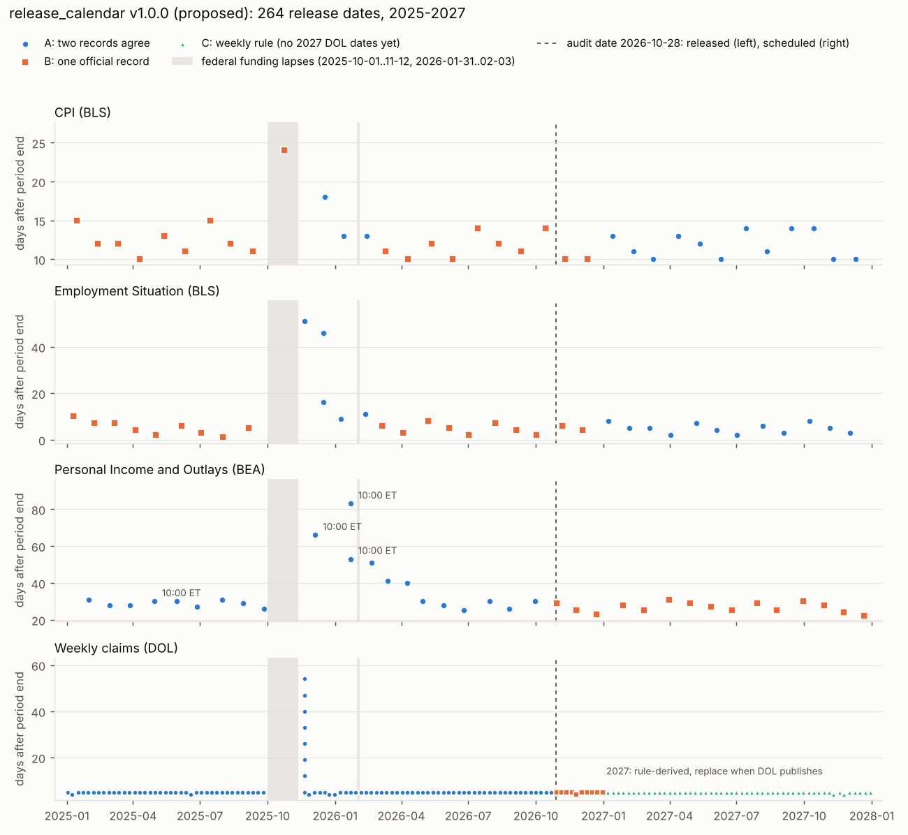

# 달력 감사 5차: release_calendar (BLS·BEA·DOL 발표일정)

- **작성:** 2026-10-28
- **근거:** 소유자 승인서 "나 Geon Koh는 범위의 A안을 승인합니다." 승인 범위는 1단계 `release_calendar.yaml` 신설이고, 서명은 감사 후 별도 서명서로 받습니다(`11_bls_bea_stage1_status.md`).
- **규칙:** `core/calendars/data/`와 코드는 바꾸지 않았습니다. 서명 필드도 쓰지 않았습니다. 코드 수정 2건은 제안 패치(`calendar_batch5/proposed_code.diff`)로만 드립니다(감사 요청서 7절 8번).
- **자료:** 소유자가 2026-10-28에 내려받아 올린 공식 일정 PDF 11개와 ALFRED 엑셀 4개입니다. PDF는 글자가 그림으로 저장돼 있어 화면으로 읽고 옮겨 적었습니다(`calendar_batch5/sources/official_schedules.yaml`). 옮겨 적은 날짜는 모두 ALFRED 기록과 자동으로 대조됩니다.

---

## 1. 결론: 서명 가능 (Go). 코드 패치 1건이 함께 필요합니다

제안 파일은 264행입니다. 2025-01-01~2027-12-31에 발표되는 CPI, 고용보고서, 개인소득·지출, 주간 실업수당을 담았습니다.

| 발표 | 행 | 기간(발표일) | A | B | C |
|---|---|---|---|---|---|
| CPI (BLS) | 35 | 2025-01-15 ~ 2027-12-10 | 15 | 20 | — |
| EMPSIT 고용보고서 (BLS) | 36 | 2025-01-10 ~ 2027-12-03 | 17 | 19 | — |
| PIO 개인소득·지출 (BEA) | 36 | 2025-01-31 ~ 2027-12-22 | 21 | 15 | — |
| CLAIMS 주간 실업수당 (DOL) | 157 | 2025-01-02 ~ 2027-12-30 | 95 | 10 | 52 |
| **합계** | **264** | | **148** | **64** | **52** |

**근거 등급.**

- **A:** 두 기록이 일치합니다. 과거 발표는 ALFRED 최초 vintage와 공식 일정을 대조했고, 2027년 BLS는 두 일정 페이지를 대조했습니다.
- **B:** 공식 기록이 하나뿐입니다.
- **C:** 공식 일정이 아직 없어 규칙으로 만들었습니다.

**이미 발표된 159행.**

- 124행은 두 기록이 일치합니다. **불일치는 0건입니다.**
- 나머지 35행은 ALFRED 기록만 있습니다. 2025년 BLS 정기 발표와 2026년 CPI·고용 정기 발표입니다. 2025년 BLS 연간 일정 페이지는 받지 않았습니다.

**판단 근거 (Go).**

| 항목 | 내용 |
|---|---|
| 정확성 | 겹치는 기록 148건이 모두 일치하고, 어긋나면 빌드가 멈추도록 했습니다. 주말에 발표되는 행은 없습니다. 연방 휴일에 발표되는 행은 1건뿐인데, 실제로 그날 발표됐습니다(아래 F-05). |
| 미래 정보 | 날짜를 추정하지 않습니다. 목록에 없는 관측은 지금처럼 수집을 거부합니다. 예외는 C등급 52행으로, 다음 절의 결정 사항입니다. |
| 효과 | 막혀 있던 8개 시리즈가 열립니다. 위험 모델 입력인 근원 PCE(PCEPILFE)도 포함됩니다. 모의 서명 상태에서 수집, 읽기, 신선도 판단이 모두 동작했습니다. |
| 위험 | 코드 패치(F-01) 없이 서명하면 BEA 10:00 발표 4건이 90분 일찍 공개된 것으로 기록됩니다. 그래서 패치와 서명을 같은 커밋에 넣습니다. |

**소유자 결정 3건.** 서명 양식에서 체크합니다.

1. **2027년 실업수당 52행(C)을 넣을지.** 권고는 넣는 것입니다. 이유는 F-04에 있습니다.
2. **코드 패치 F-01(행별 발표 시각)을 적용할지.** 필수입니다.
3. **코드 패치 F-02(`usable_at` 탐색 시작점)를 적용할지.** 권고입니다. 승인 범위에 적힌 파일(adapter, store)이 아니라 `publication.py`이므로 따로 여쭙니다.

---

## 2. 자료와 대조

| 자료 | 업로드 | 내용 | 쓰인 곳 |
|---|---|---|---|
| BLS CPI 일정 | ___001.pdf | 2026-10 ~ 2027-11 기준월 14건 | CPI 미래 |
| BLS 고용보고서 일정 | ___002.pdf | 2026-10 ~ 2027-11 기준월 14건 | EMPSIT 미래 |
| BLS 셧다운 변경 일정 (2026-02-12 수정) | ___003.pdf | 2025·2026 셧다운으로 바뀐 날짜와 취소 | CPI·EMPSIT 2025-09 ~ 2026-01 |
| BLS 2027 월별 일정 (2026-10-09 수정) | ___004.pdf | 2027 발표 전체와 연방 휴일 | CPI·EMPSIT 2027 교차확인, holidays_FED 확인 |
| BEA 발표 일정 2025·2026·2027 | ___005_2025 / ___005 / ___005_2027.pdf | 개인소득·지출 날짜와 **시각** | PIO 전체 |
| FRED 실업수당 달력 2025·2026·2027 | ___006_*.pdf | 2025년 46건, 2026년 52건, 2027년 "없음" | CLAIMS |
| ALFRED 실시간 관측 | CPIAUCSL·PAYEMS·PCEPI·ICSA _1.xlsx | 관측별 최초 vintage (2024-11 ~ 2026-09) | 과거 발표 전체 |

**대조 결과** (`calendar_batch5/build.log`)

- **ALFRED와 공식 일정이 겹치는 과거 124건:** 모두 일치합니다.
  - CPI 3건, EMPSIT 5건: 셧다운 변경 페이지와 ALFRED
  - PIO 21건: BEA 일정과 ALFRED
  - CLAIMS 95건: FRED 달력과 ALFRED
- **FRED 실업수당 발표일 88개 (2025-01-01 ~ 2026-10-28):** ALFRED ICSA vintage 날짜 88개와 집합이 정확히 같습니다.
- **BLS 2027 일정의 두 페이지:** 개별 일정 페이지(001·002)와 월별 목록(004)이 CPI 12건, 고용 12건 모두 일치합니다.
- **연방 휴일:** BLS 2027 목록에 적힌 연방 휴일 12일이 서명된 `holidays_FED` 2027과 정확히 같습니다. 1차 감사에서 서명한 FED 파일을 독립 자료로 한 번 더 확인한 셈입니다.

---

## 3. 발견사항

| ID | 내용 | 조치 | 등급 |
|---|---|---|---|
| F-01 | **BEA 10:00 발표 4건.** 2025-04-30(3월분), 2025-12-05(9월분), 2026-01-22(10·11월분)은 08:30이 아니라 10:00 ET였습니다. 지금 코드는 일정 행의 시각(08:30)을 모든 날짜에 씁니다. 그래서 이 4건이 실제보다 90분 일찍 공개된 것으로 기록됩니다. KRX 의사결정에는 어차피 다음 날 반영되므로 실제 영향은 없습니다. 다만 공개 시각 기록이 틀립니다. | **코드 패치(필수):** `adapter.py`가 관측월 행의 `time`·`tz`를 그 관측에 적용합니다. 패치 전 모의 서명에서는 이 4건이 PCE 두 시리즈에서 모두 틀렸습니다(8건). 패치 후에는 407건이 모두 맞습니다. | A |
| F-02 | **`usable_at`의 60일 탐색 한계.** 관측일부터 60일만 찾기 때문에, 발표가 60일 넘게 걸리는 관측에서 ValueError가 납니다. PIO는 평소에도 60일이 걸리고, 셧다운 때는 82~113일이 걸렸습니다. 2026년 이후 발표 74행 중 12행이 오류였습니다. 운영 데이터 경로(`publication_instant`)는 영향이 없습니다. 오류가 나는 쪽이므로 미래 정보를 쓸 위험도 없습니다. | **코드 패치(권고):** `publication.py`에서 탐색을 "발표일 하루 전"부터 시작합니다. 모든 시장의 마감이 그 세션의 UTC 날짜 안에 있으므로, 그 전 세션은 답이 될 수 없습니다. 패치 후 74행 오류 0건입니다. | A |
| F-03 | **2025 셧다운 처리.** ① 2025년 10월 CPI는 발표가 취소돼 행을 두지 않습니다. ALFRED에도 값이 없고, 레지스트리 `missing_months`와 일치합니다. ② 10월 고용은 단독 발표 없이 11월분과 함께 2025-12-16에 나왔습니다. 그래서 행은 12-16입니다. 실업률(UNRATE)은 10월 가계조사가 없어 레지스트리에 이미 빠져 있습니다. ③ 실업수당 7주(9/27 ~ 11/8)는 2025-11-20에 한꺼번에 나왔습니다. ④ PIO 9월분은 12-05, 10·11월분은 2026-01-22입니다. | 공식 페이지와 ALFRED대로 기록했습니다. | A |
| F-04 | **2027년 실업수당 일정이 없습니다.** FRED에 2027년 날짜가 없습니다("No release dates are available"). 그래서 규칙으로 52행을 만들었습니다. 규칙은 "주가 끝난 뒤 목요일 08:30 ET, 그 목요일이 연방 휴일이면 수요일"입니다. 이 규칙은 2025~2026년 공식 날짜 105건 중 셧다운 7건을 뺀 98건을 모두 재현합니다. 2027년에 규칙이 날짜를 옮기는 날은 둘입니다. 2027-11-10(재향군인의 날)과 2027-11-24(추수감사절)입니다. | **소유자 결정.** 넣으면 ICSA가 2027년에도 열립니다. 빼면 2027-01-07부터 ICSA 수집이 거부됩니다(context 역할이라 북에는 영향 없음). DOL 일정이 나오면 새 버전으로 바꿉니다. | C |
| F-05 | **2025-12-24 (수).** 대통령령으로 연방기관이 쉰 날이고, 서명된 holidays_FED에도 휴일로 있습니다. 그런데 DOL은 이날 실업수당을 발표했습니다(성탄절 목요일을 피해 하루 앞당김). ALFRED와 FRED가 일치합니다. | 그대로 둡니다. 빌드는 이 1건을 알려진 예외로만 허용합니다. | A |
| F-06 | **파일의 끝.** 2027년 12월분 발표(2028년 1월)는 범위 밖입니다. 그래서 2027-12-22 08:30 ET에 11월 PCE가 나온 뒤에는 근원 PCE의 "다음 발표" 시각을 계산할 수 없습니다. 이때부터 PCEPILFE 읽기는 막히고 헤지 크레딧이 꺼집니다(보수적 기본값). 커버리지 경보는 2027-10-01에 경고(남은 60일), 2027-12-01에 호출(20일)이 울립니다. | 2028년 버전을 **2027-12-22 전에** 서명해야 합니다. BLS·BEA의 다음 해 일정은 보통 10월에 나옵니다. | — |
| F-07 | **US 상태의 시작일 표시.** `release_calendar`를 US 커버리지 대상에 넣으면 `status("US")`의 시작일(`covers_from`)이 2025-01-01로 바뀝니다. 매매 시계(`MARKET_FILES`)와 과거 백테스트 경로는 이 값을 쓰지 않습니다. 쓰는 곳은 테스트와 운영 상태 표시뿐입니다. | 정보 제공용입니다. 1995~2024 발표일은 2단계(별도 승인)입니다. | — |

**B등급 64행:** 공식 기록이 하나뿐인 행입니다.

- ALFRED만 있는 과거 35행: CPI 18행, 고용 17행
- 일정 페이지 하나뿐인 미래 29행:
  - BLS 2026년 11·12월 4행
  - BEA 2026-10-29 이후 15행
  - FRED 실업수당 2026-10-29 이후 10행

미래 날짜가 바뀌면(셧다운 등) 먼저 M5 발표 이벤트(지연·취소)로 공개 시각을 옮깁니다. 그 뒤 새 버전으로 고칩니다.

---

## 4. 검증

**모의 서명** (`calendar_batch5/simulate_signed.py`)

- 방법: 데이터 폴더를 임시 폴더에 복사하고, 제안 파일과 MANIFEST 행을 넣은 뒤 "SIMULATION" 표기로 서명했습니다. US 커버리지 대상 추가는 실행 중에만 반영했습니다.
- 원본 데이터 폴더가 바뀌지 않은 것은 md5로 확인했습니다.

| 확인 | 현재 코드 | 패치 적용 |
|---|---|---|
| 로드(264행, md5) | 통과 | 통과 |
| 모든 행의 공개 시각 = 행의 날짜·시각·시간대 (8개 시리즈, 407건) | **실패 8건** (10:00 행 4건 × PCE 2개 시리즈) | 통과 |
| BEA 10:00 (EDT·EST 각 1건) | **실패 2건** | 통과 |
| 목록에 없는 관측은 거부 (2025-10 CPI, 2027-12 PCE, 2024-11 CPI) | 통과 | 통과 |
| `usable_at` KRX, 2026년 이후 발표 74행 | **오류 12건** | 통과 |
| 수집: CPI 2026-09가 2026-10-14 12:30Z(08:30 EDT)로 기록 | 통과 | 통과 |
| 근원 PCE(위험 모델) 2026-10-28 읽기: 8월분 정상 / 11-06에 9월분 없으면 stale | 통과 | 통과 |
| 실업수당을 발표 전에 수집하면 잠정치로 표시 | 통과 | 통과 |
| US 상태 2026-10-28: signed=True, 남은 FED 영업일 292 | 통과 | 통과 |
| 합계 | **실패 4항목** | **0항목** |

로그는 두 개입니다. 현재 코드 결과는 `simulate_signed_current_tree.log`, 패치 적용 결과는 `simulate_signed.log`에 있습니다.

**전체 macro 테스트.** 저장소 사본에서 서명 후 상태를 그대로 만들어 33개 모듈을 돌렸습니다. 사본에 넣은 것은 다음과 같습니다.

- 제안 파일과 MANIFEST 행. 서명은 "Scratch Dry Run" 표기이고, 사본에만 넣었습니다.
- US 커버리지 대상 추가
- 코드 패치와 테스트

결과는 5절에 적습니다.

---

## 5. 테스트 영향

두 트리에서 macro 테스트 33개 모듈을 동시에 돌렸습니다.

- **현재 저장소(d1c9296).**
- **서명 후 상태 사본.** 다음을 모두 넣었습니다.
  - 제안 파일과 MANIFEST 행
  - US 커버리지 대상 추가
  - 코드 패치 F-01·F-02
  - 테스트 갱신

**결과.**

- 두 트리의 결과는 실행 시간 표기를 빼면 한 줄도 다르지 않습니다. **새로 실패한 테스트는 없습니다.**
- 새 테스트 내용(10:00 발표 행, 발표까지 82일 걸린 관측의 `usable_at`)을 포함한 `macro_m1_integration`은 8/8 통과입니다. 같은 테스트를 패치 없는 코드로 돌리면 실패합니다.
- 서명 상태 검사(`macro_m1_calendars`)도 같습니다: 18 통과, 4 미실행. 여기에는 서명된 파일이 완전한지와 시험용 서명자가 없는지를 보는 검사가 포함됩니다.
- **기존 실패 3건:** 이번 작업과 무관하며 원래부터 있던 것입니다.
  - `macro_m0_harness`: T-OBS-03 레지스트리 불일치, `flet` 모듈 없음
  - `macro_m8_pipeline`: `test_dry_run_end_to_end_on_the_local_cache`

**모의 서명 로그 재생성.** 패치를 넣은 깨끗한 사본에서 `simulate_signed.log`를 다시 만들었습니다. 실패는 0건입니다. `proposed_code.diff`가 시험한 트리와 같은 내용인지도 확인했습니다.

---

## 6. 그래프



- **그래프의 축:** 세로축은 기준 기간이 끝난 뒤 발표까지 걸린 날수입니다. 색과 모양은 근거 등급을 나타냅니다(A 원, B 사각형, C 삼각형). 회색 띠는 셧다운 구간이고, 점선은 감사일입니다.
- **셧다운 지연:** 2025 셧다운 직후 고용·PCE·실업수당 발표가 크게 늦어졌습니다. PCE는 최대 83일, 실업수당은 최대 54일입니다.
- **10:00 발표:** 10:00 발표 4건은 모두 이 시기의 BEA 발표입니다.
- **2027 실업수당:** 2027년 실업수당은 규칙으로 만든 C등급입니다.

---

## 7. 서명 후 반영 순서 (한 커밋)

1. `calendar_batch5/proposed/release_calendar.yaml`을 `core/calendars/data/`로 옮깁니다.
2. MANIFEST에 행을 추가합니다. 값은 version 1.0.0, test_ids [T-AVAIL-01]입니다. 서명 도구는 행이 있어야 동작합니다.
3. `proposed_code.diff`를 적용합니다. 서명서에서 체크하신 것만 적용합니다.
   - `adapter.py` (F-01)
   - `publication.py` (F-02)
   - `store.py`의 US 커버리지 대상 추가
   - 테스트 갱신
4. 서명 도구로 서명을 기록합니다. 지문이 다르면 도구가 서명을 거부합니다.
   `python -m tools.sign_calendars --signer "<서명자>" --expect release_calendar=1faf621a5b443f1c9f3627c2a98f1054 release_calendar`
5. 테스트를 실행하고, 서명 문서와 결정 기록(OWNER_RULINGS_LOG)을 남긴 뒤 커밋하고 푸시합니다.

F-04에서 2027년 실업수당을 빼기로 하시면 파일이 바뀌고 지문도 바뀝니다. 그때는 새 지문으로 서명서를 다시 드립니다.

---

## 8. 서명 양식

```
[QUANTGEN 달력 서명서 · 5차 (release_calendar)]

서명자 표기 (signed_off_by): ______________________

서명 대상과 초안 지문:
  [ ] release_calendar.yaml   v1.0.0   1faf621a5b443f1c9f3627c2a98f1054
      (264행: CPI 35 · EMPSIT 36 · PIO 36 · CLAIMS 157; 2025-01-01~2027-12-31)

확인 사항:
  [ ] 과거 발표일은 ALFRED 최초 vintage와 공식 일정이 일치함 (124건, 불일치 0)
  [ ] 2025 셧다운: 10월 CPI 행 없음, 10월 고용 → 2025-12-16, 실업수당 7주 → 2025-11-20 (F-03)
  [ ] BEA 10:00 ET 발표 4건(2025-04-30, 2025-12-05, 2026-01-22 ×2)을 행의 시각으로 기록 (F-01)
  [ ] 2025-12-24 실업수당 발표(연방 휴무일이지만 실제 발표) 유지 (F-05)
  [ ] 2028년 버전은 2027-12-22 전에 서명해야 함을 확인 (F-06)

결정:
  2027년 실업수당 52행 (규칙 기반, C등급) (F-04):
    [ ] 넣는다 (권고)     [ ] 뺀다 (지문이 바뀌어 서명서를 다시 받음)
  코드 패치:
    [ ] F-01 adapter.py 행별 발표 시각 적용 (필수)
    [ ] F-02 publication.py usable_at 탐색 시작점 (권고)
    [ ] store.py US 커버리지 대상에 release_calendar 추가 (A안 승인 범위)

서명 문장:
  "나 ______은(는) 위 파일의 발표일·시각·출처를 확인했으며, 이 파일에 서명합니다."

서명 시각 (UTC): 서명 도구가 자동으로 기록
```

---

## 9. 출처

**BLS**

- CPI 일정: https://www.bls.gov/schedule/news_release/cpi.htm
- 고용보고서 일정: https://www.bls.gov/schedule/news_release/empsit.htm
- 2027 월별 일정 (2026-10-09 수정): https://www.bls.gov/schedule/2027/home.htm
- 2025·2026 셧다운 변경 일정 (2026-02-12 수정): https://www.bls.gov/bls/2025-lapse-revised-release-dates.htm

**BEA**

- 발표 일정 (2025·2026·2027): https://www.bea.gov/news/schedule

**FRED (실업수당 달력)**

- 2025: https://fred.stlouisfed.org/releases/calendar?rid=180&y=2025
- 2026: https://fred.stlouisfed.org/releases/calendar?rid=180&y=2026
- 2027: https://fred.stlouisfed.org/releases/calendar?rid=180&y=2027

**ALFRED**

- https://alfred.stlouisfed.org/series?seid=CPIAUCSL
- https://alfred.stlouisfed.org/series?seid=PAYEMS
- https://alfred.stlouisfed.org/series?seid=PCEPI
- https://alfred.stlouisfed.org/series?seid=ICSA

**재현**

- 원본 엑셀은 FRED 이용약관 때문에 저장소에 넣지 않았습니다. 대신 `extract_alfred.py`가 뽑은 날짜만 `sources/`에 넣었습니다.
- 재현 순서는 `extract_alfred.py`(업로드 파일) → `build_proposed.py` → `simulate_signed.py` → `plot_release_calendar.py`입니다.
