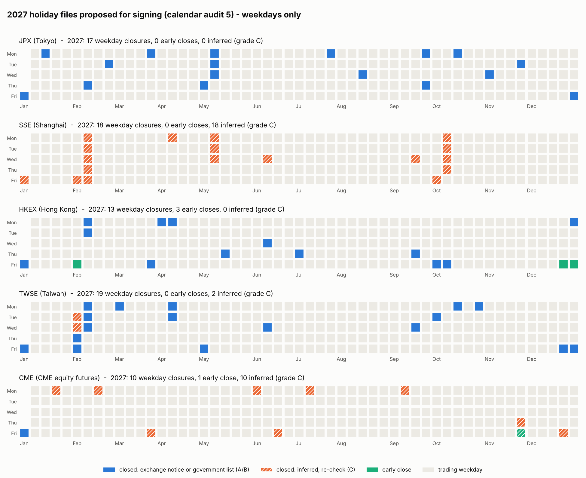

# 달력 5차: 아직 서명되지 않은 6개 파일 (JPX · SSE · HKEX · TWSE · CME 휴장일, market_closes)

- **작성:** 2026-10-29 (자료 확인 2026-10-28 UTC 18:10 기준)
- **요청:** 소유자 원문 "그나저나, 서명 문서는 어디있나요? 얼른 만들어주세요. 아직 서명되지 않은 파일들도 마찬가지로 미리 제공해주세요."
- **규칙:** `core/calendars/data/`는 바꾸지 않았고, 서명 필드도 쓰지 않았습니다. 감사 결과, 제안 파일, 서명 양식만 냅니다.
- **서명 양식:** `14_signing_form_batch5.md`
- **서명된 10개 파일의 기록:** `12_signature_register.md`

---

## 1. 결론

**판단: 6개 파일 모두 서명 진행(Go)을 권장합니다.** 단, 2027년 추정 행은 공지가 나오면 새 버전으로 다시 서명하는 조건입니다.

| 파일 | 행 (2025 / 2026 / 2027) | 근거 등급 A / B / C | 판정 |
|---|---|---|---|
| `holidays_JPX` | 54 (18 / 19 / 17) | 47 / 7 / 0 | 서명 가능 |
| `holidays_SSE` | 55 (18 / 19 / 18) | 37 / 0 / **18** | 서명 가능. 2027년 18행은 모두 추정이라 11~12월 공지 후 다시 서명 |
| `holidays_HKEX` | 51 (18 / 17 / 16), 반일장 9행 포함 | 31 / 20 / 0 | 서명 가능. 마감 시각 결정 필요(HK-01) |
| `holidays_TWSE` | 57 (18 / 20 / 19) | 38 / 17 / 2 | 서명 가능 |
| `holidays_CME` | 37 (14 / 12 / 11), 조기마감 6행 포함 | 23 / 4 / 10 | 서명 가능. 정의 결정 필요(CME-01) |
| `market_closes` | 3 → 4행 (CN 1, HK 2, TW 1) | 1 / 3 / 0 | 서명 가능. HK-01과 같은 결정 |

**근거는 세 가지입니다.**

1. **확정된 날짜는 거래소 공지와 맞습니다.** 2025~2026년 날짜는 거래소 공지(A)나 거래소가 따른다고 밝힌 정부 공휴일 목록(B)에서 왔습니다. 두 라이브러리와도 정의 차이를 빼면 모두 일치합니다(5절).
2. **추정이 틀려도 미래 정보를 쓰지 않습니다.** 추정(C)은 아직 공지가 없는 2027년과 대만 설 직전 결제일에만 있습니다.
   - 휴장으로 잘못 적으면, 그날 종가를 없는 것으로 보고 다음 종가를 씁니다. 데이터를 늦게 쓸 뿐입니다.
   - 개장일로 잘못 적으면, 기대한 종가가 오지 않아 결측으로 처리됩니다.
   - 이 파일들의 종가는 KR 공분산에만 쓰입니다. 실패해도 북을 멈추지 않고, 최대 5번의 결정 동안 '오래됨'으로 표시한 뒤 빠집니다.
3. **서명해도 다른 시장은 바뀌지 않습니다.** 6개 파일을 서명한 사본에서 전체 매크로 테스트를 서명 전과 비교했습니다(6절).

**서명 후 바뀌는 것**

- JP·CN·HK·TW 결정 시계가 열려 `signed=True`가 됩니다(남은 거래일 286~292).
- 닛케이, 상하이, 항셍, 가권 종가를 시장 간 시점 규칙(`close_print_bound + 60초 < decision`)으로 읽을 수 있게 됩니다.
- KRX 종가 결정 시점에 같은 날짜 종가를 쓸 수 있는 시장은 **대만뿐**입니다. 일본·중국·홍콩은 쓸 수 없습니다. 스펙의 B5 표와 같습니다.
- 지금 JP·CN·HK·TW 북은 없으므로, 새로 무장(ARM)되는 북은 없습니다.

---

## 2. 범위와 방법

**범위.** 6개 파일은 원래 행이 0개인 빈 골격이었습니다(`market_closes`만 출처 없는 3행). 그래서 데이터를 새로 만들었습니다.

- **기간:** 이미 서명된 NYSE·SIFMA·CBOE와 같은 2025-01-01~2027-12-31입니다.
- **2025년 이전:** 스펙은 아시아 4개 시장에 'KR 공분산 기간'까지의 이력을 요구합니다. 이 부분은 다음 버전 과제로 남깁니다. 지금은 그 날짜를 조회하면 `CalendarCoverageError`로 막힙니다. 실패해서 막히는 쪽이라 안전합니다.

**자료 확인 방법.** 시장마다 공식 공지를 찾았습니다.

- **JPX:** 휴업일 목록, 공휴일 거래 공지, 국립천문대 2027 역요항
- **SSE:** 상하이거래소 연간 휴장 공지와 국무원 공휴일 통지
- **HKEX:** HKEX 연간 휴장 회람(CT/063/24, CT/075/25, CT/077/26)과 홍콩 정부 관보 공휴일
- **TWSE:** TWSE 연간 개·휴장일표, 태풍 휴장 공지, 행정원 인사행정총처 2027 공무 달력
- **CME:** CME 휴일 정산 시각 공지와 청산 공지

**한계.** 이 세션의 네트워크 정책이 모든 거래소·정부 사이트를 막았습니다. 그래서 공식 문서는 **검색 엔진 발췌로만** 확인했습니다. 각 행의 `source_url`을 서명 전에 직접 열어 보시기를 권합니다.

**독립 교차 확인.** `exchange_calendars 4.13.2`와 `pandas_market_calendars 5.5.0`을 별도 가상환경에서 썼습니다. 둘 다 출처가 아니라 대조용입니다(spec L2003). 스크립트는 `calendar_batch5/cross_check.py`이고, 결과는 `cross_check.log`에 있습니다.

**근거 등급.** 각 행 `evidence` 필드의 맨 앞 글자입니다.

| 등급 | 뜻 |
|---|---|
| **A** | 거래소 자체 공지가 그 날짜를 적고 있음. 언론 보도로 확인한 거래소 공지도 포함 |
| **B** | 거래소가 따르는 정부 공휴일 목록에 있음. 해당 연도 거래소 공지는 있지만 그 행은 발췌에서 보지 못함 |
| **C** | 추정. 아직 공지가 없음. 공지가 나오면 새 버전으로 바꿈 |

---

## 3. 파일별 발견사항

### holidays_JPX (도쿄증권거래소)

- **2025년(18일)과 2026년(19일):** 모두 JPX 자체 자료(A)입니다.
  - 2025년 거래일 243일(JPX 연간 통계)과, 2026년 1~9월 월별 거래일 수가 이 목록으로 계산한 값과 맞습니다. 따라서 그 기간에 예정 밖 휴장은 없었습니다.
- **2027년(17일):** JPX가 2027년 휴업일 목록을 이미 냈습니다.
  - 2027-03-22(춘분 대체휴일), 09-20, 09-23, 12-31 등 10행은 JPX 자료(A)입니다.
  - 7행(4/29, 5/3~5, 7/19, 8/11, 11/3)은 국립천문대 역요항(관보 2026-02-02)과 2차 목록으로 확인했습니다(B).
- **반일장:** 없습니다. 반일장은 2009-12-04 규정 개정으로 폐지됐고, 2010년 대발회부터 종일 거래입니다.
- **마감 시각:** 규칙 저장소의 `close_jst`(2024-11-05부터 15:30)를 그대로 씁니다.

### holidays_SSE (상하이증권거래소)

- **2025년(18일)과 2026년(19일):** SSE 연간 공지(上证公告〔2024〕38号, 〔2025〕45号)와 명절별 공지에 있습니다(A).
  - 주말 보충 근무일(调休上班)은 SSE가 '주말 휴장'으로 적습니다. 거래일이 아닙니다.
- **2027년(18일): 모두 C입니다.** 국무원의 2027년 공휴일 통지가 아직 없습니다. 보통 11월에 나오고, SSE 공지는 12월에 나옵니다.
  - 2025년부터 바뀐 법정 공휴일 규칙(설 전날과 5월 2일 추가)과 2025~2026년 배치 방식으로 추정했습니다.

  | 구분 | 날짜 |
  |---|---|
  | 법정 공휴일(평일) | 1/1, 2/5(설 전날), 2/8, 4/5, 6/9, 9/15, 10/1 |
  | 주말에 겹쳐 평일로 대체 쉬는 날(补假) | 2/9, 2/10, 5/3, 5/4, 10/4, 10/5 |
  | 2025~2026년 배치 방식에서 추정 | 2/11, 2/12, 5/5, 10/6, 10/7 |

- **라이브러리 대조:** `pandas_market_calendars`의 2027년 추정보다 3일(2/12, 5/4, 5/5)이 많습니다. 넉넉하게 잡는 쪽을 택했습니다.

### holidays_HKEX (홍콩거래소)

- **휴장:**
  - 2025년 15일, 2026년 14일, 2027년 13일입니다.
  - HKEX 회람 CT/063/24, CT/075/25, CT/077/26과 홍콩 정부 공휴일 관보에서 왔습니다.
  - 2027년 공휴일은 2026-05-15 관보에 실렸습니다. HKEX의 2027년 회람도 2026-06-01에 나왔습니다.
- **반일장:** 매년 3일(설 전날, 성탄 전날, 연말)이고, 오후장이 없습니다.
- **악천후:** 2024-09-23부터는 태풍 8호나 흑색 폭우 경보에도 거래합니다. 2025~2026년 악천후 휴장은 없었습니다. 2025-09-24 태풍 10호(라가사) 때도 개장했습니다.
- **HK-01 (결정 필요): 마감 시각 16:10, 반일장 12:10.**
  - 2016-07-25 종가 단일가(CAS)가 도입된 뒤로, 공식 종가는 16:00 이후 **16:08~16:10 사이 무작위 시각**에 정해집니다. 반일장은 12:08~12:10입니다.
  - 항셍지수 종가도 이 공식 종가로 계산됩니다.
  - 설정(`close_print_bound_s: 0`)상 마감 시각이 곧 '종가가 정해지는 마지막 시각'이어야 합니다. 그래서 16:10과 12:10을 제안합니다.
  - 초안은 16:00이었습니다. 16:00으로 두면 종가가 아직 정해지지 않은 시점을 종가 시점으로 봅니다.
  - `market_closes`의 HK 행은 둘로 나눴습니다. 2015-01-01~2016-07-24는 16:00, 2016-07-25부터는 16:10입니다.

### holidays_TWSE (대만증권거래소)

- **2025년(18일):** TWSE 연간 일정표와 이후 공지(언론 보도)에서 왔습니다.
  - 2025-05-28 '기념일 및 명절 실시 조례'로 새 공휴일이 생겼습니다. 9/29(교사절 대체), 10/24(광복절 대체), 12/25(행헌기념일)가 그에 따른 휴장입니다.
- **2026년(20일):** TWSE 일정표에 더해 **태풍 휴장 2일**이 있습니다.
  - 2026-07-10: 태풍 바위(巴威)
  - 2026-10-23: 태풍 창피(薔琵)
  - 규칙: 타이베이시가 전일 또는 오전 휴무를 발표하면 TWSE는 전일 휴장합니다.
- **설 직전 '결제만 하는 날':** 거래가 없고 종가도 없으므로 휴장(closed)으로 적었습니다.
  - 2025년 1/23~24, 2026년 2/12~13이 이런 날입니다.
  - 2027년 2/2~3은 같은 방식으로 추정했습니다(C).
- **2027년(19일):** 2026-05-21에 승인된 인사행정총처 2027 공무 달력에서 왔습니다(B). 휴일 121일이고 보충 근무일은 없습니다.
  - TWSE의 2027년 일정표는 아직 없습니다. 2026년 일정표는 2025-10-29에 나왔습니다.
- **마감 시각:** 13:30입니다. 13:25~13:30에 주문만 받고 13:30에 한 번에 체결합니다.
- **라이브러리 대조:** 라이브러리에 없는 5일이 있습니다. 태풍 2일, 2027년 결제 전용일 2일, 2027-04-06(어린이날 대체)입니다.

### holidays_CME (CME 주가지수 선물)

- **CME-01 (결정 필요): 이 달력이 무엇인지.**
  - 스펙의 소비 상품은 마이크로 E-mini S&P 500(`CME_micro_ES`)입니다. 그래서 '주가지수 선물의 정규 일일 정산이 있는 날'을 영업일로 정의했습니다.
  - 미국 공휴일(MLK, 대통령의 날 등)에는 CME Globex가 12:00 CT까지 짧게 거래합니다. 하지만 그날 날짜로 정산하지 않고, 거래는 다음 거래일로 넘어갑니다. 그래서 **휴장**으로 적었습니다.
  - 라이브러리는 같은 날을 '조기 마감'으로 봅니다. 데이터는 같고 정의만 다릅니다.
- **특수일:**
  - **2025-01-09(카터 국가애도일):** 08:30 CT까지 거래했고, 정산가는 전날 값을 그대로 썼습니다.
  - **2026-04-03(성금요일, 고용지표 발표일):** 08:15 CT경까지 단축 거래했지만 정산하지 않았습니다.
  - 두 날 모두 새 정산이 없으므로 휴장으로 적었습니다(A).
- **조기 마감일:** 거래는 12:15 CT에 멈추고, 정산은 12:00 CT에 정해집니다. 정산 시각은 CME 공지(A)이고, 12:15 거래 중단은 브로커 공지(B)입니다. `close_local`에는 12:15를 시카고 시간으로 적었습니다.
  - **2025-11-28:** 그 전날 밤 데이터센터 장애로 Globex가 약 11시간 멈췄다가 07:30 CT에 재개됐습니다.
- **2025~2026년 대조:** CME 주가지수 선물의 휴장·조기 마감일은 **서명된 NYSE 목록과 하루도 다르지 않았습니다.**
- **2027년:** CME가 아직 일정을 내지 않았습니다. 그래서 2027년 행은 서명된 `holidays_NYSE` v1.0.0을 따릅니다(C). 1/1만 CME 공지가 있습니다(A).

### market_closes (CN · HK · TW 마감 시각, 시행일별)

| 시장 | 기간 | 개장 | 마감 | 근거 |
|---|---|---|---|---|
| CN | 2015-01-01~ | 09:30 | 15:00 CST | 2018-08-20부터 14:57~15:00 종가 단일가(그 전에는 마지막 1분 VWAP). 마감 시각은 계속 15:00 (B) |
| HK | 2015-01-01~2016-07-24 | 09:30 | 16:00 HKT | 종가 단일가 이전 (B) |
| HK | 2016-07-25~ | 09:30 | **16:10** HKT | 종가 단일가 16:00~16:08/16:10 (A), HK-01 |
| TW | 2015-01-01~ | 09:00 | 13:30 TST | 13:25~13:30 종가 단일가 (B) |

- **SSE 서킷브레이커:** 2016-01-04와 2016-01-07에 거래가 일찍 중단됐습니다. 이 두 날은 지금 범위(2025년~) 밖입니다. 2025년 이전 이력을 만들 때 반영합니다.

---

## 4. 2027년 한눈에

- **주황 빗금:** 추정(C)이라 공지가 나오면 다시 확인할 날입니다.
- **초록:** 조기 마감입니다.
- **그림 스크립트:** `calendar_batch5/plot_calendar_2027.py` (matplotlib)

---

## 5. 라이브러리 대조 (`cross_check.log`)

| 파일 | 라이브러리 | 결과 |
|---|---|---|
| JPX | exchange_calendars (~2027-10-28), pandas_market_calendars | **완전 일치** (51/51, 54/54) |
| SSE | exchange_calendars (~2026-12-31) | **완전 일치** (37/37) |
| SSE | pandas_market_calendars | 2027년만 다름: 제안에 2/12, 5/4, 5/5가 더 있음 (둘 다 추정) |
| HKEX | 둘 다 | 휴장 **완전 일치**. 반일장 마감만 12:10 대 12:00 (HK-01) |
| TWSE | exchange_calendars (~2027-10-28) | 제안에만 5일: 태풍 2일, 2027 결제 전용일 2일, 2027-04-06 |
| CME | pandas_market_calendars CME_Equity | 정의 차이 (CME-01). 라이브러리의 휴장 7일은 모두 제안에도 있음 |

---

## 6. 검증

**모의 서명 검증.** `calendar_batch5/simulate_signed.py`가 다음 순서로 확인합니다.

1. `core/calendars/data/`를 임시 폴더에 복사합니다.
2. 6개 파일을 제안본으로 바꾸고, `"SIMULATION - not a signature"`로 가짜 서명합니다.
3. 실제 로더, 결정 시계, 시장 간 규칙으로 확인합니다.

결과는 **46/46 통과**이고, 원본은 바뀌지 않았습니다(md5 확인). 로그는 `simulate_signed.log`입니다.

| 확인 항목 | 결과 |
|---|---|
| 6개 파일 로드 | 모두 로드 |
| JP | 2026-09-22(국민의 휴일) 휴장, 2027-03-22 휴장, 2026-12-30 거래일, 결정 시각 06:30Z |
| CN | 2026-10-10(보충 근무 토요일)은 거래일 아님, 2026-10-08 결정 시각 07:00Z |
| HK | 결정 시각 08:10Z(16:10 HKT), 반일장 2026-12-24는 04:10Z. `market_closes`가 2016-07-22에는 16:00, 2016-07-25에는 16:10을 고름 |
| TW | 2026-10-23(태풍) 휴장, 2025-01-23(결제 전용일) 휴장, 결정 시각 05:30Z |
| CME | 2026-04-03 영업일 아님, 2025-11-28 영업일(12:15 조기 마감), 2027-12-31 영업일 |
| KRX 2026-10-22 종가 기준 시장 간 규칙 | TW 사용 가능, JP·CN·HK 사용 불가 |
| 시장 상태(2026-10-29) | JP·CN·HK·TW 모두 `signed=True`, ARM 전제조건 참, 경보 없음 |

**커버리지 경보 시점.** 2028년 파일을 2027년 9월 말까지 서명해야 경보 없이 넘어갑니다. 1차 서명 때와 같습니다.

| 파일 | `warn` 시작 (60일 이하) | `page` 시작 (20일 이하) |
|---|---|---|
| JPX | 2027-10-04 | 2027-12-02 |
| SSE | 2027-10-08 | 2027-12-03 |
| HKEX | 2027-10-06 | 2027-12-02 |
| TWSE | 2027-10-04 | 2027-12-01 |
| CME | 2027-10-06 | 2027-12-02 |

**전체 테스트.** 두 사본에서 매크로 테스트 모듈을 모두 돌려 비교했습니다. 한 사본은 지금 `main` 그대로이고, 다른 사본은 6개 파일을 가짜 서명했습니다.

- **결과:** 39개 모듈 가운데 38개는 결과가 똑같았습니다.
- **다른 하나 `macro_m1_calendars`는 의도한 동작입니다.** 서명된 파일의 서명자가 테스트용 이름("SIMULATION")이면 실패하도록 한 보호 장치 때문입니다(`test_cal01_shipped_drafts_...`).
  - 같은 사본을 테스트용이 아닌 이름으로 다시 가짜 서명하자 18/22 통과, 실패 0, 미실행 4가 나왔습니다. 서명 전과 같습니다.
  - `macro_m1_integration`은 8/8 통과입니다.
- **서명 전부터 있던 실패:** 양쪽 사본에서 똑같습니다. 이번 변경과 무관합니다.
  - `flet` 모듈이 없어서: 5개 모듈
  - `macro_m8_pipeline::test_dry_run_end_to_end_on_the_local_cache`

---

## 7. 소유자 결정 사항

서명 양식(`14_signing_form_batch5.md`)의 확인란과 같은 내용입니다.

| ID | 결정 | 권장 | 이유 |
|---|---|---|---|
| HK-01 | 홍콩 마감 16:10, 반일장 12:10 | **16:10 / 12:10** | 종가 단일가가 끝나야 공식 종가가 정해짐. 16:00은 종가가 정해지기 전 시점 |
| SSE-27 | SSE 2027년 18일을 추정(C)으로 지금 서명 | **지금 서명, 공지 후 v1.0.1** | 대안은 2027년을 빼고 2026-12-31까지만 서명하는 것. 그러면 남은 거래일이 60일 이하라 바로 `warn`, 12월부터 `page`가 울리고, 2027-01-04부터 상하이 종가가 막힘. 추정은 틀려도 미래 정보를 쓰지 않음 |
| TW-27 | 대만 2027 결제 전용일 2/2~3 추정, 태풍 휴장 포함 | **포함** | 2025~2026년과 같은 방식. 태풍 휴장은 TWSE 공지로 확인 |
| CME-01 | CME = 주가지수 선물 정산일. 미국 공휴일 단축 거래와 특수일(2025-01-09, 2026-04-03)은 휴장. 2027년은 NYSE를 따름 | **이 정의** | 소비 상품이 `CME_micro_ES`. 정산이 없는 날은 관측도 없음 |
| SCOPE | 기간 2025~2027, 2025년 이전은 다음 버전 | **동의** | 이전 날짜는 `CalendarCoverageError`로 막혀 안전 |

---

## 8. 서명 뒤에 남는 일

1. **2027년 추정 행을 공지로 바꿔 새 버전(1.0.1)으로 다시 서명합니다.**

   | 공지 | 예상 시기 | 바꿀 행 |
   |---|---|---|
   | 국무원·SSE 2027 휴장 공지 | 2026년 11~12월 | SSE 2027년 18행 |
   | TWSE 2027 개·휴장일표 | 곧 | 대만 결제 전용일 2행. B 등급 17행도 A로 올림 |
   | CME 2027 휴일 일정 | 연중 | CME 2027년 10행 |
   | KRX 2027 휴장 공지 | 12월 | 1차 서명 조건 |

2. **2025년 이전 이력(KR 공분산 기간)을 추가합니다.** SSE 서킷브레이커(2016-01-04·07), 2015-09-03~04(전승절), 2020-01-31(코로나 연장 휴장), HKEX 태풍 휴장 이력을 포함합니다.
3. **예정 밖 휴장을 반영합니다.** 태풍, 장애, 국가애도일 같은 휴장이 생기면 변경 통제 절차에 따라 새 버전으로 넣습니다.
4. **공식 원문을 다시 확인합니다.** 네트워크 허용 목록에 `www.jpx.co.jp`, `www.sse.com.cn`, `www.hkex.com.hk`, `www.twse.com.tw`, `www.cmegroup.com`이 추가되면, Claude가 검색 발췌가 아닌 원문으로 다시 대조합니다.

---

## 9. 주요 출처

행마다 `source_url`이 있고, 전체 목록은 `calendar_batch5/build_proposed.py` 앞부분에 있습니다. 대표 출처는 다음과 같습니다.

- **JPX:**
  - 휴업일 목록 https://www.jpx.co.jp/corporate/about-jpx/calendar/index.html
  - 공휴일 거래 https://www.jpx.co.jp/derivatives/rules/holidaytrading/
  - 국립천문대 2027 역요항 https://eco.mtk.nao.ac.jp/koyomi/yoko/2027/rekiyou271.html
- **SSE:**
  - 2025 공지 https://www.sse.com.cn/disclosure/announcement/general/c/c_20241223_10767108.shtml
  - 2026 공지 https://www.sse.com.cn/disclosure/announcement/general/c/c_20251222_10802507.shtml
  - 공휴일 규칙(2025~) https://www.news.cn/politics/20241112/53da215f46c546a480f0a01d339dafa2/c.html
  - 종가 단일가 https://finance.ifeng.com/a/20180806/16431578_0.shtml
- **HKEX:**
  - 2027 회람 https://www.hkex.com.hk/Services/Circulars-and-Notices/Participant-and-Members-Circulars/SEHK/2026/SEHK_CT_077_2026Jun01162846?sc_lang=en
  - 거래 시간 https://www.hkex.com.hk/Services/Trading-hours-and-Severe-Weather-Arrangements/Trading-Hours/Securities-Market?sc_lang=en
  - 2027 공휴일 https://www.gov.hk/en/about/abouthk/holiday/2027.htm
- **TWSE:**
  - 2026 일정표 https://www.twse.com.tw/holidaySchedule/holidaySchedule?response=html
  - 태풍 휴장 https://ctee.com.tw/news/20260710700623-430301 , https://money.udn.com/money/story/5607/9832133
  - 2027 공무 달력 https://focustaiwan.tw/society/202605210014
- **CME:**
  - 휴일 일정 https://www.cmegroup.com/tools-information/holiday-calendar.html
  - 2026 성금요일 https://www.cmegroup.com/tools-information/holiday-calendar/files/2026/2026-good-friday-clearing-advisory.pdf
  - 카터 애도일 https://www.cmegroup.com/content/dam/cmegroup/notices/ser/2025/01/ser-9499r.pdf
