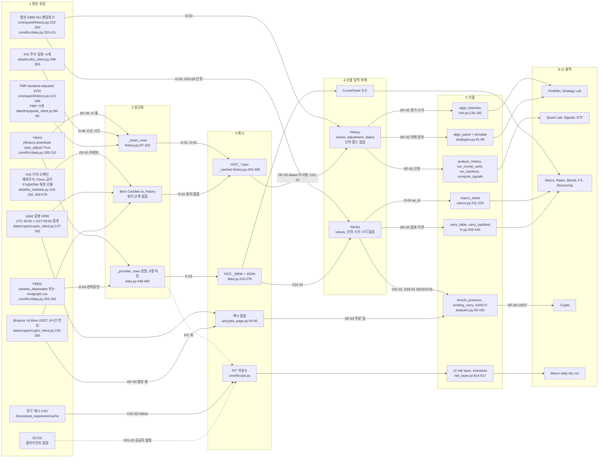

# 데이터 흐름 감사 보고서: 공급자 원본 → 정규화 → 캐시 → 모델 입력 → UI (요청서 7장 3항, 6장)

> 복원 메모 (오케스트레이터): 하네스가 조사 에이전트의 보고서 파일 쓰기를 거부했습니다. 이 파일은 그 에이전트가 반환한 구조화 결과(요약, 발견사항, 미검증 항목)를 내용 변경 없이 옮긴 것입니다. 원본은 워크플로 저널 `wf_4ff8dbcc-e3c`에 있습니다.

> 보고서 파일 미작성: 하네스가 서브에이전트의 보고서 .md 쓰기를 거부했다("Subagents should return findings as text"). 우회하지 않았다. 아래 본문과 findings가 보고서 전체다. 상위 단계가 `docs/audit/2026-10-27/data_flow.md`로 그대로 옮겨 적으면 된다.

- 감사일 2026-10-27. 기준 커밋 `859a983`. 저장소 파일은 하나도 고치지 않았다(`git status`: 다른 차원의 미추적 보고서 2개뿐). 수정안은 diff로만 제시한다.
- 환경: Python 3.13.17, numpy 2.3.5, pandas 2.3.3, scipy 1.18.0, statsmodels 0.15.0, yfinance 1.7.0, pandas_datareader 0.11.1, flet 0.85.2.
- 시장 데이터 공급자에 실제 요청을 보내지 않았다. 금지 파일 4개(`yf_SPY.csv`, `yf_BTC-USD.csv`, `binance_BTCUSDT.csv`, `upbit_KRW-BTC.csv`)는 열지도, 읽지도, 해시하지도 않았다. 하네스의 CSV 읽기 함수가 이 4개를 거부한다.
- `.env`는 열지 않았다. `config` 임포트 전에 `dotenv.load_dotenv`를 빈 함수로 바꿨고, 키 이름이 들어간 환경 변수는 지웠다.

## 0. 요약
- 공급자 7종(Yahoo, FRED, KIS, ECOS, FMP, Upbit/Binance, 합성)과 연구 캐시 경로를 홉별로 추적했다. 흐름도는 3장, 홉별 위험 표는 4장에 있다.
- 맞게 처리되는 곳도 코드로 확인했다. FRED 퍼센트→소수 변환(곡선 `core/ficc/data.py:582`, 단기금리 `:666-667`, 매크로 `core/ficc/macro.py:136-137`, Quant Lab rf `ui/quant_lab_page.py:94`), 매크로 화면 %·bp 표시(`ui/macro_page.py:56-70`), FMP 배당조정 판정(`core/quant/history.py:163-165`), KIS 주식 수정주가 요청(`data/krx/kis_client.py:286`), FMP 시세의 공급자 타임스탬프(`data/fmp/quote_client.py:86-95, 282`), 총수익·가격수익 혼합 경고(`history.py:105-117`).
- 새 발견사항 6건(P2 2건, P3 4건). D-01~D-05, C-01과 겹치지 않는 것만 올렸다. 겹치는 항목은 5장에서 위치만 가리킨다.

| ID | 심각도 | 판정 | 한 줄 요약 |
|---|---|---|---|
| DF-01 | P2 | 사실 | 금리·수익률 수준(KIS `Y0101` 등 퍼센트, Yahoo `^TNX`)이 가격으로 모델에 들어간다. 채권 랠리가 −28.5% "손실"로 나오고, 최소분산 최적화가 이 계열에 97%를 준다 |
| DF-02 | P2 | 사실(측정) | 종가 시각이 다른 시장(KRX 06:30 UTC, 미국 20~21시 UTC, 암호화폐 00:00 UTC)을 같은 날짜로 맞춘다. KODEX 200–QQQ 상관이 0.164로 계산되지만 5세션 기준은 0.538이다. 전략 패널에서는 미래 정보가 된다(토이 규칙 Sharpe 2.94 → 정보 일치 정렬 0.47) |
| DF-03 | P3 | 사실 | 진행 중 마지막 봉: `History.status="provisional_intraday"`를 읽는 곳이 0곳. Crypto 화면은 열린 일봉과 오늘 일부 회차 펀딩을 완성값처럼 쓴다 |
| DF-04 | P3 | 추정 | FX 캐리 백테스트가 월간 OECD 금리를 1관측만 늦춘다. FRED 게시일보다 최대 약 2주 일찍 순위에 쓰면서 note는 "no lookahead" |
| DF-05 | P3 | 사실 | Yahoo 연속선물(`CL=F` 등)은 롤 조정이 없는데 note가 "Yahoo adjusted close". KIS 채권 가격 계열은 쿠폰 제외를 말하지 않는다 |
| DF-06 | P3 | 사실 | 김치 프리미엄이 Binance USDT 가격을 USD로 1:1 취급하고 note에 밝히지 않는다 |

- 제안 패치: 12개 파일, 477줄(LF 기준). 원본 사본에서 제안 회귀 테스트 8개 모두 실패, 패치 사본에서 모두 통과. 기존 테스트 부분집합(8개 모듈)은 두 사본 모두 PASS 159 / FAIL 4 / NOT_RUN 7 / 임포트 실패 2로 같다. FAIL·임포트 실패는 모두 스크래치 사본에 `docs/`, `main.py`가 없어서 생긴 환경 문제다. 비PASS 목록이 한 줄도 다르지 않다.

## 1. 범위
- 요청서 7장 3항: 공급자별 원본 → 정규화 → 캐시 → 모델 입력 → UI 흐름. 홉마다 시간대, 관측 시각 대 수신 시각, 단위(%, bp, 연율), 수정주가(분할·배당), 중복·누락, NaN/inf, 매크로 발표 지연, 합성 대체, 캐시 만료를 점검.
- 요청서 6장: 시리즈별 출처·수신 시각·관측 시각·발표 시각·단위·시간대, 주식 조정 기준, 금리·매크로의 관측일 대 발표일, BTC의 거래소·호가 통화·시간대·봉 마감 시각·누락 봉·거래소 간 차이.
- 대상 코드: `core/quant/history.py`, `core/ficc/data.py`, `core/ficc/macro.py`, `core/ficc/fx.py`, `core/crypto/analytics.py`, `data/crypto/crypto_client.py`, `data/krx/kis_client.py`, `data/kis_markets.py`, `data/fmp/quote_client.py`, `core/quant/risk.py`, `core/quant/strategies.py`, `core/quant/montecarlo.py`, `core/quant/backtest.py`, `core/skills/macro_daily.py`(dry run 입력만), `ui/` 소비 화면.
- 범위 밖: `paper_live/`, `grokteam/`(읽지도 실행하지도 않음). 금융 공식 정확성(7장 4항), 속도(5항), 테스트 의미(6항)는 다른 차원이 다룬다.

## 2. 방법
1. 네트워크 접점 함수부터 화면 위젯까지 호출 경로를 코드로 추적했다. 소비자는 `grep`으로 모두 찾고 함수 본문을 읽었다.
2. 홉마다 6장의 점검 항목을 표로 채우고, 칸마다 코드 라인 근거와 사실/추정/미검증을 붙였다.
3. 의심 지점은 재현 스크립트로 확인했다. 모두 `python3 -B`, 가짜 전송 계층(`_yf_fetch`, `crypto_client._get`, `KISMarkets` 교체), 허용 캐시 CSV(`yf_069500.KS.csv`, `yf_QQQ.csv`, `yf_CL_F.csv`, `binance_funding_BTCUSDT.csv`, `binance_ETHUSDT.csv`)를 썼다.
4. 공급자 동작은 문서로 확인했다. 웹 검색 2건: FRED `IR3TIB01KRM156N` 페이지 요약(최신 관측 2026-02, 갱신 2026-03-16), Binance kline 클라이언트 문서(열린 봉의 종가는 변한다). FRED 페이지를 직접 가져오지는 않았다(공급자 호출 금지). yfinance 1.7.0의 일봉 시간대 처리는 설치된 소스(`yfinance/multi.py`: `ignore_tz = interval[-1] not in ('m','h')` → `tz_localize(None)`)로 확인했다.
5. 수정안은 스크래치 사본(`audit_work/data_flow/tree`)에만 적용했다. 원본 사본(`orig`)과 비교해 diff를 만들었다. 저장소에는 `git apply --check --ignore-whitespace`(적용 없음)만 돌렸고 통과했다.
6. `tests/run_all.py`는 쓰지 않았다. 8개 모듈(`quant_acceptance`, `ficc_acceptance`, `expansion_acceptance`, `acceptance`, `macro_m2_risk`, `macro_m4_integration`, `macro_m7_stats`, `macro_m9_lab`)의 테스트 함수를 스크래치 사본에서 프로세스 안으로 불렀다. 캐시·매크로·거래 폴더는 임시 폴더, 네트워크는 차단.

## 3. 데이터 흐름도
화살표 라벨은 그 홉의 위험 ID다. `DF-`는 이 보고서, 나머지는 요청서와 다른 차원 보고서의 ID다.

### 3.1 공급자별 요약
| 공급자 | 날짜 라벨 기준 | 값의 시각 | 단위 | 조정 기준 | 수신 시각(fetched_at) | 발표 시각 | 합성 대체 | 캐시 만료 |
|---|---|---|---|---|---|---|---|---|
| Yahoo (`yf_history`, `_yf_fetch`) | 거래소 현지 날짜(yfinance 1.7 일봉 `ignore_tz` 기본 True, 소스 확인) | 거래소 종가. 장중이면 마지막 행은 진행 중 가격(`data.py:224-230`) | 가격. `^TNX` 등은 퍼센트 수준(DF-01) | `auto_adjust=True`(`data.py:200`) 분할+배당 → `total`. `^`·`=F`·`=X`·`-USD`는 `""`(`history.py:279-281`). `=F` 롤 조정 없음(DF-05) | History는 캐시 적중 시 note "cached HH:MM"(시간대 없음, C01-05). Series는 없음 | 해당 없음 | FICC `auto`만(`data.py:609-613`). History 경로는 예외 | 장중 10분, 아니면 6시간(`history.py:424-436`, `data.py:248-265`) |
| FRED (`_fred_fetch`) | 관측일(뉴욕 영업일, DFF 등 7일) | 관측일만 | 퍼센트 원값. 변환 지점 4곳 모두 정상(0장) | 해당 없음 | 없음(D04-02, C01-05) | 시트 경로 없음. PIT만 구분(D04-03) | `auto`에서 합성, 소수로 바뀜(D-03, D03-06) | 6시간 |
| KIS 주식 (`kis_history`, `KISClient.quote`) | KST 영업일 | 15:30 KST. 장중이면 진행 중 가격 | 원 | `FID_ORG_ADJ_PRC="0"`(`kis_client.py:286`) 분할·권리, 현금배당 제외 → `split`(`history.py:224-226`) | 시세 `as_of=_now()` 수신 시각(D-05) | 해당 없음 | KIS 미설정 시 합성(`history.py:491-496`) | 장중 10분 / 6시간 |
| KIS 기타 (`kis_market_history`) | KST(국내), 거래소 현지(해외) | 같음 | 해외주식 가격, `Y0xxx` 퍼센트(DF-01), `FX@KRW` 원/달러, 채권 1만원당 가격 | 해외 `MODP=1` 분할만(`kis_markets.py:470`, `history.py:309`). 채권 쿠폰 미포함(DF-05). 선물은 단일 계약. `continuous_futures`(`kis_markets.py:291-317`) 호출처 없음 | 시세 `as_of` 로컬 날짜(D05-06) | 해당 없음 | KIS 미설정 시 주가형 합성(D03-06) | 같음 |
| FMP (`fmp_history`, `FMPQuoteClient`) | 거래소 날짜 | 거래소 종가 | 가격 | `/historical-price-eod/dividend-adjusted`, 응답 전체로 `adjClose` 유무 1회 판정 → `total`/`split` | 시세 `as_of`는 공급자 `timestamp`(정상) | 해당 없음 | 키 없으면 합성(`history.py:507-511`), 키 있고 실패면 예외 | 이력 6시간·장중 10분, 시세 메모리 20초 |
| Upbit (`UpbitPublic.daily`) | `candle_date_time_utc` 날짜(`crypto_client.py:151`). KST로는 그날 09:00~다음 날 09:00 | 다음 날 00:00 UTC. 오늘 봉은 열린 봉 | KRW | 해당 없음 | 없음. 시세 `as_of` 수신 시각(`:173`) | 해당 없음 | 명시 경로 예외 | `load_history` 경유 CRYPTO 10분. Crypto 화면은 캐시 없음(P01-09) |
| Binance (`BinancePublic.daily`, `funding`) | kline 시작의 UTC 날짜(`:221`) | 다음 날 00:00 UTC. 마지막 kline은 열린 봉(DF-03). 펀딩 00·08·16시 UTC | USDT(DF-06). 펀딩 8시간 소수 | 해당 없음 | 없음. `premium_index` `as_of` 수신 시각(`:265`) | 해당 없음 | 같음 | 같음 |
| ECOS | 없음 | 없음 | 없음 | 없음 | 없음 | 레지스트리에만 `ECOS_1530` 15:30 KST(`data/macro/series_registry.yaml:24, 310-314`) | 없음 | v2 risk layer·시나리오가 `ECOS_1530_CLOSE`를 PIT에서 읽음(`core/quant/risk_layer.py:614-617`, `core/quant/scenarios.py:38`). 공급자는 V01-03 |
| 합성 | 로컬 오늘로 끝나는 평일, 공휴일 포함(D03-08) | 없음 | History 주가형, FICC `rate` 소수(D03-06) | 해당 없음 | 없음 | 없음 | 그 자체 | 캐시 안 함(`data.py:26-28`) |
| 연구 캐시 CSV | 파일별 | 파일별 | 파일별 | Yahoo `auto_adjust=True`(`docs/asset_expansion_study.py:85`) | 파일 mtime(C01-03) | 없음 | 없음 | 없음, `--refresh`만(C01-09) |

## 4. 홉별 위험 표
판정: 사실 = 코드·재현으로 확인. 추정 = 근거는 있으나 재현 못 함. 미검증 = 확인 못 함. "정상"은 점검 결과 문제 없음.

| # | 공급자 | 홉 | 파일:라인 | 점검 항목 | 현재 동작 | 위험·판정 | 관련 ID |
|---|---|---|---|---|---|---|---|
| Y1 | Yahoo | 원본 | `core/ficc/data.py:200` | 수정주가 | `auto_adjust=True`: Close가 분할·배당 조정 | 새 배당 때 과거 전체가 재조정됨. 6시간 캐시 안에서는 무관. 정상(사실) | — |
| Y2 | Yahoo | 원본 | yfinance 1.7 `multi.py`(`ignore_tz`) | 시간대 | 일봉은 tz 제거 → 거래소 현지 날짜 | 시장 간 종가 시각 차가 날짜에 남지 않음(사실, 라이브러리 소스) | DF-02 |
| Y3 | Yahoo | 원본 | `data.py:208-209` | NaN/inf | `dropna`만, `isfinite` 없음 | inf 통과(사실) | D-01 |
| Y4 | Yahoo | 정규화 | `history.py:275` → `:97-102` | 중복·0 이하 | 0 이하·None·NaN 조용히 제거, 중복·inf 유지 | 재현 r00: inf와 같은 날짜 2행이 남음(사실) | D-01, D-02 |
| Y5 | Yahoo | 정규화 | `history.py:279-281` | 단위·조정 라벨 | note "Yahoo adjusted close" 고정. `^`·`=F` → adjustment `""` | `^TNX` 수익률, `=F` 롤 미조정이 가격처럼 보임(사실) | DF-01, DF-05 |
| Y6 | Yahoo | 캐시 | `data.py:224-230, 261` | 진행 중 봉 | 마지막 행 날짜 ≥ 기록 UTC 날짜면 10분만 | 정상. 다만 `as_of`가 오늘이 될 수 있음 | C01-02, D04-01 |
| Y7 | Yahoo | 캐시 | `history.py:402-458` | 만료·검증 | 장중 10분/6시간, 행 수 일치만 검사 | 손상 파일 사용(사실) | C01-01, C01-07, P01-08 |
| Y8 | Yahoo | 원본 | `data.py:435-440` | 창 | 10년 상한 | 긴 창 요청이 잘림(사실) | P01-10 |
| Y9 | Yahoo·FMP·KIS | 모델 | `core/quant/risk.py:134-160`, `strategies.py:51-90` | 시장 정렬 | 날짜 교집합, 같은 날짜 일간 수익률 | 상관 과소, 전략 미래 정보(사실, 측정) | DF-02 |
| F1 | FRED | 원본 | `data.py:163-192` | 관측 대 수신 대 발표 | 관측일만. 발표·수신 시각 없음 | 시트 경로에서 최신성 판단 불가(사실) | D04-02, C01-05 |
| F2 | FRED | 원본 | `data.py:171` 대 `:189` | NaN/inf | pdr 경로 `dropna`만, requests 경로 `isfinite` | 경로마다 다름(사실) | D-01 |
| F3 | FRED | 정규화 | `data.py:20-22, 582, 666-667`; `macro.py:136-137`; `ui/quant_lab_page.py:94` | 단위 %→소수 | 소비자마다 따로 변환. 확인한 4곳 모두 맞음 | 정상(사실). 합성 대체 시 단위 바뀜 | D03-06 |
| F4 | FRED | 정규화 | `macro.py:147-153` | 주말 행 | 7일 계열 주말 제거 | 정상(사실) | — |
| F5 | FRED | 정규화 | `data.py:616-632` | 빈도 | 월간 OECD는 월초 날짜, ffill 없음. 주석 `:618` "6-8 months behind" | 정상 표기(사실) | FC-03 |
| F6 | FRED | 모델 | `core/ficc/fx.py:373-381, 434-438` | 발표 지연 | 월간 1관측 지연, note "no lookahead" | FRED 게시일보다 이름(추정) | DF-04 |
| F7 | FRED | 모델→UI | `fx.py:342-371`; `core/ficc/insights.py:288-292`; `ui/fx_page.py:347-366` | 오래된 값 | 45일 넘으면 `rate_stale`. 해설에만 나오고 표·AI 페이로드 행에는 `rate_date`·`rate_stale` 없음 | 표만 보면 묵은 금리를 모름(사실) | DF-04(부수) |
| F8 | FRED | 모델 | `macro.py:223` | 기준일 | `max(last_date)` | 지표별 지연 은폐(사실) | D04-01 |
| F9 | FRED | UI | `ui/macro_page.py:56-70` | 단위 표시 | pct·bp 정상 | 정상(사실) | — |
| F10 | FRED | 원본 | `data.py:163-192` 전체 | 수정 발표 | 최신 빈티지만, ALFRED 없음 | 수정되는 계열이면 백테스트에 사후 값. 현재 지표는 대부분 금리·환율이라 영향 작음(추정) | D04-03 |
| F11 | FRED | 대체 | `data.py:539-541` | 합성 | `auto`에서 id별 합성 | (사실) | D-03 |
| K1 | KIS 주식 | 원본 | `kis_client.py:286` | 수정주가 | `"0"`=수정주가 요청, 라벨 `split`과 일치 | 정상(사실. 필드 의미는 KIS 문서 기준) | — |
| K2 | KIS | 원본 | `kis_client.py:269, 324` | 시세 시각 | `as_of=_now()` 수신 시각 | (사실) | D05-01 |
| K3 | KIS | 원본 | `kis_client.py:275-276`; `kis_markets.py:139-140, 466-467` | 날짜 기준 | 기기 로컬 날짜 | KST가 아닌 기기에서 경계 하루 차. 장중에는 영향 없음(추정) | D05-06 |
| K4 | KIS | 정규화 | `history.py:192-226` | 중복 | dict, 먼저 받은 페이지 우선 | 정상(사실). 속도는 P01-03 | P01-03 |
| K5 | KIS 기타 | 정규화 | `kis_markets.py:143-156` | 0 이하·중복 | ≤0 제거(금리 0 이하도 제거), 마지막 행 우선 | (사실) | D-01, D-02 |
| K6 | KIS 기타 | 정규화 | `history.py:312-313` | 단위 | `Y0xxx` 퍼센트를 `closes`로, note `""` | 가격으로 계산됨(사실) | DF-01 |
| K7 | KIS 기타 | 정규화 | `history.py:310-311`; `kis_markets.py:570-578` | 조정 | 채권 1만원당 가격, 쿠폰 미포함, adjustment `""` | 가격수익률임을 말하지 않음(사실) | DF-05 |
| K8 | KIS 기타 | 정규화 | `kis_markets.py:291-317`; `history.py:316` | 롤 | `continuous_futures` 호출처 없음, `load_history`는 단일 계약 | 단일 계약은 롤 없음, 정상(사실) | DF-05(대조) |
| K9 | KIS 기타 | 정규화 | `history.py:306-309` | 해외 조정 | `MODP=1` 분할만 → `split` | 정상(사실) | — |
| K10 | KIS | 대체 | `history.py:491-506` | 합성 | KIS 미설정 시 합성 | (사실) | D-03(S7, S8) |
| K11 | KIS 기타 | UI 연결 | `kis_markets.py:492-512` | KRW 금리·원/달러 | FICC 화면 미연결 | (사실) | FC-03 |
| K12 | KIS | 모델 | `ui/derivatives_page.py:69-71`; `core/ficc/equity_deriv.py:133` | 단위·관례 | CD 91d 단리 퍼센트/100을 연속복리로 사용 | 3%·3개월에서 약 1bp 차이(사실, 계산). 기록만 | D03-05 |
| M1 | FMP | 원본 | `history.py:131, 163-165` | 조정 | dividend-adjusted, 응답 단위 판정 | 정상(사실) | — |
| M2 | FMP | 원본 | `quote_client.py:86-95, 282` | 시세 시각 | 공급자 timestamp | 정상(사실). KIS와 대조 | D-05(대조) |
| M3 | FMP | 정규화 | `history.py:166-178` | inf·중복 | `_clean_rows` | (사실) | D-01, D-02 |
| M4 | FMP·KIS·Yahoo | 모델·UI | `history.py:105-117`; `ui/portfolio_page.py:139`; `ui/strategy_lab_page.py:133` | 조정 혼합 | total+split 혼합 경고 | 정상(사실). 수익률·롤 계열은 대상 아님 | DF-01, DF-05 |
| B1 | Upbit | 원본 | `crypto_client.py:151, 165` | 시간대 | UTC 날짜(KST 09:00 경계) | KRX와 섞으면 종가 17.5시간 차(사실) | DF-02 |
| B2 | Binance | 원본 | `crypto_client.py:221-226` | 시간대 | kline 시작 UTC 날짜 | 정상(사실) | — |
| B3 | Upbit·Binance | 원본 | `crypto_client.py:161, 223` | NaN/0 | `or 0.0`, `float()` 그대로 | 0·inf 통과(사실) | D-01 |
| B4 | Upbit·Binance | 정규화 | `crypto_client.py:81-84`; `history.py:290-291` | 정리 | `to_history`는 `_clean_rows`를 거치지 않음 | (사실) | D-01 |
| B5 | Binance·Upbit | 원본 | `crypto_client.py:192-226`(close time `k[6]` 미사용), `:137-165` | 열린 봉 | 마지막 봉을 그대로 반환 | (사실: 코드. 공급자 동작은 추정) | DF-03 |
| B6 | Binance | 원본 | `crypto_client.py:97-102` | 부분 일 | `daily()`의 오늘 합은 지금까지 회차만 | (사실) | DF-03 |
| B7 | Upbit·Binance | 정규화 | `crypto_client.py:137-226` | 누락 봉 | 간격 검사 없음. Upbit는 체결 없는 봉을 만들지 않음 | 비유동 종목 누락(추정) | D-01(간격) |
| B8 | Crypto 화면 | 캐시 | `ui/crypto_page.py:45-60` | 캐시 | 없음, 매번 새로 받음 | (사실) | P01-09 |
| B9 | Upbit·Binance | 모델 | `core/crypto/analytics.py:69-107` | 호가 통화 | USDT=USD | (사실) | DF-06 |
| B10 | FRED→Crypto | 모델 | `analytics.py:73-80`; `ui/crypto_page.py:52` | FX 정렬 | DEXKOUS 날짜 ffill, H.10 주간 발표 | 최대 약 10일 묵은 환율(사실) | V01-01, D03-01 |
| B11 | Crypto | 모델 | `ui/crypto_page.py:76-77` 대 `core/quant/risk.py:84-90` | 연율화 | Crypto 화면은 365 변환, `analyze_history`는 252 | 다른 화면에서 BTC 변동성이 다르게 나옴(사실) | D-01/D-02 차원 작업(r07) |
| E1 | ECOS | 원본 | `series_registry.yaml:310-314`; `risk_layer.py:614-617`; `scenarios.py:38` | 공급자 | 클라이언트 없음, PIT 계열을 읽음 | 실데이터 없으면 계산 불가 또는 proxy(사실) | V01-03 |
| E2 | ECOS | 대체 | `core/ficc/context_log.py:408` | proxy | DEXKOUS를 "labelled proxy"로 | 시각이 15:30 KST가 아니라 정오 NY(사실) | V01-01 |
| S1 | 합성 | 원본 | `history.py:250-257`; `data.py:288-295` | 날짜 | 로컬 오늘, 평일, 공휴일 포함 | 최신처럼 보임(사실) | D03-08 |
| S2 | 합성 | 원본 | `data.py:311-352` | 단위 | `rate` 소수 대 FRED 퍼센트 | 100배 차이(사실) | D03-06 |
| S3 | 합성 | 원본 | `history.py:501-506` | 형태 | 수익률 기호에 주가형 GBM | (사실) | D03-06 |
| R1 | 연구 CSV | PIT | `core/skills/macro_daily.py:86-91` | 조정 | Yahoo 조정 종가를 `*_OFFICIAL_CLOSE` id에 넣음. `vendor_close`, "not an official close" 표시 있음 | 공식 종가와 수준 차(배당 누적). 수익률엔 영향 작음(추정, 미측정) | C01-03 |
| R2 | 연구 CSV | PIT | `macro_daily.py:1412` | 수신 시각 | 파일 mtime | (사실) | C01-03 |
| R3 | 연구 CSV | 캐시 | `docs/asset_expansion_study.py:68-136` | 검증 | 입력 해시 없음 | (사실) | C01-09 |
| R4 | 연구 CSV | 카드 | `docs/asset_expansion_study.py:319-320` | 롤 | "Yahoo's roll treatment is undocumented"가 카드 문구에만 | 앱 경로에는 경고 없음(사실) | DF-05 |
| U1 | 전체 | UI | `ui/quant_lab_page.py:323-327`; `ui/portfolio_page.py:143-144` | 출처·시각 표시 | source, note, first→last 날짜. `status` 미표시 | 진행 중 봉을 종가로 보임(사실) | DF-03 |

## 5. 요청서 항목과의 교차 참조(이 차원에서 본 위치만)
| 요청서 ID | 이 차원에서의 판정 | 흐름상 위치 | 세부 |
|---|---|---|---|
| D-01 | 사실. 재현 r00: `_clean_rows([...inf..., NaN, -1])` → inf 유지, NaN·−1은 경고 없이 제거 | 정규화 홉 4곳: `_clean_rows`(`history.py:97-102`), `_bars`(`kis_markets.py:143-156`), `Candles.to_history`(정리 없음, `crypto_client.py:81-84`), `_yf_fetch`·pdr(`data.py:171, 208`) | D-01/D-02 차원 보고서 |
| D-02 | 사실. 같은 날짜 2행이 그대로 남음(r00). KIS·Upbit·Binance 페이징은 dict로 중복 제거 | 정규화 | D-01/D-02 차원 보고서 |
| D-03 | 이 차원은 합성 대체 지점을 흐름도에 표시만 함 | 원본·대체 | D03-01~10 |
| D-04 | 사실(`macro.py:223`) | 모델(macro_sheet) | D04-01~03 |
| D-05 | 사실(`kis_client.py:269, 324`). FMP 시세는 공급자 timestamp를 써서 정상 | 원본(시세) | D05-01~06 |
| C-01 | 캐시 홉 전체 | 캐시 | C01-01~09 |
| V-01 | DF-02(종가 시각 기준), DF-06(USDT/USD)이 V-01 하네스의 `date_basis`·P15 쌍 입력이 된다 | 모델 | V01-01~03 |
| P-01 | Crypto 화면 무캐시(B8), Yahoo 10년 상한(Y8) | 캐시·원본 | P01-09, P01-10 |
| FC | Strategy Lab은 현재 차트 단계에서 멈춤(FC-01). DF-02의 전략 영향은 계산 단계와 장부 등록에 해당 | 모델 | FC-01, FC-03 |

## 6. 발견사항
상세 필드(ID, 심각도, 판정, 파일·함수·라인, 재현 단계, 기대 결과, 실제 결과, 영향, 수정안, 회귀 테스트)는 findings 배열에 있다.

## 7. 수정안(diff, 적용하지 않음)
- 전체 diff: `/tmp/claude-0/-home-user-quantgen/244a07c1-ef5e-50fd-a9f1-360db0f46038/scratchpad/audit_work/data_flow/proposed_data_flow.diff`(저장소 줄바꿈 그대로, `history.py`는 CRLF). 읽기용 LF 판: `…/proposed_data_flow.lf.diff`(477줄). 생성 스크립트: `…/apply_patches.py`(스크래치 사본에만 적용, 경로에 scratchpad가 없으면 거부).
- 대상 12개 파일: `core/quant/history.py`, `core/quant/risk.py`, `core/quant/strategies.py`, `core/quant/montecarlo.py`, `core/quant/backtest.py`, `core/ficc/fx.py`, `core/crypto/analytics.py`, `data/crypto/crypto_client.py`, `ui/crypto_page.py`, `ui/portfolio_page.py`, `ui/quant_lab_page.py`, `ui/strategy_lab_page.py`.
- 저장소 대상 `git apply --check --ignore-whitespace`: 통과(적용 안 함).
- 모든 새 필드(`History.kind`, `BasketStats.note`, `Panel.note`)는 기본값이 있는 꼬리 필드다. 저장소 안의 생성 호출은 모두 키워드 방식이라 깨지지 않는다(`grep` 확인). 새 `ValueError`는 해당 화면들이 이미 잡아서 오류 배너로 보인다(`ui/quant_lab_page.py:291`, `ui/signals_page.py:140`, `ui/portfolio_page.py:118`, `ui/strategy_lab_page.py:236`).

## 8. 검증 결과
- 제안 회귀 테스트 `…/regression_data_flow.py`(8개): 원본 사본 8 FAIL, 패치 사본 8 PASS(`…/regression_out.txt`).
- 모듈 자체 검사(`core.ficc.fx`, `data.crypto.crypto_client`, `core.crypto.analytics`, `core.ficc.data`, `core.ficc.macro`): 두 사본 모두 `ok`(`…/selfcheck_tree.out`).
- 기존 테스트 8개 모듈: 원본 PASS 159 / FAIL 4 / NOT_RUN 7 / 임포트 실패 2, 패치 사본 동일. 비PASS 목록이 한 줄도 다르지 않다(`…/subset_orig.log`, `…/subset_tree.log`). FAIL 4건은 `main.py`·`docs/quant_lab_grading` 부재, 임포트 실패 2건은 `docs.kis_quote_check` 부재(스크래치 사본 환경). NOT_RUN 7건은 REFDATA·OWNER 사유다. 미실행 테스트를 통과로 세지 않았다.
- 패치 후 재현: r01은 `ValueError: I:Y0101 is a rate pct series (KIS benchmark yield in percent: a rate, not a price), not a price: risk statistics needs prices.` r03 정렬 상관 0.164 → 0.428(5세션), note 표시. r04 포지션 차이 3회 → 0회, note에서 "no lookahead" 삭제. r06 note "Yahoo continuous front-month future, NOT roll-adjusted".

## 9. 소유자 메모와의 관계(데이터 흐름 관점만)
- "(-> 공급사필요)": 흐름에서 공급원이 비어 있는 홉은 세 곳이다. (1) 매크로 시트의 발표·수신 시각(F1): FRED 응답에는 관측일만 있다. ALFRED 빈티지(`realtime_start`, FRED API 키 필요, 미검증)나 이미 있는 PIT 경로(D04-03)로 통일하는 것이 맞다. (2) 원화 공식 시계열(E1): ECOS 클라이언트가 없는데 v2 risk layer와 시나리오가 `ECOS_1530_CLOSE`를 읽는다(V01-03). (3) USDT/USD 기저(DF-06): 측정 수단이 없다(V01 하네스 P15 제안).
- "(-> FICC/BTC 모두 KIS에서 접근 가능한지 …)": FICC 원화 금리·KTB·원/달러는 KIS로 이미 받는다(`data/kis_markets.py:55-64, 492-512, 561-578`). 화면에 연결되지 않았을 뿐이다(FC-03). 연결 전에 DF-01(단위 필드)을 먼저 고쳐야 퍼센트 금리가 가격으로 흘러가지 않는다. BTC 현물은 KIS에 없고 CME BTC 선물만 있다. 현물은 Upbit(KRW)·Binance(USDT) 무키 경로가 이미 구현돼 있다. 흐름상 필요한 것은 새 공급자가 아니라 완성 봉만 쓰기(DF-03), USDT 표기·기저 측정(DF-06), 종가 시각 표시(DF-02)다. 공급자 선택 자체는 C01/V01 보고서 9장과 D03 보고서 9장이 다룬다.

## 10. 재현 스크립트·산출물 경로(모두 `/tmp/claude-0/-home-user-quantgen/244a07c1-ef5e-50fd-a9f1-360db0f46038/scratchpad/audit_work/data_flow/`)
- `_h.py`: 하네스(dotenv 무력화, 키 환경 변수 삭제, 네트워크 차단, 캐시 스크래치, 금지 CSV 거부). `QG_ROOT`로 원본·패치 사본 선택.
- `r00_d01_d02_check.out`: D-01/D-02 교차 확인.
- `r01_yield_as_price.py` → `r01_out.txt`, `r01_yield_as_price.after.out` (DF-01)
- `r02_running_bar_dropped.py` → `r02_out.txt` (DF-03)
- `r03_nonsync_close.py` → `r03_out.txt`, `r03.after.out` (DF-02 상관)
- `r04_monthly_release_lag.py` → `r04_out.txt`, `r04_monthly_release_lag.after.out` (DF-04)
- `r05_crossvenue_lookahead.py` → `r05_out.txt` (DF-02 전략)
- `r06_futures_roll_label.py` → `r06_out.txt`, `r06_futures_roll_label.after.out` (DF-05)
- `regression_data_flow.py` → `regression_out.txt` (제안 회귀 테스트 8개)
- `run_subset.py` → `subset_orig.log`, `subset_tree.log` (기존 테스트 8개 모듈, 프로세스 내 실행, 결과 파일 미기록)
- `apply_patches.py`, `proposed_data_flow.diff`, `proposed_data_flow.lf.diff`, `orig/`, `tree/`
- 실행: `cd …/data_flow && python3 -B -W ignore r01_yield_as_price.py`(나머지 동일). 패치 사본 대상은 `QG_ROOT=…/data_flow/tree python3 -B -W ignore <script>`.

Sources (웹 검색): [FRED IR3TIB01KRM156N](https://fred.stlouisfed.org/series/IR3TIB01KRM156N), [Binance kline client docs (crystaldoc)](https://crystaldoc.info/github/mwlang/binance/master/Binance/Responses/Kline.html)

## 발견사항 상세

### DF-01 (P2, 사실)

- **심각도:** P2
- **판정:** 사실
- **파일·함수·라인:** core/quant/history.py History:54-95(단위 필드 없음), kis_market_history:296-318(Y0xxx :312-313), yf_history:266-281(:279-281); data/kis_markets.py Bars.to_history:87-90, overseas_chart:476-490; 소비: core/quant/risk.py analyze_history:63-118, align_histories:134-160; core/quant/montecarlo.py run_monte_carlo:229; core/quant/backtest.py run_backtest:107; core/quant/strategies.py align_panel:51-66
- **재현 단계:** python3 -B .../audit_work/data_flow/r01_yield_as_price.py. 가짜 KIS 전송으로 국고채 3년(Y0101) 수익률 3.50%→2.50% 300세션을 load_history('Y0101', source='kis')로 받고, 같은 History를 analyze_history, run_monte_carlo(gbm), align_histories+optimize_portfolio(min_vol)에 넣는다. Yahoo ^TNX는 가짜 _yf_fetch로 같은 방식.
- **기대 결과:** 수익률·금리 계열은 단위(퍼센트)를 지니고, 수익률·변동성·MC·백테스트·포트폴리오 가중치 계산에서 거부되거나 별도 처리된다. 화면은 '가격이 아님'을 말한다.
- **실제 결과:** History(source='KIS', note='', adjustment='')로 들어온다. analyze_history: ann_return −0.283, max_drawdown −0.285, Sharpe −4.38. 같은 경로에서 3년 무이표채 보유자는 +2.94%(부호 반대). MC는 수익률 수준을 GBM으로 시뮬레이션(median_terminal 2.174). min_vol 최적화가 수익률 계열에 0.97 가중. ^TNX도 note 'Yahoo adjusted close', adjustment ''. convention_warning은 빈 문자열. load_history docstring(:469-470)과 kis_market_history docstring(:299)이 'Y0101 a KRW benchmark yield (percent)'라고 안내하는 경로다.
- **영향:** 채권 랠리가 −28% 손실로, 금리 '자산'이 저변동 자산으로 보인다. Portfolio·Quant Lab·Signals·Strategy Lab에 Y0xxx·^TNX·^IRX를 넣으면 숫자가 무의미하다. FC-03(KIS 원화 금리 FICC 연결)을 할 때 같은 함정에 빠진다.
- **수정안:** History에 꼬리 필드 kind: str = 'price' 추가('rate_pct' = 퍼센트 금리). require_price(h, what)로 analyze_history, align_histories, align_panel, run_monte_carlo, run_backtest 진입에서 ValueError('... is a rate pct series (...), not a price: ... needs prices'). kis_market_history의 Y0xxx는 replace(..., kind='rate_pct', note='KIS benchmark yield in percent: a rate, not a price'); yf_history는 _YAHOO_YIELDS=('^TNX','^IRX','^FVX','^TYX')에 kind='rate_pct'. _cached가 JSON에 'kind'를 쓰고 읽는다(안 하면 캐시 적중 때 kind가 사라짐). 차트 표시는 그대로 허용. diff: proposed_data_flow.lf.diff 의 core/quant/history.py @@-66,+66 / @@-117,+120 / @@-277,+318 / @@-308,+357 / @@-439,+490 / @@-451,+503, core/quant/risk.py @@-14 / @@-62 / @@-137, strategies.py @@-52, montecarlo.py @@-231, backtest.py @@-107.
- **회귀 테스트:** test_df01_kis_yield_is_not_a_price: 가짜 KIS로 load_history('Y0101') → assert h.kind == 'rate_pct'; analyze_history(h)와 align_histories([h, x])가 'not a price'를 담은 ValueError. test_df01_kind_survives_the_cache: TTL 3600, 두 번째 호출의 note에 'cached'가 있고 kind == 'rate_pct'. test_df01_df05_yahoo_labels: load_history('^TNX', source='yfinance').kind == 'rate_pct'. (regression_data_flow.py: 원본 FAIL, 패치 PASS)

### DF-02 (P2, 사실)

- **심각도:** P2
- **판정:** 사실
- **파일·함수·라인:** core/quant/risk.py align_histories:134-160(날짜 교집합 :140-143, 같은 날짜 일간 공분산 :153-154); core/quant/strategies.py align_panel:51-66, simulate:69-90(가중치 행 t를 t→t+1 보유 :71-73, :82-83); ui/portfolio_page.py:111-113; ui/strategy_lab_page.py:104-105. 대조: core/quant/optimize.py weekly_returns:145, v2 사용 :245
- **재현 단계:** (1) python3 -B .../r03_nonsync_close.py: 캐시 yf_069500.KS.csv(KODEX 200), yf_QQQ.csv, 2024-07-29~2026-09-23 505 공통 세션을 History로 만들어 align_histories와 optimize_portfolio(min_vol)에 넣는다. (2) python3 -B -W ignore .../r05_crossvenue_lookahead.py: 2015-01-01 이후 2,758세션, align_panel(코드 정렬)과 '정보 일치' 정렬(KRX t와 직전 미국 종가) 각각에 토이 규칙 '미국 상승일 다음 KRX 보유'와 앱의 pairs(y=KRX, x=US)를 simulate로 돌린다.
- **기대 결과:** 종가 시각이 다른 시장(KRX 15:30 KST=06:30 UTC, 미국 16:00 ET=20~21시 UTC, 암호화폐 00:00 UTC)을 섞으면 공분산을 비동시성 보정(주간·Dimson)하거나 최소한 경고한다. 전략 패널은 늦게 닫는 시장의 정보를 같은 날 먼저 닫힌 시장의 체결에 쓰지 않는다.
- **실제 결과:** 같은 날짜 일간 상관 0.164, KRX(t)–US(t−1) 0.351, Dimson 1지연 0.516, 5세션 0.538. min_vol 가중 [0.158, 0.842](주간 공분산이면 [0, 1]). 토이 규칙 Sharpe +2.94(연 +54.2%) 대 정보 일치 정렬 +0.47(연 +7.5%). 앱 pairs 계열은 −0.15 대 −0.15로 거의 같음. 화면 경고 없음(ui·core/quant에 관련 문구 0건). Upbit KRW-BTC(날짜 라벨 UTC, 종가 다음 날 09:00 KST)와 KRX를 섞으면 17.5시간 차.
- **영향:** Portfolio가 KRX·미국 혼합 바스켓의 분산 효과를 과대평가하고 비중을 잘못 준다(convention_warning이 '005930.KS와 미국 티커 혼합'을 권장하는 바로 그 경우). Strategy Lab에서 단기 규칙이 시차 정보를 실력으로 계산할 수 있다(pairs 외 계열은 미측정. Strategy Lab은 현재 FC-01로 렌더 단계에서 멈추지만 점수 계산과 장부 등록은 먼저 일어남).
- **수정안:** history.py에 close_clock(h)('KRX'|'US'|'UTC0'|'')와 mixed_close_warning(hists) 추가. align_histories는 혼합이면(세션 50 이상) 공분산을 5세션 합 수익률로 추정하고 BasketStats.note에 이유를 담는다. Portfolio는 stats.note를 오류 배너로 표시. align_panel은 Panel.note를 채우고, Strategy Lab은 note가 있으면 PASS/REJECT를 보류(withheld = 'No PASS / REJECT: ' + note + ' The walk-forward cannot tell that lead-lag from skill.'). 근본 해결은 레그별 정보 지연을 아는 패널(결정 시각 기준 as-of 조인)이며 v2 risk layer의 PIT 조인과 맞추는 것. diff: history.py @@-117,+120, risk.py @@-129 / @@-151,+155, strategies.py @@-43 / @@-63, ui/portfolio_page.py @@-139, ui/strategy_lab_page.py @@-103.
- **회귀 테스트:** test_df02_mixed_closes_are_flagged_and_weekly: KIS '069500'과 FMP 'QQQ'(KRX가 미국을 하루 늦게 따르는 합성 경로) → align_histories(...).note 비어 있지 않음, st.corr[0,1] > 같은 날짜 일간 상관 + 0.2, align_panel(...).note 비어 있지 않음; 같은 시장 두 개는 note == ''. (원본 FAIL, 패치 PASS; 패치 후 캐시 실데이터 상관 0.164→0.428)

### DF-03 (P3, 사실)

- **심각도:** P3
- **판정:** 사실
- **파일·함수·라인:** core/quant/history.py _cached:445-448(status 설정), History.status:65-68; 소비자 없음; 화면 칩 ui/quant_lab_page.py:323-327, ui/portfolio_page.py:143-144. Crypto: ui/crypto_page.py _live:45-60(캐시·status 우회), data/crypto/crypto_client.py FundingSeries.daily:97-102, BinancePublic.daily:192-226(close time k[6] 미사용), UpbitPublic.daily:137-165; core/crypto/analytics.py funding_carry:136-165; ui/crypto_page.py:70-77(weekday, GARCH)
- **재현 단계:** python3 -B .../r02_running_bar_dropped.py. [A] 가짜 Binance 전송으로 load_history('BTCUSDT', source='crypto')를 부르고, ui·core/quant·core/crypto에서 History의 .status를 읽는 줄을 검색. [B] 상수 펀딩 0.0001/8h로 오늘이 3/2/1회차일 때 funding_carry. [B2] 허용 캐시 binance_funding_BTCUSDT.csv(가격 레그는 binance_ETHUSDT.csv)로 마지막 날을 1/3·2/3로 줄여 비교. [C] 실제 클라이언트 코드로 열린 봉·부분 일 확인.
- **기대 결과:** history.py:448 주석('M1: a running last bar is never presented as a close')대로 진행 중 봉은 화면에 표시되거나 분석에서 빠진다. 펀딩 연율은 완성된 UTC 일만 쓴다.
- **실제 결과:** status='provisional_intraday', last_date=오늘(UTC). 읽는 소비자 0곳(검색 1건은 risk_layer.py:425의 다른 객체). Quant Lab 칩은 'first → last_date'만 보인다. Crypto 화면은 캐시·status를 거치지 않고 열린 kline과 오늘 일부 펀딩(09:53 UTC 기준 0.0002 대 하루 0.0003)을 그대로 쓴다. 상수 펀딩: 연율 10.95% → 10.43%(2/3), 9.91%(1/3). 캐시 실이력(마지막 날 2026-09-25): 5.55% → 5.50% / 5.44%, 백분위 0.388 → 0.382 / 0.379.
- **영향:** 장중 실행 시 MC 시작가, 신호, 백테스트 마지막 날, 포트폴리오 마지막 수익률이 미완성 값이고 화면은 그 사실을 말하지 않는다. 크기는 1봉이라 작다. 펀딩 연율·백분위는 하루 중 시각에 따라 아래로 치우친다(실데이터에서 약 −0.1%p). GARCH·요일표에 부분 일 수익률이 하루치로 들어간다.
- **수정안:** Quant Lab 날짜 칩에 ' (last bar intraday, not a close)'와 오류 색, Portfolio 칩에 ' · last bar intraday'. crypto_client: UpbitPublic.daily(closed_only=False)는 오늘 UTC 봉 제거, BinancePublic.daily(closed_only=False)는 int(k[6]) >= now_ms 봉 제거, FundingSeries.daily(complete_only=False)는 오늘 UTC 키 제거. Crypto 화면 _live는 closed_only=True, complete_only=True. Signals·ETF 화면에도 같은 칩 권장(diff 미포함). diff: data/crypto/crypto_client.py @@-94 / @@-134 / @@-155 / @@-190 / @@-215, ui/crypto_page.py @@-45, ui/quant_lab_page.py @@-324, ui/portfolio_page.py @@-139.
- **회귀 테스트:** test_df03_crypto_page_uses_complete_days_only: inspect.getsource(ui.crypto_page._live)에 'closed_only=True'와 'complete_only=True'; 가짜 전송에서 Binance·Upbit daily(closed_only=True).dates[-1] < 오늘 UTC; funding(...).daily(complete_only=True)에 오늘 키 없음. test_df03_quant_lab_says_intraday: ui.quant_lab_page 소스에 'provisional_intraday'. (원본 FAIL, 패치 PASS)

### DF-04 (P3, 추정)

- **심각도:** P3
- **판정:** 추정
- **파일·함수·라인:** core/ficc/fx.py _ffill_rates:373-381(lag=1 :378), carry_backtest:384-440(이자 발생 :419, note :434-438), 모듈 docstring:23-29; core/ficc/data.py _SHORT_RATE_IDS:616-632(주석 :618 'run 6-8 months behind'); ui/fx_page.py:303-366(note → 페이로드 :366); core/ficc/insights.py:286-287(note를 해설에 그대로)
- **재현 단계:** python3 -B .../r04_monthly_release_lag.py. [A] 2025-01~2026-09 월간 계열(note 'monthly; FRED IR3TIB01KRM156N...')에 _ffill_rates를 2026-03-02, 03-13, 03-16, 03-31로 묻는다. [B] KRW가 매월 +25bp 오르는 합성 금리 교차 시나리오에서 코드 규칙과 발표일 규칙(익월 16일부터 사용)으로 carry_backtest(top_n=1, rebalance_days=5)를 돌려 포지션 비교.
- **기대 결과:** 순위(결정)에는 발표된 값만 쓰고, 이자 발생에는 그날 실제 금리를 쓴다. note의 'no lookahead'는 규칙과 일치한다.
- **실제 결과:** [A] 과거 백테스트에서 2026-03-02~03-31 모두 2026-02-01자 월평균 사용. 웹 검색으로 본 FRED 페이지는 Feb-2026 관측의 갱신일을 2026-03-16으로 표시 → 03-01~03-15에 미발표 값 사용. [B] 주간 리밸런싱 144회 중 3회 롱 레그가 다름(2024-01-01, 01-08, 01-15: 코드 KRW, 발표일 규칙 CAD). 이자 발생도 같은 지연 값을 써서 연 수익률 +6.22% 대 +5.80%. note는 'no lookahead'. 일간 SOFR·SONIA도 다음 날 아침 공표인데 관측일 당일 순위에 쓴다(1일 선행). 코드 자신의 주석은 OECD 계열이 6~8개월 늦다고 말한다.
- **영향:** 월간 금리를 쓰는 통화(JPY, KRW, AUD, CAD, CHF, EUR·GBP 대체 시)의 순위가 금리 변화 직후 최대 약 반 달 앞서 바뀐다. 수치 영향은 작지만 화면·AI 해설 문구가 사실과 다르다. 이자 발생에 한 달 늦은 금리를 써서 캐리 손익도 어긋난다.
- **수정안:** _MONTHLY_RELEASE_DAYS = 21; _release_dates(s)는 월간 관측(월초 날짜)을 익월 21일로, 그 밖은 관측일 그대로. _ffill_rates(s, dates, *, known=True)는 known=True면 발표일 기준(순위), False면 관측일 기준(이자). carry_backtest는 R(발표)로 순위, A(관측)로 이자 발생. note를 'ranks use rates published by the rebalance date (monthly averages from day 21 after month end; daily fixings on their observation date, a one-day lead); accrual at the observed rate'로 교체. 자체 검사도 새 규칙으로 갱신(tb.dates[0] == '2025-03-21'). 정석은 ALFRED realtime_start 또는 PIT 경로(core/ficc/pit.py)와 같은 발표 시각 관리. diff: core/ficc/fx.py @@-21 / @@-370 / @@-400 / @@-422 / @@-433 / @@-527.
- **회귀 테스트:** test_df04_monthly_rate_waits_for_release: 2026-01~09 월간 계열(0.03+0.0025i)에서 fx._ffill_rates(m, ['2026-03-02','2026-03-15']) == 0.03(1월 평균); carry_backtest(...).note에 'no lookahead' 없음. (원본 FAIL: 0.0325 반환, 패치 PASS. 패치 후 r04의 포지션 차이 0회)

### DF-05 (P3, 사실)

- **심각도:** P3
- **판정:** 사실
- **파일·함수·라인:** core/quant/history.py yf_history:266-281(note 고정 :281, adjustment :279-280), kis_market_history:310-311(채권); data/kis_markets.py continuous_futures:291-317(호출처 없음), bond_daily:570-578; docs/asset_expansion_study.py:319-320(카드 문구의 롤 caveat)
- **재현 단계:** python3 -B -W ignore .../r06_futures_roll_label.py. 허용 캐시 yf_CL_F.csv 2019-10-01~2021-09-30을 가짜 _yf_fetch로 실제 yf_history에 통과시키고 analyze_history를 돌린다.
- **기대 결과:** 연속선물은 롤 조정 여부를 표시한다('adjusted close'라고 하지 않는다). 채권 가격 계열은 쿠폰 제외(가격수익률)임을 note·adjustment로 말한다.
- **실제 결과:** CL=F note 'Yahoo adjusted close', adjustment ''. 원본 2020-04-17 18.27, 04-20 −37.63, 04-21 10.01, 04-22 13.78. −37.63 행은 0 이하라 경고 없이 빠짐(D-01). 남은 한 단계 로그수익률 −0.602, analyze_history worst_day −0.602, max_drawdown −0.842, 첨도 46.2. 04-21→04-22에 계약이 바뀌어 보임(5월물 만기 후 6월물; 계약 전환 시점은 공개 기록 기준 추정). KIS 채권 note는 'price per 10,000 KRW face; thin trading shows flat days'로 쿠폰 언급이 없고 adjustment ''.
- **영향:** 롤 날짜의 계약 간 가격차가 수익률·변동성·MC·백테스트에 섞인다. 'adjusted'를 롤 조정으로 오해할 수 있다. 채권은 이표 수입이 빠진 가격수익률인데 convention_warning이 잡지 못한다. 연구 쪽은 caveat를 알고 있으나(asset_expansion_study.py:319-320) 앱 경로에는 없다.
- **수정안:** yf_history note: '=F'는 'Yahoo continuous front-month future, NOT roll-adjusted', 수익률 지수는 DF-01 문구, 나머지는 'Yahoo adjusted close'. kis_market_history 채권: note에 '; coupons NOT included (price return)' 추가. 중기: KISMarkets.continuous_futures를 load_history에 연결하거나 Yahoo '=F'를 수익률 기반 모델에서 경고. diff: core/quant/history.py @@-277,+318 / @@-308,+357.
- **회귀 테스트:** test_df01_df05_yahoo_labels: 가짜 _yf_fetch로 load_history('CL=F', source='yfinance').note에 'roll' 포함. 추가 권장(미작성): 가짜 KIS 채권 응답으로 load_history('KR103501GE31', source='kis').note에 'coupons NOT included'. (원본 FAIL, 패치 PASS)

### DF-06 (P3, 사실)

- **심각도:** P3
- **판정:** 사실
- **파일·함수·라인:** core/crypto/analytics.py kimchi_premium:69-107(공식 :82 prem = kr/(us*fx) − 1, btc_usd=us :102, note :106-107), 모듈 docstring :7-8; ui/crypto_page.py:45-60
- **재현 단계:** 코드 확인. 회귀 테스트로 확인: kimchi_premium({d:1.4e8}, {d:1e5}, {d:1380.0})의 note에 'USDT' 없음. 크기 측정은 공급자 호출 금지로 하지 않음.
- **기대 결과:** 호가 통화가 다른 두 가격(Upbit KRW, Binance USDT)을 비교할 때 USDT/USD 기저를 보정하거나 note에 밝힌다.
- **실제 결과:** P_Binance(BTCUSDT)를 USD로 1:1 취급한다. 결과 필드 이름도 btc_usd. note는 FX 시차('a few hours of FX drift')만 말한다.
- **영향:** USDT가 1달러에서 벗어나는 구간(예: 2022-05)에는 기저가 김치 프리미엄 안에 섞여 z·ADF·예측 회귀에 들어간다. 평상시 크기는 미측정.
- **수정안:** note에 'Binance BTCUSDT is quoted in USDT and taken 1:1 as USD: the USDT/USD basis is inside the premium.' 추가(diff: core/crypto/analytics.py @@-103). 선택: Upbit KRW-USDT로 나눈 대안 프리미엄을 함께 보이기(Upbit USDT 자체에도 프리미엄이 있어 두 정의를 나란히 보여야 함). V01 하네스 P15(BTCUSDT 대 BTC-USD)로 기저 상시 측정.
- **회귀 테스트:** test_df06_kimchi_note_names_usdt: 상수 입력의 kimchi_premium(...).note에 'USDT' 포함. (원본 FAIL, 패치 PASS)

## 미검증 항목

- 보고서 파일 docs/audit/2026-10-27/data_flow.md는 작성하지 않았다: 하네스가 서브에이전트의 보고서 .md 쓰기를 거부했다. 전체 내용은 summary와 findings에 있다.
- DF-04의 발표일 근거는 웹 검색 요약 1건(FRED IR3TIB01KRM156N: Feb-2026 관측, 갱신 2026-03-16)이다. ALFRED 빈티지와 다른 OECD 계열(JPY, AUD, CAD, CHF)의 실제 발표 지연, 코드 주석의 '6-8개월' 주장은 확인하지 못했다.
- Binance/Upbit 일봉 API가 열린(진행 중) 봉을 마지막 행으로 주는지는 실제 호출로 확인하지 못했다. 근거는 서드파티 클라이언트 문서와 코드에 필터가 없다는 사실뿐이다.
- CL=F의 계약 전환 시점(5월물 만기 2020-04-21, 6월물 전환)과 6월물 가격은 공개 기록 기억이다. 사실로 쓴 것은 캐시 CSV 값(−37.63, 10.01, 13.78)뿐이다.
- yfinance 1.7 실제 응답의 날짜 처리(여러 시간대 티커 혼합 다운로드)는 라이브러리 소스로만 확인했고 실호출은 하지 않았다. Yahoo KRW=X 등 FX 일봉의 날짜 기준도 미검증이다.
- KIS 응답 필드 의미(FID_ORG_ADJ_PRC '0'=수정주가, bond_prpr가 클린가인지, Y0xxx가 퍼센트인지)는 저장소 주석과 문서 기준이다. 실호출로 확인하지 못했다.
- USDT/USD 기저의 평상시 크기는 측정하지 못했다(DF-06).
- pandas_datareader 0.11.1의 FRED 경로가 현재 FRED 응답에서 실제로 동작하는지 확인하지 못했다.
- DF-02의 전략 영향은 토이 규칙과 pairs 계열만 측정했다. trend_switch, vol_target, risk_parity, xs_momentum 계열의 영향은 미측정이다. Strategy Lab 화면은 FC-01 때문에 현재 렌더 단계에서 멈춘다.
- 실제 Flet 화면을 띄워 새 경고 배너·칩이 보이는지는 확인하지 않았다. 코드와 예외 처리 경로로만 확인했다.
- 연구 CSV의 Yahoo 조정 종가를 *_OFFICIAL_CLOSE id에 넣었을 때(macro_daily.py:86-91) 공식 종가와의 수준 차는 측정하지 않았다.
- KIS 클라이언트가 기기 로컬 날짜를 쓸 때(KST가 아닌 기기) 생기는 경계 영향은 재현하지 않았다.
- 기존 테스트는 8개 모듈만 스크래치 사본에서 돌렸다. 사본에 docs/와 main.py가 없어 FAIL 4건, 임포트 실패 2건이 두 사본 모두에서 났다. 해당 테스트의 패치 영향은 미검증이다. 전체 870건은 실행하지 않았다(run_all.py 금지).
- Signals·ETF 화면의 진행 중 봉 표시는 diff에 넣지 않았다(Quant Lab, Portfolio만).
