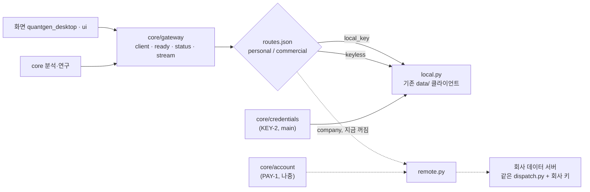

# 공급원 게이트웨이 설계 (KEY-3)

- 판: v0.3.3 (2026-11-20, KEY-5/a: 5절 서버 오류 코드 세 가지 꼴과 전송 실패 고정 코드, 7a절 `data.kis_stream`·`data.kis_workspace` 입구, 공용 `core/gateway/feed.py`, `krx_gateway()` 답의 막힘 사유와 길·키 바뀜 뒤 다시 설정, `on_change`). v0.3.2 (2026-11-20, PR #133 3차 검토 반영: 6절 화면 44곳·QuoteFeed 규칙·풀지 못한 `level`, 7a절 import 때 정하는 5곳을 코드 docstring과 같게, 같은 답 시험의 긴 목록 비교 방식과 김치 프리미엄 범위, 7절 KEY-5 행). v0.3.1 (2026-11-19, PR #133 메인 검토 반영: 6절 동결 예외·허용 목록·상한, 7a절 막힘(off·company)·묶음 로더·여러 공급원 모듈·예외 5곳·규칙 6 범위, 7절 하네스와 지문). v0.3 (2026-11-19, KEY-4: 6절 판 3, 7a절 새로, 3절 규칙 4·6과 9절 정정 — 메인 세션 KEY-3 검토 잔여 1·8번). v0.2 2026-11-19 (PR #132 검토: 경계 시험 ast화). v0.1 2026-11-19. 작성: PAYMENTS_ACCOUNT_KEYS 세션. ID `KEY-3/design`.
- **소유자 승인: 2026-11-19, 원문 "Key-3 승인"** (이 세션 채팅).
- 근거: 소유자 D7-G 승인 (2026-11-18 14:15 KST, 원문 "그러면 D7-G의 방식대로 진행하겠습니다", handoff `MERGE_QUEUE.md`, 커밋 `762150c`), 설계 원안 handoff `plans/2026-11-17/D7_ENV_STRUCTURE.md` 5장.
- 기준: main `ca5da08` (KEY-2 `3249af7`, KEY-2/b `ca5da08` 병합 뒤). 줄 번호는 이 커밋 기준이며 코드가 바뀌면 달라집니다.
- 완료 조건: 소유자 확인. 확인 전에도 KEY-3 코드는 브랜치에서 시작할 수 있습니다 (D7-G 승인). main 병합은 `MERGE_QUEUE.md` 차례에만.
- 공급사 계약·약관 내용은 **법률 자문이 아닙니다**. 계약이 필요한지는 공급사 서면 답과 변호사 의견으로 정합니다.

---

## 0. 한 장 요약

앱(화면과 core)은 공급사를 직접 부르지 않고 `core/gateway` 한 곳만 부릅니다. 게이트웨이는 `routes.json`의 설정에 따라 공급원마다 길을 고릅니다.

| 길 | 뜻 | 지금 (`personal`) | 법인 뒤 (`commercial`) |
|---|---|---|---|
| `local_key` | 사용자 PC에서 사용자 키로 공급사 직접 호출 (지금 방식) | 켜짐 | 사용자 키 공급원에 계속 |
| `keyless` | 키 없는 공개 공급원 직접 호출 | 켜짐 | 표시 조건 확인 뒤 |
| `company` | 회사 데이터 서버를 거침 (`remote.py`) | **꺼짐** (주소 빈 값) | 계약 데이터 |
| `off` | 쓰지 않음 | — | 계약 못 한 공급원 |

법인 뒤 남는 일은 `routes.json`의 `commercial` 값, 회사 서버, 계약뿐입니다. 앱 구조는 바뀌지 않습니다 (소유자 조건: "앱의 구조를 수정"해야 하면 거부).



---

## 1. 부품

| 파일 (새) | 하는 일 | 공개 함수·자료 |
|---|---|---|
| `core/gateway/__init__.py` | 앱이 부르는 유일한 입구 | `client(source)`, `ready(source)`, `status()`, `stream(source, ...)`, `reload()`, `profile()` |
| `core/gateway/routes.json` | 공급원마다 길 순서. 프로필 `personal`, `commercial` | 아래 2절 |
| `core/gateway/routes.py` | `routes.json` 읽기·검증 (규칙 1·2를 여기서 강제) | `load_routes()`, `RouteError` |
| `core/gateway/local.py` | 기존 `data/` 클라이언트와 `core/ficc/data.py` 등을 감싸는 내 PC 길. 키는 `config` → `core/credentials`로만 | `LocalRoute.client(source)` |
| `core/gateway/remote.py` | 회사 서버 길. (공급원, 함수, 인자)를 JSON으로 보내고 결과를 받음. 계정 토큰을 붙임. 허용 함수 목록만. **`local_key` 고정 공급원은 거절** | `RemoteRoute.call(source, fn, args)`, `RemoteRefused` |
| `core/gateway/codec.py` | 결과 ↔ JSON. `Quote` (`data/krx/kis_client.py`), `Candle`·`MarketSnapshot` (`core/market/models.py`), `Answer` (`data/krx/gateway.py`), 시계열 표 | `encode(obj)`, `decode(payload, kind)` |
| `core/gateway/dispatch.py` | 서버 쪽 처리기: (공급원, 함수, 인자)를 받아 내 PC 길로 실행. 회사 서버는 **같은 코드**를 회사 키로 돌림. 시험에서는 가짜 서버가 씀 | `dispatch(request) -> response` |
| `core/gateway/sources.py` | 공급원 이름표 (2절 표의 `id`), 키 이름 (`core/credentials/names.py`와 연결), 고정 길 | `SOURCES` |

**결과 꼬리표 (규칙 4).** 게이트웨이를 지난 모든 결과에는 `source`, `route` (`local_key`/`keyless`/`company`), `delay` (실시간·지연·일별), `display_right` (`core/research/display_rights.json`의 판정)를 붙입니다. 기존 `Answer(data, source, ok, reason)`에 `route`, `delay`, `display_right`를 더한 `GatewayAnswer`를 씁니다. 화면은 이 값을 그대로 보여 줍니다.

**`ready(source)`의 답 (5가지).** `key_needed` (필요한 키 이름 목록과 함께), `login_needed`, `plan_needed`, `ready`, `off`. 지금은 `key_needed`/`ready`/`off`만 나옵니다. 나머지 둘은 `company` 길이 켜지면 같은 자리에서 나옵니다.

**`status()`의 행 (KEY-5 화면이 그대로 그림, 규칙 5).**

```json
{"source": "kis_quote", "label_key": "gateway.source.kis_quote", "route": "local_key",
 "state": "key_needed", "needs": ["KIS_APP_KEY", "KIS_APP_SECRET"], "key_sources": {"KIS_APP_KEY": null},
 "delay": "realtime", "display_right": "personal_only"}
```

- 값 대신 이름과 상태만 있습니다 (`key_sources`는 `core.credentials.status()`의 `source`: `env`/`keyring`/`dotenv`/없음).
- 화면은 공급원 이름을 코드에 박지 않고 `label_key`로 번역문을 찾습니다. 법인 뒤 "회사 제공 (로그인 필요)" 행이 생겨도 화면은 바뀌지 않습니다.

---

## 2. `routes.json`

```json
{
  "schema": 1,
  "active_profile_from": "core.app_identity.GATEWAY_PROFILE",
  "profiles": {
    "personal": {
      "kis_quote":     ["local_key"],
      "kis_account":   ["local_key"],
      "upbit_account": ["local_key"],
      "crypto_public": ["keyless"],
      "fred":          ["keyless"],
      "yahoo":         ["keyless"],
      "fmp":           ["local_key"],
      "krx_open_api":  ["local_key"],
      "opendart":      ["local_key"],
      "anthropic":     ["local_key"],
      "gs_marquee":    ["local_key"]
    },
    "commercial": {
      "kis_quote":     ["local_key"],
      "kis_account":   ["local_key"],
      "upbit_account": ["local_key"],
      "crypto_public": ["keyless"],
      "fred":          ["keyless"],
      "yahoo":         ["off"],
      "fmp":           ["off"],
      "krx_open_api":  ["local_key"],
      "opendart":      ["local_key"],
      "anthropic":     ["local_key"],
      "gs_marquee":    ["off"]
    }
  },
  "fixed_local": ["kis_quote", "kis_account", "upbit_account"]
}
```

- 값은 길의 **순서**입니다. 앞 길이 `ready`가 아니면 다음 길을 봅니다 (예: 나중에 `["company", "local_key"]`).
- `commercial` 값은 **초안**입니다. 계약 답이 오기 전에는 켜지지 않습니다 (`GATEWAY_PROFILE = "personal"`, `DATA_API_BASE = ""`, `core/app_identity.py`). 위 `commercial`은 "계약이 없으면 끄는" 보수적 초안이고, 계약이 생기면 그 공급원을 `["company"]`로 바꿉니다.
- 활성 프로필은 `core.app_identity.GATEWAY_PROFILE` (OS 세션, main에 있음)에서 읽습니다. `company` 길은 `core.app_identity.company_data_server_configured()`가 참일 때만 열립니다.
- **회사 키는 이 파일 어디에도 없습니다** (규칙 2). 주소도 `app_identity`에 있고 여기에는 없습니다.

**검증 (`routes.py`, 실패하면 앱 시작 시 `RouteError`):**
1. 모든 공급원이 두 프로필에 다 있음. 모르는 공급원·길 이름 없음.
2. `fixed_local` 공급원은 두 프로필 모두 `["local_key"]` 하나뿐 (규칙 1).
3. 키처럼 보이는 문자열 (32자 이상의 영숫자, `sk-` 등)이 파일에 없음 (규칙 2).

---

## 3. 지켜야 할 규칙 6개와 시험

| # | 규칙 | 어디서 강제 | 시험 (`tests/gateway_acceptance.py`) |
|---|---|---|---|
| 1 | 사용자 증권사·거래소 키 공급원 (KIS 시세·잔고·주문, Upbit 잔고)은 `local_key` 고정. 회사 서버는 증권사 키·계좌·주문을 다루지 않음 | `routes.py` 검증 + `remote.py`가 그런 공급원 요청을 `RemoteRefused`로 거절 + `dispatch.py`도 거절 | `fixed_local`을 `company`로 바꾼 `routes.json`이 거절됨; `remote.call("kis_account", ...)`이 거절됨 |
| 2 | 회사 키는 설치파일·`routes.json`·저장소 어디에도 없음 | `routes.py`의 키 모양 검사; 저장소 검사 | 키 모양 문자열을 넣은 `routes.json` 거절; `core/gateway/**`에 키 모양 문자열 0개 |
| 3 | 공개판은 `.env`를 읽지 않음 | KEY-2에서 이미 (`core.credentials.may_read_dotenv`) | KEY-2 시험 재사용; 게이트웨이는 `.env`를 직접 읽지 않음 (grep 시험) |
| 4 | 결과마다 출처·길·지연·표시권 | `GatewayAnswer` (`answer()`), `status()` 행 | `answer()`의 결과와 `status()`의 모든 행에 네 칸이 있음; `display_rights.json`에 없는 공급원은 `unknown`으로 표시 (빈칸 금지). core가 `provider()`·`ficc()`로 받는 결과는 기존 형 그대로이고 (7a절), 화면이 네 칸을 그리는 일은 KEY-5 |
| 5 | 화면은 `status()` 행을 그대로 그림. 공급원 이름을 화면 코드에 박지 않음 | KEY-5 (UI 세션) | `status()` 행 스키마 시험; 경계 시험이 화면 쪽 새 직접 호출을 막음 |
| 6 | 키를 넣거나 지우면 해당 클라이언트를 다시 만듦 (재시작 불필요; `client(source)`로 받은 클라이언트만. `provider()`로 클래스를 받아 직접 만든 클라이언트는 만들 때 키를 읽음, 7a절) | `core.credentials.subscribe` → `_on_key_change`: 다음 `client()`는 새로 만들고, 그동안 내준 클라이언트 (약한 참조로 기억)마다 `reload_credentials()`를 **바뀔 때마다** 부름 | 키를 넣으면 `ready("kis_quote")`가 `key_needed` → `ready`로 바뀜 (같은 프로세스); 키 두 개를 차례로 넣어도 처음 받은 클라이언트가 두 번 다 알림을 받음 |

**경계 시험 `tests/gateway_boundary_acceptance.py`.**
- `core/`, `quantgen_desktop/`, `ui/`, `main.py`의 모든 `.py`를 `ast`로 읽어 공급사에 바로 닿는 곳을 찾습니다 (자세한 기준은 6절). 읽지 못한 파일이 있으면 실패합니다.
- 시작 예외 목록은 `tests/fixtures/gateway/known_direct_calls.json`입니다. 파일마다 **내용**으로 고정합니다. 목록에 없는 것이 생기면 실패하고, 목록에 있는 것이 사라졌는데 목록을 줄이지 않아도 실패합니다 (목록이 썩지 않게). 같은 파일에서 하나를 빼고 다른 직접 호출을 넣어도 걸립니다.
- KEY-4가 `core/`·`main.py` 항목을 동결 예외 한 줄 (`core/engine/feed.py`, 6절) 외에 0으로 만들었고 (2026-11-19), KEY-5가 화면 항목을 0으로 만듭니다 (그동안 `SCREEN_CEILING`이 상한).
- Runtime과 Compliance (모든 PR) 두 곳에서 돌아, 경로 필터 밖 파일에 새 직접 호출을 넣어도 잡힙니다.
- 새 공급원은 `data/`에 클라이언트를 만들고 `routes.json`에 한 행을 더하는 PR로만 들어옵니다 (데이터소스 세션, 이 세션이 검토).

**가짜 서버 시험 `tests/gateway_remote_acceptance.py`.**
- 같은 프로세스 안의 가짜 서버 (`dispatch.py`를 고정 응답 클라이언트로 돌림)를 띄우고, 프로필을 `personal` ↔ `commercial`(가짜 서버 경유)로 바꿔도 **같은 답** (codec 왕복 후 값이 같음)이 나오는지 봅니다.
- 네트워크는 쓰지 않습니다 (가짜 전송 계층). 진짜 공급사·진짜 키를 쓰지 않습니다.

---

## 4. 공급원별 길 (D7 5.4 표, 공급원 id 확정)

| id | 공급원 | 키 (`core/credentials/names.py`) | `personal` | `commercial` (초안) | 비고 |
|---|---|---|---|---|---|
| `kis_quote` | KIS 시세·차트·실시간 | `KIS_APP_KEY`, `KIS_APP_SECRET` | `local_key` (고정) | `local_key` (고정) | 코스콤이 사용자 키 구조를 허용하지 않으면 별도 공급원 (`krx_licensed`)을 `company`로 더함 — 미정 |
| `kis_account` | KIS 잔고 (주문은 나중) | 같음 | `local_key` (고정) | `local_key` (고정) | 서버 금지 |
| `upbit_account` | Upbit 잔고 | `UPBIT_ACCESS_KEY`, `UPBIT_SECRET_KEY` | `local_key` (고정) | `local_key` (고정) | 서버 금지 |
| `crypto_public` | Upbit/Binance 공개 시세 | 없음 | `keyless` | `keyless` | 표시 조건 **미검증** |
| `fred` | FRED 금리·환율·VIXCLS | 없음 | `keyless` | `keyless` | VIXCLS는 Cboe 조건 확인 뒤 |
| `yahoo` | Yahoo (yfinance) | 없음 (개인용) | `keyless` | `off` → 계약 대체 공급사가 생기면 `company` | 상용판 제거 대상 |
| `fmp` | FMP | `FMP_API_KEY` | `local_key` | `off` → 표시 계약 시 `company` | |
| `krx_open_api` | KRX Open API | `KRX_API_KEY` | `local_key` | `local_key` (약관 **미검증**) | |
| `opendart` | OpenDART | `OPENDART_API_KEY` | `local_key` | `local_key` | 사용자 본인 키 |
| `anthropic` | AI 해설 | `ANTHROPIC_API_KEY` | `local_key` (기본 꺼짐) | `local_key` | 수요 뒤 `company` 중계 선택 |
| `gs_marquee` | GS Marquee | `GS_CLIENT_ID`, `GS_CLIENT_SECRET` | `local_key` | `off` | 제외 후보 |

---

## 5. 회사 서버 길 (`remote.py`) 약속

지금은 꺼져 있고 가짜 서버로만 시험합니다. 실제 서버는 PAY-3 (위치는 소유자에게 먼저 여쭘)입니다.

| 항목 | 정함 |
|---|---|
| 전송 | HTTPS POST `{DATA_API_BASE}/v1/call`, 본문 JSON `{"source", "fn", "args", "client_version"}` |
| 인증 | 계정 토큰 (`core/account`, PAY-1)을 `Authorization: Bearer`로. 토큰 값은 `core/credentials`의 토큰 저장 자리에 (KEY-2 `TOKENS`에 이름 추가) |
| 허용 함수 | 공급원마다 허용 함수 목록 (`sources.py`). 목록 밖은 보내지 않음 |
| 거절 | `fixed_local` 공급원은 보내기 전에 거절 (`RemoteRefused`). 서버도 거절 |
| 실시간 | `stream()`은 웹소켓 `{DATA_API_BASE}/v1/stream`. 지금은 시험용 가짜만 |
| 실패 | 서버 오류는 `GatewayAnswer(ok=False, reason=...)`. 값을 지어내지 않음 (`data/krx/gateway.py`의 원칙 그대로) |
| 오류 코드 | `RemoteFailed`의 글은 세 가지 꼴만 (KEY-5/a, 3차 검토 F5): 우리 서버 코드 (`remote.SERVER_CODES`: `bad_request`, `unknown_source`, `fixed_local`, `function_not_allowed`, `result_not_encodable`, `bad_answer`, `no_answer`), HTTP 상태 (`http_503`), 예외 클래스 이름 (대문자로 시작하는 낱말, 숫자 없음, `Error`·`Exception`·`Timeout`으로 끝남; 대문자 약어 낱말은 5자 이하, 다른 낱말은 3자 이상). 그 밖은 짧은 키 모양 글 (`a8Fk3mQ9zX2pL7vB`)도 `bad_answer`. 전송 실패는 클래스 이름 대신 고정 코드 `transport_timeout`·`transport_connection`·`transport_tls`·`transport_error` (F6) |
| 로그 | 요청 로그에 인자는 남기되 키·토큰은 남기지 않음 |

---

## 6. 직접 호출 목록 (경계 시험의 예외)

**판 3 (2026-11-19, KEY-4).** 판 1은 `git grep` 정규식으로 30개 파일 69곳, 판 2는 `ast`로 48개 파일 121곳 (core·main 83, 화면 38)이었습니다. KEY-4에서 메인 세션 검토 잔여 1~5·8번에 따라 검출 꼴을 넓혀 다시 세니 **49개 파일 135곳 (core·main 92, 화면 43)** 이었고, KEY-4가 core 26개 파일 90곳 + `main.py` 1곳을 게이트웨이로 옮겼습니다. 남은 core 1곳은 명시 예외입니다 (아래 "동결 예외"). PR #133 검토 뒤 검출 꼴을 더 넓혀도 (A2, B1~B4) 새로 잡힌 core 파일은 `core/ficc/curves.py`의 `CurveSnapshot`(순수 자료형) 하나였고, 그 이름은 공유 허용 목록에 넣었습니다. 기준은 `tests/fixtures/gateway/known_direct_calls.json` (파일마다 **내용**으로 고정, 줄 번호 아님)이고, 이 표는 그 파일에서 만든 것입니다.

| 층 | 파일 | 찾은 것 | 옮기는 묶음 |
|---|---|---|---|
| `core/` | 1 (동결 예외; KEY-4 전 27) | 1 (KEY-4 전 91) | KEY-4 끝 |
| `main.py` | 0 (KEY-4 전 1) | 0 (KEY-4 전 1) | KEY-4 끝 |
| `quantgen_desktop/` | 9 | 17 | KEY-5 (UI 세션; `paper.py` 1곳은 2차 검토에서 추가) |
| `ui/` | 13 | 27 | KEY-5 (UI 세션) |
| **합계** | **23** | **45** (화면 44 + 동결 예외 1) | |

**동결 예외:** `core/engine/feed.py`의 `import:data.fmp.FMPQuoteClient`. 이 파일은 소유자 S4 판정 (T-RO-01, T-CAP-02; `tests/macro_m5_integration.py` UNTOUCHED 목록, `tests/macro_registry.csv`)으로 `_backup/QUANTGEN_pre_v2_2026-10-05.zip` 원본과 바이트가 같아야 합니다. 그래서 파일은 그대로 두고, 앱 경로의 FMP 클라이언트는 `main.py`의 `QuoteFeed` 하위 클래스가 `gateway.provider("data.fmp")`로 처음 쓸 때 만듭니다 (키 없으면 시작을 막지 않는 것도 그대로). `quantgen_desktop/paper.py`의 `QuoteFeed()`는 화면이라 KEY-5. 시험의 `FROZEN` 표가 이 한 줄만 허용합니다.

**새 직접 호출이 생기면:** 먼저 `test_no_new_direct_provider_calls`가 실패합니다. 목록을 `--write-known`으로 다시 만들어 넘기려 하면 core·main은 `test_core_and_main_go_through_the_gateway`(동결 예외 외 0), 화면은 `test_screen_list_stays_under_the_ceiling`(상한 `SCREEN_CEILING` 22파일·44곳, 지금 목록에 없는 화면 파일 금지; KEY-5가 상한을 내림)이 실패합니다.

**무엇을 세나 (`tests/gateway_boundary_acceptance.py`의 `findings`):**
- 공급사 모듈 import, 모든 꼴: `import data.krx.x`, `from data import kis_markets`, `from data.fmp.quote_client import X` (이름마다 하나), `import yfinance`, `import gs_quant...`, 별 import (`from data import *`, `from core.ficc.data import *`). 공급사 모듈은 `data.krx`, `data.fmp`, `data.crypto`, `data.kis_markets`, `data.kis_stream`, `data.kis_workspace`, `data.net`, `data.didm`, `yfinance`, `gs_quant`, `pandas_datareader` (FRED 라이브러리), `fredapi`, `pykrx`. `from config import *`도 셉니다.
- 상대 import는 파일 위치로 절대 이름을 풀어 셉니다 (`from .data import load_series` → `core.ficc.data.load_series`).
- FRED·Yahoo 클라이언트 `core.ficc.data`: **허용 목록 방식.** 모듈 자체, 그리고 `local.FiccData.CONSTANTS`(`G10_KRW`, `Series`, `CurvePanel`, `CurveSnapshot`, `_period_for`, `synthetic_*`)에 없는 모든 이름 (`load_*`, `_yf_fetch`, `_fred_fetch`, `_provider_rows`, `_fetch`, `_treasury_from_fred`, 손잡이 `_yf`·`_pdr`·`_requests` 등)을 import로든 속성으로든 쓰면 셉니다. 시험은 그 튜플을 `ast`로 읽어 게이트웨이와 한 목록을 쓰고, 그 8개를 고정해 둡니다 (`test_ficc_allowlist_is_pinned`; `CONSTANTS`와 `EXPOSED`는 겹치지 않음).
- 동결된 엔진 피드를 FMP 클라이언트 없이 만드는 꼴 (`QuoteFeed()`/`QuoteFeed(g)`, `fmp_client=` 없음): 피드가 스스로 FMP에 닿으므로 셈 (`call:core.engine.feed.QuoteFeed(no fmp_client)`). `main.py`는 게이트웨이 하위 클래스를 쓰고, `quantgen_desktop/paper.py`가 화면 목록에 올라 있음 (KEY-5).
- 패키지를 import한 뒤 속성으로 닿는 꼴 (`import data` → `data.kis_markets.KISMarkets()`, `from core import ficc` → `ficc.data.load_series(...)`).
- `importlib.import_module`·`__import__` (별칭 `from importlib import import_module as im`, 키워드 `name=`, 상대 이름 + `package=` (글자, 또는 `__package__`·`__name__`을 검사하는 파일의 이름으로 풀어서), `fromlist` 항목, 공급사를 품은 부모 패키지 (`import_module('data')`, `__import__('core.ficc')` 뒤 속성·`getattr`) `importlib.__import__`, `package=__spec__.parent`, `__import__`의 `level`, `getattr(<import한 패키지>, "글자")` 포함; 글자로 적힌 이름만. 끝내 풀지 못한 상대 이름과 정수 글자가 아닌 `level` (변수 등)은 공급원으로 보고 셈 (안전한 쪽으로 실패)).
- 동결된 `core/engine/feed.py`의 `QuoteFeed`를 FMP 클라이언트 없이 만들기 (`QuoteFeed(g)`, `QuoteFeed(g, None)`, `fmp_client=None`): 그 feed가 FMP에 스스로 닿습니다. 그 클래스를 이어받으면서 자기 `fmp`를 정의하지 않는 하위 클래스도 셉니다 (`main.py`의 하위 클래스는 `fmp`를 게이트웨이로 만듦).
- `config`의 키 함수: 호출 (`config.kis_ready()`), 값으로 쓰기 (`f = config.fmp_key`, `getattr(config, "anthropic_key")`), 별칭 (`import config as QC`), `from config import kis_ready`. 키 존재를 알려 주는 `config.*_provider_status` (quant·krx·ficc·crypto)도 셉니다.
- Anthropic API 주소 문자열 (`https://api.anthropic.com...`). 안내 문구 속 호스트 이름은 세지 않음.
- 읽거나 구문 분석하지 못한 파일 (SyntaxError, UnicodeDecodeError)은 건너뛰지 않고 **실패**로 봅니다 (`test_unparsable_file_fails`). 파일은 바이트로 `ast`에 주므로 PEP 263 인코딩 선언 (예: utf-7)도 Python이 실행하는 그대로 읽습니다 (`test_coding_cookie_is_honoured`).

**허용된 곳 (세지 않음):** `core/gateway/`, 그리고 게이트웨이가 감싸는 FRED·Yahoo 클라이언트 `core/ficc/data.py` 자체.

**검토 3번 (경계 범위) 선택: 넣음.** FRED·Yahoo 로더 (`core.ficc.data`)와 `gs_quant` 직접 사용을 경계에 넣었습니다. **KEY-4 뒤 사실:** `core/`의 FRED·Yahoo 호출은 모두 `gateway.ficc()`를 지나고, 호출마다 그 요청이 닿을 공급원 (`_route`로 Yahoo 티커/FRED id를 가림)의 길을 봅니다. 그래서 `commercial`의 `yahoo: off`는 core 경로에서 Yahoo 티커만 막고 FRED id는 그대로 둡니다: `source="auto"`의 FRED+Yahoo 묶음은 Yahoo id만 SYNTHETIC(사유 포함)으로 돌려주고 FRED id는 계속 읽으며, Yahoo를 콕 집은 요청과 Yahoo 전용 호출은 `GatewayOff` (`CoreAccessTest.test_yahoo_off_stops_yahoo_tickers_only`). `history.py` 디스크 캐시도 막힌 공급원의 옛 파일을 내주지 않습니다. **화면 44곳 (KEY-5 전)은 아직 `core.ficc.data` 등을 직접 부르므로 그 경로는 막히지 않습니다** (지금 `commercial`은 켜지지 않으므로 실제 영향 없음).

**어디서 도나:** Runtime (경로 필터)과 **Compliance (경로 필터 없음, 모든 PR)** 두 곳. 표준 라이브러리만 씀.

파일별 (많은 순, KEY-4 뒤):

| 찾은 것 | 파일 | 묶음 |
|---|---|---|
| 8 | `ui/settings_page.py` | KEY-5 |
| 6 | `quantgen_desktop/market_chart.py` | KEY-5 |
| 5 | `ui/market_chart_page.py` | KEY-5 |
| 3 | `ui/fx_page.py` | KEY-5 |
| 2 | `quantgen_desktop/app.py` | KEY-5 |
| 2 | `quantgen_desktop/market_rankings.py` | KEY-5 |
| 2 | `quantgen_desktop/watchlist_live.py` | KEY-5 |
| 2 | `ui/rates_page.py` | KEY-5 |
| 1 | `core/engine/feed.py` | 동결 예외 (S4) |
| 1 | `quantgen_desktop/home_view.py` | KEY-5 |
| 1 | `quantgen_desktop/market_summary.py` | KEY-5 |
| 1 | `quantgen_desktop/market_tools.py` | KEY-5 |
| 1 | `quantgen_desktop/paper.py` | KEY-5 |
| 1 | `quantgen_desktop/qscore.py` | KEY-5 |
| 1 | `ui/bonds_page.py` | KEY-5 |
| 1 | `ui/crypto_page.py` | KEY-5 |
| 1 | `ui/derivatives_page.py` | KEY-5 |
| 1 | `ui/fcharts.py` | KEY-5 |
| 1 | `ui/krx_page.py` | KEY-5 |
| 1 | `ui/macro_page.py` | KEY-5 |
| 1 | `ui/macro_state_panel.py` | KEY-5 |
| 1 | `ui/quant_lab_page.py` | KEY-5 |
| 1 | `ui/structuring_page.py` | KEY-5 |

KEY-4 원칙 (지켰음): 공급사 호출 줄만 바꿉니다. 주입 자리가 이미 있는 함수 (`loader=`, `status_loaders=`, `probe_loaders=` 등)는 기본값만 게이트웨이로 바꿉니다. 다른 줄은 손대지 않습니다. KEY-4가 쓰는 입구는 7a절.

---

## 7a. KEY-4: core가 게이트웨이를 지나는 길

core는 공급사 클라이언트를 직접 import하지 않고 아래 입구만 씁니다 (`core/gateway/__init__.py`). 대부분 **부를 때** 공급사 모듈·`config`에서 이름을 찾으므로, 바뀌기 전 "함수 안 import"와 같은 대상을 얻습니다 (시험이 공급사 모듈을 바꿔 끼운 것도 그대로 보임).

**막힘 (`blocked(source)`):** 길이 `off`이거나 `company`이면 core의 로컬 입구는 그 공급원을 거절합니다. `company`도 거절하는 까닭: 화면은 "회사 제공"이라고 보여 주는데 core가 사용자 키로 공급사를 직접 부르면 안 되기 때문 (PR #133 검토 B7). 회사 길은 `client(source)`로만 갑니다. 어떤 공급원을 회사 길로 돌리려면 그 core 호출을 `client(source)`의 허용 함수로 바꾸는 작은 PR이 필요합니다 (지금 `commercial`의 `company`는 비어 있음).

| 입구 | 하는 일 | 막힌 공급원 (`off`·`company`) |
|---|---|---|
| `provider(module, source=None)` | 공급사 모듈. 표 `PROVIDER_MODULES`가 모듈마다 닿는 공급원 **전부**를 적음: `data.krx` → kis_quote·krx_open_api·opendart, `data.crypto.crypto_client` → crypto_public·upbit_account. 고정 로컬이 아닌 것을 모두 검사하고, 하나만 쓰는 호출은 `source=`로 그것만 (Upbit 잔고: `source="upbit_account"`). **`source=`는 호출자의 선언일 뿐 모듈 전체에 대한 관문이 아닙니다**: 받은 모듈로 다른 공급원 클라이언트를 만들면 그것은 검사되지 않으므로, 그런 호출은 코드 검토에서 봅니다 | `GatewayOff`. `data.net`·`gs_quant`·`gs_quant.timeseries`는 공급원 없음 (공유 HTTP 세션, 오프라인 계산) |
| `ficc()` | FRED·Yahoo 로더 (`local.FiccData`). 노출 이름 `EXPOSED` + 값·순수 도우미 `CONSTANTS` + `yfinance` 핸들 | 묶음 로더(`load_many`·`load_series`)의 `source="auto"`: 막힌 id만 SYNTHETIC+사유, 나머지는 읽음. 그 밖 (명시 `source=`, 단일 공급원 로더, `_yf_fetch`·`_fred_fetch`, `yfinance`): `GatewayOff`. `probe()`: 막힌 공급원은 부르지 않고 "off in profile …" 행 |
| `keys_ready(source)` | `config.kis_ready()`·`fmp_ready()`·`upbit_ready()`·`ai_ready()` | `False` |
| `local_key(source, part)` | `config.fmp_key()`·`anthropic_key()`·`gs_client_id()`·`gs_client_secret()` (내 PC에서 사용자 키로 공급사에 직접 보내는 기존 코드용) | `""` |
| `suspend_key(source)` | 자체 점검 동안 키를 빈 값으로 (기존 `config.anthropic_key` 바꿔치기와 같은 동작). **한 스레드 자체 점검용** (전역 함수를 잠시 바꿈) | — |
| `status_loaders()` | `config`의 quant·krx·ficc·crypto 상태 함수 (값 없음) | — |
| `endpoint("anthropic")` | Anthropic 메시지 주소 | — |

- **고정 로컬 공급원 3개 (`kis_quote`, `kis_account`, `upbit_account`)는 `routes.json`을 읽지 않습니다.** 규칙 1로 어떤 프로필에서도 `local_key`이므로 `route_of()`가 표 없이 `local_key`를 돌려줍니다. 그래서 KIS 종목 마스터처럼 "실행 중 파일을 열지 않는" 코드가 그대로이고 (`market_directory_acceptance`), `routes.json`이 깨져도 KIS·Upbit 잔고는 동작하며 `status()`도 그렇게 보여 줍니다 (나머지는 `off`).
- **"부를 때 조회"의 예외 5곳 (모듈을 읽을 때 한 번 정함, `core/gateway/__init__.py` docstring과 같음):** `core/gateway/feed.py` `QuoteFeed`의 기반 클래스 (동결 feed의 `QuoteFeed`; KEY-5/a G3에서 `main.py`에서 옮김. `main.py`는 `krx_gateway` 함수와 이 하위 클래스를 이름에 묶을 뿐, 그때 공급원이나 길을 아무것도 풀지 않음 — KRX 게이트웨이와 FMP 클라이언트는 `main()`·`fmp` 안에서 부를 때 만듦), `core/quant/gsq.py`의 `gs_quant`, `core/quant/history.py`의 `_requests` (`data.net` 공유 세션), `core/quant/risk.py`의 `_gts`, `core/quant/insights.py`의 `_API_URL`. 모두 고정 로컬이거나 공급원 없는 것이라 길 판단과 무관하며, 바뀌기 전에도 모듈 맨 위 import였습니다.
- **규칙 6 (키 바뀜 알림)** 은 `client(source)`로 받은 클라이언트에만 갑니다. `provider()`로 클래스를 받아 직접 만든 클라이언트 (예: `KISMarkets()`)는 지금까지처럼 만들 때 키를 읽습니다.
- **`keys_ready`가 `False`일 때** 화면은 "키 없음"으로 보일 수 있습니다 (막힘과 구별 안 됨). 구별해 보여 주는 일은 KEY-5 (`status()`의 `state`·`route`를 그대로 그림)에 넘깁니다.
- **규칙 4 (결과 꼬리표):** core 결과는 지금까지의 형 (`History`, `Series`, `CurvePanel` 등) 그대로입니다 ("앱 동작 동일"). 출처·길·지연·표시권은 `status()` 행과 `answer()`로 화면에 가며, 화면이 그 값을 그리는 일은 KEY-5입니다.
- **`krx_gateway()`:** KRX 화면의 `KRXGateway`를 그때 만듭니다. KIS는 고정 로컬이라 늘 실제 클라이언트이고, KRX Open API·OpenDART가 막히면 그 하위 클라이언트를 `OffClient`(준비 안 됨, 상태 행에 사유, 행 목록은 빈 목록, 그 밖의 호출은 `GatewayOff`)로 바꿔 공급사에 닿지 않습니다. `main.py`는 이것을 `main()` 안에서 부르므로, routes.json이 깨졌거나 공급원이 꺼져도 앱은 시작합니다 (PR #133 2차 검토 A1, `tests/gateway_main_acceptance.py`). KEY-5/a (3차 검토 C): 막힌 하위 클라이언트가 있으면 `quote`·`market_snapshot`·`indices`·`filings`·`financials`의 실패 사유가 "Set KRX_API_KEY"·"need OPENDART_API_KEY"가 아니라 `OffClient`의 사유입니다 (company면 "served by the company route", A1R3-1). 앱은 이 게이트웨이를 한 번 만들어 KRX 화면과 엔진 feed가 같은 객체를 쥐므로 (F7), `reload()`나 그 공급원의 키 바뀜 뒤에는 만든 게이트웨이마다 하위 클라이언트를 새로 만들고 막힘을 다시 겁니다 (같은 객체 안에서, A1R3-5).
- **`core/gateway/feed.py` `QuoteFeed` (KEY-5/a G3, A1R3-4):** 동결 엔진 feed의 하위 클래스. FMP는 `provider("data.fmp")`로 부를 때 만들고, 막히면 클라이언트 없이 `fmp_blocked`에 사유를 두며, 그 사유가 상태 행 (`provider_status`)과 엔진의 종목별 오류 (`last_error`)에 그대로 나옵니다 ("FMP client unavailable" 대신). 길·FMP 키가 바뀌면 클라이언트가 없던 feed는 다시 찾습니다 (`on_change`). `main.py`가 이 클래스를 쓰고, 화면 `quantgen_desktop/paper.py`는 KEY-5에서 이것으로 바꿉니다.
- **`data.kis_stream`·`data.kis_workspace` (KEY-5/a G1·G2):** 둘 다 `provider()` 입구가 있고 공급원은 고정 로컬 `kis_quote`뿐이라 어떤 프로필·깨진 routes 파일·회사 길에서도 거절되지 않습니다. 그래서 `kis_workspace`의 순수 값 (`availability_note`, `supported_intervals`, `OVERSEAS_PRICE_DETAIL`)을 위한 별도 허용 목록은 두지 않습니다 (G2 결정: 화면 안내 문구가 막힘과 상관없이 늘 보임). 화면 쪽 옮김은 KEY-5.
- **`on_change(listener)`:** `reload()` 뒤와 키를 저장·삭제한 뒤 불림 (`core/gateway/feed.py`, `krx_gateway()` 다시 설정에 씀). 실패하는 listener는 다른 listener를 막지 않습니다.
- **앱 동작 동일 근거:** `tests/gateway_same_answer_acceptance.py`. 바뀐 core 호출 51가지 요청 (load_history의 모든 auto 분기와 키 유무, crypto 잔고·가격, market_cap FMP·요금제 오류, 파생·ETF의 KIS 분기, 채권·금리·구조화·환율 기본 로더, gsq와 가짜 gs_quant 등)을 공급사 모듈 자리에 고정 가짜를 넣고 main `9f76b07` (KEY-4 전)에서 돌린 답과 **가짜가 받은 인자** (실제 시그니처에 묶어 기록)를 `tests/fixtures/gateway/same_answers_main.json`에 적었고, 브랜치에서 같은 요청이 같은 답·같은 인자를 내는지 봅니다. 오늘 날짜에 따라 바뀌는 값은 적지 않습니다. 비교는 구조·키·문자열·정수·길이는 정확히, 소수는 상대 1e-6·절대 1e-9 안 (반복 적합 결과는 numpy/BLAS 빌드·OS마다 끝자리가 1e-8 정도 움직임; 게이트웨이 변경은 정확 비교되는 호출 인자·입력열이 잡음). **24개 넘는 목록** (fixture를 작게 두려고 줄임): 앞뒤 8개씩은 위와 같이, 가운데는 정수·문자열·구조를 sha256으로 정확히, 소수는 합·제곱합·위치가중합 `sum((i+1)*x_i)`·이웃 차 제곱합 `sum((x_{i+1}-x_i)**2)`을 같은 허용오차로 비교합니다 (3차 검토 SA3-1·DOC3-5: 가운데 값 둘 바꾸기·가운데 뒤집기·정수 +500을 잡음). crypto 분석은 적합 통계만 뺍니다 (김치 프리미엄의 ADF p값·반감기·AR(1) 감쇠·예측 기울기와 t, GARCH, 요일표: statsmodels 빌드에 따라 크게 달라짐). 김치 프리미엄의 날짜·`premium_pct`·`z_1y`·`btc_usd`·마지막·평균·최대값은 산술 결과라 그대로 비교하므로, Upbit 원화 종가와 USD/KRW가 바뀌면 답이 달라집니다 (3차 검토 SA3-2).

---

## 7. 순서·공유 파일·코드 지문

| 묶음 | 파일 | 담당 | 공유 파일 (대기열 경유) | 공수 (추정) |
|---|---|---|---|---|
| KEY-3 | 새 `core/gateway/**`, `tests/gateway_*` + KEY-2/b 검토 후속 5건 (`data/krx/kis_client.py`, `tests/credentials_acceptance.py`, 문서; 브랜치 `claude/payments-key3-prep-20261119`) | 이 세션 | `runtime-smoke.yml` 경로·시험 줄 | 3~4일 |
| KEY-4 | `core/` 26개 파일 90곳 + `main.py` 1곳, 동결 예외 1곳 (`core/engine/feed.py`, 6절) — **PR #133** | 이 세션 (+ 데이터소스: `markets.py`) | `runtime-smoke.yml` 경로·시험 줄 | 2~3일 |
| KEY-5/a | `core/gateway/__init__.py`·`remote.py`·새 `feed.py`, `main.py` (feed 옮김), `tests/gateway_*` (G1~G3, 3차 검토 C) | 이 세션 | 없음 (`runtime-smoke.yml` 경로는 `core/gateway/**`로 이미 덮임) | 1일 |
| KEY-5 | 화면 22개 파일 44곳 (`quantgen_desktop/paper.py` 포함) + 키·연결 화면 (6절 판 3). KEY-5/a 뒤 | **UI 세션** (소유자를 거쳐 요청) | 없음 | 1~1.5일 |

- **Nautilus 코드 지문:** 지문 입력 27개 파일 (`config.py`, `tools/nautilus/**`, `HARNESS_SOURCES` 11개 등) 중 6절의 49개 파일 (판 3)과 겹치는 것은 없습니다 (`core.quant.gate_package.HARNESS_SOURCES`로 확인). 그래서 KEY-3·KEY-4는 `config.py`를 건드리지 않는 한 지문을 바꾸지 않습니다. 바꾸게 되면 PR 본문에 적습니다. **다만** 하네스는 `core.quant.history`를 거쳐 `core/gateway`를 import하는데, `core/gateway/**`는 지문 입력 밖입니다. 게이트웨이가 바뀌어도 지문은 그대로이므로, 게이트웨이를 바꾸는 PR은 하네스가 쓰는 `history.py` 경로 (`_READY`, `_requests`, KIS·FMP·Yahoo 조회)의 같은 답 시험을 함께 돌립니다.
- **준법:** 새 소스 파일이 생기므로 20개 문서 재검토 대상입니다. PR마다 최신 main merge 뒤 맨 마지막에 기준선 갱신.
- **CI:** KEY-3 PR이 `runtime-smoke.yml` 경로 목록에 `core/gateway/**`, `tests/gateway_*`를, bounded-fixtures 단계에 시험 모듈 3개를 더합니다.

---

## 8. 법인 때 남는 일 (앱 구조 수정 없음)

| 일 | 누가 | 앱 코드 |
|---|---|---|
| 계약: 코스콤/KRX, Yahoo 대체, FMP 표시 또는 제외, Cboe (VIX) | 소유자 (법인) | 없음 |
| 회사 데이터 서버: `dispatch.py`를 회사 키로, 계정·요금제 확인, 사용자 수 기록 | 이 세션 + 소유자 (PAY-3) | 없음 |
| `routes.json` `commercial` 값 확정, `display_rights.json` 갱신 | 이 세션 + 데이터소스 세션 | 설정 파일만 |
| `core/app_identity.py`: `DATA_API_BASE`, Cognito ID, `GATEWAY_PROFILE = "commercial"` | OS 세션 | 설정 값만 |

남는 위험: 계약 공급사가 "사용자 PC에서만 도는 SDK"만 허용하면, 그 공급사용 `local.py` 클라이언트 하나를 더합니다 (새 공급원 추가, 0.5~1일 추정). 화면·core 수정은 없습니다.

## 9. 확인 못 한 것 (미검증)

- 공급사별 상용 표시 조건 (KRX·FMP·Cboe·Upbit/Binance 공개 시세), 계약 공급사가 서버 API를 주는지. **법률 자문이 아닙니다.**
- 경계 시험은 `core/`·`quantgen_desktop/`·`ui/`·`main.py` 안에서 공급사 모듈에 **바로** 닿는 곳만 셉니다. 세지 않는 것: 검사 범위 밖 모듈 (`data/` 안의 서로 부르기, `tools/`, 연구 스크립트)을 거쳐 닿는 경로, 이름을 실행 중에 만들어 import하는 경로 (`import_module(name)`의 `name`이 변수), 앱 코드가 공급사 객체를 인자로 받아 쓰는 경우 (그 객체를 만든 쪽에서 셈). import 그래프 전체를 따라가는 검사는 하지 않습니다.
- 회사 서버 위치·형태 (PAY-3, 소유자에게 먼저 여쭘).
- 공수는 모두 추정입니다.
