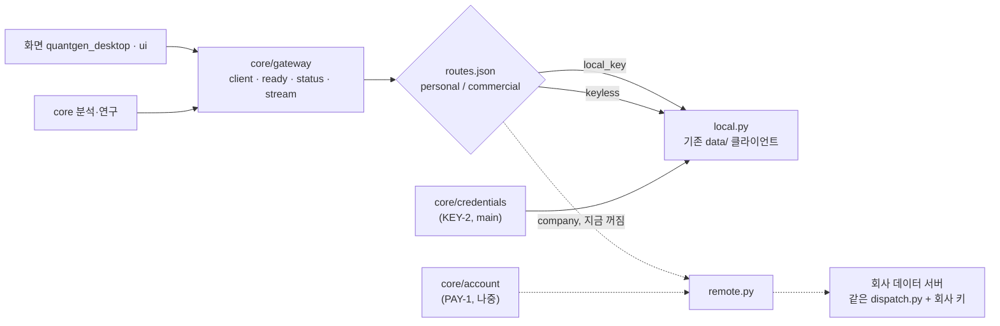

# 공급원 게이트웨이 설계 (KEY-3)

- 판: v0.1 (2026-11-19). 작성: PAYMENTS_ACCOUNT_KEYS 세션. ID `KEY-3/design`.
- 근거: 소유자 D7-G 승인 (2026-11-18 14:15 KST, 원문 "그러면 D7-G의 방식대로 진행하겠습니다", handoff `MERGE_QUEUE.md`, 커밋 `762150c`), 설계 원안 handoff `plans/2026-11-17/D7_ENV_STRUCTURE.md` 5장.
- 기준: main `ca5da08` (KEY-2 `3249af7`, KEY-2/b `ca5da08` 병합 뒤). 줄 번호는 이 커밋 기준이며 코드가 바뀌면 달라집니다.
- 완료 조건: 소유자 확인. 확인 전에도 KEY-3 코드는 브랜치에서 시작할 수 있습니다 (D7-G 승인). main 병합은 `MERGE_QUEUE.md` 차례에만.
- 공급사 계약·약관 내용은 **법률 자문이 아닙니다**. 계약이 필요한지는 공급사 서면 답과 변호사 의견으로 정합니다.

---

## 0. 한 장 요약

앱(화면과 core)은 공급사를 직접 부르지 않고 `core/gateway` 한 곳만 부릅니다. 게이트웨이는 `routes.json`의 설정에 따라 공급원마다 길을 고릅니다.

| 길 | 뜻 | 지금 (`personal`) | 법인 뒤 (`commercial`) |
|---|---|---|---|
| `local_key` | 사용자 PC에서 사용자 키로 공급사 직접 호출 (지금 방식) | 켜짐 | 사용자 키 공급원에 계속 |
| `keyless` | 키 없는 공개 공급원 직접 호출 | 켜짐 | 표시 조건 확인 뒤 |
| `company` | 회사 데이터 서버를 거침 (`remote.py`) | **꺼짐** (주소 빈 값) | 계약 데이터 |
| `off` | 쓰지 않음 | — | 계약 못 한 공급원 |

법인 뒤 남는 일은 `routes.json`의 `commercial` 값, 회사 서버, 계약뿐입니다. 앱 구조는 바뀌지 않습니다 (소유자 조건: "앱의 구조를 수정"해야 하면 거부).



---

## 1. 부품

| 파일 (새) | 하는 일 | 공개 함수·자료 |
|---|---|---|
| `core/gateway/__init__.py` | 앱이 부르는 유일한 입구 | `client(source)`, `ready(source)`, `status()`, `stream(source, ...)`, `reload()`, `profile()` |
| `core/gateway/routes.json` | 공급원마다 길 순서. 프로필 `personal`, `commercial` | 아래 2절 |
| `core/gateway/routes.py` | `routes.json` 읽기·검증 (규칙 1·2를 여기서 강제) | `load_routes()`, `RouteError` |
| `core/gateway/local.py` | 기존 `data/` 클라이언트와 `core/ficc/data.py` 등을 감싸는 내 PC 길. 키는 `config` → `core/credentials`로만 | `LocalRoute.client(source)` |
| `core/gateway/remote.py` | 회사 서버 길. (공급원, 함수, 인자)를 JSON으로 보내고 결과를 받음. 계정 토큰을 붙임. 허용 함수 목록만. **`local_key` 고정 공급원은 거절** | `RemoteRoute.call(source, fn, args)`, `RemoteRefused` |
| `core/gateway/codec.py` | 결과 ↔ JSON. `Quote` (`data/krx/kis_client.py`), `Candle`·`MarketSnapshot` (`core/market/models.py`), `Answer` (`data/krx/gateway.py`), 시계열 표 | `encode(obj)`, `decode(payload, kind)` |
| `core/gateway/dispatch.py` | 서버 쪽 처리기: (공급원, 함수, 인자)를 받아 내 PC 길로 실행. 회사 서버는 **같은 코드**를 회사 키로 돌림. 시험에서는 가짜 서버가 씀 | `dispatch(request) -> response` |
| `core/gateway/sources.py` | 공급원 이름표 (2절 표의 `id`), 키 이름 (`core/credentials/names.py`와 연결), 고정 길 | `SOURCES` |

**결과 꼬리표 (규칙 4).** 게이트웨이를 지난 모든 결과에는 `source`, `route` (`local_key`/`keyless`/`company`), `delay` (실시간·지연·일별), `display_right` (`core/research/display_rights.json`의 판정)를 붙입니다. 기존 `Answer(data, source, ok, reason)`에 `route`, `delay`, `display_right`를 더한 `GatewayAnswer`를 씁니다. 화면은 이 값을 그대로 보여 줍니다.

**`ready(source)`의 답 (5가지).** `key_needed` (필요한 키 이름 목록과 함께), `login_needed`, `plan_needed`, `ready`, `off`. 지금은 `key_needed`/`ready`/`off`만 나옵니다. 나머지 둘은 `company` 길이 켜지면 같은 자리에서 나옵니다.

**`status()`의 행 (KEY-5 화면이 그대로 그림, 규칙 5).**

```json
{"source": "kis_quote", "label_key": "gateway.source.kis_quote", "route": "local_key",
 "state": "key_needed", "needs": ["KIS_APP_KEY", "KIS_APP_SECRET"], "key_sources": {"KIS_APP_KEY": null},
 "delay": "realtime", "display_right": "personal_only"}
```

- 값 대신 이름과 상태만 있습니다 (`key_sources`는 `core.credentials.status()`의 `source`: `env`/`keyring`/`dotenv`/없음).
- 화면은 공급원 이름을 코드에 박지 않고 `label_key`로 번역문을 찾습니다. 법인 뒤 "회사 제공 (로그인 필요)" 행이 생겨도 화면은 바뀌지 않습니다.

---

## 2. `routes.json`

```json
{
  "schema": 1,
  "active_profile_from": "core.app_identity.GATEWAY_PROFILE",
  "profiles": {
    "personal": {
      "kis_quote":     ["local_key"],
      "kis_account":   ["local_key"],
      "upbit_account": ["local_key"],
      "crypto_public": ["keyless"],
      "fred":          ["keyless"],
      "yahoo":         ["keyless"],
      "fmp":           ["local_key"],
      "krx_open_api":  ["local_key"],
      "opendart":      ["local_key"],
      "anthropic":     ["local_key"],
      "gs_marquee":    ["local_key"]
    },
    "commercial": {
      "kis_quote":     ["local_key"],
      "kis_account":   ["local_key"],
      "upbit_account": ["local_key"],
      "crypto_public": ["keyless"],
      "fred":          ["keyless"],
      "yahoo":         ["off"],
      "fmp":           ["off"],
      "krx_open_api":  ["local_key"],
      "opendart":      ["local_key"],
      "anthropic":     ["local_key"],
      "gs_marquee":    ["off"]
    }
  },
  "fixed_local": ["kis_quote", "kis_account", "upbit_account"]
}
```

- 값은 길의 **순서**입니다. 앞 길이 `ready`가 아니면 다음 길을 봅니다 (예: 나중에 `["company", "local_key"]`).
- `commercial` 값은 **초안**입니다. 계약 답이 오기 전에는 켜지지 않습니다 (`GATEWAY_PROFILE = "personal"`, `DATA_API_BASE = ""`, `core/app_identity.py`). 위 `commercial`은 "계약이 없으면 끄는" 보수적 초안이고, 계약이 생기면 그 공급원을 `["company"]`로 바꿉니다.
- 활성 프로필은 `core.app_identity.GATEWAY_PROFILE` (OS 세션, main에 있음)에서 읽습니다. `company` 길은 `core.app_identity.company_data_server_configured()`가 참일 때만 열립니다.
- **회사 키는 이 파일 어디에도 없습니다** (규칙 2). 주소도 `app_identity`에 있고 여기에는 없습니다.

**검증 (`routes.py`, 실패하면 앱 시작 시 `RouteError`):**
1. 모든 공급원이 두 프로필에 다 있음. 모르는 공급원·길 이름 없음.
2. `fixed_local` 공급원은 두 프로필 모두 `["local_key"]` 하나뿐 (규칙 1).
3. 키처럼 보이는 문자열 (32자 이상의 영숫자, `sk-` 등)이 파일에 없음 (규칙 2).

---

## 3. 지켜야 할 규칙 6개와 시험

| # | 규칙 | 어디서 강제 | 시험 (`tests/gateway_acceptance.py`) |
|---|---|---|---|
| 1 | 사용자 증권사·거래소 키 공급원 (KIS 시세·잔고·주문, Upbit 잔고)은 `local_key` 고정. 회사 서버는 증권사 키·계좌·주문을 다루지 않음 | `routes.py` 검증 + `remote.py`가 그런 공급원 요청을 `RemoteRefused`로 거절 + `dispatch.py`도 거절 | `fixed_local`을 `company`로 바꾼 `routes.json`이 거절됨; `remote.call("kis_account", ...)`이 거절됨 |
| 2 | 회사 키는 설치파일·`routes.json`·저장소 어디에도 없음 | `routes.py`의 키 모양 검사; 저장소 검사 | 키 모양 문자열을 넣은 `routes.json` 거절; `core/gateway/**`에 키 모양 문자열 0개 |
| 3 | 공개판은 `.env`를 읽지 않음 | KEY-2에서 이미 (`core.credentials.may_read_dotenv`) | KEY-2 시험 재사용; 게이트웨이는 `.env`를 직접 읽지 않음 (grep 시험) |
| 4 | 결과마다 출처·길·지연·표시권 | `GatewayAnswer` | 모든 공급원 결과에 네 칸이 있음; `display_rights.json`에 없는 공급원은 `unknown`으로 표시 (빈칸 금지) |
| 5 | 화면은 `status()` 행을 그대로 그림. 공급원 이름을 화면 코드에 박지 않음 | KEY-5 (UI 세션) | `status()` 행 스키마 시험; 경계 시험이 화면 쪽 새 직접 호출을 막음 |
| 6 | 키를 넣거나 지우면 해당 클라이언트를 다시 만듦 (재시작 불필요) | `core.credentials.subscribe` → `gateway.reload(source)` | 키를 넣으면 `ready("kis_quote")`가 `key_needed` → `ready`로 바뀜 (같은 프로세스) |

**경계 시험 `tests/gateway_boundary_acceptance.py`.**
- `core/`, `quantgen_desktop/`, `ui/`, `main.py`에서 공급사 클라이언트 import (`data.krx`, `data.fmp`, `data.crypto`, `data.kis_*`, `data.net`), `yfinance`, `api.anthropic.com`, `config`의 키 함수 사용을 셉니다.
- 처음에는 6절 목록 (파일별 개수)을 **알려진 예외**로 둡니다. 새 직접 호출이 생기면 실패합니다. 개수가 줄면 예외 목록도 줄이라고 실패합니다 (목록이 썩지 않게).
- KEY-4가 `core/` 예외를 0으로, KEY-5가 화면 쪽 예외를 0으로 만듭니다.
- 다른 세션이 새 기능을 넣어도 구조가 다시 흩어지지 않게 계속 켜 둡니다. 새 공급원은 `data/`에 클라이언트를 만들고 `routes.json`에 한 행을 더하는 PR로만 들어옵니다 (데이터소스 세션, 이 세션이 검토).

**가짜 서버 시험 `tests/gateway_remote_acceptance.py`.**
- 같은 프로세스 안의 가짜 서버 (`dispatch.py`를 고정 응답 클라이언트로 돌림)를 띄우고, 프로필을 `personal` ↔ `commercial`(가짜 서버 경유)로 바꿔도 **같은 답** (codec 왕복 후 값이 같음)이 나오는지 봅니다.
- 네트워크는 쓰지 않습니다 (가짜 전송 계층). 진짜 공급사·진짜 키를 쓰지 않습니다.

---

## 4. 공급원별 길 (D7 5.4 표, 공급원 id 확정)

| id | 공급원 | 키 (`core/credentials/names.py`) | `personal` | `commercial` (초안) | 비고 |
|---|---|---|---|---|---|
| `kis_quote` | KIS 시세·차트·실시간 | `KIS_APP_KEY`, `KIS_APP_SECRET` | `local_key` (고정) | `local_key` (고정) | 코스콤이 사용자 키 구조를 허용하지 않으면 별도 공급원 (`krx_licensed`)을 `company`로 더함 — 미정 |
| `kis_account` | KIS 잔고 (주문은 나중) | 같음 | `local_key` (고정) | `local_key` (고정) | 서버 금지 |
| `upbit_account` | Upbit 잔고 | `UPBIT_ACCESS_KEY`, `UPBIT_SECRET_KEY` | `local_key` (고정) | `local_key` (고정) | 서버 금지 |
| `crypto_public` | Upbit/Binance 공개 시세 | 없음 | `keyless` | `keyless` | 표시 조건 **미검증** |
| `fred` | FRED 금리·환율·VIXCLS | 없음 | `keyless` | `keyless` | VIXCLS는 Cboe 조건 확인 뒤 |
| `yahoo` | Yahoo (yfinance) | 없음 (개인용) | `keyless` | `off` → 계약 대체 공급사가 생기면 `company` | 상용판 제거 대상 |
| `fmp` | FMP | `FMP_API_KEY` | `local_key` | `off` → 표시 계약 시 `company` | |
| `krx_open_api` | KRX Open API | `KRX_API_KEY` | `local_key` | `local_key` (약관 **미검증**) | |
| `opendart` | OpenDART | `OPENDART_API_KEY` | `local_key` | `local_key` | 사용자 본인 키 |
| `anthropic` | AI 해설 | `ANTHROPIC_API_KEY` | `local_key` (기본 꺼짐) | `local_key` | 수요 뒤 `company` 중계 선택 |
| `gs_marquee` | GS Marquee | `GS_CLIENT_ID`, `GS_CLIENT_SECRET` | `local_key` | `off` | 제외 후보 |

---

## 5. 회사 서버 길 (`remote.py`) 약속

지금은 꺼져 있고 가짜 서버로만 시험합니다. 실제 서버는 PAY-3 (위치는 소유자에게 먼저 여쭘)입니다.

| 항목 | 정함 |
|---|---|
| 전송 | HTTPS POST `{DATA_API_BASE}/v1/call`, 본문 JSON `{"source", "fn", "args", "client_version"}` |
| 인증 | 계정 토큰 (`core/account`, PAY-1)을 `Authorization: Bearer`로. 토큰 값은 `core/credentials`의 토큰 저장 자리에 (KEY-2 `TOKENS`에 이름 추가) |
| 허용 함수 | 공급원마다 허용 함수 목록 (`sources.py`). 목록 밖은 보내지 않음 |
| 거절 | `fixed_local` 공급원은 보내기 전에 거절 (`RemoteRefused`). 서버도 거절 |
| 실시간 | `stream()`은 웹소켓 `{DATA_API_BASE}/v1/stream`. 지금은 시험용 가짜만 |
| 실패 | 서버 오류는 `GatewayAnswer(ok=False, reason=...)`. 값을 지어내지 않음 (`data/krx/gateway.py`의 원칙 그대로) |
| 로그 | 요청 로그에 인자는 남기되 키·토큰은 남기지 않음 |

---

## 6. 직접 호출 목록 (경계 시험의 시작 예외)

`git grep` 기준 (main `ca5da08`): **30개 파일 69곳**. D7 보고서는 같은 방법의 다른 셈으로 31개 파일 72곳이라 했습니다 (D7 2장이 "셈 방식에 따라 1~2곳 달라짐"이라 적은 차이). 경계 시험이 같은 정규식으로 정확한 목록을 만들고, 그 목록이 기준입니다.

셈에 쓴 정규식:
```
(from|import) data\.(krx|fmp|crypto|kis_markets|kis_stream|kis_workspace|net)
| (import yfinance|from yfinance|yf\.(download|Ticker|Tickers))
| api\.anthropic\.com
| config\.(kis_ready|kis_credentials|fmp_key|fmp_ready|opendart_key|opendart_ready|krx_key|krx_ready|anthropic_key|ai_ready|gs_client_id|gs_client_secret|upbit_ready|upbit_keys)\(
```
범위: `core/**.py`, `quantgen_desktop/**.py`, `ui/**.py`, `main.py`. (`core/research/strategy_workflow.py`의 `import config as QC` 별칭 사용은 시험에서 따로 잡음.)

| 층 | 파일 | 곳 | 옮기는 묶음 |
|---|---|---|---|
| `core/` | 17 | 43 | KEY-4 (이 세션). `core/research/markets.py`는 데이터소스 세션이 DS-H에서 같은 규칙으로 |
| `quantgen_desktop/` | 6 | 14 | KEY-5 (UI 세션) |
| `ui/` | 6 | 11 | KEY-5 (UI 세션) |
| `main.py` | 1 | 1 | KEY-4 |
| **합계** | **30** | **69** | |

파일별 (많은 순):

| 곳 | 파일 | 묶음 |
|---|---|---|
| 13 | `core/quant/history.py` | KEY-4 |
| 6 | `quantgen_desktop/market_chart.py` | KEY-5 |
| 4 | `ui/market_chart_page.py` | KEY-5 |
| 4 | `core/research/crypto_workflow.py` | KEY-4 |
| 3 | `ui/settings_page.py` | KEY-5 |
| 3 | `core/research/etf_workflow.py` | KEY-4 |
| 3 | `core/research/connections.py` | KEY-4 |
| 3 | `core/quant/insights.py` | KEY-4 |
| 2 | `quantgen_desktop/watchlist_live.py` | KEY-5 |
| 2 | `quantgen_desktop/market_rankings.py` | KEY-5 |
| 2 | `quantgen_desktop/app.py` | KEY-5 |
| 2 | `core/research/derivatives_workflow.py` | KEY-4 |
| 2 | `core/research/ai_connection.py` | KEY-4 |
| 2 | `core/quant/gsq.py` | KEY-4 |
| 2 | `core/market/market_cap.py` | KEY-4 |
| 2 | `core/ficc/data.py` | KEY-4 |
| 1 | `ui/macro_state_panel.py`, `ui/krx_page.py`, `ui/derivatives_page.py`, `ui/crypto_page.py` | KEY-5 |
| 1 | `quantgen_desktop/qscore.py`, `quantgen_desktop/market_tools.py` | KEY-5 |
| 1 | `main.py` | KEY-4 |
| 1 | `core/research/watchlist.py`, `core/research/market_board.py`, `core/research/market_analysis.py`, `core/market/qscore_rankings.py`, `core/market/detail_model.py`, `core/ficc/curve_models.py`, `core/engine/feed.py` | KEY-4 |

KEY-4 원칙: 공급사 호출 줄만 바꿉니다. 주입 자리가 이미 있는 함수 (`loader=`, `status_loaders=`, `probe_loaders=` 등)는 기본값만 게이트웨이로 바꿉니다. 다른 줄은 손대지 않습니다.

---

## 7. 순서·공유 파일·코드 지문

| 묶음 | 파일 | 담당 | 공유 파일 (대기열 경유) | 공수 (추정) |
|---|---|---|---|---|
| KEY-3 | 새 `core/gateway/**`, `tests/gateway_*` + KEY-2/b 검토 후속 5건 (`data/krx/kis_client.py`, `tests/credentials_acceptance.py`, 문서; 브랜치 `claude/payments-key3-prep-20261119`) | 이 세션 | `runtime-smoke.yml` 경로·시험 줄 | 3~4일 |
| KEY-4 | `core/` 17개 파일 43곳 + `main.py` 1곳 | 이 세션 (+ 데이터소스: `markets.py`) | 없음 (그 기간 이 줄들의 수정 권한) | 2~3일 |
| KEY-5 | 화면 12개 파일 25곳 + 키·연결 화면 | **UI 세션** (소유자를 거쳐 요청) | 없음 | 1~1.5일 |

- **Nautilus 코드 지문:** 지문 입력 27개 파일 (`config.py`, `tools/nautilus/**`, `HARNESS_SOURCES` 11개 등) 중 위 30개 파일과 겹치는 것은 없습니다 (`core.quant.gate_package.HARNESS_SOURCES`로 확인). 그래서 KEY-3·KEY-4는 `config.py`를 건드리지 않는 한 지문을 바꾸지 않습니다. 바꾸게 되면 PR 본문에 적습니다.
- **준법:** 새 소스 파일이 생기므로 20개 문서 재검토 대상입니다. PR마다 최신 main merge 뒤 맨 마지막에 기준선 갱신.
- **CI:** KEY-3 PR이 `runtime-smoke.yml` 경로 목록에 `core/gateway/**`, `tests/gateway_*`를, bounded-fixtures 단계에 시험 모듈 3개를 더합니다.

---

## 8. 법인 때 남는 일 (앱 구조 수정 없음)

| 일 | 누가 | 앱 코드 |
|---|---|---|
| 계약: 코스콤/KRX, Yahoo 대체, FMP 표시 또는 제외, Cboe (VIX) | 소유자 (법인) | 없음 |
| 회사 데이터 서버: `dispatch.py`를 회사 키로, 계정·요금제 확인, 사용자 수 기록 | 이 세션 + 소유자 (PAY-3) | 없음 |
| `routes.json` `commercial` 값 확정, `display_rights.json` 갱신 | 이 세션 + 데이터소스 세션 | 설정 파일만 |
| `core/app_identity.py`: `DATA_API_BASE`, Cognito ID, `GATEWAY_PROFILE = "commercial"` | OS 세션 | 설정 값만 |

남는 위험: 계약 공급사가 "사용자 PC에서만 도는 SDK"만 허용하면, 그 공급사용 `local.py` 클라이언트 하나를 더합니다 (새 공급원 추가, 0.5~1일 추정). 화면·core 수정은 없습니다.

## 9. 확인 못 한 것 (미검증)

- 공급사별 상용 표시 조건 (KRX·FMP·Cboe·Upbit/Binance 공개 시세), 계약 공급사가 서버 API를 주는지. **법률 자문이 아닙니다.**
- 69곳 셈은 정규식 기준입니다. 간접 호출 (다른 모듈을 거쳐 공급사에 닿는 경로)은 경계 시험이 import 그래프로 한 번 더 확인합니다.
- 회사 서버 위치·형태 (PAY-3, 소유자에게 먼저 여쭘).
- 공수는 모두 추정입니다.
