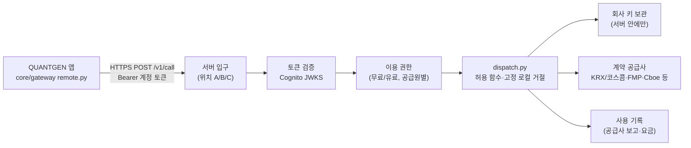

# 회사 데이터 서버 설계 (PAY-3, 설계만)

- 판: v0.1 (2026-11-24, PAYMENTS_ACCOUNT_KEYS 세션, 메인 지시 P5)
- 상태: 설계 초안. **코드·AWS 자원·계약 없음.** 위치는 소유자 결정 OA-40 (A 시드니 / B 서울 / C Cloudflare Workers) 대기.
- 기준 코드: main `de32ea1`의 `core/gateway/remote.py`, `dispatch.py`, `codec.py`, `sources.py`, `routes.json`, `core/app_identity.py`, 설계 `docs/commercial/GATEWAY_DESIGN.md` 5·8절.
- 비용·요금 숫자는 모두 **미검증** (공식 요금표 검색 요약, 리전별 차이 미확인). 법률 관련 줄은 **법률 자문이 아닙니다**.

## 0. 한 장 요약

회사 데이터 서버는 앱의 `company` 길(`routes.json`)이 닿는 곳입니다. 앱은 회원 계정 토큰만 보내고, 서버가 **회사 키**로 계약한 공급사를 부른 뒤 앱과 같은 `dispatch.py` 규칙으로 답합니다. 앱 쪽 코드는 이미 있습니다 (지금은 꺼짐: `DATA_API_BASE = ""`).

**위치와 상관없이 같은 것 (1~7절)** 이 설계의 대부분이고, **위치마다 다른 것 (8절)** 은 지연·데이터 위치·운영·비용입니다.

## 1. 앱 쪽 계약 (이미 코드에 있음, 바꾸지 않음)

| 항목 | 값 | 출처 |
|---|---|---|
| 요청 | `POST {DATA_API_BASE}/v1/call`, JSON `{"source", "fn", "args", "kwargs", "client_version"}` | `remote.py` `http_transport`, `RemoteRoute.call` |
| 인코딩 | `codec.encode`/`decode` (JSON에 안전한 값만; 못 바꾸면 `result_not_encodable`) | `codec.py` |
| 답 | `{"ok": true, "result": ...}` 또는 `{"ok": false, "error": "<코드>"}` | `dispatch.py` |
| 오류 코드 | 우리 코드 (`bad_request`, `unknown_source`, `fixed_local`, `function_not_allowed`, `result_not_encodable`, `bad_answer`, `no_answer`, `DARTUnavailable`, `KISUnavailable`), `http_<상태>`, 예외 클래스 이름 꼴만. 앱은 그 밖을 `bad_answer`로 바꿈 | `remote.py` `SERVER_CODES`, GATEWAY_DESIGN 5절 |
| 시간 제한 | 앱 15초 (`timeout_s=15.0`) | `remote.py` |
| 고정 로컬 | `kis_quote`, `kis_account`, `upbit_account`는 앱이 보내기 전에 거절하고 서버도 거절 (D7-G 규칙 1) | `routes.json` `fixed_local`, `dispatch.py` |
| 실시간 | `{DATA_API_BASE}/v1/stream` 웹소켓 (지금은 시험용 가짜만) | GATEWAY_DESIGN 5절 |
| 켜는 조건 | `GATEWAY_PROFILE == "commercial"` 이고 `DATA_API_BASE`가 채워짐 | `core/app_identity.py` `company_data_server_configured()` |

서버는 **같은 `dispatch.py`** 를 씁니다 (공급원 목록·허용 함수·거절 규칙이 앱과 한 곳에서 정해짐). 서버 전용 코드는 그 앞뒤 (토큰·권한·키·기록)뿐입니다.

## 2. 인증과 이용 권한

1. **토큰 검증:** `Authorization: Bearer <액세스 토큰>`. 운영 풀 `quantgen-prod`의 JWKS로 서명·만료·발급자·`client_id` (웹 `quantgen-web` 또는 데스크톱 `quantgen-desktop`, PAY-1)·`token_use=access`를 확인합니다. 토큰 폐기(revocation)를 켰으므로 폐기된 새로고침 토큰은 새 액세스 토큰을 못 받지만, 이미 나간 액세스 토큰은 만료(60분)까지 유효합니다 (미검증: Cognito 폐기의 액세스 토큰 즉시 무효 여부).
2. **이용 권한 (entitlement):** 토큰의 `sub`로 회원의 요금제·상태를 찾습니다. 무료/유료 구분과 공급원별 허용은 결제 설계(`docs/commercial/payments/PAYMENT_DESIGN.md`)의 구독 상태를 따릅니다. 저장 위치 후보: Cognito 그룹 (`qg-paid` 등, 토큰의 `cognito:groups`) 또는 서버 DB. **결정 S-2.**
3. **권한 없음:** `{"ok": false, "error": "not_entitled"}` — 새 서버 코드이므로 `remote.SERVER_CODES`에 더해야 앱이 그대로 보여 줍니다 (앱 쪽 한 줄 변경, KEY 작업). 토큰 없음·만료는 HTTP 401 → 앱은 `http_401`.
4. 회원 개인정보(이메일 등)를 서버에 저장하지 않습니다. 사용 기록에는 `sub`만 (5절).

## 3. 회사 키 보관

| 규칙 | 내용 |
|---|---|
| 위치 | 서버 안 비밀 저장소에만 (A·B: AWS Secrets Manager, C: Workers Secrets). 설치 파일·`routes.json`·저장소·앱에 절대 없음 (GATEWAY_DESIGN 규칙 2) |
| 읽기 | 서버 실행 역할만 읽기 권한. 관리자 사람 계정은 쓰기만, 읽기는 비상 때 기록 남김 |
| 기록 | 요청 기록에 키·토큰 값을 남기지 않음 (GATEWAY_DESIGN 5절 "로그") |
| 교체 | 공급사별 교체 절차와 날짜 기록. 유출 대응은 관리자 안내서 17-A 방식으로 별도 서버 절 추가 |
| 비용 | Secrets Manager 비밀 1개당 월 약 $0.40 + 1만 회 호출당 $0.05 (미검증, [요금표](https://aws.amazon.com/secrets-manager/pricing/)) |

## 4. 장애 때 동작

- 서버가 답하지 않거나 오류면 앱은 `RemoteFailed(<코드>)` → 화면에 이유 표시 (`transport_timeout`, `http_503` 등). **값을 지어내지 않습니다.**
- 개인 키로 몰래 바꿔 부르지 않습니다. 개인 키 길로 넘어가는 것은 `routes.json`이 `["company", "local_key"]`처럼 순서로 적었을 때만이고, 그 순서는 공급사 계약이 허락할 때만 씁니다 (결정 S-3).
- 서버 쪽 공급사 오류는 클래스 이름만 앱에 전달 (`dispatch.py`: 공급사 메시지는 입력을 되풀이할 수 있어 보내지 않음).
- 상태 확인: `GET /v1/health` (인증 없음, 공급사 호출 없음) — 앱 `gateway.status()`의 회사 길 행에 쓸 수 있음 (앱 쪽 추가는 KEY 작업, 선택).

## 5. 사용 기록·요청 제한·표시 권리

| 항목 | 내용 |
|---|---|
| 사용 기록 | 요청마다 `시각, sub, source, fn, 결과 코드, 응답 크기`. 인자는 종목·기간 정도라 남기되 키·토큰은 남기지 않음. 공급사 사용자 수 보고와 요금 계산에 씀. 보관 기간은 공급사 계약과 개인정보 문서(01·20)로 정함 (결정 S-4) |
| 요청 제한 | 회원별·공급원별 분당 한도 (공급사 한도보다 낮게). 넘으면 HTTP 429 → 앱 `http_429` |
| 캐시 | 같은 요청은 짧게 캐시 (공급사 계약이 허용하는 범위에서). 캐시 키에 `sub`를 넣지 않음 (공개 시세는 회원 간 공유) |
| 표시 권리 | 공급원별 표시 조건은 `core/research/display_rights.json`과 `docs/product/MARKET_DISPLAY_RIGHTS_2026-10-31.md` 기준. 서버는 계약에 없는 공급원·함수를 `routes.json`/`sources.py` 허용 목록으로 막음 |
| 개인정보 | 서버가 새로 처리하는 것은 `sub`와 사용 기록뿐 → 01 처리방침에 "회사 데이터 서버 이용 기록" 행 추가 필요 (정책 PR, 서버 생길 때) |

## 6. 실시간 (`/v1/stream`)

웹소켓은 오래 열린 연결이 필요합니다. 요청마다 짧게 도는 함수형(Lambda·Workers)만으로는 맞지 않을 수 있어 위치마다 방식이 다릅니다 (8절). 첫 단계는 `/v1/call`만 열고 실시간은 뒤로 미루는 안을 권합니다 (결정 S-5). KIS 실시간은 고정 로컬이라 서버를 지나지 않습니다.

## 7. 비용 항목 (위치 공통 목록, 숫자는 8절)

계산·실행, 요청 입구(API), 비밀 보관, 데이터 전송(나가는 쪽), 기록 보관, 경보, 도메인·인증서, 공급사 계약료 (가장 큼, 별도). 공급사 계약료는 이 문서에서 추정하지 않습니다.

## 8. 위치마다 다른 것 (OA-40)

| 항목 | A. AWS 시드니 (같은 계정) | B. AWS 서울 | C. Cloudflare Workers |
|---|---|---|---|
| 실행 형태 | Lambda + API Gateway HTTP API (요청형), 실시간은 API Gateway WebSocket 또는 작은 컨테이너 | A와 같음 (리전만 `ap-northeast-2`) | Workers (요청형), 실시간은 Durable Objects (미검증) |
| `dispatch.py` 재사용 | 그대로 (Python, `requests`·공급사 클라이언트 같이 묶음) | 그대로 | **어려움.** 지금 공급사 클라이언트는 `requests`·pandas 등을 쓰는 Python. Workers의 Python 지원·패키지 범위 미검증 → JS로 다시 쓰거나 서버 한 대를 뒤에 두어야 할 수 있음 (앱 쪽 계약은 그대로) |
| 국내 공급사까지 거리 | 시드니 ↔ 서울 왕복 지연 큼 (약 100~150ms, 미검증). 일별·분 단위 조회는 영향 작음 | 가장 가까움 | 가까운 엣지에서 실행되나 공급사 호출 위치는 Cloudflare가 정함 (미검증) |
| 국내 IP 요구 | 공급사가 국내 IP만 허용하면 막힘 (미검증, 공급사 문의 필요) | 문제 없음 (예상) | 나가는 IP를 고정하기 어려움 (미검증) |
| 개인정보 위치 | 회원 계정과 같은 호주. 처리방침의 국외 이전 표에 새 항목만 더함 | 국내 리전. 처리방침에 서울 리전 추가 | 처리 국가가 요청마다 다를 수 있음 → 국외 이전 고지가 복잡 (미검증) 〔법률 자문이 아닙니다. 근거: 개인정보 보호법 제28조의8, 원문 미확인〕 |
| 운영 | 이미 쓰는 계정·CloudTrail·예산·경보에 그대로 붙음. 관리할 리전 하나 | 리전 하나 더 (경보·예산·CloudTrail 다중 리전은 이미 켜짐) | 다른 회사 계정·기록 체계 하나 더. Cloudflare는 이미 DNS·메일에 씀 |
| 차가운 시작 | Lambda Python 수백 ms~1초대 (미검증; pandas 묶음이면 길어짐) | 같음 | 매우 짧음 (미검증) |
| 한도 | Lambda 15분·응답 크기 한도, API Gateway 시간 제한 (미검증 수치) | 같음 | 요청당 CPU 기본 30초 (유료), 묶음 크기 10MB (요약, [한도](https://developers.cloudflare.com/workers/platform/limits/)) |
| 비용 (월, 회원 수백 명·요청 수십만 가정, 미검증) | Lambda: 월 100만 요청·40만 GB초 무료, 넘으면 100만 요청당 $0.20 ([요금](https://aws.amazon.com/lambda/pricing/)). HTTP API: 100만 요청당 약 $1 ([요금](https://aws.amazon.com/api-gateway/pricing/)). 비밀 몇 개 $2 안팎. 합계 수 달러~$20대 (추정) | A와 비슷, 서울 요금표 차이 미확인 | 유료 최소 월 $5, 1천만 요청 포함, 넘으면 100만당 $0.30 ([요금](https://developers.cloudflare.com/workers/platform/pricing/)). 단 Python 재작성 비용이 큼 |
| 이 세션의 제안 | **A로 시작** (가장 적은 새 운영, 코드 재사용). 국내 IP 요구가 확인되면 B | 국내 IP 요구가 있으면 | 권하지 않음 (지금 코드와 맞지 않음) |

## 9. 순서 (법인·계약 뒤)

1. 소유자: OA-40 결정, 공급사 계약 (서버 API 허용 여부, 국내 IP 요구, 사용자 수 보고 방식).
2. 이 세션: 서버 저장소/폴더 위치 정함 (결정 S-1), `dispatch.py`를 감싼 서버 코드 + 시험 (가짜 공급사).
3. 소유자: AWS 자원 만들기 (단계별 안내는 그때 `OWNER_STEPS`처럼 씀).
4. OS 세션: `core/app_identity.py`의 `DATA_API_BASE`, `GATEWAY_PROFILE = "commercial"`.
5. 데이터소스 세션 + 이 세션: `routes.json` `commercial` 값과 `display_rights.json`.
6. 메인: 정책 PR (01 처리방침 서버 기록 행, 08 대장).

## 10. 결정 목록

| # | 결정 | 누가 | 지금 제안 |
|---|---|---|---|
| OA-40 | 서버 위치 A/B/C | 소유자 | A (국내 IP 요구가 확인되면 B) |
| S-1 | 서버 코드를 이 저장소 폴더(`server/`)에 둘지 별도 저장소에 둘지 | 소유자 + 메인 | 이 저장소 (`dispatch.py`·`sources.py` 공유가 쉬움) |
| S-2 | 이용 권한 저장: Cognito 그룹 / 서버 DB | 이 세션 (PAY-2 결정 뒤) | 처음엔 Cognito 그룹 |
| S-3 | 회사 길 실패 때 개인 키 길로 넘어갈지 (공급원별) | 소유자 (계약 조건) | 넘어가지 않음 (기본) |
| S-4 | 사용 기록 보관 기간 | 소유자 + 메인 (정책) | 공급사 보고 주기 + 1년 (제안) |
| S-5 | 실시간 `/v1/stream`을 첫 판에 넣을지 | 소유자 | 뒤로 미룸 |
| S-6 | `not_entitled` 서버 코드를 앱 `SERVER_CODES`에 더하기 | 메인 (KEY 작업) | 서버 생기기 전에 더함 |

## 11. 확인 못 한 것

- 공급사별 서버 API 제공·국내 IP 요구·사용자 수 보고 방식 (PAY-0 문의와 별개로 데이터 공급사 문의 필요).
- 시드니 ↔ 서울 지연 수치, Lambda Python 차가운 시작, Workers Python 지원 범위.
- 모든 요금 숫자 (리전별·현재 요금표 재확인 필요).
- Cognito 토큰 폐기가 이미 발급된 액세스 토큰에 주는 영향.
