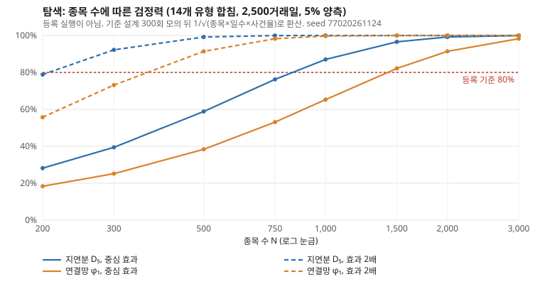

# 사전등록 V0.1 제안 (DIDM-4/b, 2026-11-24) — 미적용, 소유자 답 대기

- 작성: DIDM_DEV 세션. **제안일 뿐입니다.** `docs/didm/PREREG_V0.md`는 한 글자도 바꾸지 않았고, 등록 격자·판정 규칙 (`core/didm/sim/power.py`)도 그대로입니다. 소유자가 승인한 항목만 V0.1로 옮기고, 그 뒤 Stage 0을 **시도 2회**로 다시 돌립니다.
- 근거 1 (등록 실행): `docs/didm/STAGE0_REPORT_V0.md` — 시도 1회, 시드 20261124, 500회 반복, 판정 REVISE.
- 근거 2 (탐색 계산): `tools/didm/stage0_explore.py` — **등록 실행이 아니고 판정에 쓰지 않습니다.** 시드 77020261124, 300회 반복, 기준 설계 2개를 모의한 뒤 표준오차를 1/√(종목 수 × 일수 × 사건율)로 환산. 환산이 맞는지 다른 설계 3개를 직접 모의해 대조했습니다 (예측 59%·실제 55%, 예측 93%·실제 91% 등, 5절).
- 모든 숫자는 합성 자료이고, 효과 크기 (당일 반응 50bp, 지연 비중 0.15, 파급 10bp, 변동성 계수 0.10)는 문헌 범위 안에서 이 세션이 고른 가정입니다. 실제 값은 Stage 2에서 처음 나옵니다.

## 0. 한눈에

| 번호 | 무엇 | 지금 등록 문구로는 | 제안 | 권고 |
|---|---|---|---|---|
| 가 | 지연 반영 δ를 재는 법 | 비율 추정이 불안정, 검정력 22~27% | 비율 대신 **차이** (5일 누적 − 당일), 유형을 **합쳐서** 검정 | 승인 권고 |
| 나 | 연결망 파급 φ | 검정력 11% (합침) | V0에서는 **보고만 하고 관문에서 뺌** | 승인 권고 |
| 다 | HAR 월 계수 포함률 | 56% (관심 모수 아님) | 포함률 점검 대상에서 **관심 모수만** 남김 | 승인 권고 |
| 라 | "잘못 지정한 모형이 짐" | 하루 수익률 예측 오차로는 구분 안 됨 (7%, 16%) | 층마다 **계수 검정**으로 바꿈 | 승인 권고 |
| 마 | Stage 3 변동성 기준 QLIKE −2% | 중심 가정에서 개선 0.14% | 세 선택지 (5절) — **그대로 두고 통과 못 할 수 있음을 받아들임**을 권고 | 판단 필요 |
| 바 | 표본을 늘리는 길 | N = 200으로는 δ·φ 모두 부족 | 종목 수 500~1,000으로 넓힘 (자료·비용 확인 필요) | 판단 필요 |

## 1. (가) 지연 반영 비중 δ

- **(i) 지금 문구.** `PREREG_V0.md` 56행, Stage 2 통과 조건: "유형의 ≥ 70%에서 예측 부호 + Holm 유의 θ₀, **≥ 2개 유형에서 δᵏ > 0 유의**, φ가 날짜 고정효과·재배선 위약보다 유의, 반박된 사건이 5일 안에 0일 움직임의 ≥ 50% 되돌림". δ의 정의는 Notion DIDM 5.1: δᵏ = Σ_{h≥1} θᵏ_h / Σ_{h≥0} θᵏ_h (비율).
- **(ii) 바꿀 문구.** "≥ 2개 유형에서 δᵏ > 0 유의"를 → "**유형을 합친 지연 누적분 D₅ = Θ₅ − Θ₀ > 0이 유의 (단측 5%)**. 유형별 D₅ᵏ는 보고하고, Holm 유의한 유형이 있으면 함께 적음. δ (비율)는 점 추정으로만 보고." 표준오차는 두 기간의 결합 Driscoll-Kraay.
- **(iii) 근거 숫자.**
  - 등록 실행: 유형 1개 (N = 200, 사건 2,500건)에서 δ 평균 추정 0.64 (참값 0.15), 포함률 81.0%, 검정력 22.0%. 14개 유형 합침에서도 검정력 25.6%, 편향 −19.4%.
  - 비율이 튀는 이유: 분모인 20일 누적 계수의 잡음이 큼 (20일 수익률 잡음 약 9%).
  - 탐색 계산: 같은 자료에서 차이 D₅는 포함률 86.7~92.7%로 정상이고, 합침 검정력이 34% (비율 27%)로 더 높음. 20일 차이 D₂₀는 13%로 더 낮음 → 5일이 낫습니다 (가정한 반감기 1일에서).
- **(iv) 바꾸지 않으면.** 유형별 δ > 0을 N = 200·2,500일에서 80% 검정력으로 보려면 지연 누적분이 중심 가정의 **약 7.6배** (5일 차이 기준; 유형 1개에서 필요한 종목 수가 약 11,500개로 계산됨, √(11,500/200) ≈ 7.6)여야 합니다. 즉 지금 문구의 δ 조건은 사실상 통과할 수 없습니다. "부호는 맞지만 δ ≈ 0 → DIDM은 변동성·위험 모형으로만" (Notion 6.2 Revise 칸)이라는 결론이 **신호가 없어서가 아니라 표본이 작아서** 나오게 됩니다.
- **(v) 대안: 표본을 늘림 (문구는 그대로).** 탐색 계산, 14개 유형 합침·중심 효과:

  | 종목 수 N | 2,500일 | 5,000일 |
  |---|---|---|
  | 200 | D₅ 28% | 50% |
  | 500 | 59% | 87% |
  | 1,000 | 87% | 99% |
  | 2,000 | 99% | 100% |

  D₅가 80%에 닿는 종목 수는 2,500일에서 약 820개. 유형별로는 약 11,500개라 종목을 늘려도 닿지 않습니다. 그래서 (가)의 "합쳐서 검정"과 (바)의 "종목 수 확대"를 함께 해야 합니다.
- **(vi) 시도 수.** 승인되면 추정량 변경 = 설계 변경이므로 Stage 0 시도 2회로 기록 (`power.py`의 `ATTEMPTS`, 보고서 5절). Stage 2는 아직 돌린 적이 없어 Stage 2의 시도 수는 0 그대로입니다. V0.1에는 "바꾸기 전에 본 결과 = Stage 0 합성 결과뿐, 실제 수익률은 보지 않음"을 적습니다.

## 2. (나) 연결망 파급 φ

- **(i) 지금 문구.** 56행 "φ가 날짜 고정효과·재배선 위약보다 유의". Notion 5.2: V1 (연결망 VAR)을 만드는 조건이 "V0에서 φ_h가 Holm 유의".
- **(ii) 바꿀 문구.** "φ는 V0에서 **추정해 보고하되 Stage 2 통과 조건에서 뺌**. 재배선 위약과 함께 보고. V1로 넘어가는 조건 (φ 유의)은 그대로 둠 — 즉 φ가 유의하지 않으면 V1을 만들지 않을 뿐, V0의 통과를 막지 않음."
- **(iii) 근거 숫자.** 등록 실행: 파급 10bp에서 검정력 유형 1개 5.8%, 합침 11.4%; 20bp·합침에서도 38.0%. 재배선 위약의 잘못 기각 비율 4.4% (정상) → 추정량은 맞고 신호가 작음. 편향은 합침에서 5.6% (통과).
- **(iv) 바꾸지 않으면.** N = 200·2,500일·합침에서 80%에 닿으려면 파급이 중심 가정의 **약 2.7배 (1일 누적 기준, 27bp)** 여야 합니다. Notion 7.4가 스스로 "전형적 파급 0.10%"라고 적었으므로, 지금 문구는 Stage 2를 거의 확실히 막습니다. Notion 6.2의 Stage 0 중단 규칙이 바로 이 경우입니다: "현실적 크기에서 복원 불가 → 그 층을 뺌".
- **(v) 대안.** 표본 확대: φ₁이 80%에 닿는 종목 수는 2,500일·합침에서 약 1,400개 (탐색). 1,000개면 65%, 2,000개면 91%.
- **(vi) 시도 수.** (가)와 같은 시도 2회에 묶음.

## 3. (다) 포함률 점검 대상

- **(i) 지금 문구.** 54행 Stage 0: "상대 편의 < 10%, 90% 구간 포함률 85~95%, 계획 표본에서 검정력 ≥ 80%". 어떤 모수에 적용하는지는 적혀 있지 않아, 시도 1회에서는 추정하는 15개 모수 전부에 적용했습니다 (`power.py` `RECOVERY_PARAMS`).
- **(ii) 바꿀 문구.** "포함률·편향 점검은 **관심 모수** (θ_h, D₅, φ_h, ψ, γ, η)에 적용. 통제 변수 계수 (HAR의 일·주·월 계수)는 보고만."
- **(iii) 근거 숫자.** HAR 월 계수: 편향 −1.8% (10% 기준 안)인데 표준오차가 0.0025로 아주 작아 포함률이 56~84%. 종목 고정효과를 뺄 때 생기는 알려진 동적 패널 편향입니다. 같은 회귀의 관심 모수 γ, η는 포함률 88~92%로 정상.
- **(iv) 바꾸지 않으면.** 다른 것이 모두 통과해도 이 항목 하나로 REVISE가 남습니다.
- **(v) 대안.** 편향 보정 (분석식 또는 반분 재표집)을 넣어 포함률을 맞춤. 가능하지만 관심 모수가 아닌 것에 추정기를 복잡하게 만듭니다.
- **(vi) 시도 수.** 시도 2회에 묶음.

## 4. (라) "잘못 지정한 모형이 짐"

- **(i) 지금 문구.** Notion 6.2 Stage 0: "mis-specified models lose (DM p < 0.05) at realistic effect sizes". 사전등록 54행에는 이 구절이 없고 Notion 표를 "바꾸지 않고" 쓴다고 50행에 적혀 있습니다. 시도 1회의 해석: 표본 밖 30% 구간에서 Diebold-Mariano 단측 p < 0.05인 반복이 80% 이상.
- **(ii) 바꿀 문구.** "연결망·신뢰 상태 층은 **그 층의 계수 검정**으로 봄 (φ = 0 검정; 신뢰 상태를 넣은 충격과 뺀 충격을 함께 넣은 회귀에서 넣은 쪽 계수가 유의하고 뺀 쪽이 0에 가까운지). 변동성 층은 지금처럼 DM 검정."
- **(iii) 근거 숫자.** 합침·중심 효과에서 연결망 없는 모형이 지는 비율 6.6%, 신뢰 상태 없는 모형 16.4%, 뉴스 없는 HAR 100%. 수익률은 사건이 없는 날이 대부분이라 하루 수익률 예측 오차 차이가 잡음에 묻힙니다. 같은 자료에서 θ₀의 계수 검정력은 100%입니다.
- **(iv) 바꾸지 않으면.** 수익률 쪽 두 비교는 효과가 두 배여도 13%, 32%라 계속 실패합니다.
- **(v) 대안.** 표본 밖 구간을 사건이 있는 종목-날짜로 한정해 DM 검정 (미검증: 이 세션에서 돌려 보지 않음).
- **(vi) 시도 수.** 시도 2회에 묶음. (나)가 승인되면 연결망 비교는 관문에서 빠지고 보고만 합니다.

## 5. (마) Stage 3 변동성 기준 QLIKE −2%

- **(i) 지금 문구.** 57행: "변동성 QLIKE −2% 이상·DM p < 0.05·MCS 90% 안, 수익률 Clark–West p < 0.05·OOS R² > 0, ES 백테스트 악화 없음". Notion 6.3: "QLIKE −2%: 운영 위험을 감수할 만한 최소 개선 (우리 판단, **Stage 0 검정력 분석으로 확인 예정**)".
- **(iii) 근거 숫자.** 등록 실행: HAR 대비 HAR-X의 QLIKE 개선이 합침·중심 (γ = 0.10)에서 **0.14%**, 합침·두 배 (γ = 0.20)에서 0.58%, 유형 1개에서는 0.01~0.04%. 통계적으로는 이기지만 (DM 기각 100%) 크기가 기준의 1/14입니다. 개선 폭은 γ의 제곱에 거의 비례하므로 (0.14 → 0.58), 전체 종목-날짜 평균으로 2%가 되려면 γ가 약 0.38 (중심 가정의 3.8배; 계산상 추정, 그 설정을 직접 모의하지는 않음)이어야 합니다.
- **세 선택지.**
  1. **기준을 그대로 두고, 통과 못 할 수 있음을 받아들임 (권고).** QLIKE 2%는 "운영할 가치가 있는 최소 개선"이라는 사업 판단이라 결과를 보고 낮추면 기준의 뜻이 없어집니다. Stage 0은 "γ가 0.10 정도면 변동성 기준에 못 닿는다"는 것을 미리 알려 준 것이고, 실제 γ는 Stage 2에서 나옵니다.
  2. **기준은 두되, 재는 범위를 "사건 뒤 날짜"로 좁힘.** 개선은 사건이 있는 종목-날짜 (전체의 7%)에서만 생기므로 그 날짜만 보면 개선 폭은 계산상 약 2% (0.14% ÷ 0.07; 미검증)입니다. 위험 덮개가 실제로 쓰이는 날이 사건 뒤라는 점에서 근거는 있으나, 등록 기준의 범위를 바꾸는 것입니다.
  3. **변동성 목표를 보고만 하고 관문에서 뺌.** 권하지 않습니다. DIDM의 남은 가치 주장이 변동성·위험 쪽 (단독 알파는 NO-GO)이라 이 관문이 가장 중요합니다.
- **(vi) 시도 수.** 1번이면 변경 없음. 2번이면 V0.1에 범위 변경을 적고 Stage 0 시도 2회에서 "사건 뒤 날짜 QLIKE"를 함께 재서 확인합니다.

## 6. (바) 표본을 늘리는 길

| 길 | 효과 (탐색) | 걸리는 것 |
|---|---|---|
| 종목 수 200 → 500 | D₅ 28% → 59%, φ₁ 18% → 38% | 연결 (공급망) 자료가 있는 종목 수, 수집 비용 |
| 종목 수 → 1,000 | D₅ 87%, φ₁ 65% | 위와 같음. 소형주는 뉴스가 드물어 사건율이 낮아질 수 있음 (가정 0.07과 달라짐) |
| 기간 2,500 → 5,000일 | 종목 수를 두 배로 한 것과 같은 효과 | Stage 2 구간 (2015~2024)을 2005년까지 늘려야 함. 그 구간에 쓸 수 있는 채점기는 기준선과 ChronoGPT 빈티지뿐 (`MODEL_CUTOFFS.md`), 뉴스 수집원의 과거 범위도 확인 필요 |
| 유형을 합침 | 유형 1개 대비 14배의 사건 | 유형마다 반응 방향·크기가 다르면 합친 계수가 희석됨 (모의에서는 모든 유형이 같다고 가정) |

종목 수와 기간은 자료 쪽 (DATA_SOURCE)에서 실제로 가능한지 확인이 필요합니다 (미검증).

## 7. 탐색 계산이 맞는지 확인한 것

환산식으로 예측한 검정력과 직접 모의한 검정력 (300회, 오차 ±5%p 안팎):

| 설계 | 추정량 | 예측 | 모의 |
|---|---|---|---|
| 합침, N = 500 | D₅ | 58.8% | 55.0% |
| 합침, N = 500 | φ₁ | 38.4% | 44.7% |
| 합침, N = 200, 효과 큰 칸 | D₂₀ | 93.4% | 91.3% |
| 합침, N = 200, 효과 큰 칸 | φ₅ | 38.8% | 42.0% |
| 유형 1개, N = 200, 효과 큰 칸 | D₅ | 43.4% | 49.3% |

N = 1,000 이상은 직접 모의하지 않고 환산만 했습니다 (미검증). 다시 돌리기: `python -B -m tools.didm.stage0_explore --out <저장소 밖 폴더> --workers 4` (약 5분).

## 8. 소유자께 드리는 질문 (예/아니오)

1. **(가)** Stage 2의 "2개 이상 유형에서 δ > 0 유의"를 "유형을 합친 5일 지연 누적분 D₅ > 0 유의"로 바꿀까요? (권고: 예)
2. **(나)** 연결망 파급 φ를 V0에서는 보고만 하고 Stage 2 통과 조건에서 뺄까요? (권고: 예)
3. **(다)** Stage 0의 포함률·편향 점검을 관심 모수에만 적용할까요? (권고: 예)
4. **(라)** "잘못 지정한 모형이 짐"을 수익률 쪽은 계수 검정으로 바꿀까요? (권고: 예)
5. **(마)** Stage 3 변동성 기준 QLIKE −2%를 **그대로** 둘까요? (권고: 예. "아니오"면 선택지 2 "사건 뒤 날짜로 범위를 좁힘"과 3 "보고만" 중 하나를 골라 주세요.)
6. **(바)** 대상 종목 수를 200개에서 500개 이상으로 넓히는 것을 자료 쪽에 확인하도록 할까요? (권고: 예. 답이 "예"면 메인이 DATA_SOURCE에 가능한 종목 수·기간을 묻습니다.)

답이 오면: 승인된 항목만 `PREREG_V0_1.md`로 옮기고 (V0는 그대로 보존), 격자·규칙을 **먼저 커밋한 뒤** Stage 0 시도 2회를 돌려 보고합니다.
