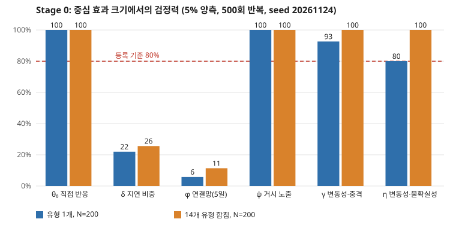

# DIDM-4 Stage 0 모의실험 보고서 (Version 0)

- 작성: DIDM_DEV 세션, 2026-11-24. **판정: `STAGE0: REVISE` (시도 1회).**
- 코드: `core/didm/sim/{dgp,recovery,power}.py`, `core/didm/models/{lp,har_x}.py`, 도구: `tools/didm/stage0_report.py`, 시험: `tests/didm_stage0_acceptance.py`.
- 기준: `docs/didm/PREREG_V0.md` 3절 Stage 0 행 (동결) — 상대 편향 < 10%, 90% 구간 포함률 85~95%, 계획 표본에서 검정력 ≥ 80%, 잘못 지정한 모형이 짐.
- **모든 숫자는 합성 자료입니다.** 실제 가격·수익률·기사·모델은 쓰지 않았습니다. 이 보고서는 "계획한 추정량이 알려진 답을 되찾는가"만 말하고, DIDM이 실제 시장에서 통한다는 뜻이 아닙니다.

## 1. 한 줄 결론

핵심 두 층 (당일 직접 반응 θ₀, 충격이 다음 날 변동성을 올리는 정도 γ)은 등록 기준을 통과했습니다. 그러나 **지연 반영 비중 δ와 연결망 파급 φ는 현실적인 효과 크기에서 되찾지 못했습니다** (검정력 22%, 11%). 그래서 GO가 아니라 REVISE입니다. NO-GO는 아닙니다 (핵심 층이 통과).



| 층 | 관문 칸 | 검정력 | 편향·포함률 | 결과 |
|---|---|---|---|---|
| θ₀ 당일 직접 반응 (핵심) | A | 100% | 편향 0.1%, 포함률 89.6% | 통과 |
| γ 변동성·충격 (핵심) | A | 92.6% | 편향 −0.1%, 포함률 88.2% | 통과 |
| ψ 거시 노출 | A | 100% | 편향 −0.2%, 포함률 88.8% | 통과 |
| η 변동성·불확실성 | A | 80.0% | 편향 1.2%, 포함률 91.2% | 통과 (기준선 위에 딱 걸침) |
| δ 지연 비중 (유형별) | A | **22.0%** | 평균이 참값의 4배, 포함률 81.0% | **실패** |
| φ 연결망 파급 (합침) | C | **11.4%** | 편향 5.6%, 포함률 91.8% | **실패 (검정력)** |
| 연결망 없는 모형이 짐 | C | 6.6% | — | **실패** |
| 신뢰 상태 없는 모형이 짐 | C | 16.4% | — | **실패** |
| 뉴스 없는 HAR이 짐 | C | 100% | — | 통과 |

점검 267개 중 통과 231, 실패 21, 미결 15 (미결 = 편향이 10%를 넘지만 반복 500회의 오차 안이라 판단 불가).

## 2. 무엇을 돌렸나

- 가상 세계: Version 0 식 그대로 (Notion DIDM 5.1). 종목 N개 × 2,500거래일. 종목-날짜마다 사건이 생기고, 채점기가 방향 확률을, DIDM이 신뢰 상태 π를 줍니다. 세계는 확률 π로 사건이 참인지, 방향 확률대로 실제 방향을 뽑습니다. 그래서 보정된 채점기의 충격 = 실제 영향의 기댓값입니다.
- 수익률 = 날짜 효과 + 직접 반응 (당일 θ₀ + 20일에 걸친 지연분) + 연결 종목의 파급 + 거시 노출 + 잡음 (일 변동성 2%, 두꺼운 꼬리). 변동성 = HAR + γ·|충격| + η·방향 불확실성.
- 추정: 날짜 고정효과 패널 국소투영 (h = 0, 1, 5, 20, Driscoll-Kraay 표준오차), HAR-X 회귀. 잘못 지정한 모형 3개는 앞 70% 날짜로 맞추고 뒤 30%에서 Diebold-Mariano 검정.
- 격자 10칸 × 500회 반복, 시드 20261124. 중심값: θ₀ 50bp, δ 0.15, 반감기 1일, φ 10bp, ψ 10bp, γ 0.10, η 0.05. "유형 1개" = 사건율 0.005 (종목당 200거래일에 1건), "합침" = 14개 유형을 합친 0.07.
- 격자·관문 칸·판정 규칙은 전체 실행 **전에** 커밋했습니다 (`6aaba25`). 그 전에는 효과가 아주 큰 시험용 설정으로만 코드를 돌렸습니다.

## 3. 결과

검정력 = 참값이 0이 아닐 때 "0이다"를 5% 수준에서 기각한 비율. Holm 14 = 14개 유형을 함께 검정할 때 가장 엄격한 단계.

**칸 A** (A one-type central N200; 평균 사건 수 2500)

| 모수 | 참값 | 평균 추정 | 상대 편향 % | 90% 구간 포함률 % | 검정력(5%) % | 검정력(Holm 14) % |
|---|---|---|---|---|---|---|
| θ₀ (당일 직접 반응) | 0.005 | 0.005007 | 0.1 | 89.6 | 100.0 | 98.4 |
| Θ₅ (5일 누적) | 0.005855 | 0.005962 | 1.8 | 86.2 | 67.2 | 31.2 |
| Θ₂₀ (20일 누적) | 0.005882 | 0.005808 | -1.3 | 88.2 | 25.6 | 6.6 |
| δ (지연 비중) | 0.15 | 0.6364 | 324.2 | 81.0 | 22.0 | 14.0 |
| φ₅ (연결망, 5일) | 0.0009844 | 0.001192 | 21.1 | 89.4 | 5.8 | 0.2 |
| φ 위약 (재배선) | 0 | 1.011e-05 | — | 89.0 | 4.4 | 0.4 |
| ψ (거시 노출) | 0.001 | 0.0009977 | -0.2 | 88.8 | 100.0 | 100.0 |
| γ (변동성·충격) | 0.1 | 0.0999 | -0.1 | 88.2 | 92.6 | 74.4 |
| η (변동성·불확실성) | 0.05 | 0.05058 | 1.2 | 91.2 | 80.0 | 41.4 |
| HAR 월 계수 | 0.2 | 0.1964 | -1.8 | 59.0 | 100.0 | 100.0 |

**칸 C** (C pooled central N200; 평균 사건 수 35004)

| 모수 | 참값 | 평균 추정 | 상대 편향 % | 90% 구간 포함률 % | 검정력(5%) % | 검정력(Holm 14) % |
|---|---|---|---|---|---|---|
| θ₀ (당일 직접 반응) | 0.005 | 0.004993 | -0.1 | 89.8 | 100.0 | 100.0 |
| Θ₅ (5일 누적) | 0.005855 | 0.00587 | 0.3 | 89.2 | 100.0 | 100.0 |
| Θ₂₀ (20일 누적) | 0.005882 | 0.005975 | 1.6 | 88.2 | 100.0 | 95.8 |
| δ (지연 비중) | 0.15 | 0.1209 | -19.4 | 87.0 | 25.6 | 13.6 |
| φ₅ (연결망, 5일) | 0.0009844 | 0.00104 | 5.6 | 91.8 | 11.4 | 1.4 |
| φ 위약 (재배선) | 0 | 4.026e-05 | — | 90.4 | 4.4 | 0.2 |
| ψ (거시 노출) | 0.001 | 0.001001 | 0.1 | 87.2 | 100.0 | 100.0 |
| γ (변동성·충격) | 0.1 | 0.1002 | 0.2 | 90.4 | 100.0 | 100.0 |
| η (변동성·불확실성) | 0.05 | 0.0498 | -0.4 | 89.6 | 100.0 | 100.0 |
| HAR 월 계수 | 0.2 | 0.1964 | -1.8 | 56.0 | 100.0 | 100.0 |

칸별 요약 (E, I 칸은 δ·φ·η의 참값이 0이라 그 열은 검정력이 아니라 잘못 기각한 비율입니다):

| 칸 | 설정 | 사건 수 | θ₀ 검정력 | δ 검정력 | φ₅ 검정력 | γ 검정력 | η 검정력 | 연결망 없는 모형이 짐 | 신뢰 상태 없는 모형이 짐 | 뉴스 없는 HAR이 짐 | QLIKE 개선 % |
|---|---|---|---|---|---|---|---|---|---|---|---|
| A | one-type central N200 | 2500 | 100.0 | 22.0 | 5.8 | 92.6 | 80.0 | 4.2 | 6.8 | 61.4 | 0.01 |
| B | one-type central N50 | 624 | 70.2 | 33.0 | 4.4 | 43.8 | 27.6 | 1.6 | 8.2 | 21.8 | 0.01 |
| C | pooled central N200 | 35004 | 100.0 | 25.6 | 11.4 | 100.0 | 100.0 | 6.6 | 16.4 | 100.0 | 0.14 |
| D | pooled central N50 | 8755 | 100.0 | 21.2 | 7.4 | 100.0 | 99.8 | 4.6 | 9.6 | 96.0 | 0.14 |
| E | one-type low N200 | 2499 | 67.8 | 29.6 | 5.4 | 44.4 | 5.6 | 3.0 | 7.2 | 11.8 | 0.00 |
| F | one-type high N200 | 2502 | 100.0 | 34.8 | 6.6 | 100.0 | 100.0 | 6.0 | 10.6 | 98.6 | 0.04 |
| G | one-type central N200 overconfident scorer | 2502 | 100.0 | 21.4 | 5.2 | 99.8 | 51.2 | 3.4 | 6.2 | 53.8 | 0.01 |
| H | one-type central N200 half-life 5d | 2500 | 100.0 | 22.8 | 5.2 | 95.0 | 78.4 | 3.4 | 6.6 | 57.8 | 0.01 |
| I | pooled low N200 | 34992 | 100.0 | 11.0 | 4.8 | 100.0 | 5.4 | 2.4 | 10.4 | 70.8 | 0.01 |
| J | pooled high N200 | 35011 | 100.0 | 95.2 | 38.0 | 100.0 | 100.0 | 13.4 | 32.4 | 100.0 | 0.58 |

전체 표 (10칸 × 17개 모수)는 아래 명령의 출력 `stage0.md`, `stage0.json`에 있습니다.

## 4. 읽는 법과 뜻

1. **직접 반응과 변동성 층은 계획대로 추정할 수 있습니다.** θ₀·γ·ψ의 편향은 1% 안, 포함률은 87~92%입니다. 유형 하나만으로도 (사건 2,500건) θ₀는 Holm 기준에서 98%의 검정력이 있습니다.
2. **δ (지연 비중)는 지금 방식으로는 못 잽니다.** δ는 두 누적 계수의 비율인데 20일 누적 계수의 잡음이 커서 (20일 수익률 잡음 약 9%) 비율이 튑니다. 유형 하나에서는 평균 추정이 0.64 (참값 0.15), 14개 유형을 합쳐도 검정력 26%입니다. 효과가 두 배인 합침 칸 (J)에서만 95%가 나옵니다. **사전등록 Stage 2의 통과 조건 "2개 이상 유형에서 δ > 0 유의"는 이 표본 크기에서는 효과가 중심 가정의 두 배 이상이어야 닿을 수 있습니다.**
3. **φ (연결망 파급)는 10bp 크기에서 못 잽니다.** 14개 유형을 합쳐도 검정력 11%, 20bp로 올려도 38%입니다. 재배선 위약의 잘못 기각 비율은 4.4%로 정상이라, 추정량이 틀린 것이 아니라 신호가 작은 것입니다. Notion 7.4의 "파급 0.10%를 보려면 사건-연결 쌍 약 15,700개"와 같은 방향입니다.
4. **신뢰 상태를 뺀 모형이 표본 밖 예측에서 뚜렷이 지지 않습니다 (16%).** 계수 추정에서는 차이가 나지만 하루 수익률 예측 오차로는 구분이 안 됩니다. 신뢰 상태 층의 값은 예측 오차가 아닌 다른 시험 (반박된 사건의 되돌림, Stage 2 조건)으로 봐야 합니다.
5. **변동성 예측 개선 폭이 작습니다.** 뉴스 항을 넣은 HAR-X가 통계적으로는 이기지만 (합침 칸 100%) QLIKE 개선은 중심값에서 0.14%, 두 배 효과에서도 0.58%입니다. 사전등록 Stage 3의 기준은 2%입니다. γ = 0.10은 이 세션이 고른 가정이지만, **γ가 이 정도면 Stage 3 변동성 기준에 닿지 못한다**는 점은 미리 알아야 합니다.
6. **과신하는 채점기는 계수를 깎습니다 (G 칸, 관문 아님).** 확률을 제곱해 날카롭게 만든 채점기에서는 θ₀가 22% 낮게 나오고 포함률이 59%로 떨어집니다. Stage 1의 보정 기준 (ECE ≤ 0.05)이 왜 필요한지를 보여 줍니다.
7. **HAR 월 계수의 포함률 실패 (56~84%)는 추정기 문제입니다.** 편향은 −1.8%로 작지만 표준오차가 아주 작아 구간이 참값을 놓칩니다. 종목 고정효과를 뺄 때 생기는 알려진 동적 패널 편향이고, `har_x.py` 머리말에 "무시한다"고 적은 그 항입니다. 관심 모수 (γ, η)의 포함률은 정상입니다.
8. N = 50에서는 유형 하나의 θ₀ 검정력이 70%로 기준 아래입니다. 유형별 분석에는 N = 200 쪽이 필요합니다.

## 5. 시도 기록과 다음 안

| 시도 | 내용 | 결과 |
|---|---|---|
| 1 (2026-11-24) | 격자 `GRID_V0` 10칸, 500회, 시드 20261124. 설계 변경 없음 | REVISE |

결과를 본 뒤에는 격자·관문·규칙을 바꾸지 않았습니다. 아래는 **제안**이고, 하나라도 적용하면 시도 2회로 적습니다 (메인·소유자 판단).

- (가) δ: 비율 대신 차이 Θ_h − Θ₀ (지연 누적분)을 직접 검정하고, 긴 창 20일 대신 5일을 주 지표로. 유형별이 아니라 합쳐서 먼저 봄. 이것은 추정 방식 변경이지만, 사전등록 Stage 2의 "δ > 0 유의 (유형 2개 이상)" 문구와 닿아 있어 사전등록 V0.1이 필요한지 판단이 필요합니다.
- (나) φ: V0에서 연결망 층을 "보고만 하고 관문에서 뺌"으로 둘지. Notion 6.2의 Stage 0 중단 규칙은 "현실적 크기에서 복원 불가 → 그 층을 뺌"입니다.
- (다) HAR 월 계수: 관심 모수가 아니므로 포함률 점검 대상에서 빼거나 편향 보정을 넣음.
- (라) 잘못 지정한 모형 비교: 하루 수익률 예측 오차 대신 계수 검정 (φ = 0, 신뢰 상태 유무의 적합도 차이)으로 바꿀지.

## 6. 이 보고서의 한계

- 효과 크기 (θ₀ 50bp, γ 0.10 등)는 문헌 범위 안에서 이 세션이 고른 가정입니다. 실제 값은 Stage 2에서 처음 나옵니다.
- 가상 세계의 충격은 날짜끼리 독립입니다. 실제 뉴스는 몰려서 나오므로 실제 표준오차는 더 클 수 있습니다.
- 유형 14개를 따로 모의하지 않고 사건율로만 구분했습니다 (유형 하나 0.005, 합침 0.07).
- 거시 노출 B는 알려진 값으로 넣었습니다 (추정 오차 없음). 점프 확률 항 ζ와 거래량 식은 넣지 않았습니다 (V3·보조 검증).
- Python 3.13.18, numpy만 사용. 다른 Python 판·다른 기계에서의 숫자 일치는 미검증입니다.

## 7. 다시 돌리기

```
python -B -m unittest tests.didm_stage0_acceptance
python -B -m tools.didm.stage0_report --seed 20261124 --out <저장소 밖 폴더> --workers 4
```

2026-11-24 확인:

- `tests.didm_stage0_acceptance` 34개 통과 (작은 시험용 설정; 등록 격자는 돌리지 않음).
- 위 보고 명령을 같은 시드로 **두 번** 돌려 `stage0.json`, `stage0.md`, 화면 출력이 바이트 단위로 같음을 확인했습니다 (`stage0.json` SHA-256 `f74d5127661876d3e380dad334090072d2f9d2b4fd887a9839069801e9ec8650`). 두 번 모두 마지막 줄은 `STAGE0: REVISE`.
- 실행 시간: 4개 프로세스로 한 번에 약 17분 (이 컨테이너).
