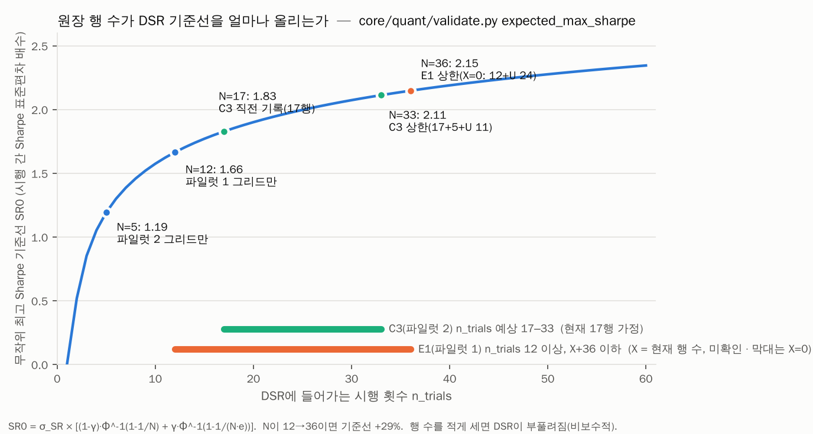

# 사용자 단독 작업 ①-3, ①-5 실행 가이드

작성일 2026-10-27 · 대상: QUANTGEN 소유자(고건) · 작성: Claude Code

기준 문서: `REMAINING_WORK_2026-10-27.docx`의 "👤 사용자 단독 (9건)" 표 · 관련: `docs/nautilus_bridge/TASK_BRIEF_2026-10-27.md` 6.5절, 9절

| 순서 | 작업 | 선행 | 이유 |
|---|---|---|---|
| ①-3 | `git push origin studies-of-record-2026-10-23` | 없음 | 클론할 때마다 guard 테스트 3건 실패 |
| ①-5 | `E1.jsonl`, `C3.jsonl` 행 수 보고 | 없음 | DSR 시행 횟수 계산에 필요 (스펙 O11) |

---

## 0. 한눈에 보기

| | ①-3 태그 push | ①-5 원장 행 수 보고 |
|---|---|---|
| 하는 일 | Windows 클론에만 있는 annotated 태그 1개를 GitHub에 올림 | 원장 파일 2개를 **읽기만** 해서 행 수와 체인 상태를 보고 |
| 어디서 | Windows 클론 (`C:\Users\whydi\OneDrive\Desktop\QUANTGEN`, 기존 계획 문서 기준 경로) | 같은 클론의 저장소 루트. 원장은 `~\.nextgen\macro\ledgers` |
| 소요 | 약 5분 | 약 5분 |
| 위험 | 매우 낮음. 새 커밋 없이 태그 객체 1개만 올라감 | 없음. 아무 파일도 쓰지 않음 (아래 2.4에서 검증) |
| 되돌리기 | 필요 없음. 원격 태그를 지우거나 다시 만들지 **말 것** | 해당 없음 |
| 끝나면 Claude에게 | `git ls-remote` 출력 2줄 (1.6 양식) | 스크립트 출력 전체 (2.7 양식) |
| 서로 의존? | 아니요. 순서 상관없이 따로 해도 됩니다 | |

**권장 시점:** 둘 다 Claude 작업 재개(②묶음) **전**. ①-3이 끝나면 클라우드 세션에서 임시 태그를 만들지 않아도 되고,
①-5 값이 있으면 ②-2 계획과 ③-5 파일럿 등록표에 실제 숫자를 넣을 수 있습니다.

### 0.1 Claude가 2026-10-27 클라우드에서 직접 확인한 사실

| 확인 항목 | 결과 | 의미 |
|---|---|---|
| `git ls-remote --tags origin` | **0줄** (GitHub에 태그가 하나도 없음) | 진짜 태그가 아직 안 올라감 |
| `git merge-base --is-ancestor eacd57d origin/main` | 참 | 태그가 가리킬 커밋은 이미 GitHub에 있음. push는 태그 객체 1개만 추가 |
| 새 클론에서 guard 5건 실행 | **2/5 PASS, 3 FAIL** (아래 출력) | 문서의 "클론마다 3건 실패"를 재현 |
| 같은 클론에 로컬 임시 태그(push 안 함)를 만든 뒤 guard 재실행 | **5/5 PASS** | 진짜 태그만 올라가면 해결된다는 뜻 |

새 클론에서의 실제 출력:

```
FAIL guard/test_a_tag_is_annotated_and_peels_to_the_baseline AssertionError: git cat-file -t studies-of-record-2026-10-23: fatal: Not a valid object name studies-of-record-2026-10-23
FAIL guard/test_b_tagged_pins_match_prereg_and_frozen_rule AssertionError: git show studies-of-record-2026-10-23:grokteam/out/PREREG_book.json: fatal: invalid object name 'studies-of-record-2026-10-23'.
PASS guard/test_c_no_forward_look_before_it_opens
FAIL guard/test_d_library_versions_match_the_pins_while_a_readout_is_pending AssertionError: git show studies-of-record-2026-10-23:grokteam/out/PREREG_book.json: fatal: invalid object name 'studies-of-record-2026-10-23'.
PASS guard/test_d_pending_readouts_retire_only_when_all_three_are_in
2/5 passed, 3 failed, 0 not run
```

---

## 1. ①-3 태그 push

### 1.1 왜 필요한가

1. **테스트:** `tests/frozen_guard.py`의 (a), (b), (d) 세 테스트가 이 태그를 git으로 읽습니다(`:31-32, 66-91`).
   태그가 없는 클론에서는 항상 실패합니다. GitHub에서 받는 모든 클론(클라우드 세션 포함)이 여기에 해당합니다.
2. **동결 기록의 백업:** 이 태그는 GROKTEAM-BOOK과 paper_live H2 사전 등록 연구의 기준점입니다. 메시지에 10개 고정 파일의
   sha256과 동결 증거(스펙 Appendix C)가 들어 있습니다. ⑧-1 H2 판독(기한 약 2026-12-19)과 ⑧-3 GROKTEAM forward look
   (2027-02-01 이후)은 이 태그로 체크아웃한 클론에서만 실행합니다. 지금은 Windows 클론 한 곳에만 있으므로, 그 폴더의 `.git`이
   손상되면 기록이 사라집니다.
3. **클라우드 작업 단순화:** 지금은 클라우드 세션마다 push하지 않는 임시 태그를 만들어야 합니다(TASK_BRIEF 10절 3단계).
   진짜 태그가 올라가면 이 우회 절차가 필요 없습니다.

### 1.2 왜 사용자만 할 수 있나

- **진짜 태그 객체는 Windows 클론에만 있습니다.** 태그 객체에는 작성자, 작성 시각(2026-10-23 13:26:11 KST, 유닉스 시각
  `1792729571`, 실행 기록 `2026-10-23-execution-record.md` 21번 항목), Appendix C 메시지가 들어 있습니다.
  Claude가 같은 이름으로 새로 만들면 sha가 다른 객체가 됩니다. test_a는 통과하겠지만 10-23의 동결 기록은 아닙니다.
- Claude 세션은 지정된 브랜치에만 push할 수 있고 태그는 push하지 않는 규칙을 따릅니다(TASK_BRIEF 10절 3단계).

### 1.3 사전 점검 (Step 1~2)

PowerShell 또는 Git Bash에서 실행합니다. 아래 명령은 둘 다에서 그대로 동작합니다.
`^{commit}`이 들어간 인자는 **반드시 큰따옴표로** 감싸세요. cmd.exe에서는 `^`가 특수 문자입니다.

**Step 1. 로컬 태그 확인**

```powershell
cd "$env:USERPROFILE\OneDrive\Desktop\QUANTGEN"
git cat-file -t studies-of-record-2026-10-23
git rev-parse "studies-of-record-2026-10-23^{commit}"
git for-each-ref refs/tags/studies-of-record-2026-10-23 --format="%(objecttype) %(objectname) %(taggerdate:unix) %(taggername)"
git tag -n1 -l studies-of-record-2026-10-23
```

| 줄 | 기대값 | 다르면 |
|---|---|---|
| 1 | `tag` | `commit`이면 lightweight 태그 → **중단하고 보고** |
| 2 | `eacd57d2b0821ad796ab9b66d2d2c96a3d71081f` | **중단하고 보고** (다른 커밋에 붙은 태그) |
| 3 | `tag <태그 객체 sha> 1792729571 Geon Koh` | 시각이 다르면 10-23 이후 다시 만든 태그 → **보고 후 판단** |
| 4 | `studies-of-record-2026-10-23 Studies of record: GROKTEAM-BOOK and paper_live H2 (spec 2026-10-23, section 3.1, D9)` | 문구가 조금 달라도 1~3줄이 맞으면 진행 |

3번 줄의 **태그 객체 sha를 메모**해 두세요. Step 4에서 GitHub 쪽 값과 비교합니다.
1번 줄에서 `fatal: Not a valid object name`이 나오면 이 클론에도 태그가 없는 것입니다. **새로 만들지 말고** Claude에게 보고하세요.

**Step 2. 원격 확인**

```powershell
git remote -v
git fetch origin
git branch -r --contains eacd57d2b0821ad796ab9b66d2d2c96a3d71081f
git ls-remote --tags origin studies-of-record-2026-10-23
```

| 명령 | 기대값 | 다르면 |
|---|---|---|
| `git remote -v` | `origin  https://github.com/xkg4real/quantgen.git (fetch)`와 `(push)` 두 줄. SSH 주소 `git@github.com:xkg4real/quantgen.git`도 괜찮음 | 아무것도 안 나오면 1.5의 "원격 없음" 행 참조. 10-23 시점에는 이 클론에 원격이 없었습니다(실행 기록 24번 항목) |
| `git branch -r --contains …` | `origin/main`이 목록에 있음 | 없으면 **중단하고 보고** (GitHub 저장소가 다른 이력일 수 있음) |
| `git ls-remote --tags …` | **아무것도 출력되지 않음** | 출력이 있으면 이미 누군가 올린 것 → push하지 말고 출력 그대로 보고 |

### 1.4 push (Step 3)

```powershell
git push origin refs/tags/studies-of-record-2026-10-23
```

기대 출력의 마지막 줄:

```
 * [new tag]         studies-of-record-2026-10-23 -> studies-of-record-2026-10-23
```

문서에 적힌 `git push origin studies-of-record-2026-10-23`과 결과는 같습니다. `refs/tags/`를 붙인 이유는 같은 이름의
브랜치가 생기더라도 태그만 정확히 지정하기 위해서입니다.

### 1.5 사후 확인 (Step 4~5)

**Step 4. GitHub 쪽 값 확인 (필수)**

```powershell
git ls-remote --tags origin "studies-of-record-2026-10-23*"
```

기대 출력은 정확히 2줄입니다. 끝의 `*`가 없으면 둘째 줄(`^{}`)이 패턴에 걸리지 않아 1줄만 나옵니다.

```
<Step 1에서 메모한 태그 객체 sha>	refs/tags/studies-of-record-2026-10-23
eacd57d2b0821ad796ab9b66d2d2c96a3d71081f	refs/tags/studies-of-record-2026-10-23^{}
```

- 1줄째 sha가 Step 1의 값과 같아야 합니다. 진짜 태그가 올라갔다는 증거입니다.
- 2줄째(`^{}`)는 annotated 태그가 가리키는 커밋입니다. 이 줄이 없으면 lightweight 태그가 올라간 것이므로 보고하세요.

**Step 5. 새 클론에서 guard 실행 (선택)**

Claude가 보고를 받은 뒤 클라우드에서 같은 검사를 하므로 건너뛰어도 됩니다. 직접 확인하려면 **임시 폴더**에서 하세요.
`tests/run_all.py`는 `qa/acceptance_results.json`을 덮어쓰므로 작업 중인 클론에서는 돌리지 않습니다.

```powershell
cd $env:TEMP
git clone https://github.com/xkg4real/quantgen.git qg-tagcheck
cd qg-tagcheck
python tests/run_all.py --suite guard
cd ..
Remove-Item -Recurse -Force qg-tagcheck
```

기대 출력의 마지막 줄은 `5/5 passed, 0 failed, 0 not run`입니다. test_d는 전역 Python의 numpy 2.3.5, scipy 1.18.0,
pandas 2.3.3을 확인하므로 평소 QUANTGEN을 돌리는 `python`으로 실행하세요.

### 1.6 오류별 대응

| 증상 | 원인 | 대응 |
|---|---|---|
| `error: src refspec refs/tags/... does not match any` | 이 클론에 태그가 없음 | **중단.** 새 태그를 만들지 말고 보고. 다른 사본(예: `_backup`)에 있는지 Claude가 함께 찾습니다 |
| `fatal: 'origin' does not appear to be a git repository` | 원격 미설정 | `git remote add origin https://github.com/xkg4real/quantgen.git` → `git fetch origin` → Step 2부터 다시 |
| 로그인 창, `Authentication failed`, `403` | 자격 증명 없음 또는 만료 | Git Credential Manager 창에서 GitHub 로그인. 토큰을 쓴다면 이 저장소에 contents 쓰기 권한이 있어야 함 |
| `! [rejected] ... (already exists)` | 원격에 같은 이름의 태그가 있음 | **`--force` 금지.** `git ls-remote --tags origin` 출력을 그대로 보고 |
| `GH013: Repository rule violations` | 저장소의 태그 보호 규칙 | 규칙을 해제하지 말고 메시지 그대로 보고 |
| Step 4에 `^{}` 줄이 없음 | lightweight 태그가 올라감 | 보고. 원격 태그를 지우지 말 것 |

### 1.7 하지 말 것

| 금지 | 이유 |
|---|---|
| `git push --tags`, `git push --follow-tags` | 로컬의 다른 태그(실험용 등)까지 함께 올라갈 수 있음 |
| `git push -f`, 원격 태그 삭제 후 다시 push | frozen_guard (a)·(b)는 영구 provenance 조항(`tests/frozen_guard.py:12`). 태그의 정체성이 바뀌면 두 사전 등록 연구의 기준점이 흔들림 |
| 태그를 새로 만들거나(`git tag -a ...`) 옮기기(`git tag -f`) | 10-23 작성 시각과 Appendix C 메시지를 잃음 |
| 작업 중인 클론에서 `tests/run_all.py` 실행 | `qa/acceptance_results.json`이 부분 결과로 덮어써짐 |

### 1.8 완료 보고 양식

```
[①-3 완료]
push 출력 마지막 줄: * [new tag] studies-of-record-2026-10-23 -> studies-of-record-2026-10-23
ls-remote:
<sha>    refs/tags/studies-of-record-2026-10-23
eacd57d2b0821ad796ab9b66d2d2c96a3d71081f    refs/tags/studies-of-record-2026-10-23^{}
Step 1 taggerdate: 1792729571 (또는 실제 값)
Step 5 실행 여부: 예(5/5) / 아니요
```

---

## 2. ①-5 `E1.jsonl`, `C3.jsonl` 행 수 보고

### 2.1 왜 필요한가

Nautilus 브리지는 QUANTGEN 게이트의 DSR(Deflated Sharpe Ratio)을 계산할 때 시행 횟수를 원장에서 가져옵니다.

- **시행 횟수 공식(스펙 O11, 5.5 step 3):** `n_trials = 등록 후 family N_raw + U`.
  U는 연구가 실행했지만 원장에 없는 설정의 수입니다. E1은 최대 24, C3는 최대 11입니다(스펙 6.6, 10.2).
- **파일럿 1(SPY)은 `E1.jsonl`, 파일럿 2(BTC-USD)는 `C3.jsonl`을 씁니다.** E1은 Strategy Lab의 `trend_switch`가
  기록합니다(`ui/strategy_lab_page.py:50`). C3는 paper_live의 TREND 변형, Strategy Lab의 `crypto_trend`,
  `docs/techfund_study.py`가 기록합니다.
- **R-15 거부 조건:** of-record 실행은 원장 파일이 없거나, 비었거나, 해시 체인이 깨졌으면 시작하지 않습니다.
  브리지는 원장을 새로 만들지도 않습니다(스펙 217행, 5.3.2 step 1). 지금 상태를 알아야 파일럿이 막힐지 미리 압니다.
- **K12 (시장 혼합):** C3에는 미국·한국 주식 추세 행과 암호화폐 행이 섞여 있습니다. 그래서 시장별 행 수도 따로 기록합니다.



**그림 읽는 법:** DSR은 관측 Sharpe가 "무작위 시행 N개 중 최고값의 기대치(SR0)"를 넘을 확률입니다.
SR0는 `core/quant/validate.py:211-217`의 `expected_max_sharpe`로 계산하며, N이 커질수록 올라갑니다.

| n_trials | 5 | 12 | 17 | 22 | 33 | 36 |
|---|---|---|---|---|---|---|
| SR0 배수 | 1.19 | 1.67 | 1.83 | 1.94 | 2.11 | 2.15 |

- N이 12에서 36으로 늘면 기준선이 **29%** 높아집니다. 같은 전략이라도 DSR ≥ 0.95 통과 여부가 바뀔 수 있는 크기입니다.
- **행 수를 적게 세면 DSR이 부풀려집니다(비보수적).** 많이 세는 쪽은 보수적입니다. 그래서 정확한 측정값이 필요합니다.
- 그림의 범위는 계획용 추정입니다. C3는 직전 기록 17행을 가정했고, E1의 X는 아직 모릅니다.

### 2.2 지금까지 알려진 값 (참고용, 모두 미확인)

| 원장 | 기록 | 출처 |
|---|---|---|
| C3 | 3행 (CRY-1 등록: vol-scaled control, split 2024-01-10, ETH replication) | `research_notes/QUANTGEN v2 integration map/sprint_logs/S7.md:188` |
| C3 | 17행 (paper_live TREND 변형 포함) | `research_notes/QUANTGEN TRADEGEN split map/split_map.md:496` (10-23 분리 조사) |
| E1 | 기록 없음. 있는지조차 미확인 | `research_notes/QUANTGEN Nautilus bridge map/02_quantgen_gate_ledger_lab.md:238` |

원장은 append-only이므로 **C3가 17행보다 적게 나오면 이상 신호**입니다(2.5 해석표).

### 2.3 실행 전 조건

1. **QUANTGEN 앱(`main.py`), Strategy Lab, paper_live 실행, 테스트 스위트를 모두 끈 상태**에서 실행하세요.
   읽는 도중 행이 추가되면 스냅샷이 어긋납니다. 앱은 시작할 때 `~\.nextgen\macro`에 기록을 남깁니다(split map 8.3절).
2. **스크립트는 저장소 밖에 저장하세요**(예: `%TEMP%`). 저장소 안에 두면 작업 트리가 더러워지는데,
   of-record 실행은 추적되지 않는 파일까지 포함해 깨끗한 git 트리를 요구합니다(스펙 5.3.2 step 2, `--untracked-files=all`).
3. 평소 QUANTGEN을 돌리는 `python`을 쓰세요. 스크립트가 `core.quant.gate_ledger`(numpy, scipy 필요)를 그대로 씁니다.

### 2.4 실행

**스크립트를 받는 두 가지 방법**

- 대화에 첨부된 `ledger_census.py`를 받아 `%TEMP%\ledger_census.py`로 저장, 또는
- 이 문서를 GitHub에서 열고 2.6의 코드 블록 오른쪽 위 복사 버튼으로 복사해서 메모장에 붙여 넣고, UTF-8로
  `%TEMP%\ledger_census.py`에 저장.

**실행 명령 (PowerShell)**

```powershell
cd "$env:USERPROFILE\OneDrive\Desktop\QUANTGEN"
python "$env:TEMP\ledger_census.py" --rows | Out-File -Encoding utf8 "$env:TEMP\ledger_census.txt"
Get-Content "$env:TEMP\ledger_census.txt"
```

- `--rows`를 붙이면 E1과 C3의 행마다 한 줄(config_id 앞 16자, rule, market, run_kind, phase, run_utc, script, params)을
  추가로 출력합니다. Claude가 이 목록으로 U를 미리 계산할 수 있습니다. 공유하고 싶지 않으면 `--rows`를 빼세요.
  행 수 보고에는 없어도 됩니다.
- 저장소 루트가 아닌 곳에서 실행하면 `STOP: run this from the QUANTGEN repo root`를 출력하고 끝납니다.

**이 스크립트가 하는 일과 하지 않는 일 (Claude가 검증한 내용)**

- QUANTGEN이 쓰는 원장 경로를 그대로 따릅니다: `config.macro_dir() / "ledgers"`. OS나 `.env`의 `QUANTGEN_MACRO_DIR`도 반영합니다.
- 체인 검증은 QUANTGEN 자체 함수 `FamilyLedger.verify_chain()`을 씁니다(`core/quant/gate_ledger.py:284-309`).
  기록 경로(`append`, 잠금 파일)는 호출하지 않습니다.
- 클라우드에서 합성 원장으로 시험했습니다. 정상, 빈 파일, 손편집으로 깨진 체인, 파일 없음, 디렉터리 없음, 잘못된 위치에서 실행,
  여섯 경우 모두 의도대로 출력했습니다. 실행 전후로 디렉터리의 모든 파일의 md5가 같았습니다. 즉 **아무 파일도 생성하거나 바꾸지 않습니다.**
- 환경 변수는 `QUANTGEN_MACRO_DIR`가 설정됐는지만 출력하고 값이나 `.env`의 다른 키는 출력하지 않습니다.

**정상일 때의 출력 형태 (합성 데이터 예시)**

```
== QUANTGEN ledger census (read-only) ==
census_utc        : 2026-10-27T08:10:53Z
python            : 3.13.x
QUANTGEN_MACRO_DIR: not set
ledger_dir        : C:\Users\whydi\.nextgen\macro\ledgers

-- every family file (5) --
file                          rows  chain
C3.jsonl                        17  OK
...

-- E1.jsonl --
exists            : yes
bytes             : 2569
modified_utc      : ...
file_sha256       : ...
chain             : OK
rows (N_raw)      : 4
ledger_hash (md5) : ...
distinct config_id: 4
run_utc range     : ... .. ...
by market         : KR=1, US=3
by run_kind       : trial=4
by phase          : research=4
by rule           : trend_switch=4
by script         : ui/strategy_lab_page.py=4
```

### 2.5 결과 해석

| 결과 | 의미 | 할 일 |
|---|---|---|
| E1·C3 모두 `exists: yes`, `chain: OK`, rows ≥ 1 | R-15 통과 조건 충족 | 출력 보고만 |
| `exists: NO` 또는 `LEDGER DIR MISSING` | 그 원장을 쓰는 파일럿을 R-15가 막음 | 보고만. **빈 파일을 만들지 마세요.** 원장을 어떻게 시작할지는 Claude가 선택지를 정리해 판정 요청(O11)으로 올립니다 |
| `empty file` (rows 0) | 위와 같음 | 위와 같음 |
| `chain: BROKEN` | 손편집, 동기화 충돌, 동시 쓰기 중 하나 | **편집·복구·삭제 금지.** `first_bad_line`과 `reason`을 그대로 보고. 원본은 건드리지 말고 다른 폴더에 사본만 보관 |
| C3 rows < 17 | append-only 원장에서 행이 줄 수 없음. 다른 디렉터리를 보고 있거나 파일이 교체됨 | 보고. `ledger_dir`과 `QUANTGEN_MACRO_DIR` 줄을 확인 |
| `by script`에 낯선 경로(TRADEGEN 폴더 등) | 분리 이후 TRADEGEN 사본이 QUANTGEN 원장에 기록했을 가능성 (분리 스펙 3.2 위반, split map 8.3) | 보고. 원장은 그대로 둠 |
| 파일 목록에 `C3 (1).jsonl`, `C3-DESKTOP-xxxx.jsonl` 같은 이름 | 동기화 충돌 사본 | 보고. 어느 파일이 진짜인지는 체인과 행 수로 Claude가 판단 |
| `QUANTGEN_MACRO_DIR: set` | 기본 경로가 아닌 곳을 씀 | 출력의 `ledger_dir`이 실제 위치. 그대로 보고 |

### 2.6 스크립트 전문 (`ledger_census.py`)

```python
"""Read-only census of QUANTGEN's trial ledgers for the owner's report (TASK_BRIEF section 9 item 3; spec O11, R-15).

Run from the QUANTGEN repo root with the interpreter QUANTGEN uses:
    python <path to>\\ledger_census.py            # summary of every family file, details for E1 and C3
    python <path to>\\ledger_census.py --rows     # also one line per E1 and C3 row (lets Claude compute U)

It only reads: no lock sidecar, no directory, no row is ever written. The ledger directory is the one QUANTGEN
itself resolves (config.macro_dir() / "ledgers", so QUANTGEN_MACRO_DIR from the OS or .env is honoured).
"""
from __future__ import annotations

import argparse
import hashlib
import json
import os
import sys
from collections import Counter
from datetime import datetime, timezone
from pathlib import Path

FOCUS = ("E1", "C3")


def _utc(ts: float) -> str:
    return datetime.fromtimestamp(ts, timezone.utc).strftime("%Y-%m-%dT%H:%M:%SZ")


def _counts(rows, key) -> str:
    c = Counter(str(r.get(key)) for r in rows)
    return ", ".join(f"{k}={v}" for k, v in sorted(c.items())) or "-"


def main(argv=None) -> int:
    ap = argparse.ArgumentParser()
    ap.add_argument("--rows", action="store_true", help="print one line per E1 and C3 row")
    args = ap.parse_args(argv)

    root = Path.cwd()
    if not (root / "core" / "quant" / "gate_ledger.py").exists():
        print(f"STOP: run this from the QUANTGEN repo root (cwd is {root})")
        return 2
    sys.path.insert(0, str(root))
    import config as QC
    from core.quant import gate_ledger as GL

    ldir = QC.macro_dir() / "ledgers"
    print("== QUANTGEN ledger census (read-only) ==")
    print(f"census_utc        : {datetime.now(timezone.utc).strftime('%Y-%m-%dT%H:%M:%SZ')}")
    print(f"python            : {sys.version.split()[0]}")
    print(f"QUANTGEN_MACRO_DIR: {'set' if os.environ.get('QUANTGEN_MACRO_DIR', '').strip() else 'not set'}")
    print(f"ledger_dir        : {ldir}")
    if not ldir.is_dir():
        print("RESULT: LEDGER DIR MISSING (E1 and C3 both missing)")
        return 0

    files = sorted(p for p in ldir.glob("*.jsonl") if p.is_file())
    print(f"\n-- every family file ({len(files)}) --")
    print(f"{'file':<28}{'rows':>6}  chain")
    for p in files:
        chk = GL.FamilyLedger(p).verify_chain()
        state = "OK" if chk.ok else f"BROKEN at line {chk.first_bad_line}: {chk.reason}"
        print(f"{p.name:<28}{chk.n_rows:>6}  {state}")
    others = sorted(p.name for p in ldir.iterdir() if p.is_file() and p.suffix not in (".jsonl", ".lock"))
    if others:
        print(f"other files in ledger_dir: {others}")

    for fam in FOCUS:
        led = GL.family_ledger(fam, ldir)
        print(f"\n-- {fam}.jsonl --")
        if not led.path.exists():
            print("exists            : NO  (R-15 would refuse this pilot; report it, create nothing)")
            continue
        data = led.path.read_bytes()
        st = led.path.stat()
        chk = led.verify_chain()
        print("exists            : yes")
        print(f"bytes             : {len(data)}")
        print(f"modified_utc      : {_utc(st.st_mtime)}")
        print(f"file_sha256       : {hashlib.sha256(data).hexdigest()}")
        print(f"chain             : {'OK' if chk.ok else 'BROKEN'}")
        print(f"rows (N_raw)      : {chk.n_rows}" + ("" if chk.ok else "  (rows before the break only)"))
        if not chk.ok:
            print(f"first_bad_line    : {chk.first_bad_line}")
            print(f"reason            : {chk.reason}")
            print("(do not edit or repair the file; report these lines as they are)")
            continue
        rows = led.rows()
        if not rows:
            print("(empty file: R-15 would refuse this pilot; report it, create nothing)")
            continue
        runs = sorted(str(r.get("run_utc")) for r in rows)
        print(f"ledger_hash (md5) : {led.hash(rows)}")
        print(f"distinct config_id: {len({r.get('config_id') for r in rows})}")
        print(f"run_utc range     : {runs[0]} .. {runs[-1]}")
        for key in ("market", "run_kind", "phase", "rule", "script"):
            print(f"by {key:<15}: {_counts(rows, key)}")
        if args.rows:
            print("rows:")
            for i, r in enumerate(rows, start=1):
                params = json.dumps(r.get("params"), sort_keys=True, separators=(",", ":"))
                print(f"  {i:>3} {str(r.get('config_id'))[:16]} {r.get('rule')} {r.get('market')} "
                      f"{r.get('run_kind')} {r.get('phase')} {r.get('run_utc')} {r.get('script')} {params}")
    print("\n== end of census ==")
    return 0


if __name__ == "__main__":
    sys.exit(main())
```

**차선책 (Python으로 실행할 수 없을 때만):** 아래 명령은 줄 수만 셉니다. 체인 검증을 하지 않고
`QUANTGEN_MACRO_DIR`도 반영하지 않으므로, 보고할 때 **"차선책, 체인 미검증"**이라고 적어 주세요.

```powershell
Get-ChildItem "$env:USERPROFILE\.nextgen\macro\ledgers" -Filter *.jsonl |
  ForEach-Object { "{0}`t{1}" -f $_.Name, (Get-Content $_.FullName | Measure-Object -Line).Lines }
```

### 2.7 하지 말 것

| 금지 | 이유 |
|---|---|
| 원장 파일을 열어 편집하거나 저장 (메모장, VS Code 자동 포맷 포함) | 각 줄은 canonical JSON이고 `row_md5`와 `prev_row_md5`로 묶여 있음. 공백 하나만 바뀌어도 체인이 영구히 깨짐 (`gate_ledger.py:284-309`) |
| 빈 `E1.jsonl` 생성, 다른 원장에서 행 복사 | R-15는 "빈 원장"도 거부함. 복사한 행은 family_id가 맞지 않아 체인 검증에 실패함 |
| 원장을 클라우드로 보내 실행한 뒤 결과를 되돌려 놓기 | 체인이 두 갈래로 갈라질 위험 (스펙 O10). 읽기 결과(텍스트)를 보내는 것은 괜찮음 |
| 테스트 스위트나 앱을 켠 채로 실행 | 스냅샷이 어긋날 수 있음. 스위트의 T-HERM-02는 홈 디렉터리 변화를 감시함 |

### 2.8 완료 보고 양식

출력 파일 `%TEMP%\ledger_census.txt`를 첨부하거나 내용 전체를 붙여 넣으면 됩니다. 요약만 적으려면:

```
[①-5 완료]
census_utc:
ledger_dir:                     QUANTGEN_MACRO_DIR: set / not set
E1: exists(yes/no)  chain(OK/BROKEN)  rows=  ledger_hash=  by market=
C3: exists(yes/no)  chain(OK/BROKEN)  rows=  ledger_hash=  by market=  by script=
--rows 포함 여부: 예 / 아니요
방법: 스크립트 / 차선책(체인 미검증)
```

---

## 3. 보고를 받은 뒤 Claude가 할 일

| 보고 | Claude의 후속 작업 |
|---|---|
| ①-3 | 클라우드 새 클론에서 guard 5건 실행 후 5/5 확인. TASK_BRIEF 6.5절과 10절의 "로컬 임시 태그" 절차 삭제. 남은 작업 문서에서 ①-3 완료 처리 |
| ①-5 정상 | 스펙 O11의 "UNVERIFIED"를 측정값(행 수, 해시, 시각)으로 갱신. `--rows`가 있으면 U와 `n_trials` 범위를 미리 계산해 ③-5 파일럿 등록표 초안에 반영 |
| ①-5 이상 (없음, 빈 파일, 체인 깨짐, 낯선 script) | 원인 후보와 선택지를 정리해 판정 요청으로 올림. 원장은 소유자 판정 전까지 아무도 건드리지 않음 |

실제 파일럿 실행(⑥) 때는 러너가 등록 직후의 `hash()`, `n_raw`, 시장별 행 수를 다시 기록합니다(스펙 5.3.2 step 12).
이번 보고는 그 전에 계획을 세우기 위한 스냅샷입니다. 그 사이 paper_live나 Strategy Lab을 돌리면 행 수가 늘 수 있고,
이는 정상입니다. 해시와 시각을 같이 기록하는 이유가 이것입니다.

---

## 부록. 이 가이드의 근거

| 내용 | 근거 |
|---|---|
| 태그 이름, 기준 커밋 `eacd57d…`, 검사 4조항 | `tests/frozen_guard.py:1-15, 31-32, 66-91` |
| 태그 생성 명령과 메시지(Appendix C) | `docs/superpowers/plans/2026-10-23-quantgen-split-phase1.md:274-327` |
| 태그 작성 시각 `1792729571`, 당시 원격 없음 | `docs/superpowers/plans/2026-10-23-execution-record.md` 21번, 24번 항목 |
| 진짜 태그가 GitHub에 없음, 소유자 push 요청 | `docs/nautilus_bridge/TASK_BRIEF_2026-10-27.md` 6.5절, 9절 |
| 원장 형식, 체인 검증, `n_raw` | `core/quant/gate_ledger.py:265-336` |
| 원장 경로와 `QUANTGEN_MACRO_DIR` | `config.py:176-178` |
| 시행 횟수 공식, R-15, U 상한, K12 | `docs/superpowers/specs/2026-10-26-nautilus-bridge-design.md` O11(107행), 5.5 step 3(891행), R-15(1229행), 6.6(1591·1605행) |
| SR0 공식과 DSR | `core/quant/validate.py:211-237` |
| 원장별 기록 주체 | `ui/strategy_lab_page.py:50`, `paper_live/engine.py:69`, `docs/techfund_study.py:71` |
