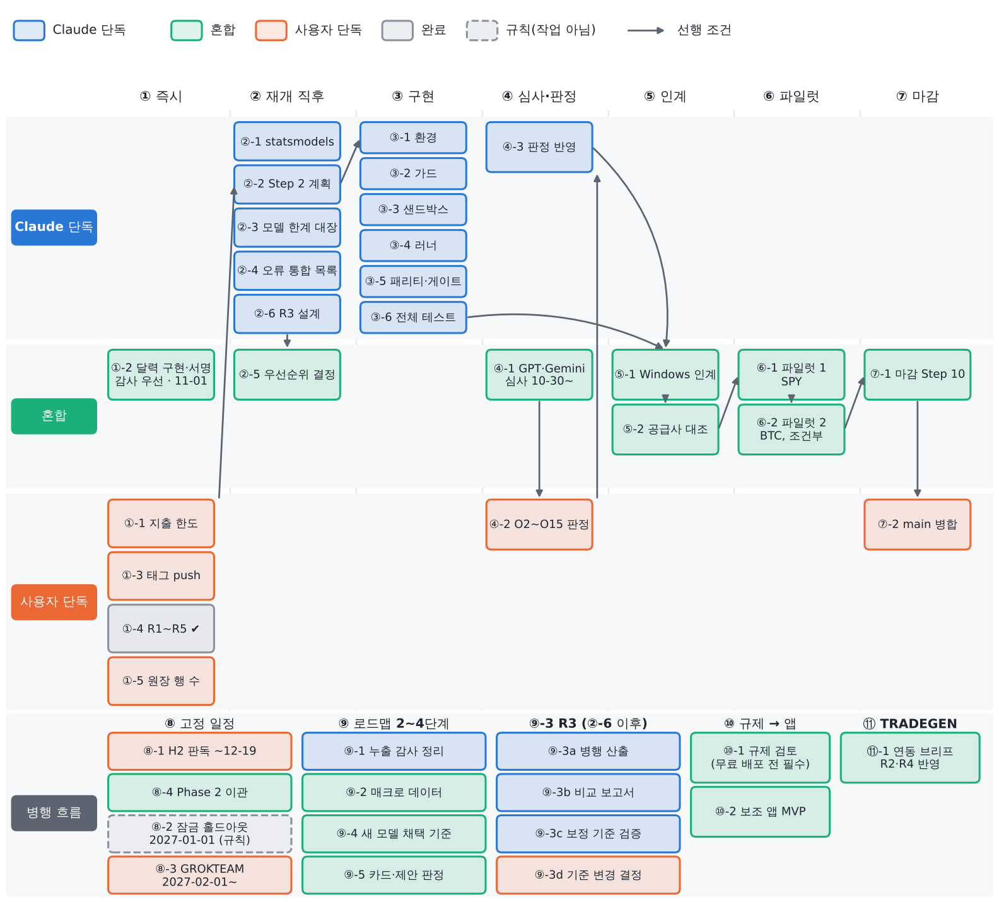

# 📋 로드맵 검토, 수용안, 전체 남은 작업 (판정 반영판)

작성일 2026-10-27 · 대상: QUANTGEN 소유자(고건) · 기준 과업: NautilusTrader 연구 브리지
상세본: `docs/nautilus_bridge/ROADMAP_REVIEW_2026-10-27.md` · 과업 브리프: `docs/nautilus_bridge/TASK_BRIEF_2026-10-27.md`

**O1 승인 기록:** 말씀하신 원문을 날짜와 채널과 함께 스펙 Status에 기록했습니다. 승인 범위는 `pyarrow`를 포함한 새 의존성입니다. 설치는 별도 venv에만 하고, 전역 Python과 동결된 numpy·pandas·scipy 버전은 그대로 둡니다. O2~O15는 아직 미결입니다.

## 📌 판정 반영 현황 (2026-10-27)

원문은 `docs/nautilus_bridge/OWNER_RULINGS_LOG.md`에 날짜와 채널과 함께 그대로 기록했습니다.

| 판정 | 내용 | 반영 |
|---|---|---|
| O1 | 새 의존성 승인(`pyarrow` 포함) | 완료. 별도 venv에만 설치하고 frozen pin은 유지 |
| ①-2 | 감사 파일을 우선 적용하는 조건으로 달력 구현 승인 | **완료 (2026-10-28).** 4개 파일 감사·수정 후 소유자 서명(Geon Koh, 06:35:52Z). `test_cal02` PASS. 기록: `docs/audit/2026-10-27/01~03` |
| R1 | 지금은 무료 배포, 법령 검토 후 유료 판매로 전환 예정 | ⑩-1 규제 검토를 **무료 배포 전에도 필수 선행 조건**으로 둠 |
| R2 | 예 | ⑪-1에 피드백 제어 경로 포함 |
| R3 | 원장 기반 전환과 판정 보수화를 분리. 실행 ID, 기록 항목, 시행 구분 기준. 병행 산출과 비교 후 기준 결정 | ⑨-3을 ②-6, ⑨-3a~⑨-3d로 분할. **기존 카드 판정 기준은 바꾸지 않음** |
| R4 | 예 | ⑪-1에 Moonshot 격리 규칙 포함 |
| R5 | 예 | ②-3, ②-4를 Nautilus 작업과 병행 |

**R1에 대한 비판적 메모.** 무료 배포여도 규제 검토가 먼저 필요합니다. 이유는 세 가지입니다.
- 광고 수익이나 이후 유료 전환을 전제로 하면 "영업"으로 볼 여지가 있습니다(투자자문업, 유사투자자문업).
- Yahoo, FRED, KIS 등 데이터 공급사의 약관상 재배포 가능 여부를 확인해야 합니다.
- README의 "개인용, 제품 배포 금지" 원칙을 개정해야 합니다.

---

## 🔍 핵심 요약

**총평:** 로드맵의 방향은 QUANTGEN이 지켜 온 원칙과 대부분 일치하므로 대체로 수용합니다. 신뢰성 우선, 기준전략 비교, 비용 반영, 단계적 검증이 그렇습니다. 다만 세 군데는 그대로 받으면 기존 구속 조건과 충돌하므로 조건을 붙였습니다.

| # | 충돌 지점 | 부딪히는 기존 조건 |
|---|---|---|
| 1 | 앱의 **주문 기능**과 **"시장 출시"** | README: QUANTGEN은 개인용이며 제품으로 배포 금지. QUANTGEN에는 주문 경로가 없음. 신호를 공유할 때 투자자문업이나 유사투자자문업 등록이 필요한지는 아직 **조사하지 않음** |
| 2 | **TRADEGEN에서 QUANTGEN으로 가는 피드백 순환** | 분리 스펙 3.2: TRADEGEN은 QUANTGEN 원장에 기록할 수 없음. 실거래 결과를 보고 모델을 고치면 그 자체가 표본외 데이터를 써 버림(데이터 스누핑) |
| 3 | **"현재 상태 진단부터"** | 결론은 맞습니다. 다만 테스트 870개, 매크로 v2, 게이트 패키지가 이미 있으므로 진단은 "다시 만들기"가 아니라 **"감사하고 문서화하기"**여야 합니다 |

**Nautilus 브리지는 로드맵 1단계(엔진 결함 진단)와 3단계(검증 체계)에 정확히 들어맞으므로 계속 진행합니다.**

## 🧭 항목별 수용안 (요약)

| 판정 | 항목 |
|---|---|
| **수용** | 신뢰성 우선(B1) · 비용·과적합·표본외 검증(C3, 이미 구현) · 리스크를 범위로 제시(C4) · 예측과 실제, 모의와 실거래 구분(D2) · 단순 기준전략 비교(E1) |
| **수용 + 구체화** | 모델 한계 기록(B2) → **모델 한계 대장**으로 정리 · 새 모델은 "확실히 나을 때만"(C2) → 사전 등록한 비교 검정과 시행 횟수 반영 |
| **조건부 수용** | 세 축 구조(A1) → 앱은 QUANTGEN **밖**에 두고 결과만 읽음 · 모듈화(C5) → 동결 파일은 두고 어댑터로 · 주문은 나중(D1) → 주문은 **TRADEGEN에서만** · 백테스트→모의→실거래(E2) → 다음 단계로 올리는 기준을 미리 정함 |
| **수정 수용** | 피드백 순환(A2) → TRADEGEN은 읽기 전용 증거 보고서만 내고, 그에 따른 QUANTGEN 변경은 원장에 먼저 등록 · 6단계 구성(F) → 4단계를 "추가"가 아니라 "검증과 정리"로 |
| **보류** | 순환이 "시장 출시 준비"를 증명한다는 주장(A3) → **규제 검토 단계**를 먼저 둠 |
| **수용 + 안전장치** | Moonshot(E3): TRADEGEN 전용, 별도 원장, 손실 상한 $30, 사전 등록, 적법한 거래처만 |
| **보완** | 로드맵에 없는 것: 규제 검토, 단계별 완료 기준, 예산, 단계 전환 승인자 |

## ✅ ① 이미 있거나 반영된 것

- **3단계 검증:** walk-forward·2배 비용·DSR·PBO와 원장이 이미 있고, Nautilus 스펙 rev 6이 Claude 심사를 마쳤습니다.
- **4단계 고급 분석:** 매크로 M0~M10, tech-fund, 시나리오가 이미 있습니다.
- **1단계 진단 재료:** 이번 세션에서 결함 9건(K-a~K-i)을 확인했습니다. 예를 들면 다음과 같습니다.
  - Strategy Lab이 원장에 쌓인 시행 횟수를 쓰지 않고 `n_trials=len(grid)`로 점수를 매깁니다(`:127`).
  - Strategy Lab이 계산을 끝낸 **뒤에** 원장에 등록합니다(`:114-118`).
  - `cost_class('BTCUSD')`가 50 bp의 미국 주식 비용으로 분류됩니다.

## 🗑️ ② 불필요하거나 대체된 것

- QuantConnect 관련 작업 전부.
- 로드맵이 새로 만들자고 한 것 중 이미 있는 기능. 다시 만들지 않고 감사만 합니다.

---

## ⏳ ③ 남은 작업: 담당별 분류와 순서

**순서 표기:** `①-1`에서 앞의 원 숫자는 **단계 묶음**, 뒤 숫자는 묶음 안의 순서입니다. "선행" 칸에 적힌 항목이 끝나야 시작할 수 있습니다. 같은 묶음 안에서 선행이 없는 항목은 함께 진행할 수 있습니다.

| 묶음 | 시점 |
|---|---|
| ① 즉시 | 지금부터 11-01까지 |
| ② 작업 재개 직후 | 지출 한도 재설정 후, 병행 가능 |
| ③ Nautilus 구현 | ②-2 이후, 순서대로 |
| ④ 외부 심사와 판정 | 10-30 14:40 이후, ③과 병행 가능 |
| ⑤ Windows 인계 | ③과 ④ 이후 |
| ⑥ 파일럿 | ⑤ 이후 |
| ⑦ 병합과 마감 | ⑥ 이후 |
| ⑧ 고정 일정 | 날짜에 묶여 있어 다른 묶음과 병행 |
| ⑨ 로드맵 2~4단계 | ②-5 우선순위 결정 이후 |
| ⑩ 규제 검토와 앱 MVP | R1 판정에 따라 |
| ⑪ TRADEGEN 연동 | ⑥ 이후 권장 |

### 🤖 Claude 단독 (16건)

| 순서 | 작업 | 선행 | 완료 기준 |
|---|---|---|---|
| ②-1 | `requirements.txt`에 `statsmodels` 추가(브랜치) | ①-1 | 새 환경에서 셀프체크 3건 통과 |
| ②-2 | Nautilus Step 2 마무리: 계획의 Task 섹션 5개 작성, 통합, 검토 2건, RED 단계 dry run | ①-1 | 계획 완성. 모든 RED 테스트가 예상한 이유로 실패 |
| ②-3 | 1-1 **모델 한계 대장** | ①-1 | 모델마다 목적, 가정, 한계, 적용 범위, 검증 상태 기록 |
| ②-4 | 1-2 **알려진 오류 통합 목록**(K-a~K-i, 이월 92건) | ①-1 | 전 항목에 분류와 우선순위 |
| ②-6 | **R3 실행 레지스트리 설계**: 실행 고유 ID, 기록 항목, 전체 실행 수와 유효 시행 수 구분, 시행 분류 기준(재실행·실패·파라미터 탐색·독립 검증) | ①-1 | 설계 문서. 기존 카드의 판정 기준은 변경하지 않음 |
| ③-1 | Task 1 환경 | ②-2 | 휠 식별값 `a448cd20…` 일치 |
| ③-2 | Task 2 가드(T-RO-01 개정, `nautilus` 테스트 스위트 등록) | ③-1 | test_08/09 통과. 개정의 효력은 사인오프 후 |
| ③-3 | Task 3 샌드박스 | ③-2 | F1/F2/N1 골든값 재현 |
| ③-4 | Task 4 러너(원장 선등록) | ③-3 | 등록 순서 테스트 통과 |
| ③-5 | Task 5 패리티, 게이트, 파일럿 등록표, Windows 런북 | ③-4 | 합성 데이터 리허설 통과, `GATE` 불변 |
| ③-6 | 클라우드 전체 테스트 실행, 실행 기록 작성 | ③-5 | 791/929 PASS. FAIL은 Windows 전용 1건만 |
| ④-3 | 판정이 기본값과 다르면 브랜치 작업을 수정하거나 삭제 | ④-2 | 브랜치가 판정과 일치 |
| ⑨-1 | 2-2 미래 정보 누출 감사 결과 정리 | ②-5 | 감사 보고서 |
| ⑨-3a | R3 레지스트리 구현, 원장 기반 기록과 **기존 판정의 병행 산출** | ②-6 | 두 방식이 모두 산출되고 기존 판정은 그대로임 |
| ⑨-3b | R3 **비교 보고서**: 시행 이력을 반영하면 판정이 달라지는 카드와 근거 | ⑨-3a | 카드별 기존 판정, 원장 기반 판정, 차이의 원인 |
| ⑨-3c | R3 **과최적화 보정 기준의 타당성 검증**(DSR 시행 수 정의, 유효 시행 수 추정, 시뮬레이션) | ⑨-3b | 검증 보고서와 권고안 |

### 👤 사용자 단독 (9건)

| 순서 | 작업 | 선행 | 이유 / 기한 |
|---|---|---|---|
| ①-1 | **지출 한도 재설정**(또는 리셋 대기) | — | 모든 Claude 작업의 선행 조건 |
| ①-3 | `git push origin studies-of-record-2026-10-23` | — | 클론할 때마다 guard 테스트 3건 실패 |
| ①-4 | ~~R1~R5 판정~~ **완료 (2026-10-27)** | — | 판정 반영 현황 참조 |
| ①-5 | `E1.jsonl`, `C3.jsonl` 행 수 보고 | — | DSR 시행 횟수 계산에 필요 |
| ④-2 | **O2~O15 판정**과 스펙 승인 문장 | ④-1 | 병합과 실제 원장 실행의 전제 |
| ⑦-2 | `main` 병합(merge commit으로) | ⑦-1 | 병합은 사용자만 할 수 있음 |
| ⑧-1 | H2 홀드아웃(11-03 종료) **판독**. 태그 클론에서 실행 | — | **기한 약 2026-12-19** |
| ⑧-3 | GROKTEAM forward look. 태그 클론에서 **단 한 번** | — | **2027-02-01 이후** |
| ⑨-3d | R3 **판정 기준 변경 여부 결정** | ⑨-3c | 소유자가 결정. 그 전까지 기존 카드 기준 유지 |

> 규칙 ⑧-2: **2027-01-01부터 잠금 홀드아웃**이 시작됩니다. 이 날짜 이후 데이터는 어떤 설계에도 쓰지 않습니다. 별도 작업은 아니고 모든 묶음에 적용됩니다.

### 🤝 혼합 (15건)

| 순서 | 작업 | Claude 몫 → 사용자 몫 | 선행 |
|---|---|---|---|
| ①-2 | ~~**달력 구현과 서명**~~ **완료 2026-10-28**(T-CAL-02, **기한 2026-11-01**) | 사용자: 감사 파일 제공 → Claude: 감사 파일 우선으로 구현, 검증, diff 제시 → 사용자: 서명 문장 → Claude: `signed_off_by`·`signed_utc`·`md5` 기록 | 감사 파일 |
| ②-5 | 1-4 **우선순위 결정** | Claude 제안 → 사용자 승인 | ②-3, ②-4 |
| ④-1 | **GPT·Gemini 심사** | 사용자 PC에서 실행 → Claude가 판정하고 스펙에 반영 | 10-30 14:40 |
| ⑤-1 | **Windows 인계(Step 7A)** | Claude: 사인오프 기록 → 사용자: 런북 실행, 인계 보고서 커밋 → Claude: 검토 → 사용자: 파일럿 실행 승인 기록(`owner_confirmed`) | ③-6, ④-2 |
| ⑤-2 | **파일럿 시계열 공급사 대조** | Claude: 도구와 스펙 개정 → 사용자 PC에서 실행 | ⑤-1, ⑥-1 전 필수 |
| ⑥-1 | **파일럿 1**(SPY, 12개 설정) | 사용자: 실제 원장으로 실행 → Claude: 분석과 기록 | ⑤-1, ⑤-2 |
| ⑥-2 | **파일럿 2**(BTC-USD, 5개 설정) | 같음. **파일럿 1이 패리티를 통과할 때만** | ⑥-1 |
| ⑦-1 | 마감(Step 10) | 사용자: Windows 전체 테스트 → Claude: 실행 기록, README 집계 | ⑥-2 |
| ⑧-4 | 분리 스펙 Phase 2(LAZYOWEN 이관) | Claude 스펙 → 사용자 별도 승인 | ⑧-1 |
| ⑨-2 | 매크로 데이터 확보 | Claude 목록 → 사용자가 확보하고 라이선스 확인 | ②-5 |
| ⑨-4 | **새 모델 채택 기준** | Claude 초안 → 사용자 승인 | ②-5 |
| ⑨-5 | 4단계: 매크로 카드 실행, tech-fund 제안 판정 | Claude 분석 → 사용자 판정 | ⑨-2 |
| ⑩-1 | **규제 검토**(무료 배포 전에도 필수; 투자자문업·유사투자자문업, 데이터 재배포 라이선스, README 원칙 개정) | Claude 조사 초안 → 사용자가 전문가 자문 | ①-4(R1) |
| ⑩-2 | **보조 앱 MVP**(QUANTGEN 밖, 분석만) | Claude 설계와 구현 → 사용자 승인 | ⑩-1 |
| ⑪-1 | **TRADEGEN 연동 브리프** | Claude 초안 → 사용자 승인 → TRADEGEN 세션에서 실행 | ①-4, ⑥-1 권장 |

### 🗺️ 전체 흐름



텍스트 버전(같은 내용):

```
①-1 지출 한도 ─┬─▶ ②-1 statsmodels
①-2 달력(감사) ├─▶ ②-2 Step 2 ─▶ ③-1 ▶ ③-2 ▶ ③-3 ▶ ③-4 ▶ ③-5 ▶ ③-6 ─┐
①-3 태그 push   ├─▶ ②-3 모델 대장 ─┐                                     │
①-4 R1~R5 ✔   ├─▶ ②-4 오류 목록 ─┴▶ ②-5 우선순위 ─▶ ⑨-1, ⑨-2, ⑨-4, ⑨-5  │
               └─▶ ②-6 R3 설계 ─▶ ⑨-3a 병행 산출 ─▶ ⑨-3b 비교 ─▶ ⑨-3c 검증 ─▶ ⑨-3d 결정
①-5 행 수 보고                                                          ▼
10-30 14:40 ─▶ ④-1 GPT/Gemini ─▶ ④-2 O2~O15 ─▶ ④-3 ─────────▶ ⑤-1 Windows 인계
                                                                   ▼
                                    ⑤-2 공급사 대조 ─▶ ⑥-1 파일럿 1 ─▶ ⑥-2 파일럿 2 ─▶ ⑦-1 ─▶ ⑦-2 병합
고정 일정: 11-01 ①-2 · 11-03~12-19 ⑧-1 ▶ ⑧-4 · 2027-01-01 잠금 홀드아웃(규칙) · 2027-02-01~ ⑧-3
R1 ─▶ ⑩-1 규제 검토 ─▶ ⑩-2 앱 MVP          ⑥-1 이후 ─▶ ⑪-1 TRADEGEN 연동
```

---

## ⚠️ 판정 현황과 남은 결정

| # | 질문 | 판정 |
|---|---|---|
| R1 | "시장 출시"의 의미 | **무료 배포, 법령 검토 후 유료 전환 예정** (2026-10-27) |
| R2 | 피드백 순환의 제어 경로 | **예** |
| R3 | Strategy Lab 시행 횟수의 원장 기반 전환 | **원장 기반으로 전환하되, 판정 보수화는 분리. 병행 산출과 비교 후 결정** |
| R4 | Moonshot 격리 규칙 | **예** |
| R5 | 1단계 진단 병행 | **예** |
| 남은 결정 | 감사 파일 제공 방법, O2~O15, 달력 서명 문장, ⑨-3d 판정 기준 변경 여부 | 미결 |

## 💡 Go/No-go와 근거

| 대상 | 판단 | 근거 |
|---|---|---|
| Nautilus 브리지 | **Go** | 로드맵 1·3단계에 직접 기여 · O1 승인 · 실측 패리티 상관 0.999999, Sharpe 차이 최대 0.0013 · 비용 $0 |
| 로드맵 전체 | **조건부 Go** | 원칙과 순서는 타당. A2·A3·D1·E3 조건을 지킬 것 |
| 앱 무료 배포(R1) | **규제 검토 후 Go** | ⑩-1 규제 검토(투자자문업 해당 여부, 데이터 재배포 라이선스)와 README 원칙 개정이 선행 조건 |
| 유료 판매와 주문 기능 | **현 시점 No-go** | 규제 미조사, 검증 미완. 다시 볼 조건: 규제 자문 + TRADEGEN 소규모 실거래 성과 + 사전에 정한 성공 기준 충족 |
| Moonshot | **QUANTGEN 범위 밖** | 성공할 사전 확률이 매우 낮고, 성공한 결과만 보고될 위험이 있음. TRADEGEN 안에서 격리하면 가능 |

---

**(해결됨 2026-10-27: 소유자가 감사 파일을 채팅에 직접 올림)** **확인 요청 (①-2 감사 파일):** 이 클라우드 환경의 네트워크 정책이 `docs.google.com`을 막고 있어 감사 파일을 열 수 없습니다. 다음 중 하나로 전달해 주세요.
1. 파일(.docx)을 이 채팅에 직접 업로드합니다. 가장 빠르고, 앞서 로드맵 문서도 이 방식으로 읽었습니다.
2. 환경 설정의 Network access에서 `docs.google.com`과 `drive.google.com`을 허용 도메인에 추가합니다.

달력 서명 기한은 **2026-11-01**입니다.
