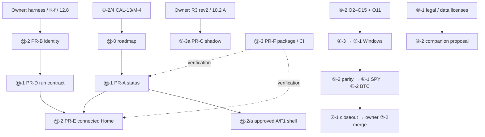

# QUANTGEN remaining work — 2026-10-29

This is a dependency and handoff update, **not approval of every proposed audit item**.
The definitions and acceptance criteria of IDs ①–⑪ remain in
[the 2026-10-27 roadmap](REMAINING_WORK_2026-10-27.md); no IDs are renumbered.
Completion is determined by the append-only `handoff:LEDGER.md`, not by age or this plan.
The proposed overall prioritization still needs the owner's decision. The owner separately
approved A ivory/deep-green, F1 Open Horizon and Research Home UI implementation after handoff.
That bounded UI work does not authorize a ResearchRun backend, changed gates or new data rights.

## Inherited work and current boundaries

- Completed in the remote ledger before this handoff: ①-1, ①-2, ①-2/2, ①-2/3,
  ①-3, ①-4, ①-5, ②-1, ②-2, ②-3, ②-4, ②-5/a, ②-5/b, ②-6,
  ③-1–③-6, ④-2/a. Do not repeat them. ④-2/a is the decision form, **not** owner signoff.
- ①-2/4/a: CAL-13/M-4 loader hardening and focused hermetic checks, commit
  `2ff977d6653c3fe53df2e7c75062cf13966da10f` on `gpt/calendar-loader-20261029`.
  51 PASS / 12 NOT_RUN; signed set 1.0.0, 17/17 files unchanged. Parent ①-2/4 remains
  partial: the full suite was not run because protected/frozen artifacts must not be read.
- Nautilus implementation is complete; Windows handoff, provider parity and real pilots
  are separate, still blocked by ④-2, O11 and the original acceptance conditions.
- BS-21 keeps its current formula. PR-B's instrument/cost harness and R3 scoring are
  unchanged pending their explicit decisions. No frozen research, holdout, actual ledger,
  protected cache or credential reads are authorized by this roadmap.
- Current distribution policy remains personal research only. A future free product is
  a proposal subject to ⑩-1; it is not current permission to distribute.

## New IDs (original IDs retain their meanings)

| ID | Work and acceptance | Dependency / decision |
|---|---|---|
| ⑫-0 | Roadmap reconciliation: every audit item maps to an ID or explicit deferral; original IDs preserved | Documentation only |
| ⑫-1 | PR-A status source: separate QA, calendar/data, gate, study and distribution fields; provenance and stale-input checks; README agrees | Start from main; no QA artifact overwrite |
| ⑫-1/a | Bounded recorded QA/calendar + declared policy snapshot; fixtures reject contradictory/missing/stale inputs | Frozen gate/study evidence intentionally NOT_INSPECTED; full live adapters deferred |
| ②-5/c | PT-04 partial FRED coverage: unavailable long-end metrics/prices, truthful UI, synthetic regression checks | Step 7, no owner decision required |
| ⑫-2/a | PR-B identity/alias matrix and executable characterization tests; design only | Frozen implementation remains unchanged |
| ⑫-3/a | PR-F safe packaging stage and Linux/Windows CI definitions with honest run evidence | Windows result separate from Linux |
| ⑫-2 | PR-B canonical instrument/cost mapping; BTCUSD regression and alias matrix | Owner approval of 12.8 / K-f priority / frozen harness required |
| ⑫-3 | PR-F packaging and CI with explicit environment tiers | Linux/Windows independently reported; never mark Windows tested from Linux |
| ⑫-4 | Typed formal-gate blockers register | ⑨-2 and ⑨-5; no promotion of NOT_RUN |
| ⑬-1 | PR-D reproducible ResearchRun schema/export/adapters | Validated instrument identity; owner-approved scope; no implicit new ledger |
| ⑬-2 | PR-E Home and six workspaces; preserve all 16 routes and in-flight work | PR-A / PR-D for fully connected product |
| ⑬-2/a | Owner-approved A/F1 Home and navigation shell; honest unconnected/empty states; preserved existing functions | Can precede PR-D using display-only empty adapters; no fabricated data |
| ⑬-3 | Extend model evidence cards | ②-3, approved non-frozen adapters |
| ⑬-4 | Run comparison | ⑬-1; reject incompatible runs |
| ⑬-5 | Unified risk view of existing results | ⑬-1; no new prediction algorithms |
| ⑬-6 | Cancellable/progress-aware jobs | Ledger-safe cancellation design first |
| ⑬-7 | Read-only SDK | Stable ⑬-1, separately scoped |
| ⑬-8 | Usability evaluation/copy | Intended audience and synthetic fixtures; targets are proposals |
| ⑭-1 | Scenario storyboard | Existing engines only, proposal |
| ⑭-2 | Teaching templates | Public use after ⑩-1 |
| ⑭-3 | Opt-in product analytics | Public companion only after privacy decision; none in private desktop |

## Audit coverage and original PR sequence

| Audit ID | Roadmap / disposition |
|---|---|
| QG-P0-01 | ⑫-1 / PR-A |
| QG-P0-02 | ⑫-2 / PR-B; overlaps ②-5 queue, do not duplicate |
| QG-P0-03 | ⑨-3a–d / PR-C; R3 rev 2 and §10.2 A pending |
| QG-P0-04 | ③ completed implementation; ④–⑦ actual parity/pilots remain |
| QG-P0-05 | ⑤-2 and ⑨-2 |
| QG-P0-06 | ⑫-4, ⑨-5 |
| QG-P0-07 | ⑫-3 / PR-F packaging |
| QG-P0-08 | ⑫-3 / PR-F CI |
| QG-P0-09 | ⑩-1 legal/data entitlement gate |
| QG-P1-01 | ⑬-2 / PR-E; bounded first UI step ⑬-2/a |
| QG-P1-02 | ⑬-2 / PR-E; command palette/favorites deferred |
| QG-P1-03 | ⑬-1 / PR-D |
| QG-P1-04 | ⑬-3 extends ②-3 |
| QG-P1-05 | ⑬-4 |
| QG-P1-06 | ⑬-5 |
| QG-P1-07 | ⑬-6 |
| QG-P1-08 | ⑬-7 |
| QG-P1-09 | ⑪-1; TRADEGEN code outside this task |
| QG-P1-10 | ⑬-8 |
| QG-P2-01 | ⑭-1 |
| QG-P2-02 | ⑭-2 |
| QG-P2-03 | ⑭-3 |
| QG-P2-04 | Deferred; no community/leaderboard build |
| QG-P2-05 | Out of scope; no brokerage/PFOF/order routing |

PR-A → PR-B → PR-C → PR-D → PR-E is the review sequence in the audit;
PR-F supports it throughout. Independent work is possible only where the original
prerequisites permit it. The original handoff did not authorize merging or release. The owner subsequently authorized
UI publication on 2026-10-29 ("ui는 사이트에 바로 반영해줘~ 클로드 알려줄때도 자세히 알려주고").
That applies to UI deployment only; it does not approve frozen harness/gate changes.
The public website source and hosting access must be identified before deployment.
The bounded UI shell is the owner's later direct request, not a declaration that PR-B/C/D are done.

## Next owner-dependent work

Use `O2_O15_DECISION_FORM_2026-10-29.md` for ④-2 and E1 initialization (O11).
Other unresolved decisions: PR-B frozen harness/12.8/K-f; R3 rev 2 and 10.2 A;
②-5 §10 classification; BS-21; audit §12 priority/product scope. Existing decisions
are preserved; do not ask for blanket migration approval again.

Sources: `HANDOFF_MANUAL_2026-10-29.md`, `OWNER_RULINGS_LOG.md`, original roadmap,
`docs/audit/2026-10-29/QUANTGEN_PentPort_Strategic_Improvement_Audit_2026-10-29.md`,
and the latest handoff CURRENT/LEDGER. Historical test totals are provenance, not a new run.

## Verified continuation checkpoint — 2026-10-29

- Completed bounded follow-ups: ②-5/c PT-04 (`7db616c`, 96 focused PASS);
  ⑫-2/a design/characterization (`00d32eb`, 3 PASS, 17 aliases).
- ⑫-3 packaging/CI is **not implemented, not approval-blocked**. It is the next
  recommended Codex implementation; inspect pyproject dependency/module/resource
  omissions and test a clean excluded-path install. No workflow run is claimed.
- UI application candidate: `gpt/ui-apply-main-20261029` / `e46f81f` (UI/status only).
  Automatic approval review rejected PR creation under the prior explicit no-PR/
  no-merge instruction. The later UI request was not accepted as a clear override.
  No PR or main change occurred. The owner clarified the viewed app is local Flet;
  a PC checkout update and restart are also needed. Public web deployment is unstarted.
- Core remaining decisions: O2–O15/O11; PR-B frozen harness/12.8/K-f; R3 rev2/10.2 A.
  These do not prevent ordinary packaging/CI or bounded display-only preparation.
- The owner requested a private Word/PDF progress report and intends to continue
  through Codex. See `CONTINUATION_STATUS_2026-10-29.md` for next-task conditions.
