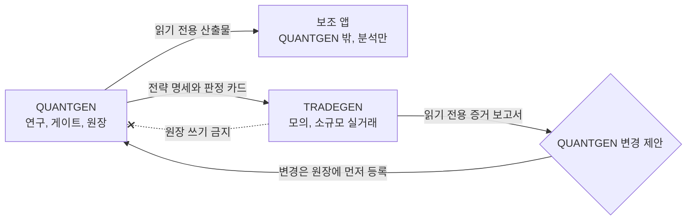

# 📋 QUANTGEN 로드맵 문서 검토, 수용안, 전체 남은 작업 (2026-10-27)

- **검토 대상:** 소유자(고건)의 QUANTGEN 발전 로드맵 문서. docx, 2026-10-27 작성, 이하 "로드맵"이라 부릅니다.
- **기준 과업:** QUANTGEN의 NautilusTrader 연구 브리지(지정 과업). 상세는 `docs/nautilus_bridge/TASK_BRIEF_2026-10-27.md`에
  있습니다.
- **검토 태도:** 로드맵의 취지를 최대한 살립니다. 다만 기존 구속 조건이나 실측 근거와 부딪히는 부분은 조건을 붙여
  수용하거나 수정안을 냅니다. 판정은 수용, 수용+구체화, 조건부 수용, 수정 수용, 보류 중 하나입니다.
- **소유자 결정 반영:** O1(`pyarrow`를 포함한 새 의존성) 승인을 2026-10-27에 받았고, 스펙 Status에 원문 그대로
  기록했습니다.

---

## 🔍 핵심 요약

**총평.** 로드맵의 방향은 QUANTGEN이 이미 지켜 온 원칙과 대부분 맞습니다. 신뢰성 우선, 단순 기준전략과의 비교,
비용 반영, 과적합 점검, 단계적 검증이 그렇습니다. 그래서 대부분 수용합니다. 다만 세 가지는 그대로 받으면 기존 구속
조건과 충돌하므로 조건을 붙였습니다.

| # | 충돌 지점 | 로드맵의 표현 | 부딪히는 기존 조건 |
|---|---|---|---|
| 1 | 앱의 주문 기능과 "시장 출시" | "실제 주문 기능은 나중에", "앱이 시장에 나갈 준비" | README Regulatory note: QUANTGEN은 개인용이며 "Do not distribute it as a product". QUANTGEN에는 주문 경로가 없음(T-RO-01, DO-NOT-BUILD 21). 신호를 공유할 때 투자자문업이나 유사투자자문업 등록이 필요한지는 아직 조사하지 않음(`reports/Korean resident trading venue legality.md`, 미해결 질문 표). |
| 2 | TRADEGEN에서 QUANTGEN으로 가는 피드백 순환 | "TRADEGEN의 검증 결과는 다시 QUANTGEN 개선에 반영" | 분리 스펙 3.2: TRADEGEN은 QUANTGEN 원장에 trial을 등록할 수 없음. 실거래 결과를 보고 모델을 고치면 그 자체가 표본외 데이터를 소비함(데이터 스누핑). |
| 3 | "현재 상태 진단부터" | 6단계의 1단계 | 맞는 결론입니다. 다만 QUANTGEN에는 이미 테스트 870개, 매크로 v2(M0~M10), 게이트 패키지, 논문 파이프라인이 있습니다. 그래서 진단은 "다시 만들기"가 아니라 "감사하고 문서화하기"로 범위를 정해야 합니다. |

**Nautilus 브리지는 로드맵 안에서 어디에 놓이나.** QUANTGEN의 백테스트를 독립된 이벤트 기반 엔진으로 다시 계산해
시뮬레이터 결함을 찾습니다. 이것은 로드맵 1단계(진단, 알려진 오류 찾기)의 도구이면서 3단계(검증 체계 개선)의
기반입니다. 따라서 브리지를 계속 진행하는 것은 로드맵의 취지와도 맞습니다.

| 항목 | 현재 |
|---|---|
| 지정 과업 | Nautilus 브리지. Step 2(구현 계획) 도중 중단. 스펙 rev 6, Claude 심사 완료(5라운드 전원 AGREE). |
| 소유자 결정 | O1 승인. O2~O15는 미결. |
| 막힌 것 | Claude: 지출 한도 소진. 소유자: GPT/Gemini 심사, 남은 판정, Windows 인계. |
| 기한이 있는 일 | **달력 서명 2026-11-01(5일 남음)**, H2 판독 약 2026-12-19, 잠금 홀드아웃 시작 2027-01-01, GROKTEAM forward look 2027-02-01 이후 |

---

## 🧭 로드맵 항목별 수용안

| # | 로드맵 내용 | 판정 | 근거 (기존 자산과 제약) | 반영 방법 |
|---|---|---|---|---|
| A1 | 세 축: QUANTGEN(핵심), 보조 앱, TRADEGEN(실험) | 조건부 수용 | 2026-10-23 분리: QUANTGEN은 연구와 모의매매까지, TRADEGEN은 한국법 범위의 실거래. 로드맵은 앱이 어느 저장소에 있는지 말하지 않습니다. | 앱은 **QUANTGEN 밖**(별도 저장소 또는 TRADEGEN)에 둡니다. 앱은 QUANTGEN의 읽기 전용 산출물(카드, run record, 매크로 artifact)만 읽습니다. |
| A2 | TRADEGEN 결과를 QUANTGEN 개선에 반영하는 순환 | **수정 수용** | 분리 스펙 3.2: TRADEGEN은 QUANTGEN 원장에 쓰지 못합니다. 결과를 보고 고치면 표본외 데이터가 소비됩니다. | 피드백 경로를 정합니다. ① TRADEGEN은 읽기 전용 증거 보고서만 냅니다. ② 그 보고서를 보고 바꾸는 QUANTGEN의 변경은 QUANTGEN 원장에 새 trial로 **먼저 등록**합니다. ③ 2027-01-01 잠금 홀드아웃 이후 데이터는 설계에 쓰지 않습니다. |
| A3 | 순환이 "시장 출시 준비"를 증명 | **보류** (사전 조건 추가) | README상 개인용이고 배포 금지입니다. 규제 검토가 없습니다. 백테스트와 모의 성과는 시장성의 증명이 아닙니다(선택 편향, 생존 편향). | 출시를 판단하기 전에 **규제 검토 단계**(투자자문업, 유사투자자문업, 배포 범위; 전문가 자문)를 새로 둡니다. "준비됨"의 측정 가능한 기준을 미리 정의합니다. |
| B1 | 복잡함보다 신뢰성 | 수용 | 원장, MANIFEST, 게이트, 동결 스터디가 이미 이 원칙으로 만들어져 있습니다. | 그대로 둡니다. |
| B2 | 모델마다 한계를 기록 | 수용 + 구체화 | Models Primer와 ModelCard는 있지만, 모델별 가정, 한계, 적용 범위, 검증 상태를 한곳에 모은 대장은 없습니다. | 1단계 산출물로 **모델 한계 대장**을 만듭니다. |
| C1 | 데이터: 공급사 비교, 정제, 미래 정보 누출 차단 | 수용 (일부 기존) | 시점 기준 데이터 계약(M1), `lag_audit`, 가용성 규칙이 있습니다. 공급사 비교는 약합니다. Nautilus는 QUANTGEN 자체 데이터를 쓰므로 데이터 오류는 잡지 못합니다(스펙 P0은 엔진만 검증). | **파일럿 전 시계열 공급사 대조** 과제를 추가합니다. 파일럿 기간 데이터 열람 규칙 때문에 소유자 PC에서 도구로 돌리고, 일치율과 불일치 날짜만 기록합니다. 스펙 개정이 필요합니다. |
| C2 | 새 모델은 확실히 나을 때만 추가 | 수용 + 구체화 | "확실히"의 기준이 없습니다. `forecast_eval`과 `gate_stats`에 DM, MCS, SPA 검정이 있습니다. | 채택 기준을 **사전 등록한 비교 검정**으로 정합니다. 예측은 DM/MCS, 전략은 paired bootstrap ΔSharpe와 DSR이며, trial 수를 반영합니다. |
| C3 | 검증: 비용, 과적합, 표본외 테스트 | 수용 (이미 구현) | walk-forward 756/126, 2배 비용, DSR, PBO, 원장이 있습니다. | Nautilus 브리지가 여기에 **엔진 독립성**을 더합니다. |
| C4 | 리스크: 결과를 범위로 제시 | 수용 | GARCH/EWMA/HAR, 몬테카를로 팬, `scenarios.py`, Kupiec·Christoffersen·PIT 검정이 있습니다. | 범위를 보여줄 때 **보정(calibration) 검증 결과**를 함께 표시합니다. |
| C5 | 구조: 독립 모듈 | 조건부 수용 | 게이트 패키지 소스(`HARNESS_SOURCES`)를 고치면 패키지 변경이 됩니다. 동결 스터디 파일을 고치면 VOID가 됩니다. | 다시 짜는 대신 **어댑터와 경계 계약**으로 모듈화합니다(Nautilus의 parent/child 계약 방식). 동결 파일은 손대지 않습니다. |
| D1 | 앱: 분석 먼저, 주문은 나중 | 조건부 수용 | QUANTGEN 안에 주문 경로를 둘 수 없습니다. | 주문 기능은 **TRADEGEN에서만** 둡니다. 앱의 분석 화면은 QUANTGEN 산출물을 읽기만 합니다. |
| D2 | 예측과 실제, 모의와 실거래를 구분 | 수용 | 기존 라벨 규약이 있습니다(VENDOR DATA·DRY RUN 칩, verdict 스타일). | 앱 UI 규약으로 넓힙니다. |
| E1 | QUANTGEN을 쓰지 않는 단순 기준전략과 비교, 목표 수익 달성만으로는 성공 아님 | 수용 (강하게 일치) | 게이트의 벤치마크 검정(p ≤ 0.10)과 일치합니다. | 패밀리마다 **기준전략을 사전 등록**합니다(buy-and-hold, 60/40, 동일가중, SMA-200). |
| E2 | 백테스트 → 모의매매 → 소규모 실거래 | 조건부 수용 | QUANTGEN의 paper_live H2가 진행 중입니다(홀드아웃 11-03 종료, 판독 약 12-19). 실거래는 TRADEGEN이 한국법 범위에서 합니다. | 단계를 올리는 **승격 기준**을 미리 정합니다: 최소 표본, 손실 한도, kill switch. |
| E3 | Moonshot($30 → $30,000)은 별도 고위험 실험 | 수용 + 안전장치 | 1000배 목표는 사전 확률이 매우 낮습니다. 성공한 것만 보고되는 선택 보고 위험이 있습니다. 거래처의 적법성이 걸립니다(Kalshi는 회색, 국내 거주자의 Polymarket 이용은 경찰이 불법으로 판단). | TRADEGEN 전용, 별도 원장 패밀리, 손실 상한 $30 고정, 사전 등록, 적법한 거래처만 씁니다. 결과는 QUANTGEN 판정이나 홍보에 쓰지 않습니다. |
| F | 6단계 순서 | 수정 수용 | 1단계부터라는 결론에 동의합니다. 다만 4단계(고급 분석)는 상당 부분 이미 있습니다(매크로 M0~M10, tech-fund, scenarios). 단계마다 완료 기준과 기한이 없습니다. | 4단계를 "추가"에서 **"검증과 정리"**로 바꿉니다. 단계마다 완료 기준을 두고, 기존 고정 기한에 맞춥니다. |
| G | (빠진 것) 규제, 성공 기준, 예산, 단계 전환 승인자 | 보완 | 오늘 지출 한도가 소진되어 작업이 멈췄습니다. 자원 계획이 필요합니다. | 각 단계에 승인자(소유자), 완료 기준, 예산 한도를 적습니다. |

### 피드백 순환의 제어 경로 (A2 수정안)



---

## ✅ ① 이미 끝났거나 반영된 것 (로드맵 단계 기준)

| 로드맵 단계 | 이미 있는 것 | 근거 |
|---|---|---|
| 1단계 진단 | 이번 세션에서 실제 결함과 불일치를 찾았습니다(아래 목록). | Nautilus 맵 4종, 비판 검토(K1~K15), 클라우드 기준선 테스트 |
| 3단계 검증 | walk-forward, 2배 비용, DSR, PBO, 원장. Nautilus 스펙 rev 6(Claude 심사 완료). O1 승인. | `core/quant/validate.py`, `gate_ledger.py`, 스펙 rev 6 |
| 4단계 고급 분석 | 매크로 v2(M0~M10), tech-fund 레지스터, 시나리오 라이브러리 | README "Macro integration", "Tech-fund research register" |
| 리스크 범위 제시 | Quant Lab 등급(Kupiec, Christoffersen, PIT, 팬) | `core/quant/lab.py` |

**이번 세션에서 확인한 "알려진 오류" (1단계 진단의 출발점)**

| # | 결함 또는 불일치 | 위치 | 영향 |
|---|---|---|---|
| K-a | `statsmodels`가 `requirements.txt`에 없음 | `core/quant/strategies.py:266-271` | 새로 설치하면 셀프체크 3건 실패 |
| K-b | 동결 스터디 태그가 GitHub에 없음 | `tests/frozen_guard.py` | 클론할 때마다 guard 테스트 3건 실패 |
| K-c | Strategy Lab이 `n_trials=len(grid)`로 채점(원장 n_raw를 쓰지 않음) | `ui/strategy_lab_page.py:127` | DSR 보정이 약해질 수 있음 |
| K-d | Strategy Lab이 계산을 마친 뒤에 원장에 등록(선등록 아님) | `ui/strategy_lab_page.py:114-118` | 실패하거나 중단된 실행이 시행 횟수에서 빠질 수 있음 |
| K-e | `simulate()`가 다중 슬리브를 매일 비용 없이 리밸런싱한다고 가정 | `core/quant/strategies.py:83-90` | 모델 가정으로 문서화할 대상. 이벤트 엔진과 패리티 불가 |
| K-f | `cost_class('BTCUSD')`, `('EURUSD')`가 `'us'`(50 bp)로 분류 | `core/quant/validate.py:87-112` | 외부 티커 형식이 들어오면 비용과 시장이 잘못 분류됨 |
| K-g | `repo_anchor()`가 packed-refs 상태에서 UNVERSIONED를 돌려줌 | `core/quant/gate_ledger.py:122-131` | 정상 클론에서 원장 등록이 거부될 수 있음 |
| K-h | dry-run 테스트가 캐시 파일 mtime에 의존 | `tests/macro_m8_pipeline.py` | 새 클론에서 실패 |
| K-i | 이월된 경미 결함 92건(Plan A 17건, Plan B 75건) | `docs/superpowers/plans/2026-10-23-execution-record.md` | 분류가 필요(수정, 보류, 폐기) |

## 🗑️ ② 불필요하거나 대체된 것

- **QuantConnect 관련 전부:** 구독, 약관 대응, API 키, LEAN 템플릿, 라이브 계약 검증(이전 답변 ② 참조).
- **로드맵이 "새로 만들자"고 한 것 중 이미 있는 기능:** 매크로, 팩터, 스트레스, 리스크 범위, 검증 게이트. 다시 만들지
  않고 1단계에서 감사하고 문서화합니다.

## ⏳ ③ 남은 작업: 담당별 분류와 순서

**순서 표기.** `①-1`의 앞 숫자는 **단계 묶음**이고, 뒤 숫자는 묶음 안의 순서입니다. 묶음은 대체로 아래 순서로
진행하고, "선행" 칸에 적힌 것이 끝나야 시작합니다. 같은 묶음 안에서 선행이 없는 항목은 함께 진행할 수 있습니다.

| 묶음 | 시점 |
|---|---|
| ① 즉시 | 지금부터 11-01까지 |
| ② 작업 재개 직후 | 지출 한도 재설정 후, 서로 병행 |
| ③ Nautilus 구현 | ②-2 이후, 순차 |
| ④ 외부 심사와 판정 | 10-30 14:40 이후, ③과 병행 가능 |
| ⑤ Windows 인계 | ③과 ④ 이후 |
| ⑥ 파일럿 | ⑤ 이후 |
| ⑦ 병합과 마감 | ⑥ 이후 |
| ⑧ 고정 일정 | 날짜에 묶여 있어 다른 묶음과 병행 |
| ⑨ 로드맵 2~4단계 | ②-5 우선순위 결정 이후 |
| ⑩ 규제 검토와 앱 MVP | R1 판정에 따라 |
| ⑪ TRADEGEN 연동 | ⑥ 이후 권장 |

### 🤖 Claude 단독 (12건)

| 순서 | 작업 | 선행 | 완료 기준 |
|---|---|---|---|
| ②-1 | `requirements.txt`에 `statsmodels` 추가(브랜치) | ①-1 | 새로 설치한 환경에서 셀프체크 3건 통과 |
| ②-2 | Nautilus Step 2 마무리: 계획의 Task 섹션 5개, 통합, 검토 2건, RED dry run | ①-1 | 계획 파일 완성. 모든 RED 테스트가 예상한 이유로 실패 |
| ②-3 | 1-1 **모델 한계 대장** | ①-1 | 모델마다 목적, 가정, 한계, 적용 범위, 검증 상태, 테스트 ID |
| ②-4 | 1-2 **알려진 오류 통합 목록**(K-a~K-i, 이월 92건 분류) | ①-1 | 전 항목에 분류(수정, 보류, 폐기)와 우선순위 |
| ③-1 | Task 1 환경: 해시 고정 requirements, `launch.py`, egress probe | ②-2 | Linux venv 설치, 휠 식별값 `a448cd20…` 일치 |
| ③-2 | Task 2 가드: T-RO-01 개정, `nautilus` 스위트 등록 | ③-1 | 대조 테스트 일치, test_08/09 통과. 개정은 브랜치에서만이고 효력은 사인오프 후 |
| ③-3 | Task 3 샌드박스 | ③-2 | F1/F2/N1 골든값 재현 |
| ③-4 | Task 4 러너(원장 선등록, 수익률 재구성) | ③-3 | 등록 순서 테스트 통과 |
| ③-5 | Task 5 패리티, 게이트, 파일럿 등록표, Windows 런북 | ③-4 | 합성 데이터 리허설 통과, `GATE` 불변 |
| ③-6 | 클라우드 전체 스위트(래퍼), 실행 기록 작성 | ③-5 | 791/929 PASS. FAIL은 Windows 전용 1건만 |
| ④-3 | 판정이 기본값과 다른 부분의 브랜치 작업을 수정하거나 삭제 | ④-2 | 스펙 Appendix B와 브랜치가 판정과 일치 |
| ⑨-1 | 2-2 시점 기준 데이터와 누출 감사 결과 정리 | ②-5 | 기존 `lag_audit`과 M1 계약 기준의 보고서 |

### 👤 사용자 단독 (9건)

| 순서 | 작업 | 선행 | 이유 / 기한 |
|---|---|---|---|
| ①-1 | **지출 한도 재설정**(또는 리셋 대기) | — | Claude 작업 전부의 선행 조건 |
| ①-2 | **달력 세트 서명**(T-CAL-02) | — | **기한 2026-11-01.** 현재 `signed_off_by: null` |
| ①-3 | `git push origin studies-of-record-2026-10-23` | — | 클론마다 guard 테스트 3건 실패 |
| ①-4 | **R1~R5 판정**. 특히 R1(시장 출시의 의미)과 R3(Strategy Lab 시행 횟수) | — | ⑨, ⑩, ⑪의 방향을 정함 |
| ①-5 | `E1.jsonl`, `C3.jsonl`의 현재 행 수 보고 | — | DSR 시행 횟수 계산에 필요 |
| ④-2 | **O2~O15 판정**과 스펙 승인 문장 | ④-1 | 병합과 실제 원장 실행의 전제 |
| ⑦-2 | `main` 병합(merge commit, 브랜치 ref 유지) | ⑦-1 | 병합은 사용자만 할 수 있음 |
| ⑧-1 | H2 홀드아웃 종료(11-03) 후 **판독**. 태그 클론에서 실행 | — | **기한 약 2026-12-19.** 5분봉 보존 기간 때문 |
| ⑧-3 | GROKTEAM forward look. 태그 클론에서 **단 한 번** | — | **2027-02-01 01:00 UTC 이후** |

> 참고 ⑧-2(규칙): **2027-01-01부터 잠금 홀드아웃**입니다. 이 날짜 이후 데이터는 어떤 설계에도 쓰지 않습니다.
> 별도 작업은 아니고 모든 묶음에 적용됩니다.

### 🤝 혼합 (15건)

| 순서 | 작업 | Claude 몫 → 사용자 몫 | 선행 |
|---|---|---|---|
| ②-5 | 1-4 **우선순위 결정**(로드맵 2~4단계) | Claude 제안 → 사용자 승인 | ②-3, ②-4 |
| ④-1 | **GPT(Codex)·Gemini(agy) 심사** | 사용자 PC에서 실행 → Claude가 판정하고 스펙에 반영 | 10-30 14:40 |
| ⑤-1 | **Step 7A Windows 인계** | Claude: 사인오프 문장 기록, main 동기화 → 사용자: 런북 실행(전용 Python, venv, 방화벽, 스위트), 인계 보고서 커밋 → Claude: 모듈 목록(census)과 `code_sha256` 검토 → 사용자: `owner_confirmed` 기록 | ③-6, ④-2 |
| ⑤-2 | 2-1 **파일럿 시계열 공급사 대조** | Claude: 도구 작성과 스펙 개정 → 사용자 PC에서 실행, 결과만 기록 | ⑤-1. 반드시 ⑥-1 전 |
| ⑥-1 | **파일럿 1**(SPY, E1, 12개 설정) | 사용자: 실제 원장 실행 → Claude: 분석과 기록 | ⑤-1, ⑤-2 |
| ⑥-2 | **파일럿 2**(BTC-USD, C3, 5개 설정) | 같음. **파일럿 1이 패리티를 통과한 경우에만** | ⑥-1 |
| ⑦-1 | Step 10 마감 | 사용자: Windows 전체 스위트 → Claude: 실행 기록, README 집계 | ⑥-2 |
| ⑧-4 | 분리 스펙 Phase 2(LAZYOWEN을 paper_live 밖으로 이관) | Claude 스펙 → 사용자 별도 승인 | ⑧-1 |
| ⑨-2 | 2-3 매크로 데이터 확보 | Claude 목록 → 사용자가 확보하고 라이선스 확인 | ②-5 |
| ⑨-3 | 3-1 **Strategy Lab 원장 선등록, 원장 기반 시행 횟수**(K-c, K-d) | 사용자 R3 판정 → Claude 구현, 기존 카드에 재채점 표시 | ①-4, ②-5 |
| ⑨-4 | 3-2 **새 모델 채택 기준** | Claude 초안 → 사용자 승인 | ②-5 |
| ⑨-5 | 4단계: 매크로 카드 실행, tech-fund 제안(XS, OQ) 판정 | Claude 분석 → 사용자 판정 | ⑨-2 |
| ⑩-1 | **규제 검토**(투자자문업, 유사투자자문업, 배포 범위) | Claude 조사 초안 → 사용자가 전문가 자문 | ①-4(R1) |
| ⑩-2 | **보조 앱 MVP**(QUANTGEN 밖, 읽기 전용 데이터 계약, 분석만) | Claude 설계와 구현 → 사용자 승인 | ⑩-1 |
| ⑪-1 | **TRADEGEN 연동 브리프**: 피드백 프로토콜, 기준전략 사전 등록, 승격 기준, Moonshot 격리 | Claude 초안 → 사용자 승인 → TRADEGEN 세션에서 실행 | ①-4, ⑥-1 권장 |

### 🗺️ 전체 흐름 (순서도)

```
①-1 지출 한도 ─┬─▶ ②-1 statsmodels
①-2 달력 서명   ├─▶ ②-2 Step 2 ─▶ ③-1 ▶ ③-2 ▶ ③-3 ▶ ③-4 ▶ ③-5 ▶ ③-6 ─┐
①-3 태그 push   ├─▶ ②-3 모델 대장 ─┐                                     │
①-4 R1~R5      └─▶ ②-4 오류 목록 ─┴▶ ②-5 우선순위 ─▶ ⑨-1…⑨-5           │
①-5 행 수 보고                                                          ▼
10-30 14:40 ─▶ ④-1 GPT/Gemini ─▶ ④-2 O2~O15 ─▶ ④-3 ─────────▶ ⑤-1 Windows 인계
                                                                   ▼
                                    ⑤-2 공급사 대조 ─▶ ⑥-1 파일럿 1 ─▶ ⑥-2 파일럿 2 ─▶ ⑦-1 ─▶ ⑦-2 병합
고정 일정: 11-01 ①-2 · 11-03~12-19 ⑧-1 ▶ ⑧-4 · 2027-01-01 잠금 홀드아웃(규칙) · 2027-02-01~ ⑧-3
R1 ─▶ ⑩-1 규제 검토 ─▶ ⑩-2 앱 MVP          ⑥-1 이후 ─▶ ⑪-1 TRADEGEN 연동
```

---

## ⚠️ 판정이 필요한 사항

| # | 질문 | 권고 기본값 |
|---|---|---|
| R1 | 앱의 "시장 출시"는 무엇을 뜻합니까: 개인용, 지인에게 무료 배포, 유료 판매? | 지금은 **개인용**. 외부 배포는 규제 검토 뒤에 결정. |
| R2 | 피드백 순환을 A2의 제어 경로로 운영할까요? | 예 |
| R3 | Strategy Lab의 시행 횟수를 원장 기반으로 바꿀까요(K-c, K-d)? | 예. 기존 카드에는 재채점 표시를 붙입니다. |
| R4 | Moonshot 격리 규칙(E3)을 TRADEGEN 브리프에 넣을까요? | 예 |
| R5 | 1단계 진단 산출물(1-1, 1-2)을 Nautilus 작업과 병행할까요? | 예. 서로 독립적입니다. |
| R6 | Nautilus O2~O15 | 스펙 2절 기본값 |

## 💡 Go/No-go 판단과 근거

| 대상 | 판단 | 근거 |
|---|---|---|
| Nautilus 브리지 | **Go** | 로드맵 1단계(엔진 결함 진단)와 3단계(검증)에 직접 기여합니다. O1이 승인되었습니다. 실측 패리티: 상관 0.999999, ΔSharpe 최대 0.0013. 비용은 $0입니다. |
| 로드맵 전체 | **조건부 Go** | 원칙과 순서는 타당합니다. 단 A2, A3, D1, E3의 조건을 지켜야 합니다. |
| 앱의 시장 출시와 주문 기능 | **현 시점 No-go** | README가 개인용이고 배포 금지라고 정합니다. 규제를 조사하지 않았습니다. 검증이 끝나지 않았습니다. 다시 볼 조건: 규제 자문, TRADEGEN 소규모 실거래 성과, 사전에 정한 성공 기준 충족. |
| Moonshot | **QUANTGEN 범위 밖** (TRADEGEN 안에서 격리하면 Go 가능) | 사전 확률이 매우 낮고 선택 보고 위험이 있습니다. 적법한 거래처만 쓸 수 있습니다. |

순서는 ③의 순서 번호와 전체 흐름을 따릅니다.
