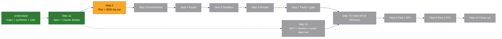

# Task brief: the QUANTGEN research bridge to NautilusTrader (suspended 2026-10-27)

Owner: Geon Koh. Repository `xkg4real/quantgen`, branch `claude/amazing-gauss-tdiguu`.
Written by Claude Code when the owner suspended the task. **Status: SUSPENDED at Step 2 (implementation plan),
partly written.** No bridge code is built. No ledger row was written. No pilot-window data was touched.

Why it stopped: on 2026-10-27 the plan workflow hit the account's monthly spend limit. 10 of its 12 agents failed
(the five task authors, the integrator, both plan reviewers, the fixer and the RED dry run). The spec update (revision 6)
and the plan skeleton were written before the limit. The owner then asked to suspend the task and receive this brief.

---

## 1. The task in one paragraph

Connect QUANTGEN, a read-only quantitative-finance research instrument, to **NautilusTrader 1.231.0** as a second,
independent, event-driven **backtest** engine. Every strategy variant is first registered in QUANTGEN's trial ledger.
It is then run in Nautilus at 1x and 2x costs. Parity with QUANTGEN's own vectorized backtest is checked, and only
then does QUANTGEN's unchanged gate give the verdict: walk-forward 756/126 with purge and embargo, the 2x-cost
rerun, the DSR with the ledger's trial count, and PBO. There are two pilots:

- Pilot 1: SPY trend-following, 12 settings, 2004-12-01 to 2026-09-25.
- Pilot 2: BTC-USD crypto trend, 5 settings, run only if pilot 1 passes parity.

Nautilus live trading is never used in QUANTGEN; real-money trading belongs to TRADEGEN.

---

## 2. How the task came to be (history and the owner's instructions)

| When | What | Source |
|---|---|---|
| 2026-10-23 | Plans A (split) and B (paper pipeline) finished locally; the final QA run was 749/870 PASS, 0 FAIL. | `docs/superpowers/plans/2026-10-23-execution-record.md` |
| Local session (before upload) | The owner asked: "let's continue implementing QuantConnect into QUANTGEN … present it to me in a bulletin format before my approval". The local session ran workflow `qc-bridge-understand` and produced the **QuantConnect bridge bulletin**: Spec → Plan → Client (12-endpoint allowlist) → LEAN template (refuses live mode) → Bridge (ledger first) → Gate (local costs, parity); prerequisites (paid Quant Researcher plan about $84/month, account, API key in `.env`, data terms, no benchmarking publication); defaults (parity bars 98% / 0.99 / 0.05, simulated orders, shared trend ledger). It stopped there, awaiting approval. | Pasted by the owner on 2026-10-26 |
| 2026-10-26 | The owner, in the cloud session: "This was the task that was designated, and it stopped here. Can you find where to resume, and after that automatically start the remaining tasks." | Owner message, verbatim |
| 2026-10-26 | The owner: "And don't forget, use all possible skills". | Owner message, verbatim |
| 2026-10-26 | The owner: **"No, actually we're going to replace QuantConnect into Nautilus trader"**. | Owner message, verbatim |
| 2026-10-27 | The owner: "Suspend the given task, and give me an .md file of the prior designated task that I've ordered to you. It shall contain the details of the task, alongside with current acquisitions made." | Owner message, verbatim (this file) |

**What the owner's words authorise (as recorded in the spec's Owner context).** They decide two things only: the
engine is NautilusTrader, and Claude continues without stopping. Every other choice is a default taken on the owner's
behalf (section 7 below), each listed with what it costs if wrong. Branch work is reversible. **Not** authorised
without the owner's explicit sign-off: the merge into `main`, the T-RO-01 exemption taking effect, and any of-record
(production-ledger) run.

---

## 3. What replacing QuantConnect with Nautilus changed

| Topic | QuantConnect plan | NautilusTrader plan |
|---|---|---|
| Where it runs | Cloud backtests through the QC API | Locally, in a separate pinned venv, one subprocess per run |
| Cost | Paid plan about $84/month | Free, open source (LGPL-3.0-or-later; private import conveys nothing) |
| Credentials | `QUANTCONNECT_USER_ID`, `QUANTCONNECT_API_TOKEN` | None; the child gets no `.env` key |
| Data terms | Only "summary results" may leave QC; no benchmarking publication | None; QUANTGEN's own md5-pinned caches |
| Main new risks | Fees, terms, account eligibility | A heavy new dependency (about 940 MB on Linux, about 0.5 GB on Windows, `pyarrow`); the order-path rule T-RO-01; Rust network clients loaded in every backtest; determinism; API churn (1.231.0 is the last 1.x release); Windows standard precision |
| "Refuses live mode" | LEAN template refuses live mode | The sandbox strategy refuses unless its clock is a `TestClock` and the kernel environment is BACKTEST |

---

## 4. Process and status



| Step | Who | Status | Evidence |
|---|---|---|---|
| Understand | Claude | **Done** | 4 maps + synthesis + critic, commits `f5742ab`, `6f7c610` |
| 1a Spec and Claude debate | Claude | **Done** (closed after 5 rounds, all five personas AGREE) | `a14954f` … `b7f991a`; revision 6 written, uncommitted until this brief's commit |
| 1b GPT + Gemini review, owner approval | Owner's machine | **Open** (REVIEW_INCOMPLETE) | Neither CLI exists in the cloud container; Codex quota back 2026-10-30 14:40 |
| 2 Plan and RED dry run | Claude | **Partial**: skeleton written (674 lines); 5 task sections, integration, reviews, fixes and the dry run not done | `docs/superpowers/plans/2026-10-26-nautilus-bridge.md` |
| 3 Environment | Claude | Not started (inputs ready: the hash closure, wheel identities) | section 6.4 |
| 4 Guard (T-RO-01 amendment) | Claude | Not started | spec 5.6 |
| 5 Sandbox | Claude | Not started (a filled skeleton was prototyped in scratch and reproduces F1/F2/N1) | spec 5.2.9 |
| 6 Runner | Claude | Not started | spec 5.3 |
| 7 Parity and gate | Claude | Not started | spec 5.4, 5.5 |
| 7A Hand-off | Claude, then owner | Not started; needs Step 1b | spec section 9, runbook |
| 8-10 Pilots, close-out | Owner (Windows) | Not started | spec section 10 |

---

## 5. Repository acquisitions (all on `claude/amazing-gauss-tdiguu`, pushed)

| Commit | Content |
|---|---|
| `f5742ab` | Map 02: QUANTGEN's gate, trial ledger and Strategy Lab inputs |
| `6f7c610` | Maps 01, 03, 04, the architect's synthesis and the critic's findings K1-K15 |
| `a14954f` | Spec revision 1; Claude referee round 1 (1 REJECT, 4 accept-with-changes); rulings |
| `7112351` | Spec revision 2; round 2 (security AGREE); rulings |
| `4f5f18b` | Spec revision 3; round 3 (security pressed and AGREE, QA and governance AGREE); rulings |
| `588c847` | Spec revision 4; round 4 (4 AGREE, ops 1 major); rulings |
| `b7f991a` | Spec revision 5; targeted round 5 (ops and security AGREE); rulings close Step 1a |
| (this commit) | Spec revision 6, the plan skeleton, and this brief |

Files:

| Path | What it is |
|---|---|
| `research_notes/QUANTGEN Nautilus bridge map/00_synthesis.md` | Step plan, prerequisites, defaults, risks, measured parity, critic findings |
| `research_notes/QUANTGEN Nautilus bridge map/01_nautilus_backtest_api.md` | The engine side, measured hands-on (includes the probe script) |
| `research_notes/QUANTGEN Nautilus bridge map/02_quantgen_gate_ledger_lab.md` | Gate, ledger and Strategy Lab inputs, with file:line |
| `research_notes/QUANTGEN Nautilus bridge map/03_pilot_and_parity.md` | Pilot port, parity design, measured parity on pre-2004 SPY, fixtures F1/F2/N1 |
| `research_notes/QUANTGEN Nautilus bridge map/04_governance_constraints.md` | Every house rule the bridge touches, and every conflict |
| `docs/superpowers/specs/2026-10-26-nautilus-bridge-design.md` | **The design spec, revision 6** (1,906 lines) |
| `docs/superpowers/specs/2026-10-26-nautilus-review/` | 22 referee reports (rounds 1-5) and 5 rulings files |
| `docs/superpowers/plans/2026-10-26-nautilus-bridge.md` | **Plan skeleton**: Global Constraints, File Structure, Interface Contract C1-C12, Count Ledger, five task placeholders |
| `docs/nautilus_bridge/TASK_BRIEF_2026-10-27.md` | This brief |

---

## 6. Findings acquired

### 6.1 NautilusTrader 1.231.0, measured

| # | Finding | Consequence for the design |
|---|---|---|
| 1 | Deterministic and fast: 12 runs × 5,600 daily bars take about 11 s; fills hash identically across runs and processes once the UUID columns are dropped. | One child process per run; hashes exclude UUIDs and wall-clock. |
| 2 | A MARKET order sent from `on_bar` fills at the **same bar's close** (`nt:backtest/engine.pyx:1716, 1724, 1727`). | Matches QUANTGEN's decide-at-close-t convention; parity runs use it. |
| 3 | `AT_THE_CLOSE` / `AT_THE_OPEN` are rejected in backtest; no market-on-close type exists. | Not used. |
| 4 | `PortfolioAnalyzer` returns are **wrong** on a CASH account: Sharpe +1.94 reported against a true −1.90. | Returns are rebuilt in the parent from fills; `run_analysis=False`. |
| 5 | The CASH risk check ignores the fee; an order at 100% of cash force-stops the whole backtest, which still returns normally. | Sizing `floor(cash / (P(1+c)))` in Decimal; fail-closed checks on forced stop and bars seen. |
| 6 | `Equity` takes whole shares only; `BarDataWrangler` reads columns by position. | Whole shares at $1M (error at most 0.08%); bars built from strings. |
| 7 | **Windows wheel = standard precision**: `QUANTITY_MAX` about 1.8e10 (Linux high precision: 3.4e13). | Bar volume 1e9, asserted at runtime (critic K1, a blocker caught before build). |
| 8 | `from nautilus_trader.backtest.engine import BacktestEngine` loads 7 `live` modules and the Rust core with 35 compiled submodules (binance, bybit, okx, network, …). | A static scan cannot bind the Rust core, so OS egress control is added (section 7). |
| 9 | `FillModel` reseeds Python's global `random`. | Fixed seed; one process per run. |
| 10 | 1.231.0 is the **final 1.x** (Cython) release; v2 (Rust/PyO3) changes import paths. | Exact pin with hashes; v2 migration is a later task. |
| 11 | Requires Python ≥3.12, numpy ≥1.26.4, pandas ≥2.3.3, pyarrow ≥25. | Compatible with the frozen pins numpy 2.3.5, pandas 2.3.3; installed only in a separate venv. |
| 12 | A cp313 `win_amd64` wheel exists. | Windows install is possible (UNVERIFIED in practice until Step 7A). |

### 6.2 Parity evidence (measured on SPY 1995-01-03 to 2004-11-30 only, before the pilot window)

| Evidence | Result |
|---|---|
| All 12 settings, 1x and 2x cost | decision agreement 100%; min correlation 0.99999901; max abs ΔSharpe 0.0013 |
| Walk-forward selection | same column at all 14 origins; OOS corr 0.99999996 |
| Crypto trend, 5 settings, synthetic 1,500 days | agreement 100%; min corr 0.99999984; max abs ΔSharpe 0.0003 |
| Fixtures F1, F2 | fills, commissions and final cash match hand arithmetic to the cent (F1 cash 926,593.00; F2 50,343.77) |
| 1-session fill delay (realism) | corr 0.98295, ΔSharpe −0.098: the only material realism effect found (realism leg deferred) |

### 6.3 Why the owner's parity bars were tightened (proposal O5)

A test flipped one 21-session decision block at a time (109 blocks), to stand in for a port bug:

| Bar | Share of single-flip bugs caught |
|---|---|
| Owner's corr < 0.99 | 27.5% |
| Owner's abs ΔSharpe > 0.05 | 16.5% |
| Either owner bar | 36.7%, so **63% of flip bugs pass both** |
| Corrected corr < 0.9999 | 100% |
| Corrected abs ΔSharpe > 0.01 | 86.2% |

A bridge that forgot to double the cost in the 2x run passes both original bars (corr 0.9991, ΔSharpe 0.0496).
Corrected bars: decision agreement 100% (with a floating-point tie exemption), corr ≥ 0.9999, abs ΔSharpe ≤ 0.01,
plus hard checks on fill dates, completeness and a per-fill commission recompute. The original bars are printed next
to them in every report.

### 6.4 Environment acquired

- **Hash-pinned closure**, 16 distributions, installs with `--require-hashes` into a fresh Linux venv, `pip check`
  clean (Appendix A).
- **Wheel identity** (sha256 over the wheel's own `RECORD` entries, excluding `RECORD`, `INSTALLER`, `REQUESTED`,
  `direct_url.json`, `__pycache__`; sorted, joined by `\n`): manylinux_2_35 `a448cd20501f6050edba17cf0e6fe8771e94e454213ece96ed936c15548f03f9`;
  win_amd64 `47d274d79b85a43b79917e9b993fa3e68ebf68138c4a8b86527c5902cf439555` (764 entries each). Two Linux installs
  reproduce the wheel value, so the identity does not depend on the install method.
- Wheel SHA-256: manylinux `429ea61c33a32cd8498d39e0ea95ebaa12b8dbfc25c71fbaba845f2b05e8ab91`; win_amd64
  `5fc8e08e98b6a47a5f0104c12ac6d8d3cefa0fd9dd2bb0d211c1b14517ff9aaf`.
- `unshare -rn` works in the Linux container (network-less child).
- Data md5 pins: `yf_SPY.csv` `d2164597d576e1b2fcadde063065811d`; `yf_BTC-USD.csv` `bc76f530ff24ab445367fe826150bc10`;
  `fred_DGS3MO.csv` `661722143f24930a29b58c535d227c1b`; stored pilot-2 reference card `d0bb0882fb51dec361cf2ddb160186bb`.

### 6.5 Cloud test baseline (and what the owner should know)

| Run | Result | Notes |
|---|---|---|
| Committed local run (`ac86705`) | 749/870 PASS, 0 FAIL, 121 NOT_RUN | Windows |
| First cloud run | 738/870 PASS, 8 FAIL, 124 NOT_RUN | all 8 environment-only |
| Cloud after fixes | **745/870 PASS, 1 FAIL, 124 NOT_RUN** | only `papers/test_debate_run_kills_process_tree` (Windows `taskkill`); 3 Tectonic tests NOT_RUN |

The cloud fixes, none of them a code change:
1. `statsmodels` installed. Three selfchecks need it, but `requirements.txt` does not list it. **Owner: add it.**
2. Cache file mtimes backdated to 2026-10-01. The dry-run test reads mtime as retrieval time; a fresh clone stamps
   today.
3. A **local-only stand-in** of the tag `studies-of-record-2026-10-23` on `eacd57d`, never pushed. The real tag was
   never pushed to GitHub. **Owner: run `git push origin studies-of-record-2026-10-23`.** With the stand-in, frozen
   guard test (b) re-hashed the tagged pins and they match.

---

## 7. The design (spec revision 6), in brief

```
 parent (global Python 3.13, never imports nautilus_trader)          child (pinned venv, one per variant x cost level)
 tools/nautilus/runner.py                                            tools/nautilus/sandbox.py
  0 lock, 1 table check, 2 git tree, 3 venv + identity + selftest     --check-env / --guard-selftest / run --in <tempdir>
  4 egress record, 5 data md5 + rounding, 6 cash rate                 bars O=H=L=C=adjusted close, 9 dp, volume 1e9
  7 P0a provenance vs the study loader                                 fee closure: qty x price x bp x stress / 1e4
  8 REGISTER EVERY VARIANT IN THE LEDGER  <-- before any child         port of trend_switch / crypto_trend:
  9 launch children under unshare -rn (Linux) or firewalled py313       trade only on a decision change; on_start refuses
 10-15 rebuild returns from fills, cross-checks, matrices                unless TestClock / BACKTEST
 16 parity P0b-P13 (tools/nautilus/parity.py)                         outputs: fills.csv, decisions.csv, onbar_equity.csv,
 17 gate: both engines scored with QUANTGEN's selection;               manifest.json (no UUIDs, no wall clock)
    card only if decision and all gate predicates agree,
    else WITHHELD; cards in docs/nautilus_bridge/
```

Key decisions:
- **Egress layer (security blocker fix):**
  - Linux children run under `unshare -rn`.
  - Windows runs from a dedicated base interpreter `%LOCALAPPDATA%\quantgen\py313` with the firewall rule
    `QUANTGEN-nautilus-block-out`, so the owner's global Python is unaffected.
  - A probe must fail to connect before any of-record run.
- **T-RO-01 amendment:**
  - One allow-listed file may make one AST-counted `self.submit_order` call.
  - 7 more order verbs are forbidden everywhere.
  - A full dotted-name deny-list (live, adapters, network, pyo3, client-name pattern).
  - A sandbox language restriction (no `sys` beyond `argv`/`exit`, no `importlib`, no dunders, no dynamic calls).
  - Both lists are pinned by sha256.
  - It is the first exemption for a forbidden token in T-RO-01's history, so the owner must rule (O2).
- **Trial count:** `n_trials = family N_raw after registration + U`, where U is the study's documented configurations
  absent from the ledger. Bridge replicas share the local `config_id` (engine tag in `source`), so N does not grow per
  engine.
- **Runner modes:** rehearsal (Claude, synthetic data, temp ledgers) and of-record (owner only: host fingerprint,
  egress record, `owner_confirmed` quoting `table_sha256` and `code_sha256`, clean git tree, non-empty family ledger).
- **Pilot 2 gating:** of-record C3-BTCUSD refuses unless an of-record E1-SPY run passed parity under the same
  `code_sha256`.
- **Deferred:** the realism (fill-delay) leg; Strategy Lab display of bridge cards.
- **Expected verdicts, stated before the runs:**
  - Pilot 1 most likely INSUFFICIENT_DATA or REJECT. A one-sleeve trend book trades rarely, and that is a finding
    about the rule, not a bridge failure.
  - Pilot 2 is an engine replication of the stored PASS card C3. It is labelled as not new evidence.

### 7.1 Owner rulings with the defaults taken (spec section 2)

| # | Ruling | Default taken |
|---|---|---|
| O1 | Dependency incl. `pyarrow` | Yes, only in a separate hash-pinned venv outside the repo and OneDrive |
| O2 | T-RO-01 amendment | As spec 5.6, in `tools/nautilus/`; effective outside the branch only after sign-off |
| O3 | DO-NOT-BUILD item 21 reading | The venv holds `TradingNode` and adapters, but the bridge never constructs them; strategy refuses non-backtest; egress layer blocks |
| O4 | Version | 1.231.0, hash-pinned, wheels kept |
| O5 | Parity bars | Corrected bars (section 6.3), originals printed alongside |
| O6 | Pilot-1 table | Start 2004-12-01 (1995-2004 already seen by the probe) |
| O7 | Realism leg | Deferred |
| O8 | Referees | Wait for GPT and Gemini (Step 1b) |
| O9 | Windows environment | `py313` base interpreter, `ntvenv`, firewall rule, timings at Step 7A |
| O10 | Where pilots run | Owner's Windows machine, production ledger |
| O11 | Trial count; E1/C3 row counts | `N_raw + U`; counts UNVERIFIED until the owner reports them |
| O12 | WITHHELD in Strategy Lab | Deferred; results read from files |
| O13 | Tolerate kernel live imports and Rust submodules | Tolerate the import, never construct; census must equal the baseline |
| O14 | Pilot-2 table | As spec 10.2 |
| O15 | Venv off its pins | FAIL in the suite (blank key stays NotRun) |

### 7.2 The Claude debate (Step 1a), round by round

| Round | security | quant | qa | ops | governance |
|---|---|---|---|---|---|
| 1 (rev 1) | REJECT | changes | changes | changes | changes |
| 2 (rev 2) | AGREE | changes | changes | changes | changes |
| 3 (rev 3) | AGREE (pressed) | changes | AGREE | changes | AGREE |
| 4 (rev 4) | AGREE | AGREE | AGREE | 1 major | AGREE |
| 5 (rev 5, targeted) | AGREE | — | — | AGREE | — |

In the table, "changes" means ACCEPT WITH CHANGES and "pressed" means security was made to re-confirm its round-2
agreement. Every issue in every round has a ruling in the rulings files and in spec Appendix B. The `adversarial-spec`
skill's multi-model debate could not reach GPT or Gemini here (no `litellm`, no keys, no `codex` or `gemini` CLI), so
the external rounds are Step 1b.

---

## 8. The implementation plan (Step 2): what exists and what is missing

Exists, in `docs/superpowers/plans/2026-10-26-nautilus-bridge.md`:
- Global Constraints: spec section 3 verbatim, the Step 2 additions and the cloud rules.
- File Structure.
- Interface Contract C1-C12 (launch, sandbox CLI, egress probe, `input.json`, `manifest.json`, goldens, the suite
  module, stub child, runner, parity).
- Count Ledger.
- Test inventory mapping all L1-1..L1-36 and L2-1..L2-12.

Task breakdown and expected full-suite counts (cloud wrapper, key unset):

| Task | Spec step | Builds | Suite after |
|---|---|---|---|
| 1 | 3 Environment | `requirements-nautilus.txt`, `launch.py`, sandbox self-checks, `egress_probe.py`, env pins, RECORD fixtures, `tests/nautilus_acceptance.py` (not yet registered) | 745/870, 1 FAIL, 124 NOT_RUN (unchanged) |
| 2 | 4 Guard | T-RO-01 amendment + 2 tests; `nautilus` suite registered in `tests/run_all.py`; registry row 12; README text | 756/885, 1 FAIL, 128 NOT_RUN |
| 3 | 5 Sandbox | full `sandbox.py` (spec 5.2.9 structure), `fixture_inputs` | 758/890, 1 FAIL, 131 NOT_RUN |
| 4 | 6 Runner | `runner.py`, stub child, goldens, Linux census baseline | 779/914, 1 FAIL, 134 NOT_RUN |
| 5 | 7 Parity and gate | `parity.py`, both registration tables (no owner fields), Windows runbook | 791/929, 1 FAIL, 137 NOT_RUN |

Missing, because of the spend limit: the five task sections (RED/GREEN steps with verbatim test code), the integration
pass, the two plan reviews, the fixes and the RED dry run in a scratch clone.

---

## 9. What the owner needs to do (whenever convenient)

1. `git push origin studies-of-record-2026-10-23` from the Windows clone (the real tag is missing on GitHub).
2. Add `statsmodels` to `requirements.txt` (three selfchecks fail without it).
3. Report the current row counts of `E1.jsonl` and `C3.jsonl` in `~/.nextgen/macro/ledgers` (O11).
4. After 2026-10-30 14:40: run the GPT (Codex) and Gemini (`agy`) referee rounds on spec revision 6, or record a
   substitute (Step 1b).
5. Rule on O1-O15 or accept the defaults, and give the approval in the spec's Owner-context form.
6. Later, Step 7A on Windows, following the runbook that Task 5 writes.

## 10. How to resume

1. Raise the spend limit or wait for the reset. Then ask Claude to resume "the Nautilus bridge, Step 2".
2. Claude reads, in order: this brief, the spec revision 6, the plan skeleton, `round5_rulings.md`, then the maps as
   needed.
3. Cloud container setup:
   - `pip install numpy==2.3.5 pandas==2.3.3 scipy==1.18.0 statsmodels` plus `requirements.txt`, with the pins held;
   - `touch -d '2026-10-01' docs/asset_expansion/cache/*.csv`;
   - create the local-only stand-in tag on `eacd57d` (never push tags);
   - rebuild the Linux venv from Appendix A: download the wheels with `pip download`, then
     `pip install --require-hashes`.
4. The scratchpad of this session (venvs, wheels, probes, `run_baseline.py`) is lost when the container is reclaimed.
   Everything needed to rebuild it is in this brief and the committed maps. The probe and skeleton scripts that matter
   are reproduced in map 01 and spec 5.2.9.
5. Re-run the plan workflow from its task-author stage (the lead's skeleton and the spec revision 6 are committed), then
   integrate, review, fix and RED-dry-run. Then Tasks 1-5, test-first, with a task review after each.
6. Run suites in the cloud only through a wrapper that redirects `tests.run_all.OUT` to the scratchpad. Never commit
   `qa/acceptance_results.json` from Linux.

## 11. Open questions and main risks (from the spec)

- **Windows facts UNVERIFIED until Step 7A:** install time, import time, run time, whether the Store Python's app
  alias starts the stub child, standard-precision goldens, the firewall behaviour of the venv redirector.
- **Pilot-window parity margins:** unmeasured on purpose; they are measured only in the registered run.
- **API churn:** 1.231.0 is the last 1.x release; a v2 migration is a separate task.
- **LGPL:** obligations arise only if QUANTGEN is ever distributed (the README forbids distribution).
- **Single-instrument rule:** multi-sleeve books cannot reach parity, because `simulate` rebalances drift for free. The
  bridge is limited to single-instrument long/flat rules until a drift convention is ruled on.

---

## Appendix A. `requirements-nautilus.txt` body (hash-pinned closure, cp313 win_amd64 + manylinux)

Install only into the dedicated venv, never into the global interpreter:
`<venv python> -m pip install --require-hashes --only-binary=:all: --no-cache-dir -r requirements-nautilus.txt`

```
click==8.5.0 \
    --hash=sha256:255bc9599cf7748b4b1a446ccc735421bd08a2ae529a8b88597d3de5664ee360
colorama==0.4.6 ; sys_platform == "win32" \
    --hash=sha256:4f1d9991f5acc0ca119f9d443620b77f9d6b33703e51011c16baf57afb285fc6
fsspec==2026.2.0 \
    --hash=sha256:98de475b5cb3bd66bedd5c4679e87b4fdfe1a3bf4d707b151b3c07e58c9a2437
msgspec==0.22.0 \
    --hash=sha256:0739b068f31f2004a364f97679ba91f2f5ecd6ec2a5b4b890188ab5c57d20672 \
    --hash=sha256:c6c310ef83e7e291b01a63298828f848348bb99e84a1098c4b3923c05674d032
nautilus-trader==1.231.0 \
    --hash=sha256:5fc8e08e98b6a47a5f0104c12ac6d8d3cefa0fd9dd2bb0d211c1b14517ff9aaf \
    --hash=sha256:429ea61c33a32cd8498d39e0ea95ebaa12b8dbfc25c71fbaba845f2b05e8ab91
numpy==2.3.5 \
    --hash=sha256:00dc4e846108a382c5869e77c6ed514394bdeb3403461d25a829711041217d5b \
    --hash=sha256:11e06aa0af8c0f05104d56450d6093ee639e15f24ecf62d417329d06e522e017
pandas==2.3.3 \
    --hash=sha256:f8bfc0e12dc78f777f323f55c58649591b2cd0c43534e8355c51d3fede5f4dee \
    --hash=sha256:318d77e0e42a628c04dc56bcef4b40de67918f7041c2b061af1da41dcff670ac
portion==2.6.3 \
    --hash=sha256:9f5a26de92ff1241c7ba7ab23da0b544e67308187100681512871a50d6d206f1
pyarrow==26.0.0 \
    --hash=sha256:3de30a7432b48b98b9decbd9e25a53bb9251d202c2e6c5a29a50869592ccb117 \
    --hash=sha256:240bd18a7487f8767616a948a69dd4e740a8bc36a1c9da49e4dc9a32c5c2faed
python-dateutil==3.0.0 \
    --hash=sha256:3c79630202e4152c6add678446984236efe4f57e84d8e892aab0637bab82e9fd
pytz==2026.5 \
    --hash=sha256:e658af3757f9e26a9d25dd2aff38335acd92bc9104f890a894b2c1ba28311b03
six==1.17.0 \
    --hash=sha256:4721f391ed90541fddacab5acf947aa0d3dc7d27b2e1e8eda2be8970586c3274
sortedcontainers==2.4.0 \
    --hash=sha256:a163dcaede0f1c021485e957a39245190e74249897e2ae4b2aa38595db237ee0
tqdm==4.70.1 \
    --hash=sha256:c293e525e6fef9c20e8728fd4612df02a0aa31bb5fe91ecd93e123b1b7bffa73
tzdata==2026.5 \
    --hash=sha256:b683bd1b6659ddcd810ff02ad09ba821d4bf1065072805063eb35c49617905ac
uvloop==0.22.1 ; sys_platform != "win32" \
    --hash=sha256:0530a5fbad9c9e4ee3f2b33b148c6a64d47bbad8000ea63704fa8260f4cf728e
```
