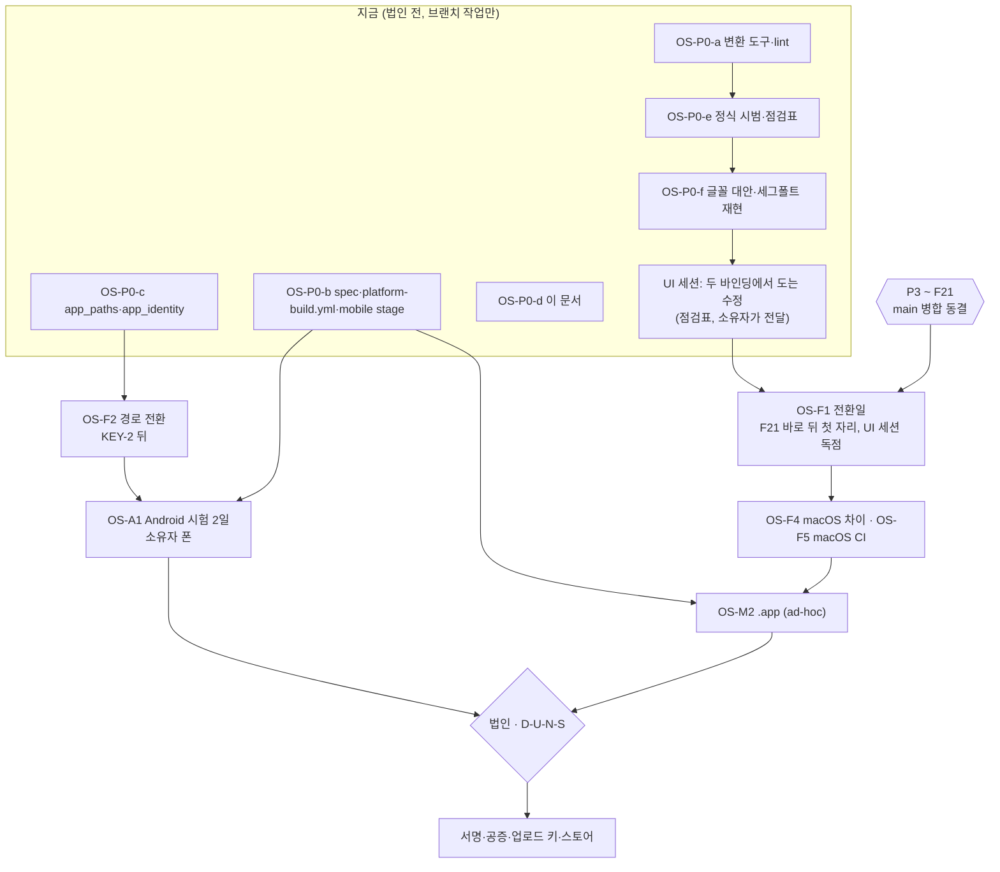

# QUANTGEN 플랫폼 확장 실행 계획 — 개정 2판 초안 (2026-11-17)

- 상태: **초안, 소유자 확인 전.** Notion 원문 "QUANTGEN 플랫폼 확장 실행 계획: macOS · Android · iOS" (`6f75e02e0296483086927a73d45df697`, 2026-11-11 판, 기준 `51792f1`)의 개정안입니다. Notion은 소유자 승인 뒤에만 고칩니다.
- 작성: OS_EXPANSION 세션 (QUANTGEN/MAIN의 하부 세션). 기준: main `5888d05`, UI 브랜치 `claude/friendly-bardeen-r6xe8f` `bec272b`, 작업 브랜치 `claude/os-prep-20261117`.
- 표시: **(미검증)** 직접 확인 못 함, **(추정)** 계산·판단 값, **(추론)** 공개 자료에서 미루어 본 것. 라이선스·법률 문장은 법률 자문이 아니며 변호사 확인이 필요합니다.

## 0. 소유자 11-16 질문에 대한 답

> 앱의 플랫폼 확장과 관련해서 다음과 같은 항목들을 고려해서 (1)문서 수정(할 필요 있으면 수정)할 것, (2) 당장 실행 가능한 것 (병렬로, github merge 순서 등에 따라 앱의 구성 등이 다르면 원래 주어진 급한 Task (i.e. Remaining Work))이 끝난 다음 진행하도록 미리 파이프라인 구축만 해놓을 것

| 질문 | 답 | 근거 |
|---|---|---|
| 전 플랫폼의 Module & BL이 PySide6 기반이 맞는지 | **아닙니다.** BL(`core/`, `data/`, `config.py`)은 UI가 없는 공통 Python입니다. PySide6는 **데스크톱(Windows·macOS) 화면만**입니다. 모바일은 Flet 축소판 동반 앱이고, iOS는 법인 뒤입니다 (D9 권장 승인분). | Qt for Python의 iOS 지원(6.12)은 numpy 같은 C 확장을 쓰지 못함 (원문 5절), Qt 화면 최소 창 1000×700 |
| 별도 기기 구입 없이 지금 할 수 있는 것 | Windows: 소유자 PC. macOS: GitHub `macos-latest` 러너로 빌드·ad-hoc 서명까지 (`platform-build.yml`, 수동 실행만). Android: 소유자 폰 + CI의 `flet build apk` (디버그 서명). iOS: Mac이 있어야 시뮬레이터라도 되므로 지금은 문서만 (필요하면 클라우드 Mac 24시간 대여 약 $21, us-east-1, **(추정)**, 나중에 여쭘) | 이 세션에서 만든 파이프라인 (3절) |
| 법인 설립 전/후로 구성·아키텍처·개발 단계가 바뀌는지 | **구조는 바뀌지 않습니다.** 바뀌는 것은 이름·계정·서명 키·설정값이고, 그 값은 `core/app_identity.py` 한 곳에 모았습니다. 법인 뒤에 하는 일: D-U-N-S → Apple 조직 계정·Developer ID 서명·공증, Windows OV 인증서, Android 업로드 키·조직 인증, 스토어 등록, 유료 판매 | `core/app_identity.py` (게시자 기본값에 "(주)" 없음, D11 문서 2.1의 상법 제20조 지적, 법률 자문 아님) |

## 1. 원문에서 고칠 것

| 원문 | 고친 내용 | 근거 |
|---|---|---|
| 4절 "Qt `quantgen_desktop/` 49개 파일, 약 11,700줄" | main 83개 .py, **29,927줄**; UI 브랜치 85개, 33,973줄. 2주에 약 6.5배 | `git ls-tree` + 줄 수 (2026-11-17) |
| 7.2 M2 "반대 방향의 의존은 없습니다. `ui/`와 `main.py`는 `quantgen_desktop`을 import하지 않으므로" | **틀림.** `ui/` 12개 파일이 `quantgen_desktop`의 문구 모듈을 import합니다 (`ui/bonds_page.py` 등). 반대로 `quantgen_desktop/macro_records.py`·`narrative_view.py`·`portfolio.py`·`risk_display.py`·`market_narrative_language.py`가 함수 안에서 `ui.*`를 import합니다. 모바일 묶음은 그래서 "Qt 없는 문구 모듈만" 골라 넣습니다 (`stage.py --profile mobile`, 11개 + `owner_ui_language/` 하위 패키지) | `git grep` (main `5888d05`) |
| 7.1 F1 "의미가 다른 2곳을 고칩니다" | 시범 결과 11묶음. 세그폴트·메모리 폭증의 원인은 두 곳(`localization.py`의 `singleShot(0, self.apply)`, UI `bonds.py`의 `setWeight(600)`)으로 확정, 고친 복사본 재시범에서 세그폴트·OOM 0 (`PYSIDE6_TRIAL` 7절). 새 실패·세그폴트·"이미 지워진 객체" 수는 `docs/platform/PYSIDE6_TRIAL_2026-11-17.md`. 점검표 `docs/platform/PYSIDE6_UI_CHECKLIST.md` | D9 보고서, 이 세션 시범 |
| 작업 ID `F1`, `M2`, `A1`… | **`OS-` 접두어** (`OS-F1`, `OS-M2`, `OS-A1`). 다른 문서의 F(소유자 F1~F22 실행), D1~D14(11-17 결정)와 겹치지 않게 | 지시문 8절 |
| F1의 시점 | **D9 판정: F 뒤 전환 예상 약 30시간(> 24시간) → 지금 진행, "나안".** 준비(도구·시범·두 바인딩에서 도는 수정)는 지금, main 전환 병합은 F21 바로 뒤 첫 자리, 그날 `quantgen_desktop/**`는 UI 세션 독점 | handoff `plans/2026-11-17/D9_PYSIDE6_ESTIMATE.md`, `MERGE_QUEUE.md` |
| F2 `user_data_dir()` | 원문 우선순위 그대로 구현 (`QUANTGEN_DATA_DIR` → `FLET_APP_STORAGE_DATA` → 기존 `~/.nextgen` → OS 기본). 호출하는 5곳의 전환(`config.py`·`kis_client.py`·`opendart_client.py`)은 **OS-F2**, 결제·계정 세션의 KEY-2 뒤 | 작업 브랜치 `core/app_paths.py` |
| M2 "계산 코드 해시가 `None`" (원문 결정 D9) | spec이 해시 대상 원본 3개를 자료 파일로 넣음. 패키지 앱 안에서 `QUANTGEN --selfcheck`로 확인: PyQt6·PySide6 빌드 모두 해시가 빌드 때 값과 같음 (2026-11-18, Linux) | `packaging/quantgen_desktop.spec` |
| A1 "축소 의존성의 출발점" | `mobile/pyproject.toml`: flet, pyyaml, Babel, requests, numpy, pandas로 시작 (scipy·statsmodels·matplotlib 등은 첫 시험에서 뺌). 어느 기능이 비는지가 A1의 측정 항목 | 작업 브랜치 `mobile/` |
| 모바일과 UI-D1의 관계 (원문에 없음) | UI-D1(2026-11-11): **새 화면 작업의 기준은 PyQt(데스크톱)**, Flet은 유지하되 기준이 아님. 모바일 Flet은 그 예외가 아니라 **축소판 동반 앱**(시세 읽기·연구 결과 보기)으로 범위를 좁혀 둡니다. 새 기능은 데스크톱에 먼저 | handoff `UI_SESSION_CURRENT.md` 소유자 결정 블록 |
| 7.3 A7 개발자 인증 | 2026-09-30 4개국 시작, 2027년 이후 전 세계 (원문 그대로, 한국 적용 시점 **미검증**). Play 조직 계정 필요는 **(추론)** | 원문 출처 |
| (새) Windows 서명 | 코드 서명 인증서 유효기간 최대 **460일** (2026-03 이후 발급분부터, CA/B Forum, **미검증**: 공식 문서 직접 확인 못 함). Azure Artifact Signing(구 Trusted Signing)은 한국 법인 대상이 아니라는 답변을 봤으나 공식 문서 미확인 → **법인 OV 인증서까지 대기** 제안 | 검색 요약 (2026-11-17) |
| (새) 라이선스 | PySide6 LGPL v3: 소스를 닫고 팔 때의 조건(동적 링크·교체 가능성·고지), macOS 공증·하드닝 런타임과 교체 가능 요건, iOS 정적 링크 — **변호사 확인 필요** (법률 자문 아님) | PyPI PySide6-Essentials 6.12.0 |

## 2. 순서 (개정)

## 3. 지금 만든 파이프라인 (작업 브랜치 `claude/os-prep-20261117`, main 병합 전)

| 무엇 | 파일 | 확인 |
|---|---|---|
| 변환 도구 (`--check`, `--apply`, `--lint`) | `tools/qt_port/pyqt6_to_pyside6.py`, `tests/qt_port_acceptance.py` | 12개 시험 통과; main·UI 두 번 적용 시 두 번째 변경 0, compileall 통과 |
| 글꼴 비교 | `tools/qt_port/font_probe.py`, `docs/platform/font_probe/` | Linux 오프스크린: `insertSubstitutions`가 지금과 같은 결과 |
| 세그폴트 재현 | `tools/qt_port/repro/` | PySide6에서 재현, PyQt6 0회 |
| 경로·정체성 | `core/app_paths.py`, `core/app_identity.py` + 시험 2개 | 10개 시험 통과 |
| 데스크톱 빌드 | `packaging/quantgen_desktop.spec` (`QG_QT_BINDING`), `packaging/launch_desktop.py` | 로컬 Linux PySide6 빌드 성공 (596MB onedir, 다른 바인딩·보호 파일 없음, 오프스크린 실행 유지) |
| 모바일 묶음 | `tools/packaging/stage.py --profile mobile`, `mobile/pyproject.toml` | 362개 파일; Qt를 막아도 `main.py`와 `ui/` 36개 모듈 import 성공 |
| CI | `.github/workflows/platform-build.yml` (수동·`v*` 태그만) | 실행 전. `workflow_dispatch`는 기본 브랜치에 있어야 하므로 병합 + 소유자 승인 뒤. 비공개 뒤 유료 (macOS 러너 분당 약 $0.062, **(추정)**) |

## 4. 나중에 여쭐 것 (제안만)

1. Mac 없이 macOS: GitHub macOS 러너는 수동·태그에서만, 사람 확인 단계는 클라우드 Mac 24시간 대여(약 $21, us-east-1, **(추정)**; 서울 가격 **미검증**).
2. 번들 ID `com.quantgeneration.quantgen` 확정 (`core/app_identity.BUNDLE_ID_CONFIRMED`가 지금 False).
3. Apple 개인 명의 가입은 하지 않음 (서명 주체가 실명으로 보임).
4. Windows 서명은 법인 OV 인증서까지 대기 (서명 없는 설치파일 공개 배포 금지 유지).

## 5. 확인 못 한 것

- Windows·macOS에서의 PySide6 동작과 글꼴 표시 (시범은 Linux 오프스크린만).
- Flet 0.85.2 Android 빌드 실제 동작, APK 크기, 의존성 휠 유무.
- PyInstaller 번들의 keyring 백엔드 (결제·계정 세션 KEY-2와 함께).
- 패키지 앱 안에서 `code_evidence()` 해시 값.
- 라이선스·공증·정적 링크 조건 (변호사).
