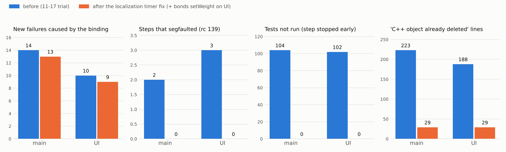

# PySide6 정식 시범 (OS-P0-e) — 2026-11-17

- 작성: OS_EXPANSION 세션 (QUANTGEN/MAIN의 하부 세션). 소유자 결정 D9 "나안"의 준비 작업입니다. 앱 코드는 바꾸지 않았고, 시범은 스크래치 복사본에서만 했습니다.
- 대상: `origin/main` **`5888d05`**, UI 브랜치 `origin/claude/friendly-bardeen-r6xe8f` **`bec272b`**.
- 방법:
  1. `git archive <ref> -- quantgen_desktop core data ui tests tools assets config.py main.py pyproject.toml requirements.txt README.md ':!**/*.jsonl' ':!**/holdout/**' ':!**/frozen/**' ':!**/.env*'`로 두 벌을 풉니다 (`docs/`는 넣지 않음).
  2. 한 벌은 그대로 **PyQt6 6.12.0**, 다른 한 벌은 `python tools/qt_port/pyqt6_to_pyside6.py --apply <복사본>` 뒤 **PySide6-Essentials 6.12.0** (같은 Linux, Python 3.12.3, `requirements.txt` 전체 설치).
  3. PySide6 쪽에만 시범용 글꼴 shim: `font_policy.py`가 `QChar`가 없으면 대체 글꼴 등록을 건너뜀 (D9와 같은 조건; 없으면 거의 모든 Qt 테스트가 import에서 실패).
  4. 그 ref의 `runtime-smoke.yml`에서 Qt 설치 단계 뒤의 `python -m unittest` 명령을 순서대로 (`-f`만 뺌; main 17개, UI 18개), 명령당 `timeout 1500`, `QT_QPA_PLATFORM=offscreen`, `HOME`·`XDG_*`를 스크래치로.
  5. 두 ref × 두 바인딩 4개를 2개씩 동시에 돌렸습니다 (4코어, 메모리 16GB).
- 집계: 같은 테스트 ID가 PyQt6에서는 통과(또는 아예 실패 안 함)하고 PySide6에서 FAIL/ERROR면 "새 실패". 두 쪽이 똑같이 실패한 것은 제외합니다. "이미 지워진 객체" 줄 = 로그의 `Internal C++ object (...) already deleted` 줄 수.

## 1. 결과 요약 (D9 시작값과 나란히)

| 지표 | D9 (main `e01e152`·UI `212f0dd`, Python 3.13) | 이번 main `5888d05` | 이번 UI `bec272b` |
|---|---|---|---|
| 바인딩 때문에 새로 실패한 테스트 | **15** | **14** | **10** (UI는 단계 9가 두 바인딩 모두 25분 제한에 걸려 모의매매·AI 해설 묶음을 비교하지 못함) |
| 세그폴트 (rc 139가 난 단계 수) | **1** | **2** (단계 2; 단계 12는 첫 실행에서 메모리 폭증으로 강제 종료, 단독 재실행에서 세그폴트) | **3** (단계 3·6·13) |
| "이미 지워진 C++ 객체" 줄 | **223** | **223** | **188** |
| 처리 안 된 예외 Traceback | PyQt6 7 / PySide6 86 | PyQt6 7 / PySide6 79 | PyQt6 6 / PySide6 63 |
| 통과한 테스트 수 (PyQt6 / PySide6) | — | 930 / 686 | 884 / 666 |
| 크래시 등으로 PySide6에서 실행조차 안 된 테스트 | 약 160 | 104 | 102 |
| **새 발견: 메모리 폭증** | — | 단계 12 첫 실행에서 python 하나가 **12.7GB**까지 커져 OOM 종료 | 단계 3·5 첫 실행 OOM 종료 (상한 8GB로 단독 재실행: 단계 3은 세그폴트, 단계 5는 정상 종료) |

메모리 폭증은 같은 날 수정본 재현 시험에서도 2번(10.9GB, 10.8GB) 나왔습니다 (`dmesg`의 OOM 기록 4건, 모두 PySide6 쪽 python). PyQt6 쪽은 한 번도 없었습니다. 이벤트 필터가 서로를 부르며 "Error calling Python override of QObject::eventFilter()"를 100단계 넘게 겹쳐 쓰는 출력이 같이 보여, 그 연쇄가 원인일 것으로 봅니다 **(가설)**.

### 단계별 종료 코드 (main `5888d05`)

| 단계 | 내용 (앞부분) | PyQt6 | PySide6 |
|---|---|---|---|
| 1 | indicator_signal_context, risk_reward | 0 | 0 |
| 2 | 셸 레일 3개 + workspace_readability | 0 | **139** |
| 3 | windows_branding, first_paint, home_live, ui_followup, … | 0 | 1 |
| 4 | markets_watchlist, market_tabs, received_bars, … | 0 | 1 |
| 5 | A3 layout·reading | 0 | 0 |
| 6 | workflow_guidance, chart_rendering, operation_fixes, typography, … | 0 | 1 |
| 7 | A1 terms·status | 0 | 0 |
| 8 | desktop_acceptance 외 22개 (오프라인 픽스처) | 0 | 1 |
| 9 | startup, macro_language, authored_prose | 0 | 0 |
| 10 | 공시 해석 9개 | 0 | 0 |
| 11 | history_best_source, strategy_lab_display, … | 1 | 1 (같은 실패, `docs/` 미포함 탓) |
| 12 | owner_ui 14개 문제 묶음 | 1 (strategy 1건, PyQt6만 실패) | **137** (OOM) → 단독 재실행 **139** |
| 13 | KIS 차트·실시간 묶음 | 0 | 1 |
| 14 | desktop_stock_detail | 0 | 1 |
| 15 | indicator_engine | 0 | 0 |
| 16 | status display·snapshot | 0 | 0 |
| 17 | 지표 교육·로캘 | 1 | 1 (같은 실패, `docs/` 미포함 탓) |

UI 브랜치는 단계가 하나 더 있고(새 시장 허브·지표 결론부·스크롤 테스트, 단계 2) 그 뒤 번호가 하나씩 밀립니다. 두 바인딩이 같게 실패한 것: `strategy_lab_display` 4건, `build_pages_display` 1건, `indicator_guide` 1건 (시범 폴더에 `docs/`·`results/`가 없어서; 바인딩과 무관). PyQt6만 실패: main 단계 12 `desktop_owner_ui_strategy_acceptance.test_cards_read_by_name_with_a_verdict_summary_in_both_languages` 1건 (PySide6 쪽은 크래시로 그 테스트까지 못 감).

## 2. 새 실패 목록 (원인 묶음 = D9 4절 번호)

재현은 모두 **변환한 스크래치 복사본**의 루트에서: `cd <복사본> && QT_QPA_PLATFORM=offscreen python -m unittest <테스트 ID>` (PySide6 venv). 줄 번호는 main `5888d05` 기준이며 UI 브랜치에서도 같은 함수에서 같은 실패가 납니다.

| # | 테스트 (main / UI 모두, UI 미비교는 표시) | 묶음 | 파일:줄 | 증상 | 두 바인딩에서 다 되는 고침 방향 |
|---|---|---|---|---|---|
| 1 | `tests.ui_followup_acceptance.ExportTests.test_formats_share_score_readings_and_embedded_chart` | 1 print | `quantgen_desktop/stock_report.py:164` | `QTextDocument` has no attribute `print` | `(getattr(doc, "print_", None) or doc.print)(writer)` |
| 2 | `tests.desktop_operation_fixes_acceptance.OperationFixTests.test_real_wheel_cannot_focus_a_selector` | 2 findChildren | `tests/desktop_operation_fixes_acceptance.py:119` | `findChildren` 타입 튜플 TypeError | 타입마다 따로 호출해 합침 |
| 3–7 | `tests.desktop_stock_detail_acceptance.StockDetailTests.test_an_interval_choice_then_another_stock_opens_with_the_last_period_chip`, `…test_opening_a_stock_gives_the_chart_the_keys`, `…test_the_data_notes_follow_the_chart_and_menu_intervals_load_enough_bars`, `…test_watchlist_rows_fold_and_open_a_stock`, `tests.desktop_market_tabs_acceptance.SearchZoomTests.test_choosing_a_name_loads_and_connects_without_a_button` | 3 receivers (+7 예외 정책) | `quantgen_desktop/stock_detail.py:1470` `_open` | `receivers(바운드 신호)` TypeError가 슬롯 안에서 출력만 되고 계속 → 다른 종목이 열리거나 안 열림 | 연결할 때 플래그를 직접 기록 (점검표 3번); 테스트는 슬롯 예외를 실패로 모음 (7번) |
| 8 | `tests.desktop_stock_detail_acceptance.StockDetailTests.test_ctrl_wheel_zooms_on_the_bar_under_the_pointer` | 5 Qt 객체 해시 | `quantgen_desktop/market_menu.py:203` `eventFilter` | `unhashable type: 'QPointingDevice'` (`watched in self.roots`) | `any(watched is r for r in ...)` 또는 `id()` 키 (점검표 5번; `--lint` 5묶음 11곳) |
| 9–11 | `tests.desktop_paper_acceptance.NativePaperTests.test_confirm_activation_edit_reconfirmation_and_restart`, `…test_failed_persistence_rolls_back_and_reports_failure`, `…test_invalid_and_stale_edits_do_not_confirm` (UI 미비교: 단계 9 제한 시간) | 4 콤보 Enum | `quantgen_desktop/paper.py:125` `combo()` → `:271` `preview` | `'str' object has no attribute 'value'` | 꺼낼 때 `Side(value)`로 되돌림 (주문 쪽이라 꼼꼼히) |
| 12 | `tests.desktop_typography_acceptance.BundledFontCoverageTests.test_indicator_chip_remove_uses_a_bundled_multiplication_sign` | 8 글꼴 (QChar 없음) | `tests/desktop_typography_acceptance.py:113` | `QRawFont.supportsCharacter("×")`가 PySide6에서 False (문자열을 받지 못함) | `supportsCharacter(ord(ch))` |
| 13 | `tests.market_progressive_acceptance.ProgressiveHistoryTests.test_native_paints_before_worker_finishes_and_ignores_old_selection` | **원인 미상** (6 수명 의심) | 테스트 80행 | 작업자 미리보기는 나왔는데 `pane.snapshot`이 None, 로그에 "이미 지워진 ResearchWindow" 오류 | 9·10번 수명 수정 뒤 다시 확인 |
| 14 | `tests.desktop_commentary_acceptance.NativeCommentaryTests.test_invalid_or_oversized_preview_is_localized_without_sending` (UI 미비교) | 11 **원인 미상** | 테스트 189행 (`code='PAYLOAD_INVALID'` 하위 시험) | 잘못된 미리보기 뒤 `payload`가 비워지지 않음 | 슬롯 예외를 드러낸 뒤 다시 확인 |

### 세그폴트·강제 종료 (실행 중단, 그 단계의 나머지 테스트는 미실행)

| ref | 단계 | 죽은 테스트 | 위치 | 재현 |
|---|---|---|---|---|
| main | 2 | `tests.desktop_home_markets_shell_acceptance.ShellRailTests.test_outside_window_click_dismisses_without_navigating` | 테스트 69행 `window()` (새 `ResearchWindow` 생성·활성화 중) | `tools/qt_port/repro/shell_window_segfault.sh <복사본> <PySide6 python>` — 3회 중 2회, CI 단계 2 그대로는 3회 중 3회. PyQt6 0회 |
| main | 12 | 첫 실행 OOM(12.7GB), 단독 재실행 `test_collapsed_rail_language_and_no_global_translation_pass` | 같은 `window()` | 단계 12 명령 단독 실행 |
| UI | 3 | `…ShellRailTests.test_single_destination_mouse_click_needs_no_submenu` | 같은 계열 | UI 단계 3 명령 |
| UI | 6 | `tests.desktop_a3_layout_acceptance.A3ResultLayoutTests.test_bond_scenarios_and_hedge_remain_available_after_layout_change` | 미조사 | UI 단계 6 명령 |
| UI | 13 | `tests.desktop_owner_ui_ficc_acceptance.OwnerUiFiccTests.test_combo_items_and_visible_captions_stay_english_in_an_english_window` | 미조사 | UI 단계 13 명령 |

**원인 조사 (OS-P0-f, main 단계 2):**
- gdb C 스택: `QTableView::timerEvent → updateGeometries → updateEditorGeometries → QStyledItemDelegate::updateEditorGeometry → Shiboken::BindingManager::getOverride → PyObject_GetAttr`에서 SIGSEGV. 표가 쓰는 **위임 객체(delegate)의 Python 래퍼가 이미 해제**된 상태입니다.
- 크래시 대신 오류로 끝난 실행: `Error calling Python override of QStyledItemDelegate::initStyleOption(): ReportActions.__init__.<locals>.<lambda>() takes from 0 to 2 positional arguments but 3 were given` — 위임 객체 자리에서 엉뚱한 람다가 불림 (해제된 메모리 재사용).
- 창을 지운 뒤 남는 것 (`tools/qt_port/repro/window_survivors.py`): PyQt6는 숨은 최상위 위젯 6개로 고정, **PySide6는 창마다 6개씩 쌓임** (지운 창의 `MarketChartPane`, `BondsPane` 콤보, `QFrame`; 지운 `ResearchWindow`의 Python 객체가 계속 붙잡음).
- `gc.disable()`이어도 재현 → 가비지 수집 시점 문제가 아님. 정리 뒤 `gc.collect()` 강제 → 3회 중 0회 (대신 이벤트 필터 연쇄 오류 1건). `watchlist.py`의 `_IdentityDelegate`만 `self.`에 붙잡기 → 여전히 재현 (2회 중 2회, 나머지 2회는 메모리 폭증으로 강제 종료).
- 앱 코드 없는 최소 재현(`tools/qt_port/repro/delegate_lifetime.py`, 30회 × 4가지)은 **재현 안 됨**. 원인 객체 하나를 특정하지 못했습니다 (가설: 지운 창의 Python 객체가 남아 붙잡는 위젯·필터·위임 객체의 소유권이 PySide6에서 어긋남).
- 고침 방향 (두 바인딩 모두): 점검표 9·10번 — Qt에 넘긴 위임 객체·헤더는 `self.`에 참조, 창에서 떼어 낸 위젯은 부모를 주거나 닫을 때 `deleteLater()`, 앱 전체 이벤트 필터는 창이 사라질 때 `removeEventFilter`, 테스트 정리 뒤 `gc.collect()`.

## 3. 무엇이 달라졌나 (D9 대비)

- 새 실패 15 → 14: 같은 11묶음이 그대로 나옴. 줄어든 1개는 D9의 "시장 검색·진행형 차트 2개" 중 하나가 이번엔 3번 묶음(receivers)으로 설명됨. D9의 10묶음 `_loaded()` TypeError는 이번 로그에 없음 (0건).
- 세그폴트는 그대로이고 위치가 실행마다 바뀝니다 (D9: `watchlist.py:805` 창 만들기, 이번: 셸 테스트 `window()`, A3, FICC). 공통점은 **앞 테스트의 창을 지운 뒤 새 창을 만들 때**입니다.
- 새로 보인 것: PySide6의 **메모리 폭증(10.8~12.9GB, 4회)**. CI 러너(Windows 16GB, Ubuntu 16GB)에서도 같은 일이 나면 작업이 통째로 죽습니다 **(미검증)**.
- 변환 도구는 D9의 간이 스크립트보다 정확합니다 (설명 문구 13곳은 바꾸지 않고, 문자열 안 서브프로세스 코드는 바꿈).

## 4. F21 뒤 남는 시간에 주는 뜻

D9 5절 추정의 4행(수명·소유권·예외 정책, 예상 6시간)이 가장 커질 위험이 있습니다. 세그폴트 위치가 실행마다 바뀌고 메모리 폭증까지 있어 **"높음"(11시간) 쪽으로 봅니다 (추정)**. 반대로 3행 글꼴(예상 3시간)은 `insertSubstitutions`가 지금과 같은 결과를 내서(`docs/platform/font_probe/FONT_PROBE.md`, Linux) 약 1~1.5시간으로 줄 수 있습니다 (Windows 눈 확인 전, 추정). 나안대로 UI 세션이 지금 점검표 1~5·8·9·10번을 두 바인딩 방식으로 고치면, F21 뒤 남는 일은 D9의 약 12~20시간 범위로 봅니다. 고치지 않으면 약 30~35시간입니다 (추정).

## 5. 확인 못 한 것

- Windows·macOS에서의 결과 (Linux 오프스크린만).
- UI 브랜치의 단계 9 (`desktop_acceptance` 외 22개)는 두 바인딩 모두 25분 제한에 걸려 비교 못 함 (동시 실행으로 느려졌을 수 있음). UI 단계 14(KIS 차트)도 PyQt6 쪽이 25분 제한.
- 세그폴트 원인 객체, 메모리 폭증의 정확한 경로, 묶음 11·13의 원인.
- 이 시범은 4개 실행을 2개씩 동시에 돌렸습니다. 첫 실행의 OOM 강제 종료 3건 중 UI 단계 3·5는 단독으로 다시 돌린 값을 표에 넣었습니다 (원래 로그는 보관).

## 6. 다시 하는 법

```bash
# 작업 브랜치 claude/os-prep-20261117 의 도구, 스크래치 폴더 S
git archive <ref> -- quantgen_desktop core data ui tests tools assets config.py main.py pyproject.toml requirements.txt README.md \
  ':!**/*.jsonl' ':!**/holdout/**' ':!**/frozen/**' ':!**/.env*' | tar -x -C "$S/copy"
python tools/qt_port/pyqt6_to_pyside6.py --apply "$S/copy"        # PySide6 쪽만
# 글꼴 shim (PySide6 쪽만): font_policy.py에서 QChar import를 try/except로, 대체 등록 루프를 QChar가 있을 때만
# runtime-smoke.yml의 Qt 설치 단계 뒤 'python -m unittest' 줄을 '-f' 빼고 하나씩, timeout 1500,
# QT_QPA_PLATFORM=offscreen, HOME/XDG_* 를 스크래치로.
```

## 7. 재시범 — 원인 두 곳을 고친 복사본 (2026-11-17 밤)

고친 곳은 임시 복사본뿐이고, 화면 코드는 고치지 않았습니다(UI 세션 몫).

1. `localization.py`의 `QTimer.singleShot(0, self.apply)`를 자식 타이머로 바꿈 (점검표 6번). main과 UI 모두.
2. UI만: `bonds.py:201`의 `setWeight(600)`를 `QFont.Weight(600)`으로 바꿈 (점검표 12번). 전체 재시범의 단계 6은 이 수정보다 먼저 돌았습니다. 그래서 단계 6은 이 수정 뒤에 따로 두 번 돌린 결과(20개 모두 통과, 2번 중 2번)로 바꿔 넣었습니다.

같은 CI 단계를 `ulimit -v 8GB`로 돌렸습니다. PyQt6 쪽 기준은 처음 시범 로그 그대로입니다. 같은 수정을 PyQt6에 적용해도 단계 3은 그대로 통과합니다.



| 지표 | 처음 main / UI | 고친 뒤 main / UI |
|---|---|---|
| 바인딩 때문에 새로 실패한 테스트 | 14 / 10 | **13 / 9** |
| 세그폴트 난 단계 | 2 / 3 | **0 / 0** |
| 중간에 죽어 실행 못 한 테스트 | 104 / 102 | **0 / 0** |
| "이미 지워진 C++ 객체" 줄 | 223 / 188 | **29 / 29** |
| 메모리 폭증 강제 종료 | 4회 | **0회** (단계 최대 0.74GB) |
| PySide6 통과 테스트 수 (PyQt6) | 686 (930) / 666 (884) | **909 (930) / 868 (884)** |
| 시간 초과 단계 | — / 단계 9 | — / 단계 9·13. 두 단계 모두 **PyQt6도 똑같이 시간 초과**라 바인딩 차이가 아님 |

남은 새 실패의 원인은 모두 점검표에 있는 묶음입니다.

| 묶음 | main | UI | 위치 |
|---|---|---|---|
| 3 `receivers` | 6 | 5 | `stock_detail.py:1470` 한 곳이 주식 상세 테스트 5개와 시장 탭 검색 1개를 실패시킴 (UI에서는 그중 4+1) |
| 4 콤보 Enum | 3 | 0 | `paper.py` |
| 5 Qt 객체 해시 | (위 6에 포함된 Ctrl+휠 1) | 같음 | `market_menu.py:203` |
| 1 `print` | 1 | 1 | `stock_report.py:164` |
| 2 `findChildren` 튜플 | 1 | 1 | 운영 수정 테스트:119 |
| 8 글꼴 `supportsCharacter(str)` | 1 | 1 | 타이포그래피 테스트:113 |
| **13 (새로 찾음)** 깨진 문자가 Qt 항목 데이터를 지나며 사라짐 | 1 | 0 | `desktop_commentary_acceptance`: `'\ud800'` 같은 짝 없는 서로게이트는 PySide6 콤보 항목 데이터(딕셔너리 안 포함)를 거치면 지워져 "깨진 내용" 검사를 통과해 버림. PyQt6는 그대로 둠 (실측) |

처음 시범에서 "원인 모름"이던 둘 중 `market_progressive`는 1번 수정으로 사라졌고, `commentary`는 13번입니다. 그래서 **원인을 모르는 새 실패는 0개**입니다.

**F21 뒤 남는 시간 재추정:** 남은 일은 한 줄~수십 줄짜리 수정 7묶음입니다. `6-bound`는 28~29곳이지만 같은 방식을 반복하는 일입니다. 여기에 누수(10번)와 Windows·macOS 확인을 더합니다. UI 세션이 미리 고치면 **약 8~14시간**, 고치지 않으면 **약 18~25시간**으로 봅니다(처음 추정은 12~20시간 / 30~35시간). 추정 근거: 세그폴트와 메모리 폭증의 원인 조사가 끝나 "원인 모를 문제" 몫이 빠졌습니다.

## 8. UI 세션 수정 뒤 재시범 (UI `75336f3`, 2026-11-18)

UI 세션이 점검표 ①·②, `6-bound`, 3·5·4·1·2·8·13·10번을 고친 브랜치입니다. 같은 CI 단계 18개를 두 바인딩으로 돌렸습니다(Linux 오프스크린, `ulimit -v 8GB`).

- `--lint`: 97건 → **50건**. `6-bound`·`receivers`·`setWeight`·이벤트 필터 해시가 모두 0입니다. 남은 것은 검토용 4·6묶음, 가드 안에 있는 8묶음 2건, 9번 10곳, 그리고 새 14번 2건입니다.
- **그대로 돌리면 PySide6 세그폴트가 7단계에서 다시 났습니다**(2·4·6·7·9·13·14).
  - 원인은 7개 화면 새 디자인 중 시스템 화면 커밋 `a00c856`입니다. 이분 탐색으로 확인했습니다: `d513c66`은 통과, `b6ca305`(이 커밋을 합친 것)는 실패.
  - 그 안에서 원인은 `connections.py`의 `focus_order`입니다. `nextInFocusChain()`으로 창 전체 포커스 사슬을 도는 부분입니다. 시스템 화면의 다른 부분을 하나씩 끈 변형 8개는 모두 여전히 죽었고, `focus_order`만 끈 변형과 그 안의 사슬 돌기를 `findChildren`으로 바꾼 변형만 통과했습니다. `setTabOrder` 자체는 원인이 아닙니다.
  - 점검표 14번과 lint `14-focus-walk`로 추가했습니다.
- **그 한 곳만 `findChildren`으로 바꾼 복사본의 결과:**

| 지표 | PyQt6 | PySide6 (그대로) | PySide6 (`focus_order` 수정) |
|---|---|---|---|
| 세그폴트 단계 | 0 | 7 | **0** |
| 바인딩 때문에 새로 실패한 테스트 | — | 10 | **0** |
| 중간에 죽어 못 돌린 테스트 | — | 209 | **0** |
| "이미 지워진 C++ 객체" 줄 | 0 | 31 | **0** |
| 통과 테스트 수 (분석 스크립트 기준) | 614 | 405 | **614** |
| 단계별 종료 코드 | — | 다름 | **18단계 모두 PyQt6와 같음** |

- 두 바인딩 모두 실패하는 단계가 있습니다. 단계 9·13은 시간 초과, 12·18은 PyQt6와 같은 테스트가 실패합니다. 바인딩 차이가 아니므로 이 문서의 대상이 아닙니다.
- 시스템 화면 시험 5개(포커스 순서 포함)는 `findChildren` 변형에서 두 바인딩 모두 통과했습니다.
- 위젯 누수(`window_survivors.py`): 이제 두 바인딩이 같습니다. 다만 둘 다 창마다 숨은 최상위 위젯 21개가 남습니다(`QWidget` 16, `sysPlain` 4, `CompactFieldGrid` 1). 바인딩과 무관한 새 디자인 쪽 누수로 보고 UI 세션에 알립니다.

## 9. 최종 재시범 — UI `5025c6f` 그대로 (2026-11-19)

UI 세션이 점검표 9번(delegate 참조)과 14번(`focus_order`)까지 반영한 브랜치를 **고치지 않고 그대로** 두 바인딩으로 돌렸습니다(CI 18단계, Linux 오프스크린).

| 지표 | 처음(11-17, `bec272b`) | 이번(`5025c6f`) |
|---|---|---|
| `--lint` 위험 패턴 | 97 | **38** (검토용 4·6묶음, 가드 안 8묶음 2건만) |
| 세그폴트 단계 | 3 | **0** |
| 바인딩 때문에 새로 실패한 테스트 | 10 | **0** |
| "이미 지워진 C++ 객체" 줄 | 188 | **0** |
| 메모리 폭증 강제 종료 | 4회 | **0회** |
| 단계별 종료 코드 | 다름 | **18단계 모두 PyQt6와 같음** |
| 통과 테스트 수 (PyQt6 / PySide6) | 884 / 666 | **614 / 612** |

- 차이 2개는 단계 9의 `desktop_rates_language_acceptance` 3개 테스트입니다. 단계 9는 두 바인딩 모두 25분 제한에 걸리는데, PySide6가 끊긴 시점이 조금 일러 실행되지 않은 것입니다. 실패가 아닙니다.
- 두 바인딩 모두 실패하는 테스트 6개(단계 12·18)와 시간 초과 2단계(9·13)는 바인딩과 무관합니다.
- **판정:** Linux 기준으로 UI 브랜치는 PySide6 전환 준비가 끝났습니다. Windows·macOS 실행은 병합 뒤 `platform-build.yml`(수동 실행)과 소유자 PC에서 확인합니다.
