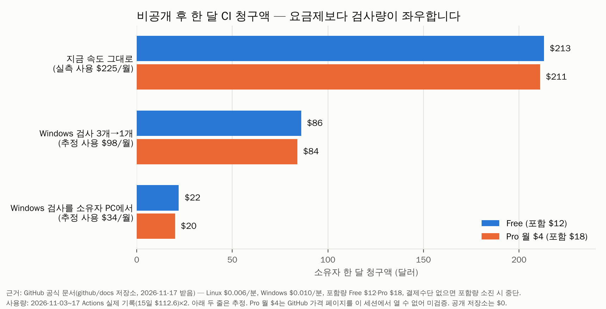

# D5 — GitHub Pro가 꼭 필요한가, "CI 시간이 유료"란 무슨 뜻인가 (2026-11-17)

소유자 지시 (원문): "D5 : 깃헙 프로가 반드시 필요한지를 분석하라. 이미 지속적인 CI가 진행이 되고 있는데, CI 시간이 유료라는것이 뭘 의미하는지 구체화 할 필요가 있음. 비공개 전환은 승인, 즉시 진행할 것."

## 1. 결론 (먼저)

| 질문 | 답 |
|---|---|
| Pro가 **반드시** 필요한가 | **아니요.** 비공개 저장소에서 CI를 계속 돌리는 데 꼭 필요한 것은 **카드(결제수단) 등록**입니다. 요금제는 Free여도 됩니다. |
| 그래도 Pro를 권하나 | **예, 권합니다 (월 $4, 미검증 가격).** CI를 한 달에 $16어치 넘게 돌리면 Pro가 오히려 쌉니다. 지금 속도면 월 $225어치라서 Pro가 매달 약 $2 덜 냅니다. 덤으로 저장 용량이 늘고, 나중에 main 보호 규칙을 켤 수 있습니다. |
| "CI 시간이 유료"의 뜻 | 지금은 저장소가 **공개**라 GitHub가 검사 기계를 **공짜로** 빌려 줍니다. **비공개**가 되면 그 기계를 쓴 **분(分)만큼 소유자 카드로 청구**됩니다. 우리 검사 한 번(앱 파일이 바뀐 PR)에 약 **$3.09**, 지금 속도로 **월 약 $225**(환율 1,400원 가정 시 약 31만 원)입니다. |
| 카드 없이 비공개로 바꾸면 | 한 달 포함량(Free $12 = 검사 약 4번)을 다 쓰는 순간 **CI가 멈춥니다.** 그러면 "CI 통과 시 병합" 규칙 때문에 **모든 병합이 멈춥니다.** |
| 비공개 전환을 제가 할 수 있나 | **못 합니다.** 이 세션에는 저장소 설정을 바꾸는 도구가 없습니다(gh CLI 없음, GitHub 연결 도구에 해당 기능 없음). 아래 4장 순서대로 소유자께서 눌러 주셔야 합니다. 약 10분. |

그래프 요점: **Free냐 Pro냐는 월 $2 차이**이고, **검사를 얼마나 돌리느냐가 월 $20~$213을 가릅니다.** 그래서 진짜 결정은 "Pro 여부"가 아니라 "CI를 얼마나 줄일까"(3장)입니다.

## 2. "CI 시간이 유료"를 숫자로

### 2.1 요금 규칙 (GitHub 공식 문서 원문)

| 항목 | 내용 | 출처 |
|---|---|---|
| 공개 저장소 | 표준 GitHub 기계 사용은 무료 ("In public repositories … free") | github/docs `content/billing/concepts/product-billing/github-actions.md` (2026-11-17 받음) |
| 비공개 저장소 분당 요금 | Linux $0.006, Windows $0.010, macOS $0.062 | 같은 문서 |
| 한 달 포함량 | Free $12 (Linux 2,000분 상당), Pro $18 (Linux 3,000분 상당). 매달 초기화 | 같은 문서, `githubs-plans.md` |
| 카드가 없을 때 | "If your account does not have a valid payment method on file, usage is blocked once you consume the included compute usage." (포함량을 다 쓰면 막힘) | 같은 문서 141행 |
| 결과물(artifact) 저장 | Free 500MB, Pro 1GB(Actions 문서) — 요금제 비교 페이지는 Pro 2GB로 적혀 있어 문서끼리 다름 | 같은 문서, `githubs-plans.md` |
| 예산 | 예산을 만들고 "Stop usage when budget limit is reached"를 **안** 고르면 이메일만 오고 CI는 안 멈춤 | `content/billing/how-tos/set-up-budgets.md` |
| Pro 가격 | 월 $4 (연 $48) — 제3자 자료만 확인, GitHub 가격 페이지는 이 세션 네트워크에서 열리지 않아 **미검증**. 결제 화면에서 확인해 주세요 | 웹 검색 2026-11-17 |

### 2.2 우리 저장소의 실제 CI 사용량 (2026-11-03 ~ 11-17, 15일, 실측)

| 검사 | 기계 | 15일 사용 분 | 정가 환산 |
|---|---|---|---|
| Runtime (앱 설치 검사) | Windows 3대 (Python 3.11·3.12·3.14) | 9,522분 | $95.2 |
| Runtime (앱 설치 검사) | Linux 1대 | 2,650분 | $15.9 |
| Compliance (문서 일관성) | Linux | 214분 | $1.3 |
| **합계** | | | **$112.6 → 월 약 $225** |

- 검사 한 번(앱 파일이 바뀐 PR에 커밋을 올릴 때마다): Windows 약 286분 + Linux 약 39분 ≈ **$3.09** (실행 43432023421 기준).
- 문서만 바뀐 PR은 Compliance만 돕니다 (약 30초, 거의 0원).
- 포함량으로 버티는 횟수: Free $12 → 앱 검사 약 4번, Pro $18 → 약 6번. 그 뒤는 카드 청구 또는 중단.
- 결과물 저장(추정): 앱 검사 1회 wheel 4개 약 28.5MB(7일 보관), Compliance 1회 약 2.5MB(**30일 보관**). 지금 속도면 합계가 Free 500MB를 넘을 수 있습니다. 카드가 없으면 업로드 단계가 실패해 검사가 빨간불이 됩니다. 카드가 있으면 초과분은 월 몇십 센트 수준(추정).

### 2.3 Free와 Pro 비교 (비공개일 때)

| | Free | Pro |
|---|---|---|
| 요금 | $0 | 월 $4 (미검증) |
| CI 포함량 | 월 $12 | 월 $18 |
| 월 CI $225 쓸 때 청구 | $213 | $211 |
| 월 CI $98 쓸 때 청구 | $86 | $84 |
| 손익분기 | 월 CI 사용 **$16 미만이면 Free가 쌈**, 넘으면 Pro가 쌈 | |
| main 보호 규칙(실수로 main에 바로 올리는 것 막기) | 비공개에서는 **못 씀** | 씀 |
| 결과물 저장 | 500MB | 1GB (또는 2GB) |
| 지금 우리가 쓰는가 | main 보호 규칙은 지금 **꺼져 있음**(규칙 0개). 그래서 Pro의 이 기능은 "앞으로 켤 수 있음" 정도의 가치 | |

판단 근거: 우리는 앞으로도 월 $16보다 훨씬 많이 쓸 것이므로(CI를 줄여도 추정 $34~$98), **Pro가 매달 $2 이득 + 저장 용량 + 보호 규칙**입니다. 반대로 CI를 거의 안 돌리는 달이 온다면 그때 Free로 내리면 됩니다.

## 3. 비용을 줄이는 방법 (GH-1, F21 뒤에 진행 — 승인된 D5 권장안 그대로)

F 동결(P3~F21) 동안은 main에 다른 것을 넣지 않으므로, 아래 변경은 F21 뒤 한 PR로 묶습니다.

| 방법 | 효과 (추정) | 대가 |
|---|---|---|
| ① PR마다 Windows 검사를 3대→1대(3.12)로, 3.11·3.14는 하루 한 번 또는 출시 전에만 | 월 $225 → 약 $98 | 3.11·3.14 문제를 하루 늦게 발견 |
| ② 같은 PR에 새 커밋이 오면 이전 검사를 자동 취소 (Compliance에는 이미 있음, Runtime에는 없음) | 측정 후 판단 (같은 PR에 연달아 올리는 경우만큼 절약) | 없음 |
| ③ Compliance 결과물 보관 30일 → 7일 | 저장 용량 초과 위험 제거 | 없음 |
| ④ Windows 검사를 소유자 PC에서 실행(셀프호스트) | 월 약 $34(Linux만 과금) | 검사 때마다 PC가 켜져 있어야 함, PC에서 저장소 코드가 실행됨. GitHub가 2026-03부터 셀프호스트에도 분당 $0.002를 받겠다고 했다가 미뤘다는 보도가 있으나 공식 확인 못 함(미검증). **지금은 비권장** |

①+②+③을 권장합니다. ④는 비용이 계속 부담되면 그때 다시 봅니다.

## 4. 소유자가 누를 순서 (약 10분, 이 순서가 중요)

카드부터 넣어야 지금 돌고 있는 PR121·PR122 검사와 이후 병합이 멈추지 않습니다.

**① 비밀키 노출 여부 확인 (비공개 전에, 2분)**
1. https://github.com/xkg4real/quantgen 접속 → 위쪽 **Security** 탭 → 왼쪽 **Secret scanning**.
2. 알림이 하나라도 있으면 그 키 이름을 저에게 알려 주시고 해당 서비스에서 **키를 새로 발급**하세요(값은 보내지 마세요).
3. 같은 화면에서 **Insights** 탭 → **Forks**: 포크가 있으면 그 사본은 비공개 후에도 **공개로 남습니다**(GitHub 문서: "Current forks will remain public"). 있으면 알려 주세요.
4. tradegen 저장소도 같은 확인.

**② 카드 등록 (3분)**
1. https://github.com/settings/billing 접속 (또는 오른쪽 위 프로필 사진 → **Settings** → 왼쪽 **Billing & Licensing**).
2. **Payment information** → 카드 추가.

**③ Pro로 올리기 (1분, 권장)**
1. 같은 **Billing & Licensing** → **Licensing** → "Current plan" 옆 **Upgrade** → "Pro" 아래 **Upgrade to Pro**.
2. 결제 화면에 나오는 실제 가격을 확인해 주세요 (제가 확인한 $4는 미검증).

**④ 예산 알림 (2분)**
1. **Billing & Licensing** → **Budgets and alerts** → **New budget**.
2. Budget type: **Product-level budget**, Product: **Actions**, 금액: **$150**.
3. **Stop usage when budget limit is reached는 체크하지 않기** (체크하면 $150에서 CI가 멈추고 병합도 멈춤). **Receive budget threshold alerts는 체크** (75%·90%·100%에 이메일).
4. 같은 화면 "Included usage alerts"의 **Receive alerts when my included usage reaches 90% and 100%**도 체크.

**⑤ 비공개로 바꾸기 (1분씩)**
1. https://github.com/xkg4real/quantgen → 위쪽 **Settings** 탭 → **General** 화면 맨 아래 **Danger Zone**.
2. "Change repository visibility" 오른쪽 **Change visibility** → **Make this repository private** → 확인 문구(저장소 이름) 입력 → 확인.
3. tradegen도 같은 방법. (website는 이미 비공개)

끝나면 "비공개 완료"라고만 알려 주세요. 제가 이 세션에서 저장소 접근과 CI가 그대로 도는지 확인하겠습니다.

## 5. 비공개로 바뀌면 달라지는 것 (확인 목록)

| 항목 | 바뀌는 점 | 할 일 |
|---|---|---|
| Claude 세션 | GitHub 앱이 설치돼 있어 그대로 접근 (전환 후 제가 확인) | 없음 |
| GPT(Codex/ChatGPT) | ChatGPT의 GitHub 연결이 **비공개 저장소 접근 권한**을 가져야 함 (미검증) | ChatGPT 설정 → 커넥터 → GitHub에서 quantgen·tradegen이 선택돼 있는지 확인 |
| 소유자 PC의 git pull | 처음 한 번 GitHub 로그인 창이 뜸 (Git Credential Manager) | 로그인하면 끝 |
| 비밀키 자동 검사(Secret scanning·Push protection) | 개인 계정 비공개 저장소에서는 **꺼짐** (GitHub 문서: GHAS 기능은 조직 계정 유료 기능) | F21 뒤 GH-2: 커밋 전 비밀키 검사를 CI에 추가 (제안) |
| 별·지켜보기 | 지워짐 | 없음 |
| 공개 포크 | 공개로 남고 분리됨 | ①-3에서 확인 |
| Compliance 문서 묶음의 GitHub 링크 | 접근 권한 없는 검토자에게는 열리지 않음 (`tools/compliance/export.py` 49~51행이 github.com 링크를 만듦) | 법률 검토자에게는 묶음 파일 자체를 전달 |
| 웹사이트(AWS Amplify) | 별도 저장소(website, 이미 비공개) → 영향 없음. 사이트에 quantgen 저장소 링크가 있는지는 미검증 (사이트 접속이 이 세션에서 막힘) | 웹사이트 세션에 확인 요청 |
| GitHub Pages | 안 씀 (has_pages false) | 없음 |

## 6. 확인하지 못한 것 (미검증)

- Pro의 현재 가격(월 $4)과 결제 화면의 실제 메뉴 이름 — github.com·docs.github.com이 이 세션 네트워크에서 열리지 않아 GitHub 문서 **원본 저장소(github/docs)** 파일로 확인했습니다. 화면 이름이 조금 다를 수 있습니다.
- 공개 기간에 비밀값이 커밋된 적이 있는지 (Secret scanning 알림 API가 이 세션에서 막힘) → 4장 ①에서 소유자 확인.
- tradegen 저장소의 CI 사용량 (이 세션 접근 불가).
- 3장 절감 효과는 추정입니다. GH-1 적용 뒤 2주 실측으로 다시 계산합니다.
