# QUANTGEN 업무 설계도 (마스터 파일) — 2026-11-17 초안

> 소유자 요청 (Notion 34f5c916fe0c800b9b4af35c80ebe778, <11 16 업무 지시 필요한 부분>):
> "업무 설계도 마스터파일 필요함 — 결제망 구축, OS확장, API키 관련 해야되는 일들을 통합 문서화 및 통합 다이어그램 생성 지시 / 다이어그램 만들때도 위 앱 플랫폼 확장 관련된 가이드라인을 제대로 반영하도록 할 것 / 위 다이어그램을 바탕으로 업무 지시, 이때 깃헙 merge 등과 관련된 부분에 주의할 것."

- 상태: **초안. 소유자 승인 전.** 승인 전에는 아무 저장소·Notion·설정도 바꾸지 않았습니다.
- 기준 시점: main `e01e152` (PR #120, 2026-11-14), 연구 브랜치 `claude/amazing-gauss-tdiguu` `cdbbe61`, handoff `c73ff11` (2026-11-17 09:38Z, UI 세션의 `UI_SESSION_CURRENT.md`·LEDGER 4행; 그 앞 `0ae7045` 09:31Z가 이 세션의 준비 체크포인트이고 `CURRENT.md`는 그대로, `8fefe01`·`706ad91`은 AUTO_STATE 자동 기록뿐), UI 세션 브랜치 `claude/friendly-bardeen-r6xe8f` `da0ea20` (2026-11-17 09:18Z, PR 없음).
- 승인 후 둘 곳 (메인이 정함, 부록 F): handoff 브랜치 `MASTER_WORK_DESIGN.md` + Notion 사본 1쪽. 작업 ID의 공식 출처는 main의 `docs/nautilus_bridge/REMAINING_WORK_2026-11-17.md` (7절).
- 표시: **(미검증)** = 이번 조사에서 직접 확인하지 못한 내용. **(추정)** = 계산·추론 값.
- 번호: `D1`~`D14` = 소유자 보고서(`OWNER_REPORT_2026-11-17.md`)의 결정. 옛 초안의 `Q1`~`Q32`가 어디로 갔는지는 부록 G. "판정 기록 결정 N" = `docs/nautilus_bridge/OWNER_RULINGS_LOG.md`의 기존 결정. "결정표 N번" = `docs/product/DECISIONS_PILOT_CLOSE_MERGE_2026-11-11.md`.

---

## 0. 오늘 살아 있는 UI 세션 (모든 세션이 먼저 읽을 것)

Claude UI 세션이 소유자의 **별도 요청 (2026-11-17)** 을 `claude/friendly-bardeen-r6xe8f`에서 끝내고 (main 미병합) 소유자의 PNG 확인을 기다립니다. 요청 원문과 결과는 그 브랜치의 `docs/product/UI_MARKET_HUB_CONCLUSIONS_2026-11-17.md`에 있습니다. 이 계획은 그 일과 겹치지 않게 짰습니다.

| 무엇 | 사실 (git으로 확인) | 이 계획에 주는 영향 |
|---|---|---|
| 커밋 | `da0ea20` (main `e01e152` 위 1커밋, 47파일, +4591/−224). PR 없음, 그래서 그 브랜치의 CI는 한 번도 돌지 않음 | UI PR의 병합 자리는 D2 |
| '봉' 문구 | `core/education/reading_cues.py:45`를 "현재 거래량을 평균과 비교하세요. 아직 진행 중인 기간의 거래량은 완성되지 않았어요."로 고침. `:19`, `:35`의 '봉'은 그대로 | **새 문구 승인 불필요.** main 쪽 수정은 이 45행과 바이트가 같은 문장만 씀 (D1) |
| `runtime-smoke.yml` | 107~108행: 새 테스트 모듈 3개 추가, 레일 테스트 이름 변경. PR122(`197c0e1`)는 9행 경로 목록과 93행을 고침 | 줄이 달라 자동 병합은 되지만 둘 다 공유 파일. GH-1은 그 둘이 들어간 main 위에서 만듦 |
| 시장 테스트 | `tests/desktop_home_markets_markets_acceptance.py`의 같은 두 블록을 PR121(`ea3d596`)과 반대로 고침 (ea3d596: 국가 행 `['Korea','US']`를 기대 / da0ea20: `open_root(...) is None`과 시장 허브 카드를 기대) | 충돌 한 번은 피할 수 없음. 동작을 바꾼 쪽이 UI이므로 **나중에 합치는 쪽이 UI 판을 씀** (2.4) |
| 그 밖의 충돌 | `git merge-tree 197c0e1 da0ea20` 모의 병합: 위 시장 테스트와 함께 `docs/compliance/FACTS.md` (양쪽이 끝에 절을 하나씩 추가)·`source-review.json`이 충돌, `runtime-smoke.yml`은 자동 병합 | FACTS.md는 **두 절을 모두 남김**, source-review.json은 기준선 다시 생성 (2.4 5번) |
| 그 밖 | `quantgen_desktop/app.py` +75줄, 새 `market_hub.py`, `market_summary.py`, `indicator_picker.py`, 새 `core/education/outlook.py`, `docs/compliance/FACTS.md`·`12-claims.md`·`source-review.json` | 앱 줄 번호는 바뀝니다. 지시문은 줄 번호 대신 이름으로 적음 |
| 승인 대기 | 시장 메인·범주 화면 PNG와 지표 결론부 문구 (UI PR에 들어갈 것, D2), 나머지 화면 7개 시안 (`draft_01_home` … `draft_07_system`, 아직 구현 없음). 시안 승인 뒤 화면별 구현, ID `⑬-2/page-redesign/<route>` | 11-16의 마이페이지·연결 탭 삭제는 `page-redesign/system`, 홈 지표 6개는 `page-redesign/home`에 넣음. 새 ID를 따로 만들지 않음 |
| 인계 기록 | handoff `c73ff11` (09:38Z, Claude-Session `session_016uB1jf8m3p5GW1qzQVJe7k`): `UI_SESSION_CURRENT.md` 맨 위에 `status: waiting_on owner`, PR은 소유자가 요청하면 만듦. LEDGER에 `⑬-2/market-rail-categories-only`, `⑬-2/market-hub/1`, `⑬-2/indicator-scroll-stability/1`, `⑬-2/indicator-conclusions/1`을 **병합 전** (커밋 `da0ea20`)으로 이미 기록 | 02의 UI-0은 끝남. 병합 뒤 이 4 ID를 다시 기록하지 않음 (병합 커밋은 `UI_SESSION_CURRENT.md`에만). 규칙 7 "병합 뒤 기록"과 다르지만 LEDGER는 덧붙이기만 하므로 그대로 둠 |

같은 화면을 두 에이전트가 따로 고치지 않는다는 규칙 (`origin/handoff:AGENTS.md` §6 끝)에 따라, 메인과 다른 세션은 `core/education/**`, `quantgen_desktop/**`, `tests/desktop_*`를 UI 세션 동의 없이 고치지 않습니다.

---

## 1. 한 장 요약

| 줄(레인) | 세션 | 지금 할 일 | 막고 있는 것 |
|---|---|---|---|
| 메인 라인 (Remaining Work) | 메인 Claude (이 세션) | PR121 (+'봉' 한 줄) → PR122, ⑦-1 Step 10 마감 커밋, REMAINING_WORK 새 판, P3, F | UI 세션 동의 (D1), D3·D4 |
| GitHub 정리 | 메인 Claude | 소유자 비공개 전환 지원, GH-1·GH-2는 F21 뒤 | D5 |
| 앱 화면 | UI/UX (기존, 오늘 11-17 요청을 브랜치에서 끝냄) | PNG 피드백 반영, 11-16 항목을 시안에 넣기 | 소유자 PNG 승인, 병합 자리 D2 |
| 웹사이트 | 웹사이트 (기존 역할, 클라우드 세션 권장 D13) | 사이트 CI, 색, 문구 정리 | 로그인·가입은 법인과 D11 뒤 |
| OS 확장 | **신규** | Phase 0 (브랜치만) | PySide6 전환은 F 뒤 (D9) |
| 결제·계정 (API 키 포함) | **신규** | 문의 7건 초안, 키 저장소 브랜치 | 유료 판매는 법인·PG·신고 뒤 |
| 데이터소스 (DIDM 포함) | **신규** | 공급사 비교표, DIDM 스키마, 홈 지표 데이터 계층 | 진단 출력, D14 |
| TRADEGEN | 기존 | 비공개 전 자기 워크플로 점검 | 없음 |

핵심 원칙 세 가지:
1. **main 병합은 한 줄로 줄 세웁니다.** 거의 모든 PR이 `docs/compliance/source-review.json`을 다시 써서 동시에 열리면 서로 깨집니다 (`tools/compliance/check.py:278-286`; main에서 2026-11-03 이후 176번 변경).
2. **P3 시작부터 F21까지 main은 멈춥니다.** 공식 동결은 "병합해도 됩니다" 공지부터 F21까지입니다 (`docs/product/PILOT_OWNER_RUN_2026-11-11.md:686`). P3 리허설이 그날의 main을 쓰므로 P3 시작부터 사실상 멈춥니다.
3. **법인 설립은 관문이지만 구조는 바꾸지 않습니다.** 바뀌는 것은 이름·계정·서명 키·설정값입니다. 그 값들을 `core/app_identity.py`(신규) 한 곳에 모아 두면 법인 뒤에는 설정만 바꿉니다.

---

## 2. 전체 흐름도

### 2.1 작업 줄과 의존 관계

```mermaid
flowchart TD
  FRZ{{"P3 시작 ~ F21<br/>main 병합 금지"}}
  G1{"G1 법인 설립<br/>+ D-U-N-S 번호"}
  G2{"G2 유사투자자문업<br/>신고 수리"}
  G3{"G3 PG 심사 통과"}
  GL{"L 변호사 의견서<br/>D-14"}

  subgraph L0["메인 세션 Claude · Remaining Work"]
    M0["체크포인트<br/>GPT 반환 검증"]
    M1["PR121 + '봉' 45행<br/>UI 문장 그대로 (D1)"]
    M2["PR122<br/>새 main 합쳐 재검사"]
    MR["REMAINING_WORK_2026-11-17<br/>문서만"]
    M4["⑦-1 Step 10 마감 커밋<br/>연구 브랜치 (P2·결정 10)"]
    M5["⑦-2 P3<br/>main을 연구 브랜치에 병합 + 전체 검사"]
    M6["소유자 확인 문장<br/>+ 공지"]
    M7["F1~F21<br/>소유자 Windows PC"]
    M8["F 이후 main PR<br/>README 표·기준선·LEDGER"]
    POL["회원가입 정책 문서 PR<br/>06·17·18·20·처리방침"]
    ORD["웹 거래 결정 메모<br/>→ 주문 모듈 M-12"]
  end

  subgraph L1["GitHub 정리"]
    GHP["소유자: quantgen·tradegen 비공개<br/>Pro·결제수단·알림 예산 (D5)"]
    GH1["GH-1 CI 축소·보관기간"]
    GH2["GH-2 파일 정리<br/>test_npu.py · mindmap"]
  end

  subgraph L2["UI/UX 세션 · 기존 · PNG 확인 대기"]
    UB["da0ea20<br/>시장 메인·지표 결론부·스크롤"]
    UP["소유자 승인<br/>시장 메인 PNG + 결론부 문구"]
    UP7["소유자 승인<br/>화면 7개 시안"]
    UPR["UI PR 병합 (D2)"]
    U1["page-redesign/system<br/>마이페이지·연결 탭 삭제"]
    U2["page-redesign/home<br/>홈 지표 6개 + 그래프"]
    U3["API 키 화면<br/>page-redesign/system/2"]
    UA["계정 화면<br/>core/account API 사용"]
    UQ["OS-F1 변환 실행<br/>OS 도구 · 화면 PR 1일 멈춤"]
  end

  subgraph L3["데이터소스 세션 · 신규 · DIDM 포함"]
    H0["소유자 2분 진단"]
    DSH["DS-H 홈 지표<br/>데이터 계층"]
    DS1["DS-1 공급사 비교표"]
    DS2["DS-2 Bigdata.com 시험<br/>소유자 PC에서 실행"]
    DI1["DIDM-0·1<br/>사전등록·점수 스키마"]
    DS4["DS-4 커넥터<br/>OpenDART·EDGAR·GDELT"]
  end

  subgraph L4["결제·계정 세션 · 신규 · API 키 포함"]
    P0["PAY-0 문의 7건 초안<br/>소유자 발송"]
    P2["PAY-2 결제 설계 문서"]
    K2["KEY-2 키 보관함 저장소<br/>.env 없이 실행 (D7)"]
    P1["PAY-1 계정·로그인 코드"]
    P3S["PAY-3 서버 저장소<br/>위치는 나중에 결정"]
    P4["PAY-4 유료 판매<br/>카드 PG"]
  end

  subgraph L5["OS 확장 세션 · 신규"]
    O0["Phase 0<br/>변환 도구·빌드 초안·app_identity"]
    O2["OS-F2 경로<br/>KEY-2 뒤"]
    OW["Windows 설치파일<br/>서명 없음 · 내부용"]
    OM["macOS .app<br/>GitHub 러너"]
    OA["Android 시험<br/>Flet · 소유자 폰"]
    OSG["서명 배포<br/>Apple·Google·Windows OV"]
  end

  subgraph L6["웹사이트 세션 · 기존 역할 · xkg4real/website"]
    W0["WEB-0 사이트 CI"]
    W1["WEB-1 색 추가 (D10)"]
    W2["WEB-2 문구 정리"]
    W3["WEB-3 출시 알림 폼<br/>+ 백엔드 코드"]
    W4["WEB-4 우리 로그인 UI<br/>플래그 꺼짐"]
    W5["WEB-5 로그인 후 화면 틀"]
    W6["계정 오픈"]
    WT["웹 거래 경로<br/>지금은 증권사 화면 연결만 (D12)"]
  end

  M0 --> M1 --> M2 --> MR --> M5
  M4 --> M5 --> M6 --> FRZ --> M7 --> M8
  UB --> UP --> UPR
  MR -.->|"D2-A이고 승인됨"| UPR
  UPR -.-> M5
  M8 -.->|"승인이 늦으면"| UPR
  M8 --> GH1 --> GH2
  M8 --> POL --> W3
  M8 --> ORD --> GL --> WT
  UP7 --> U1
  UP7 --> U2
  H0 --> DSH --> U2
  K2 --> U3
  U1 --> U3
  K2 --> P1 --> UA
  P1 --> P3S --> P4
  G1 --> P4
  G3 --> P4
  G2 -.->|"시그널 상품만"| P4
  M8 --> UQ
  O0 --> UQ --> O2
  K2 --> O2
  O2 --> OW
  O2 --> OM
  O2 --> OA
  OW --> OSG
  OM --> OSG
  G1 --> OSG
  DS1 --> DS2
  DI1 --> DS4
  W0 --> W1 --> W2
  W4 --> W5
  W4 --> W6
  G1 --> W6
  FRZ -.->|"병합 멈춤"| U1
  FRZ -.->|"병합 멈춤"| K2
  FRZ -.->|"병합 멈춤"| DSH
```



읽는 법:
- 실선은 "앞이 끝나야 뒤를 시작(또는 병합)"입니다. 점선은 조건입니다. 마름모는 관문, 육각형은 동결입니다.
- 웹사이트 줄은 다른 저장소라 main 대기열 밖입니다. 단 정책 문서의 **뜻**이 바뀌면 먼저 quantgen `docs/compliance`를 PR로 고칩니다 (사이트 빌드가 그 해시를 검사; `origin/handoff:WEBSITE_AWS_SESSION_CURRENT.md:72`).
- GHP(소유자의 비공개 전환)는 D5-A면 지금 바로입니다. 다른 일을 기다리지 않습니다.
- 플랫폼 지침: 계산 로직(BL)은 UI 없는 공통 Python입니다. 데스크톱(Windows·macOS) UI만 PySide6로 옮깁니다. 모바일은 PySide6가 아닙니다 (2.3).

### 2.2 main 병합 대기열 (한 줄)

```mermaid
flowchart LR
  N1["1 PR121<br/>+ '봉' 45행"] --> N2["2 PR122"] --> N3["3 REMAINING_WORK<br/>문서만"] --> N4["4 UI PR<br/>D2-A·승인 시"] --> N5{{"5 P3 시작<br/>사실상 동결"}} --> N6{{"6 공지 ~ F21<br/>공식 동결"}} --> N7["7 F 이후 main PR"] --> N8["8 UI PR<br/>4에 못 들어갔으면"] --> N9["9 GH-1 + GH-2"] --> N10["10 KEY-2 · DS-H · 화면 PR<br/>정책 문서 PR · 하나씩"] --> N11{{"11 OS-F1<br/>독점 창"}} --> N12["12 OS-F2 · app_identity · 빌드"]
```



- 1~3: 메인. 2는 1이 병합된 main을 합친 뒤입니다 (`origin/handoff:CURRENT.md`의 GPT 인계와 같은 순서). 3은 Compliance만 도는 문서 PR이라 1~2분입니다. 1·2 사이에 넣지 않는 이유: main이 움직이면 PR121·122가 main을 다시 합치고 Windows 전체 검사(약 95분)를 다시 해야 합니다.
- 4: D2-A이고 소유자가 시장 메인 화면 PNG와 지표 결론부 문구를 PR122 병합 전까지 승인했을 때만 (화면 7개 시안은 이 PR과 무관). 아니면 8.
- 5~6: P3 리허설은 그날의 main으로 합니다. 확인 문장 뒤에 main이 움직이면 다시 합치고 문장을 다시 받아야 합니다 (답 X4).
- 9: D5-A면 F21 뒤. D5-B면 3과 4 사이로 당기고, 병합 뒤 소유자가 quantgen을 비공개로 바꿉니다.
- 11: PySide6 전환 PR 하나가 `quantgen_desktop/**`와 `tests/desktop_*`를 잠급니다. PR은 UI 세션이 OS 세션의 도구로 엽니다.

### 2.3 앱 플랫폼 지침 (다이어그램과 지시에 반영)

| 층 | 무엇 | 플랫폼 | 근거 |
|---|---|---|---|
| 공통 BL | `core/`, `data/`, `config.py` | 모든 플랫폼 공통. UI 프레임워크 import 0건 | git grep 0건 (platform 조사) |
| 데스크톱 UI | `quantgen_desktop/` | Windows·macOS. 지금 PyQt6 6.12.0 (54개 파일), F 뒤 PySide6로 (D9) | `pyproject.toml:23` |
| 모바일 UI | `ui/` + `main.py` (Flet) 또는 모바일 웹 | Android 먼저, iOS는 법인 뒤 | Notion 6f75e02e §3.1, §5 |
| 웹 | 웹사이트 세션 | 브라우저 | `WEBSITE_AWS_SESSION_CURRENT.md` |

플랫폼 계획 문서에 "없음"으로 적혀 있지만 실제로 있는 연결 두 가지:
- 데스크톱 → Flet: `quantgen_desktop/macro_records.py:67-73`이 `ui.macro_cards_view` 등을 불러옵니다.
- Flet → 데스크톱: `ui/bonds_page.py:27` 외 8개 파일이 `quantgen_desktop`의 Qt 없는 문구 모듈을 불러옵니다. 모바일 묶음에도 그 모듈이 들어가야 하고, 나중에 `core/text`로 옮길 항목입니다.

### 2.4 main CI 복구: 누가, 무엇을, 어떤 순서로 (D1)

지금 main `e01e152`의 알려진 실패 (PR119 run 43454709190: 설치 작업 4개 모두 실패):
- 옛 화면 기준 테스트 3개: `tests/desktop_home_markets_markets_acceptance.py` 2개, `tests/desktop_owner_ui_risk_acceptance.py` 1개. **PR121 `ea3d596`이 이미 고침.**
- '봉' 1개: `core/education/reading_cues.py:45` (`tests/desktop_stock_detail_acceptance.py:1333`, 규칙 R-D9-2). PR121·122의 설치 작업 4개가 모두 여기서 실패 (run 43478587544, 43478852671). UI 브랜치 `da0ea20`이 이미 고침.
- 실패 단계 뒤의 세 단계 ('recorded owner decision and readiness display', 'indicator education and locale contracts', 'Retain the verified installable wheel')는 한 번도 돌지 않았습니다. 고친 뒤 새 실패가 나올 수 있습니다.

'봉' 45행만 고치는 별도 PR은 녹색이 될 수 없습니다 (옛 테스트 3개가 남음). 그래서 고칠 것을 PR121에 모읍니다.

**D1-A (권장) 순서:**
1. 소유자 → UI 세션: 동의 요청 한 줄 전달 (보고서 2절 3번). UI 세션은 `UI_SESSION_CURRENT.md`에 동의를 적고, 45행 문장을 바꾸지 않습니다.
2. 메인: 동의를 확인한 뒤 PR121 브랜치 `gpt/r3-recorder-20261114`를 GPT에서 인수 → `origin/main`을 merge (이미 최신이면 생략) → 45행을 da0ea20과 **바이트가 같은** 문장으로 바꾸는 커밋 하나 (`git diff origin/claude/friendly-bardeen-r6xe8f -- core/education/reading_cues.py`에 45행이 나오지 않아야 함) → 기준선 갱신은 맨 마지막 → force 없이 push → PR이 띄우는 모든 워크플로의 모든 작업이 정확한 head에서 녹색 → 병합. 별도 LEDGER ID는 만들지 않고 PR121 행에 45행을 적습니다.
3. 메인: PR122 `gpt/r3-outage-20261114`에 새 main을 merge → 기준선 맨 마지막 → push → 전체 녹색 → 병합.
4. 메인: `REMAINING_WORK_2026-11-17.md` 문서 PR → Compliance 녹색 → 병합.
5. UI 세션: 자기 차례(대기열 4 또는 8)에 main을 자기 브랜치에 merge. `tests/desktop_home_markets_markets_acceptance.py`의 두 블록 충돌은 **UI 판**으로 풂 (UI가 동작을 바꿨으므로 ea3d596의 국가 행 기대는 낡음). `reading_cues.py`는 같은 문장이라 충돌 없음. `docs/compliance/FACTS.md`는 양쪽 절(R3 기록기·오류 기록 / 11-17 시장 메인·결론부)을 모두 남김. `source-review.json`은 기준선 다시 생성.
6. UI 세션이 동의하지 않거나 답이 없으면, 메인은 `core/education/**`를 고치지 않고 소유자에게 묻습니다.

**D1-B 순서:** 소유자가 시장 메인 화면 PNG와 결론부 문구를 먼저 승인 → UI 세션이 ea3d596의 `tests/desktop_owner_ui_risk_acceptance.py` 수정을 가져와 PR → 전체 녹색 → 병합. 그다음 메인이 PR121에 main을 merge하면서 시장 테스트는 main(UI) 판을 쓰고 ea3d596의 그 두 블록은 버림 → 녹색 → 병합 → PR122. 소유자 승인 시점에 따라 main이 더 오래 빨간불입니다.

---

## 3. 세션 지도

### 3.1 한눈에

| 세션 | 누가 (권장) | 맡는 경로 | 손대지 않음 | 인계 파일 (handoff 브랜치) | 첫 작업 3개 |
|---|---|---|---|---|---|
| 메인 (Remaining Work + 병합 관리) | Claude 메인 세션 (session_01H6RrzMUzF8vwK8xkX977mB). 사용량이 끝나면 GPT 후임 (소유자 지시가 있을 때만, 07) | 연구 브랜치 P2 범위 (마감 기록·스펙·README 두 줄·`docs/nautilus_bridge/runs/`), PR121·122 인수, `.github/workflows/**`, `tools/handoff/**`, `CLAUDE.md`, `AGENTS.md`, `docs/nautilus_bridge/REMAINING_WORK_*.md`, 정책 문서 PR (`docs/compliance/**`, 회원가입용), handoff 브랜치 문서 (마스터·대기열·새 세션 인계 틀), 공유 파일 대기열 조정. `core/education/reading_cues.py:45` 한 줄은 UI 세션 동의가 있을 때만 | `docs/asset_expansion/cache/` (절대), 웹사이트 저장소 (`OWNER_RULINGS_LOG.md:314-315`), `tools/nautilus/**`, `NB-*` 폴더, `owner_confirmed`·`host_fingerprint`, `qa/acceptance_results.json` 쓰기, 그 밖의 `core/education/**`·`quantgen_desktop/**`·`tests/desktop_*` | `CURRENT.md` | 1) 반환 검증 체크포인트 + 마스터·대기열 게시 2) PR121 + 45행 (D1) 3) ⑦-1 Step 10 마감 커밋 |
| UI/UX | 기존 세션 그대로 (오늘 `claude/friendly-bardeen-r6xe8f`의 Claude UI 세션 + GPT UI) | `quantgen_desktop/**` **전부** (계정 화면, OS-F1 변환 실행, `app_identity` 화면 연결 포함), `ui/**` (유지만), `assets/**`, `core/education/**`, `core/ui_*messages*.py`, `core/ui_page_messages/**`, `tests/desktop_*`, `docs/product/UI_*.md`, `docs/product/ui_website_updates/*.json` | `core/research/markets.py` 등 데이터 계층, `config.py`, `core/credentials/**`, `core/account/**`, 연구 브랜치, 웹사이트 저장소 | `UI_SESSION_CURRENT.md` | 1) PNG 피드백 반영 (체크포인트는 `c73ff11`로 끝남) 2) 시안에 11-16 항목 넣기 3) D1 동의와 병합 준비 |
| 웹사이트 | 기존 역할 그대로. 운영은 저장소를 붙인 Claude 클라우드 세션 (D13) | `xkg4real/website` 저장소만. AWS(Cognito·SES·API) 설정 목록도 그대로 이 세션 | quantgen 코드, AWS 자원을 직접 만들거나 바꾸기 (소유자만) | `WEBSITE_AWS_SESSION_CURRENT.md`, `WEBSITE_AWS_HANDOFF.md` | 1) WEB-0 사이트 CI 2) WEB-1 색 3) WEB-2 문구 정리 PR |
| OS 확장 | **신규** Claude | `tools/packaging/**`, 새 `packaging/`, 새 `tools/qt_port/**`, `core/app_paths.py`, 새 `core/app_identity.py`, 새 `mobile/**`, `docs/platform/**`, 새 `.github/workflows/platform-build.yml` (대기열 경유) | `quantgen_desktop/**`·`tests/desktop_*` (변환 실행과 화면 연결은 UI 세션), `core/quant`, `core/research`, `data/**` (경로 수정은 OS-F2에서 대기열로, KEY-2 뒤), 웹사이트, F 파일 (규칙 6) | `OS_SESSION_CURRENT.md` (신규) | 1) PyQt6→PySide6 변환 도구 `--check` 2) `platform-build.yml`·패키징 초안 3) `app_paths`·`app_identity` + 플랫폼 계획 개정 2판 초안 |
| 결제·계정 (API 키 포함) | **신규** Claude | 새 `core/account/**`, 새 `core/credentials/**`, `tests/account_*`, `tests/credentials_*`, 새 `docs/commercial/**`, 대기열을 거쳐 `config.py`의 비밀 이름 경로·`data/krx/kis_client.py` 토큰 캐시 (KEY-2가 이 파일의 다음 수정 주인) | `quantgen_desktop/**` (계정·키 화면은 UI 세션이 이 세션의 API로 만듦), 웹사이트 저장소, AWS, 연구 브랜치 | `PAYMENTS_SESSION_CURRENT.md` (신규) | 1) PAY-0 문의 7건 초안 2) KEY-1 환경변수 이름 목록 (이름만) 3) KEY-2 키 보관함 저장소 브랜치 |
| 데이터소스 (DIDM 포함) | **신규** Claude | `data/**` 공급사 클라이언트 (`data/krx/kis_client.py`는 쓰기만, 고치지 않음), `core/research/markets.py` (DS-H), 새 `core/didm/**`, 새 `docs/didm/**`, 새 `tools/didm/**`, `tests/didm_*`, 대기열을 거쳐 `config.py` 공급사 설정·`.env.example` 이름·`requirements.txt`·`docs/compliance/08-third-parties.md` 행·`core/research/display_rights.json` | `quantgen_desktop/**` (화면은 UI 세션), 웹사이트, 연구 브랜치, `core/research/stock_profile.py`의 "no news source connected" 문구 (표시권이 생길 때까지 유지) | `DATA_SOURCE_SESSION_CURRENT.md` (신규, DIDM 절 포함) | 1) DS-1 공급사 비교표 2) DIDM-0 사전등록 + DIDM-1 점수 스키마 3) DS-H 홈 지표 데이터 계층 (진단 뒤) |
| TRADEGEN | 기존 그대로 | `xkg4real/tradegen` | quantgen | 기존 | 저장소 비공개 전 자기 워크플로 점검 |

세션 지시문(붙여넣기용)은 `drafts/sessions/` 아래 파일입니다.

### 3.2 세션 사이 주고받기

| 주는 쪽 | 받는 쪽 | 무엇 | 언제 |
|---|---|---|---|
| 메인 | UI/UX (소유자 전달) | D1 동의 요청: 45행 문장 유지, 시장 테스트 충돌은 UI 판 | 승인 직후 |
| 데이터소스 (DS-H) | UI/UX | `load_home_indicators()` 한 번 호출로 6개 값 + 기록 | DS-H 병합 뒤 |
| 결제·계정 (KEY-2) | UI/UX | 자격증명 `get/set/delete/status` | KEY-2 병합 뒤 |
| 결제·계정 (PAY-1) | UI/UX | 계정 API (`core/account`). 계정 화면은 UI 세션이 만듦 | PAY-1 병합 뒤 |
| 결제·계정 | 웹사이트 | 인증 엔드포인트, 앱 클라이언트 ID (웹·데스크톱 따로) | 운영 전 두 세션이 합의 |
| OS 확장 | UI/UX | `tools/qt_port/pyqt6_to_pyside6.py`, 화면 밖 수정 목록, `core/app_identity.py` | OS-F1 전날 |
| UI/UX | 웹사이트 | `docs/product/ui_website_updates/*.json` | UI PR마다 |
| 메인 | 모든 세션 | `MERGE_QUEUE.md`의 `freeze:` 줄, F 완료 신호 | 상시 |
| OS 확장 | 웹사이트 | `releases.json` 스키마 2 (다운로드 페이지는 웹사이트만 수정) | 서명 빌드 뒤 |

---

## 4. 병합 순서와 공유 파일 규칙

### 4.1 규칙 (모든 세션 공통)

| 번호 | 규칙 | 근거 |
|---|---|---|
| 1 | **동결 표시.** handoff 브랜치 `MERGE_QUEUE.md`(메인 소유)에 `freeze: none` 또는 `freeze: P3 (since <시각>, by <세션>)`, `freeze: F (...)` 한 줄. 병합 전 반드시 읽음. 동결 중에는 병합도, 병합 지시도 하지 않음 | `PILOT_OWNER_RUN_2026-11-11.md:686` |
| 2 | **공유 파일은 한 번에 PR 하나.** `docs/compliance/source-review.json`, `docs/compliance/FACTS.md`와 다른 `docs/compliance/*.md`, `README.md`, `pyproject.toml`, `requirements*.txt`, `.env.example`, `config.py`, `data/krx/kis_client.py`, `core/app_paths.py`, `.github/workflows/**`, `.gitattributes`, `.gitignore`, `CLAUDE.md`, `AGENTS.md`, `qa/acceptance_results.json`, `results/RULINGS.md`, `docs/nautilus_bridge/OWNER_RULINGS_LOG.md`, `core/research/display_rights.json`, `tools/compliance/**`, `tools/handoff/**` | `check.py:278-286`; source-review.json 176회 변경 |
| 3 | **병합 직전 순서.** `origin/main`을 브랜치에 **merge** (merge 커밋). 이미 push한 브랜치는 **rebase하지 않음** (rebase는 force push가 필요). force push 금지 → 기준선 갱신은 **맨 마지막**: `python -m tools.compliance.check --refresh-baseline --reviewed-by <이름> --review-note "<12자 이상>"` → `python -m tools.compliance.check --check` → **"녹색" = 그 PR이 띄운 모든 워크플로의 모든 작업이 정확한 head에서 성공** (지금은 Compliance 1개 + Runtime이 뜨면 syntax 2개와 설치 4개; GH-1 뒤에는 Runtime 작업 수가 줄어듦) → 병합. **어떤 실행이든 도는 중에는 병합하지 않음** | PR119이 Runtime 도중 병합되어 main이 빨간불 (run 43454709190) |
| 4 | **파일 추가·삭제는 PR 설명에 적음.** 감시 파일을 더하거나 빼면 20개 문서 전부 재검토 | `check.py:278-286` |
| 5 | **독점 창.** F 기간과 OS-F1(PySide6 전환일)에는 `quantgen_desktop/**`, `tests/desktop_*`를 잠금. OS-F1 PR은 UI 세션이 OS 도구로 열고, 그날 다른 화면 PR은 열지 않음 | 플랫폼 계획 8단계 |
| 6 | **F 파일 보호.** F가 main에 들어가기 전에는 `quantgen_desktop/bonds.py`, `quantgen_desktop/bonds_portfolio_narrative.py`, `ui/bonds_page.py`, `ui/qcharts.py`, `.github/workflows/nautilus-registration.yml`, `qa/research_status.json`, README 상태 표를 고치지 않음 | 연구 브랜치 변경 목록 (`git diff --stat bb35b3b`) |
| 7 | **LEDGER는 덧붙이기만.** ID는 PR 병합 뒤 `--done`으로 기록. 시작 전 `python3 tools/handoff/push_handoff.py --ledger`로 중복 확인 | `CLAUDE.md` |
| 8 | **CI 파일.** 플랫폼 CI는 별도 파일 `platform-build.yml` (수동 실행·태그만). `runtime-smoke.yml` 수정은 셋뿐: GH-1 (메인), OS-F1의 Qt 설치 줄, 규칙 10의 경로·테스트 추가. UI 브랜치(107~108행)와 PR122(9·93행)가 이미 고치므로, 나중 수정은 그 둘이 들어간 main 위에서 | 비용 (8절) |
| 9 | **바깥 저장소.** 웹사이트·TRADEGEN 저장소는 이 대기열 밖. `releases.json`과 다운로드 페이지는 웹사이트 세션만. 공개 배포에 서명 없는 설치파일 금지 | Notion 6f75e02e M4 |
| 10 | **CI가 실제로 돌게.** Runtime의 `pull_request` 경로 목록(`origin/main:.github/workflows/runtime-smoke.yml:5-9`)에는 `config.py`, `data/krx/**`, `core/didm/**`, `core/credentials/**`, `core/account/**`가 없고, `tests/didm_*`, `tests/credentials_*`, `tests/account_*`, `tests/app_paths_acceptance.py`는 어느 단계에도 없음. 각 레인의 **첫 코드 PR**이 자기 경로를 그 목록에, 자기 테스트 모듈을 'Verify bounded source fixtures' 단계(또는 새 단계)에 더함 (공유 파일이라 대기열 경유). 자기 테스트가 어느 CI 단계에서도 돌지 않는 PR은 병합하지 않음 | critic 확인, `runtime-smoke.yml:5-9`, `:90-93` |

모든 세션의 고정 규칙 (`docs/product/PILOT_READOUT_AND_STEP10_PREP_2026-11-11.md:93-110`, 0.3절):
- `docs/asset_expansion/cache/`는 어떤 브랜치·어떤 체크아웃에서도 열기·목록·해시·검색 금지. `git grep`/`git ls-files`에는 `':!docs/asset_expansion/cache'`. 저장소 전체 `find`, `ls -R`, `tree`, `du`, `grep -r`, `rg` 금지.
- **그 폴더가 디스크에 있는 체크아웃에서는 경로 없는 `git status`도 그 폴더를 훑습니다** (0.3절 1번). 그래서 코드 작업은 그 폴더를 받지 않는 sparse 클론에서 합니다 (2.2절의 방법):
  ```bash
  git clone --no-checkout <저장소 URL 또는 로컬 경로> "$SCRATCH/wt"
  git -C "$SCRATCH/wt" sparse-checkout set --no-cone '/*' '!/docs/asset_expansion/cache/'
  git -C "$SCRATCH/wt" checkout <브랜치>
  test ! -e "$SCRATCH/wt/docs/asset_expansion/cache" && echo "no cache folder" || echo "STOP: the cache folder is on disk"
  ```
  "no cache folder"를 본 뒤에만 진행. 로컬 경로에서 복제했다면 push 전에 `git -C "$SCRATCH/wt" remote set-url origin <GitHub URL>`. sparse 클론을 못 쓰는 곳에서는 `git status --porcelain -- <경로>`, `git diff -- <경로>`처럼 늘 경로를 줍니다.
- `git add`는 파일 이름으로만. `git add -A`, `git add .`, `git commit -a` 금지.
- `.env`, `~/.nextgen` 열지 않음. 변수 **이름**만 적고 값은 절대 적지 않음.
- 클라우드에서 `tests/run_all.py` 실행 금지. `qa/acceptance_results.json`은 소유자 Windows 실행 결과만 커밋.

### 4.2 지금의 대기열

| 순서 | 무엇 | 담당 | 상태 |
|---|---|---|---|
| 1 | PR121 (R3 기록기, head `ea3d596`) + '봉' 45행 (D1-A) | 메인 (GPT에서 인수) | 열림. 설치 작업 4개 실패 ('봉'). UI 세션 동의 대기 |
| 2 | PR122 (R3 장애 기록, head `197c0e1`) | 메인 | 열림, 같은 원인. 1 뒤 main 합쳐 재검사 |
| 3 | `docs/nautilus_bridge/REMAINING_WORK_2026-11-17.md` (문서만) | 메인 | 2 뒤 |
| 4 | UI PR (`claude/friendly-bardeen-r6xe8f`) | UI 세션 | D2-A이고 PR122 병합 전 시장 메인 PNG·결론부 문구 승인 시. 아니면 8 |
| 5~6 | P3 → 공지 → F1~F21 | 메인 + 소유자 | ⑦-1 마감 커밋 뒤 |
| 7 | F 이후 main PR | 메인 | — |
| 8 | UI PR (4에 못 들어갔으면) | UI 세션 | — |
| 9 | GH-1 + GH-2 | 메인 | D5-A (D5-B면 3과 4 사이) |
| 10 | KEY-2, DS-H, `page-redesign/system`·`/home`, 회원가입 정책 문서 PR, 각 레인의 CI 경로 추가 | 각 세션, 하나씩 | 브랜치 작업은 지금 가능 |
| 11 | OS-F1 PySide6 전환 | UI 세션 (OS 도구) + OS 세션 | F 이후 + 소유자 "OS go" |
| 12 | OS-F2 (경로; `config.py`·`kis_client.py`는 KEY-2 뒤), `app_identity` 화면 연결 (UI), 빌드 | OS + UI | — |
| 별도 | 오래된 PR #12 (2026-10-29 이후 변경 없음) | 나중에 여쭘 | 닫기 권장 |

---

## 5. 언제 시작할 수 있나

### 5.1 지금 바로 (main을 건드리지 않거나 대기열 순서대로)

| 세션 | 일 |
|---|---|
| 메인 | 체크포인트, 마스터·대기열·새 세션 인계 틀 게시, PR121 + 45행 (UI 동의 뒤), ⑦-1 마감 커밋 (연구 브랜치, 병렬), PR122, REMAINING_WORK 새 판 |
| UI/UX | 11-17 요청의 PNG 피드백 반영, 시안에 11-16 항목 넣기, D1 동의 |
| 웹사이트 | WEB-0~WEB-2 (별도 저장소). 로그인 UI는 플래그 꺼진 채로 |
| OS 확장 | Phase 0 (브랜치만, PR 병합 없음), 플랫폼 계획 개정 2판 초안 |
| 결제·계정 | PAY-0 문의 초안, PAY-2 설계 문서, KEY-1 목록, KEY-2 브랜치 |
| 데이터소스 | DS-1 비교표, DIDM-0·1, DS-3 RavenPack 견적 문안, DS-H (진단 출력 뒤) |
| 소유자 | 보고서 2절 (업데이트·진단, 비공개, UI 세션 전달, 세션 열기, 문의 한 줄, 스크린샷, Bigdata.com) |

### 5.2 F21 뒤

| 세션 | 일 |
|---|---|
| 메인 | F 이후 main PR, LEDGER ⑦-2, GH-1·GH-2, 회원가입 정책 문서 PR, 웹 거래 결정 메모 (문서만, P4), `push_handoff.py --doc` 확장 |
| UI/UX | UI PR (4번 자리를 못 썼으면), `page-redesign/system`·`/home` 병합, API 키 화면, OS-F1 변환 실행 |
| OS 확장 | OS-F1 지원 → OS-F2 → `app_identity` → macOS 차이 → `.app` → Android 시험 |
| 결제·계정 | KEY-2 병합, OS 확장의 키 저장 (OS-F3)과 맞춤 |
| 데이터소스 | DS-H 병합, DS-4 커넥터 |
| 메인 | 주문 모듈 M-12: ⑦-2 뒤에 시작 (P4, `OWNER_RULINGS_LOG.md:759`), 20 거래일 모의 (D-9), 변호사 의견서 (D-14) |

**시간표 주의.** 소유자가 요청한 앱 항목(마이페이지, 홈 지표 6개, API 키 화면)과 DS-H는 대기열 10번, 즉 F21 뒤에 main에 들어갑니다. F21 날짜는 소유자 Windows 실행에 달려 있어 아직 모릅니다. 앞당길 수 있는 자리는 4번(P3 직전) 하나이고, D2로 UI PR을 넣거나, 그때까지 준비되면 작은 홈 지표 수정 하나를 넣을 수 있습니다. 그 자리를 쓰면 F가 Windows 전체 검사 한 번(약 95분)만큼 늦어집니다.

### 5.3 법인 설립 뒤 (관문 G1)

| 영역 | 일 | 근거 |
|---|---|---|
| 서명 | D-U-N-S → Apple 조직 계정 → Windows OV 인증서 (최대 460일, 매년 갱신) → Android 업로드 키 | 런치 플랜 12단계; appviewx 460-day |
| 스토어 | Google Play 조직 계정 (금융 앱은 조직 계정이 필요하다고 읽힘, 추론), App Store 사업자번호 | Google Play 도움말 9876821 |
| 웹사이트 | 정식 회원가입 오픈, 처리방침의 법인명·책임자·연락처 확정, 해외(시드니) 보관 공개 | `release-profile.json:5-14` (지금 null) |
| 결제 | 사업자등록, 통신판매업 신고, PG 계약 (G3). 시그널 상품은 유사투자자문업 신고 수리 (G2) 뒤 | Notion 70e6a1d5 |
| 서버 | 회사 서버가 공급사 키를 보관하는 방식 (부록 C의 C)은 재배포 계약 필요 | Notion 40e5c916 항목 5 |

법인 전에 미리 해 둘 것 (법인 뒤 작업 흐름이 바뀌지 않게):
- `core/app_identity.py` 한 곳에 조직명, 번들 ID (제안 `com.quantgeneration.quantgen`, 나중에 여쭘), 게시자 표시명, 업데이트 주소, Cognito 도메인·클라이언트 ID, 라이선스 공개키. 앱의 QSettings 이름과 `windows_branding.py`가 여기서 읽게 하는 화면 쪽 연결은 UI 세션이, 패키징 설정은 OS 세션이 합니다.
- 자격증명 저장소 (KEY-2)에 `quantgen_cloud` 공급원 자리 (꺼진 상태)를 미리 둡니다.

---

## 6. 관문 정의

| 관문 | 뜻 | 누가 | 이 뒤에 열리는 것 |
|---|---|---|---|
| F 동결 | P3 시작 (공식은 "병합해도 됩니다" 공지) ~ F21 | 메인 공지, 소유자 실행 | 모든 main 병합 재개, OS-F1 |
| G1 법인 설립 | 등기 + D-U-N-S (최대 5+2 영업일) | 소유자 | 서명, 스토어, 정식 가입, 결제 계약 |
| G2 유사투자자문업 | 신고 수리 | 소유자 | 시그널 상품 판매 |
| G3 PG 심사 | 카드 PG 승인 | 소유자 | 도구형 구독 유료 판매 (시나리오 A만 Go) |
| L 변호사 의견서 | D-14 | 소유자 | 주문 기능이 있는 버전 배포, 웹 거래 |
| 표시권 | KRX/Koscom, FMP, Cboe 등 재표시 계약, Yahoo 대체 | 소유자 | 앱·웹에 시세·뉴스 점수 공개 표시 (지금 `display_rights.json`: 공개 허가 false, 법률 의견 false) |

---

## 7. 작업 ID 체계

| 접두어 | 세션 | 예 |
|---|---|---|
| 기존 Remaining Work ID | 메인 | ⑦-1, ⑦-2, ⑨-3a/recorder/1/lifecycle |
| `⑬-2/…` (기존 규칙, `AGENTS.md` §6) | UI/UX | `⑬-2/page-redesign/system`, `⑬-2/page-redesign/home`, `⑬-2/page-redesign/system/2` (API 키 화면) |
| GH- | GitHub 정리 (메인) | GH-1, GH-2 |
| OS- | OS 확장 | OS-F1, OS-F2, OS-M2, OS-A1 |
| PAY-, KEY- | 결제·계정 | PAY-0, KEY-2 |
| DS-, DIDM- | 데이터소스 | DS-1, DS-H, DIDM-1 |
| WEB- | 웹사이트 (새 항목) | WEB-0 |

- 플랫폼 계획의 F1–F6, A1–A7, M1–M7, S1–S3는 연구 병합의 F1~F21, Bonds 결함 F1–F5, S1–S4와 겹칩니다. 그래서 모두 `OS-` 접두어로 바꿉니다.
- `CLAUDE.md`는 ID가 최신 `docs/nautilus_bridge/REMAINING_WORK_*.md`에서 온다고 정합니다 (지금 최신은 2026-10-27). 그래서 메인이 `REMAINING_WORK_2026-11-17.md`를 문서만 바꾸는 PR로 main에 올립니다 (대기열 3번). `check.py`의 감시 범위 밖이고 (`check.py:130-145`, docs는 product·compliance만) Runtime 경로 목록에도 없어 Compliance(약 1분)만 돕니다. 그 PR이 병합되기 전 며칠 동안은 이 마스터가 임시 목록이며, 그 사실을 `CURRENT.md`에 적습니다.
- 새 접두어도 `push_handoff.py`의 ID 검사를 통과합니다 (`norm_id`의 NFKC·casefold, `ID_SHAPE` `push_handoff.py:58`).

---

## 8. 비용 메모

| 항목 | 값 | 근거 |
|---|---|---|
| 지금 CI 비용 | 0원 (저장소 공개) | run 43478852671 billable 0 ms |
| 비공개 후 실측 기준 | 2026-11-03~17 사용량을 정가로 환산하면 약 $112.6 (15일), 월 약 $225 | Actions 사용량 합산 (github-structure 조사) |
| 전체 Runtime 1회 | Windows 약 286분 + Linux 약 39분 ≈ $3.09 | run 43432023421 |
| F21까지 남은 전체 검사 | PR121, PR122, (D2-A면) UI PR → 2~3번 ≈ $6~9 **(추정)**. 다른 세션이 PR을 열면 그만큼 더 | 위 단가 |
| GH-1 뒤 추정 | 1회 약 $1.18, 월 약 $60~90 **(추정)** | 조사 추정 |
| 포함량 | Free 월 $12, Pro 월 $18 (Linux 2,000분/3,000분 상당). Pro 포함량은 전체 검사 약 5번 **(추정)**. 결제수단이 없으면 포함량을 다 쓴 순간 막힘 | github/docs 원문 (10절) |
| 저장 공간 | 포함 Free 500MB, Pro 1GB. 지금 속도면 약 2.7GB 보관 **(추정)**, 초과분 GB·월 $0.25. GH-1이 보관 기간을 줄임 | 같은 문서 |
| 예산 설정 (D5-A) | 월 약 $250, 75·90·100% 알림, **'한도에서 사용 중지'는 끔**. 켜 두면 P3·F 도중 CI가 멈출 수 있음. GH-1 뒤 $100 안팎으로 낮추고 중지를 켤지 다시 정함. 화면의 정확한 옵션 이름은 미확인 | 위 월 속도 |
| macOS 러너 | 분당 $0.062, 1회 약 $2.5~6 **(추정, 실행 시간 미측정)** | 3자 보도 + Notion 6f75e02e |
| 클라우드 Mac | AWS mac2-m2.metal 약 $0.878/시간, 최소 24시간 ≈ $21 (us-east-1, 서울 가격 미확인) | AWS FAQ |
| Bigdata.com | Pro 월 $40 (정가 $50), Max 월 $160 **(검색 요약, 페이지 직접 확인 못 함)** | bigdata.com/pricing |
| OV 코드서명 | 연 약 $150~300 **(Notion 분석, 미검증)** | Notion 40e5c916 항목 8 |
| GitHub Pro | 가격 미확인. 비공개 저장소의 브랜치 보호에 필요 (website 저장소) | github/docs gated-features |

참고: 플랫폼 조사의 "월 약 $840"은 모든 실행이 전체 실행이라고 가정한 값입니다. 실제 작업 분(分) 합계로는 월 약 $225입니다. 위 표는 실측 쪽을 씁니다.

---

## 9. 확인 못 한 것

- GitHub 계정 요금제와 결제수단 유무 (API의 plan 값이 null), 공개 기간 동안 비밀값이 커밋된 적이 있는지 (비밀 스캔 기록 API 차단), tradegen의 워크플로와 Actions 사용량 (403).
- 소유자 PC에서 홈 지표가 안 뜨는 실제 원인 (코드만 읽음). 후보 넷: Yahoo 요청 제한, 보안 프로그램의 TLS 가로채기, venv 패키지, 오래된 체크아웃. 연구 브랜치 `cdbbe61`에는 `quantgen_desktop/home_view.py`가 없어 (main이 새로 추가) 연구 클론에서 앱을 켜면 옛 연구 홈이 보입니다. whydi PC의 연구 클론이 지금도 연구 브랜치인지는 모릅니다 (UI 인계가 11-14에 그 폴더에서 `git switch main`을 안내함).
- UI 브랜치 `da0ea20`의 CI 결과 (PR이 없어 한 번도 돌지 않음), UI 세션의 D1 동의.
- PR121·122에서 '봉' 실패 뒤 건너뛴 세 단계의 결과.
- 웹사이트 실제 문구 (사이트와 website 저장소 모두 이 환경에서 접근 불가).
- Bigdata.com의 기록 시작, 한국 종목 범위, 재배포 조항. Upbit 시세의 표시 조건.
- PySide6-Essentials 6.12에 QtSvgWidgets·QtTest가 있는지, macOS 러너 실행 시간, 클라우드 Mac 서울 가격.
- 파일럿 2에서 Python 3.13.17이 쓰인 이유 (run.json 값만 확인). 첫 E 시도 (843/1 실패)와 소유자 콘솔 내용은 GPT 전언.
- 소유자가 말한 "서명 작업", "노트북 파일"의 뜻.
- Notion 34f5c916 '문서' 칸의 PDF 1개와 외부 개체 2개는 열어 보지 않았습니다. 로그인 후 화면 스크린샷이 그 안에 있을 수 있습니다.
- `origin/handoff` `706ad91` AUTO_STATE가 이 세션(244a07c1)에 대해 18:08 KST `rate_limit_error` 스냅샷을 남겼습니다. 무슨 뜻인지는 확인하지 않았습니다.
- 법률 사항 전부 (법률 자문 아님): 조문은 검색 결과·2차 자료로만 봤고 원문은 확인하지 않았습니다.

## 10. 출처

**저장소·인계**
- 소유자 목록: Notion 34f5c916fe0c800b9b4af35c80ebe778 (2026-11-17 조회, 09:10Z 다시 확인).
- 인계: `origin/handoff:CURRENT.md` (`0ae7045`), `UI_SESSION_CURRENT.md`, `AGENTS.md` §6, `WEBSITE_AWS_SESSION_CURRENT.md` (:72, :128, :140-141, :248), `WEBSITE_AWS_HANDOFF.md`, `OWNER_HANDOFF_POLICY_2026-11-13.md`, `LEDGER.md`, `STEP10_CHANGE_REVIEW_2026-11-14_gpt.md`, `WINDOWS_E_READOUT_2026-11-14_gpt.md`.
- UI 세션: `origin/claude/friendly-bardeen-r6xe8f` `da0ea20`, `docs/product/UI_MARKET_HUB_CONCLUSIONS_2026-11-17.md`.
- main: `docs/product/PILOT_OWNER_RUN_2026-11-11.md`, `docs/product/PILOT_READOUT_AND_STEP10_PREP_2026-11-11.md`, `docs/product/DECISIONS_PILOT_CLOSE_MERGE_2026-11-11.md`, `docs/nautilus_bridge/OWNER_RULINGS_LOG.md` (:757 P2, :972-980 결정 10~18), `tools/compliance/check.py`, `tools/handoff/push_handoff.py`, `.github/workflows/runtime-smoke.yml`, `core/research/display_rights.json`, `pyproject.toml`.
- CI: runs 43454709190 (PR119), 43478587544 (PR121), 43478852671 (PR122), 43432023421 (PR117).
- Notion: 런치 플랜 68c577d259f847798171caad8a546c1d, 플랫폼 계획 6f75e02e0296483086927a73d45df697, 결제망 70e6a1d505e346c0a5f6b43bc9ff4fed, 상업화 분석서 40e5c916fe0c815ba983dd4c4cc7992c, DIDM 02e5c916fe0c821bb15701f648e9db87, DIDM_Research_Report 2045c916fe0c82ca8efe8157c0c70bd8, Types of Info 41b5c916fe0c80ddb4e2ce2e1d376003, REMAINING WORK 4065c916fe0c80d2af08c0e7f68817fa.

**외부 출처** (조사 단계에서 읽음, 이번 개정에서 다시 열지 않음. 일부는 검색 요약만)
- 금융위원회 보도자료 (유료 양방향 채널, 2024-08-14 시행): https://www.fsc.go.kr/po010101/82887
- 한국투자증권 제휴 안내 (제3자 서비스): https://apiportal.koreainvestment.com/provider
- 네이버페이 사례 보도: https://www.mt.co.kr/stock/2024/10/17/2024101715491394304 , https://www.mt.co.kr/stock/2025/01/16/2025011614370710555 , https://www.mt.co.kr/stock/2025/03/09/2025030715473235190
- Google Play 개발자 계정 유형: https://support.google.com/googleplay/android-developer/answer/9876821 (그 밖에 answer/14151465, android-developer-console answer/16561738)
- Apple D-U-N-S: https://developer.apple.com/support/D-U-N-S/
- 코드서명 인증서 460일: https://www.appviewx.com/blogs/460-day-code-signing-certificate-2026/
- Microsoft Trusted/Artifact Signing 국가 범위 (Q&A 답변, 공식 문서 아님): https://learn.microsoft.com/en-us/answers/questions/2243504/trusted-signing-for-other-countries ; 서명 선택지: https://learn.microsoft.com/en-us/windows/apps/package-and-deploy/code-signing-options
- PyQt 상용 라이선스: https://riverbankcomputing.com/commercial/license-faq
- Qt for Python 모바일: https://www.qt.io/blog/python-mobile-app-development-bringing-pyside6-on-ios , https://doc.qt.io/qtforpython-6.10/deployment/deployment-pyside6-android-deploy.html , https://www.qt.io/blog/qt-for-python-release-6.12-is-here
- Flet 배포: https://flet.dev/docs/publish/android , https://flet.dev/docs/publish/ios
- GitHub Actions 요금·포함량·초과 시 동작: github/docs 저장소 `content/billing/concepts/product-billing/github-actions.md`, `data/reusables/billing/{actions-included-quotas, actions-standard-runner-prices, default-over-quota-behavior, compute-allowance-model}.md`, `data/reusables/gated-features/{secret-scanning, push-protection-for-users, protected-branches}.md` (2026-11-17 raw로 읽음)
- Bigdata.com: https://bigdata.com/pricing , https://docs.bigdata.com/getting-started/bigdata_pricing , https://docs.bigdata.com/api-reference/market-data/entity-sentiment (사이트가 막혀 검색 요약)
- yfinance (개인용 안내): https://github.com/ranaroussi/yfinance ; Yahoo 도움말 https://help.yahoo.com/kb/SLN2310.html (`display_rights.json`의 근거)
- AWS: Cognito 관리형 로그인 https://docs.aws.amazon.com/cognito/latest/developerguide/cognito-user-pools-managed-login.html , 맞춤 UI https://aws.amazon.com/blogs/security/use-the-hosted-ui-or-create-a-custom-ui-in-amazon-cognito , EC2 Mac FAQ https://aws.amazon.com/ec2/instance-types/mac/faqs/
- 개인정보보호위원회: https://pipc.go.kr/np/default/page.do?mCode=D060040000 ; 법령 파일 https://www.law.go.kr/LSW/flDownload.do?flSeq=143888285
- keyring: https://github.com/jaraco/keyring

---

## 부록 A. 회원가입 빈칸 답 (Notion에 붙여넣기용, D11-A 기준)

> ANSWER (조문 원문 미확인, 변호사·개인정보 상담 118 확인 전, 법률 자문 아님): 법적으로는 법인 설립 전에도 가능합니다. 개인도 업무 목적으로 개인정보파일을 운용하면 개인정보처리자입니다(개인정보 보호법 제2조 제5호). 권장 순서: ① 지금: 이메일만 받는 출시 알림(Alert me), 만 14세 이상만. 별도 동의, 처리방침 게시, 알림 발송 후 3개월 안에 (또는 동의 철회 시) 파기. ② 정식 회원가입(계정): 법인 등기 후. 처리방침·약관에 법인명·책임자·연락처를 확정하고 해외(AWS 시드니) 보관을 공개한 뒤 오픈. 유료 계정은 만 19세 이상. ③ 유료: 사업자등록, 통신판매업 신고(면제 요건 확인), PG, 시그널 상품이면 유사투자자문업 신고 후.

이유 요약 (모두 조문 원문 미확인):
- 개인 명의로 회원을 모은 뒤 법인으로 옮기면 사전 개별 통지가 필요합니다 (제27조).
- 처리방침에는 처리자와 책임자 연락처가 필요한데 지금 비어 있습니다 (제30조; `release-profile.json:5-14`).
- 시드니 보관은 국외 이전이라 처리방침에 공개해야 합니다 (제28조의8).
- 출시 알림은 광고로 보고 사전 동의, (광고) 표시, 쉬운 수신 거부를 지킵니다 (정보통신망법 제50조).
- 최소 연령: 만 14세 미만은 법정대리인 동의가 필요하므로 (제22조의2) 알림은 만 14세 이상으로 받습니다. 유료 계약은 미성년자가 법정대리인 동의 없이 맺으면 취소할 수 있어 (민법 제5조) 만 19세 이상을 권합니다. 내부 문서 `17-children.md:34`도 연령을 법률 확인 항목으로 남겨 두었습니다.
- 지금 웹사이트의 로그인·문의·결제 백엔드는 연결되어 있지 않습니다 (`WEBSITE_AWS_SESSION_CURRENT.md:248`). 그래서 'Alert me' 링크는 알림 폼이 실제로 작동할 때 겁니다.

## 부록 B. 플랫폼 답

**PySide6 기반이 맞나요?** 아니오.
- BL (`core/`, `data/`, `config.py`)은 UI 없는 공통 Python입니다. 모든 플랫폼이 같이 씁니다.
- 데스크톱 UI는 지금 PyQt6 6.12.0입니다 (54개 파일, PySide6는 0건).
- PyQt6는 GPL v3 또는 Riverbank 유료 라이선스입니다. 소스를 닫고 팔려면 유료 라이선스가 필요합니다 (가격 미공개). PySide6는 LGPLv3입니다. 닫힌 판매가 되려면 LGPL 조건(동적 링크, 교체 가능성 등)을 지켜야 하고, 특히 macOS 강화 런타임·공증과 iOS 정적 링크에서 조건을 지킬 수 있는지는 **변호사 확인이 필요합니다**.
- 전환은 약 2.5~3.5일 + 화면 PR 1일 멈춤 **(추정)**. F 이후 첫 플랫폼 PR. 변환 도구는 OS 세션이 만들고 실행과 화면 확인은 UI 세션이 합니다.
- 모바일은 PySide6가 아닙니다. iOS용 Qt for Python은 numpy를 못 씁니다. PySide6 Android 빌드는 Linux/macOS 호스트에서만 됩니다. 데스크톱 창 최소 크기가 1000×700이라 폰에 맞지 않습니다.

**기기 구입 없이 지금 할 수 있는 것**

| 플랫폼 | 방법 | 비고 |
|---|---|---|
| Windows | GitHub Windows 러너에서 PyInstaller 빌드, 두 PC에서 시험 | 서명 없음 → 내부 시험만 (SmartScreen 경고) |
| macOS | GitHub macOS 러너에서 시험·`.app` 빌드, 확인은 클라우드 Mac 24시간 | 비공개 뒤 회당 약 $2.5~6 **(추정)**, 공개 배포는 Apple 계정·공증 필요 (법인 뒤) |
| Android | Flet `flet build apk` (Windows에서 가능), 소유자 폰에 설치 | 2일 시험: 크기, 첫 실행 시간, 계산 결과 비교 |
| iOS | 지금은 현실적이지 않음 | Mac·Xcode·Apple 계정 필요 → 법인 뒤 |
| 웹 | 웹사이트 세션 | 서버 제품이라 로그인·표시권·규제와 묶임 |

**법인 전/후**

| 영역 | 법인 전 | 법인 뒤 |
|---|---|---|
| 코드·빌드 | 전부 가능 (PySide6, 경로, 패키징, Android 시험, dev 로그인) | 설정값만 바꿈 (`core/app_identity.py`) |
| Apple | 개인 가입은 개인 이름이 표시됨 → 권장 안 함 | 법인 + D-U-N-S (최대 5+2 영업일) + 회사 도메인 메일 + 웹사이트 |
| Google | 디버그 APK를 내 폰에 | Play 등록은 조직 계정이 맞다고 봅니다 (금융 서비스 앱 요건에서 추론, 공식 문구로 확정 못 함). 업로드 키는 법인 뒤에 만듦 |
| Windows 서명 | 개인 인증서는 개인 이름이 표시됨 | 법인 OV 인증서 (최대 460일, 매년 갱신). Azure Artifact Signing은 한국 법인이 쓸 수 없다는 Microsoft Q&A 답변이 있음 (공식 문서로 확인 못 함) |
| 결제 | 유료 판매 없음 | 사업자등록, 통신판매업, PG, (시그널 상품은) 유사투자자문업 |
| 개인정보 | 개인이 처리자 | 법인이 처리자 → 옮길 때 통지 |

## 부록 C. .env 없이 실행 — 방법 4가지 (D7)

| 방법 | 내용 | 법인 필요 | 권장 |
|---|---|---|---|
| A | 앱에서 키 입력 → OS 키 보관함 (Windows 자격 증명 관리자 / macOS 키체인, Python `keyring`) 저장 | 아니오. 법인 뒤에도 흐름 그대로 | ★ 지금 |
| B | 키 없이 되는 기본값 (FRED, Upbit/Binance 공개 시세, KIS 종목 목록; Yahoo는 개인·베타만) | 아니오 | ★ 지금 (상업판은 Yahoo 교체) |
| C | 회사 서버가 공급사 키를 보관하고 데이터를 중계 | 예. 재배포 계약 (Koscom/KRX, FMP, Cboe 등), 약관·처리방침, 서버 운영 | 나중 결정. 자리만 미리 |
| D | 사용자별 OAuth | KIS는 투자일임·자문사만 제휴 (KIS 제휴 안내). **다른 공급사는 확인하지 않음** | 해당 없음 (KIS 기준) |

지금 키가 없으면 막히는 것: KIS (국내 시세·차트, 랭킹 등), FMP, OpenDART, KRX, Anthropic (AI 해설, 선택), GS Marquee (선택), Upbit 개인 키 (보유 자산만). KIS 토큰은 지금 `~/.nextgen/kis_token.json`에 평문으로 저장되며 (`data/krx/kis_client.py:20-24,54`), KEY-2에서 키 보관함으로 옮깁니다. 운영자 키는 설치파일에 넣지 않습니다.

## 부록 D. DIDM 데이터 소스 비교 (요약, 2026-11-17 기준, D14)

| 공급원 | 정보 | 기록 시작 | 점수 | 비용 (소규모) | 재배포 | DIDM 적합성 |
|---|---|---|---|---|---|---|
| RavenPack RPA 1.0 / Edge | 뉴스·공시·통화록의 종목별 사건 | DJ판 2000, Web판 2007 (WRDS는 2000, 서로 다름) | ESS 0~100 (50 중립), 관련도 0~100, 새로움 ENS, 사건 분류 | 공개 가격 없음, 견적만 | 제한 | 가장 잘 맞음. 비용·계약이 걸림 |
| Bigdata.com (RavenPack 제품) | 뉴스·프리미엄 뉴스·통화록·공시 검색 API, 종목 일별 감성 | 미검증 | 문단 -1~+1, 일별 감성·압력·이상 관심 | Starter $0 (+$10), Pro $40/월, Max $160/월 (검색 요약) | 약관 조항 미검증 | 가장 싸게 RavenPack 계열 점수 사용. 과거 깊이 미검증 |
| LSEG MarketPsych | 뉴스·소셜 감성·감정 지수 100+ | 1998 | 지수 | 견적 | 제한 | 국가·거시 감성에 강함 |
| Bloomberg EDF | 기사별 종목 감성 | 2007 | -1/0/+1 + 확신도 | 견적 (기업 계약) | 제한 | 지금 단계엔 과함 |
| Dow Jones Factiva | 뉴스 원문 (점수 없음) | 매우 김 | 없음 | 견적 | 계약 기간 저장 | 자체 LLM용 원문, 비쌈 |
| GDELT 2.0 | 세계 사건·주제·논조 | 2015-02 | 논조 (금융용 아님) | 무료 (BigQuery 별도) | 출처 표시 | 이미 DIDM V0 뼈대 |
| SEC EDGAR / OpenDART·KIND | 미국·한국 공시 | 수십 년 | 없음 | 무료 | 공개 | 1순위 사건 소스 (한국 보완 핵심) |
| EODHD / FMP 뉴스 | 뉴스 + 일별 감성 | 미검증 | -1~1 / 기사별 | $19.99/월 (상업은 별도) / 기존 요금제 | 개인용 / 표시 계약 필요 | 싼 기준선 |
| BigKinds | 한국 뉴스 104개사 | 2016 서비스 시작 | 키워드·주제 | 무료·지원 | 일부 상업 금지 | 약관 검토 뒤 |

차이 요약: RavenPack과 Bigdata.com은 DIDM의 "뉴스·공시 감성" 칸만 채웁니다. 예측시장, 거시 빈티지, 공급망 연결, EPU·GPR, 코인 미시구조, 한국어 뉴스는 다른 소스가 필요합니다 (DS-4 이후). RavenPack 점수 방식 (관련도·ESS·새로움)은 DIDM 자체 점수 형식으로 따라 만들고 (DIDM-1), Bigdata.com 점수는 3단계에서 넘어야 할 기준선으로 씁니다. 공급사 점수는 표시 계약 전까지 내부용입니다.

D14-A 중단 조건: ① 감성 기록이 2015-01-01보다 늦게 시작 ② KOSPI200 표본 50개 중 80% 미만 연결 ③ 500종목 10년치 비용이 상한 $200 초과 ④ 약관이 파생 특징 저장 금지. 하나라도 걸리면 Bigdata.com은 앞으로의 데이터에만 쓰고, RavenPack 견적을 받습니다. Bigdata.com Pro는 DIDM 계획의 "3단계 전 유료 데이터 $0" 규칙과 월 $40만큼 어긋납니다.

DS-2 시험 방법: `bigdata.com`, `docs.bigdata.com`은 클라우드 세션 환경에서 막혀 있습니다. D14-A는 데이터소스 세션이 `tools/didm/` 시험 스크립트를 쓰고, 소유자가 자기 PC에서 `BIGDATA_API_KEY`를 둔 채 실행해 출력만 붙여 넣는 방식입니다. 다른 길은 소유자가 그 세션 환경에 API 호스트와 네트워크 비밀을 승인하는 것입니다. 어느 쪽이든 키 값은 채팅·저장소에 쓰지 않습니다.

## 부록 E. 11/16 항목별 정리 (목록 순서)

| # | 항목 | 현재 상태 | 담당 세션 | 준비된 것 | 결정 |
|---|---|---|---|---|---|
| 1 | 웹 색 하나 추가 | 아이보리 + 숲 초록 | 웹사이트 | 색 값·대비·쓰는 곳 규칙 (WEB-1) | D10 |
| 2 | 로그인을 우리 UI로 | 로그인·가입 미연결, Cognito dev 풀만 있음 | 웹사이트 (AWS 자원은 소유자) | 화면 6개, 보안 규칙, 꺼진 플래그 (WEB-4) | 소유자 말씀대로 ("우리의 UI") |
| 3 | 로그인 후 화면 (좌측 바 등) | 없음. 스크린샷 못 찾음 (Notion '문서'의 PDF·외부 개체 2개는 미확인) | 웹사이트 | 메뉴 구조, 정직한 빈 화면 (WEB-5) | 스크린샷 |
| 4 | 회원가입 시점 | 가입·동의 양식 없음, 운영자 정보 비어 있음 | 소유자 결정 → 메인 (정책 문서 PR, F21 뒤) → 웹사이트 (WEB-3 폼·백엔드 코드; AWS 자원은 소유자) | 부록 A, 동의 문구 한/영 | D11 |
| 5 | Docs·사이트 문체 (humanizer) | 정책 원문에 개발자용 내용 섞임 (`01-privacy-policy.md:24`) | 웹사이트 (뜻 변경은 main `docs/compliance` 먼저, 메인) | 규칙, 지울 용어 목록 (WEB-2) | 세션 진행. 뜻이 바뀌는 문구는 전후 표로 따로 |
| 6 | "draft", "Payments aren't connected" 제거 | 공개 HTML이 '검토용' 빌드로 기록됨 (실제 문구 미확인) | 웹사이트 | 검색어 목록, 대체 문장 | 세션 진행 (정책 문장은 전후 표) |
| 7 | Q&A 다운로드 답 | 현재 문구 미확인 | 웹사이트 | 한/영 한 문장, SHA256 제거 | 지시대로 |
| 8 | Account login "not open yet" + Alert me | 계정·문의 백엔드 미연결 (`:248`) | 웹사이트 | 한/영 문장, "무료는 가입 필요" 삭제. 링크는 알림 폼 작동 뒤 | D11 |
| 9 | Docs 첫 화면 묶음 | 20개 평면 목록 | 웹사이트 | 다섯 묶음, 개수 표현 삭제 | 지시대로 |
| 10 | Intro 하이라이트 | — | 웹사이트 | 표시 규칙 | 지시대로 |
| 11 | 웹 거래 + 문구 | 주문 코드 없음, M-12는 설계 문서만 | 웹사이트 (문구), 메인 (⑦-2 뒤 결정 메모 → M-12), 소유자 (변호사·KIS 문의) | 쟁점 7개, 선택지 A/B/C, 문구 | D12 |
| 12 | Claude → GitHub → AWS → 웹 | GitHub → AWS는 작동, Claude → GitHub이 빠짐 | 소유자 (세션·보호) + 웹사이트 (WEB-0 CI) | 사이트 CI 지시, PR 순서 | D13 |
| 13 | 서명 끝나고 다시 다운로드 | 앱 서명 작업 없음 | 소유자 (지금 업데이트) | 업데이트 줄 (보고서 2절 1번) | 뜻은 나중에 |
| 14 | 연결 테스트 페이지 삭제 | 시스템의 '연결' 탭 | UI (`page-redesign/system` 안) | 지울 것·남길 코어 목록 | 세션 진행 (소유자 지시) |
| 15 | 노트북 파일 정리 | `.ipynb` 없음. `test_npu.py`는 무관한 NPU 데모 | 메인 (GH-2, F21 뒤), 소유자 (PC 목록) | 삭제 목록, PC 목록 명령 (부록 H) | 뜻 확인 |
| 16 | 리서치 홈 지표 6개 + 그래프 | 6개 연결됨 (키 불필요). 원인 미확인. 연구 클론에서 켜면 옛 화면 | 소유자 진단 → 데이터소스 (DS-H) → UI (`page-redesign/home`) | 진단 명령, 원인 후보 4개, 설계 | D8 + 진단 출력 |
| 17 | 시스템 → 마이페이지, 불필요 항목 삭제 | 시스템 쪽 7개 항목 확인. UI 시안 `draft_07_system` 승인 대기 | UI (`page-redesign/system`) | 남김/삭제 표 (02) | 시안 승인 |
| 18 | 사용자 목적에 안 맞는 부분 삭제 | 내부 용어 여러 곳 | UI | 용어 정리 목록 | 세션 진행 |
| 19 | .env 없이 실행 | 이미 `.env` 없이 켜짐. 키가 필요한 기능만 막힘 | 결제·계정 (KEY-2) + UI (키 화면) | 부록 C, 설계 | D7 |
| 20 | 법인 뒤 흐름 미리 수정 | 앱 이름·ID 값이 여러 곳에 흩어짐 | OS (`app_identity`), UI (화면 연결), 결제·계정 (`quantgen_cloud` 자리) | 부록 B | 나중 (번들 ID 등) |
| 21 | 플랫폼 (1) 문서 수정 | Notion 계획이 9곳 낡거나 틀림 | OS 확장 | 고칠 목록 9개 | D9 |
| 22 | 플랫폼 (2) 파이프라인 미리 | 플랫폼 코드 없음 | OS 확장 | Phase 0/1/2, 병합 규칙 | D9 |
| 23 | 전 플랫폼 PySide6 기반? | 아니오 | — | 부록 B | D9 |
| 24 | 기기 구입 없이 지금 | Windows·Android는 가능, macOS는 CI, iOS는 법인 뒤 | OS 확장 | 부록 B | 나중 (macOS 방법) |
| 25 | 법인 전/후 구조 변화 | 구조는 안 바뀜, 이름·계정·서명만 | OS·결제·웹사이트 | 부록 B | 나중 |
| 26 | 업무 설계도 마스터 파일 + 다이어그램 | 이번에 작성 | 메인 | 이 파일 | 세션이 정함 (위치) |
| 27 | 다이어그램에 플랫폼 지침 반영 | 반영함 (2.3절) | 메인 | — | — |
| 28 | 다이어그램 기반 업무 지시 (merge 주의) | 지시문 8개, 병합 규칙 10개 | 메인 | `sessions/` | D6 |
| 29 | 세션 재분류 (OS, 결제, 데이터소스+DIDM) | 신규 3개 | 소유자가 열기 | 지시문 3개 | D6 |
| 30 | 기존 세션 유지 | UI/UX·웹사이트·TRADEGEN 그대로. 웹사이트의 AWS 역할도 그대로 | — | 지시문 2개 | — |
| 31 | 메인 세션 재검토 | Remaining Work + 병합 관리 + GitHub 정리 | 메인 | `sessions/01_MAIN_CLAUDE.md` | D1~D5 |
| 32 | 모든 저장소 비공개 | quantgen·tradegen 공개, website 비공개 | 소유자 + 메인 (GH-1, F21 뒤) | 순서, 비용 | D5 |
| 33 | 저장소 파일 정리 | 삭제 3, 나중 1, 나머지 유지 | 메인 (GH-2, F21 뒤) | 부록 F | 세션이 정함 (소유자 기준대로) |
| 34 | RavenPack vs Bigdata.com 비교표 | Notion에 한 줄뿐 | 데이터소스 (DS-1) | 부록 D | — |
| 35 | 둘 중 하나 선택 | 미선택, 계정 없음 | 소유자 | 권장 Bigdata.com | D14 |
| 36 | RavenPack 점수 방식 참고 | DIDM Stage A 설계는 있음, 코드 없음 | 데이터소스 (DIDM-1) | 점수 스키마 | — |
| 37 | DIDM 보완 소스 연결 | 연결된 것 없음 | 데이터소스 (DS-4~) | 10개 순서 | — |
| 38 | 자체 LLM 개발 | Notion 항목이 비어 있음 | — | 이번엔 지시 없음 | — |

## 부록 F. 세션이 스스로 정하는 것, 나중에 여쭐 것

**세션이 정함 (소유자가 따로 말씀하시면 그대로 바꿈)**

| 항목 | 정한 기본값 | 누가 | 이유 |
|---|---|---|---|
| 마스터 위치 | handoff `MASTER_WORK_DESIGN.md` + Notion 사본 1쪽 | 메인 | PR·CI 없이 모든 에이전트가 읽음 |
| 작업 ID 출처 | main `REMAINING_WORK_2026-11-17.md` (대기열 3) | 메인 | `CLAUDE.md` 규칙 |
| 파일 정리 (GH-2) | 삭제: `test_npu.py`, `mindmap/` (12.9MB), `.claude/launch.json`의 `godseye-dev` 항목. F 뒤: `_backup/`을 `archive-2026-11` 태그로 남기고 삭제 (그 전에 `tests.macro_m5_integration`이 zip 없이 건너뛰는지 확인). 유지: `paper_live/`·`grokteam/` (2027-02-01까지 동결 연구), techfund·council·reports·research_notes·tools | 메인 | 소유자 기준 "프로그램 구동에 하나도 필요가 없으면 삭제". 삭제 3개는 코드 참조 0 |
| API 키 저장 담당 | 결제·계정 세션 | — | 런치 플랜이 키 보관과 계정 작업을 묶음 |
| 연결 테스트 탭 | 삭제. 나중에 API 키 화면 옆 '연결 확인' 버튼 하나 | UI | 소유자 지시 "없앨 것". 화면에서 환경변수 이름이 사라짐 |
| 규칙(Rules) 탭 위치 | UI 세션이 시스템 시안에 제안 (권장: 모의투자 화면으로) | UI | 시안 승인 때 함께 봄 |
| 로그인 화면 | Cognito 위에 우리 UI, 가입은 꺼둠 | 웹사이트 | 소유자 말씀 "우리의 UI". AWS 관리형 화면은 주소가 AWS 그대로라 이를 못 채움 |
| Marketplace | '준비 중' 쪽만 | 웹사이트 | 유료 양방향 채널은 2024-08-14부터 투자자문업 (금융위 보도자료, 10절) |
| 마이페이지 My Assets | "데스크톱 앱에서 증권사 연결" 안내만 | 웹사이트 | 웹 증권 연결 없음 |
| 스펙 이외 Step 10 세부 | `PILOT_READOUT_AND_STEP10_PREP` 2.2~2.10 그대로 | 메인 | 이미 승인된 절차 |

**나중에 여쭐 것 (2주 안에 필요 없음)**

| 항목 | 지금 제안 | 언제 |
|---|---|---|
| Mac 없이 macOS | GitHub macOS 러너 (수동·태그만) + 확인 단계에서 클라우드 Mac 24시간 (약 $21, us-east-1) | OS-M3 전 (F 뒤) |
| 법인 관련 값 | 번들 ID `com.quantgeneration.quantgen`, 개인 명의 Apple 가입 안 함, Windows 서명은 법인 OV 인증서까지 대기 | OS-A1·서명 전 (F 뒤) |
| 서버 저장소·AWS 인프라 위치 | 새 비공개 저장소 후보. 그때까지 AWS 설정은 웹사이트 세션 그대로 (11/16 "기존 세션은 그대로 유지") | PAY-3 전 |
| Marketplace 범위 ('준비 중' 너머) | 무료 공유만 / 유료 (변호사 의견 뒤) | 변호사 의견 뒤 |
| 정책 문구 전후 표 | 가격 "Paid plans are coming soon." / 정책 맨 위 "This policy takes effect when accounts open." 등 뜻이 바뀌는 문장 | 웹사이트 세션이 표를 만들 때 |
| 오래된 PR #12 | 닫기 권장 | 아무 때나 |
| 연구 클론의 `.agents` | 클론 밖으로 옮김 (11-11 안내 "지우지 말고 밖으로", `PILOT_OWNER_RUN_2026-11-11.md:18`). 줄은 부록 H2 | P3 공지 때 |
| '서명 작업'의 뜻 | a 설치파일 코드서명 / b 캘린더·Step 10 서명 / c TRADEGEN 승인 서명. 어느 쪽이든 지금 작업은 같음 | 아무 때나 |
| Flet 앱 정리 | 그대로 유지 (결정 UI-D1) | — |
| 출시 알림 전 법률 확인 | 변호사 또는 개인정보 상담 118 한 번 | WEB-3 전 |
| 결제 문의 7건 발송, RavenPack 견적 | 세션 초안을 받은 뒤 | 초안이 나오면 |

## 부록 G. 옛 질문 번호 → 새 번호

| 옛 Q | 어디로 |
|---|---|
| Q1 | 없앰. 판정 P2는 이 세션(session_01H6RrzMUzF8vwK8xkX977mB)에 주어졌고 (판정을 기록한 main 커밋 `45af437`·`8e44708`의 Claude-Session 줄이 이 세션), 결정 11은 후속 세션에만 적용. 메인이 P2·결정 10대로 Step 10 마감 |
| Q2 | D3 |
| Q3 | D4 |
| Q4 | D1 ('봉' 새 문구 승인은 불필요: UI 세션 문장 사용) |
| Q5 | D1, D2, D5와 2.2절 |
| Q6 | 부록 F (P3 공지 때) |
| Q7, Q8 | D5 |
| Q9 | 부록 F (메인, 소유자 기준대로) |
| Q10, Q11 | D6 |
| Q12, Q13, Q14 | 부록 F |
| Q15 | 나중 (AWS 이관은 하지 않음) |
| Q16 | 보고서 2절 1번 (지금 업데이트) + 부록 F (뜻은 나중) |
| Q17, Q18 | 부록 F (UI 시안 안에서). Flet 부분은 나중 |
| Q19 | D8 (표시권 포함) |
| Q20 | D7 |
| Q21, Q22 | D9 (변환 실행은 UI 세션) |
| Q23, Q24 | 나중 |
| Q25 | D10 |
| Q26 | 부록 F (소유자 말씀대로) |
| Q27 | D11 (최소 연령 권장 포함) |
| Q28 | 부록 F / 나중 |
| Q29 | D11 (Alert me) + 부록 F (정책 문구 표는 나중) |
| Q30 | D12 |
| Q31 | D13 |
| Q32 | D14 (DS-2 키 처리 포함) |

## 부록 H. 소유자 명령 상세

**H1. PC 안 "노트북 파일" 목록 (PowerShell).** 이름·크기·날짜만 나오고 `.env`는 빠집니다. QUANTGEN 폴더 위치가 다르면 첫 경로를 바꾸세요.
```powershell
Get-ChildItem -Force "$env:USERPROFILE\OneDrive\Desktop\QUANTGEN","$env:LOCALAPPDATA\QUANTGEN","$env:LOCALAPPDATA\quantgen","$env:USERPROFILE" -ErrorAction SilentlyContinue | Where-Object { $_.Name -notlike '.env*' } | Select-Object FullName,Length,LastWriteTime
```

**H2. 연구 클론의 `.agents` 옮기기 (P3 공지 때 메인이 다시 드림).** 연구 클론 맨 위 폴더의 PowerShell에서. 마지막 줄이 아무것도 출력하지 않아야 합니다. 경로를 준 `git status`라 보호 폴더를 훑지 않습니다.
```powershell
$keep = Join-Path $env:USERPROFILE 'QUANTGEN_local_keep\20261117'
New-Item -ItemType Directory -Force $keep | Out-Null
Move-Item -LiteralPath .\.agents -Destination $keep
if (Test-Path .\quantgen) { Move-Item -LiteralPath .\quantgen -Destination $keep }
git status --porcelain --untracked-files=all -- .agents quantgen
```

**H3. (선택) whydi PC에 앱 전용 폴더 만들기.** 연구 클론을 F까지 그대로 두면서 그 PC에서도 최신 앱을 쓰고 싶을 때만. 보호 폴더를 받지 않는 방식입니다. 이 PC에서 시험하지 않았습니다 (미검증). 비공개 전환 뒤에는 GitHub Desktop 로그인이 되어 있어야 받아집니다. `.env`는 기존 폴더에서 직접 복사하시고, 내용을 채팅에 붙이지 마세요.
```bat
cd /d "%USERPROFILE%"
set "QG_GIT=git"
for /d %G in ("%LOCALAPPDATA%\GitHubDesktop\app-*") do @if exist "%G\resources\app\git\cmd\git.exe" set "QG_GIT=%G\resources\app\git\cmd\git.exe"
"%QG_GIT%" clone --no-checkout https://github.com/xkg4real/quantgen QUANTGEN_app
cd /d QUANTGEN_app
"%QG_GIT%" sparse-checkout set --no-cone "/*" "!/docs/asset_expansion/cache/"
"%QG_GIT%" checkout main
call Start-QUANTGEN-Desktop.cmd
```

**H4. 홈 지표 진단 결과 읽는 법 (데이터소스 세션용).** `reason_code`로 원인을 나눕니다: Yahoo 요청 제한 ('요청 제한'), 보안 프로그램·프록시의 TLS 가로채기 ('인증서 확인/연결 확인'), venv 패키지 ('설치 확인/버전 확인'), 오래된 체크아웃 (`branch --show-current`가 연구 브랜치이거나 `log -1`이 `e01e152`보다 옛것). FRED는 3번 × 12초 재시도라 (`data/net.py`, `config.py:154`) 막히면 카드가 1~3분 비어 있습니다. 출력에는 기호·상태·사유 코드·관측일만 나옵니다 (`origin/main:core/research/markets.py:88-90`).

---

## 검토 지적 처리 메모 (2026-11-17 critic 27건)

27건 모두 반영했습니다. 아래는 그대로 따르지 않고 바꿔 반영한 부분과 그 이유입니다.

1. **'봉' 45행만 main에 넣는 별도 PR (지적 1의 둘째 안).** 그 PR은 녹색이 될 수 없습니다. main에는 옛 테스트 3개 실패도 있기 때문입니다 (지적 7 자신이 확인; PR119 run 43454709190에서 설치 작업 4개 모두 실패). 그래서 45행을 이미 그 3개를 고친 PR121에 넣는 길을 D1-A로 권했습니다. 시장 테스트 충돌은 피할 수 없으므로, 나중에 합치는 쪽이 UI 판을 쓰도록 순서를 적었습니다 (2.4).
2. **보고서 0절에 UI 세션을 네 번째 항목으로 (지적 1).** 소유자 보고서의 0절은 세 줄로 정해져 있어, UI 세션을 셋째 줄에 넣고 자세한 내용은 이 파일 0절에 두었습니다.
3. **Q1 문구 충실성 (지적 6).** Q1 자체를 없앴습니다. 판정 P2는 이 세션에 주어졌고 결정 11은 후속 세션에만 적용되므로 소유자에게 물을 것이 없습니다. GPT 후임(07)은 여전히 소유자가 직접 쓴 한 줄이 있어야 합니다.
4. **OS-F1의 소유자 예외 (지적 2의 둘째 안).** 예외를 묻지 않고, OS 세션은 도구만 만들고 UI 세션이 변환을 실행하는 길을 택했습니다. 소유자 결정이 하나 줄고 화면 소유권도 그대로입니다.
5. **REMAINING_WORK 새 판 "지금" (지적 17).** 반영하되 자리는 PR122 바로 뒤로 정했습니다. PR121·122보다 먼저 main을 움직이면 두 PR이 main을 다시 합치고 Windows 전체 검사(약 95분)를 각각 다시 해야 하기 때문입니다 (규칙 3).
6. **handoff 기준점 (지적 27).** critic이 본 `8fefe01` 뒤에 이 세션의 준비 체크포인트 `0ae7045` (09:31Z)와 UI 세션의 인계 `c73ff11` (09:38Z)이 올라와, 기준점을 `c73ff11`로 적고 0절에 UI 인계 내용을 반영했습니다.
